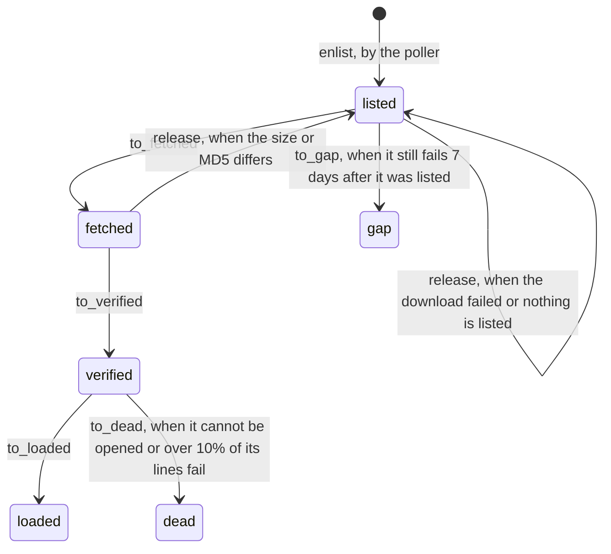

# The fenced ledger: walkthrough

Depth kernel #1 (`docs/design/p1.md` §7). This note explains the code in this folder, file by
file, and answers the questions of §7.8. It changes in the same pull request as the code, and
a change to either asks for the owner's line-by-line review.

## The claim

Every 15-minute file of both GDELT streams is processed **at least once**, and its effects land
**exactly once**, whatever the workers do: crash, run twice, or stop for longer than their lease
and wake up.

Two mechanisms carry it:

1. **The fence.** A lease writes a random token into the row. Every later write names that
   token in its `WHERE`. A worker whose lease has passed to another changes 0 rows.
2. **Idempotent effects.** Everything written outside the database goes to a key computed from
   the bytes written. Doing a step twice writes the same bytes to the same key.

## The files

| File | What is in it |
|---|---|
| `fence.py` | Every SQL statement of the ledger: enqueue, lease, and the fenced commits |
| `keys.py` | Object keys derived from content |
| `backoff.py` | How long a failed file waits |
| `tier1.py` | `walk`: one lease taking one file through fetch, verify and load |

Outside this folder, and not part of the kernel: `worker/poller.py` (enqueues files),
`worker/feed.py` (GDELT's listings, HTTP), `worker/lake.py` (the Parquet bytes),
`worker/store.py` (the object store), `worker/__main__.py` (the processes).

## The row and its states

One row of `ingest.interval` is one file: `(stream, stamp)`. The row is also the job.



`loaded → published` is the publisher's (task 11). `loaded`, `gap` and `dead` end tier 1: the
lease statement never picks them.

| Transition | Done first, outside the database | Written by the commit |
|---|---|---|
| `listed → fetched` | The zip is PUT under the MD5 of its own bytes | `raw_key`; the lease runs 5 more minutes |
| `fetched → verified` | The stored bytes have the listed size and MD5 | The lease runs 5 more minutes |
| `verified → loaded` | Both lake files are PUT | `parquet_key`, `rows`, `loaded_at`; the token is cleared |
| `listed → listed`, `fetched → listed` | Nothing | `next_attempt_at`, `last_error`; `raw_key` and the token are cleared |
| `listed → gap` | Nothing | `last_error`, and one `ingest.known_gap` row in the same transaction; the token is cleared |
| `verified → dead` | Nothing (the zip stays where it is) | `last_error`; the token is cleared |

## `fence.py`

**Connections.** A lease and a commit are each one statement, so one transaction. `to_gap` is
two statements, and `enlist` one insert per file, in one explicit transaction. That only works
if the connection is in autocommit mode, so each function refuses one that is not. A caller that needs more work in the same transaction (Phase
2's load will) opens it with `conn.transaction()` around its own statements and the commit.

**Time.** Every time in a statement is `coalesce(%(now)s::timestamptz, now())`: the database's
clock, so the workers' clocks do not matter. A test passes its own `now`. Production never does.

**`enlist`.** `insert … on conflict (stream, stamp) do nothing`. A file already in the ledger is
left exactly as it is, whatever its state, so the poller can list the same stamp any number of
times. The other side of that: a row keeps the size and MD5 it was first enqueued with, and a
row enqueued with none never gets any (see "Known limits").

**`lease`.** One statement:

```sql
update ingest.interval
   set lease_token = gen_random_uuid(),
       lease_until = now + interval '5 minutes',
       attempts    = attempts + 1
 where (stream, stamp) = (
         select stream, stamp
           from ingest.interval
          where state in ('listed', 'fetched', 'verified')
            and next_attempt_at <= now
            and (lease_until is null or lease_until < now)
          order by stamp desc, stream
          for update skip locked
          limit 1)
returning …, listed_at <= now - interval '7 days'
```

- The inner `select` finds the rows that are ready: in a state tier 1 works on, past their
  backoff, and not under a lease that is still running. It takes the newest, because the
  freshness target is about new files; a backlog drains behind the live edge. `, stream` only
  makes the order total, so that a test can say which row comes next.
- `for update` locks the chosen row until this statement's transaction ends. `skip locked` is
  explained below.
- The outer `update` writes a new random token, the time-out, and one more attempt.
- The last returned column is `overdue`: the file was listed 7 days ago or more. The database
  decides it, at lease time.

A lease on a row whose earlier lease ran out replaces the token. From that moment the earlier
holder can change nothing, whenever it wakes.

**The commit.** Every write a lease holder makes ends in the same three lines, `COMMIT_WHERE`:

```sql
 where (stream, stamp) = (%(stream)s, %(stamp)s)
   and lease_token = %(token)s        -- the fence
   and state = %(from)s               -- the expected state
```

`_commit` puts one of six `set` clauses in front of it and returns whether exactly one row
changed. The six are the transitions of the table above. `False` means the row was not touched:
either a newer lease exists, or the step had already been committed. The worker stops and does
not look for the reason. If its commit had landed after all, the row has moved on; if not, the
lease runs out and another worker repeats the step. Both are safe.

A lease that has run out but that nobody else has taken still commits. The fence is the token,
not the clock.

**`to_gap`** is the one commit with a second statement: the `known_gap` row. Both are in one
transaction, and the fenced `update` comes first, so a stale worker writes neither. One row is
written per file (`first_stamp = last_stamp`, `intervals = 1`). A run of missing files is a run
of such rows; nothing merges them, because that would be a write that depends on other rows.

## `keys.py`

- A raw zip goes to `raw/gdelt/{stream}/dt={date}/{md5 of the bytes that arrived}.zip`. The key
  is computed from what was downloaded, not from what was listed, so a bad download is stored
  under its own name and never over a good one.
- The two lake files go to `lake/facts/gkg/v1/dt={date}/{stream}-{stamp}-{hash}.parquet` and to
  the same name under `lake/display/gkg/v1/`. `{hash}` is one SHA-256 over the digests of both
  files (32 hex characters of it). So a change to either file renames both.
- **One column names two objects.** `parquet_key` stores the facts key. `keys.display_key` turns
  it into the display key. No schema change was needed.

## `backoff.py`

`delay(attempts)` is 30 seconds, doubling, capped at 15 minutes. `attempts` counts leases, so a
file that fails once waits 30 seconds and a file that has failed for an hour is asked for four
times an hour. These are proposed values, not measurements. A backoff is a release: the token
is cleared and `next_attempt_at` is set, so nothing sleeps while holding a lease.

## `tier1.py`

`walk` takes a lease and starts from whatever state the row is in. That is how a crash is
resumed: from the last commit, not from the start.

1. **`listed`.** Download the zip. PUT it under its own MD5. Commit `fetched`.
2. **`fetched`.** If this walk did not download the zip itself, read it back from the store.
   Compare its size and MD5 with the listing. Equal: commit `verified`. Not equal, or not in
   the store: release to `listed` with backoff.
3. **`verified`.** Unzip and parse (`gdelt.parse_gkg`). Build the two Parquet files. PUT
   display, PUT facts. Commit `loaded`.

Inside each step the order is always **effect, then commit**. The row never names an object
that was not written; an object can exist that no row names, which is harmless.

There is no lease renewal. A step has to end inside the 5 minutes its lease has left, so a
download is given 200 seconds in all (`worker.feed.TOTAL_SECONDS`) and then counts as failed.
Without that limit two workers could take turns outlasting their leases on one slow file, each
fencing the other out, and neither would ever commit.

`walk` is a generator. It yields after the lease, after the download, between two PUTs, and
just before every commit: the points where the world can change under it. `run_one` runs it
straight through. The property test holds several walks and decides which one moves.

What happens when something goes wrong (§7.6 of the design note, as built):

| Event | Outcome |
|---|---|
| The download fails: a 404 or any other status, a redirect, a time-out, or more than 200 seconds in all | `release` to `listed` with backoff |
| The file was enqueued with no size or MD5 | Not downloaded: there is nothing to verify it against. `release`, as above |
| The download's size or MD5 differs | It was stored under its own MD5; the row goes `fetched → listed` with backoff |
| Any of the three above, 7 days or more after the file was listed | `to_gap`. On that last try a download that does not match is not stored |
| The zip cannot be opened (not a zip, not exactly one file, damaged, anything else the zip reader refuses, or it would unpack to over 1 GiB) | `to_dead`, and a log line that starts `ALARM` |
| More than 10% of the non-blank lines fail the 27-column contract | `to_dead`, as above |
| 10% or fewer fail | The failing lines are left out and counted; the rest is loaded |
| A commit returns `False` | The walk ends with `FENCED` |
| The row is `verified` and its zip is not in the store | `MissingObject` is raised. The row stays; the lease runs out; someone has to look |
| Anything else raises | The same: the worker logs it, and the lease runs out |

**Broken lines.** Decided by the owner on 20 November 2026: quarantine and count the lines that
fail the contract, load the rest, and park a file only when it cannot be opened or more than 10%
of its non-blank lines fail. `too_broken` is that rule; 10% is a design value. The count of
quarantined lines is logged and is written into the facts file's metadata (`gl.parse`); the
ledger has no column for it. The lines themselves stay in the raw zip.

## Where this goes beyond the design note

Each of these is a choice made while building, small enough not to need a schema change, and
each has a test. They are listed so that the review can disagree with them.

1. The lease orders by `stamp desc, stream`, not by `stamp desc` alone.
2. A file with no listed size or MD5 is never downloaded. It becomes a gap after 7 days. The
   poller enqueues such a file when a stamp it missed is not in the master list.
3. On the last try of an overdue file, a download that does not match its listing is not stored.
4. A `fetched` row whose zip is not in the store is treated as a mismatch.
5. A `verified` row whose zip is not in the store raises, and is not repaired.
6. `known_gap` gets one row per file.
7. The alarm for a `dead` file is a log line until the deploy task gives it somewhere to go.
8. `overdue` is the file's age since it was listed, not a count of tries. A file listed 7 days
   ago that fails its next try becomes a gap, even if the workers were down for those 7 days and
   that try was its first.

## Known limits

- **A file enqueued with no listing can only become a gap.** When the poller fills in stamps it
  missed, a stamp that its one read of the master list does not show is enqueued with no size
  and no MD5 (a read reaches about four months back). Such a row is never downloaded, and
  nothing fills its listing in later: not the poller, whose insert ignores existing rows, and
  not a worker. If GDELT publishes that file after all, the ledger still calls it a gap after 7
  days. The fix is a decision for the owner: let the poller fill an empty listing (a write to a
  ledger row without a token), or let the worker that holds the row look the listing up and
  commit it under its token. The hourly reconciler of Phase 3 is the plan's own answer.
- **A wrong first listing is just as sticky**, for the same reason.

## The questions of §7.8

**Why is a time-out not a fence?** `lease_until` tells *other* workers when they may take the
row. It cannot tell the holder anything, because a paused worker does not know it was paused.
It wakes in the middle of a step, six minutes late, and carries on. Checking the clock first
would not help: it can pause again between the check and the write. Only the database, at the
moment of the write, knows whose row it is.

**Why is the token check in the same statement as the write?** Because "check, then write" has
a moment between the two. One `update … where lease_token = …` has none: PostgreSQL locks the
row, evaluates the `where` against the row as it is now, and writes, as one act. If another
transaction is changing the row at that instant, the update waits for it and then evaluates the
`where` again, against the result. `test_a_stale_commit_that_waits_for_the_new_lease_is_rejected_when_it_resumes`
shows exactly that.

**What does `SKIP LOCKED` do, and what does it not promise?** It makes a lease statement pass
over a row that another transaction has locked at this instant, instead of waiting for it. So
two workers that ask at the same moment get two different rows, and neither waits. If the first
transaction commits just before the second reaches the row, the second sees the row's new
version, `lease_until` is now in the future, and it passes over it for that reason. It does not
promise:

- anything once the first transaction has committed. The row lock lasts for one statement.
  After that, `lease_until` keeps other workers away and the token stops the old holder;
- order. "Newest first" is best effort: a worker that skips a locked row takes an older one;
- that work is found. A statement that meets only locked rows returns nothing, and the worker
  asks again two seconds later;
- fairness between workers.

**Why are effects keyed by content?** Because a worker that loses its lease has usually already
written something. It cannot be stopped from doing so, and nothing can be rolled back in an
object store. With content keys it does not matter: the step is deterministic, so the loser
wrote the same bytes to the same key as the winner. If the two ran different code, the loser's
bytes went to a different key that no row names: garbage, not corruption. The ledger row names
the key that counts.

**Why does `now.json` go last, and what is a burned `seq`?** Both belong to the publisher, which
is task 11 and has no code yet. The design note's answers (§7.5): `now.json` is the only pointer
that changes, so it is written after everything it names exists, and a crash before it leaves
readers on the previous, complete state. A pass takes its number in a transaction of its own
before it writes anything; if the pass then dies, the number is spent, so `seq` has gaps and
never repeats or goes back.

**What would the tests miss?**

- Anything outside the model. A file that GDELT publishes wrong, and a parse that is wrong the
  same way every time: two workers then agree on the wrong bytes.
- An object store that does not behave like the test's dict: a PUT that is not all-or-nothing,
  or a GET that does not see a PUT that just returned. The R2 client does not exist yet.
- Concurrency inside one statement. The histories step whole statements, one at a time. Row
  locks and the re-evaluated `where` are covered by a handful of tests with two connections and
  threads, not by a thousand histories.
- The database's own failures: a restart in the middle of a commit, or its clock stepping back.
- Two databases. A promoted standby and a revived old primary are Phase 2's problem, and the
  ledger epoch is its answer.
- Size. A history has three workers, two streams and three stamps.
- Whether amd64 and arm64 write the same Parquet bytes (ADR-0010).

## The tests

| Where | What |
|---|---|
| `apps/worker/tests/unit/` | No database, no network; part of `mise run check`. Stamps and file names, the listing parsers, what one poll enqueues, the backoff schedule, the keys, the broken-lines rule and the zip checks, the folder store, and that the same rows give the same Parquet bytes |
| `tests/pg/test_fence.py` | Each statement against PostgreSQL 18: two connections never lease the same row (also eight at once); a stale token or a wrong state changes 0 rows, for every commit; release with backoff; gap after 7 days with its `known_gap` row |
| `tests/pg/test_tier1.py` | Whole walks: no faults, 404, mismatch, a death at each point, a pause past the lease at each point, gap, broken lines, dead |
| `tests/pg/test_poller.py` | The poller against the database, with GDELT as a dict |
| `tests/pg/test_histories.py` | The property test, below |

The tests under `tests/pg/` need Docker and run with `mise run test` or `mise run test:ledger`.
They use the container harness of the SQL tests (`db/tests/pg`), loaded by path.

**The property test.** Hypothesis generates 1,000 histories. A history lists files (and lists
them again), starts workers, steps them, kills them and moves the clock, in any order. What
GDELT serves for a file is fixed by the file's kind: good, late, garbled at first, broken,
missing, always wrong, or enqueued with no listing. So every file has one right ending. After
every step, and again once a clean worker has finished everything a week later, it checks:

1. Every listed file ends in exactly one terminal state, the right one for its kind, and a
   finished row is never leased and never changes.
2. The successful commits of a file form one chain: each starts from the state the one before
   left. The design note says "exactly one successful commit per transition"; with retries a
   file can go `listed → fetched → listed → fetched`, so the chain is the form that holds.
3. A commit whose token is not the row's current token never succeeds. And the other way
   round: a commit with the current token and the expected state is never rejected.
4. The store holds what one worker with no faults would have written, key for key and byte for
   byte, plus at most the downloads that differed from their listing, each under its own MD5.
   No key is ever written twice with different bytes.

It also checks that every lease went to the newest row that was ready.

**The run that must fail.** The last test removes the fence line from `COMMIT_WHERE` and runs
the same histories. They fail on invariant 3, and Hypothesis shrinks the failure to a history
like this one: a file is listed; a worker leases it, downloads it and stores it; the clock moves
six minutes; a second worker leases the same row; the first worker commits `listed → fetched`.
With the fence, that commit changes 0 rows.

## Try it

```bash
mise run test:ledger
```

```bash
GL_LEDGER_HISTORIES=100 mise run test:ledger
```

Against live GDELT, with a PostgreSQL 18 prepared as `db/README.md` describes (`db/roles.sql`,
then `dbmate up`) and a folder outside the repository as the store:

```bash
GL_DATABASE_URL=postgresql://worker@127.0.0.1:5432/globalens GL_STORE_DIR=/somewhere/store uv run python -m worker poll
```

```bash
GL_DATABASE_URL=postgresql://worker@127.0.0.1:5432/globalens GL_STORE_DIR=/somewhere/store uv run python -m worker work
```

```bash
GL_DATABASE_URL=postgresql://worker@127.0.0.1:5432/globalens GL_STORE_DIR=/somewhere/store uv run python apps/worker/tools/frozen_worker.py --seconds 330
```

The last one works like any worker until a file it has downloaded and stored is about to be
committed as `fetched`. There it stops its own process with SIGSTOP, and a helper wakes it five
and a half minutes later. Run it beside the other two and read its log: by then another worker
has taken the file, and the commit it makes on waking changes no row. With `--commit any` it
freezes before whichever commit comes first, which for a file that is not there yet is its
release.
