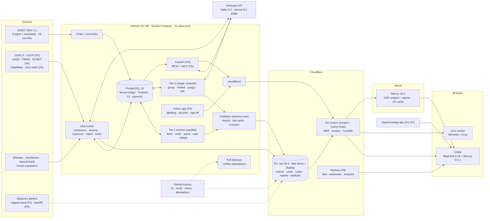
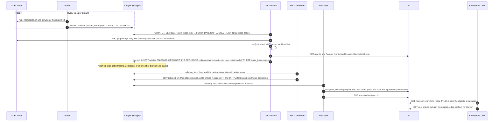
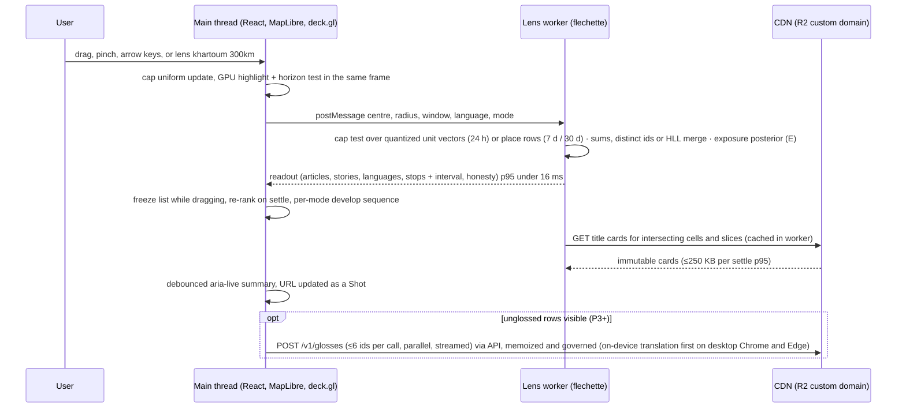
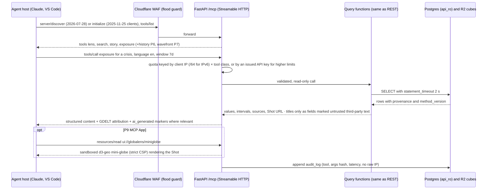

# GlobaLens 3.0 — Master Plan

*Plan of record · plan revision 3 (integrated after six critic reviews) · 2026-10-29 · ten phases from a ~1.7k-LOC hackathon prototype to a launched, measured product.*

> **Number labels.** *(research)* means a value measured during research; a committed `bench/` or `evals/` script re-measures it before it appears in a README, résumé or `/stats`. *(illustrative)* means a placeholder. Unlabelled numbers are targets or budgets. `[Brackets]` in résumé bullets are filled only from `metrics/ledger.jsonl`, the single source of every published number.

**What you're building, in plain English.** A live 3D globe of the world's news. You turn the planet under v1's ring (the Lens) and read the real headlines from that place, in their own languages, with English translations, grouped into stories and updated every 15 minutes. Press **E** and the globe answers a question that none of the tools surveyed in §1 answers live: *which crises is each language's press under-covering, given how severe they are?* That reading comes with error bars, a public method, validation against the EU's and CARE's annual lists, and a weekly report anyone can recompute. Behind it sits an ingestion engine you can watch on `/engine`, built to survive the faults that break naive pipelines. Every number on the site, and every number on your résumé, comes from one measured metrics file (`metrics/ledger.jsonl`, the metrics ledger).

---

## 0. TL;DR

**On one screen** (details follow; unfamiliar terms are in Appendix B):
- **What it becomes: one instrument, two layers.**
  1. **The daily driver.** It aims to be the best way to explore the world's news **by place, language and time**. Rotate the globe under the Lens and read the real headlines there: originals from ~65 languages *(research)*, English glosses (short machine translations) where you are actually looking, outlet and time, collapsed into stories, refreshed every 15 minutes, every view a link.
  2. **The signature: Exposure.** Press **E** and the light inverts. Attention is divided by **severity** measured from sensors and curated datasets; UCDP's conflict deaths are coded from news reports, so a sensor-only variant leaves them out. The Lens reads each language's **exposure in stops**, a photography unit where 0 is proportionate and each stop is a factor of two ("−4.1 stops: about 1/17 of the coverage its severity predicts" *(illustrative)*), with an error bar that simulations check holds the true value about 90% of the time. Anyone can rerun the weekly *Underexposed Report* and get a byte-identical result.
- **Why it's unique.** Others show what is happening (World Monitor), rate partisan lean (Ground News) or list neglected crises once a year (CARE, and ECHO for the EU). None of the tools surveyed in §1 measures attention against severity, per language, live, with a method anyone can rerun.
- **What you build first.** Week 0 (~8 h, Appendix C): accounts, data keys and a test phone. P1 (50 h): a deployed Next.js + MapLibre/deck.gl globe on real GDELT data whose Lens lists real headlines, fed by a crash-proof Python ingester, with GitHub Actions CI and OpenTofu (open-source Terraform) from day one.
- **How long and how much.** 471 build hours over 10 phases, with Claude Code doing most of the typing and four core modules written by you (Appendix D): planned finish 20 Dec 2027 at 10 h/wk or 12 May 2027 at 20 h/wk. It runs on one EU server, CDN-first, so a launch spike lands on Cloudflare's edge, not the server. Hosting (§14, baseline B): ~$26–34/month in P1–P3, ~$57–75 in P4–P7 once the memory trigger moves you to the 8 GB CPX32, ~$65–80 at launch, ~$100–115 in the launch month and ~$77–93 by P10. If Hetzner's 8 GB Cost-Optimized server (CX33/CAX21) is orderable, launch costs ~$45/month. The ≤$50 ceiling is an assumption to confirm (Open Question 1, §17).
- **When you can stop.** After P3 (150 h): a live globe plus Press E, already a complete portfolio piece. After P5 (250 h): the full thesis with 20 real users. After P8 (396 h): launched. Any stop point can drop to a priced maintenance mode (frozen: ~$1–6/month).
- **What it proves.** Frontend craft (a WebGL globe and a design system), data engineering (exactly-once ingestion, a decade backfill), ML and LLM engineering (multilingual stories, calibrated models, evals, an MCP server for AI agents) and infrastructure (OpenTofu, signed deploys, a timed rebuild from code), with Rust/WASM, ClickHouse, NATS and k3s tried in measured bake-offs. About 57k lines of code by P10: an outcome, not a target (§10).

| # | Codename | One line | Hours | Weeks @10 / @20 h | Cum. LOC |
|---|---|---|---|---|---|
| 1 | First Light | Render spike in week 1 (does the globe hold its frame rate on a laptop and a mid-range phone?); both GDELT streams through a fenced ledger (a Postgres job table where only the current lease holder may commit a file, so crashes never lose or double-count data); rotate the real globe and read real headlines in the Lens | 50 | 5.0 / 2.5 | ~7k |
| 2 | The Lens | Hand-written Web Worker behind the Lens (instant readouts), story groups (copies of one story collapsed), first English glosses (machine-translated headlines), keyboard and screen-reader paths (WCAG) + mobile, chaos harness (kills and pauses workers on purpose and checks nothing was lost), attested deploys (the server runs only signed, verified builds), `/engine` v1 (the backend's live UI), JS-vs-Rust/WASM bake-off | 50 | 5.6 / 2.6 | ~14k |
| 3 | Infrared & E | Severity from disaster alerts (GDACS) and conflict deaths (UCDP) on a population grid, a Bayesian Exposure model whose error bars are checked by simulation, **Press E**, glosses for every visible row, the **pivot gate** (can enough listed crises be scored, and does Exposure add anything beyond counting articles? A failed gate triggers Branch B), hiring packet #1 (video, case study, résumé lines) | 50 | 5.6 / 2.6 | ~20k |
| 4 | Stories | Embedding-model bake-off, StoryStream v1 (groups headlines in any language into stories; deterministic, so replays match), a titles-only benchmark against a published system, hybrid cross-lingual search (an English query finds Hindi coverage), Shots (shareable views frozen at a moment) + share cards, backups | 50 | 5.6 / 2.6 | ~27k |
| 5 | Crisis Ledgers | Crisis registry, a calibrated linker (which crisis is this story about?) + quantifier (how many articles per language, with error bars), crisis Exposure on Crisis Ledger pages, Report #1, MCP server (AI agents can query GlobaLens), classroom mode, first 20 users, hiring packet #2 | 50 | 6.2 / 2.8 | ~34k |
| 6 | Long Exposure | Capped BigQuery backfill (back to 2016 at the earliest), as-of replay with honest vintages (the world as it was known then, each severity source's release labelled), decade-store bake-off (DuckDB vs ClickHouse vs Postgres), quake, fire and event layers (USGS, FIRMS, EONET), validation vs simple baselines, GlobaLens-Bench v1 (a public benchmark) | 50 | 6.2 / 2.8 | ~39k |
| 7 | Wavefront | Outlet registry, crawl-lag model (corrects for GDELT seeing articles ~2 h after publication *(research)*), StoryStream v2 + distillation (a cheap local model trained on the LLM's decisions), story arcs, chaos v2, fan-out bake-off (Postgres polling vs NATS vs Redpanda), arXiv preprint | 50 | 6.2 / 2.8 | ~44k |
| 8 | Explain & Launch | Computed-first Explain (SQL computes every number; the LLM only phrases it), checked syntheses (fact-checked AI summaries), watch-lenses (saved regions with feeds and alerts, no account), attested report (a signed weekly report anyone can verify), public API + open data, launch hardening, 90-s video, **Show HN** | 46 | 5.8 / 2.6 | ~51k |
| 9 | Agents | MCP App mini-globe (renders inside Claude), a minimal bounded Analyst (≤8 read-only tool calls) answering in Shots, agent-eval gate on PRs within a separate eval budget | 36 | 5.0 / 2.1 | ~54k |
| 10 | Depth & Hardening | Rust and k3s (Kubernetes) bake-offs, timed disaster-recovery (DR) rebuild from code, paper submission, metrics frozen for the résumé | 39 | 4.9 / 2.3 | ~57k (+~3k Rust if triggered) |

**471 build hours** follow an ~8-hour Week 0 (Appendix C). The weeks above include a **run tax** for operating the live system (1 h/wk in P2–P4, 2 h/wk from P5, 3 h/wk in the launch month; §9). Planned finish: **20 Dec 2027 at 10 h/wk** or **12 May 2027 at 20 h/wk**, holidays included. If estimates run 20% over (the R11 watch line in the §15 risk register), the likely finish is 20 Mar 2028 or 17 Jun 2027. Estimates are bottom-up per task (§10 conventions); anything that didn't fit sits in a named backlog, not in hidden hours.

**Stop points** (dates are planned @10 h/wk · @20 h/wk; likely dates in §10):
- **After P3** (150 h; 15 Mar 2027 · 8 Jan 2027): a live, no-signup, real-data globe whose Lens lists real headlines by place, language and time, with glosses and story groups; ingestion verified under three injected fault types (a killed worker; a worker paused past its lease, the 5-minute claim it holds on a file; duplicate deliveries; five types from P7) and visible on `/engine`; accessible and mobile. **Press E** is live with simulation-tested error bars, plus the result of the pivot gate, whose pass/fail rules were written down before the analysis ran. A hiring packet (video, case study, résumé lines, and defense sheets: likely interview questions with answers) is ready. *Branch B* (the fallback if the gate fails, §15): the same, with Exposure labelled experimental and the gate finding published as a methods note.
- **After P5** (250 h; 6 Jun 2027 · 14 Feb 2027): the complete thesis. Benchmarked stories and cross-lingual search, calibrated crisis linking and quantification, Crisis Ledgers, *The Underexposed Report* #1, an MCP server with a tool-use eval, classroom mode, 20 recruited users and external reviewers, hiring packet #2. *Branch B:* Crisis Ledgers show attention with intervals, and the weekly artifact is a "What each language saw" digest.
- **After P8** (396 h; 12 Oct 2027 · 11 Apr 2027): launched. Decade replay with honest as-of, validation against baselines, Wavefront, Explain, watch-lenses, an attested report and open data, load-tested, a 90-second video, Show HN, hiring packet #3.
- At every stop point the system can drop into a priced **maintenance mode** (§9): live-lite (~$15–50/month depending on the server, ~1 h/month) or frozen (~$1–6/month).

**Headline metrics** (targets; published values come from the ledger):

| Metric | Target |
|---|---|
| Ingest correctness | Both GKG streams (~340k articles/day *(research)*); 0 intervals (15-minute GDELT files) lost or duplicated across [N] injected faults of 5 types, [c]% kill-point coverage (the share of the pipeline's crash points the fault tests actually hit) |
| Freshness | ≥99% of 15-minute intervals' attention data live ≤30 min after GDELT lists them |
| Daily driver | Reference Android: ≥30 fps at 100k points, INP p75 ≤200 ms (Interaction to Next Paint, Google's responsiveness metric); ≥90% of displayed foreign-language headlines glossed within 2 s |
| Stories | Story grouping: titles-only cross-lingual pairwise F1 (how accurately headline pairs land in the same story) against Miranda et al.'s 2018 multilingual news-clustering system re-run on the same titles (their full-text 84.0 *(research)* shown only as a reference) |
| Exposure | 90% error bars (statistical intervals) that hold the true value 85–95% of the time in simulation; beats an attention-only baseline (CARE's own method, run on GDELT) by ΔAUC ≥0.05 on the EU (ECHO) and CARE neglected-crisis lists, or the claim changes (AUC: the chance that a listed crisis scores as more under-covered than an unlisted one) |
| Weekly report | Repro hash match 100% over ≥4 consecutive weeks; out by Monday 18:00 UTC in ≥90% of weeks |
| Usage | [u] weekly unique visitors (weekly-salted, no cookies) and [a] active niche users (seen in ≥2 distinct weeks) |
| Monthly cost | ~$45 at launch (8 GB Cost-Optimized, if orderable) · ~$65–80 at launch (CPX32 baseline) |

---

## 1. North Star

- **Name:** GlobaLens, release **3.0** (no edition name).
- **Tagline:** *See beyond the headlines.*
- **Hero line:** *A live light meter for the world's news: what each language is looking at, how each story travels, and the crises it isn't seeing. Updated every 15 minutes, with error bars.*

**Pitch.** Every 15 minutes GDELT publishes metadata for the world's online news: about 340k articles a day, in which machine translations from ~65 languages outnumber English 1.9 to 1 *(research)*. v1 ignored most of it. GlobaLens 3.0 puts all of it on a globe you steer with v1's Lens:
- **Viewfinder** shows where the press is looking. City-level coverage is drawn as sharp discs; country-level coverage is a soft tint, never a fake pin.
- The Lens lists the real headlines in the ring, collapsed into stories, glossed into English where you look, and searchable across languages.
- Press **E**: attention is divided by severity measured from GDACS, UCDP, USGS, FIRMS and population data, and the Lens reads **exposure in stops** per language with an interval. 0 is proportionate; each stop is a factor of two; the readout always says it in words too.
- **Wavefront** shows how a story crossed borders, corrected for crawl lag.
- **Long Exposure** replays attention since 2016 as it was known at the time, with each source's vintage labelled honestly.

Every number links to its method, eval and sources. Each Monday *The Underexposed Report* does weekly and per language what CARE's annual report on the least-covered humanitarian crises does once a year.

**Users.** The lead persona is the **attention allocator**: someone whose job is deciding what others look at.

| User | Job to be done | Primary surface |
|---|---|---|
| Journalism / IR instructors and students (first niche; at 10 h/wk NGO staff form the P5 cohort and classes follow, per OQ4; 20–50 recruited by hand) | "Every Monday, show what our language's press misses vs severity and other languages." | Report, Present mode, Eight Globes, Ledgers |
| NGO comms and advocacy staff | "Defensible, current evidence that my crisis is under-covered." | Crisis Ledger permalink, badge, watch-lens |
| Data journalists, researchers | "An open attention-vs-severity dataset with a reproducible method." | Parquet drops, GlobaLens-Bench, `/methods`, `make reproduce`, Python client |
| Curious public | "What's happening where I care, and what am I not hearing about?" | Daily-driver Lens, share cards, report |
| AI agents, developers | "Typed, cited tools for attention by place, language, time." | MCP server + MCP App |

Hiring reviewers are a secondary audience, served by `/engine`, `/trust`, `/stats`, the ADR log, the Bake-off Lab and a 5-minute "For engineers" tour. That is deliberate: a product with real users and numbers a stranger can check is what makes a reviewer stop and look, and the résumé lines fall out of it (§16).

**What makes it unique.** World Monitor (~89.7k stars *(research)*, AGPL, the same globe stack v1 used) shows *what is happening everywhere*. GlobaLens measures *where each language's press is looking, and where it isn't*. Comparisons stay factual and generous: each product is described by what it measures.

| | World Monitor (Oct 2026; figures *research*) | **GlobaLens 3.0** |
|---|---|---|
| Core | 468 feeds, 59 layer types, an instability index, an analyst that moves the map | One quantity: attention by place × language × time, set against severity |
| Neglect | Crisis trackers | Per-language stops with tested intervals, validated as-of against ECHO and CARE and against an attention-only baseline |
| Propagation | Not offered | Per-story first arrival, corrected for crawl lag |
| History | 7-day local playback | Attention since 2016, replayable as-of |
| Location | Point markers | Precision as optical focus; centroids never drawn as pins |
| Trust | Public forecast-accuracy page | Public eval history, `/engine`, a reproducible attested report, published losses |
| Agents | 99 MCP tools, paid quotas | Free H3/time/exposure/wavefront MCP tools + an MCP App |
| License | AGPL + Pro tier | Apache-2.0 code; CC BY 4.0 aggregates where upstream allows |

Others measure something else: Ground News rates partisan lean, Kagi News is a daily digest, GDELT Cloud sells AI-coded events, and CARE and ECHO publish annual lists. None measures attention against severity per language in real time.

**Where your "extra, extra crazy" went.** Into things a reviewer can see and check, not into more services: a globe whose light inverts to show neglect (Press E); eight planets, one per language, turning in sync (Eight Globes); arcs that land in the order a story reached each country (Wavefront); a decade of the world's attention you can scrub, as it was known at the time (Long Exposure); a backend with its own animated UI that replays last night's fault-injection run (`/engine`); a mini-globe that renders inside Claude (MCP App); a weekly report anyone can recompute and verify against a public signature; a public benchmark and an arXiv preprint; and seven pre-registered bake-offs that put Rust/WASM, ClickHouse, NATS, Redpanda and k3s in your hands without bloating production. The UI is treated as a product too: the "Deep Field" design system in `packages/ui`, a storyboarded Press-E transition, Present mode and themes for classrooms, five hazard layers plus a graticule and day/night terminator, Storybook, visual regression and axe in CI, and a phone budget as strict as the desktop one (§4).

**Non-goals** (stated in the README): flights, ships, markets, bias ratings, risk scores, forecasting claims, full text, user accounts, crisis leaderboards, a non-English UI in 3.0.

**30-second demo** (readouts *illustrative*):

| t | What the viewer sees |
|---|---|
| 0–1 s | An SVG dot-matrix globe paints at the viewer's longitude (taken from the timezone; no prompt). |
| 1–4 s | WebGL fades in: warm light where the press looked today, sharp city discs, soft country tints. Badge: "data 7 min old · articles reach GDELT ~2 h after publication". |
| 4–10 s | The Sahel turns under the Lens. Real headlines in French, Arabic and Hausa fill the list with English glosses, outlet and time, grouped into stories. **The daily driver.** |
| 10–14 s | Press **E**: the legend morphs, capitals drain and azure light pools where severity outweighs coverage. The Lens reads **"−4.1 stops ▼ under-covered · English-language media gave this about 1/17 of the coverage its severity predicts (likely 1/9 to 1/32) · 7 days"**. |
| 14–18 s | Press **2** for Arabic: −1.2 stops. Split shows both languages as two concentric arcs. |
| 18–22 s | **Wavefront**: arcs land in arrival order; a strip of language chips fills in arrival order and three stay empty: "never reached Spanish-, Portuguese- or Hindi-language press". |
| 22–26 s | **Long Exposure**: scrub to 2023; the crisis's attention curve draws beside two comparable disasters. |
| 26–30 s | The **Crisis Ledger** opens with per-language severity vs attention, intervals, sources and a 90-word note labelled "AI-generated from 14 sources". Share makes a card with the same reading, pinned to that moment. |

---

## 2. From v1 to 3.0

**Honest audit** (verifiable facts only; all counts *(research)*). v1 is ~1,730 lines from a June 2025 hackathon (13 commits, messages like "FInal"):
- a Vite + react-globe.gl page;
- a 169-line Flask file over MongoDB;
- a laptop script that scraped full article text with a spoofed user agent;
- a seeder that **drops the API's collection and inserts 300,000 Faker documents with random "embeddings"** into the collection the API reads.

The README described Cloud Scheduler, Cloud Functions, Vertex AI, Docker Compose, GitHub Actions, Terraform and more; none of it is in the repo. There were no tests, CI, IaC or LICENSE, and the API was hardcoded to `127.0.0.1`. `docs/retro/v1.md` records what the seeder did and what the README claimed against what the repo contained. 3.0's honesty infrastructure (a metrics ledger, a generated status table, labelled numbers) exists so those two signals never recur.

| Area | v1 | 3.0 | Why |
|---|---|---|---|
| Data | Unrepo'd CSV step; full text scraped | Both GKG 2.1 streams from raw 15-min files through a fenced ledger; metadata only | Correctness; copyright (AP v. Meltwater, the Cohere and Perplexity suits); translations are ~2/3 of the signal *(research)* |
| Store | MongoDB `temp` | PostgreSQL 18 + PostGIS + h3 + pgvector; Parquet lake on R2 split into a facts layer and a redactable display layer | Relational, spatial, aggregate-heavy; rebuildable; takedowns possible |
| Ingest | Manual loop, no dedupe | Self-healing poller, MD5, per-file retry, fenced leases, gap registry, verified under five fault types | Files 404 for minutes; 17 days of 2025 were never published *(research)* |
| Globe | react-globe.gl, one 2,000-doc JSON | MapLibre 6.16 + deck.gl 9.4.1, incremental Arrow shards, worker Lens | Cartography, globe→street morph, million-point layers, small updates |
| Search | English SBERT over random vectors | Hybrid cross-lingual search (P4): full text on originals and glosses + multilingual embeddings, fused by RRF | Cross-lingual by construction |
| Ops / truth | Nothing; README over-claims | CI/CD on GitHub Actions, OpenTofu (the open-source fork of Terraform: same HCL language, compatible providers and the same plan/apply workflow, so your Terraform skills and the résumé keyword carry over; §6), attested deploys (the server runs only builds whose signed provenance verifies), SLOs, a stated support model; a claims file (`metrics/claims.yml`) + generated status table | Every piece earns its place; every number checkable |

**What survives:** the name, the tagline, GDELT, the dark cosmic look, and above all **the Lens gesture**: rotating the planet *under* a fixed reticle to reveal what's there. In P1 the Lens does what v1's did, listing headlines in the ring, but on real data and with a ring that keeps its screen size as you zoom. From P2 it becomes an instrument, and in E-mode a light meter. v1 is tagged `v1-hackathon` and removed from `main`. The before→after story is told when someone asks why the claims file and the metrics ledger exist; it doesn't open the pitch.

---

## 3. Product: the two layers

**Layer A, the daily driver,** is built first and never starved: Viewfinder, the Lens with real headlines (exact duplicates collapsed in P1, story groups in P2, stories in P4), glosses where you look, cross-lingual search, window chips, language keys, share cards, mobile and the first-run experience.

**Layer B, the signature:** Exposure (places in P3, crises in P5), *The Underexposed Report* (P5, attested in P8), Long Exposure (P6) and Wavefront (P7).

**Rules:**
- **Layer A first.** No Layer B work ships while a Layer A budget is red. There are three budgets: performance (fps, INP, Lens p95, bytes), accessibility (axe, manual passes), and **task success** (the Layer A tasks in the P3, P5 and P7 usability tests; a miss stays red until a re-test passes).
- **Admission.** A feature must move a product metric (defined in §13: weekly uniques, active niche users, citations via referrers and embeds) or a `/trust` validation metric, and fit the RAM, cost and hours budgets.

| Tier | Feature | Layer | Phase |
|---|---|---|---|
| **Core** | Exactly-once ingest of both GKG streams + `/engine` showpiece | Both | P1→P2, grows |
| Core | Viewfinder + location honesty (discs for Geo_Type 3/4, polygons for 1/2/5, unlocated counted, not drawn) | A | P1 |
| Core | Lens v0 with auto aperture lists headlines with duplicates collapsed and country-level coverage grouped (P1); hand-written worker kernel, aperture clamp through the morph, window chips, language keys (P2) | A | P1–P2 |
| Core | Story groups (URL canon, title hash, MinHash) → StoryStream stories + Magnitude | A | P2 → P4 |
| Core | English glosses: Batch for multi-outlet groups and on-device translation (P2); on-view real-time glosses for every row you see (P3) | A | P2–P3 |
| Core | First run: designed empty/loading/stale/no-WebGL states (P2); coach marks, example gallery, the optional intro (P4) | A | P2/P4 |
| Core | Hybrid cross-lingual search with CJK/Thai support + ⌘K grammar | A | P4 |
| Core | Shots: one schema for URLs, pinned-moment snapshots, cards, embeds, visual tests | A | P4 |
| Core | Hazard layers (GDACS, UCDP in P3; USGS, FIRMS, EONET in P6), each showing its coverage; graticule + terminator | B | P3/P6/P8 |
| Core | Crisis Ledgers; trust surfaces (`/trust`, `/stats`, `/methods`, attributions, two-clock badge, `/privacy`) | Both | P1→P5 |
| Core | Explain (SQL computes, LLM phrases) + checked syntheses; watch-lenses + badges (no accounts) | Both | P8 |
| **Signature** | **Press E: Exposure** with tested intervals, plain-language readouts and empty rings | B | P3 (places), P5 (crises) |
| Signature | Classroom mode: Eight Globes, Present mode, Split | Both | P5 |
| Signature | Long Exposure (knowledge-time replay since 2016) · Wavefront (crawl-lag-corrected arrival, story level) | B | P6 · P7 |
| Signature | The Underexposed Report (weekly, reviewed, bit-reproducible, attested) | B | P5, P8 |
| Signature | Geo-news MCP server + tool-use eval (P5) + MCP App mini-globe (P9) | Both | P5/P9 |
| Signature | GlobaLens-Bench: public story-pair, crisis-link and as-of validation sets with baselines | Both | P6–P7 |
| **Stretch** (cut from the top of this list last) | 1. Bounded Analyst polish · 2. Crisis-level Wavefront + amplifier naming · 3. EBM decomposition · 4. Embedder fine-tune (only if the bake-off misses) · 5. "If it were here" · 6. Data Navigator hex traversal · 7. WebGPU lab view · 8. Framing diffs (gated on κ) | — | P9–P10 or backlog |

**Backlog (explicitly not scheduled; picked up only if a phase finishes early):** geocode-accuracy eval (300 items), Wikipedia pageview and ReliefWeb report-count series, a v0 outlet registry before P7, a titles-only clustering probe in P2, an on-CPU MT model (Opus-MT via CTranslate2; trigger: on-view gloss spend exceeds its cap for 7 days), a TLA+ model of the lease protocol (if P10 finishes early), packages/gdelt published to PyPI before P8, a Playwright Shot-playlist recorder (`pnpm demo:pN`).

**Key user journeys** (each becomes a Playwright journey test on frozen fixtures in P8):
1. **"What's happening there, in their language?"** (curious reader, P1→P4).
   1. Drag the Sahel under the Lens and read the original headlines with glosses.
   2. Press `3` for French and widen to 7 days.
   3. Open a story with 14 outlets in 5 languages.
   4. Press `S`; the link opens that exact moment and unfurls as a card with the same reading.
2. **Monday class** (instructor, P3→P5).
   1. Open the weekly report in Present mode on the projector (Paper theme, large type, clicker advances figures).
   2. Show Eight Globes: eight languages, eight planets, rotating together.
   3. Open a Crisis Ledger and compare English vs Arabic stops with intervals in Split.
   4. Students cite the permalinks.
3. **Defensible evidence** (NGO comms, P5→P8). A watch-lens over the programme region, the Ledger's self-updating badge on the NGO site, an "attention cliff" alert into Slack, and the Ledger as the citation in a pitch to an editor.
4. **Reproduce the method** (researcher, P6→P8). Download a weekly Parquet drop with its datasheet (aggregates and GDELT record IDs, no titles), run `make reproduce WEEK=2027-W40`, check the hash against the Sigstore-attested one, query history with the Python client, and score a model on GlobaLens-Bench.
5. **A cited globe in an agent** (developer, P5→P9). "Which crises is Spanish-language press under-covering this month?" in Claude, through the MCP server: cited, with Shot links and, from P9, an inline mini-globe.
6. **Hiring review** (secondary, 5 minutes). The README's "For engineers" tour: the 90-second video → `/engine` (the day's intervals in a time-lapse, last night's chaos run replayed) → `/trust` "where we lose" → ADR-0004 → one kernel walkthrough.

---

## 4. Experience & design system

**Aesthetic: "Deep Field."** Near-black matte chrome; only data emits light. Ticks, graticule and mono numerals give instrument precision. Calm by default, loud only for anomalies, one colour encoding at a time. The rule: **light means attention**, so nothing else glows (no city lights at night: the night side only darkens).

**Visual target.** P1 task 0 produces 4–6 hi-fi frames (desktop V, desktop E, the Lens list, a story sheet, the mobile drawer, a Crisis Ledger) and a 10-second motion prototype of develop-on-settle, linked from `docs/design/`. Every later phase opens with a design task for its own screens and motion, reviewed against these principles before code.

**Colour tokens.** These live in Tailwind 4 `@theme` (`packages/ui/tokens.css`, created in P1) and are generated from three OKLCH inputs, Linear-style. High-contrast and Paper themes are generated from the same inputs.

| Token | Hex | Use |
|---|---|---|
| void / canvas | `#030509` / `#070A10` | space; app background |
| surface-1/2/3 | `#0D1219` / `#141A22` / `#1C232C` | panels, cards, popovers (elevation = lightness) |
| border subtle / strong / control | `#272E38` / `#38404B` / `#676F7A` | separators; control outlines (≥3:1) |
| text-1/2/3 | `#EBEFF4` / `#B4BBC5` / `#8A939F` | text (tertiary ≥5:1 everywhere) |
| **lens-500** (the only accent) | `#C3F344` | reticle, focus, selection (14.5:1 on surface-1) |
| lens-300 / 700 / 900 | `#DEFF87` / `#759B21` / `#233407` | hover, strokes, selected tint |
| danger / warning | `#FB575D` / `#FCB442` | status only, **always icon + text** (warning ≈ lime for deuteranopes, ΔE 0.077, so never colour alone) |
| ocean / land / coast | `#030910` / `#11181F` / `#2C3742` | basemap |
| atmosphere | `#478CC4` | rim glow only, in V and I; turned off in E, since it shares the exposure scale's under-covered hue (~205°) |
| attention ramp | `#1A2029 → #8A6A3E → #F9BE78 → #FFF1DC` | Viewfinder (log share) |
| severity ramp | `#24101A → #6B1D44 → #C23A6E → #FF9EB8` | Infrared; GDACS green/orange/red map onto its steps plus level glyphs and text |
| exposure scale | `#FE9879 · #CB836D · #767B81 · #5AA1CB · #59C3FE` | over → proportionate → under, with ▲/▼ glyphs; value-suppressing: wide intervals pull towards the neutral step |

The exposure scale passes a scripted colour-vision check (adjacent ΔE ≥0.079 under protan, deutan and tritan simulation). `packages/ui/scripts/palette-check.ts` gates the ramps from P3 and also asserts three colour rules: no data ramp reuses another ramp's hue; the atmosphere rim is off in E; GDACS levels only use severity steps. Two geometric rules are visual-regression Shots instead: E + Split draws concentric arcs, never the E ring's outline/fill encoding (P5); Wavefront shows language reach only in the chip strip, never as country fills (P7).

**Type** (OFL; static font instances for OG cards):

| Token | Face | Desktop | Mobile |
|---|---|---|---|
| micro / data | JetBrains Mono 500 caps / 450 tnum | 11/14 · 12/16 | same |
| caption / ui / body | Inter 450 / 550 / 400 | 12/16 · 13/18 · 14/21 | 13/18 · 15/20 · 16/24 |
| headline-sm / headline (chrome) | Newsreader 550 / 500 | 17/22 · 22/28 | 18/24 · 22/28 |
| headline text (original titles) | Noto Serif (Latin, Cyrillic, Greek) + per-script Noto by `unicode-range` | 15/21 | 16/23 |
| display / hero | Newsreader 450 / Inter Display 600 | 32/36 · 56/56 | 28/32 · 40/42 |

**Scripts and languages** (measured on the 2026-10-27 sample *(research)*: 63 source-language codes, 21 scripts; Latin 67%, Cyrillic 11.6%, Han 6.7%, Greek 4.6%, Arabic 4.4%, Hangul 1.9%, Devanagari 1.3%; 4.6% of translated titles are right-to-left):
- Newsreader covers Latin and Vietnamese only, so original headlines use a Noto stack: Noto Serif for Latin/Cyrillic/Greek, and Noto families for Arabic, Hebrew, Devanagari, Bengali, Tamil, Telugu, Gujarati, Gurmukhi, Kannada, Malayalam, Sinhala, Thai, Georgian, Armenian, CJK and Hangul, all lazy-loaded by `unicode-range`. A fontTools CI check requires ≥99.9% glyph coverage for every script in a fixture week, and one visual Shot per script family (Arabic/Hebrew RTL, Devanagari shaping, Thai, CJK) guards rendering.
- Every title renders with `lang` (BCP 47 from `srclc`) and `dir="auto"`; outlet and time sit in `<bdi>` so an Arabic title next to Latin metadata never reorders. Layout uses CSS logical properties.
- `packages/gdelt/lang.py` maps GDELT's codes to BCP 47 tags, endonyms, direction and script (GDELT writes Azerbaijani as `axe`, not `aze`); CI fails on any unknown code in a week of data.
- The UI is English in 3.0 (a non-goal to localize), but all UI strings live in one module so a later language needs no refactor. Times show in the viewer's time zone with UTC on hover; reports are in UTC.

**Layout.** Desktop (readouts *illustrative*):
```
┌ ◉ GlobaLens  Globe · Report · Crises · How it works ▾   [⌘K]   V I E   1 EN 2 AR 3 FR…   data 7 min old ┐ 44px
├ IN THE LENS (360px, rail <1440px) ──┬──────────── globe ────────────┬ SHEET (420px, closed by default) ─┤
│ Sahel · ≈600 km [1h|6h|24h|7d|30d] │       ╭──────── ◯ ────────╮    │ Story / Crisis Ledger             │
│ 214 stories · 9 langs              │       ╰───────────────────╯    │ headlines · languages · sources   │
│ honesty: 31% country-level         │  [V|I|E] [layers] [+][−][⌖]    │ method · Δ                        │
│ ▣ headlines + glosses              │                 [locator]      │                                   │
├ TIMELINE 88px ▁▂▃▅▇█▇▅▃▂  ◀ ▶ ▶▶  brush  hatched gaps ───────────────────────────● LIVE ───┤
```
- The Lens's camera padding follows open panels on desktop and mobile, so the reticle always sits in the centre of the *visible* globe.
- The sheet opens on demand. Below 1440 px the left panel collapses to a rail. Footer: Status · Attributions · Corrections · Privacy · Terms. How it works ▾ opens Methods, Trust, Engine, Stats and API. From P5 a Classroom item in the top bar opens Present mode (F) and Eight Globes, and Accessibility and Publishers join the footer.
- Under SSR routes (story, Ledger, report, methods) the canvas persists: it shrinks to a locator on article pages and stays full on map pages, and a `<ViewTransition>` links the two (gated for reduced motion).

Mobile:
- Full-bleed globe with the Lens kept in the unobscured area.
- Base UI Drawer at 120 px / 50% / 92%; the map stays live at the two lower detents.
- Top bar: a V·I·E segmented control. Numbered language chips, a visible scrubber (no twist gesture), and a Share · Pin · Explain row in the Lens HUD.
- The report reads as an article.
- **Render budget** 100k points (300k desktop) plus a battery tier capping DPR at 1.5 through MapLibre's `pixelRatio` (deck's `useDevicePixels` is ignored in interleaved mode). The budget limits drawing only: readouts always use the full data, and a parity test checks one Shot on desktop and mobile.

**First run, navigation and states.**
- **Landing:** always Viewfinder at the visitor's longitude; returning visitors resume their last view (localStorage, wrapped in try/catch). From P4 an optional ≤8-second intro (V → E → V; first on P4's cut line) plays once; any input interrupts it, and reduced motion or `?intro=0` skips it.
- **Three non-blocking coach marks** (P4): "Drag the planet under the ring", "Press E (or tap E) to compare coverage with severity", "S shares this exact view". Dismissals are remembered. In Branch B the E coach mark and any intro are omitted.
- **Example gallery** (P4): five curated Shots drawn from the canonical visual-regression set (in P4: "Sahel this week", a multilingual story and a Press-E view; "24 Feb 2022" joins in P6 and "How one story travelled" in P7). It doubles as the first-visit empty state, the instructors' starting point and test fixtures.
- **States** (P2), each with a design, copy, a visual Shot (P4) and a Storybook story (P7):

| State | Treatment |
|---|---|
| Empty Lens | "No located coverage here in 24 h" + an arrow and snap button to the nearest coverage |
| Zero attention vs not measurable | Zero shows "0 articles" with a one-sided stops bound; not measurable is hatched with its reason (no severity source covers this kind) |
| Loading (NN/g thresholds) | Nothing under 1 s; a skeleton list under 10 s; a progress bar beyond |
| Fetch failed (offline or edge error) | The last loaded data stays visible with its age; "Couldn't load the latest data · Retry" with automatic backoff (2 s → 60 s); "Offline" when the browser reports no network |
| Stale >45 min | Amber badge: "GDELT hasn't published since 14:00 UTC; showing the last good data" (per stream) |
| Severity source stale | Exposure holds the last good value with "stale since …"; stops are never computed with a missing denominator |
| Past (Long Exposure) | A persistent "As known on 24 Feb 2022, 03:00 UTC" banner, tinted chrome and a Return-to-live pill |
| No WebGL2 / lost context | The SVG globe stays interactive with the list and Table view; `webglcontextrestored` restores |
| VM down | Banner designed in P2: "Live updates paused; history and cached pages still work" |

**The Lens in detail** (hand-written depth kernel; Appendix D):
- **Aperture: auto by default.** The ring keeps a constant screen size and its radius in km follows zoom, clamped to 25–3,000 km and shown live in the HUD ("≈ 640 km"). Typing `[ ]`, dragging the edge or `⌘K lens khartoum 300km` locks the radius; a lock chip unlocks it with one tap. On touch, pinch-zoom is the aperture control in auto mode, and a ≥44 px edge handle appears only while locked. The clamp is specified through the z10–12 globe→Mercator morph and covered by property tests.
- **Geometry.** The cap test is `dot(p, c) ≥ cos θ` on quantized float32 unit vectors, identical on the GPU (`LensExtension` highlight) and in the worker, with the oracle tolerance set to the quantization step. A vertex-shader horizon test (`dot(p̂, ĉam) < 1/|cam|` discards) prevents far-side see-through and picking through the globe. MapLibre-native country tints highlight through feature-state, since a deck extension can't reach them.
- **Windows.** 24 h reads every point. 7 d and 30 d read **place rows** (named-place centroids × language × window; 15.3k city-located rows mapped to 3.6k distinct places in the sample *(research)*) with the same exact cap test. Article counts are exact sums; distinct story counts merge small HyperLogLog sketches and show as "≈". H3 cells remain for severity fusion and hex rendering; decade cubes clamp the minimum aperture by resolution (res-4 ≥110 km, res-3 ≥300 km, res-2 ≥750 km), draw the effective aperture, select cells by centroid distance and area-weight boundary cells. E mode applies the same rule at the severity resolution (res 3): the effective E aperture is max(requested, 300 km), drawn as a second ring with its radius in the HUD, and attention and severity are both summed over cells chosen by centroid distance (gridDisk plus the dot test) with area-weighted boundary cells, so numerator and denominator share one support.
- **Meter, in numbers and words.** V shows articles, stories, arriving languages and honesty, plus surprise from P6. I shows people affected, killed or in need with a coverage tier and source watermarks. E shows stops with the interval and a plain-language line: "−4.1 stops ▼ under-covered: English-language media gave this about 1/17 of the coverage its share of severity predicts (likely 1/9 to 1/32)" *(illustrative)*. Zero attention reads as a one-sided bound ("below −5 stops"). A "How to read this" popover steps from attention share to severity share to the ratio, linking `/methods/exposure`. Magnitude reads "M 2.1 · ~126 independent outlets" *(illustrative)*.
- **Two time controls.** Window chips (1 h / 6 h / 24 h from P2; 7 d / 30 d from P3) in the Lens HUD set the span; the bottom timeline (brush, LIVE edge, Return-to-live pill) sets the position. In Long Exposure the position moves **knowledge time**.
- **Language keys and Split.** Keys `1`–`9` have fixed, documented defaults (1 EN, 2 AR, 3 FR, 4 ES, 5 RU, 6 ZH, 7 DE, 8 PT, 9 HI), customizable and remembered locally. Split compares two languages over one place, never two crises, and renders as two concentric arcs (inner = language A, outer = language B) or a two-row readout, never the E ring's outline/fill encoding.
- **Develop on settle**, per mode (the list freezes while dragging, shows "scanning", then re-ranks with stable keys and FLIP motion):

| Mode | 0 ms | ~150 ms | ~300 ms | ≤2 s |
|---|---|---|---|---|
| V | counters | list re-rank (group size × recency) | (P4) highlight the top story; (P7) its arcs | (P8) Explain line |
| I | counters | snap to a hazard within ≤15% of the aperture | hazard card | (P8) Explain line |
| E | counters | (P5) snap to a crisis within ≤15% of the aperture | stops, interval, empty ring | (P8) Explain line |

  A snap moves the camera at most 15% of the aperture as a calm ease (≥400 ms, ease-out, no overshoot or bounce). The first arrow key after a snap returns to the pre-snap centre; later arrow keys pan. In I and E the counters show static figures (no count-up).

  "In the Lens" lists, per mode: V, headlines (story groups from P2, stories from P4); I, hazards in the cap with people affected and their coverage badge, then headlines; E, headlines for the place under the stops readout (P3), and from P5 crises in the cap with stops and linked stories.
- **Honesty readout.** "31% of this attention comes from country-level geocodes, allocated by population · 21% of articles had no location." *(illustrative)* Country-level coverage appears in the list as one collapsed group per country or ADM1 the cap intersects ("Sudan · country-level · 214"), never as a point.
- **Empty rings.** The outline is the attention proportionate to severity; the fill is the actual attention.
- **P / S / X.** Pin (watch-lens, P8), Share (Shot, P4), Explain (P8). When the agent drives (P9) the ring shows marching dashes; any input takes control back.
- **No dragging needed (WCAG 2.5.7).** Click to centre, arrow keys, `[ ]`, ⌘K. "In the Lens" is the screen-reader view, with debounced `aria-live` summaries.

**The five named modes and tools** (no other coined names; every other tool keeps a plain name, and there are plenty: ⌘K search, Share, Pin, Explain, Split, Eight Globes, Present mode, Table view, watch-lenses and, from P9, Ask. Internal names such as "title cards" never reach the UI):

| Name | Kind | Key | Shows | Phase |
|---|---|---|---|---|
| **Viewfinder** | lighting mode | `V` | Attention share as light per selected language; precision as optical focus | P1 |
| **Infrared** | lighting mode | `I` | Severity on H3 cells (default) + hazard markers on zoom or toggle | P3 |
| **Exposure** | lighting mode | `E` | log2(attention share ÷ severity share) per language, intervals, empty rings | P3 / P5 |
| **Long Exposure** | time tool | timeline, `,` `.` `J` `K`, `Space` | Hourly attention since 2016, keyed by knowledge time | P6 |
| **Wavefront** | arcs tool | `W` | First arrival of a story per country and language | P7 |

**Control parity.** Every key has a visible desktop control (its key shown in the tooltip) and a touch control. Single-key shortcuts are active only while the globe region has focus (WCAG 2.1.4); Settings can disable or remap them, and `?` opens a cheat sheet.

| Action | Desktop key | Desktop control | Touch |
|---|---|---|---|
| Mode | `V` `I` `E` | V·I·E segmented control | Same control in the top bar |
| Language | `1`–`9`, `0` = all | Numbered chips | Numbered chips |
| Aperture | `[` `]` | Edge handle, lock chip | Pinch (auto) or ≥44 px handle (locked) |
| Window / position | `,` `.` `J` `K` `Space` | Window chips; timeline | Chips; scrubber |
| Split | `Shift`+second language | Long-press menu on a chip | Long-press a second chip |
| Share / Pin / Explain | `S` `P` `X` | HUD buttons | HUD row |
| Wavefront | `W` | Tab on story sheet | Tab on story sheet |

**Press E, storyboarded** (the launch GIF depends on it; specified in `docs/design/p3.md` before code):
- 0–150 ms: chrome dims; the legend chip starts morphing from the attention ramp to the exposure scale.
- 150–900 ms: one shader uniform cross-fades luminance, so capitals visibly drain and azure pools rise.
- At 900 ms: the Lens readout morphs from counts to stops plus its plain-language line.
- First use only: a caption, "E compares coverage with severity. Blue = under-covered for its severity · press V to go back".
- E unavailable here: hatching plus the reason. Reduced motion: an instant swap plus the caption.
- Acceptance: ≥50 fps on M1, ≥30 fps on the reference Android, and 4 of 5 usability testers can say what changed.

**Hazard layers.** They earn their place because they *are* the severity denominator, and **no hazard is ever shown without its coverage**: each marker or footprint carries a compact badge ("M6.8 · ~1.2M exposed · 14 articles in 3 languages · ▼ −3.1 stops" *(illustrative)*; the plain-language line appears on hover and focus), and clicking one opens its coverage in the Lens.

| Layer | Phase | Rendering | Severity input |
|---|---|---|---|
| GDACS alerts (EQ, TC, FL, VO, DR, WF) | P3 | Severity-ramp steps + level glyph + text; cyclone cones | Exposed population per episode (versioned) |
| UCDP GED Candidate | P3 | Points with precision codes | Conflict fatalities, flagged *news-derived* (excluded from the sensor-only variant) |
| USGS earthquakes | P6 | Rings sized by magnitude | Kontur population inside the intensity radius |
| NASA FIRMS VIIRS detections | P6 | H3 res-4 heat | People exposed (Kontur inside detection buffers); fire radiative power only sets the tier |
| NASA EONET | P6 | Curated markers and tracks | Context and linking only (no severity) |

A graticule and a day/night terminator (darkening only) arrive in P8 as cheap MapLibre custom layers. **No breadth layers** (flights, ships, markets, weather): World Monitor already offers 59 layer types *(research)*, and each of these would dilute the one quantity GlobaLens measures. Every layer that does ship feeds the severity side of Press E, so each new layer makes the meter more accurate rather than the map busier.

**Layer inventory** (render technique · phase): precision discs (deck Scatterplot, binary attributes · P1) · country/ADM1 tints (MapLibre fill + feature-state · P1) · H3 attention (deck H3HexagonLayer · P3) · story highlights (LensExtension · P4) · GDACS/UCDP (P3) and USGS/FIRMS/EONET (P6) hazard layers · severity on H3 (P3) · exposure scale + empty rings (P3/P5) · surprise halos (P6) · arcs + language-chip strip (P7) · gap hatching on the timeline (P6) · graticule + terminator (P8).

**Motion:**
- Transitions: 120 ms press, 180 ms popover, 280 ms sheet.
- Camera flights: 0.8–2.4 s, scaled by distance.
- `<ViewTransition>` is gated in CSS for reduced motion, since React doesn't gate it.
- MapLibre `flyTo` becomes `jumpTo` under reduced motion.
- ≤3 flashes per second; anomaly halos breathe over 4 s.

**Tone and motion for human harm** (rules in the `packages/ui` docs; external reviewers check the copy, not only the method):
- No ignite, flash or particle effects on layers that carry casualties (UCDP, Infrared, Ledgers); the I/E settle snap is only the calm ease defined under Develop on settle; crisis arcs draw calmly.
- Casualty numbers are static, in sober type, with source and date, never rolling counters.
- Copy says "people affected", not "hotspot"; "under-covered", not "ignored"; "coverage", never "worth".
- Instrument language describes attention, never deaths.

**Shots and permanence.** A Shot is the versioned view state (camera, lens, window, position, mode, language, selection, `as_of`). From P4, shared Shots **pin `as_of` and the window** by default, and the share dialog says so ("This link shows the view as of 20 Nov, 14:15 UTC"). The page opens at that moment with a "Live now: −3.2 stops →" pill *(illustrative)*. Pressing `S` writes a small immutable snapshot to R2 (readout plus ≤50 headline IDs, titles and URLs; a few KB), and both the card and the historical list render from it, so card and page always match and links never rot. Takedowns rewrite affected snapshots (§7). Every card or badge that shows stops also shows ▲/▼ and the plain-language ratio; cards add the interval.

**Accessibility (WCAG 2.2 AA from P2):**
- Drag-free Lens (2.5.7); targets ≥32 px; focus never obscured by sheets (2.4.11).
- Global **freeze-frame** (2.2.2) pauses rotation, playback, arcs **and live data refresh**: new items wait behind an "N new headlines" button and never reflow the list under focus.
- Single-key shortcuts scoped to the globe region, with a disable/remap toggle (2.1.4).
- Every original title carries `lang` and `dir` (3.1.2); a Playwright assertion checks it.
- Reduced-motion and reduced-transparency paths, plus a "Solid panels" toggle (panels are ≥90% opaque anyway).
- A Table view behind every map view; no colour-only encodings; High-contrast and Paper themes (P5); share cards carry generated alt text (`opengraph-image` alt + `twitter:image:alt`) from the Shot readout.
- Manual passes: keyboard-only and VoiceOver in P2; VoiceOver, NVDA, TalkBack and iOS VoiceOver in the P8 audit. An `/accessibility` statement page ships in P5.
- Stretch: Data Navigator keyboard traversal of the hex grid.

**Design-system tooling:**
- **`packages/ui` is a product.** Tokens and five primitives (Panel, Chip, Badge, ListRow, Readout) in P1; Base UI components (Sheet, Drawer, CommandPalette, LensReadout, LegendChip, StopsBadge, TierBadge, Sparkline) grow with the phases.
- **axe** runs on components and the main route from P2 and must report 0 serious or critical violations to merge.
- **Visual regression** (P4, with Shots): Playwright 1.64 snapshots ≤20 canonical Shots in P4 (~40 by P8) in the official Docker image with SwiftShader, a fixed seed, a frozen clock, masked animations, **a local PMTiles extract and fixture data** (never the production edge). The same suite gates every MapLibre upgrade, since MapLibre is pinned exactly and ships almost weekly.
- **Catalog: Storybook** (P7, once Ledger, report and story components exist), over Ladle. Its a11y addon runs axe on every story, it covers token docs and MDX, it runs interaction tests, and reviewers recognize it; Ladle starts faster but we'd rebuild those features. Fallback trigger: if Storybook can't integrate with Next 16.4 and Tailwind 4.3 within a 2-h timebox, switch to Ladle and record an ADR. It publishes to `design.<domain>` in P8.
- **Bundle budgets** (size-limit in CI from P1): initial route ≤200 KB gzip; the globe chunk, loaded after the SVG paint, ≤800 KB gzip.

---

## 5. Target architecture

**Principles:**
1. **Bake the past, stream the present.** Each closed 15-min interval becomes small immutable, content-addressed Arrow shards on the CDN; clients keep a ring buffer and poll a ~1 KB `now.json` (monotonic `seq`; a client never steps back) every 60 s.
2. **The ledger is the truth, in two tiers.** *Tier 1* (fetch → verify → parse → load → article-count rollups → point and title shards that carry no group or story fields) is order-independent and runs in parallel under fenced leases; its effects happen exactly once and its replays are hash-identical. *Tier 2* (group → embed → assign → link) is order-dependent and runs single-threaded under an advisory lock over one totally ordered log; it is deterministic given that order and a frozen LLM memo, and it is measured by assignment agreement, not claimed hash identity. Tier-2 outputs (group and story IDs, group sketches, title-card ranks) live only in tier-2-owned tables and in per-interval group shards that the publisher writes after grouping; tier-1 digests cover tier-1-owned columns and objects only.
3. **Computed first, generated second.** SQL decides what is true; an LLM only phrases it, is verified, and never blocks publishing.
4. **Degrade, don't die.** With the VM down, the globe, history, cached Ledgers and the last good "now" still serve from the edge (`docs/degraded-modes.md` lists every mode, its banner and its drill).
5. **One query function, three surfaces:** REST, MCP and the Shot.
6. **Untrusted text stays data.** Third-party titles and names enter prompts only through `glcore.untrusted`, and leave APIs only as structured fields marked untrusted.

**Freshness by product.** Attention products (shards, rollups, story groups) publish once an interval is loaded and grouped: ≤30 min from GDELT listing, never waiting more than 15 min for the other stream (§7 step 5). Title cards follow within ≤75 min, stories within ≤60 min p95 and crisis links within ≤6 h. LLM adjudications arrive later as **versioned corrections** that carry their own knowledge time; they are appended to the ordered log as entries with their own `seq` and applied only by the tier-2 consumer, so as-of replays and report hashes stay stable.



**Ingest → enrich → publish → serve**


**A Lens interaction** (no server call for the readout)


**An MCP / agent query**


| Component | Technology | Responsibility | Phase |
|---|---|---|---|
| Poller + reconciler | Python 3.13, httpx | Both `lastupdate` files every 60 s; per-file retry + MD5; hourly master-list diff; gap registry | P1 / P3 (reconciler) |
| Fenced ledger (tier 1) | Postgres, `SKIP LOCKED` + `lease_token` | listed → fetched → verified → loaded (→ published); commits only with the current token; dead letter | P1 |
| Ordered log (tier 2) | Postgres advisory lock, `seq` per resolved stamp | grouped → embedded → assigned → linked, in ledger order; replays follow `seq` | P2 → P5 |
| Publisher | Single process behind an advisory lock | Shards, title cards, cubes, `now.json` with monotonic `seq` | P1 |
| Core store | PG 18 + PostGIS 3.6 + h3-pg 4.5.0 + pgvector ≥0.8.7 + pg_partman + btree_gist | Hot window (14 d articles by stamp day, 90 d stories), registry, severity versions, `llm_memo`, labels, lenses | P1–P5 |
| Lake + cubes | Parquet on R2 (facts layer + redactable display layer), DuckDB 2.0 (LTS), pyarrow | Replay, history, as-of, open data; place rows and H3 cubes per language | P1/P3/P6 |
| API + MCP | FastAPI 0.162, OpenAPI 3.1; MCP Python SDK ≥2.0 (stateless 2026-07-28: per-request `_meta` protocolVersion/clientCapabilities, `server/discover`) | Glosses, hazards, exposure, `lens_query`, search, stories, Ledgers, Explain, lenses, badges; read-only agent tools | P3 / P5 |
| Admin app | Separate FastAPI app + Jinja2 on `admin.<domain>`, Cloudflare Access (GitHub IdP), JWT verified at origin | Labelling, denylist, corrections, report sign-off, memo purges | P4 |
| Jobs runner | `jobs` table + systemd timers | Connectors, severity, exposure, report, evals, exports; gated on input watermarks | P3 |
| Web + globe | Next.js 16.4 on Vercel; MapLibre 6.16 + deck.gl 9.4.1 | Persistent globe; SSR stories, Ledgers, reports; OG cards; `LensExtension` | P1 |
| Client packages | `lens`, `shot`, `miniglobe`, `ui` | Cap math; Shot schema; SVG globes (cards, Eight Globes, MCP App); design system | P1–P4 |
| Edge | Cloudflare DNS, R2 custom domain + Cache Rules, WAF, Tunnel, Access, Turnstile; Workers from P8 | Immutable caching without Workers; tiles, webhook delivery and analytics in Workers from P8 | P1 (Access P4, Turnstile P5) / P8 |
| `/engine` | Next.js page + `engine.json` on R2 | The backend's live UI (§11) | P2→ |

---

## 6. Tech stack & decision log

One choice per decision. Every deferred option names its trigger, and the ADR log records "considered, not triggered".

| Layer | Choice | Why | Rejected alternatives (trigger) | Phase |
|---|---|---|---|---|
| App framework | Next.js 16.4 (App Router, Cache Components), React 19.3; globe mounted once in `app/(globe)/layout.tsx` | SSR Ledgers and OG cards beside a persistent canvas; Renovate tracks monthly security releases (CVE-2025-55182) | TanStack Start 1.0 (stable only since 13 Oct 2026); Vite SPA (no SSR/OG) | P1 |
| Globe renderer | MapLibre **6.16 (exact pin)** + deck.gl **9.4.1** `MapLibreOverlay`, interleaved WebGL2; `LensExtension` with a horizon test | Cartography + adaptive globe + binary attributes (~1M points at 60 fps *(research)*) | three.js/globe.gl; Cesium; Mapbox (proprietary); WebGPU core (no basemap interleaving; trigger: a deck.gl WebGPU device that interleaves with the basemap, lab view only until then). **Plan B: custom GLSL**, built only on a P1 no-go | P1 |
| Basemap | **OpenFreeMap** vector tiles with our own style (P1–P7); **Protomaps PMTiles z0–12 on R2 behind a tile Worker** from P8 | Free, keyless and unmetered, with commercial use allowed; attribution "OpenFreeMap © OpenMapTiles Data from OpenStreetMap" (the OpenFreeMap part is optional). The public instance has no SLA, and its terms say it may be discontinued at any time without notice. From P1, a Protomaps PMTiles style (the local dev extract) stays wired behind a config flag as a tested fallback, and self-hosted tiles become the default at launch (P8) | Mapbox; MapTiler/Stadia (non-commercial free tiers); direct `pmtiles://` reads (an extract exceeds the edge's cacheable object size) | P1 / P8 |
| Client data plane | Immutable per-interval point shards and per-interval × H3 res-0 title shards + hourly compactions; per-(H3 cell, 6-h slice) **title cards** (top-K headlines) plus daily 7 d/30 d window cards (title-card compactions that serve windows >24 h); place rows and exposure-cube inputs as immutable per-day partitions per language (plus an all-languages partition), with hourly partitions for the open day compacted at day close; the worker sums counts, merges HLLs by register max and adds Gamma parameters across a window's partitions; `now.json` with monotonic `seq`; flechette in a Worker; Arrow MIME compressed by a Cloudflare Compression Rule or zstd IPC buffers with a flechette codec (P1 measures both) | 15-min source; ≤1.5 MB of data to first interactive on mobile, ≤150 KB per update, ≤250 KB of titles per settle | One rolling 24-h pack + title dictionary (~20 MB/day of titles *(research)*, full re-download every 15 min); SSE/WebSockets (trigger: sub-minute push or bidirectional state) | P1–P3 |
| UI kit | Tailwind 4.3, shadcn/ui on Base UI, React Aria, Motion 14, cmdk, Zustand 5, nuqs 2.10, TanStack Query 5, uPlot | One library per job; state in the URL | Redux; Vaul (unmaintained); an i18n library (trigger: a partner needs a non-English UI) | P1–P2 (cmdk with ⌘K in P4; uPlot by P6) |
| Design system / cards | `packages/ui` tokens + primitives (P1); axe (P2); Playwright visual on fixtures (P4); Storybook (P7); `next/og` + d3-geo SVG cards with Latin-only text | §4; Satori can't render WebGL, RTL or complex shaping | Ladle (2-h integration trigger); headless GL; HarfBuzz render path (trigger: non-Latin card text required) | P1–P7 |
| API | FastAPI 0.162; OpenAPI 3.1 → `@hey-api/openapi-ts`; oasdiff; RFC 9457 errors; per-endpoint quotas in middleware | Typed contract next to the Python ML; arrives when glosses-on-view, hazards and exposure need a server | GraphQL; tRPC; Connect (Python beta); a Worker gateway (trigger: origin QPS >50 sustained); Valkey (trigger: per-worker halving proves too coarse in audit logs, or hot-key contention) | P3 |
| Database | Self-hosted PostgreSQL 18 + PostGIS 3.6 + h3-pg 4.5.0 + pgvector **≥0.8.7** + pg_partman + btree_gist; extensions built from tagged tarballs with checksums; dbmate with expand/contract migrations | One engine; 0.8.7 fixes CVE-2026-103484; h3-pg 4.5.0 fixes a btree comparator sign bug that reversed ORDER BY and range scans (the upgrade reindexes); btree_gist for temporal keys | Neon/Supabase (pgvector 0.8.6; never sleeps); MongoDB; TimescaleDB (TSL). **Stay on PG18 for the project's life** | P1 (PG18) → P5 (pg_partman, h3-pg P2; PostGIS P3; pgvector P4; btree_gist P5) |
| Lake / decade store | Day-partitioned Parquet (zstd) on R2: a facts layer (IDs, geo, lang, outlet, times including `listed_at`, hashes) and a redactable display layer (titles, URLs); DuckDB 2.0 (LTS, released 21 Oct 2026, supported to Oct 2027; adopt from 2.0.1, due 18 Nov 2026, once `INSTALL h3 FROM community` resolves for 2.0) over a VM-attached copy for decade queries | Zero egress; takedowns possible; decade reads fast on VM-attached disk | DuckLake (trigger: concurrent writers); ClickHouse or partitioned PG (P6 bake-off) | P1/P6 |
| Queue / streaming | **Fenced ledger-as-queue** (`SKIP LOCKED` + `lease_token`, dead letter, content-addressed writes) + a single ordered tier-2 consumer | Exactly-once is one fenced transaction; ~15 msg/s | pgmq; Kafka/Redpanda; NATS (trigger: polling fan-out breaches freshness or the DB-load bound, measured in the P7 bake-off) | P1 |
| Orchestration | Worker loop + `jobs` table + systemd timers + `glb backfill`; time-critical schedules on the VM, not Actions | ~8 jobs; Actions disables schedules after 60 idle days *(research)* | Dagster (trigger: >8 interdependent jobs or a 2nd stale-input incident); Airflow | P1/P3/P6 (`glb backfill`) |
| Search | PG FTS (`simple` + `unaccent`) on originals + glosses, a character-bigram `tsvector` for unspaced scripts (zho, jpn, tha, khm, lao, mya), pgvector HNSW on `core.story_search`, refreshed hourly from live centroids (new stories and centroids that moved by cosine distance >0.02; singletons excluded), RRF in one SQL statement | Cross-lingual, CJK-capable, no new service | OpenSearch/Meilisearch/Typesense; Qdrant (trigger: recall@10 <0.95 or >10M vectors) | P4 |
| Story assignment | **Exact in-process search** (numpy) over live centroids (~100k × 256 fp32 ≈ 100 MB; a 5k-title batch ≈ 2.6e11 FLOPs, seconds on 2 vCPUs) | Deterministic; no HNSW update churn | pgvector HNSW for assignment (random level assignment per backend makes replays diverge; centroid updates bloat the index). HNSW stays for user-facing search only | P4 |
| Embeddings | Chosen by the P4 bake-off (harrier-oss-v1-270m provisional), ONNX int8 on CPU, revision-pinned with sha256 in `models.lock`; stored at native dimension or PCA-256 (fitted once, versioned) unless truncation costs ≤0.01 Pearson | Multilingual, permissive, free on CPU; Matryoshka support measured, not assumed | Jina v4/v5 (non-commercial); hosted APIs; GPU serving; `trust_remote_code` | P4 |
| Classical ML | LightGBM + isotonic calibration | Fast, inspectable, distillable | Deep models where trees suffice | P4 (isotonic) / P5–P7 (LightGBM) |
| LLMs | Haiku 5.5 with **thinking explicitly disabled** (effort ≤ high), structured outputs (`output_config.format`), no prefill, refusals handled as memoized outcomes; Batch for bulk, real-time for on-view glosses/Explain/Analyst; Sonnet 5.5 sampled judge (`between_tools`, structured outputs, no forced `tool_choice`); `llm_memo`; three workspaces with console spend limits | $0.05/$0.25 per MTok on Batch *(research)*; memoization replaces the removed `temperature` | Self-hosted gpt-oss-20b (no saving); Sonnet for bulk; fine-tuning | P2→ |
| Title translation | On-device Translator API as a desktop-only enhancement (Chrome 138+ and Edge 148+ on desktop; it doesn't work on mobile, where "Translator API on Android" is only Proposed on Chrome Platform Status with no milestone, and Safari has none). It runs on the main thread only (not in Web Workers), covers 39 language codes *(research)* (no Hausa, Persian, Urdu or Swahili), and needs a user gesture the first time a language pack downloads (P2). Haiku Batch handles multi-outlet groups and SSR pages (P2), and on-view real-time Haiku handles visible rows (P3); on-view Haiku is the only path on the reference Android and iPhone. All are memoized and capped | Pays only for titles people look at | NLLB (CC-BY-NC); MADLAD-400 (too slow on 2 vCPU); Opus-MT via CTranslate2 (trigger: on-view spend over cap for 7 days) | P2–P3 |
| Faithfulness | MiniCheck-Flan-T5-L int8 as a **scheduled batch** for syntheses (load, verify, exit); Explain uses slot checks only | 75.0 on LLM-AggreFact *(research)* at ~$0; stays off the real-time path and the resident RAM set | HHEM-2.1 (English-only); MiniCheck on the Explain path (RAM, latency) | P8 |
| Agent | ~1.5k LOC on the Anthropic SDK; ≤8 read-only tools; ≤8 calls; minimal Ask panel | Inspectable, governed, evaluable | LangGraph, Pydantic AI, CopilotKit, AI SDK runtime | P9 |
| Compute | One Hetzner EU VM chosen by one OpenTofu variable: **`cx33`/`cax21`** (8 GB Cost-Optimized, if orderable; a daily job watches availability) **or `cpx22` → `cpx32`** (on the memory-pressure trigger, expected at P4) **or `gce`**; Compose; Tunnel | Small, constant load; scale-to-zero buys nothing; 20 TB EU traffic included *(research)* | Cloud Run + Neon; Kubernetes (P10 bake-off); AWS (App Runner closed). CAX21 needs arm64 images (native `ubuntu-24.04-arm` runners) and a logical Postgres move | P1 |
| Edge + web | Cloudflare: DNS, R2 **custom domain + Cache Rules** (no Worker on the hot path), WAF, Tunnel, Access, Turnstile, Email Routing; Workers Paid from P8; Vercel Hobby (Pro in the launch month; stay on Pro if month-1 usage passed 50% of any Hobby limit) | Workers bill every request, cached or not, and Free stops at 100k/day *(research)*; R2 custom-domain cache hits invoke nothing | A pack-serving Worker; OpenNext on Workers (size limits), kept as a static-shell fallback (drilled in P8) | P1 (Access P4, Turnstile P5, Workers Paid and Vercel Pro P8) |
| IaC | OpenTofu 1.13 (runs Terraform 1.5-compatible HCL, so "Terraform (OpenTofu)" is an honest résumé line); client-side state encryption (OpenTofu-only); state split into `storage` (prevent_destroy, bucket locks) and `compute`; plan on PR, apply on merge, nightly drift, Conftest | Rebuilt in the DR drill without touching data | Terraform (BSL); Pulumi | P1 |
| CI/CD | Actions in a free org: merge queue, `ci-ok`, SHA pins, zizmor, harden-runner, Renovate (weekly groups, patch automerge), release-please, OSV-Scanner, CodeQL, `uv sync --locked`; from P2: Hardened Images, SBOM, SLSA L3, Grype, attested pull deploys | No inbound SSH or deploy keys; Python supply chain covered too | Trivy (compromised, CVE-2026-33634); SSH push; Argo CD (P10 bake-off) | P1/P2 |
| Observability | OTel → Grafana Cloud Free (14-day windows; allow-listed ~400 series) + Sentry (PII off, spike protection); 28-day SLOs from daily SLI rollups in the ledger; Healthchecks.io dead-man; Faro without a session id (P8) | $0; survives a VM outage; no cookie banner | Langfuse/Phoenix; self-hosted LGTM | P1 (dead-man) / P2 / P8 (Faro) |
| Product analytics | First-party aggregate events (no cookies or user IDs; IPs used only in memory for the weekly-salted visitor hash); weekly unique visitors as a HyperLogLog count of an in-memory hash of a weekly salt, IP and user agent (salt rotated and deleted weekly); retention from product keys (P5); moved to a Worker + Analytics Engine in P8 | Measures the admission rule without storing personal data | Cloudflare Web Analytics alone (page views only); Plausible/PostHog (cost, cookies) | P5/P8 |
| Auth | **No user accounts**: capability URLs, signed webhooks; admin on `admin.<domain>` behind Cloudflare Access with the GitHub IdP and passkeys, JWT verified at the origin; Turnstile on LLM and form paths | Minimal personal data, inventoried in `docs/privacy.md` | Better Auth, Clerk (trigger: a feature needing identity; none planned); email OTP as the admin root of trust | P4 (admin) / P5 (Turnstile on forms) / P8 (capability URLs, webhooks) |
| Backups / DR | Nightly locked exports of irreplaceable tables (P2); pgBackRest + WAL (`archive_timeout` 60 s) to R2 + weekly encrypted off-Cloudflare copy (P4); weekly restore on a TTL lab box | Knowledge-time stamps, labels and memo outputs can't be rebuilt from GDELT | Restores on public CI runners (disk, secrets); one-account blast radius | P2/P4 |
| Native code | **Rust only behind triggers:** WASM Lens kernel (P2: ≥2× p95 on the reference Android **and** JS p95 ≥4 ms, or JS misses 16 ms and WASM meets it); `storystream-core` via PyO3 (P10: replay >12 h, ≥99.9% agreement). Rust GKG parser rejected by measurement: Python does 11.7–13.6k rows/s/core *(research)* vs ~4 rows/s live | The trigger story is the senior signal | Martin tiles (trigger: >50k features per viewport) | P2 lab / P10 |
| **C++** | **No.** You offered C++ "if required", and nothing here requires it. Only two hot loops could want native code: the Lens scan in the browser and the StoryStream loop in Python. Rust reaches both from one toolchain, with memory safety: WebAssembly via wasm-bindgen and Python extensions via PyO3/maturin. C++ would need Emscripten for one and pybind11 for the other. You still write native code: the P2 bake-off builds a real Rust → WASM Lens kernel and measures it on your phone, and P10 builds `storystream-core` if its trigger fires | Recorded so the omission reads as a decision. On a résumé, "benchmarked Rust/WASM against JS and chose by measurement" is a stronger line than "used C++" | — | — |
| Monorepo | pnpm + Turborepo, uv, mise, devcontainer, Compose watch + `grafana/otel-lgtm`; Cargo only if Rust ships | Affected-only CI across two languages | Nx; Bazel; Poetry | P1 |
| **Trigger-gated** | 8 GB Cost-Optimized / CPX32 · ClickHouse · NATS/Redpanda · k3s + Argo CD · Rust kernels · Dagster · Qdrant · DuckLake · Valkey · SSE · Better Auth · Opus-MT · HarfBuzz cards · i18n library · WebGPU (lab view only) | Each has a pre-registered metric (§11) or a stated trigger | — | — |

---

## 7. Data

| Source | Role | Terms | Cadence | Phase |
|---|---|---|---|---|
| GDELT GKG 2.1, English + translated (**raw files, never the APIs**) | Attention: place, language, outlet, title, themes, tone | Free incl. commercial; cite + link | 15 min | P1 |
| GDACS | Severity: alerts, footprints, exposed population per episode | Open; acknowledgement required; "as is" (redistribution of exposed-population figures verified before P8) | Minutes–hours | P3 |
| UCDP GED Candidate (+ annual GED releases) | Conflict fatalities (news-coded, so excluded from the sensor-only variant) | CC BY 4.0 with UCDP's citation; token; 5k req/day *(research)* | Monthly | P3 / P6 |
| Kontur Population (H3 res 8, ~400 m) | People exposed; allocation of country-level geocodes | CC BY (2023 snapshot) | Static | P3 |
| HDX HAPI (per-dataset licences) · INFORM Severity | Chronic crises (food insecurity, displacement, people in need); independent severity validation | Per dataset; **HAPI conflict-event series excluded (ACLED-sourced)**; INFORM licence verified in the P3 spike | Weekly–monthly | P3 spike / P5 |
| ReliefWeb v2 | Disaster registry (GLIDE) | Approved appname; metadata only | Daily | P5 |
| Wikidata | Crisis names in 100+ languages (taken from reviewed registry revisions, never live); outlet → country and language | CC0; compliant User-Agent (200 req/min vs 10 *(research)*) | Weekly | P5–P7 |
| USGS (feeds + FDSN) · NASA FIRMS · NASA EONET | Quake intensity radius; fire detections → people exposed; context events | Open, with requested acknowledgements; FIRMS needs a free key | 1 min – 3 h | P6 |
| GeoNames cities15000 · Natural Earth · OpenFreeMap / Protomaps (OSM) | Gazetteer for ⌘K; admin polygons; basemap | CC BY · public domain · ODbL (attribution visible on the map, also in compact mode) | Static | P1 (Natural Earth, OpenFreeMap) / P4 (GeoNames for ⌘K) / P8 (Protomaps) |
| BigQuery `gdeltv2.gkg_partitioned` | Capped seed (last 90 days + latest list year) for the P3 gate; backfill from 2016 | $6.25/TiB after 1 TiB/month free *(research)* | Twice | P3 / P6 |
| ECHO Forgotten Crisis Assessment · CARE's annual under-reported crises report | Validation labels (crisis names and years only) | Facts | Annual | P3/P6 |

**Not used:**
- ACLED and anything derived from it (including HAPI's conflict-event series): no API for generic emails, and its terms forbid substitutes.
- GDELT Events, Mentions and all GDELT APIs (DOC is throttled, GEO returns 404).
- Article HTML, ledes, thumbnails, or any crawler (a weekly fetch of `robots.txt` alone, for policy, is the only outbound request to publishers; see legal posture).
- Non-commercial feeds; NLLB, Jina v4/v5, the TimesFM 3.0 weights; any AGPL/GPL code (World Monitor included).

**GDELT facts the design rests on** (all *(research)* until a `bench/` script re-measures them):
- **Volume:** ~340k articles/day (≈117k English, ≈224k translated); ~1.2 GB/day zipped; GKG is ~98% of bytes and GCAM ~70% of GKG; ≈3.6k rows per 15-minute batch, peaks near 4.9k.
- **Drift:** English volume is down 61% since 2016, so luminance is always a share of the selected language.
- **Titles:** `PAGE_TITLE` is present in 99.9% of records. **Translated documents keep the original-language title, and no English title exists anywhere in the files** (verified 2026-10-29). 84% of translated titles contain numeric HTML entities, decoded at parse. Titles average ~70 B (English) and ~100 B UTF-8 (translated); URLs ~108 B. A day of titles + URLs is ~68 MB raw, ~21 MB brotli-class, so titles never travel inside the point data.
- **Untrusted text:** in the sample, 7 of 19,333 decoded translated titles carried bidi override controls and 16 carried zero-width or BOM characters (~80 and ~185 a day at full volume).
- **Location:** 58.5% (English) and 50.9% (translated) resolve to a city, 12.4% and 26.2% to a country only, ~21% have none. Draw points **only for `Geo_Type ∈ {3,4}`**; filter on Geo_Type, never on FeatureID. Blocklist centroids such as Kansas (39.828175, −98.5795).
- **Duplicates:** 22.8% of English titles in a sample were exact duplicates; iheart.com alone was 8.5% of English documents.
- **Reliability:** a silent gap ran from 2025-06-14 18:00 to ~07-02 (1,665 intervals). Listed files can 404 for minutes. Files appear ~10 min *before* their stamp. `PAGE_PRECISEPUBTIMESTAMP` is present in 44–58% of records; median crawl lag ~120 min (English), ~82 min (translated).

**Ingestion design** (hand-written depth kernel #1):
1. **Poll** both `lastupdate` files every 60 s; `INSERT (stream, stamp) ON CONFLICT DO NOTHING`.
2. **Lease with a fence.** `UPDATE ingest.interval SET lease_token = gen_random_uuid(), lease_until = now() + interval '5 min' WHERE (stream, stamp) = (SELECT … FOR UPDATE SKIP LOCKED LIMIT 1) RETURNING lease_token`. Every later write commits `… WHERE (stream, stamp) = ($1,$2) AND lease_token = $3 AND state = $4`; 0 rows means a newer lease exists, so the transaction rolls back. A worker paused past its lease (GC, VM steal, SIGSTOP) can never commit over its replacement.
3. **Fetch** with per-file backoff (retrying for up to 7 days), verify size and MD5, store the raw zip content-addressed at `raw/gdelt/{stream}/dt=…/` (30-day lifecycle).
4. **Load in one fenced transaction (tier 1).** Apply the 27-column contract, decode entities, sanitize (`glcore.untrusted`), drop GCAM and V1 columns (about −80% of bytes *(research)*), `INSERT … ON CONFLICT DO NOTHING RETURNING` into `core.article` (partitioned by the stamp day embedded in `GKGRECORDID`, `UNIQUE (stamp_day, gkg_record_id)`), and apply H3 × language × hour rollup deltas **only from the returned rows**. A redelivery inserts nothing and changes nothing.
5. **Resolve and order (tier 2).** A stamp is *resolved* when both streams are loaded, or 15 min after its first stream loaded if the other has not (a provisional gap logged in `ingest.stage_log`; step 7's 7-day known-gap rule governs completeness only); it gets a ledger-assigned `seq`, and late intervals get the next `seq`. An interval that loads after its stamp resolved is processed on its own under that later `seq`. Publishing waits only for an interval's grouping, so a missing stream delays it by at most 15 min. One consumer under an advisory lock runs grouping (P2), embedding and assignment (P4) and linking (P5) in `seq` order; replays follow `seq`. LLM calls in tier 2 never block it: the classifier decides now, and adjudications land later as versioned corrections appended to the ordered log with their own `seq`.
6. **Publish** (single publisher, advisory lock): per-interval point shards, title shards per H3 res-0 cell and, after grouping, group shards; hourly compactions; open-slice title cards for changed cells rewritten hourly (the last hour's headlines come from per-interval title shards); the open hour's place-row and cube-input partitions (compacted into immutable daily partitions at day close, so 7 d and 30 d windows are summed in the worker rather than republished); then `now.json` **last** with `seq + 1`. Superseded rolling objects live under dated prefixes with a 48-h lifecycle delete.
7. **Reconcile** hourly by Range-reading the master-list tails (~33 KB/stream/day *(research)*) and enqueueing missing intervals. After 7 days, mark a known gap (June 2025 is seeded).
8. **LLM outbox.** Every Batch submission is recorded (with its `custom_id`) before it is sent, so a crash can't submit and pay twice.

**Two clocks and honest as-of.**
- `event_time` is the best publication estimate. **Knowledge time** is when the fact became available: for GDELT rows, the file's availability (`listed_at`, or the stamp for backfilled rows), identical for live and backfilled data. `loaded_at` is kept separately for operations.
- **Severity is bitemporal.** `sev.hazard_event_version` is append-only (event, revision, `valid_from`, `known_at`, `vintage` ∈ {live, archived, as_now}, `ingested_at`, payload); `as_of` filters on `known_at`, the source's own vintage time (GDACS episode timestamp, UCDP release date, USGS first-solution time), never on `ingested_at`; severity per cell is derived per `as_of`. Each source publishes a "data through" watermark shown on readouts, and windows newer than a source's typical lag read **"severity pending"** for that hazard kind (conflict ≈ 30 days *(research)*), never as positive stops.
- **Scope of the no-look-ahead claim:** exact for GDELT attention (where as-of is mostly a ~2-h crawl-lag shift *(research)*); vintage-labelled for severity (GDACS episode timestamps, archived UCDP Candidate releases, USGS first-solution times (origin time + 30 min; later magnitude revisions labelled as-now unless superseded versions are fetched per event with `includesuperseded=true`)); **explicitly anachronistic** for Kontur (a 2023 snapshot) and for the 2027 registry, linker and names. Validation is reported both with and without revised sources.

**Core data model** (schemas `ingest`, `core`, `geo`, `sev`, `ml`, `pub`, `ops`, `prov`):

| Table | Phase | Key fields |
|---|---|---|
| `ingest.interval` (+ `known_gap`, `dead_letter`, `stage_log`, `llm_outbox`) | P1/P2 | PK `(stream, stamp)`; `url, size, md5, state, attempts, lease_token, lease_until, seq, rows, raw_key, parquet_key, listed_at, published_at` |
| `prov.source` | P1→ | **one row per upstream dataset**: `source_id, licence, redistribute_ok, share_alike, nc, attribution_text, verified_on`; CI fails if a connector or published column lacks lineage |
| `core.outlet` | P2→P7 | `domain, country, language, wikidata_qid, outlet_group_id, lag_params, ai_use_reserved` |
| `core.article` (partitioned by stamp day, 14 d) | P2 | `UNIQUE (stamp_day, gkg_record_id)`; `stream, listed_at, event_time, url_canon, outlet_id, lang, title_orig, title_hash, geo_type, lat, lon, h3_r8, place_id, cc, adm1, tone, themes[]` |
| `core.story_group` + `group_lsh` | P2 | `rep_article_id, n_articles, n_outlet_groups, langs[]`; MinHash band buckets |
| `core.article_group` | P2 | `(stamp_day, gkg_record_id, group_id)`, written by tier 2 |
| `ml.llm_memo` + `llm_spend_day` | P2 | key = sha256(template, version, input_hash, model, api_version) → `output, outcome (ok/refusal), tokens, usd`; purge by `input_hash`; $ per feature per day |
| `pub.attention_hour` (90 d hot) | P2 | `(h3_r4, lang, hour, n_articles, n_outlet_groups_hll)` (additive counts + mergeable sketches) |
| `pub.attention_hour_groups` | P2 | `(h3_r4, lang, hour, n_groups_hll)`, written by tier 2 |
| `pub.place_window` | P3 | `(place_id, lang, window, as_of, n_articles, n_capped, story_hll)` |
| `sev.hazard_event_version`, `sev.severity_cell`, `geo.population_h3` (res 8), `geo.country_alloc` | P3 | append-only versions; `(h3_r3, day, as_of, affected, killed, in_need, tier A/B/C/N, sensor_only, source_watermarks)` |
| `pub.exposure_place` / `pub.exposure_crisis` | P3 / P5 | `(key, lang, window, as_of, alpha, beta, sev_lo, sev_hi, stops_med, ci_lo, ci_hi, def_band, tier, method_version)` |
| `ml.article_embedding`, `core.story`, `core.story_member` | P4 | native-dim or PCA-256 `halfvec` (14 d); `story_id (uuidv5 of the founding article's gkg_record_id), first_seen, centroid, M, langs[], status, merged_into` |
| `core.story_search` | P4 | `(story_id, centroid halfvec)` under pgvector HNSW for user-facing search only; refreshed hourly from live centroids (new stories and centroids that moved by cosine distance >0.02; singletons excluded) |
| `ml.label_item`, `ml.label`; `ml.correction` | P4 | gold items per task, annotator, value, κ; versioned LLM adjudications with their own knowledge time |
| `core.crisis` + `crisis_version` | P5 | `names jsonb, glide, gdacs_id, ucdp_id, footprint, cells, recorded_at`; `PRIMARY KEY (crisis_id, recorded_at, valid WITHOUT OVERLAPS)` where `valid` is valid time (btree_gist) |
| `ml.crisis_link`, `pub.quant_estimate`, `pub.report` | P5 | `(story, crisis or none, p, model_version)`; `(crisis, lang, window, est, ci)`; `week_id, content_hash, completeness, signoff`, plus `bundle_url, attestation, supersedes` from P8 |
| `pub.surprise_cell` | P6 | `(cell, lang, hour, tail_p, q)`: posterior-predictive tail probability and its Benjamini–Hochberg q-value (§8) |
| `pub.wavefront` | P7 | `(story, country/lang, first_arrival, ci_lo, ci_hi)` |
| `pub.watch_lens`, `pub.alert` | P8 | `token_hash, spec, webhook_url_enc, secret_enc, kid, last_seen`; fired and delivered times, `event_id` |
| `ops.jobs`, `ops.audit_log`, `ops.agent_run`, `ops.denylist` | P3/P4/P9/P5 | watermarks; tool and admin calls (hashed IPs); agent traces (30-day retention); outlet/URL denylist |

**Partitioning, retention and lifecycle:**
- Articles and embeddings: pg_partman partitions by stamp day, dropped after 14 days and archived to the lake, never deleted row by row.
- Stories: hot for 90 days; singletons leave the live centroid set after 48 h.
- R2 prefixes: `raw/` 30 days; `cdn/live/dt=…/` (per-interval shards, rolling compactions, open-slice and window cards, the open day's place-row and cube-input partitions) 48 hours; `snap/` (Shots, report figures) kept; `cdn/cards/` (closed-slice cards for 7 d/30 d windows) 31 days; `cdn/day/` (immutable daily place-row and cube-input partitions) 31 days; `lake/facts/` kept forever under a bucket lock; `lake/display/` kept but compacted weekly to drop denylisted rows; `exports/` (irreplaceable tables) locked ≥1 year.
- `backups/` (the pgBackRest repo) is not bucket-locked: pgBackRest rewrites `backup.info`, `archive.info` and in-progress manifests and deletes expired backups and WAL, while an R2 bucket lock rejects overwrites and deletes with 409 (R2 has no object versioning or S3 Object Lock). The weekly copy job instead writes a write-once copy to `backups-locked/` (locked 14 days) and an encrypted off-Cloudflare copy to a Hetzner Storage Box sub-account with automatic snapshots kept 30 days (or a Backblaze B2 bucket with Object Lock), keeping ≥8 weekly copies.
- Locked prefixes (`lake/facts/`, `exports/`, `backups-locked/`) are write-once: writers use a conditional PUT or HEAD-then-PUT and treat an existing key as success; corrections and backfill re-runs go to a new version prefix (`lake/facts/v{n}/…`) named in a manifest; the chaos harness's object-store fake refuses overwrites there.
- Window aggregates are assembled in the worker from immutable daily and hourly partitions, so an update changes only the open hour's partition; history comes from P6's hourly frames.
- `engine.json` updates every 60 s or on change. R2 storage by prefix and Class A/B operations appear in the `/stats` cost panel with an alert at 80% of the free tiers, or of the measured budget once P3 has measured the write rate (§9 cost guardrails).

**Data-quality checks** (per interval or job, shown on `/engine`):
- 27 columns per row (quarantine and alarm above 0.1% malformed); `PAGE_TITLE` present ≥99%; unknown `srclc` codes fail CI.
- Row counts within the trailing-28-day p1–p99; city share within ±5 points of its median.
- Blocklisted centroids never drawn (asserted); country-level rows never listed as points (asserted).
- Duplicate-ratio drift per language; **top-outlet share per language** above threshold triggers an alarm and the per-outlet cap; volume spikes from new outlets flagged.
- Connector freshness, source watermarks and licence lineage present; no news-derived input in sensor-only severity.
- Source SLAs (initial; recalibrated once each source has 4 weeks of watermark history): a source is within SLA while its "data through" watermark is no older than GDACS 6 h, USGS 1 h, FIRMS 6 h, EONET 24 h, ReliefWeb 48 h, UCDP GED Candidate 60 days, HDX HAPI and INFORM 45 days. Past SLA, Exposure holds the last good value with "stale since …" and the week's report is labelled "degraded".
- Exposure: posterior parameters valid, `ci_lo ≤ stops_med ≤ ci_hi`, shares sum to 1 per language.
- Report: per-stream completeness ≥97% for the week and every source within SLA, else labelled "degraded"; hash reproducible (nightly from P6).

**Legal posture: a search engine, not a clipping service.**
- **Store:** titles, URLs, outlet, time, language, GKG metadata, embeddings and derived numbers. Never full text, ledes or thumbnails; no crawler.
- **Two lake layers.** The facts layer is immutable; titles and URLs live in the display layer, which can be redacted. Attested report bundles and open-data drops contain **aggregates, GDELT record IDs, URL hashes and outlet IDs only**, never titles or glosses, so opt-outs never touch attested artifacts and GlobaLens never relicenses publishers' headlines. The fp16 embedding archive (P4) and any GKG persons/organizations fields (P7) belong to the display layer, are compacted with it, and are listed in the `docs/privacy.md` data map.
- **Opt-out within 72 h, per surface:** filter the outlet at pack-build and query time (Lens, search, API, MCP, Ledgers, glosses); rebuild the current shards, and the title shards and cards inside their retention window, without the outlet; delete the superseded objects that contain it from R2 and purge their URLs from the Cloudflare cache through the API (long edge TTLs outlive an R2 delete); delete its `llm_memo` rows; stop sending its titles to the LLM; rewrite affected Shot snapshots; compact the display layer weekly. If a takedown ever touches a published bundle, a superseding bundle is attested with a tombstone, keeping the chain. Runbook in `docs/runbooks/takedown.md`; contact `takedown@`. The same steps apply to a single URL or title (for example a person's delisting request) through `ops.denylist`, and also drop its rows from the embedding archive.
- **Publishers' AI-use signals.** Weekly, a `GlobaLensBot` fetch of `robots.txt` for the top ~2,000 outlet domains reads Content-Signal `ai-input=no`, TDM-Rep and RSL. Those outlets are excluded from every LLM step and from MCP text; their originals are still shown and linked. Policy on `/publishers`.
- **AI text rules:** multi-source only (≥3 outlets in ≥2 countries), ≤120 words; numbers only from SQL slots; no quotes; rejected on any ≥8-word overlap; verified before display; visibly labelled "AI-generated from N sources" or "machine-translated" (EU AI Act Art. 50, applicable since 2 Aug 2026). From P8, every API/MCP field carrying generated or machine-translated text adds `ai_generated, kind, model, method_version, sources[]`, HTML carries a data attribute and JSON-LD with the IPTC digital source type, and the Analyst and MCP App identify themselves as an AI assistant.
- **Licences, column by column.** A licence matrix in the datasheet (before P8): GDELT-derived counts carry the GDELT citation; UCDP, Kontur and GeoNames are CC BY with their citations; USGS and NASA data carry the acknowledgements they request; GDACS is verified first; titles and URLs are third-party content outside CC BY; OSM/ODbL data stays out of data products. A CI lineage gate checks every column of every drop, bundle, API and MCP response, and fails if a column traces to a source with `redistribute_ok = false`, `nc = true` or `share_alike = true` in a CC BY 4.0 output, or one lacking `attribution_text`.
- **Privacy: minimal personal data, inventoried.** `docs/privacy.md` and `/privacy` list categories, purposes, retention (logs 14 days, Analyst questions 30 days, feedback 12 months, IP-keyed counters in memory only, weekly-salted visitor hashes in memory only (only the weekly count is kept), hashed IPs in `ops.audit_log`, and recruited users', reviewers' and annotators' contact details, kept until they ask), processors (Hetzner, Cloudflare, Vercel, Grafana, Sentry, Anthropic, GitHub) and a contact. Sentry runs with `send_default_pii` off and server-side IP scrubbing; tokens and query strings are scrubbed from telemetry; capability pages send `Referrer-Policy: no-referrer`; watch-lens owners can delete their lens and webhook through the capability URL. Analyst questions are disclosed as sent to Anthropic.
- **Ethics:** compare languages by default; tiers with intervals, never ranks; switchable severity definitions; "coverage", never "worth"; an ethics statement with 2–3 external reviewers; "not for safety-of-life decisions" on `/terms`.

---

## 8. AI/ML

Two of the three depth spines (§16) organize the ML work: **multilingual ML with honest evaluation** (StoryStream → Wavefront, distillation, and the tool and agent evals, all held to published baselines) and **the attention-vs-severity method** (severity, linking, quantification, Exposure, validation). The third spine, correctness-first data systems, lives in §7 and §9. Everything else supports them.

| Component | Method | Eval dataset → metric | Target / bar | Phase |
|---|---|---|---|---|
| Geo precision | Geo_Type 3/4 → discs, 1/2/5 → polygons; earliest city mention is primary; population allocation for country-level geocodes | (backlog) 300 items → admin-1 accuracy | ≥85% on city-tier | P1 |
| Syndication collapse | URL canon, NFKC title hash, MinHash LSH (128 perms, 32 bands ⇒ Jaccard threshold ≈0.42), outlet groups | 300 labelled pairs → P/R | P ≥0.95 at R ≥0.80 | P2 |
| Title glosses | On-device on desktop Chrome and Edge only; Haiku Batch for multi-outlet groups; on-view real-time for visible rows (the only path on mobile; while an on-device language pack downloads, the Haiku path serves); ≤6 titles per streamed, viewport-ordered real-time request and ≤50 per Batch request, in a JSON envelope with canaries; memoized | 200-title adequacy check; 10-item weekly human spot-check (25 items monthly) on languages you or a volunteer annotator read; embedding-cosine adequacy proxy (P4) | ≥90% adequate; ≥90% of displayed foreign headlines glossed within 2 s | P2–P3 |
| Embedding bake-off | harrier-270m vs EmbeddingGemma 2 vs e5-small (int8 CPU, revision-pinned); Qwen3-0.6B ceiling; native vs 256-d truncation measured | **Co-primary:** F1 on 400 in-domain title pairs and SemEval-22 T8 computed on titles only; throughput; RSS | Peak-slot representatives in ≤60 s at ≤3 threads; 2- and 4-thread throughput reported; ≤600 MB RSS; T8 titles-only never compared with the full-text 0.818 *(research)* | P4 |
| StoryStream v1 | Exact in-process cosine search over time-decayed live centroids, in ledger order; isotonic threshold; Magnitude M = log10(independent outlet groups) | Miranda 2018 splits (pairwise + B-cubed, bootstrap CIs) **against Miranda et al.'s system re-run on the same titles**; 400 in-domain pairs; p95 | Pre-registered P4→P5 bar: lower CI bound of cross-lingual pairwise F1 ≥0.70 on in-domain pairs; p95 <50 ms per batch item | P4 |
| StoryStream v2 | Features chosen from the v1 error taxonomy: cosine at PCA prefixes (64/128/256), BM25, entity Jaccard, ADM1 overlap, Δt (σ = 72 h) → LightGBM ranker + calibrated new-story classifier; merge/split with memoized Haiku as corrections, appended to the ordered log as entries with their own `seq` and applied only by the tier-2 consumer | Same + ablations per error category | ≥0.80 cross-lingual pairwise F1 (titles-only) | P7 |
| Severity S-v1 | People affected (GDACS footprints × Kontur at res 8 with overlapping containment, rolled up to res 3), killed (UCDP), in need (HAPI where licensed, from P5); tiers A/B/C/N; sensor-only variant; bitemporal versions | Kendall τ over crises scorable under all definitions (n published); scorability by kind; validity vs INFORM Severity / HAPI people-in-need (non-media references) | τ ≥0.6; gaps published | P3 |
| Exposure | Per language: attention in the cap ~ Gamma–Poisson (negative binomial with outlet-group overdispersion, weak prior) on an outlet-capped numerator (story groups weighted by independent outlet groups, ≤3 articles per outlet group × place × language × day); severity drawn from its tier ranges; posterior draws of log2(att share ÷ sev share); zero attention → one-sided bound; Gamma posteriors aggregate analytically, so the worker computes cap-level intervals in 16 ms; severity-definition choice shown as a separate **definition band**. The uncapped article-count variant is published beside every gate and validation number and on `/methods/exposure` | Simulation-based calibration on ≥500 synthetic place-weeks resampled from the real outlet structure, incl. zero counts; as-of validation (below) | 90% intervals cover 85–95% before the UI may say "90%" | P3/P5/P6 |
| Validation | Index vs pre-registered baselines: **B0 attention-only** (CARE's method on GDELT: fewest articles among crises above the same severity floor; a naive articles-per-affected-person ratio is reported beside it as a descriptive comparison, never as B0), **B1 severity-only**, **B2 stratified random**; CARE compared only in its five monitored languages (ar, de, en, fr, es); with and without revised severity sources. Historical numerators use exact-title groups (the backfill carries title hashes only); their agreement with live groups is published | Latest list year (P3 gate) and every list year since 2016 (P6): AUC listed-vs-unlisted, precision@10, recall | Beat B0 by ΔAUC ≥0.05 with a bootstrap CI excluding 0; a tie is published as "severity adds no discrimination on this test" and the claim changes | P3/P6 |
| Crisis linker | Candidates (geo ∩ time ∩ themes ∩ reviewed Wikidata names) → LightGBM with open-set "none" + isotonic → Haiku only inside the low-margin band, as corrections | 300–500 gold, 20% double-annotated → macro-F1 per language (n ≥50), ECE, open-set precision | +10 F1 over the theme filter; ECE ≤0.05 | P5 |
| Quantifier | Adjusted + probabilistic classify-and-count per crisis × language × window; bootstrap; its error feeds the Exposure interval | Held-out days → error of totals, 90% coverage | Coverage 85–95% | P5 |
| Surprise | Negative-binomial counts with an empirical-Bayes prior per cell × hour-of-week on language shares; score = posterior-predictive tail probability; Benjamini–Hochberg FDR at q = 0.05 per hour | Weekly precision@20 vs GDACS/USGS/UCDP events, against raw volume | Beats raw volume; FDR controlled | P6 |
| Wavefront | Outlet registry + hierarchical per-outlet crawl-lag model on `PAGE_PRECISEPUBTIMESTAMP` | Masked timestamps → MAE, 80% coverage | Coverage 75–85% | P7 |
| Explain + syntheses | SQL fills slots, Haiku phrases. Explain: slot checks only (real time). Syntheses: Batch, ≥3 outlets in ≥2 countries, MiniCheck per sentence as a batch job with evidence = original title + gloss | Slot checks; MiniCheck; 300 labels; non-English evidence reported separately | ≥95% pass; 0 slot or overlap violations | P8 |
| MCP tool use → Analyst | ≤8 read-only tools emitting Shots | P5: ~12 tool-use tasks on a frozen snapshot; P9: ~100 tasks (incl. injections adapted from AgentDojo/InjecAgent templates) → citation **support**, claim-to-view, `as_of` leakage, attack success rate with a 95% CI | No safety regression; gate threshold set from 10 identical runs with the cache bypassed (≥2σ of the null) | P5/P9 |
| Stretch: EBM | Expected attention from severity, type, recency, covariates | Temporal holdout | — | P10 |

**Evaluation protocol:**
- Gold sets are versioned in `evals/gold/` with datasheets; labelling is MT-assisted; 20% is double-annotated with κ reported; per-language results only where n ≥50; search gold includes CJK and Thai queries.
- SemEval-2023 T3 and 2025 T10 are offline-only and never used for training.
- **Nightly runs are LLM-free** (deterministic components, chaos, repro). LLM-dependent suites run when a prompt, template, model, API version or tool-schema hash changes, plus weekly; results go to `evals/history/` and the ledger.
- LLM metrics use n ≥3 samples with CIs on the weekly sample (temperature can't be pinned); a drop beyond the CI blocks release.
- **Error analysis is a deliverable**: glosses (P2), StoryStream v1 (P4), linker v1 (P5): ≥100 errors stratified by language, a coded failure taxonomy with 20% double-coded (from P4 the second coder is an OQ6 annotator, within their hours; the P2 gloss pass is single-coded), counts and examples on `/trust` under "where we lose". Every v2 feature and distillation target cites the category it addresses.
- Reports are deterministic: integer aggregates, sorted ratios rounded to 0.01 stops before hashing, seeds from the week ID; tier-2 replays run with `llm_memo` frozen and the Anthropic client stubbed, so a memo miss fails the run.

**The distillation story (P4→P7).** Haiku adjudicates borderline merges (P4) and low-margin links (P5), all memoized and applied as corrections. Labels that agree across two prompt variants, plus the human gold sets, train the LightGBM new-story classifier and linker (P7). Reported as: *"distilled model reaches [r]% of Haiku's macro-F1 on held-out human labels, turning a projected uncapped $[A]/month adjudication bill into $0 marginal"*, with a cost/quality Pareto plot. ($A comes from the measured volume of borderline items × per-call cost; the capped spend itself is only a few dollars.)

**LLM cost model.** Haiku 5.5 is $0.10/$0.50 per MTok ($0.05/$0.25 on Batch; cache reads $0.01; prompts over 100k tokens cost $0.50/$2.50, which no route here approaches) *(research)*. Its tokenizer uses ~30% more tokens than Haiku 4.5 *(research)*, so tokens are counted with `count_tokens(model="claude-haiku-5-5")`, never assumed. Thinking is explicitly disabled on every bulk route, and CI fails if usage shows thinking tokens.

*Gloss coverage vs cost* (inputs *(research)*: ≈212k unique translated titles/day; ≈35 input + 28 output tokens per title ⇒ ≈$8.75×10⁻⁶ per title on Batch, ≈2× in real time):

| Policy | Titles/day | ≈$/month | What users see |
|---|---|---|---|
| Batch everything | 212k | ~56 | Everything glossed, mostly never viewed |
| Batch 25% / 5% (by group size) | 53k / 11k | ~14 / ~3 | Long-tail local headlines unglossed |
| **Chosen:** Batch multi-outlet groups and SSR pages + on-view real-time for visible rows, with on-device translation as a desktop-only discount | ~5–30k | ~3–8 of demand; spend capped at ~5 ($0.17/day, below) | ≥90% of displayed rows glossed within 2 s; "Translate" and "gloss pending" when capped |

Mobile gloss coverage (the §0 daily-driver target) is met by Haiku alone. Gloss coverage and spend are reported per platform, and the on-view cap is sized for mobile traffic.

*Production workspace* (governor in Postgres beneath a $15/month console limit):

| Feature (phase) | Mode | Daily cap | Shed order | Fallback |
|---|---|---|---|---|
| Analyst (P9) | real-time; Turnstile after 3 anonymous questions; ≈16–27 answers/day, stated in the UI | $0.08 | 1st | Cached examples |
| Explain (P8) | real-time, cached by Shot hash | $0.05 | 2nd | Templated sentence from SQL slots |
| Syntheses (P8) | Batch; re-run only on ≥30% growth or a new country | $0.07 | 3rd | Extractive "top headlines" |
| On-view glosses (P3) | real-time, ≤6 titles per call, up to 4 calls in parallel per settle, streamed and shown row by row; requested when the Lens slows (pre-settle); accepts only IDs published in the last 24 h; the daily line refills hourly (1/24 per hour) so a burst cannot spend it; memoized forever | $0.12 | 4th | On-device (desktop) / "Translate" / "gloss pending" |
| Batch glosses (P2) | Batch, multi-outlet representatives + SSR pages | $0.05 | 5th | Original + "gloss pending" |
| Link adjudication (P5) | Batch, low-margin band only | $0.07 | 6th | LightGBM-only, flagged |
| Merge adjudication (P4) | Batch, low-margin band only | $0.06 | 7th | Classifier-only |
| **Total** | | **$0.50/day ≈ $15/month** | | Hard stop; raising it requires an ADR |

*CI/eval and dev workspaces* (separate keys, console spend limits, auto-reload off): **ci-evals** ≤$10/month in P4–P8, ≤$25 in P9–P10 by ADR (PR gate = programmatic graders + a Haiku judge, one sample per task, only on changed agent/prompt paths, trajectories cached by task × hash of the agent and tool source × prompt hash × model × tool-schema hash × snapshot ID; weekly pass^3 and a Sonnet 5.5 judge on a stratified sample of ≤100 judgments via Batch); **dev** ≤$5/month. All three appear in §14. Embeddings cost $0 marginal on CPU; Modal GPU is used only for the optional fine-tune ($5–20 inside free credits).

**Untrusted-text policy** (`glcore.untrusted`, P2; ADR):
- **Sanitize at ingest** after entity decoding: NFKC; neutralize U+202A–U+202E and U+2066–U+2069; strip ZWSP, U+2060, BOM and Unicode tag characters; keep ZWJ/ZWNJ (needed for Persian and Indic shaping); cap at ~300 characters.
- **Prompt envelope:** titles go in as a JSON array of `{id, lang, text}` declared as data, and come back as structured outputs keyed by `id`; ≤50 per Batch request and ≤6 per real-time request, with a cached system prompt; 1–2 canary titles with known glosses on Batch packs and on 1 in 10 real-time calls; a drifting canary discards the batch.
- **Output validators:** English, length ratio within a band, no URLs, emails, markup or imperatives, named entities preserved.
- **Bounded influence:** LLM adjudication may only flip items inside the classifier's low-margin band, every flip logged with its memo key; distillation trains on human gold plus LLM labels that agree across two prompt variants; `llm_memo` supports purge by input hash and prompt-version bumps.
- **Outputs to agents:** MCP and API return titles only as structured fields marked untrusted third-party text, never concatenated into prose; crisis names come from reviewed registry revisions, never live Wikidata.
- **Gates:** planted-injection fixtures must show 0 successful injections on each path in the phase it ships: glosses (P2–P3), adjudication (P4/P5), MCP outputs (P5), Explain and syntheses (P8), Analyst (P9). A CLAUDE.md rule: only `glcore.untrusted` may place external text in a prompt.

**Claude API rules** (verified 2026-10-29 against Anthropic's API reference; encoded in `glcore.llm` and CLAUDE.md):
- API version 2026-10-21 rejects `temperature`, `top_p` and `top_k`; memoization provides reproducibility.
- Haiku 5.5 runs adaptive thinking when `thinking` is omitted; bulk routes send `thinking: {type: "disabled"}`, which Haiku accepts only at effort ≤ high, and set `output_config.effort` explicitly per route (its default is `medium`).
- Assistant prefill returns a 400 on Haiku 5.5 and Sonnet 5.5; use structured outputs (`output_config.format`).
- Haiku 5.5's safety classifiers can return `stop_reason: "refusal"` with no server-side fallback. A refusal is memoized as an outcome. A Batch pack (≤50 titles) that refuses is split in halves and resubmitted, recursively, until the refusing titles are isolated (about 12 extra requests for one refusing title in a full pack); a real-time call (≤6 titles) retries its titles one by one. A title that still refuses falls back to "gloss pending" or a classifier-only result.
- Sonnet 5.5 rejects `{type: "disabled"}` (send `{type: "between_tools"}` at effort ≤ high, or adaptive at low effort) and rejects forced `tool_choice`, so the judge uses structured outputs.
- A `text` block with non-empty `citations` inside a user turn (including in a `search_result` within a `tool_result`) returns a 400: the Analyst never echoes cited assistant text back into tool results.

---

## 9. Platform

**Monorepo:**
```
globalens/
├─ apps/  web/ (Next.js) · api/ (FastAPI, /mcp; P3) · admin/ (FastAPI + Jinja2; P4) · worker/ (poller, reconciler, tier-1, tier-2, publisher, deployer) · jobs/ (connectors, severity, exposure, report, evals, exports, glb backfill)
├─ packages/  ui/ · lens/ · shot/ · miniglobe/ · api-client/ (generated) · gdelt/ (parser, lang.py, contracts) · glcore/ (models, provenance, ledger, llm, untrusted) · py-client/ (P8)
├─ db/  migrations/ (dbmate, expand/contract) · functions/ (lens_query, rollups, exposure) · Dockerfile (PG18 + extensions from checksummed tarballs)
├─ infra/  live/{bootstrap,storage,edge,compute,observability,github,web} · modules/ · policy/          deploy/  compose/ · prod.lock
├─ evals/  gold/ · suites/ · history/ · bench-release/ (GlobaLens-Bench)          bench/  (measure_gkg.py, backfill_size.py, lens, k6)     lab/  (Bake-off Lab)
├─ docs/  3.0/ (master plan, north star, research) · adr/ · bakeoffs/ · design/ · devlog/ · methods/ · retro/ · postmortems/ · runbooks/ · perf/devices.md · ai-workflow.md · ethics.md · slo.md · privacy.md · secrets.md · degraded-modes.md · report-policy.md · metrics.md
├─ metrics/  ledger.jsonl · claims.yml
└─ CLAUDE.md · SECURITY.md · CITATION.cff (P8) · NOTICE · mise.toml · turbo.json · pnpm-workspace.yaml · pyproject.toml · models.lock   (crates/ only if Rust is adopted)
```

**Environments:**

| Env | What | Data |
|---|---|---|
| local | `mise run dev`: Compose watch (Postgres, worker, api, `grafana/otel-lgtm`) + `next dev` | Committed 6-h GDELT fixture slice; local PMTiles extract |
| ci | Testcontainers PG18 with extensions; golden files; fixture replay; Playwright in the official image | Fixtures only; **never the production edge** |
| preview | Vercel preview per PR | A frozen fixture data plane on a `preview/` R2 prefix; prod read-only API only for a short smoke set |
| prod | Hetzner VM (Compose) + Cloudflare + Vercel | Live |
| lab | Temporary OpenTofu workspace for backfill, bake-off and weekly restore boxes, TTL-labelled; each box self-destructs (`shutdown -P +TTL`) and a VM-side sweeper deletes expired boxes | Copies |

**CI/CD pipeline:**
1. **PR** (`pull_request` and `merge_group`):
   - `turbo --affected`: lint (eslint, ruff), types (tsc, pyright strict), unit tests (vitest, pytest), size-limit;
   - SQL tests in Testcontainers; GDELT contract tests; ISO-week property tests (2020 and 2026 have a W53);
   - OpenAPI drift (regenerate the client, then oasdiff); **previous-release API tests against the new schema** (expand/contract check);
   - licence and lineage check, zizmor, dependency review, OSV-Scanner on `uv.lock` and `pnpm-lock.yaml`, CodeQL;
   - eval slices on model paths (LLM-free) and the agent PR gate on changed agent paths (P9);
   - Playwright visual (P4) + axe + security-header check + OWASP ZAP baseline against the preview.
   - A `skip-llm-gate` label lets a merge proceed if the Anthropic API is down; it's logged and the gate re-runs within 24 h.
2. **`ci-ok`** (`if: always()`) is the only required check, run by the merge queue.
3. **Main:** amd64 (and arm64 if CAX21) images FROM Docker Hardened Images, `uv sync --locked` with hashes → Syft SBOM → `actions/attest@v4` (provenance and SBOM; `attest-build-provenance` v4 is now only a wrapper, and new implementations should use `actions/attest`) from a reusable workflow (SLSA L3, public Sigstore log) → Grype. A bot PR bumps `deploy/prod.lock`; release-please tags phases.
4. **Deploy (P2+):** a VM systemd timer polls `prod.lock`. For each new digest it runs `gh attestation verify oci://ghcr.io/<org>/<image>@sha256:<digest> --repo <org>/<repo> --signer-workflow <org>/<repo>/.github/workflows/<build>.yml` (artifacts built by a reusable workflow must be verified with `--signer-workflow` or `--signer-repo`), pulls by digest, takes `pg_create_restore_point`, runs `dbmate up` (with `lock_timeout`) in a one-shot container, rolls out behind health gates, rolls back the image on failure, and reports to `/engine`. Migrations are expand/contract (additive in release N, destructive in N+1 behind a manual-approval label), so a rolled-back image always runs against the new schema. P1 uses a temporary unattested pull of `:main`.
5. **Infra:** `tofu plan` (read-only token) comments on the PR; apply on merge via a protected environment holding the apply token; a nightly drift check opens an issue.
6. **Schedules:** time-critical jobs (repro gate, report attestation dispatch, restore checks, staleness watchdog) are driven by VM systemd timers or a Cloudflare Cron Trigger calling `workflow_dispatch`, because GitHub disables scheduled workflows in public repos after 60 days without activity *(research)*. Nightly: chaos harness (P2+), LLM-free evals (P4+), repro gate (P6+), `pgbackrest verify` (P4+), 60-s k6 smoke on cache-hit paths (P8+). Weekly: LLM suites, restore on a lab box (P4+), live-source canaries that validate each upstream's schema and open an issue on drift, a 4-hour client soak (heap and GPU-memory slope).

**IaC layout:**
- `infra/live/bootstrap`: R2 state bucket with client-side state encryption, applied once locally; the age key and state passphrase are escrowed offline (Appendix C).
- `infra/live/storage`: R2 buckets (`raw`, `lake`, `cdn`, `backups`, `exports`), lifecycle rules, bucket locks, the `cdn` custom domain and Cache Rules (immutable hashed paths: Edge TTL override, long; `now.json`: Eligible for cache, with Edge TTL and Browser TTL both "Respect origin"; the publisher writes `Cache-Control: public, max-age=15, s-maxage=15` on every `now.json` PUT and the client fetches it with `cache: 'no-store'`, because on the Free plan an "Override origin" Edge TTL can't go below 2 hours and the zone's default 4-hour Browser Cache TTL replaces a lower origin max-age unless the rule respects origin *(research)*). Everything has `prevent_destroy`; per-bucket scoped tokens (VM: write raw/lake/cdn/backups/exports; CI: cdn and report bundles; restore box: backups read-only); bucket locks on `lake/facts/`, `exports/` and `backups-locked/` only.
- `infra/live/edge`: zone, DNS, WAF flood rule, Tunnel, Access (GitHub IdP), Turnstile, Email Routing (`security@`, `takedown@`, with SPF/DMARC); Workers from P8.
- `infra/live/compute`: `server_type` ∈ {`cx33`, `cax21`, `cpx22`, `cpx32`} on Hetzner **or** `gce` (e2-medium → e2-standard-2 from P4, Standard network tier), deny-all-inbound firewall, cloud-init with a one-time bootstrap token (no long-lived secrets in user-data; containers can't reach `169.254.169.254`). The P1 DoD and every DR drill destroy **only this stack**.
- `infra/live/observability`, `github`, `web`: Grafana stack, synthetics, alerts, Sentry; org, rulesets, merge queue, environments; Vercel.
- `infra/policy/*.rego` (Conftest): no inbound rules, private buckets except the custom domain, Access on `admin.*`, no admin paths on the public API hostname, required labels.
- A daily scheduled job calls the Hetzner Cloud API `GET /v1/server_types` for `cx33` and `cax21` and reads `locations[].available` for fsn1, nbg1 and hel1. It opens an issue when either type shows as available. The flag only indicates availability and does not guarantee it, so the switch starts with a test create at the next maintenance window (prefer CX33: x86, no porting). The per-datacenter `server_types` data was dropped on 1 Oct 2026, and `GET /v1/datacenters` now returns 410 Gone.

**Observability, SLOs and the support model.**
- OTel exports OTLP to Grafana Cloud with one trace per interval and a span per stage; ~400 allow-listed series (per-partition Postgres metrics are dropped or rolled up). Grafana panels use **14-day windows** (Free retention); 28-day SLOs are computed from daily SLI rollups written to `metrics/ledger.jsonl` and `cdn/slo/daily/`.
- The **memory-pressure trigger** uses PSI (node_exporter pressure collector: "some" >10% for 1 h) plus MemAvailable <15% at p95 over 24 h; it opens an issue → ADR → `tofu apply -var server_type=cpx32` (or the 8 GB Cost-Optimized type when orderable). Disk alerts at 80% and 85%; WAL archive failures and `pg_wal` size alert.
- Sentry (PII off, sampling, spike protection, per-issue rate limits) collects errors; Faro (P8) runs without a session id and reports Lens timings and fps; a Healthchecks.io dead-man's switch is pinged by every publish.
- **Support model** (on `/status`, the README and `/methods`): *solo-maintained, best effort, no on-call; alerts handled within 24 h.* SLOs below are internal targets under the error-budget policy in `docs/slo.md`: a burning freshness budget freezes feature work.
- **Alert tiers.** Phone push (ntfy or Grafana IRM; any hour, no response promise) only for: ingestion stalled >60 min; disk >85% or WAL archiving failing; two failed backups in a row; LLM spend anomaly or hard stop; Tunnel down >15 min; the report job failing between Sat 12:00 and Mon 18:00 UTC. Everything else goes to a daily digest issue.

| SLO (internal target) | Target | Window |
|---|---|---|
| Attention freshness: interval's shards, rollups and story groups live ≤30 min after GDELT lists it | ≥99% per stream | 28 d (ledger) |
| Stories assigned ≤60 min after listing / crisis links ≤6 h | ≥95% / ≥95% | 28 d |
| Completeness ≤24 h (excluding registered gaps) | ≥99.9% | 28 d |
| Edge availability (globe, shards, cached Ledgers) / API availability | 99.9% / 99.5% | 28 d (synthetics) |
| API cache-miss p95 | <300 ms | 14 d (Grafana) |
| Lens readout p95 | <16 ms on M1 and the reference Android (`docs/perf/devices.md`); CI runs the benchmark under 4–6× CPU throttling as a regression proxy | per release |
| Web vitals p75 | LCP ≤2.5 s, INP ≤200 ms, CLS ≤0.1; SVG paint <1 s | 14 d RUM |
| Frame rate | ≥50 fps M1 at 300k points; ≥30 fps reference Android at 100k | per release |
| Bytes | First interactive ≤1.5 MB of data on mobile (point shards + `now.json`; JS is held by size-limit, fonts and tiles are reported; full 24 h ≤3 MB); ≤150 KB per 15-min update; titles ≤250 KB per settle p95, a cold session's first settle included | per release |
| Report | Published by Monday 18:00 UTC in ≥90% of weeks (a missed week is announced, never back-dated); repro hash match 100% | weekly |
| LLM spend | ≤ caps; the breaker sheds features, the engine keeps running | daily |
| Recovery | From P4: RPO ≤5 min for non-replayable tables (`archive_timeout` 60 s), ≤15 min overall; RTO <60 min. P2–P3: RPO ≤24 h via nightly exports; other state replays from `raw/` and the lake | per drill |

**Resource budget** (enforced: Compose `mem_limit`, `oom_score_adj` protecting Postgres, PgBouncer-style pooling, DuckDB `memory_limit`/`threads`/`max_temp_directory_size`, ONNX Runtime with the arena off and ≤3 intra-op threads (2 on CPX22), two uvicorn workers, one heavy job at a time; bake-offs never run on prod):

| Process | P1–P3 on 4 GB (CPX22) | P4+ on 8 GB (CPX32 / CX33 / CAX21) | Notes |
|---|---|---|---|
| Postgres (shared_buffers, work_mem, maintenance) | 1.2 GB | 2.5 GB | HNSW builds for search only (P4) |
| Tier-1 workers + publisher | 0.5 GB | 0.6 GB | parse + Arrow writes |
| Tier-2 (groups; + embedder + exact search from P4) | 0.3 GB | 1.6 GB | int8 model ~0.3–0.6 GB + centroids ~0.1 GB |
| API (+ MCP) | 0.25 GB (P3) | 0.4 GB | two workers |
| Jobs slot (DuckDB, connectors, MiniCheck batch in P8) | 0.6 GB | 1.6 GB | one job at a time; MiniCheck int8 ~0.8 GB loads and exits |
| OS, Docker, cloudflared, Alloy/exporters, deployer, pgBackRest | 0.9 GB | 1.0 GB | |
| Headroom | ~0.25 GB + 2 GB swap | ~0.3 GB + 2 GB swap | PSI trigger watches pressure |
| **Disk (80 GB local; 160 GB on CPX32 *(research)*)** | ~25–35 GB by P3 | ~45–55 GB by P5 | 2–3 image versions, 14-day partitions + indexes, ~2.4 GB halfvecs, ~4 GB attention_hour, WAL, logs (rotated), DuckDB spill; decade lake copy in P6 on local NVMe where it fits (CPX32), otherwise on a +40 GB Hetzner Volume (network-attached) |
| **CPU** | CPX22, 2 vCPU: ingest + publish ≪1 core | CPX32/CX33/CAX21, 4 vCPU: embedder ≤3 threads at low cgroup weight; group representatives of a p95 peak slot (~4.9k rows *(research)*) embedded in ≤60 s; the API keeps priority | |

**Security and threat model** (STRIDE-lite, reviewed at P2, P5 and P8; the untrusted-text row is live from P2):

| Threat | Mitigation |
|---|---|
| Supply chain (npm worms; compromised actions such as Trivy in Mar 2026; the same campaign hit LiteLLM on PyPI) | SHA pins, zizmor, harden-runner allow-list, `permissions: {}`, no `pull_request_target` + checkout; pnpm `minimumReleaseAge`, Renovate cooldowns for npm **and PyPI**, `uv` `exclude-newer` in CI; `uv sync --locked` with hashes; OSV-Scanner + CodeQL; Hardened Images; SBOM + SLSA L3 verified before deploy; Grype; models fetched by commit SHA with sha256 in `models.lock`, mirrored to R2, never `trust_remote_code`; DuckDB's h3 extension vendored; Postgres extensions built from checksummed tarballs; PyPI Trusted Publishing (P8) |
| Prompt injection via third-party titles and names (P2+) | `glcore.untrusted` sanitizer, JSON envelope, canaries, output validators, bounded LLM influence, memo purge, untrusted-field marking in API/MCP, per-path injection fixtures (§8) |
| XSS through decoded titles, Wikidata names, badges, feeds | React text nodes only; highlights by splitting into `<mark>` elements, never `innerHTML`; Atom and SVG built with an XML library; SVG badges served with `Content-Security-Policy: default-src 'none'; style-src 'unsafe-inline'`; CSP with nonces on dynamically rendered routes and hashes (Next.js SRI mode) on prerendered and `'use cache'` routes, since nonces force dynamic rendering; `require-trusted-types-for 'script'` with one named policy allowing only same-origin and `blob:` worker URLs (MapLibre, deck.gl, the Lens worker), report-only in P1 and enforced from P2; `frame-ancestors 'none'` (except `/embed` and badges), HSTS, nosniff, `Referrer-Policy: strict-origin-when-cross-origin`; Playwright test with planted markup titles; header check in CI |
| Spoofed admin / labelling | `admin.<domain>` only, a separate app behind Cloudflare Access with the GitHub IdP and passkeys; `Cf-Access-Jwt-Assertion` verified at the origin (team certs + aud); every admin action in `ops.audit_log`; no admin routes in the public OpenAPI spec (Conftest-checked) |
| SSRF through watch-lens webhooks (P8) | Deliveries leave from a Cloudflare Worker (no VPC, no metadata service), never the VM: HTTPS 443 only, no redirects, 5 s timeout, 64 KB cap, IP-literal and private-range hosts rejected; subscription handshake: generic URLs must echo a challenge; Slack and Discord formats (hosts `hooks.slack.com` and `discord.com/api/webhooks/` only) are verified by posting a one-time 6-digit code that the owner enters on the capability page, since Slack webhooks can't echo; per-destination rate limits; auto-disable after 10 failures; expiry after 90 idle days; SSRF unit tests (IPv4/IPv6 literals, decimal/octal forms, rebinding, redirects) |
| Webhook spoofing / replay | `GlobaLens-Signature: t=<unix>,v1=<HMAC-SHA256(secret, t + "." + body)>,kid=<n>` with 5-min tolerance, `event_id` for dedupe, rotation with overlap, verification snippets in Python and JS; webhook URL and secret envelope-encrypted (key in SOPS), never logged; Slack and Discord formatters |
| Abuse / bill shock | CDN-first (readouts never hit the origin); per-endpoint quotas in middleware keyed by endpoint class × best identity (an issued API key for MCP, else IP; a short-lived token after Turnstile for the Analyst and forms; IP last); unguessable cohort links (P5) with a higher quota; global concurrency caps; 429 + `Retry-After` as RFC 9457 problem+json; cache keys normalized on immutable paths; the single free WAF rule as a flood guard; LLM hard stop and console spend limits; abuse runbook before Report #1 |
| Tampered published numbers | Content-addressed objects; report hash + Sigstore attestation; "verify this hash" in the UI |
| Information disclosure | Inventoried personal data (§7); Postgres reachable only on the VM; secrets per `docs/secrets.md` (purpose, scope, store, readers, rotation, blast radius, revoke steps), SOPS/age at rest, plan vs apply tokens, per-bucket R2 tokens, 90-day rotation; telemetry scrubbing |
| Account loss / lockout | Passkeys or 2FA with recovery codes on every vendor (Week 0); escrowed keys; storage stack independent of compute; weekly encrypted backup copy off Cloudflare |
| Known CVEs | pgvector ≥0.8.7; Next.js security releases auto-merged after CI; MapLibre and deck.gl pinned and upgraded behind visual regression |

**Quotas** (initial values in `docs/slo.md`, tuned from P5 audit logs; 429 + `Retry-After` as RFC 9457): glosses: 60 req/min per IP, 600/min per cohort link or Turnstile session, 10 concurrent globally. Read endpoints (lens, search, stories, hazards, exposure, crises): 120/min per IP, 1,200/min per cohort link, 40 concurrent. `/mcp`: 60 tool calls/min and 1,000/day per issued API key, else per client IP (/64 for IPv6) × tool class; 20 concurrent. Analyst: 3 anonymous questions, then 5/day per Turnstile session. Shots, feedback, opt-out and watch-lens creation: Turnstile, 10/hour per session and 500/day per form globally. Each of the two uvicorn workers enforces half of every limit in memory, so no shared state is needed.

`SECURITY.md` and `/.well-known/security.txt` ship in P2; runbooks (`docs/runbooks/`) cover ingest stalled, source stale, LLM cap hit, VM down, key leaked, bad report/correction, takedown and abuse, growing by phase.

**Cost guardrails** (from the first deploy):
- The LLM governor plus three Anthropic workspaces with console spend limits (prod $15, $30 in the launch month by ADR; ci-evals $10 → $25 in P9 by ADR; dev $5) and prepaid auto-reload off.
- BigQuery: a `QueryUsagePerDay` custom quota, `maximum_bytes_billed` on every job, dry runs, `_PARTITIONTIME` filters, and a GCP budget with alert thresholds (Cloud Billing spend caps cover only the Gemini API, Agent Platform, Cloud Run and Cloud Run functions, not BigQuery or Compute Engine, so the quota and byte caps are the hard limits).
- R2 lifecycle rules by prefix; a daily job sums `r2OperationsAdaptiveGroups` (Cloudflare GraphQL Analytics API, ≤31-day ranges *(research)*) by Class A/B action type and alerts at 80% of the free 1M Class A / 10M Class B monthly operations *(research)* until P3 measures the write rate, then at 80% of the measured budget (§14).
- TTL labels, self-destruct and a VM-side sweeper for lab boxes.
- A public per-vendor cost panel on `/stats` (VM, R2 storage + operations, Workers, Vercel, each Anthropic workspace, one-offs).

**Running it: the run tax, upgrades and maintenance mode.**
- **Run tax** (in every calendar): ~1 h/week in P2–P4 (Renovate group review 25 min, alert digest 15 min, gap handling 10 min, gloss spot-check 10 min); ~2 h/week from P5, including those items plus the report sign-off (≤30 min), feedback triage (≤20 min), and the monthly patch window and quarterly Postgres rebuild (≈15 min/week amortized). Outreach, reviewer and annotator coordination and postmortems are charged to phase tasks (P3 close, P4 task 18, P5 tasks 8 and 13). If actual run time exceeds 2.5 h/week for four weeks (logged with R11), quote the likely calendar. The launch month (the four weeks after Show HN) runs ~3 h/week.
- **Report policy** (`docs/report-policy.md`): a Saturday auto-draft with a ≤30-minute author checklist; external reviewers check method changes or quarterly, not every week; a backup reviewer is recruited; with no reviewer available the report publishes labelled "automated, not yet reviewed" or skips with a notice. A correction is a new attested bundle that supersedes the old hash, linked both ways and listed on `/corrections`.
- **Upgrade policy:** stay on PG18; rebuild the Postgres image quarterly for minor and extension releases, gated by the chaos harness; a monthly reboot window that avoids Sunday and Monday (host security updates via unattended-upgrades, with kernel updates applied by the reboot; the compute stack is rebuilt only in DR drills, after a clean Postgres shutdown and a final WAL push so planned rebuilds lose nothing); Renovate grouped weekly with patch automerge when CI and visual regression pass.
- **Postmortems:** a blameless postmortem (`docs/postmortems/`, template in Appendix D) within 72 h of any SLO breach, rollback, data-correctness defect or cost-cap trip; count and links on `/stats`.
- **Maintenance mode at any stop point** (`docs/runbooks/maintenance-mode.md`):

| Option | What runs | ≈$/month | Upkeep |
|---|---|---|---|
| Full | Everything as planned | per §14 | run tax |
| Live-lite | Ingestion, globe, Lens and `/engine`; LLM features and the report paused | ~25–33 on CPX22 (after P3) · ~45–50 on CPX32 (later) · ~15 on 8 GB Cost-Optimized | ~1 h/month (quarterly dependency patch day) |
| Frozen | A final static snapshot (shards, cubes, Ledgers, report archive) on R2/Vercel with a "frozen on <date>" banner; VM destroyed | ~1–6 | none |

  Must-run schedules (watchdog, backups, report dispatch) already live on VM timers plus the external heartbeat, so a quiet repo doesn't silently stop them. Token and credit expiry dates live in `docs/secrets.md`, checked by a monthly VM-timer job.

---

## 10. The 10 phases

**Conventions:**
- **Estimates are bottom-up per task**, by class: a Claude-assisted task is 1–4 h (one session, including review and tests); a hand-written kernel **[K]** is 8 h; a bake-off **[B]** is its timebox; labelling is costed at ~50 story pairs/h, ~200 binary syndication-pair (near-duplicate) checks/h or ~25 link items/h for your own share (annotators label the rest); every phase has a **design task 0** (2–3 h, human-first `docs/design/pN.md` with Ubl's sections: context, goals and non-goals, design, alternatives, cross-cutting concerns, plus that phase's screens and motion) and a **close** (2–3 h: changelog post, a screen-captured GIF (from P5, of a scripted Shot playlist in Present mode), tag, ledger entries, 10-minute explain-back). Writing and design are inside phase hours, ~15% of each phase.
- Every task is started with the kickoff prompt in Appendix D. **[K]** marks a hand-written depth kernel; **[B]** a Bake-off Lab task (§11); each phase lists what to **read before starting**.
- **How to read a phase.** *Wow · depth · hardening* lists, in that order, what a visitor sees, the engineering depth you can defend in an interview, and what makes it robust. *Résumé bullet unlocked* is a long-form draft whose `[brackets]` fill only from the metrics ledger; its *spine* is one of the three depth areas you claim (§16). Trim it to two lines for the final résumé and keep the long form in its defense sheet. Unfamiliar terms are in Appendix B.
- Every phase ends with a tagged release (`v3.0.0-pN`), the live demo, a 30–60 s GIF, a `/stats` delta, at least one ADR and a short changelog-style devlog.
- **Cut rule:** when a phase runs over, lab and infra timeboxes slip one phase first; then the cut line applies. Each phase names one **protected user-facing item** and its never-cut items. Slipped items are deferred, not dropped.
- **Soak rule:** soak-type DoD items (7-day freshness, 7 nights of chaos, 7 days under the LLM cap, 4 weekly repro matches) may finish in the next phase's first week; the tag waits for them. Soaks start at P1 task 16 (deploy), P2 task 9 (chaos v1), P4 task 11 (full governor), P6 task 15 (repro gate) and P7 task 4 (shadow run); at 20 h/wk the P1, P2 and P4 soaks normally finish in the next phase's first week.

**LOC honesty.** LOC is an outcome, not a goal: **100k is not a target**, and padding would hurt the project. Expected end state is **~57k** (range 48–70k). `cloc` runs in CI and writes the real numbers to the ledger each phase; public pages show test-to-code ratio and eval-set sizes rather than LOC.

| Area | LOC |
|---|---|
| web/TS | ~15.6k |
| Python | ~16.1k |
| SQL | ~3.1k |
| IaC/CI | ~3.7k |
| tests | ~10.9k |
| evals/bench/lab | ~7.4k |
| Rust (the ~0.4k WASM lab in P2 is already counted under evals/bench/lab; `storystream-core` only if P10's trigger fires) | +~3k |

**Calendar.** Week 0 runs 2–8 Nov 2026; P1 starts Mon 9 Nov 2026. Weeks include the run tax; holidays add 2 weeks at 10 h/wk (inside P2) and 1 week at 20 h/wk (inside P3); the likely calendar at 10 h/wk adds 2 more inside P9 (Dec 2027). *Likely* = estimates running 20% over.

| | P1 | P2 | P3 | P4 | P5 | P6 | P7 | P8 | P9 | P10 |
|---|---|---|---|---|---|---|---|---|---|---|
| Build hours | 50 | 50 | 50 | 50 | 50 | 50 | 50 | 46 | 36 | 39 |
| Run tax (h/wk) | 0 | 1 | 1 | 1 | 2 | 2 | 2 | 2 | 3† | 2† |
| Planned end @10 h/wk | 13 Dec | 4 Feb | 15 Mar | 23 Apr | 6 Jun | 20 Jul | 2 Sep | 12 Oct | 16 Nov | 20 Dec 2027 |
| Planned end @20 h/wk | 26 Nov | 14 Dec | 8 Jan | 26 Jan | 14 Feb | 5 Mar | 24 Mar | 11 Apr | 26 Apr | 12 May 2027 |
| Likely end @10 h/wk | 20 Dec | 19 Feb | 7 Apr | 24 May | 15 Jul | 5 Sep | 27 Oct | 14 Dec | 8 Feb 2028 | 20 Mar 2028 |
| Likely end @20 h/wk | 29 Nov | 21 Dec | 19 Jan | 10 Feb | 5 Mar | 28 Mar | 20 Apr | 11 May | 29 May | 17 Jun 2027 |

† The launch month (the four weeks after Show HN closes P8) runs 3 h/wk (§9): P9's first four weeks at 10 h/wk, then 2 h/wk; all of P9 and P10's first ~2 weeks at 20 h/wk.

Total: 471 build hours + ~8 h Week 0 + run tax (~89 h over ~56 weeks at 10 h/wk; ~42 h over ~26 weeks at 20 h/wk).

**Calendar floors** take wall-clock time regardless of hours: the P1 7-day freshness soak; 7 chaos nights (P2); 7 days under the LLM cap (P4); the 7-day v2 shadow run (P7); ReliefWeb's manual approval; UCDP's token; recruiting 20 users and reviewer turnaround (P5); 4 consecutive weekly repro matches before launch (gate starts in P6); Monday report cycles. **The academic calendar matters for the first niche:** at 10 h/wk, Press E lands in mid-March 2027 (in term: pilot the Monday lesson with 2–3 instructors then), Report #1 lands in June (summer), and the launch in October (fall term). At 20 h/wk, users arrive mid-February and the launch mid-April, both in term. OQ4 couples the niche choice to your weekly hours. On the likely calendar the launch lands ~14 Dec 2027 (10 h/wk) or ~11 May 2027 (20 h/wk), both at term's end: launch through the NGO and newsletter channels and hold the classroom push for the next term start (Jan 2028 / Sep 2027).

### Phase 1 — First Light: a walking skeleton on real data

- **Goal:** replace v1 with a deployed, CI-gated skeleton that ingests both GDELT GKG streams through a fenced ledger and lets anyone rotate the globe under the Lens and read the real headlines there.
- **Effort:** 50 h. **Calendar:** 5.0 wk at 10 h/wk, 2.5 wk at 20 h/wk. **LOC:** +7.2k, cumulative ~7k (web 2.6k · py 1.8k · sql 0.3k · iac 1.0k · tests 1.0k · bench/lab 0.5k).
- **Read before starting:** §4 (Lens, layout, scripts), §5 principles, §7 ingestion design, Appendix D.
- **Wow · depth · hardening:** rotate the real planet under v1's Lens and read today's headlines in their own scripts · the hand-written fenced-ledger kernel plus the render bake-off · CI from day one, a rebuildable compute stack, a 7-day freshness soak.
- **Why now:** everything depends on correct ingestion and a working renderer. This retires the earliest risks (renderer go/no-go on desktop *and* the reference Android in week 1; GDELT file reliability; the title payload) and replaces the synthetic demo with real data on day one.
- **User-facing scope:**
  - A no-signup URL; a dark globe that paints as SVG first; OpenFreeMap basemap restyled to Deep Field with visible attribution.
  - Precision discs (`Geo_Type` 3/4) and tinted country/ADM1 polygons; unlocated articles counted, not drawn; honesty legend.
  - **Lens v0** with auto aperture: ≤50 recent headlines in the ring (original title in its script, language, outlet, time, link out), exact duplicates collapsed ("+11 copies · 4 outlets"), country-level coverage as one group per country, list frozen while dragging and re-ranked on settle.
  - Language chips with fixed key defaults, the two-clock badge, `/attributions`, a minimal `/stats`, `/privacy` v0.
  - English glosses arrive in P2; GDELT supplies none (§7).
- **Engineering scope:**
  - **Frontend:** Next.js shell, persistent client-only globe, deck.gl binary attributes, MapLibre fills, flechette, a main-thread cap query (Claude-assisted; the hand-written kernel comes in P2), tokens + five primitives.
  - **Backend/data:** Python worker (poller, fenced ledger, parser, publisher with point and title shards). Postgres holds only the ledger and provenance.
  - **Infra:** OpenTofu (storage, edge, compute as separate states), Actions CI, an R2 custom domain with Cache Rules.
  - **New tech, and why:** Next.js 16.4 (persistent layout, later SSR); MapLibre 6.16 + deck.gl 9.4.1 (cartography plus GPU layers); PostgreSQL 18 (the ledger needs transactions); R2 + custom domain (immutable, zero-egress, edge-cached objects without Workers); OpenTofu (a rebuildable VM); Compose + cloudflared (one VM, no open ports); pnpm/Turborepo/uv/mise (one monorepo, two languages).
- **Tasks:**
  0. Design (3 h): `docs/design/p1.md`; the visual target (4–6 hi-fi frames + a 10-s develop-on-settle motion sketch).
  1. **[B]** Pre-register the render spike (1 h): `lab/p1-render/prereg.md` with a prior; a standalone page fed by a static 300k-point GDELT sample (no monorepo or CI needed). Make the sample with a throwaway lab script (part of task 2's 6 h): download one day of both streams' `gkg.csv.zip` files from `masterfilelist.txt` (two days if one gives fewer than 300k points), keep `Geo_Type` 3/4 rows, and write lat, lon, language and time to one Arrow or JSON file. Claude may write it, since the real parser is task 9.
  2. **[B]** Run the spike (6 h) on an M1 and the reference Android (§11 GO criteria: fps, picking across z10–12, no far-side see-through, labels, arcs). A ≤1-h `projectTile()` smoke test replaces a speculative GLSL fallback; Plan B is built only on a no-go. ADR-0002 + note; file upstream repros for any renderer bug found. If the reference Android hasn't arrived, run the M1 half first with Chrome's 6× CPU throttling as a stand-in and finish the phone half the day it arrives; the GO decision waits for the phone.
  3. Tag `v1-hackathon`, remove v1 from `main`, write `docs/retro/v1.md` yourself (2 h): verifiable facts only.
  4. Monorepo skeleton (pnpm, Turborepo, uv, `mise.toml`, devcontainer), Apache-2.0 LICENSE, NOTICE, `CLAUDE.md`, ADR-0001 on the monorepo and toolchain (2 h).
  5. CI (2 h): affected lint/types/tests, zizmor, SHA pins, harden-runner, `ci-ok`, Renovate (npm + PyPI cooldowns), release-please, OSV-Scanner, CodeQL, `uv sync --locked`, size-limit.
  6. OpenTofu `bootstrap` + `storage` + `edge` (2 h): encrypted state; R2 buckets with lifecycle rules and `prevent_destroy`; `cdn` custom domain + Cache Rules; zone, DNS, Tunnel. ADR-0003 on topology (three-way compute variable, GCP variant).
  7. OpenTofu `compute` + Compose (2 h): CPX22 (or CX33/CAX21 if orderable), deny-all firewall, cloud-init with a one-time token; pinned PG18 image; `docs/secrets.md` inventory.
  8. dbmate `0001_ingest.sql` (1 h): `ingest.interval` (with `lease_token`, `seq`), `ingest.known_gap` (June 2025 seeded), `prov.source` (per dataset).
  9. `packages/gdelt` (3 h): 27-column parser, entity decoding, sanitizer v0, URL canon, NFKC titles + title hash, Geo_Type locations, primary location, lean projection, `lang.py` (srclc → BCP 47, endonym, direction, script; `axe`); golden files from real data (malformed lines, entities, broken UTF-8); move `measure_gkg.py` and `backfill_size.py` from `docs/3.0/research/scripts/` into `bench/`.
  10. **[K]** Poller + fenced ledger (8 h): 60 s polling of both streams, idempotent insert, `SKIP LOCKED` leases with `lease_token`, token-checked commits, per-file backoff, MD5, content-addressed raw upload; when the newest listed stamp is more than 15 min after the last one seen, enqueue every intermediate stamp (file names are deterministic) and take their size and MD5 from one Range read of the master list. Hypothesis property tests including paused-worker interleavings.
  11. Data plane v1 (3 h): per-interval point shards (quantized unit vectors, precision class, language, outlet, time, row key) and hourly compactions; per-interval title shards partitioned by H3 res-0 cell for city-level rows (titles + URLs, fetched lazily, compacted hourly), plus one per-interval country-level title shard fetched only when a country group is expanded; a single publisher writing `now.json` last with `seq`; Compression Rule vs zstd-IPC measured; byte budgets recorded; R2 objects written per interval logged to the ledger.
  12. Next.js shell (3 h): `app/(globe)/layout.tsx`; d3-geo SVG placeholder at the visitor's longitude crossfading to WebGL; OpenFreeMap restyled; `tokens.css` + Panel, Chip, Badge, ListRow, Readout; UI strings module; security headers (CSP per §9; Trusted Types report-only), with an ADR on whether SRI works on Next 16.4 and, if not, which routes render dynamically and their Vercel invocation estimate; the §4 headline font stack (Noto Serif for Latin/Cyrillic/Greek plus per-script Noto families loaded by `unicode-range`) and its fontTools CI check (≥99.9% glyph coverage per script over the fixture week); timestamps in the viewer's time zone with UTC on hover.
  13. Layers (2 h): precision discs, country/ADM1 tints (feature-state), unlocated counter, honesty legend.
  14. Lens v0 (3 h): unproject the reticle to a cap (auto aperture), cap test over quantized unit vectors, a newest-first list that fetches the title shards of the res-0 cells the cap intersects, newest interval first, until the list has 50 rows or the settle has fetched 250 KB ("load older" continues back to 24 h at ≤250 KB per step), duplicate collapse, country-level groups, freeze-and-re-rank, `lang` + `dir="auto"` + `<bdi>`, arrow keys and click-to-centre; oracle tests at the quantization tolerance.
  15. Two-clock badge, language chips (fixed defaults), Lens state in the URL (1 h).
  16. Deploy (2 h): GHCR images on main; a VM timer pulls `:main` (temporary, unattested); Vercel via OpenTofu; Healthchecks.io dead-man pinged by the publisher with a 60-minute grace period, so a stale `now.json` pages without any Actions schedule.
  17. Pages (1 h): `/attributions` from `prov.source`; `/stats` from `stats.json`; `/privacy` v0 data map; README with a status table generated from `metrics/claims.yml`.
  18. Close (3 h): the 7-day soak, running since task 16, may finish in P2 week 1; ADR-0004 (fenced ledger-as-queue) and ADR-0005 (content policy; no C++); changelog "Retiring a hackathon"; GIF; tag; ledger entries; the ledger kernel walkthrough (8–10-min recording, published; it is this phase's explain-back).
- **Data model & API:** `ingest.interval`, `ingest.known_gap`, `prov.source`. R2: `raw/`, `lake/facts/`, `lake/display/`, `cdn/live/dt={date}/shards/{hash}.arrow`, `cdn/live/dt={date}/titles/{hash}.arrow`, `cdn/live/dt=…/hour/{hash}.arrow`, `cdn/now.json`, `cdn/stats.json`. No REST API yet.
- **Tests & evals:** ≥10 real golden fixtures with 0 contract failures; 1,000 generated ledger histories (kills, pauses past lease, duplicate inserts) with nothing lost or duplicated and every stale-token commit rejected; 10k random caps against the haversine oracle at the quantization step; a week of `srclc` values with 0 unknown codes; Playwright smoke; parse throughput ≥10k rows/s/core (11.7–13.6k *research*).
- **Definition of done:**
  - Both streams live at the public URL; ≥99% of intervals land within 30 min across the 7-day soak.
  - `ci-ok` required; `tofu -chdir=infra/live/compute destroy` + apply rebuilds compute from a clean checkout without touching storage (the ledger and `prov.source` are dumped to `exports/` before the destroy and restored after apply, since no backups exist yet).
  - SVG paints in <1 s; first interactive ≤1.5 MB of data on mobile (point shards + `now.json`; JS is held by size-limit, fonts and tiles reported); ≤150 KB per update; title bytes per settle ≤250 KB p95, a cold session's first settle included (p95 over 100 random places).
  - The Lens lists recent headlines anywhere there is data; no title appears twice; country-level coverage is never drawn or listed as a point.
  - Render GO criteria met on M1 and the reference Android; retro and ADR-0002 published.
- **Demo moment:** cold load: SVG globe, then WebGL with real discs. Rotate to Kyiv; Ukrainian, Russian and English headlines fill the Lens with copies collapsed. Click one and the original opens. The badge reads "data 9 min old" *(illustrative)*.
- **Résumé bullet unlocked** (spine: correctness-first data systems): "Built self-healing ingestion for GDELT's unreliable 15-minute feeds (files that 404 for minutes, a 17-day silent gap *(research)*) on fenced Postgres leases: [N] intervals auto-recovered, 0 lost or duplicated across [M] injected faults of [5] types ([c]% kill-point coverage; refreshed after chaos v2 in P7), [99.x]% fresh within 30 min."
- **Metrics to publish:** freshness p50/p95 and % ≤30 min per stream; completeness ≤24 h; auto-recovered intervals; parse rows/s; first-load and per-update bytes; title bytes per settle; decode ms; SVG and first-frame ms; spike fps (M1, Android); test-to-code ratio (LOC by area goes to the ledger only).
- **Risks & cut line:**
  - Renderer no-go: Plan B in GLSL (+8 h; chips move to P2).
  - CPX22 unavailable: CPX32 or GCP (CX33/CAX21 are the preferred type whenever orderable).
  - Missed listings: rare (1 of 28,921 English intervals in 2026 *(research)*); the reconciler arrives with the jobs runner in P3, and until then the poller enqueues every skipped stamp (task 10).
  - Outage during the soak: the poller enqueues the skipped stamps when it recovers (task 10), the misses count against freshness, and the soak extends.
  - **Cut** (after lab slips): `/stats` → P2; chips → P2. **Protected:** a readable, deduplicated Lens list on real data. **Never:** real data, CI, the ledger kernel.

### Phase 2 — The Lens: an instrument, story groups, and an engine you can watch

- **Goal:** make the Lens a hand-written, sub-16 ms worker instrument with window chips, glosses and accessible mobile paths; collapse syndication into story groups in a deterministic ordered tier; verify ingestion under injected faults and show it live on `/engine`.
- **Effort:** 50 h. **Calendar:** 5.6 wk at 10 h/wk (+2 holiday weeks), 2.6 wk at 20 h/wk. **LOC:** +6.7k, cumulative ~14k (web 2.2k · py 1.4k · sql 0.4k · iac 0.6k · tests 1.5k · lab 0.6k, of which ~0.4k Rust).
- **Read before starting:** §4 (Lens detail, accessibility, states), §5 two tiers, §7 ingestion steps 4–6, §8 untrusted-text policy and Claude API rules, §11 P2 row.
- **Wow · depth · hardening:** the Lens settles in <16 ms over story groups with English glosses · the Lens kernel, the WASM bake-off and the chaos harness · attested pull deploys, OTel, WCAG 2.2 AA paths.
- **Why now:** the daily driver must feel instant and readable (thirty syndicated copies make the list useless); the WASM bake-off needs the JS kernel as its baseline; the ledger must be proven before order-dependent stages land on it; glosses are the first LLM path, so the untrusted-text policy lands with them.
- **User-facing scope:**
  - Lens settles in <16 ms with GPU highlight; window chips (1/6/24 h) and the timeline; language keys `1`–`9`.
  - Story groups in the list ("14 outlets · 5 languages").
  - English glosses: on-device translation on desktop Chrome and Edge (labelled "machine-translated on your device"), Haiku glosses for multi-outlet groups, "Translate"/"gloss pending" elsewhere.
  - WCAG paths: drag-free Lens, screen-reader summaries, Table view, freeze-frame (including live refresh), reduced motion, scoped shortcuts with a settings toggle and `?` cheat sheet.
  - Designed states (empty, loading, stale per stream, no WebGL2, VM down); the mobile drawer with touch parity.
  - `/engine` v1 and `/status`.
- **Engineering scope:**
  - **Frontend:** Lens worker, `LensExtension`, control parity.
  - **Backend:** `core.article` by stamp day, the tier-2 ordered consumer, MinHash grouping, `glcore.llm` + `glcore.untrusted`, the gloss job.
  - **Infra:** OTel/Grafana/Sentry, attested pull deploys, nightly locked exports.
  - **New tech, and why:** pg_partman (drop stamp-day partitions); h3-py/h3-pg (rollups keyed by cell); Haiku Batch + `llm_memo` v0 (2/3 of headlines aren't English); Syft, attestations, Grype (verifiable deploys); Grafana Cloud + Sentry (SLOs and the memory-pressure trigger); Rust + wasm-bindgen in `lab/` only.
- **Tasks:**
  0. Design (2 h): `docs/design/p2.md`; Lens HUD, states and drawer screens.
  1. **[K]** Lens worker kernel (8 h): flechette in a Worker, transferable arrays, cap test on quantized unit vectors, top-K groups, exact distinct counts, honesty %, a Shift+P perf overlay; p95 <16 ms; property tests including poles and the antimeridian.
  2. `LensExtension` + auto aperture + time (3 h): one cap uniform, vertex-shader highlight and horizon test in both projections; aperture clamp through the morph; window chips via `DataFilterExtension`; timeline brush and LIVE edge; language keys.
  3. Two-tier pipeline (4 h): `core.article` partitioned by stamp day with `UNIQUE (stamp_day, gkg_record_id)`; `INSERT … ON CONFLICT DO NOTHING RETURNING` with rollup deltas from returned rows; resolved markers and `seq`; the tier-2 consumer and publisher under advisory locks; a 15-min provisional-gap timeout.
  4. Story groups (3 h): URL canon + NFKC hash + MinHash LSH (128 perms, 32 bands) + outlet groups in tier 2; label 300 pairs (~1.5 h) and measure P/R.
  5. Untrusted-text policy (2 h): `glcore.untrusted` (sanitizer, JSON envelope, canaries, validators, memo purge-by-hash), planted-injection fixtures for glosses, the threat-model row, an ADR.
  6. Glosses v1 (4 h): `glcore.llm` (thinking disabled, explicit effort, structured outputs, refusal split-and-retry, outbox for Batch submissions, token counting); `ml.llm_memo` + governor lines; Batch glosses for multi-outlet representatives; on-device Translator API as a desktop-only enhancement (main thread only; a user gesture before a language pack downloads); displayed-gloss coverage metric (measured by the perf script over 200 scripted settles until the `POST /v1/e` beacon arrives in P5); a ≥100-error gloss taxonomy stratified by language (single-coded).
  7. Accessibility + states (3 h): drag-free Lens, debounced `aria-live`, Table view, freeze-frame with "N new headlines", reduced motion and transparency, focus management, `lang`/`dir` assertions, shortcut scoping + toggle + cheat sheet, axe gate; the state designs from §4.
  8. Mobile (2 h): Drawer detents, Lens kept in the free area, render budget, DPR through MapLibre `pixelRatio`, V·I·E and HUD touch controls; the borrowed iPhone (Safari) completes a 10-minute orbit without losing the WebGL context, recovers via `webglcontextrestored` when the loss is forced, and stays under 400 MB of tab memory.
  9. Chaos harness v1 (4 h; Claude-written around the hand-written kernel): replay a fixture week under SIGKILL, SIGSTOP held past the lease then SIGCONT, and duplicate poller inserts; compare an ordered digest of every tier-1-owned table and shard with a clean run, and compare tier-2 group partitions by pairwise agreement; 3 seeded mutants (fencing check removed, rollup outside the transaction, `now.json` before its shard) must be caught; kill-point coverage and the full event trace to R2; nightly CI.
  10. Attested pull deploys (3 h): reusable build (SBOM + provenance), `prod.lock` bot PRs, the VM deployer verifying attestations, restore point + expand/contract migrations, health-gated rollout and image rollback. ADR: Grype, not Trivy.
  11. Observability v1 (2 h): OTel traces per interval, host metrics, PSI memory trigger, disk alerts, Sentry (PII off), alert tiers (push vs digest), daily SLI rollups to the ledger; nightly locked exports to `exports/` of every irreplaceable table, extended as each appears, with append-only tables exported incrementally by watermark: `ingest.interval`, `ingest.known_gap`, `ml.llm_memo` (P2); `sev.hazard_event_version` (P3); `ml.label_item`, `ml.label`, `ml.correction` (P4); `core.crisis`, `core.crisis_version`, `pub.report`, `ops.denylist` (P5); `pub.watch_lens` with encrypted columns as stored, and `pub.alert` (P8); `docs/degraded-modes.md` v1; `SECURITY.md` + `security.txt`; a key-leaked runbook; a monthly expiry-check timer that reads token and credit expiry dates from `docs/secrets.md` and opens an issue 30 days ahead.
  12. `/engine` v1 + `/status` (2 h): animated ledger state machine (intervals flowing listed → published), freshness gauge per stream, last chaos run (fault counts, digest match, mutants caught) replayed from its published event trace, queue depths, the cost meter, deploy digest with a verified tick, the bake-off scoreboard (P1 spike); a VM-stop check confirms the globe and `/status` keep serving.
  13. **[B]** Pre-register the Lens-kernel bake-off with a prior (1 h): JS vs Rust → WASM (wasm-bindgen + SIMD128), end-to-end readout measured, scan loop isolated with h3-js held constant.
  14. **[B]** Build and measure (5 h) on M1 and the reference Android; ADR-length note. Adopt only on the §11 rule; an inconclusive expiry counts as "not adopted".
  15. Close (2 h): publish the ADRs drafted inside tasks 4, 5, 6, 10 and 14 (story groups, untrusted text, glosses, deploys, WASM); changelog "Exactly-once on at-least-once" (the ledger kernel post, drafted while Claude builds the harness in task 9); a 1-h hallway check of the Lens with 3 people; GIF, tag; the Lens kernel walkthrough (recording, published; it is this phase's explain-back) and its post "A light meter in a Web Worker" as an edited transcript with code links.
- **Data model & API:** tables `core.article`, `core.outlet` (domain, outlet group), `core.story_group`, `core.group_lsh`, `core.article_group`, `pub.attention_hour`, `pub.attention_hour_groups`, `ml.llm_memo`, `ml.llm_spend_day`, `ingest.stage_log`, `ingest.dead_letter`, `ingest.llm_outbox`; R2 `cdn/live/dt={date}/groups/{hash}.arrow` (per-interval group shards, written after grouping), `engine.json`, `status.json`, `exports/`. No public REST yet (glosses are pre-computed or on-device).
- **Tests & evals:** chaos digest equality 100% across all three fault types and every seeded mutant caught; Lens property tests on 10k caps; MinHash P ≥0.95 at R ≥0.80; glosses ≥90% adequate on 200 titles; 0 successful injections on gloss fixtures; axe 0 serious; size-limit budgets green; withholding one stream for 2 h keeps the other stream's attention ≤30 min fresh.
- **Definition of done:**
  - Lens p95 <16 ms on M1 and the reference Android; INP p75 ≤200 ms; ≥50 fps at 300k (desktop), ≥30 fps at 100k (Android).
  - Chaos green for 7 nights (soak rule applies); every deploy attestation-verified; `/engine` live.
  - Keyboard-only and VoiceOver passes; manual WCAG 2.1.4 check.
  - The borrowed iPhone (Safari) completes a 10-minute orbit without losing the WebGL context, recovers via `webglcontextrestored` when the loss is forced, and stays under 400 MB of tab memory.
  - WASM ADR merged whatever the outcome (or slipped to P3 under the cut rule).
  - Displayed-gloss coverage published from the perf script (labelled synthetic).
- **Demo moment:** split screen. Left: drag the Lens across the Gulf of Guinea; readouts settle instantly, copies collapse into story groups, glosses appear under French headlines. Right: `/engine` replays last night's chaos run: a worker frozen past its lease wakes up, its stale commit is rejected, the replacement commits, and the digests match.
- **Résumé bullet unlocked** (spine: the frontend hook): "Rendered [300]k points on an interleaved WebGL2 globe at [f] fps on desktop and [100]k at [f2] fps on a mid-range Android ([device]; INP p75 [i] ms) by moving aggregation into a hand-written Web Worker kernel over Arrow; benchmarked Rust/WASM against it and [rejected/adopted] it by a pre-registered rule."
- **Metrics to publish:** Lens p95 (desktop, Android) and the JS/WASM ratio; fault-injection runs, mutants caught, kill-point coverage; syndication P/R and duplicate inflation per language; displayed-gloss coverage, gloss adequacy and $/day; web vitals, bundle sizes and fps; memory pressure vs the trigger.
- **Risks & cut line:**
  - WASM toolchain friction: inconclusive = not adopted.
  - Gloss refusals or cost: split-and-retry, on-device first on desktop, publish coverage per platform.
  - Flaky chaos runs: deterministic seeds on fixtures.
  - **Cut** (in this order): the WASM bake-off slips to P3 (6 h); `docs/degraded-modes.md` v1 and the key-leaked runbook (task 11) → P4 task 15; `/engine`'s chaos-trace replay and the bake-off scoreboard (task 12) → P4 task 16, keeping the static last-run panel; the loading and VM-down state designs (task 7) → P4; the Shift+P overlay → P4; mobile touch polish → P3. **Protected:** story groups + glosses in a list that reads as stories. **Never:** chaos, a11y basics, the untrusted-text policy.

### Phase 3 — Infrared & E: measure severity, invert the light, run the gate

- **Goal:** measure severity from disaster and conflict datasets on population grids, ship **Press E** (place-level Exposure in stops with tested intervals and plain language), and run a pre-registered pivot gate that has to beat an attention-only baseline.
- **Effort:** 50 h. **Calendar:** 5.6 wk at 10 h/wk, 2.6 wk at 20 h/wk (+1 holiday week). **LOC:** +6.4k, cumulative ~20k (web 1.8k · py 2.0k · sql 0.5k · iac 0.2k · tests 1.3k · evals 0.6k).
- **Read before starting:** §4 (Press E storyboard, hazard layers, states), §7 (two clocks, severity versions), §8 (Exposure, Validation rows), §15 (pivot gate).
- **In plain words** (read this first; no stats degree needed): about 14 of P3's 50 hours are statistics (tasks 1, 9, 10, 11 and 17); the rest is connectors, an API and UI. *Severity* is people affected or killed, from disaster and conflict datasets laid over a population grid. The *Exposure model* (Gamma–Poisson, a standard model for counts) turns article counts into a rate with an error bar that widens when counts are small. *SBC* (simulation-based calibration) makes ≥500 fake place-weeks where you know the answer and checks that the 90% error bars contain it 85–95% of the time. The *gate* compares your index with three simple baselines (B0 counts articles only, B1 uses severity only, B2 is random) using *AUC*: the chance that a crisis on the EU/CARE neglect lists scores as more under-covered than one that isn't. *Kendall τ* checks that tiers stay put when the severity definition changes. Send `docs/design/p3.md` to your ML reviewer (Appendix D) before task 10.
- **Wow · depth · hardening:** **Press E** inverts the light and says what it means · a Bayesian Exposure model with simulation-tested intervals and a gate against baselines · licence lineage in CI, palette checks, bitemporal severity.
- **Why now:** Exposure is the signature, and its riskiest bet (can severity be measured honestly, and does it add anything beyond attention?) must be tested early enough to pivot. The hero must be live by the end of P3. Order is a vertical slice: gate pre-registration and inputs first, a provisional run right after the exposure model (~55% into the phase), polish last.
- **User-facing scope:**
  - **Infrared** (`I`): severity on H3 by default; GDACS and UCDP markers on zoom/toggle, each with its coverage badge.
  - **Exposure** (`E`): the storyboarded transition; stops with the interval, a plain-language ratio, "How to read this", tier badges, empty rings, value-suppressing colour; "not measurable" hatched; "severity pending" for lagged sources.
  - On-view glosses for every visible row (≥90% within 2 s); 7- and 30-day windows; headline lists from title cards in sparse places too.
  - Draft `/methods/exposure` and ethics statement for reviewers; `/privacy` v1.
- **Engineering scope:**
  - **Backend/data:** jobs runner + reconciler, GDACS and UCDP connectors with versions, Kontur at res 8, severity S-v1 (bitemporal), place rows and title cards, the exposure job, FastAPI.
  - **Frontend:** I and E modes, readouts, hazard layers.
  - **New tech, and why:** `jobs` runner + systemd timers (first multi-cadence work); PostGIS (footprints ∩ cells); FastAPI + OpenAPI client (on-view glosses, hazards, exposure and `lens_query` need a server); BigQuery, capped and run locally (the gate needs 90 days plus a list year the poller can't supply).
- **Tasks:**
  0. Design (2 h): `docs/design/p3.md` with the Press-E storyboard and readout copy.
  1. Gate pre-registration (3 h): `docs/gates/p3-pivot.md` (§15): G1 gated on all listed crises, broken down per kind (sudden-onset/conflict vs chronic, with the expected chronic result) and under the sensor-only definition; G2 over crises scorable under all definitions; G3 against B0/B1/B2 with its comparison set and window; `evals/validation/forgotten_crises.yml` (latest ECHO and CARE lists → places, kinds, sources; CARE limited to its five languages).
  2. BigQuery seed (2 h): minimal columns for the last 90 days plus the latest list year (~20–110 GB scanned *(research)*, inside the free TiB), dry-run gate and `maximum_bytes_billed`, run locally.
  3. HDX HAPI + INFORM spike (2 h): endpoints and per-dataset licences (conflict series excluded); document chronic-crisis coverage.
  4. Jobs runner + reconciler (2 h): `ops.jobs` with input watermarks, systemd timers, resumable runs; the hourly master-list reconciler and known gaps. ADR: jobs table, not Dagster.
  5. Provenance (1 h): `prov.source` one row per dataset; the CI licence + lineage gate v1; `/attributions` regenerates.
  6. Kontur (2 h): population at native res 8 (DuckDB over Kontur Parquet) + `geo.country_alloc`.
  7. GDACS connector (2 h): alerts, levels, footprints, exposed population, episode versions → `sev.hazard_event_version`; plus a one-off pull of the latest list year from the GDACS event archive, keeping episode timestamps as vintages.
  8. UCDP GED Candidate connector (2 h): token, fatalities with precision codes, release versions, news-derived flag; plus, for the latest list year, the last Candidate release published on or before each list's date (vintage) and the annual GED release covering that year (labelled as-now).
  9. Severity S-v1 (4 h): footprint × population at res 8 with overlapping containment, rolled up to res 3; affected/killed/in-need per cell per day per `as_of`; tiers A/B/C/N; sensor-only variant; source watermarks and "severity pending"; a fixture where a ~50 km² footprint must yield non-zero exposure. ADR.
  10. Exposure model (5 h): outlet-capped numerator; Gamma–Poisson posterior per language and place; severity ranges drawn in the posterior; definition band; one-sided bounds at zero; simulation-based calibration on ≥500 synthetic place-weeks; until coverage is 85–95%, the UI says "credible interval", not "90%"; the uncapped article-count numerator computed alongside as a sensitivity variant. ADR.
  11. Provisional gate run (1 h): G1–G3 on the seed with S-v1 and the exposure model; the result goes to the informal reviewers with the drafts.
  12. Drafts (2 h): `/methods/exposure` as a reviewer-ready document (including what list validation can and cannot show), `docs/ethics.md` ("not for safety-of-life decisions"), `/privacy` v1 (Anthropic disclosed for glosses); send to ≥2 informal reviewers with the provisional result.
  13. Title cards + place rows (3 h): per-(H3 cell, 6-h slice) top-K cards (the open slice's rewritten hourly) plus per-(cell, 7 d) and (cell, 30 d) window cards rebuilt daily, at res 0/1/2 chosen by aperture (a 7-d or 30-d settle reads one window card plus today's ≤4 slice cards per intersecting cell); each res-2 card also carries the top 3 headlines per named place (`place_id`) in the cell, so the worker's exact cap filter always has candidates for small caps; caps smaller than a res-2 cell filter card rows by location, and when fewer than min(50, in-cap rows) remain, 24-h lists fall back to the per-interval title shards, newest first, while 7-d/30-d lists show "N more articles here aren't among this area's top headlines" (with a search link from P4); `pub.place_window` with HLL sketches; place rows and cube inputs as immutable daily/hourly partitions merged in the worker; exposure cubes the worker sums analytically, with centroid-distance cell selection, area-weighted boundary cells and the res-3 minimum aperture; R2 objects written per interval logged to the ledger.
  14. Exposure UI (4 h): the transition per storyboard, the 5-step scale with ▲/▼ glyphs, readout copy, "How to read this", tier badges, empty rings, value-suppressing palette, E-unavailable state; the CVD and collision checks in CI; the effective-aperture ring in E.
  15. FastAPI (3 h): `/healthz`, `/readyz`, `POST /v1/glosses` (on-view, memoized, governed; ≤6 titles per call ordered by on-screen position, up to 4 calls in parallel, output streamed and applied per id), `GET /v1/hazards`, `GET /v1/exposure/place`, `GET /v1/lens` over the `lens_query` SQL function (property-tested against the worker); OpenAPI 3.1 → `packages/api-client`, oasdiff, `api_ro`, quotas middleware, RFC 9457 errors.
  16. Infrared UI (2 h): severity on H3, the H3 attention layer (deck `H3HexagonLayer`, §4 layer inventory), GDACS/UCDP layers with coverage badges and legend, GDACS levels on severity steps.
  17. Final gate run (1 h) → `docs/gates/p3-result.md` + decision ADR (Pass, Narrow, or Branch B); the gate uses live story groups where the poller covers the 90-day window and labels any seed-derived part "exact-title groups".
  18. Usability test #1 (2 h): 5 first-time users; tasks: find what's happening in a named city within 30 s, unaided (pass: 5 of 5); paraphrase a −2-stop reading and its interval (pass: 4 of 5); say what changed on Press E.
  19. Hiring packet #1 (3 h): a 60–90 s captioned video (screen-recorded), the case study, three résumé variants from the ledger, the scripted 2-minute story, per-bullet defense sheets, README "For engineers" tour v1; a 30-minute no-AI grilling by a technical friend.
  20. Close (2 h): changelog "Measuring what the world isn't looking at", Press-E GIF, tag, explain-back; start niche outreach and the instructor pilot; maintenance-mode runbook v1 (`docs/runbooks/maintenance-mode.md`: live-lite and frozen steps, including the static-snapshot export); the P5 and P8 closes update it.
- **Data model & API:** tables `sev.hazard_event_version`, `sev.severity_cell`, `geo.population_h3`, `geo.country_alloc`, `pub.place_window`, `pub.exposure_place`, `ops.jobs`; API `POST /v1/glosses`, `GET /v1/hazards?bbox&since`, `GET /v1/exposure/place?h3&lang&window&as_of`, `GET /v1/lens?lat&lon&r&window&lang`; CDN `cdn/live/dt={date}/cards/{res}/{cell}/{slice}/{hash}.arrow` (open-slice cards, rewritten hourly) and `cdn/live/dt={date}/cards/{res}/{cell}/{7d|30d}/{hash}.arrow` (window cards, rebuilt daily); each closed slice's final cards are copied to `cdn/cards/{res}/{cell}/{slice}/{hash}.arrow`; place-row and cube-input partitions per language (plus all languages) at `cdn/live/dt={date}/places/{lang}/{hash}.arrow` for the open day's hours and `cdn/day/{date}/{lang}/{hash}.arrow` once compacted (current `as_of` only).
- **Tests & evals:** connector contracts on recorded fixtures; exposure property tests (shares sum to 1; intervals ordered; zero counts finite); SBC coverage 85–95% including zero-count cases; Kendall τ ≥0.6 with n published; scorability by kind; G3 vs baselines; gloss injection fixtures on the on-view path; cube/card decode ≤50 ms; CVD and collision checks pass; moving the reticle 10 km on fixture data changes stops by less than half the interval width; 7 d and 30 d modes stay within the §9 byte budgets (≤150 KB per update; titles ≤250 KB per settle p95); a 25-km cap on a secondary city that shares a res-2 cell with a capital lists its own headlines in 7 d; a property test over 1,000 random caps (25–3,000 km) checks list length against in-cap counts.
- **Definition of done:**
  - Press E live with intervals, tiers and plain-language readouts; ≥50 fps on M1 and ≥30 fps on the reference Android during the transition; 4 of 5 testers explain it.
  - Two hazard layers with coverage badges; no hazard shown without its attention count.
  - ≥90% of displayed foreign headlines glossed within 2 s, measured before P5 by a scripted replay of 200 settles over a stratified place sample with the production memo (labelled synthetic), then by the aggregate `POST /v1/e` beacon from P5; cold rows reported separately.
  - Gate result and ADR published; reviewer drafts sent; hiring packet #1 complete.
- **Demo moment** (readouts *illustrative*): warm light over the capitals. Press E and it drains as the legend morphs. Drift to an under-covered flood: "−4.1 stops ▼ under-covered · about 1/17 of the coverage its severity predicts (likely 1/9 to 1/32) · English · 7 d". Press `2`: Arabic, −1.2. The list still shows the few headlines that did cover it, glossed.
- **Résumé bullet unlocked** (spine: the measurement method): "Designed a per-language attention-vs-severity index: severity from disaster and conflict datasets on population grids, a Bayesian count model whose 90% intervals hit [c]% simulated coverage, and a pre-registered pivot gate that had to beat an attention-only baseline (ΔAUC [d] on the latest EU and CARE lists)."
- **Metrics to publish:** scorability by kind (and sensor-only), τ with n, G3 vs B0/B1/B2, SBC coverage, median interval width, displayed-gloss coverage, connector freshness, card and cube bytes, E-transition fps, usability results.
- **Risks & cut line:**
  - Chronic crises unscorable: G1 reported per kind, the HAPI spike, published shares; a chronic-driven Narrow ships Exposure only for measurable kinds.
  - Severity adds nothing beyond attention: published as a finding; the claim changes (§15).
  - Misread as "worth": plain language, tiers, languages compared first, reviewers.
  - **Cut** (after the WASM bake-off, if it slipped here, moves on): the Infrared polish → P4; the 30-day window → P4. **Protected:** Press E with intervals, and the gate run. **Never:** intervals, tiers, the gate pre-registration, hiring packet #1.

### Phase 4 — Stories: from headlines to evaluated multilingual stories

- **Goal:** turn articles into multilingual stories with a deterministic online clusterer benchmarked against a same-input baseline, add hybrid cross-lingual search and shareable pinned Shots, and start real backups once human labels exist.
- **Effort:** 50 h, including ~2 h of your own labelling. **Calendar:** 5.6 wk at 10 h/wk, 2.6 wk at 20 h/wk. **LOC:** +6.9k, cumulative ~27k (web 1.6k · py 2.0k · sql 0.4k · iac 0.2k · tests 1.4k · evals/lab 1.3k).
- **Read before starting:** §6 (story assignment, embeddings, search rows), §8 (embedding bake-off, StoryStream v1, evaluation protocol), §11 P4 row, Appendix D kernel table.
- **Wow · depth · hardening:** thirty headlines in twelve languages *(illustrative)* snap into one story, and an English query finds Hindi and Chinese coverage · the StoryStream kernel, the embedding bake-off and an honest titles-only baseline · backups with restores, the admin surface behind Access, the memory-pressure resize.
- **Why now:** story identity is the unit for linking (P5), propagation (P7) and a readable daily driver; clustering quality and embedding cost are front-loaded risks, and P5 builds on stories only if they clear a pre-registered bar.
- **User-facing scope:**
  - The Lens lists **stories** with a Magnitude badge ("M 2.1 · ~126 independent outlets" *(illustrative)*), languages and first-seen time; the top story highlights on settle.
  - Story sheets with originals, glosses and a timeline; SSR `/story/[id]` with an OG card.
  - Hybrid search across languages (CJK and Thai included) and the ⌘K grammar (`lens khartoum 300km 7d ar`).
  - **Shots**: `S` pins the moment, the card matches the page, the share dialog explains it; the example gallery, the three coach marks and the optional intro (§4; the intro is first on the cut line).
  - `/trust` v1 with eval history, κ and "where we lose".
- **Engineering scope:**
  - **ML:** embedder, StoryStream v1 (tier 2, exact search), merge/split adjudication as corrections, the titles-only baseline.
  - **Backend:** hybrid search, the admin app, pgBackRest.
  - **Frontend:** story UI, Shots and cards, visual regression.
  - **New tech, and why:** ONNX Runtime int8 (multilingual embeddings on CPU); pgvector HNSW on `core.story_search` (user-facing search only); isotonic calibration (a calibrated threshold; LightGBM follows in P5); TTL OpenTofu lab boxes (bake-offs and restores never run on prod); Cloudflare Access with the GitHub IdP on `admin.<domain>` (labels are irreplaceable); pgBackRest (the first irreplaceable data); Playwright visual regression (Shots exist).
- **Tasks:**
  0. Design (2 h): `docs/design/p4.md`; story sheet, search and share-dialog screens.
  1. Admin app + labelling tool (2 h): `apps/admin` (FastAPI + Jinja2) on `admin.<domain>` behind Access; JWT verified at the origin; pair, link and query tasks; κ; export to `evals/gold/`; every admin action written to `ops.audit_log` (created here; P5 adds MCP tool calls).
  2. Gold labelling, your share (2 h): 100 of 400 in-domain story pairs across ≥6 languages; annotators label the other 300, double-annotate 20% and judge 120 search queries including CJK and Thai.
  3. Eval harness (2 h): Miranda loaders (pairwise + B-cubed, bootstrap CIs), SemEval-22 T8 computed on titles only, the in-domain set; LLM-free nightly; the eval-budget ADR.
  4. Titles-only baseline (3 h): re-run Priberam's released news-clustering code on the Miranda splits with body features disabled (if it won't run in ~3 h, implement its feature set titles-only); this becomes the primary comparison.
  5. **[B]** Pre-register the embedding bake-off with a prior (1 h): co-primary metrics, the MRL column, throughput and RSS floors (§11).
  6. **[B]** ONNX int8 exports on a TTL lab box (2 h): harrier-270m, EmbeddingGemma 2, e5-small (revision-pinned, sha256 in `models.lock`); Qwen3-0.6B ceiling.
  7. **[B]** Run on the lab box at 2 and 4 threads, score, ADR + model card (4 h).
  8. Embedder stage (2 h): embed group representatives per interval in tier 2 → native-dim or PCA-256 `halfvec` (14 d), with an fp16 Parquet archive under `lake/display/embeddings/` (redactable) so replays never re-embed; the gloss adequacy proxy (cosine between original and gloss embeddings, threshold calibrated on the 200-title set) flags glosses for the spot-check.
  9. **[K]** StoryStream v1 assignment (8 h): exact cosine search (numpy) over time-decayed live centroids in `seq` order; isotonic threshold; new-story creation; centroid updates; stable IDs by max overlap; deterministic under replay with the memo frozen; story_id is uuidv5 of the founding article (no DEFAULT uuidv7()); centroid decay and the 48-h singleton expiry use the processed stamp's time, never the wall clock; the similarity kernel runs with a fixed BLAS thread count.
  10. Magnitude and aggregates (1 h): independent outlet groups, languages, countries; singletons leave the live set after 48 h.
  11. Merge/split adjudication (2 h): borderline pairs inside the low-margin band → Haiku Batch via the outbox, appended to the ordered log as entries with their own `seq` and applied only by the tier-2 consumer, as versioned corrections with their own knowledge time; full governor (per-feature caps, ordered shedding, fallbacks); injection fixtures on this path.
  12. Story UI (3 h): the Lens lists stories; story sheet; `/story/[id]` with `'use cache'` and an OG card (Latin-only text, alt text).
  13. Shots (3 h): Zod schema ↔ nuqs codec with pinned `as_of`; `POST /v1/shots` writes a snapshot to `snap/`; per-Shot OG card from the snapshot; share dialog; Playwright visual regression bootstrapped on the ≤20 canonical Shots that exist by P4 (V, I, E, a story, the §4 states, and one per script family: Arabic/Hebrew RTL, Devanagari, Thai, CJK) with fixture data and a local PMTiles extract; each later phase's close adds its own Shots (~40 by P8).
      - 13b. First run (2 h): the example gallery from Shots that exist by P4, the three coach marks (§4) and the optional ≤8-s intro (first on P4's cut line).
  14. Hybrid search (4 h): FTS on originals + glosses, a character-bigram `tsvector` for unspaced scripts, pgvector HNSW on `core.story_search`, refreshed hourly from live centroids (new stories and centroids that moved by cosine distance >0.02; singletons excluded), RRF in one statement; nDCG@10 on the 120-query gold set; ⌘K grammar.
  15. Backups + resize (2 h): pgBackRest full weekly + WAL (`archive_timeout` 60 s) to R2; nightly `pgbackrest verify`; a weekly restore on a TTL lab box with verification queries (row counts, checksums, measured RPO) reported to `/engine`; the weekly copy job (a write-once copy to `backups-locked/` and an encrypted off-Cloudflare copy, §7); if the memory-pressure trigger fired, `tofu apply -var server_type=cpx32` + ADR + cost-panel update.
  16. `/trust` v1 + `/engine` panels (1 h): eval sparklines, dataset cards, κ, method versions; on `/engine`, a 24-h time-lapse ribbon of interval transitions and the stories-born-per-hour panel.
  17. Error analysis + bar (2 h): ≥100 StoryStream errors coded into a taxonomy (20% double-coded); evaluate the pre-registered P4→P5 bar; record the decision.
  18. Close (2 h): StoryStream kernel walkthrough (published; it is this phase's explain-back) + changelog; GIF; tag; formal reviewer outreach for P5.
- **Data model & API:** tables `ml.article_embedding`, `core.story`, `core.story_member`, `core.story_search`, `ml.label_item`, `ml.label`, `ml.correction`, `ops.audit_log`; API `GET /v1/stories?bbox&window&lang`, `GET /v1/stories/{id}`, `GET /v1/search`, `POST /v1/shots`; admin `POST /admin/labels` (never in the public spec); cards gain per-cell top stories.
- **Tests & evals:** T8 titles-only Pearson per model (never compared with 0.818); Miranda pairwise and B-cubed with CIs against the same-input baseline; in-domain pair F1; replay determinism (identical assignments on two runs with the memo frozen); assignment p95 <50 ms per item; nDCG@10 ≥0.6 including CJK queries; κ ≥0.6; injection fixtures on adjudication; visual snapshots stable for 3 runs.
- **Definition of done:**
  - Bake-off ADR merged; production embedder live; StoryStream keeps up with the measured p95 rows per slot (peak slots ≤90 s).
  - Miranda (vs the same-input baseline) and T8 titles-only scores on `/trust` with CIs; the P4→P5 bar evaluated (lower CI bound of cross-lingual pairwise F1 ≥0.70 on in-domain pairs) and its branch chosen.
  - Search crosses languages, CJK included; Shots pin moments and cards match pages.
  - LLM spend under cap for 7 days (soak rule); a restore has passed; the resize decision recorded.
- **Demo moment** (readouts *illustrative*): type "water shortage" and Hindi, Spanish, Arabic and Chinese coverage lights up. Open a story: thirty headlines in twelve languages snap together while M ticks from 1.2 to 2.1. Share it: the card shows the same moment. `/trust` shows F1 against the re-run baseline.
- **Résumé bullet unlocked** (spine: multilingual ML with honest evaluation): "Designed an online multilingual story clusterer (StoryStream; deterministic exact search over int8 CPU embeddings chosen by a pre-registered bake-off): [x] titles-only cross-lingual pairwise F1 vs [b] for Miranda et al.'s system re-run on the same input (their full-text result: 84.0 *(research)*), at [y] ms p95."
- **Metrics to publish:** T8 (titles-only), MRL delta and titles/s per model; Miranda F1 with CIs vs baseline; stories/day and singleton share; story freshness (% assigned ≤60 min); assignment p95 and replay agreement; nDCG@10 (all, CJK); $/day per LLM feature; memory pressure after resize; RPO/restore time.
- **Risks & cut line:**
  - v1 misses the bar: P5 links story groups directly (stories for display only), or pulls P7's v2 features forward and pushes the Ledger OG card and Lens snap to P6.
  - Priberam code won't run titles-only: implement its feature set; publish both.
  - Labelling time: 300 pairs instead of 400, with the CI reported honestly.
  - **Cut** (after lab slips): the optional ≤8-s intro → backlog; `/trust` styling → P5; ⌘K extras → P5. **Protected:** stories in the Lens with share cards. **Never:** evals, the same-input baseline, backups.

### Phase 5 — Crisis Ledgers: the complete thesis, in front of real users

- **Goal:** link stories to a reviewed crisis registry with a calibrated open-set linker and quantifier; publish per-language crisis Exposure on Crisis Ledgers and *The Underexposed Report* #1; expose it through a read-only MCP server with a tool-use eval; give instructors a classroom mode; put it in front of the first 20 users.
- **Effort:** 50 h, including ~4 h of labelling. **Calendar:** 6.2 wk at 10 h/wk, 2.8 wk at 20 h/wk. **LOC:** +7.0k, cumulative ~34k (web 1.9k · py 2.2k · sql 0.5k · iac 0.1k · tests 1.5k · evals 0.8k).
- **Read before starting:** §3 journeys 2–3 and 5, §7 (registry, legal posture), §8 (linker, quantifier), §9 (report policy, quotas), §15 Branch B.
- **In plain words:** about 14 of P5's 50 hours are ML (tasks 4–6 and 14), plus 4 h of labelling. The *linker* decides which crisis each story is about, or *none* (that's what "open-set" means), using LightGBM, a fast tree model. *Calibrated* means its 70% answers are right about 70% of the time; isotonic calibration is the fitting step that gets it there, and *ECE* measures how far off it still is. *Macro-F1* averages the F1 score over crises, so small crises count as much as big ones. The *quantifier* estimates how many articles per language are about each crisis, correcting for the linker's known error rates instead of trusting each label, with error bars.
- **Wow · depth · hardening:** a Ledger link unfurls into "−3.8 stops ▼ under-covered · about 1/14 of the coverage its severity predicts" *(illustrative)*, Report #1 ships, and a class projects it · the open-set linker plus the quantifier kernel · the MCP server's quotas, audit log and tool-use eval; reviewer sign-off; corrections and opt-outs.
- **Why now:** crisis Exposure needs stories (P4) and severity (P3); users and reviewers must see the thesis before launch work begins; MCP is cheap once the query functions exist.
- **User-facing scope:**
  - `/crisis/[slug]` Ledgers: per-language severity vs attention with intervals and plain language, sources, method version, linked stories, an OG card with the direction word, plain-language ratio and interval ("−3.8 stops ▼ under-covered · about 1/14 of the coverage its severity predicts (likely 1/8 to 1/25) · English-language media" *(illustrative)*).
  - The Lens snaps to crises in E. `/report/2027-Wnn` (Report #1, reviewed) as a mobile-first article, with an Atom feed and an `.ics` Monday reminder.
  - **Classroom mode:** Present mode (`F` or `?present=1`: chrome hidden, Paper or High-contrast theme, type +25%, nothing hover-dependent, a clicker advances a Shot playlist), Eight Globes (V = attention share, E = stops; rotation synchronized; one legend; keys 1–8 open that language; 2×4 grid on projectors, a swipeable row on phones), Split, the High-contrast and Paper themes.
  - `https://api.<domain>/mcp`; `/corrections`, the opt-out form, `/publishers`, `/accessibility`, `/terms`; an in-app "Report a problem with this view".
- **Engineering scope:**
  - **Data:** the registry from GDACS, UCDP and ReliefWeb (GLIDE) with reviewed Wikidata names.
  - **ML:** candidates → linker → quantifier.
  - **Backend:** Ledger API, the report job, MCP, product metrics.
  - **Frontend:** Ledger, report and classroom pages.
  - **New tech, and why:** LightGBM (a fast, inspectable open-set linker that LLM labels can later be distilled into); PG18 `WITHOUT OVERLAPS` + btree_gist (versions recorded together never overlap in valid time; revisions append); MCP Python SDK ≥2.0 over stateless Streamable HTTP (MCP 2026-07-28; agents are users, and the functions exist); first-party aggregate analytics (the admission rule needs measurement, without storing personal data).
- **Tasks:**
  0. Design (2 h): `docs/design/p5.md`; Ledger, report and classroom screens.
  1. Crisis registry (4 h): GDACS, UCDP and ReliefWeb merged on GLIDE, geography and time; HAPI chronic-crisis entries (people in need) where the P3 spike cleared the licence; Wikidata names imported as reviewed revisions; `core.crisis_version` with valid time and `recorded_at`; footprints → cells. ADR.
  2. Link gold, your share (4 h): ~100 items in your languages; annotators bring it to 300–500 with 20% double-annotated.
  3. Candidates (2 h): story cells ∩ crisis cells ∩ time ∩ themes ∩ names, plus the theme-filter baseline.
  4. Linker v1 (3 h): LightGBM with an open-set "none" class, isotonic calibration, Haiku only inside the low-margin band as corrections; injection fixtures. ADR.
  5. **[K]** Quantifier (8 h): adjusted + probabilistic classify-and-count per crisis × language × window; bootstrap intervals; held-out days; its error feeds the Exposure posterior.
  6. Crisis Exposure job (2 h): stops per language with combined intervals and the definition band; tiers with intervals, never ranks.
  7. Ledgers (2 h): `/v1/crises`, `/v1/crises/{id}`, `/v1/crises/{id}/exposure?lang&window&as_of`; SSR `/crisis/[slug]` with `'use cache'` and an OG card.
  8. Product metrics + users (3 h): ~12 aggregate events via `sendBeacon` (no cookies; no stored IPs or user IDs); weekly unique visitors = a HyperLogLog count of SHA-256(weekly salt ‖ IP ‖ User-Agent) computed in memory at `POST /v1/e` (random salt, rotated Monday 00:00 UTC, never stored); `docs/metrics.md` (active niche user = a cohort-link token seen in ≥2 distinct ISO weeks, or use confirmed by the instructor in a class session or by an NGO participant in a monthly 2-question check-in; watch tokens also count from P8); cohort links (an unguessable 256-bit `?k=` capability issued at onboarding to every class and NGO participant, hashed at rest, created in the admin app) also carry the cohort quota class; the "Report a problem" control (Turnstile, no account; it attaches the Shot); the Monday lesson kit; onboard 20; a weekly ≤20-minute feedback triage.
  9. Report job (3 h): Saturday auto-draft, snapshot Parquet, per-language tables, tiers, completeness thresholds (≥97% per stream, sources within SLA, else "degraded"), the ≤30-minute reviewer checklist, snapshot hash → `/report/[week]`; `docs/report-policy.md` with the no-reviewer rule.
  10. MCP server (3 h): `lens`, `search`, `story`, `exposure` over the same query functions (~300 LOC) on the stateless MCP 2026-07-28 protocol (MCP Python SDK ≥2.0); titles as untrusted structured fields; GDELT attribution; quotas keyed by client IP (/64 for IPv6) × tool class, or by an issued API key for higher limits; `ops.audit_log`; Inspector tests; a ~12-task tool-use eval on a frozen snapshot (a `pg_dump` of the query tables at one fixed `as_of`, restored in Testcontainers; P9 task 1 generalizes it) covering citation support and `as_of` leakage, which seeds P9's suite; the threat model updated for the MCP surface (tool-output prompt injection via titles, quota abuse, data exfiltration). ADR.
  11. Classroom mode (3 h): Present mode, Eight Globes, Split (concentric arcs), High-contrast and Paper themes.
  12. Trust and legal pages (2 h): `/corrections` (YAML-rendered), opt-out form + `ops.denylist` + takedown runbook, `/publishers` (AI-use signals), `/accessibility`, `/terms` ("not for safety-of-life decisions", GDACS "as is"; API and MCP terms: attribution passes through, titles © their publishers, no warranty, rate limits).
  13. Reviewers (1 h): send 2–3 external reviewers (and a backup) the method, ethics, UI copy and the Report #1 draft; log objections; check the gate's reviewer clause before publishing.
  14. Linker error analysis (1 h): ≥100 errors stratified by language, coded against the P4 taxonomy extended for linking (an annotator double-codes 20% within their hours); "where we lose" updated.
  15. Usability test #2 (2 h), matched to the P5 cohort (OQ4): an instructor builds a Monday slide from a Ledger in <5 min and 4 of 5 students read a Ledger correctly, or 4 of 5 NGO staff find their crisis's Ledger and paraphrase its stops and interval in <5 min; if P5 closes after mid-May, run the classroom variant with the spring-pilot instructors before term ends. Both variants add a Layer A task: 4 of 5 first-time users find and share a story about a named city with ⌘K within 60 s.
  16. Hiring packet #2 (3 h): video and case study refreshed, résumé variants regenerated, the 2-minute story revised, `docs/design/scale-out.md` as a one-page capacity table (component · current load · headroom · first bottleneck at 10×, 100×, 1000× · the §6 trigger that answers it) for ingest, ledger contention, centroid RAM, single-threaded tier 2 and API QPS, built from §6 and the §9 resource budget in ≤1 h, a no-AI grilling.
  17. Close (2 h): quantifier kernel walkthrough (published; it is this phase's explain-back) + changelog "Report #1"; GIF; tag; maintenance-mode runbook updated.
- **Data model & API:** tables `core.crisis`, `core.crisis_version`, `ml.crisis_link`, `pub.quant_estimate`, `pub.exposure_crisis`, `pub.report`, `ops.denylist` (MCP tool calls join the P4 `ops.audit_log`); API: Ledger endpoints, `GET /v1/reports/{week}`, `GET /report.atom`, `POST /v1/feedback`, `POST /v1/e` (aggregate events), `/mcp`.
- **Tests & evals:** linker macro-F1 per language (n ≥50), ECE ≤0.05, open-set precision, +10 F1 over the theme filter; quantifier 90% coverage 85–95%; MCP contract tests (schemas, attribution, read-only, quotas) and the 12-task eval; report hash stable across recomputations; Ledger LCP ≤2.5 s; injection fixtures on links and MCP outputs.
- **Definition of done:**
  - ≥10 crises with Ledgers and intervals; Report #1 published (Monday 18:00 UTC target) with reviewer sign-off.
  - *Branch B:* Ledgers with per-language attention intervals and "What each language saw" digest #1 instead.
  - MCP works in Claude Desktop; the tool-use eval runs in CI's eval budget.
  - 20 niche users onboarded; ≥5 active by the end of P5 (instructor-confirmed pilot classes count) or the niche/onboarding is revisited before P6.
  - Linker and quantifier on `/trust`; `/corrections` live.
- **Demo moment** (readouts *illustrative*): paste a Ledger link into a chat and it unfurls as "−3.8 stops ▼ under-covered · English-language media gave it about 1/14 of the coverage its severity predicts". Open it in Present mode on a projector: per-language bars with intervals, sources; the clicker advances to Eight Globes. Then in Claude, "Which crises is Spanish-language press under-covering?" returns a cited answer with Shot links.
- **Résumé bullet unlocked** (spine: the measurement method): "Built calibrated multilingual crisis linking (LightGBM with bounded LLM adjudication; macro-F1 [f] vs [b] baseline, ECE [e]) and quantification with [c]% coverage of its 90% intervals; published a weekly reproducible report reviewed by [n] external experts and used by [a] active niche users (NGO comms staff or instructors, per OQ4)."
- **Metrics to publish:** linker F1, ECE, open-set precision; quantifier coverage; crises with Ledgers; report on-time %; MCP tool calls/week, p95 and eval results; weekly uniques and active niche users; LLM $/day; usability results.
- **Risks & cut line:**
  - Labelling throughput: scope languages to the annotators.
  - Reviewer objection: Branch B (§15).
  - HAPI unusable: chronic crises stay "not measurable".
  - Too few active users: revisit niche or onboarding (OQ4) before P6.
  - **Cut:** Split → P6; the High-contrast theme → P8; the Lens snap to crises in E → P6; the Ledger OG card → P6; Eight Globes' phone layout → P8. **Protected:** the Ledger page. **Never:** the reviewer step before publishing, `/corrections`, the opt-out path, hiring packet #2.

### Phase 6 — Long Exposure: a decade of attention, replayable as-of

- **Goal:** replay attention since 2016 at hourly resolution keyed by knowledge time, with each severity source's vintage labelled honestly; add the remaining hazard layers and surprise halos; validate Exposure as-of against baselines on every list year; release GlobaLens-Bench v1.
- **Effort:** 50 h. **Calendar:** 6.2 wk at 10 h/wk, 2.8 wk at 20 h/wk. **LOC:** +5.1k, cumulative ~39k (web 1.2k · py 1.6k · sql 0.3k · iac 0.3k · tests 0.9k · evals/lab 0.8k).
- **Read before starting:** §7 (two clocks and honest as-of; partitioning), §8 (Validation, Surprise rows), §11 P6 row.
- **Wow · depth · hardening:** scrub to 24 Feb 2022 and watch Europe's attention erupt, with severity as it was known then · the capped backfill, vintage-aware as-of and the decade-store bake-off · leakage tests for attention *and* severity, BigQuery quotas, a nightly repro gate.
- **Why now:** validation against annual lists needs years of data; the surprise baseline needs seasonality; the decade-store bake-off needs a real ~1B-row cube *(research)*; four live weekly repro matches must exist before launch.
- **User-facing scope:**
  - **Long Exposure:** the timeline moves knowledge time; a decade scrubber with hatched known gaps (June 2025), playback and `J`/`K` stepping; the persistent "As known on …" banner.
  - Attention curves on Ledgers beside comparable disasters (per-crisis series computed server-side).
  - Surprise halos in Viewfinder.
  - **More layers:** USGS earthquakes, FIRMS fire detections (people exposed) and EONET events, each with its coverage badge.
  - A 10-year completeness calendar on `/trust`; GlobaLens-Bench on GitHub and Hugging Face.
- **Engineering scope:**
  - **Data:** the `glb backfill` CLI, historical severity, decade chunks and per-crisis curves, three connectors (USGS, FIRMS, EONET).
  - **ML:** the surprise job; as-of validation against baselines.
  - **Backend:** bitemporal `as_of` across the API and cubes; the nightly repro gate.
  - **Frontend:** the Long Exposure timeline and decade scrubber, attention curves, surprise halos, three hazard layers.
  - **Infra:** BigQuery in OpenTofu with WIF and quotas; storage for the decade copy (local NVMe where it fits, otherwise the +40 GB Volume); the decade-store bake-off on a TTL lab box.
  - **New tech, and why:** WIF from GitHub Actions to GCP (keyless backfill jobs; the P3 seed ran locally); ClickHouse in the lab only.
- **Tasks:**
  0. Design (2 h): `docs/design/p6.md`; scrubber, past-mode and curve screens.
  1. Per-year field sampling (2 h) (`bench/backfill_fields.py`): `PAGE_TITLE`, the translated stream, Geo_Type mix and volume; decide the earliest year we can honestly serve (never before 2016).
  2. BigQuery hardening (2 h): project in OpenTofu, WIF, a `QueryUsagePerDay` custom quota, `maximum_bytes_billed`, a budget with alert thresholds (Cloud Billing spend caps don't cover BigQuery, so the quota and byte caps are the hard limits). ADR (rejected: re-downloading ~5.7 TB of raw zips *(research)* on a burst box).
  3. `glb backfill` CLI (3 h): month partitions, a dry-run cost gate, minimal columns (date, primary location, geo type, language, domain, title hash), resumable checkpoints, DuckDB h3 aggregation (vendored extension) into `lake/facts/attention_hourly/`; knowledge time = file availability.
  4. Run the backfill (2 h of attention; days of wall-clock) in capped monthly batches; log each batch's cost to the ledger.
  5. Historical severity backfill (4 h): USGS FDSN catalog, the GDACS event archive, ReliefWeb GLIDE, versioned UCDP GED annual releases, and the archived monthly UCDP Candidate releases (for each list, the last Candidate release published on or before its date, because the annual release available on that date ends the year before the list year); everything without vintages is labelled "as-now severity"; `known_at` set from each source's vintage, `vintage = as_now` where none exists.
  6. Live connectors (4 h): USGS (feeds + FDSN; intensity radius × Kontur), FIRMS (VIIRS NRT → people exposed inside detection buffers; FRP sets the tier), EONET (context); layers with coverage badges.
  7. Decade data products (3 h): static weekly/monthly chunks of hourly res-2/3 frames for map playback (prefetched around the scrub position); per-crisis attention series precomputed for every registry crisis; a copy of the decade lake sorted by (lang, res-4 cell, hour), on local NVMe where it fits (CPX32: 160 GB *(research)*) and otherwise on a +40 GB Hetzner Volume (network-attached), for arbitrary aggregates; the P6 bake-off and store suite run on that same storage class.
  8. **[B]** Pre-register the decade-store bake-off with a prior (1 h).
  9. **[B]** Run DuckDB vs single-node ClickHouse vs partitioned Postgres on a TTL lab box, cold and warm, on the storage class production uses (6 h).
  10. **[B]** Write the ADR (1 h). Adopt a challenger only if DuckDB misses the SLO and the challenger meets it.
  11. As-of semantics (3 h): honour knowledge time and severity versions everywhere; `as_of` on the Ledger, exposure and history endpoints and in cubes; leakage tests asserting no attention row and no severity version with `known_at` after `as_of`, as-now rows counted separately.
  12. Long Exposure UI (4 h): knowledge-time timeline, decade scrubber, playback speeds, past-mode banner and tinted chrome, attention curves (uPlot), reduced-motion stepping.
  13. Surprise (3 h): negative-binomial counts with an empirical-Bayes prior per cell × hour-of-week on language shares; posterior-predictive tail scores; Benjamini–Hochberg at q = 0.05 per hour; halos; weekly precision@20 vs GDACS/USGS/UCDP against raw volume.
  14. As-of validation (3 h): for each ECHO and CARE list since 2016, the index as of the list's publication date vs B0/B1/B2 (AUC, precision@10, recall), with and without revised severity, CARE in its five languages; severity validity vs INFORM/HAPI where licensed; published in `/methods/exposure` with losses and a scope note: list validation shows agreement with expert lists that themselves draw on media monitoring, not ground truth about which crises deserve coverage; over the months where live data and the backfill overlap, compute stops both ways (live MinHash groups vs exact-title groups) and publish their agreement (Spearman ρ over place × language × week); historical numbers are labelled "exact-title groups".
  15. Nightly repro gate (2 h): pinned container, lake snapshot, deterministic aggregation, `make reproduce`; dispatch-driven from a VM timer; blocks publication on any mismatch.
  16. GlobaLens-Bench v1 (3 h): story-pair, crisis-link and as-of validation sets keyed by GDELT record ID/URL (titles only where licences allow; annotators' consent and credit), a datasheet, baselines scored on the Bench's own sets (the titles-only Priberam system run on the in-domain story pairs; B0 on the as-of set), a scoring script, a leaderboard repo; Hugging Face + GitHub; confirm arXiv submission eligibility for P7 (a first-time submitter may need an endorser, otherwise the co-author submits).
  17. Close (2 h): changelog "A decade of attention for $[b]"; GIF; tag; explain-back.
- **Data model & API:** `lake/facts/attention_hourly/year=*/`, `cdn/decade/{res}/{yyyy-ww}/{hash}.arrow`, `cdn/curves/{crisis}/{hash}.arrow`; tables `pub.surprise_cell`; `as_of` on every read endpoint plus `GET /v1/history/attention?h3&lang&from&to&as_of`; MCP gains `history`.
- **Tests & evals:** a dry-run gate that aborts above the cap; monthly row reconciliation against the master lists; leakage tests (attention and severity); the decade-store latency suite on the production storage class; surprise FDR and precision@20 vs volume; validation published; repro hash match nightly.
- **Definition of done:**
  - Hourly attention replayable from the earliest honest year; backfill ≤$20 and recorded; decade-store ADR merged.
  - Leakage tests pass; validation published with wins, losses and the with/without-revision split.
  - Scrub ≥50 fps on desktop; the repro gate green (4 consecutive weekly matches by the P8 launch gate).
  - Three more hazard layers live with coverage badges; GlobaLens-Bench v1 released.
- **Demo moment:** type `2022-02-24 03:00Z` and press play; Europe's attention erupts. Open a 2023 earthquake's Ledger: its attention curve beside two comparable disasters. Flip `as_of` back a month: severity reverts to the UCDP and GDACS vintages known then, and the banner says so.
- **Résumé bullet unlocked** (spine: correctness-first data / the measurement method): "Backfilled a decade of GDELT attention for $[b] under hard BigQuery caps and served it as static chunks plus server-side curves (replay p95 [t] ms on the production disk); validated the Exposure index as-of on every EU and CARE list since 2016 against an attention-only baseline (ΔAUC [d], with and without revised severity)."
- **Metrics to publish:** backfill $ and rows; chunk MB; replay p95; the bake-off table; surprise precision@20 vs volume and the FDR; validation AUC/precision@10/recall vs baselines; completeness %; repro matches; Bench downloads.
- **Risks & cut line:**
  - BigQuery overrun: the dry-run gate and the quota; fallback: raw files on a burst box.
  - Missing early-year fields: start later and say so.
  - Severity vintages missing: label "as-now" and report both validation numbers.
  - **Cut** (after the bake-off slips): res-4 decade cells → res-3 only (the Long Exposure minimum aperture rises from ≥110 km to ≥300 km; playback frames are already res-2/3); EONET → P8. **Protected:** the decade scrubber. **Never:** leakage tests, the with/without-revision split.

### Phase 7 — Wavefront: how stories travel

- **Goal:** show how stories cross countries and languages with a crawl-lag-corrected arrival model, built on StoryStream v2 with ablations tied to the error taxonomy and a measured distillation; harden the chaos harness; post the preprint.
- **Effort:** 50 h. **Calendar:** 6.2 wk at 10 h/wk, 2.8 wk at 20 h/wk. **LOC:** +4.9k, cumulative ~44k (web 1.2k · py 1.6k · sql 0.2k · iac 0.1k · tests 0.9k · evals/lab 0.9k).
- **Read before starting:** §4 (Wavefront, colour rules), §8 (StoryStream v2, Wavefront, distillation), §11 P7 row.
- **Wow · depth · hardening:** arcs land in arrival order and a strip of language chips shows who never covered it · the crawl-lag model, StoryStream v2 with distillation, the fan-out bake-off · chaos v2 (five fault types, five mutants), a 7-day shadow run, ablations with CIs.
- **Why now:** propagation needs stable story identity (P4) and an outlet registry. P6's history widens the lag model's training data but isn't required, which is why Branch B can swap P6 and P7. Wavefront is the third signature tool and the lead story in the fallback branch.
- **User-facing scope:**
  - **Wavefront** (`W`): great-circle arcs (depth-tested against the globe, no far-side halves) land in arrival order with calm ring pulses; a strip of language chips fills in arrival order, empty for languages never reached; an arrival table as the accessible alternative; a Wavefront tab on story sheets.
  - Arcs develop in the Lens at ~300 ms for the top story in V.
  - `/methods/wavefront` and an updated `/methods/storystream`.
- **Engineering scope:**
  - **Data:** the outlet registry (Wikidata, ccTLD fallback, overrides).
  - **ML:** the crawl-lag model; StoryStream v2 with ablations and the distillation report.
  - **Backend:** the wavefront job and MCP tool; chaos harness v2.
  - **Frontend:** the arc layer, language-chip strip and arrival table; the Storybook catalog.
  - **Infra:** the fan-out bake-off on a TTL lab box.
  - **New tech, and why:** a LightGBM ranker and new-story classifier (v1's threshold plateaus); NATS JetStream and Redpanda in the lab only; toxiproxy for fault injection; Storybook (the component set now exists).
- **Tasks:**
  0. Design (2 h): `docs/design/p7.md`; arcs, language strip and arrival table.
  1. Outlet registry (3 h): domain → country and language via Wikidata (P17/P856), ccTLD fallback, an overrides file; accuracy on 300 hand-checked domains.
  2. Crawl-lag model (4 h): hierarchical per-outlet lag fitted on `PAGE_PRECISEPUBTIMESTAMP` (present in 44–58% *(research)*), 80% arrival intervals for undated articles; MAE and coverage on masked timestamps. ADR.
  3. StoryStream v2 features (3 h), each citing a P4 error category: cosines at PCA prefixes (64/128/256), BM25 on titles, entity Jaccard (GKG persons and orgs, kept only in the 14-day hot window and the display layer), ADM1 overlap, Δt Gaussian (σ = 72 h).
  4. Ranker + new-story classifier (4 h): LightGBM trained on gold plus memoized Haiku adjudications that agree across two prompt variants; a 7-day shadow run against v1.
  5. Ablations (2 h) with CIs per error category and per feature group (time, entity, geo, LLM pass, titles-only), on Miranda and in-domain data.
  6. Distillation report (2 h): classifier F1 relative to Haiku on held-out human labels; LLM calls/day before and after; the projected uncapped bill vs $0 marginal; Pareto plot.
  7. Wavefront job (3 h): lag-corrected first arrival per country and language for each story; "never reached" sets for the top 12 languages → `pub.wavefront` + a cube.
  8. Wavefront UI (4 h): `ArcLayer` (`greatCircle`) depth-tested against the globe, animated on a clock uniform with zero CPU per frame; ring pulses (≤3 flashes/s, calm on casualty layers); the language-chip strip; the arrival table.
  9. Explainers (2 h): `/methods/wavefront` and `/methods/storystream` as static posts with 3–4 interactive figures each (the lag model; the v1 → v2 story with ablations per error category).
  10. MCP gains a `wavefront` tool (1 h).
  11. Chaos harness v2 (3 h): Postgres restarts mid-COMMIT, R2 PUT errors and timeouts via toxiproxy; mutants 4–5 (a non-idempotent R2 key, a reconciler double-enqueue); tier-2 replays under the frozen memo with assignment agreement; `docs/bugs-caught.md` lists real defects found.
  12. **[B]** Pre-register the fan-out bake-off with a prior (1 h). Tagged due diligence (expected: not adopted); task 13 runs regardless.
  13. **[B]** Harness (4 h): replay a month of intervals at maximum speed with 1–8 consumers (exposure, wavefront, `/engine` feed, the P8 watch-lens evaluator) polling the ledger vs NATS JetStream push vs Redpanda; publish-to-consume latency and Postgres CPU; tier-1 hashes identical.
  14. **[B]** ADR-length note (1 h). Adopt a broker only on the §11 rule.
  15. Storybook catalog (2 h): stories for every component and state, with the a11y addon (publishes in P8).
  16. Preprint (5 h): a ≤4-page short paper assembled from the P3 reviewer-ready `/methods/exposure` draft and the P6 validation section (the Exposure method and as-of validation against baselines; GlobaLens-Bench summarized from its datasheet), written human-first; arXiv; pick the venue by deadline (ICWSM dataset track, or an ACL/EMNLP news or social-good workshop) and invite the contributing instructor or reviewer as co-author.
  17. Usability test #3 (2 h): 4 of 5 testers read a Wavefront correctly ("which language got it last; which never"); Layer A: 5 of 5 first-time users pass P3's city task.
  18. Close (2 h): changelog "How stories travel"; GIF; tag; explain-back.
- **Data model & API:** `core.outlet` gains country, language and lag params; new `pub.wavefront`; `GET /v1/stories/{id}/wavefront`.
- **Tests & evals:** arrival MAE and 80% coverage within 75–85%; registry resolves ≥95% of article volume; v2 ≥0.80 cross-lingual pairwise F1 with CIs; distillation ≥90% of LLM F1; chaos v2: 0 lost or duplicated across five fault types, all five mutants caught, kill-point coverage reported; transport hash equality; arcs ≤2 ms/frame at 5k arcs.
- **Definition of done:**
  - v2 live after a clean 7-day shadow run (soak rule); story Wavefront live with intervals.
  - Ablations, distillation and the bugs-caught list on `/trust`; fan-out ADR merged.
  - Preprint posted; Storybook catalog complete.
- **Demo moment:** open a breaking story; arcs draw out from Nairobi country by country while the language strip fills: "French-language press +9 h via one wire; never reached Hindi" *(illustrative)*. Toggle the arrival table, then the ablation chart, where time features matter most.
- **Résumé bullet unlocked** (spine: multilingual ML with honest evaluation): "Built a crawl-lag-corrected propagation model (median GDELT lag ~[2] h) with [c]% coverage on its 80% intervals; upgraded the story clusterer (StoryStream) to a LightGBM ranker distilled from LLM adjudications at [r]% of the LLM's F1, turning a projected uncapped $[A]/month adjudication bill into $0 marginal."
- **Metrics to publish:** lag MAE and coverage; v2 F1 and ablations per category; distillation ratio and the projected bill; chaos v2 fault counts, mutants and coverage; arc ms per frame; fan-out latency and DB CPU; usability results; preprint link.
- **Risks & cut line:**
  - Sparse timestamps for some outlets: hierarchical pooling and wider intervals.
  - v2 regresses on some languages: keep v1 per language behind a flag.
  - **Cut** (after the fan-out bake-off slips to P8 under the cut rule): Storybook → P8; `/methods/wavefront` figures → P8. **Protected:** Wavefront arcs with the arrival table. **Never:** the intervals, chaos v2.

### Phase 8 — Explain & Launch: trustworthy words, a reproducible report, and the launch

- **Goal:** add computed-first Explain and checked syntheses, watch-lenses and badges, an attested reproducible report, a public API, Python client and open data; harden the edge for launch; pass the launch gates; launch with a 90-second video.
- **Effort:** 46 h. **Calendar:** 5.8 wk at 10 h/wk, 2.6 wk at 20 h/wk. **LOC:** +6.3k, cumulative ~51k (web 1.8k · py 1.8k · sql 0.3k · iac 0.5k · tests 1.4k · bench 0.5k).
- **Read before starting:** §7 (legal posture, licences, AI text rules), §8 (Explain + syntheses), §9 (security table, cost guardrails), §16 (launch plan).
- **Wow · depth · hardening:** hover any number to see its query, `make reproduce` matches the attested hash, and the launch happens · computed-first Explain plus a bit-reproducible, attested report · k6 at 10× once, VM-down and static-shell drills, a WCAG audit, the launch gates.
- **Why now:** launch needs every trust surface in place: explanations that never invent numbers, a report anyone can recompute, retention loops, an edge that survives a spike, and load-tested degrade-don't-die behaviour.
- **User-facing scope:**
  - Hover any number to see its query and method; `X` writes a slot-checked Explain line from SQL, labelled "AI-generated".
  - Syntheses of ≤120 words from ≥3 outlets in ≥2 countries, MiniCheck-verified, labelled "AI-generated from N sources".
  - `P` pins a watch-lens: a capability URL with an Atom feed and signed webhooks (attention-cliff and surprise alerts), Slack and Discord formats; self-updating badges.
  - `make reproduce WEEK=…` and "verify this hash"; `/api` docs and `pip install globalens`; weekly open-data drops with a datasheet; a public status page.
  - Graticule and terminator; the flagship `/methods/exposure` scrollytelling explainer; the 90-second video.
- **Engineering scope:**
  - **ML:** Explain and synthesis pipelines with MiniCheck verification.
  - **Backend/data:** the watch-lens evaluator, the repro pipeline and attestation, the public API and Python client, the open-data job.
  - **Frontend:** Explain, watch-lens and badge flows; graticule and terminator; the `/methods/exposure` scrollytelling; the a11y audit.
  - **Infra:** the launch edge (tile Worker, Worker-based webhook delivery, analytics in a Worker), k6, the VM-down and static-shell drills.
  - **New tech, and why:** MiniCheck-Flan-T5-L int8 as a batch job (verifies every synthesis sentence); Sigstore attestation of report bundles; Cloudflare Workers Paid (tile Worker for self-hosted Protomaps, webhook delivery, analytics), Vercel Pro for the launch month; PyPI Trusted Publishing.
- **Tasks:**
  0. Design (2 h): `docs/design/p8.md`; Explain, watch-lens and launch screens.
  1. Explain (3 h): per-metric slot templates; SQL fills numbers and entities; Haiku phrases the line in real time (capped, cached by Shot hash); slot checks; templated fallback; injection fixtures. ADR.
  2. Syntheses (3 h): Batch JSON with `source_ids` verified afterwards, 8-gram overlap rejection, no quotes, re-run on material change; MiniCheck as a scheduled batch (evidence = original title + gloss); a 300-label faithfulness set with non-English evidence reported separately.
  3. AI Act marking (1 h): `ai_generated, kind, model, method_version, sources[]` on API/MCP fields; HTML data attributes + JSON-LD (IPTC digital source type); labels kept in feeds and cards.
  4. Watch-lenses (4 h): 256-bit capability tokens hashed at rest; Turnstile on creation; Atom feed; webhooks delivered by a Worker (challenge-echo handshake for generic URLs and a posted one-time code for Slack/Discord, signing with `kid`, retries with `event_id`, SSRF rules, auto-disable, 90-day expiry); encrypted URL and secret; delete via the capability URL; set-based per-batch evaluation by joining H3 cells.
  5. Badges (1 h): `GET /v1/badges/crisis/{id}.svg` built with an XML library, strict CSP, CDN TTL 15 min, embed snippets.
  6. Reproducibility (3 h): bundles contain aggregates, record IDs and hashes only; `make reproduce`; attest each bundle from Actions (dispatched by the VM) to the public Sigstore log; "verify this hash" shows the `gh attestation verify` command; corrections as superseding bundles. ADR.
  7. Public API (3 h): `/api` from OpenAPI 3.1, a versioning and deprecation policy, API/MCP terms reviewed with the versioning policy; `packages/py-client` (typed, pandas/pyarrow helpers) and `packages/gdelt` published via PyPI Trusted Publishing; `CITATION.cff`.
  8. Open data (3 h): weekly Parquet at `open/weekly/{week}/` with a datasheet and the column-level licence matrix; the CI lineage gate on every column; GDACS redistribution terms verified first.
  9. Launch edge (3 h): Protomaps PMTiles z0–12 on R2 behind a tile Worker (recoloured; attribution in compact mode); Workers Paid; analytics events moved to a Worker + Analytics Engine; graticule + terminator; Storybook published to `design.<domain>`.
  10. Load and resilience (3 h): k6 at 10× expected launch traffic once on CDN-first and cache-miss paths; a 60-s nightly smoke on cache-hit paths; VM-down drill (globe, history, cached Ledgers, last `now.json`, `/status` banner); a static-shell fallback on Cloudflare drilled; Playwright journey tests for the six §3 journeys on frozen fixtures. ADR: raise the prod governor to $1.00/day and the prod console limit to $30 for the four launch weeks, then revert (this is the §14 launch-month +$15).
  11. Observability for launch (1 h): Faro without a session id (Lens timings, fps), synthetics, burn-rate alerts.
  12. Security review (1 h): the threat model revisited; OWASP ZAP baseline green; secrets rotation dates checked.
  13. Accessibility audit (3 h): WCAG 2.2 AA checklist, axe, manual VoiceOver, NVDA, TalkBack and iOS VoiceOver, keyboard-only; fix everything serious.
  14. `/methods/exposure` (3 h): the flagship scrollytelling explainer (attention share → severity share → stops → interval → validation vs baselines), every chart linked to code, eval and data.
  15. Launch kit (4 h): README (pitch, hero GIF, Try it, the "For engineers" 5-minute tour, key numbers linked to `/stats`, generated status table, "How is this different from World Monitor / GDELT / Ground News?" written factually); the 90-second captioned video (a scripted Shot playlist in Present mode, screen-captured); the launch post (human-first); the launch-channel plan (IR and journalism teaching lists, data-journalism newsletters, r/dataisbeautiful, newsroom Bluesky and Mastodon, a meetup talk); Show HN only after the gates pass; `sitemap.xml` for Ledgers, reports, `/methods` and `/trust`; `noindex` on `/story/[id]` pages below M 1.0 and on pinned-Shot pages, with `rel=canonical` to the live view; `robots.txt` with Content Signals (`search=yes, ai-input=yes, ai-train=no`).
  16. Hiring packet #3 (3 h): video, case study and résumé variants refreshed from the ledger; the 2-minute story revised; defense sheets updated; a no-AI grilling.
  17. Close (2 h): launch postmortem (blameless template) + changelog; GIF; tag; explain-back; maintenance-mode runbook updated.
- **Data model & API:** new `pub.watch_lens`, `pub.alert`; `pub.report` gains `bundle_url`, `attestation`, `supersedes`. Endpoints: `POST /v1/watch-lenses`, `DELETE /w/{token}`, `GET /w/{token}.atom`, `GET /v1/explain?shot=…`, `GET /v1/badges/…`. R2: `open/weekly/`.
- **Tests & evals:** slot checks 0 violations; MiniCheck pass ≥95% on syntheses; 0 overlap violations; injection fixtures on Explain and syntheses; repro hashes match for 4 consecutive weeks (gate running since P6); webhook signature, handshake and SSRF tests; k6 cache-miss p95 <300 ms at 10× with errors <0.1%; journey tests green; drill checklists completed.
- **Definition of done:**
  - **Launch gates pass:** no signup; 10× load tested; VM-down and static-shell fallbacks drilled; cost caps tested by forcing shedding; analytics and errors live; feedback channel open; **20+ active niche users** (as defined in `docs/metrics.md`); reviewers consulted; 4 consecutive repro matches; the 90-s video published; Anthropic rate-limit tier confirmed for peak on-view requests per minute.
  - Show HN posted; the attested report verifiable; the client on PyPI; open data and datasheet live.
- **Demo moment** (readouts *illustrative*): hover "−3.8 stops" to see its query. Press `X` and a checked sentence writes itself. Pin a lens and a Slack webhook fires on an attention cliff. In a terminal, `make reproduce WEEK=2027-W40` matches the published hash and `gh attestation verify` passes.
- **Résumé bullets unlocked** (usage and reproducibility kept separate):
  - "Launched GlobaLens to [u] weekly unique visitors and [a] active classroom and NGO users; served [r] req/s ([production | load-tested]) at a [h]% edge hit rate from one $[c]/month server."
  - "Published a weekly dataset and report anyone can recompute bit for bit ([k] of [k] weekly hashes matched, Sigstore-attested), with AI text computed first and [m]% of synthesis sentences passing a faithfulness check."
- **Metrics to publish:** MiniCheck rate and $/text; slot and overlap violations; repro matches; lenses, feeds and webhooks; CDN hit ratio and peak req/s (labelled production or synthetic); k6; weekly uniques and active users; embeds and referrers; launch-month $; the Show HN outcome (only if it reached the front page).
- **Risks & cut line:**
  - Spike: CDN-first with no Worker on the data path; Vercel Pro; the governor sheds Explain first, then syntheses (the Analyst joins the front of the shed order in P9).
  - Misattribution: strict gates; syntheses switch off if MiniCheck falls below 95%.
  - Too few users: delay Show HN; never fake traction.
  - **Cut** (after lab and infra slips): badges → P9; terminator → P10; open data → P10. **Protected:** watch-lenses with Atom feeds. **Never:** the repro gate, the launch gates, the video, hiring packet #3.

### Phase 9 — Agents: a cited globe inside your assistant

- **Goal:** ship the MCP App mini-globe and a minimal bounded Analyst that answers in Shots, with frozen-snapshot agent evals gating relevant PRs inside a separate eval budget.
- **Effort:** 36 h. **Calendar:** 5.0 wk at 10 h/wk, 2.1 wk at 20 h/wk (both carry the launch month's 3 h/wk run tax). **LOC:** +3.9k, cumulative ~54k (web 1.0k · py 1.2k · sql 0.1k · iac 0.1k · tests 0.6k · evals 0.9k).
- **Read before starting:** §5 (MCP diagram), §8 (MCP tool use → Analyst row, untrusted-text policy, Claude API rules, workspaces).
- **Wow · depth · hardening:** Claude renders a cited mini-globe inline · frozen-snapshot agent evals with claim-to-view, citation-support and leakage graders · a PR gate set from null runs, a red team, Turnstile and the governor.
- **Why now:** the tools, query functions, Shots and miniglobe already exist, so agents are a thin, evaluated layer rather than a foundation. Placing them late avoids "agent soup".
- **User-facing scope:**
  - In Claude, VS Code and other MCP Apps hosts, answers render an interactive mini-globe of the cited Shot.
  - On the site, a minimal "Ask" panel (labelled as an AI assistant) runs ≤8 read-only tool calls and emits Shots the globe plays, with an ops log (also as text) and citation chips; daily capacity stated.
  - The Lens shows marching dashes while the agent drives; any input takes control back, and undo walks the Shot stack.
- **Engineering scope:**
  - **ML/agents:** the agent runtime on the Anthropic SDK, frozen snapshots and the eval harness.
  - **Backend:** the streamed Analyst endpoint and the MCP App resource.
  - **Frontend:** the Ask panel and the agent-driven Lens state.
  - **Infra:** the agent PR gate inside the ci-evals workspace.
  - **New tech, and why:** MCP Apps (the `io.modelcontextprotocol/ui` extension, stable spec 2026-01-26, served from an MCP 2026-07-28 server) for inline UI, with a strict CSP and no remote scripts; Turnstile on the Analyst path.
- **Tasks:**
  0. Design (2 h): `docs/design/p9.md`; Ask panel and agent-driven Lens states.
  1. Snapshot builder (2 h): three historic 72-hour windows plus a weekly rolling one as restorable Postgres dumps (Testcontainers in CI).
  2. `as_of` guard on every tool, with leakage unit tests (1 h).
  3. Eval tasks (4 h): grow the P5 set to ~100: grounded lookup, cross-lingual comparison, exposure with intervals, wavefront, instrument operation (split-lens centres within 50 km, window overlap ≥0.7), abstention, plus adversarial cases adapted from AgentDojo/InjecAgent templates planted in fixture titles (labelled synthetic, never shown to users).
  4. Programmatic graders (3 h): trajectory, citation **support** (claims backed by tool-returned IDs, human-checked on a sample), claim-to-view consistency, `as_of` leakage, attack success rate with a 95% CI; $/task.
  5. Judges (2 h): a Haiku judge per task; a weekly Sonnet 5.5 judge (structured outputs, `between_tools`) on a stratified sample of ≤100 judgments via Batch, both orders, calibrated on 100 human labels (κ reported).
  6. CI wiring (2 h): the PR gate runs pass^1 on ~40 tasks only for changed agent, tool or prompt paths, with trajectories cached by task × hash of the agent and tool source × prompt hash × model × tool-schema hash × snapshot ID; its threshold comes from 10 identical runs with the trajectory cache bypassed (fresh samples; ≥2σ of the null), re-measured whenever the model or tool schema changes; weekly pass^3 on the sample posts to `/trust`; all inside the ci-evals workspace (≤$25/month by ADR).
  7. Analyst tools (3 h): ≤8 read-only pure functions (`lens`, `search`, `story`, `exposure`, `wavefront`, `history`, `crisis`, `shot`) returning `search_result` blocks; cited assistant text is never echoed into tool results.
  8. Analyst loop (3 h, ~1.5k LOC in total): ≤8 calls; Shots validated (Pydantic ↔ Zod); refusal handling; governor shed order 1; Turnstile after 3 anonymous questions; streamed `POST /v1/analyst`. ADR: no framework.
  9. Minimal Ask panel (2 h): ops-log rows (also as text), citation chips, reduced-motion jump cuts, the AI-assistant disclosure.
  10. Agent-driven Lens state (1 h): marching dashes, interrupt on any input, an undo stack of Shots.
  11. MCP App (4 h): a `ui://globalens/miniglobe` resource rendering a Shot in a sandboxed iframe with a declared CSP, host-tested in Claude Desktop and VS Code.
  12. Red team (2 h): injections, exfiltration and cost abuse; publish the agent eval card.
  13. Bench and privacy (3 h): a GlobaLens-Bench leaderboard on Hugging Face and GitHub (with the agent-task split); `/privacy` updated for Analyst questions (30-day retention, sent to Anthropic).
  14. Close (2 h): changelog "An agent that answers in views"; GIF; tag; explain-back.
- **Data model & API:** new `ops.agent_run` (trace, tools, cost, `as_of`, Shots; 30-day retention); `POST /v1/analyst`; MCP resource `ui://globalens/miniglobe`.
- **Tests & evals:** citation support ≥95% on the human-checked sample; claim-to-view ≥95%; pass^3 ≥0.8 on core categories; attack success rate reported with its CI, 0 successful injections on the fixture set; time to first action p95 <2.5 s; ≤$0.005 per answer (Haiku 5.5, thinking disabled, cached tool and system prefix).
- **Definition of done:** the App renders in Claude Desktop; the Analyst is live behind the governor with its capacity stated; the PR gate is required on agent paths; the eval card is published.
- **Demo moment:** in Claude, "How did English- and Arabic-language coverage of the Sudan floods differ this month?" renders an inline mini-globe with split readouts and citations, and its deep link opens the exact view on the site. Grab the globe mid-answer and the agent yields.
- **Résumé bullet unlocked** (spine: multilingual ML with honest evaluation, AI-engineering variant): "Shipped an MCP server and in-chat mini-globe app with a bounded analyst: [p] pass^3 on a [100]-task frozen-snapshot benchmark, [s]% of cited claims supported on a human-checked sample, [a]% attack success (95% CI) on injections adapted from published templates, gated by a threshold set from 10 null runs."
- **Metrics to publish:** pass^3 by category, claim-to-view, citation support, attack success with CI, $/answer, time to first action, MCP tool calls/week, eval spend.
- **Risks & cut line:**
  - Agent slop: motion budget, the claim-to-view grader, caps.
  - Cost: the Analyst is shed first; its capacity is stated.
  - **Cut:** the Ask panel polish and the agent-driven Lens state (stretch item 1). **Protected:** the MCP App. **Never:** the evals and the red team.

### Phase 10 — Depth & Hardening: settle the triggers, rebuild from code, freeze the numbers

- **Goal:** settle the last trigger-gated decisions with measurements, rebuild production from code in a timed DR drill, submit the paper, and freeze the metrics the résumé and launch materials quote.
- **Effort:** 39 h. **Calendar:** 4.9 wk at 10 h/wk, 2.3 wk at 20 h/wk (the launch month's run tax reaches into P10 at 20 h/wk). **LOC:** +2.4k, cumulative ~57k (web 0.3k · py 0.5k · sql 0.1k · iac 0.6k · tests 0.4k · lab 0.5k). Rust adds ~3k only if triggered.
- **Read before starting:** §9 (IaC layout, recovery SLOs, maintenance mode), §11 P10 rows.
- **Wow · depth · hardening:** production rebuilt from code against a stopwatch · the Rust and k3s decisions settled by pre-registered measurement · the DR and rotation drills, the metrics freeze.
- **Why now:** months of archived embeddings make a full replay measurable. The strongest evidence comes from measured decisions and a rebuild against a stopwatch, not from more components.
- **User-facing scope:** the published RTO/RPO on `/stats`; the paper (submitted or camera-ready) and a dataset DOI; datasheet v1; the refreshed video and final case study; optional EBM decomposition on Ledgers ("of −4.6 stops, −2 comes from distance to media markets" *(illustrative)*).
- **Engineering scope:**
  - **Backend/ML:** the full tier-2 replay harness and profile; the Rust bake-off; EBM decomposition (stretch).
  - **Infra:** the timed DR drill, the secret-rotation drill, the orchestration bake-off on three TTL nodes, maintenance mode.
  - **New tech, only if adopted:** Rust + PyO3 + maturin (if a replay takes >12 h); k3s + Argo CD (if they beat Compose on RTO and upgrade toil); InterpretML EBM (stretch).
- **Tasks:**
  0. Design (2 h): `docs/design/p10.md`; the drill plan.
  1. Replay harness (3 h): a deterministic full tier-2 replay over the archived embeddings since P4 with the memo frozen, the Python oracle, digests and checkpoints.
  2. Run and profile it (2 h) with py-spy; record wall time and the hot loop.
  3. **[B]** Pre-register the Rust bake-off with a prior (1 h).
  4. **[B]** If triggered, build `crates/storystream-core` (Rust + PyO3; the sequential assignment loop only) (5 h). If not, write the ADR "considered, not triggered" with the measurement, skip to task 6, and move the freed ~7 h (tasks 4–5) to task 10 (paper).
  5. **[B]** Differential tests against the Python oracle on a full replay; adopt-or-reject note (2 h).
  6. **[B]** Pre-register the orchestration bake-off; provision three TTL-labelled lab nodes with OpenTofu (2 h).
  7. **[B]** Measure k3s + Argo CD against Compose on RTO and upgrade toil; ADR; destroy the nodes (6 h).
  8. DR drill against a stopwatch (4 h): `tofu -chdir=infra/live/compute destroy`, apply, restore with pgBackRest (or rebuild from the lake and exports), replay missed intervals from the ledger, verify tier-1 digest parity and tier-2 assignment agreement; publish RTO and RPO; publish both runs if the first reveals gaps.
  9. Secret and key rotation drill (1 h): Cloudflare tokens, R2 keys, webhook secrets, the VM's GitHub read token, Anthropic keys.
  10. Paper (4 h): venue submission or camera-ready from the preprint; Zenodo DOI for GlobaLens-Bench and the open data; datasheet v1.
  11. Final refresh (3 h): video re-cut with frozen numbers, the final case study, three résumé variants filled from the ledger, the interview narrative.
  12. Maintenance mode (1 h): final refresh and re-pricing of the runbook; verify the expiry-check timer.
  13. Metrics freeze (1 h): snapshot `metrics/ledger.jsonl`; tag `v3.0.0`.
  14. Close (2 h): changelog; GIF; explain-back.
- **Data model & API:** none required. Optional `pub.ebm_decomposition`.
- **Tests & evals:** Rust↔Python differential tests (if built); the DR drill checklist; the k3s harness; EBM holdout against baselines (stretch).
- **Definition of done:** both P10 ADRs merged, whichever way they decide; RTO measured and published (target <60 min) with RPO; the paper submitted and the DOI live; the video published; the ledger frozen, and every résumé number links to an entry.
- **Demo moment:** a screen recording of `tofu destroy` on the compute stack, then apply, restore and replay. The stopwatch stops at [m] minutes, and `/engine` shows digest parity.
- **Résumé bullet unlocked** (spine: correctness-first data systems): "Rebuilt production from code and the R2 lake in [m] min in a timed DR drill (RPO [p] min); ran [7] pre-registered bake-offs and adopted [k], with back-of-envelope priors matching the measurements within [x]%."
- **Metrics to publish:** replay wall time, Rust speedup (if built), RTO and RPO, upgrade toil, the prior-vs-measured calibration table, the final SLO report, test-to-code ratio (LOC by area goes to the ledger only).
- **Risks & cut line:**
  - The drill reveals gaps: fix them, re-run, publish both runs.
  - **Cut:** EBM (to future work); the k3s bake-off only under the cut rule. **Protected:** the published RTO. **Never:** the DR drill, the freeze.

---

## 11. The Bake-off Lab, `/engine` and `/methods`

**Why it exists.** You asked for maximal ambition and named C++, Terraform, AI/ML and CI/CD. The heavyweight systems a project like this tempts you toward next are Rust/WASM (the native path, in place of C++), ClickHouse, NATS/Redpanda and k3s/Argo CD. The research says technology adopted before a measured need reads as résumé padding. The Lab gives you hands-on time with each challenger and turns it into evidence senior reviewers trust: "considered, measured, chose X".

**Rules:**
- Each bake-off lives in `lab/<id>/`, with `prereg.md` committed **before** any measurement. The prereg includes a **Prior**: a back-of-envelope estimate of each contender's result and the expected decision.
- It answers a decision the plan actually faces, and is tagged **decision** (genuinely uncertain) or **due diligence** (expected no-go, run to confirm with numbers).
- It runs from one script (`lab/<id>/run.sh`) and stays inside its timebox. **A bake-off that expires inconclusive counts as "not adopted"**, and its note records the partial data.
- It publishes `docs/bakeoffs/<id>.md`, an ADR and a short post (the ADR-length note, rendered on the blog). The challenger is adopted **only** if it wins on the pre-registered metric; "not adopted" counts as a success.
- The Lab index publishes a **calibration table**: prior vs measured for every bake-off.
- Bake-offs run on TTL lab boxes or reference devices, never on production.

| Phase | Question | Contenders | Pre-registered metric & adoption threshold | Timebox | Tag | Output |
|---|---|---|---|---|---|---|
| P1 | Can the open stack carry the globe on desktop *and* a mid-range phone? | MapLibre 6.16 + deck.gl 9.4.1 interleaved vs MapLibre + custom GLSL | **GO** if: ≥50 fps p50 at 300k points in a 30-s scripted orbit on M1; ≥30 fps p50 at 100k on the reference Android; ≥99% of 1,000 scripted picks correct across the z10–12 morph; no far-side see-through and no picking through the globe for discs, arcs and labels; symbol labels work. Otherwise Plan B. *Prior:* GO, with work on arc depth testing | ≤7 h | decision | ADR-0002 + note |
| P2 | Does the Lens kernel need WASM? | JS typed arrays vs Rust → WASM (wasm-bindgen, SIMD128) | End-to-end readout p95 (postMessage, decode, scan, top-K) over 1,000 scripted settles (300k desktop / 100k Android), scan loop isolated with h3-js held constant. **Adopt WASM only if ≥2× faster at p95 on the reference Android and JS p95 ≥4 ms there (≥25% of the frame budget), or if JS misses 16 ms and WASM meets it**; otherwise "faster, not needed". Bundle delta reported. *Prior:* JS at 2–4 ms → not adopted | ≤6 h | due diligence | ADR note |
| P4 | Which embedder ships? | harrier-oss-v1-270m vs EmbeddingGemma 2 vs multilingual-e5-small; Qwen3-Embedding-0.6B ceiling | Co-primary: in-domain title-pair F1 (lower CI bound) and SemEval-22 T8 Pearson on titles only, among models that embed a p95 peak slot's group representatives in ≤60 s at ≤3 threads (≥75 titles/s at 2 threads is the bar only for the Lean option, §14) within **≤600 MB RSS**; throughput measured at 2 and 4 threads. Native vs 256-d truncation measured; truncate only if Pearson drops ≤0.01, else native or PCA-256. Ties (Δ<0.01) go to speed. A gap >0.05 to the ceiling makes the fine-tune a stretch candidate. *Prior:* harrier and EmbeddingGemma within 0.02 | ≤7 h | decision | ADR + model card |
| P6 | Where does a decade of attention live? | DuckDB over a VM-attached Parquet copy vs single-node ClickHouse vs partitioned Postgres (~1B-row hourly cube *(research)*) | On the disk production uses (local or Volume), within the RAM budget, cold and warm: p95 <300 ms for a 90-day × res-3 × one-language aggregate and <1 s for a 10-year per-crisis series. **Adopt a challenger only if DuckDB misses and the challenger meets it.** *Prior:* DuckDB meets both | ≤8 h | due diligence | ADR + note |
| P7 | Does fan-out need a broker? | Ledger polling vs NATS JetStream vs Redpanda (Kafka API) | Replay one month at maximum speed with 1–8 consumers (exposure, wavefront, `/engine` feed, watch-lens evaluator): publish-to-consume p95 and Postgres CPU, tier-1 hashes identical under chaos. **Adopt a broker only if polling breaches the freshness SLO or exceeds 20% sustained DB CPU at 8 consumers, and the broker meets both.** *Prior:* polling well under 1% DB CPU → not adopted; the run still goes ahead to confirm this with numbers and to give hands-on JetStream and Redpanda time | ≤6 h | due diligence | ADR + note |
| P10a | Does tier 2 need native code? | `storystream-core` (Rust/PyO3) vs the Python oracle | Trigger: a full replay takes >12 h. **Adopt only with ≥99.9% assignment agreement and ≤¼ of Python's wall time.** If not triggered, the ADR records the measurement (~1 h) | ≤8 h | decision (conditional) | ADR + note |
| P10b | Should Compose give way to Kubernetes? | Compose vs k3s + Argo CD (3 temporary nodes) | DR rebuild RTO and upgrade toil (median steps and minutes over 3 trials of a Postgres minor, an app image and cloudflared). **Adopt only if RTO improves ≥30%, toil doesn't rise, and cost rises ≤€10/month.** Slips only under the §10 cut rule; the TLA+ model stays in the backlog | ≤8 h | due diligence | ADR + note |

Total: **≤50 h**, already counted in the phase hours.

**`/engine`: the backend has a UI too.** It's a showpiece, not an admin view. It renders from `engine.json` on R2 (updated every 60 s or on change), so it still works when the API or VM is down. It ships in P2 and gains a panel each phase:

| Phase | Panels |
|---|---|
| P2 | Animated ledger state machine (each interval a packet moving listed → … → published, coloured by latency vs budget); freshness gauge per stream; last chaos run (fault counts, digest match, mutants caught) replayed from its published event trace; queue depths; LLM cost meter; deploy digest with a verified-attestation tick; the bake-off scoreboard (from the P1 spike) |
| P3 | Connector freshness and source watermarks; job watermarks; gate status |
| P4 | A 24-h time-lapse ribbon replaying the day's interval transitions at ~1000×; eval sparklines; embedder titles/s; stories born and merged per hour; memory-pressure gauge; last restore and measured RPO |
| P5 | Linker, quantifier and report health (completeness, on-time); MCP tool calls |
| P6 | Backfill progress and $; nightly repro gate |
| P7 | Chaos v2 runs across five fault types; fan-out latency; v1/v2 shadow comparison |
| P8 | k6 runs; edge hit ratio; Workers usage |
| P9 | Agent pass^3 trend; eval spend |
| P10 | DR drill timeline |

**`/methods/*`: explainers.** Every chart links to its code, eval and data.
- `/methods/exposure` (the flagship): a reviewer-ready document in P3; the validation section against baselines in P6; a d3 scrollytelling version in P8.
- `/methods/storystream` and `/methods/wavefront`: static posts with 3–4 interactive figures in P7 (the v1 → v2 story, ablations per error category, the lag model).
- Timing (OQ12): to hold P3–P5 at 50 h, the P3 reviewer document and the P4 StoryStream walkthrough post serve as interim explainers, and the interactive versions ship in P7 (StoryStream) and P8 (Exposure).

---

## 12. Cross-cutting tracks

| Phase | Testing | Security | Performance budgets | Accessibility | Observability | Docs / ADRs | Devlog |
|---|---|---|---|---|---|---|---|
| P1 | Golden GKG files; ledger properties incl. paused workers; Lens oracle at the quantization step; `srclc` contract; smoke | SHA pins, zizmor, OSV, CodeQL, Renovate cooldowns (npm + PyPI), `uv --locked`, deny-all firewall, Tunnel, secrets inventory, security headers | SVG <1 s; spike fps (M1 + Android); first interactive ≤1.5 MB of data; ≤150 KB/update; titles ≤250 KB/settle (cold first settle included) | Keyboard rotate and radius; real-DOM list with `lang`/`dir` | Ledger freshness; dead-man switch; `/stats` v0 | ADR 1–5; v1 retro; visual target | "Retiring a hackathon"; ledger walkthrough |
| P2 | Chaos v1 (3 fault types, 3 mutants); Lens properties; MinHash P/R; gloss adequacy + injection fixtures | Untrusted-text policy; SBOM, SLSA L3, Grype, attested pulls; `SECURITY.md` | Lens p95 <16 ms; INP ≤200 ms; Android ≥30 fps; size-limit | WCAG 2.2 AA paths incl. 2.1.4, 2.2.2, 3.1.2; axe gate; VoiceOver | OTel, PSI trigger, Sentry (PII off), alert tiers, daily SLI rollups, locked exports, expiry-check timer | Story groups, glosses, untrusted text, deploys, WASM; degraded-modes v1 | "Exactly-once on at-least-once"; Lens walkthrough + post |
| P3 | Connector contracts; exposure properties; SBC coverage; gate script; CVD + collision checks | Licence + lineage gate; API quotas + RFC 9457 | Card/cube decode ≤50 ms; E ≥50 fps M1, ≥30 Android | Plain-language readouts; no colour-only encodings; "not measurable" in text | Source watermarks; per-source freshness | Severity, exposure, gate, jobs ADRs; ethics and methods drafts; `/privacy` v1 | "Measuring what the world isn't looking at" |
| P4 | Miranda vs the same-input baseline; T8 titles-only; in-domain pairs; nDCG incl. CJK; κ; replay determinism; visual regression | Admin app behind Access (GitHub IdP), JWT at origin; `models.lock`; adjudication injection fixtures | Assignment p95 <50 ms; peak slot ≤90 s; search <300 ms | Sheet focus; ⌘K; share-card alt text | Eval sparklines; governor alerts; restore + RPO | Embedder, StoryStream, governor, backup ADRs; `/trust` v1 | StoryStream kernel walkthrough |
| P5 | Linker F1/ECE; quantifier coverage; MCP contracts + 12-task eval | MCP read-only, quotas, audit log, threat-model update; opt-out + denylist; takedown and abuse runbooks | Ledger LCP ≤2.5 s | Present mode; semantic tables; report as article; `/accessibility` | Report completeness and on-time; MCP p95; aggregate events | Registry, linker, MCP ADRs; ethics v1; report policy; scale-out doc | "Report #1"; quantifier walkthrough |
| P6 | As-of leakage (attention + severity); dry-run gates; store suite; repro gate | WIF; BigQuery quotas | Replay p95 <300 ms / <1 s on the production storage class; scrub ≥50 fps | J/K stepping; past-mode banner; reduced-motion playback | Backfill panel; completeness calendar | Backfill, store, as-of ADRs; Bench datasheet | "A decade of attention for $[b]" |
| P7 | Lag coverage; ablations; chaos v2 (5 fault types, 5 mutants); transport hashes | Registry override review; fault injection in CI only | Arcs ≤2 ms/frame at 5k arcs | Arrival table; ≤3 flashes/s; calm motion on casualty layers | Lag drift; fan-out latency | Lag and fan-out ADRs; distillation; bugs-caught list; preprint | "How stories travel" |
| P8 | Slot checks; MiniCheck; 4 weekly repro matches; k6 10×; journey tests; drills; SSRF tests | Worker-delivered signed webhooks; hashed tokens; threat-model review; ZAP; secret-rotation dates; Trusted Publishing | CDN hit ≥95%; API p95 <300 ms at 10× | Full WCAG 2.2 AA audit incl. TalkBack and iOS VoiceOver | Faro (no session id), synthetics, burn-rate, launch dashboard | Explain and repro ADRs; datasheet + licence matrix; API docs + terms | Launch post + launch postmortem |
| P9 | Agent PR gate (null-run threshold); weekly pass^3 sample; red team | Injection defences; Turnstile; AI-assistant disclosure | First action <2.5 s; ≤$0.005/answer | Ops log as text; interrupts; reduced-motion cuts | Agent traces; eval spend | Agent ADR; eval card | "An agent that answers in views" |
| P10 | Differential tests; DR drill; k3s harness | Rotation drill | Replay wall time; RTO <60 min | Data Navigator (stretch) | Final SLO report | Rust and orchestration ADRs; paper; maintenance runbook (final) | Final case study + video |

---

## 13. Benchmarks & metrics registry

Every row writes to `metrics/ledger.jsonl` (`metric, value, ci, unit, commit, dataset_version, script, ts, label, source`), where `label` ∈ {measured, research, illustrative} and `source` ∈ {production, synthetic}. The ledger renders on `/stats` and `/trust`; definitions live in `docs/metrics.md`.

| Metric | How measured | Target | Phase |
|---|---|---|---|
| Attention freshness (% ≤30 min); stories ≤60 min; completeness ≤24 h | Ledger timestamps vs the 15-min stamp grid (P1–P2) and the master list (P3+), minus known gaps, rolled up daily | ≥99% / ≥95% / ≥99.9% (28 d) | P1/P4 |
| Auto-recovered intervals; faults injected vs intervals lost or duplicated; kill-point coverage; mutants caught | Ledger + chaos harness JSON | reported; 0; every transition boundary hit ≥k times; 100% (3 in P2, 5 in P7) | P1/P2/P7 |
| Parse throughput | `bench/parse_bench.py` | ≥10k rows/s/core (11.7–13.6k *research*) | P1 |
| Bytes: first interactive, per update, titles per settle; cards and cubes; bundles | Perf script + Lighthouse CI + size-limit | ≤1.5 MB mobile data / ≤150 KB / ≤250 KB p95 incl. cold first settle; reported; ≤200 KB initial + ≤800 KB globe chunk (gzip) | P1/P2/P3 |
| SVG paint and first frame; LCP / INP / CLS p75 | Lighthouse CI; Faro RUM from P8 | <1 s (SVG), first frame reported; ≤2.5 s / ≤200 ms / ≤0.1 | P1/P2 |
| Decode time: shards; title cards and cubes | Perf script in the Lens worker | reported; ≤50 ms (cards, cubes) | P1/P3 |
| FPS desktop / mobile (P1 render spike, Lens, P3 Press E transition); Lens p95 | Perf-lab script on the devices in `docs/perf/devices.md`; CI proxy under CPU throttling | ≥50 @300k / ≥30 @100k; <16 ms | P1/P2/P3 |
| Memory pressure (PSI "some", MemAvailable p95) vs the resize trigger | node_exporter pressure collector, daily rollup | below the §9 trigger, else resize by ADR | P2/P4 |
| Syndication P/R; duplicate inflation per language | 300 labelled pairs; % collapsed | P ≥0.95 @ R ≥0.80; published | P2 |
| Displayed-gloss coverage; gloss adequacy | Share of visible foreign-language rows glossed within 2 s: before P5, a scripted replay of 200 settles over a stratified place sample with the production memo (source = synthetic; P2 has no event endpoint), then the `POST /v1/e` beacon from P5 (source = production); cold rows and each platform reported separately; 200 titles + a 10-item weekly spot-check | ≥90%; ≥90% adequate | P2/P3 |
| Scorability by kind (+ sensor-only); τ with n; G3 ΔAUC vs B0 | Gate script | §15 bands | P3 |
| Simulated coverage of 90% intervals; median interval width | SBC suite (≥500 synthetic place-weeks, incl. zero counts); exposure job | 85–95%; reported | P3 |
| Connector freshness and source watermarks | Connector watermarks vs each source's cadence | reported | P3 |
| Usability task success | Scripted 5-person tests | P3: 5/5 city task in 30 s, 4/5 paraphrase −2 stops; P5 (matched to the cohort): slide in <5 min and 4/5 students read a Ledger, or 4/5 NGO staff find their crisis's Ledger and paraphrase its stops and interval in <5 min; both add 4/5 find and share a story via ⌘K in 60 s; P7: 4/5 read a Wavefront, 5/5 city task | P3/P5/P7 |
| T8 titles-only Pearson; titles/s; truncation delta | Bake-off harness | reported (never vs 0.818); ≤60 s per peak slot; ≤0.01 | P4 |
| StoryStream F1 (pairwise, B-cubed) vs the same-input baseline; replay agreement; v2 ablations per error category | Miranda splits + in-domain pairs, bootstrap CIs; frozen-memo replays | v1 bar: lower CI ≥0.70 in-domain; v2 ≥0.80; agreement 100%; ablations reported with CIs | P4/P7 |
| Assignment p95; nDCG@10 (all, CJK); stories/day and singleton share | Tier-2 timings; 120 queries; tier-2 counts | <50 ms; ≥0.6; reported | P4 |
| RPO; restore time | Weekly restore on a lab box | ≤5 min (non-replayable tables); reported | P4 |
| Linker macro-F1, ECE, open-set precision; quantifier coverage; crises with Ledgers | Link gold (n ≥50/language); held-out days; registry | +10 F1 over the theme filter, ECE ≤0.05, open-set precision reported; 85–95%; ≥10 crises | P5 |
| Report on time; repro match | Job logs; nightly gate | ≥90% by Mon 18:00 UTC; 100% | P5/P6 |
| Weekly unique visitors; active niche users; citations (referrer domains, embeds, badge renders) | First-party aggregate events; HyperLogLog of a weekly-salted in-memory hash of IP + User-Agent (no cookies; IPs never stored); cohort links (P5), watch tokens (P8) and check-ins; Referer | 20 onboarded and ≥5 active by the end of P5; 20+ active before Show HN | P5/P8 |
| MCP tool calls/week and p95; tool-use eval | Audit log; eval suite | reported | P5 |
| Backfill $ and rows; decade chunk MB; replay p95 | Dry-run logs + billing; chunk sizes; store suite on the production storage class | ≤$20; reported; <300 ms / <1 s | P6 |
| As-of validation (AUC, precision@10, recall vs B0/B1/B2, with and without revised severity); surprise precision@20 and FDR | Validation script; weekly | beat B0 by ΔAUC ≥0.05 or the claim changes; beats volume at q = 0.05 | P6 |
| GlobaLens-Bench downloads; preprint | Hugging Face / GitHub stats | reported | P6/P7 |
| Arrival MAE, 80% coverage; distillation ratio, projected bill | Masked timestamps; held-out human labels | 75–85%; ≥90% of LLM F1 | P7 |
| Arc render cost | Perf-lab script | ≤2 ms/frame at 5k arcs | P7 |
| MiniCheck pass; slot/overlap violations | Per sentence; automated | ≥95%; 0 | P8 |
| CDN hit; peak req/s; API p95 @10× | Cloudflare analytics (labelled production/synthetic); k6 | ≥95%; reported; <300 ms | P8 |
| Watch-lenses, feeds and webhook deliveries; Show HN outcome | Postgres counts and Worker delivery logs; HN | reported (Show HN only if it reached the front page) | P8 |
| Agent pass^3; citation support; claim-to-view; attack success (95% CI); $/answer; time to first action p95 | Frozen-snapshot suite | ≥0.8; ≥95%; ≥95%; reported; ≤$0.005; <2.5 s | P9 |
| Bake-off measurements (each §11 row: render fps, JS/WASM ratio, embedder scores, decade-store p95, fan-out latency and DB CPU, Rust speedup, k3s RTO and upgrade toil) | `lab/<id>/run.sh` | the §11 adoption thresholds | P1/P2/P4/P6/P7/P10 |
| Replay wall time; RTO / RPO; prior-vs-measured calibration | `bench/replay`; timed drill; Lab index | reported; RTO <60 min; reported | P10 |
| SLO attainment (every §9 SLO, incl. edge and API availability) | Daily SLI rollups → 28-day windows | §9 targets; final SLO report in P10 | P2→P10 |
| LLM $/day per feature; $/month by vendor and workspace; R2 storage + operations; test-to-code ratio; LOC by area (ledger only, not rendered on `/stats`); postmortems | Governor ledger; billing exports; `cloc` in CI; `docs/postmortems/` | within the §8 caps and §14; LOC is an outcome only; reported | all |

---

## 14. Cost model by phase

**Assumptions:**
- Vendor prices, free tiers, quotas and the exchange rate in this section are *(research)*; the phase totals are our estimates.
- USD per month, before VAT or sales tax (add 0–25% depending on your residency); EUR→USD ≈1.15.
- Hetzner EU incl. IPv4: CX33 ≈ $10.3 or CAX21 ≈ $12.6 (8 GB Cost-Optimized, marked "currently not available" during research; a daily job watches); CPX22 €19.99 ≈ $23; CPX32 €35.99 ≈ $41.4; +40 GB volume from P6 ≈ $2.
- R2: $0.015/GB-month after 10 GB free, zero egress, lifecycled by prefix (~150–200 GB by month 12 ≈ $2–3). Class A writes ≈1–2M/month with hourly open-slice cards (per-interval cards at res 0/1/2 would be ~2–4M). The totals below exclude any excess (≈$0–5/month at $4.50 per million); P1 task 11 and P3 task 13 log objects written per interval, and the excess is added to the rows if it tops $2. Alert at 80% of the free tiers (1M Class A, 10M Class B per month) until P3 measures the write rate, then at 80% of the measured budget, from the daily GraphQL job (§9).
- Cloudflare Free with no Worker on the hot path until P8; Workers Paid $5 from P8. Domain ≈ $1.
- Vercel Hobby $0; Pro $20 in the launch month, kept if month-1 usage passed 50% of any Hobby limit.
- Anthropic, three workspaces: prod (governor; ≤$5 in P2, ≤$6 in P3, ≤$10 in P4, ≤$15 from P5), ci-evals (~$1 in P3; ≤$10 in P4–P8, typically $3–8; ≤$25 in P9–P10, typically $10–20), dev ≤$5 (typically $1–2).
- Off-Cloudflare encrypted backup copy (Hetzner Storage Box or B2) ≈ $4 from P4.
- $0: Actions (public repo), Grafana Cloud Free, Sentry Developer, Healthchecks.io, Modal credits.
- **One-offs:** reference devices ~$150–250 used (Week 0); BigQuery seed ~$0 (P3) and backfill $0–20 capped (P6); lab boxes ~€0.05–2 each; weekly restore box ~€0.2/month; DR and k3s nodes ~€3–5 (P10); annotators $0 if volunteers, ~$300–500 if paid (OQ6).

**The ≤$50/month ceiling is a planning assumption, not a requirement you gave. Please confirm it (OQ1).** Ranges are typical spend; every workspace at its cap adds ~$5–10.

| Phase | A: 8 GB Cost-Optimized (if orderable) | **B: Comfortable, CPX22 → CPX32 (baseline)** | C: GCP (e2-medium → e2-standard-2, Standard tier) | Lean: CPX22 throughout (degraded) | Changes / one-offs |
|---|---|---|---|---|---|
| P1 | ~13–16 | **~26** | ~47–52 | ~26 | No LLM; devices one-off |
| P2 | ~15–22 | **~28–32** | ~50–58 | ~28–32 | Batch glosses |
| P3 | ~17–24 | **~30–34** | ~52–60 | ~30–34 | On-view glosses; BigQuery seed ~$0 |
| P4 | ~26–39 | **~57–68** | ~95–119 | ~39–50 | Memory-pressure resize expected; ci-evals; off-site copy |
| P5–P7 | ~27–47 | **~58–75** | ~99–127 | ~40–57 | LLM cap $15; +40 GB volume (P6); backfill $0–20 one-off; bake-off boxes |
| P8 | ~34–52 | **~65–80** | ~104–132 | ~47–62 | Workers Paid. **Launch month:** +$20 Vercel Pro, +$15 LLM → A ~69–87, B ~100–115 |
| P9–P10 | ~46–64 | **~77–93** (+$20 if Vercel Pro stays) | ~115–144 | ~59–75 | ci-evals ≤$25; DR/k3s nodes one-off |

- **A** is the only option that holds ~$45 at launch. It removes the memory-pressure trigger and every Lean compromise. CX33 is x86 (no porting); CAX21 needs arm64 images, built natively on free arm runners and attested for both architectures, and a logical Postgres move.
- **B (Comfortable)** is the planning baseline: CPX22 for P1–P3, CPX32 from the P4 trigger.
- **C** line items: instance ~$27 → ~$54, 80 GB persistent disk ~$9, IPv4 ~$3.7, VM egress to R2 and Grafana ~$4–25 (raw zips, Parquet, shards, WAL and weekly backups are metered internet egress on Compute Engine; Standard tier is cheaper than Premium), Artifact Registry and Secret Manager ~$1. The $300, 90-day new-customer trial, if you're eligible, covers P1–P3 but not steady state. Recommendation: Hetzner, unless you have GCP credits or want GCP specifically; BigQuery and WIF are used in both variants.
- **Lean** keeps CPX22 throughout by dropping: the resident embedder (e5-small, or group representatives only), the 14-day article window (7 days), MiniCheck on the box (Actions runners instead), DuckDB jobs on the box (CI and lab boxes), and the local decade copy (curves read slower from R2). It is a labelled degraded mode, not a plan.
- **Hard-ceiling mode** (only if OQ1 makes ≤$50 hard): A with ci-evals ≤$5 and dev ≤$2 stays at or below ~$50 at every cap through P10. Lean stays at or below ~$50 only with prod ≤$9 from P5 (Analyst, Explain and syntheses off), ci-evals ≤$5, dev ≤$2, OpenFreeMap after P8 and Vercel Hobby throughout. The launch-month +$35 does not apply.
- **Running total to the end of P10** (baseline B; derived from the table above and the §10 calendar, so recompute if either changes): hosting ≈$725–880 over ~14 months at 10 h/wk, or ≈$340–405 over ~6 months at 20 h/wk, plus one-offs of ≈$160–800 (devices, the capped backfill, lab and DR nodes; the top of that range only if annotators are paid). All in: roughly $0.9–1.7k at 10 h/wk or $0.5–1.2k at 20 h/wk.

---

## 15. Risk register

| # | Risk | L / I | Mitigation | Watch |
|---|---|---|---|---|
| R1 | Severity unmeasurable for chronic crises, where users look | H / H | Per-kind G1 reporting inside an all-crises gate; HAPI/INFORM spike in P3; coverage tiers with "not measurable"; sensor-only variant; **pivot gate** | P3 gate; P5 reviewers |
| R2 | Backlash over "ranking lives"; politicized conflicts | M / H | Languages compared first; tiers with intervals, never ranks; plain-language readouts; tone rules for harm; switchable definitions; ethics statement; reviewers check copy too; corrections log | Reviewer objections |
| R3 | Experimental GlobeView; see-through and morph interleaving | M / H | Week-1 bake-off on M1 and the reference Android; horizon test; native layers; Plan B in GLSL; exact pins; visual regression | P1 ADR |
| R4 | GDELT outage, decline, GDELT 5 format change | M / H | Files, not APIs; fenced ledger + reconciler + gap registry; contract tests; live-source canaries; `SourceConnector` seam; the CDN keeps the last good state | Freshness burn |
| R5 | Memory, CPU or disk exhaustion | H / M | Per-process resource budget with hard caps; PSI trigger; 8 GB type when orderable, CPX32 otherwise; MiniCheck as a batch; bake-offs off-box; disk alerts | PSI "some" >10% for 1 h |
| R6 | LLM cost or API churn (no temperature; +30% tokenizer; refusals) | M / M | `llm_memo`, Batch, ordered shedding, fallbacks, counted tokens, thinking-off assertions, refusal handling, three capped workspaces | Governor alerts |
| R7 | No English titles in GDELT for translated docs (measured) | — / M | On-device translation, on-view glosses for visible rows, Batch for SSR pages; displayed coverage published | Displayed coverage <90% |
| R8 | World Monitor ships attention-vs-severity | M / M | Ship E in P3; compete on method (tested intervals, validation against baselines, decade, reproducibility, GlobaLens-Bench) | Monthly check |
| R9 | Labelling capacity | H / M | Scoped gold sets; MT assist; volunteer annotators with a paid fallback (OQ6); per-language only where n ≥50 | Gold velocity |
| R10 | Owning AI-written code | M / H | Four hand-written kernels; two external reviewers on kernel PRs; published walkthroughs; human-first public prose; AI-assist share; no-AI grillings at P3/P5/P8 | Failed explain-back |
| R11 | Solo scope, hours overrun, burnout | H / H | Bottom-up estimates; run tax in calendars; cut rule (lab slips first); stop points; maintenance mode | A phase >1.2× its hours (switch to the likely calendar); >1.5× (re-plan) |
| R12 | Launch spike pauses Vercel or burns the LLM budget | M / M | No Worker on the data path; Vercel Pro in the launch month; Turnstile; governor; quotas | Launch dashboard |
| R13 | Copyright, misattribution, takedowns | L / H | Metadata only; redactable display layer; drops and bundles without titles; 72-h per-surface opt-out; publishers' AI-use signals honoured; checked multi-source AI text | Takedowns |
| R14 | Hetzner availability or repricing | M / M | Three-way compute variable; availability watcher; GCP module ready; public cost panel | Price notices |
| R15 | Too few niche users; academic calendar | M / M | Outreach from P3; instructor pilot when Press E lands; OQ4 coupled to hours; never fake traction | <5 active by the end of P5 |
| R16 | Prompt injection via third-party titles | M / H | Untrusted-text policy from P2; per-path injection fixtures; bounded LLM influence; untrusted fields in API/MCP | Any fixture success |
| R17 | Validation is circular (lists partly measure media coverage) | M / H | Attention-only baseline B0; severity validated against non-media references; claims change on a tie | G3 ΔAUC CI |
| R18 | Free-tier limits and schedule decay | M / M | R2 custom domain (no Worker quota); Grafana 14-day windows + ledger SLOs; dispatch-driven schedules; dead-man switch; Sentry spike protection | Ops-tier alerts |
| R19 | Data loss or a one-account blast radius | L / H | Split state; `prevent_destroy`; bucket locks; locked exports; off-Cloudflare copy; weekly restores; escrowed keys | Restore failures |
| R20 | Privacy or AI-transparency non-compliance | L / M | Data map and `/privacy`; telemetry scrubbing; no cookies; AI Act marking and disclosures | Complaints |

**The pivot gate.** Evaluated at the end of P3 (a provisional run right after the exposure model, ~55% into the phase); its reviewer clause stays live until Report #1 in P5. Pre-registered in `docs/gates/p3-pivot.md` before the analysis runs, using the capped BigQuery seed (last 90 days + the latest list year) and the HAPI/INFORM spike.

| Criterion | Measure | Pass | Narrow | Fail |
|---|---|---|---|---|
| G1 Scorability | Share of crises on the latest ECHO Forgotten Crisis and CARE lists (deduplicated) with tier A/B place-level severity over the last 90 days, **reported separately for sudden-onset/conflict and chronic kinds**, and under the sensor-only definition. Gating uses the share of all listed crises (deduplicated), because the gate exists to catch too small a scorable share of the listed CARE/ECHO crises. The sudden-onset/conflict, chronic and sensor-only shares are published beside it, and the expected (low) chronic share is pre-registered, so a chronic-driven Narrow reads as the known R1 gap | ≥50% | 30–50% | <30% |
| G2 Stability | Kendall τ of exposure tiers across definitions (affected / killed / sensor-only), computed **only over crises scorable under all three**, with n published (per-definition sign agreement if n <15) | ≥0.6 | 0.4–0.6 | <0.4 |
| G3 Direction and added value | As-of on the latest list year: listed crises vs a comparison set (every GDACS orange/red event and every UCDP country-month with ≥25 deaths in the same window that is on neither list); English stops (CARE in its five languages); AUC compared with **B0 attention-only**. List-year severity comes from P3 tasks 7–8, as of each list's publication date; a source without a vintage is labelled as-now severity in the gate result | Listed below unlisted **and** ΔAUC vs B0 ≥0.05 with a bootstrap CI excluding 0 | Listed below unlisted but the ΔAUC CI includes 0 | Listed ≥ unlisted |
| G4 Ethics | Informal reviewers (mid-P3) and formal reviewers (P4–P5) | No substantive objection | Objection fixable within P5 | Unresolved before Report #1 |

**Decision rule:**
- **Pass** if every criterion passes.
- **Narrow** if any criterion lands in "Narrow" and none fails: Exposure ships only for measurable crisis kinds; every page states the scorable share; and if G3 is narrow, the claim becomes descriptive ("attention relative to severity"), publishing "severity adds no discrimination on this test". A G3 tie alone never triggers Branch B.
- **Fail** if any criterion fails: this triggers **Branch B**.

**Branch B, the fallback, still strong:**
- Exposure becomes **"Experimental"**: behind a toggle, sensor-only, no tiers. A methods note publishes the finding, an honest research result in its own right.
- The signature trio becomes **Stories, Wavefront and Long Exposure**:
  - P4 is unchanged.
  - P5 still ships the registry, linker and quantifier. Ledgers show per-language **attention with intervals**, with severity as context; the MCP `exposure` tool is marked experimental. The weekly attested artifact becomes a **"What each language saw" digest**: attention with intervals and top stories per language (Wavefront from P7), no severity. P5's Branch-B DoD: Ledgers with attention intervals + digest #1.
  - **P6 and P7 swap**, so Wavefront lands by ~20 Jul 2027 at 10 h/wk (~5 Mar 2027 at 20 h/wk).
    - The P7 preprint keeps its 5 h but changes subject to the gate finding, StoryStream v1→v2 and Wavefront; the as-of validation and GlobaLens-Bench join it at the P10 submission.
  - P8's repro gate and attestation apply to the digest and the open-data drop; the launch story becomes "how the world's news travels, and what each language sees".
  - The instructor kit pivots to Eight Globes, Split and Wavefront comparisons.
- Stop points in Branch B: after P3, the daily driver plus experimental E and the published gate finding; after P5, stories, attention Ledgers, digest #1, MCP and 20 users; after P8, launched as above.
- What still makes it unique: per-story propagation, decade as-of replay, location honesty, public evals and a live engine, H3/time MCP tools, and the best daily driver for news by place, language and time.

---

## 16. Launch & presentation plan

**Depth map.** You claim depth in three areas, each with its own proof; everything else is hygiene. The globe and Lens are the hook, and count as a spine only for frontend roles.

| Spine | Hand-written kernel | Benchmark / eval | Flagship writing | Résumé bullet | Interview branch |
|---|---|---|---|---|---|
| 1. Correctness-first data systems | Fenced ledger (P1) | Chaos harness: five fault types, seeded mutants, kill-point coverage (P2/P7); as-of leakage tests (P6); timed DR rebuild (P10) | "Exactly-once on at-least-once" + ledger walkthrough | P1, P10 | "What happens when a worker pauses past its lease?" "Why two tiers?" |
| 2. Multilingual ML with honest evaluation | StoryStream assignment (P4) | Same-input Miranda baseline, in-domain gold, distillation Pareto (P7), agent and tool evals (P5/P9) | StoryStream walkthrough + `/methods/storystream` | P4, P7, P9 | "Why titles only, and how do you know you beat the baseline?" |
| 3. The attention-vs-severity method | Quantifier (P5); Lens kernel (P2) for frontend roles | Simulated interval coverage (P3), gate vs the attention-only baseline (P3), as-of validation (P6), GlobaLens-Bench + paper (P6–P10) | `/methods/exposure` + quantifier walkthrough | P3, P5, P6 | "Does severity add anything beyond attention?" |

**Hygiene, not headline:** SLSA attestations, Hardened Images, Grype, zizmor, harden-runner, Renovate, release-please, Storybook, the OTel stack and the k3s/NATS/ClickHouse labs live in the repo and get at most one phrase on a résumé ("benchmarked X vs Y", never a Skills list). "Terraform (OpenTofu)" covers keyword searches honestly. The other tools you asked for get the same treatment: "GitHub Actions CI/CD with signed, attested deploys" and "Rust/WASM, benchmarked against JS" each fit as one phrase inside a spine bullet, and the ML and statistics work already fills two of the three spines, so keyword searches find all of it without a Skills list. **Rule:** the final résumé carries at most four GlobaLens lines (one header line with checkable proof, such as the live URL, users or the paper, plus three spine bullets), plain language first and coined names in parentheses.

**README, in order:**
1. One-sentence pitch with a hero GIF of Press E.
2. **Try it** (no signup). 2b. **For engineers, a 5-minute tour:** the 90-second video → `/engine` (last night's chaos run replayed) → `/trust` "where we lose" → ADR-0004 → a kernel walkthrough.
3. Key numbers linked to `/stats`.
4. A **What's real** table generated from `metrics/claims.yml`.
5. C4 diagrams (Mermaid).
6. Evals with `make` commands to reproduce them; GlobaLens-Bench.
7. **How is this different from World Monitor / GDELT / Ground News?** (factual: what each measures).
8. ADR index and the Bake-off Lab with its prior-vs-measured calibration table.
9. `mise run dev` quickstart.
10. **How this was built** (`docs/ai-workflow.md`, including the AI-assist share and what was hand-written).
11. Limitations, non-goals and the support model ("solo-maintained, best effort, no on-call").
12. Attributions, licences, `CITATION.cff`.

**Docs site:** the app hosts `/methods`, `/trust`, `/engine`, `/stats`, `/status`, `/api`, `/attributions`, `/privacy`, `/terms`, `/publishers`, `/accessibility` and `/corrections`; Storybook lives at `design.<domain>` (P8); ADRs and devlogs render from `docs/`.

**Video:** a 60–90 s captioned video in each hiring packet (P3, P5); the **90-second captioned launch video is a P8 launch gate** (problem → daily-driver Lens → Press E → Wavefront → Long Exposure → Ledger → `/engine` and `/trust`), recorded by playing a scripted playlist of pinned Shots in Present mode (P5) and screen-capturing it, so every take is repeatable, and re-cut in P10 with frozen numbers. Optional meetup lightning talk.

**Writing (~10 substantial pieces, human-first; Claude edits):** 4 kernel walkthroughs (an 8–10-minute recording plus a post each), 3 methods explainers (`/methods/exposure` as the flagship; StoryStream; Wavefront), one case study, written at P3 and extended at P5 and P8 (refreshed in P10), the launch post, and the paper (preprint in P7, submission in P10). Around them: 10 short changelog devlogs and 7 ADR-length bake-off notes.

**External proof** (checkable by a stranger in 30 seconds): GlobaLens-Bench on Hugging Face and GitHub (P6); the arXiv preprint (P7) and a venue submission (P10: an ICWSM dataset track or an ACL/EMNLP news or social-good workshop, chosen by deadline); merged or filed upstream renderer fixes; `packages/gdelt` and `globalens` on PyPI (P8).

**Hiring packets** (their own 3-h tasks inside phase hours: P3 task 19, P5 task 16, P8 task 16): a 60–90 s video of the current product; the case study; three résumé variants regenerated from the ledger; the scripted 2-minute story; a defense sheet per bullet; the README "For engineers" tour; a 30-minute no-AI grilling by a technical person, with the misses logged. P10 only refreshes them.

**Show HN** goes up only after the launch gates pass: no signup; k6 at 10×; VM-down and static-shell fallbacks drilled; caps tested; analytics and errors live; feedback channel; 20+ active niche users; reviewers consulted; 4 consecutive repro matches; the 90-second video; Anthropic rate-limit tier confirmed for peak on-view requests per minute. Post on a weekday morning (US time) with a plain title ("Show HN: GlobaLens – where the world's press is and isn't looking, per language"). Answer everything in the thread; never ask for votes. At 10 h/wk the launch lands in October 2027 (fall term); at 20 h/wk in mid-April 2027 (in term).

**Launch channels** (so the launch doesn't hinge on one site): IR and journalism teaching lists, data-journalism newsletters, r/dataisbeautiful, newsroom Bluesky and Mastodon, a data-journalism meetup talk, and the instructors and NGOs already using it.

**Résumé variants** (three bullets each, numbers from the ledger only, plain language first):
- **SWE / systems:** self-healing ingestion with fenced leases (P1); the WebGL2 globe with a worker kernel on a reference phone (P2) or launch usage at an edge hit rate on one server (P8); the timed DR rebuild plus pre-registered bake-offs (P10).
- **AI / ML:** StoryStream vs a same-input baseline after a pre-registered bake-off (P4); calibrated linking and quantification with tested coverage, or distillation at [r]% of the LLM's F1 (P5/P7); the evaluated agent and MCP App (P9).
- **Data:** two-stream ingestion with a gap registry and [99.9]% completeness (P1); a capped decade backfill with as-of validation against an attention-only baseline (P6); a reproducible, attested weekly dataset plus GlobaLens-Bench (P8/P6).

**Interview narrative: one through-line,** scripted at P3 and revised at P5 and P8:
1. **The problem and its stakes.** Two-thirds of the news GDELT indexes reaches it through machine translation *(research)*, and nobody measures what each language's press misses relative to severity; CARE does it once a year.
2. **Three hard decisions, each with a number:** exactly-once processing on an unreliable feed (fencing plus fault injection, and the bugs it caught); severity from sensors and curated datasets (with a sensor-only variant) behind a pre-registered kill criterion that had to beat attention-only; LLM adjudication distilled into LightGBM at [r]% of its F1.
3. **The result:** validation against baselines, users, cost.
4. **What you'd change.**

v1 comes up only when someone asks why the claims file and the metrics ledger exist. `docs/design/scale-out.md` (P5) answers "how would this scale 100×?" from the §6 triggers. Each defense sheet holds the top 10 probing questions with answers and code pointers (for example: "What Jaccard threshold do 32 bands × 4 rows imply?" ≈0.42; "What happens when a worker pauses past its lease?" its commit matches 0 rows and rolls back).

---

## 17. Open questions for you (with recommended defaults)

1. **Cloud and budget.** *Default:* Hetzner. Order CX33 (or CAX21) in Week 0 if it's orderable (≈$45/month at launch); otherwise CPX22 now and CPX32 at the P4 memory-pressure trigger (≈$65–80 at launch, ≈$77–93 by P10, ≈$100–115 in the launch month). The GCP variant (≈$104–132 at launch) is worth it only with credits or if GCP experience is the goal. Is ≤$50/month a hard ceiling? If so, the plan switches to hard-ceiling mode (§14): with CX33/CAX21 the ci-evals and dev caps drop to $5 and $2; without the 8 GB type, Lean also cuts prod to $9 from P5 (Analyst, Explain and syntheses off), keeps OpenFreeMap (no Workers Paid) and stays on Vercel Hobby at launch.
2. **Weekly hours.** *Default:* plan at 10 h/wk (launch ~Oct 2027, finish ~Dec 2027) and treat 20 h/wk (launch ~Apr 2027, finish ~May 2027) as the upside; quote the likely (+20%) calendar to anyone outside the project.
3. **The Exposure signature.** Are you comfortable publishing *The Underexposed Report* under your name, with external reviewers? *Default:* yes, with the ethics statement, the corrections log, the report policy, and Branch B as the safety valve.
4. **First niche (depends on Q2).** *Default at 10 h/wk:* NGO communications staff (year-round) as the P5 cohort, plus a spring-2027 instructor pilot when Press E lands and a classroom cohort timed with the fall-2027 launch. *Default at 20 h/wk:* journalism/IR classrooms recruited for the spring-2027 term from P3.
5. **Logistics.** *Default:* a free GitHub org (needed for the merge queue); a short domain (≤$15/yr); Apache-2.0 for code and CC BY 4.0 for aggregates where upstream allows (titles never included); v1 tagged `v1-hackathon` and removed from `main`.
6. **Annotators.** Can you recruit 1–2 multilingual annotators at ~10 h each over P4–P5? *Default:* volunteers from a journalism or linguistics programme, credited on `/trust` and invited as GlobaLens-Bench co-authors; a fallback budget of ~$300–500 if volunteers fall through.
7. **English glosses.** *Default:* on-device translation first on desktop Chrome and Edge, Batch for multi-outlet groups and SSR pages, real-time glosses for the rows people actually see; ≤$0.17/day of the production cap (~$5/month) for ≥90% displayed coverage. Acceptable?
8. **Analyst scope.** *Default:* ship the minimal bounded Analyst in P9 as planned, first in line to be cut; the MCP server, MCP App and tool evals are never cut. The alternative (a critic's recommendation) is to skip the Analyst UI and put those ~8 hours into the paper and GlobaLens-Bench.
9. **When will you start applying, and for which cycle?** *Default:* the nearest stop point is made hiring-ready by then (packets at P3, P5 and P8). If you apply before P3 (~Mar 2027 at 10 h/wk), a reduced packet moves into the P2 close.
10. **Reference devices.** *Default:* buy a used mid-range Android (a Galaxy A5x-class phone, ~$150–200) and borrow a 3–4-year-old iPhone in Week 0, recorded in `docs/perf/devices.md`.
11. **Credit and consent.** *Default:* reviewers, annotators and instructors are credited by name only with explicit consent; otherwise anonymously.
12. **Explainer timing.** The planning brief put interactive `/methods` explainers at P3/P5 (Exposure) and P4 (StoryStream). To hold P3–P5 at 50 h, this plan uses the P3 reviewer document and the P4 StoryStream walkthrough post as interim explainers, and ships the interactive versions in P7 (StoryStream) and P8 (Exposure). *Default:* accept. Alternative: move P8 task 14 (3 h) into P5, and move P5's cut items (Lens snap, Ledger OG card) to P8.

---

## Appendix A — Sources by area

Sources below come from the research reports (fact-check corrections applied), plus a final group added while integrating the critic reviews.

**GDELT and news data**
- Terms: https://www.gdeltproject.org/about.html · data page: https://www.gdeltproject.org/data.html
- Manifests: https://data.gdeltproject.org/gdeltv2/lastupdate.txt · https://data.gdeltproject.org/gdeltv2/lastupdate-translation.txt · https://data.gdeltproject.org/gdeltv2/masterfilelist.txt
- Codebooks: http://data.gdeltproject.org/documentation/GDELT-Global_Knowledge_Graph_Codebook-V2.1.pdf · http://data.gdeltproject.org/documentation/GDELT-Event_Codebook-V2.0.pdf
- Partitioned BigQuery tables: https://blog.gdeltproject.org/announcing-partitioned-gdelt-bigquery-tables/ · pricing: https://cloud.google.com/bigquery/pricing · custom quotas: https://docs.cloud.google.com/bigquery/docs/custom-quotas · Cloud Billing budgets and spend caps (which services caps cover): https://docs.cloud.google.com/billing/docs/how-to/budgets-spend-caps
- GDELT 5 / Spanner: https://blog.gdeltproject.org/scaling-gdelt-for-a-new-era-migrating-to-spanner-with-agentic-interactive-gemini/
- Literature: MIRAI https://arxiv.org/abs/2407.01231 · Hammond & Weidmann https://doi.org/10.1177/2053168014539924 · Kwak & An https://doi.org/10.1007/978-3-319-13734-6_22

**Severity, attention and geography**
- Hazards:
  - USGS https://earthquake.usgs.gov/earthquakes/feed/v1.0/geojson.php
  - GDACS https://data.gdacs.org/Documents/2025/GDACS_API_quickstart_v1.pdf (terms: https://www.gdacs.org/documents/2025/GDACS_Terms_of_use_Mar_25.pdf)
  - EONET https://eonet.gsfc.nasa.gov/docs/v3
  - FIRMS https://firms.modaps.eosdis.nasa.gov/api/area/
- Conflict and humanitarian:
  - UCDP https://ucdp.uu.se/apidocs/ · https://ucdp.uu.se/downloads/
  - ReliefWeb https://apidoc.reliefweb.int/
  - HDX HAPI https://hdx-hapi.readthedocs.io/en/latest/
  - Kontur https://data.humdata.org/dataset/kontur-population-dataset
- Attention and knowledge: Wikimedia rate limits https://www.mediawiki.org/wiki/Wikimedia_APIs/Rate_limits · pageviews https://dumps.wikimedia.org/other/pageviews/readme.html
- Geography: GeoNames https://www.geonames.org/export/ · Natural Earth https://www.naturalearthdata.com/about/terms-of-use/ · Protomaps https://docs.protomaps.com/basemaps/downloads · OpenFreeMap https://openfreemap.org/ (terms of service: https://openfreemap.org/tos/)
- ACLED access tiers (why it's excluded): https://acleddata.com/myacled-faqs

**Legal**
- EU AI Act Art. 50: https://artificialintelligenceact.eu/article/50/
- Content Signals: https://blog.cloudflare.com/content-signals-policy/
- RSL: https://rslstandard.org/
- AP v. Meltwater: https://en.wikipedia.org/wiki/Associated_Press_v._Meltwater_U.S._Holdings,_Inc.

**Frontend and geo**
- MapLibre releases https://github.com/maplibre/maplibre-gl-js/releases · globe projection spec https://maplibre.org/maplibre-style-spec/projection/ · custom layers on the globe https://maplibre.org/maplibre-gl-js/docs/examples/add-a-custom-layer-with-tiles-to-a-globe/
- deck.gl with MapLibre https://deck.gl/docs/api-reference/maplibre/overview · GlobeView https://deck.gl/docs/api-reference/core/globe-view · WebGPU https://deck.gl/docs/developer-guide/webgpu · performance https://deck.gl/docs/developer-guide/performance
- Next.js 16.4 https://nextjs.org/blog/next-16-4 · CVE advisory https://nextjs.org/blog/CVE-2025-66478 · React 19.3 https://react.dev/blog/2026/09/09/react-19-3 · OG images https://vercel.com/docs/og-image-generation
- flechette https://github.com/uwdata/flechette · h3-js https://github.com/uber/h3-js/releases · wasm-bindgen https://github.com/wasm-bindgen/wasm-bindgen · R2 pricing https://developers.cloudflare.com/r2/pricing/

**UX**
- GitHub globe https://github.blog/engineering/user-experience/how-we-built-the-github-globe/ · Stripe globe https://stripe.com/blog/globe · earth.nullschool https://earth.nullschool.net/about
- Surprise maps https://idl.uw.edu/papers/surprise-maps · WCAG 2.2 https://www.w3.org/WAI/standards-guidelines/wcag/new-in-22/ · Data Navigator https://dig.cmu.edu/data-navigator/
- Base UI Drawer https://base-ui.com/react/components/drawer · NN/g on Liquid Glass https://www.nngroup.com/articles/liquid-glass/ · Linear UI redesign https://linear.app/now/how-we-redesigned-the-linear-ui
- MCP Apps https://github.com/modelcontextprotocol/ext-apps

**Backend and data**
- PostgreSQL 18 https://www.postgresql.org/docs/18/release-18.html · pgvector changelog https://github.com/pgvector/pgvector/blob/master/CHANGELOG.md · pgvector 0.8.7 https://www.postgresql.org/about/news/pgvector-087-released-3392/
- h3-pg https://github.com/postgis/h3-pg (changelog, 4.5.0: https://github.com/postgis/h3-pg/blob/main/CHANGELOG.md) · DuckDB release calendar (2.0 LTS) https://duckdb.org/release_calendar · DuckLake https://ducklake.select/2026/04/13/ducklake-10/
- FastAPI https://fastapi.tiangolo.com/release-notes/ · LISTEN/NOTIFY limits https://www.recall.ai/blog/postgres-listen-notify-does-not-scale
- Prefect/Dagster https://dagster.io/blog/prefect-is-acquiring-dagster · NATS https://www.cncf.io/blog/2025/05/01/protecting-nats-and-the-integrity-of-open-source-cncfs-commitment-to-the-community · ClickHouse billing https://clickhouse.com/docs/cloud/manage/billing/overview

**AI/ML**
- Claude pricing https://platform.claude.com/docs/en/about-claude/pricing · Batch https://platform.claude.com/docs/en/build-with-claude/batch-processing · search results https://platform.claude.com/docs/en/build-with-claude/search-results · API 2026-10-21 migration https://platform.claude.com/docs/en/api/migration-2026-10-21
- Embedding models: harrier-oss-v1-270m https://huggingface.co/microsoft/harrier-oss-v1-270m (MIT; 640-d, 32,768 tokens; pin the revision, currently 31de22b673913c7d658c0f03f792d77c2dcf8ebd) · EmbeddingGemma 2 https://blog.google/innovation-and-ai/technology/developers-tools/embeddinggemma-2/ · Qwen3-Embedding https://huggingface.co/Qwen/Qwen3-Embedding-0.6B
- Clustering benchmarks and data: Miranda et al. 2018 https://aclanthology.org/D18-1483.pdf (code: https://github.com/Priberam/news-clustering) · SemEval-2022 T8 https://aclanthology.org/2022.semeval-1.155/ · Hanley & Durumeric 2025 https://aclanthology.org/2025.acl-long.124/
- Faithfulness and frames: MiniCheck https://aclanthology.org/2024.emnlp-main.499.pdf · LLM-AggreFact https://llm-aggrefact.github.io/ · Media Frames Corpus https://www.aclweb.org/anthology/P15-2072.pdf
- Linking and geo: Mewsli-9 https://www.aclweb.org/anthology/2020.emnlp-main.630.pdf · Wikidata Embedding Project https://www.wikidata.org/wiki/Wikidata:Embedding_Project
- Spec and tools: MCP spec https://modelcontextprotocol.io/specification/latest · MCP 2026-07-28 changelog (sessions and `Mcp-Session-Id` removed) https://modelcontextprotocol.io/specification/2026-07-28/changelog · Modal pricing https://modal.com/pricing

**Platform**
- Hetzner price adjustment https://docs.hetzner.com/general/infrastructure-and-availability/price-adjustment/ · Hetzner Cloud API changelog (server-type availability) https://docs.hetzner.cloud/changelog · OpenTofu https://opentofu.org/blog/ · `actions/attest-build-provenance` (v4 wraps `actions/attest`) https://github.com/actions/attest-build-provenance
- GitHub runners https://docs.github.com/en/actions/reference/runners/github-hosted-runners · merge queue https://github.blog/changelog/2023-07-12-pull-request-merge-queue-is-now-generally-available/ · attestations https://docs.github.com/en/actions/concepts/security/artifact-attestations
- Trivy compromise https://www.microsoft.com/en-us/security/blog/2026/03/24/detecting-investigating-defending-against-trivy-supply-chain-compromise/ · zizmor https://github.com/zizmorcore/zizmor · Docker Hardened Images https://www.docker.com/products/hardened-images/
- Grafana Cloud https://grafana.com/pricing/ · Sentry https://sentry.io/pricing/ · Vercel https://vercel.com/pricing · Playwright https://playwright.dev/docs/release-notes · k6 https://github.com/grafana/k6/releases

**Market and career**
- World Monitor https://github.com/koala73/worldmonitor (Pro pricing: https://www.worldmonitor.app/pro) · Ground News Blindspot https://about.ground.news/blindspot · Kagi News https://help.kagi.com/kagi/news · GDELT Cloud https://docs.gdeltcloud.com/
- Unfiltered.News (defunct) https://www.niemanlab.org/2016/03/a-new-data-viz-tool-shows-what-stories-are-being-undercovered-in-countries-around-the-world/
- Recruiter study https://interviewing.io/blog/are-recruiters-better-than-a-coin-flip-at-judging-resumes · Anthropic candidate AI guidance https://www.anthropic.com/candidate-ai-guidance · Résumé-driven development https://arxiv.org/abs/2101.12703
- Show HN guidelines https://news.ycombinator.com/showhn.html · Design docs at Google https://www.industrialempathy.com/posts/design-docs-at-google/ · Nygard ADRs https://cognitect.com/blog/2011/11/15/documenting-architecture-decisions

**Added during the critic reviews** (verify before quoting; each claim the plan relies on is restated where it is used)
- Cloudflare: Workers pricing (requests billed whether or not served from cache; Free 100k/day) https://developers.cloudflare.com/workers/platform/pricing/ · Edge and Browser Cache TTL https://developers.cloudflare.com/cache/how-to/edge-browser-cache-ttl/ · R2 bucket locks https://developers.cloudflare.com/r2/buckets/bucket-locks/ · R2 metrics and analytics (GraphQL) https://developers.cloudflare.com/r2/platform/metrics-analytics/ · R2 public buckets and custom domains https://developers.cloudflare.com/r2/buckets/public-buckets/ · Cache Rules https://developers.cloudflare.com/cache/how-to/cache-rules/ · Compression Rules https://developers.cloudflare.com/rules/compression-rules/
- GitHub: disabling scheduled workflows after 60 days of inactivity https://docs.github.com/en/actions/managing-workflow-runs-and-deployments/managing-workflow-runs/disabling-and-enabling-a-workflow · PyPI Trusted Publishing https://docs.pypi.org/trusted-publishers/
- PostgreSQL 18 temporal constraints (`WITHOUT OVERLAPS`) https://www.postgresql.org/docs/18/sql-createtable.html · pgvector (HNSW construction) https://github.com/pgvector/pgvector
- Validation references: ECHO Forgotten Crisis Assessment https://civil-protection-humanitarian-aid.ec.europa.eu/what/humanitarian-aid/needs-assessments/forgotten-crisis-assessment_en · INFORM Severity https://drmkc.jrc.ec.europa.eu/inform-index/InDepth/Severity · CARE International (annual under-reported crises report and its method) https://www.care-international.org/
- Uncertainty and readability: Correll, Moritz & Heer, "Value-Suppressing Uncertainty Palettes" (CHI 2018) https://idl.uw.edu/papers/uncertainty-palettes · WCAG 2.1.4 Character Key Shortcuts https://www.w3.org/WAI/WCAG22/Understanding/character-key-shortcuts.html
- Agent security benchmarks: AgentDojo https://github.com/ethz-spylab/agentdojo · InjecAgent https://github.com/uiuc-kang-lab/InjecAgent
- Translation: Chrome built-in Translator API https://developer.chrome.com/docs/ai/translator-api · Opus-MT https://github.com/Helsinki-NLP/Opus-MT
- Ops and security tooling: OSV-Scanner https://github.com/google/osv-scanner · toxiproxy https://github.com/Shopify/toxiproxy · Healthchecks.io https://healthchecks.io/ · Hetzner Storage Box https://www.hetzner.com/storage/storage-box · RFC 9457 (problem details) https://www.rfc-editor.org/rfc/rfc9457 · TLA+ https://lamport.azurewebsites.net/tla/tla.html
- AI transparency: IPTC digital source type vocabulary https://cv.iptc.org/newscodes/digitalsourcetype/
- Claude API reference (thinking, effort, structured outputs, refusals, API version 2026-10-21): https://platform.claude.com/docs/en/api/migration-2026-10-21 · https://platform.claude.com/docs/en/about-claude/pricing

## Appendix B — Glossary

| Term | Meaning |
|---|---|
| GKG 2.1 | GDELT's Global Knowledge Graph: one 27-column row per article, every 15 min, in English and translated streams |
| Geo_Type | GDELT location precision. 3/4 = city or landmark (drawn as discs); 1/2/5 = country, US state or ADM1 (drawn as polygons) |
| Location honesty | Coarse geocodes are never drawn as precise pins; precision is shown as optical focus |
| H3 | Hexagonal grid. Maps, severity and decade cubes aggregate at res 2–4 (title cards at res 0–2); population at res 8 |
| Place rows | Per-place (named-centroid) × language × window counts used by the Lens for 7- and 30-day windows |
| Spherical cap | The Lens aperture: all points within angle θ of a centre (`dot(p, c) ≥ cos θ`) |
| Auto aperture | The ring keeps its screen size and its radius in km follows zoom until you lock it |
| Shards / title cards | Immutable per-interval point files and per-interval × H3 res-0 title files / top-K headline files per (H3 cell, 6-h slice; the open, still-filling slice's cards are rewritten hourly), plus daily 7 d/30 d window cards, so a settle fetches only what it lists |
| Fenced lease | A lease whose token must match at commit time, so a paused worker can't overwrite its replacement |
| Tier 1 / tier 2 | Order-independent stages (parallel, exactly-once, hash-identical replays) / order-dependent stages (single, ordered, deterministic with a frozen memo) |
| Resolved marker / `seq` | A stamp is resolved when both streams are loaded or 15 min after the first one loaded (the missing stream is logged as a provisional gap); it then gets the next ledger sequence number, and a late interval gets its own later one |
| Story group / StoryStream | Syndicated or duplicate copies collapsed by URL, title hash and MinHash (P2) / the online multilingual story clusterer (P4, v2 in P7) |
| Magnitude (M) | log10 of the number of independent outlet groups covering a story |
| Viewfinder / Infrared / Exposure | Lighting modes: attention / severity / attention ÷ severity |
| Long Exposure / Wavefront | Time tool (attention since 2016, keyed by knowledge time) / arcs tool (first arrival per country and language) |
| Stops | log2(attention share ÷ severity share). 0 = proportionate; each stop is a factor of 2; always shown with a plain-language ratio |
| Definition band | The spread of stops across severity definitions (affected, killed, sensor-only), shown separately from the sampling interval |
| Coverage tier | Quality of the severity data: A (sensor footprint × population, or curated counts), B (approximate), C (proxy), N (not measurable) |
| B0 / B1 / B2 | Pre-registered validation baselines: attention-only (CARE's method on GDELT), severity-only, stratified random |
| SBC | Simulation-based calibration: checking that 90% intervals cover ~90% of synthetic truths |
| Empty ring | Outline = proportionate attention; fill = actual attention |
| Crisis Ledger / The Underexposed Report | Server-rendered page per crisis / the weekly reviewed, reproducible publication |
| Shot | Versioned view-state schema (camera, lens, window, position, mode, language, selection, `as_of`) behind URLs, pinned snapshots, cards, embeds, visual tests and agent outputs |
| Knowledge time / as-of | When a fact became available, not when it happened; as-of views show only what was known then, with each source's vintage labelled |
| Displayed-gloss coverage | Share of visible foreign-language headlines that carry an English gloss within 2 s |
| Quantification; open-set linking | Estimating totals with corrected classify-and-count and intervals; linking with an explicit "no crisis" class |
| ECE; pairwise vs B-cubed F1 | Expected calibration error; two clustering metrics (Miranda et al. report pairwise) |
| Matryoshka; halfvec; RRF | Embeddings whose prefixes stand alone (measured, not assumed, here); pgvector's fp16 type; Reciprocal Rank Fusion of full-text and vector rankings |
| MCP / MCP App | Model Context Protocol tools for agents / interactive UI inside agent hosts |
| SLSA L3 / Sigstore; WIF | Build-provenance level and public attestation log; keyless Workload Identity Federation from Actions to GCP |
| PSI | Linux pressure-stall information; the memory-pressure trigger reads it |
| Run tax | Weekly hours spent operating the live system, included in every calendar |
| Bake-off; prior; pivot gate | Pre-registered, timeboxed comparison that decides an adoption; the back-of-envelope prediction recorded before it; the P3 decision on whether Exposure stays the signature |
| Two-clock badge; develop on settle | Data age plus GDELT crawl lag; the staged, per-mode Lens reveal (counters → re-rank or snap → arcs or readout → Explain) |
| Gloss | A short English machine translation shown under a foreign-language headline: on-device where the browser offers it, otherwise from Haiku; always labelled |
| Ledger (four meanings) | (1) **Ingest ledger** or **fenced ledger**: the Postgres table `ingest.interval` that walks each 15-minute GDELT file through listed → fetched → verified → loaded → published and doubles as the job queue. (2) **Metrics ledger**: `metrics/ledger.jsonl`, the single source of every published number. (3) **Claims file**: `metrics/claims.yml`, behind the README status table. (4) **Crisis Ledger**: the public page per crisis |
| Interval (two meanings) | A 15-minute GDELT file and its time slot (ingestion, freshness) / a statistical interval, i.e. an error bar (Exposure, quantifier) |
| Coverage (two meanings) | News coverage: how much the press wrote about something / interval coverage: how often an error bar contains the true value in simulation. A *coverage tier* (above) is a third idea, the quality of the severity data; *displayed-gloss* and *kill-point coverage* are simple shares |
| Tier (other uses) | Besides tier 1/2 and coverage tiers: exposure tiers on Ledgers and reports (bands of stops shown with intervals, never ranks), alert tiers (phone push vs daily digest) and the mobile battery tier (caps pixel density) |
| Lease | A worker's 5-minute claim on one interval; see Fenced lease |
| Depth kernel [K]; [B] | One of four small core modules you write by hand without AI (ledger, Lens, StoryStream assignment, quantifier); Claude may write the tests and harnesses around it, and each gets a walkthrough recording and a post (Appendix D) / a Bake-off Lab task (§11) |
| Spine | One of the three areas where you claim depth on your résumé (§16 depth map): correctness-first data systems; multilingual ML with honest evaluation; the attention-vs-severity method |
| Hiring packet; defense sheet | What you hand a recruiter at P3, P5 and P8: a 60–90 s video, a case study, three résumé variants, a 2-minute story, defense sheets and the README "For engineers" tour / one page per résumé bullet with its ledger entries, the 10 likeliest interview questions with answers, and code pointers |
| Branch B | The fallback if the P3 pivot gate fails: Exposure becomes an experimental toggle, and Stories, Wavefront and Long Exposure lead (§15) |
| Watch-lens | A saved Lens over a region, followed through an Atom feed or signed webhook alerts; the private link is the key, so no account is needed (P8) |
| Chaos harness; mutant; kill-point coverage | A test rig that replays recorded data while killing, pausing and duplicating workers, then checks every table matches a clean run / a bug planted on purpose that the harness must catch / the share of the ledger's state transitions where a crash has been injected at least k times |
| Attestation (attested) | A signed, public (Sigstore) record of which commit and workflow built an artifact; the server deploys only attested images, and anyone can check a report against its attestation |
| Vintage | The version of a source's data as published on a given date; sources revise figures later, so as-of views label which vintage they used |
| Crawl lag | The delay between an article's publication and GDELT listing it (median ~2 h *(research)*) |
| Distillation | Training a cheap local model (LightGBM) on an expensive model's (Haiku's) decisions so later calls cost $0 |
| Fan-out | Delivering each new interval to several consumers (Exposure, Wavefront, `/engine`, watch-lens alerts); the P7 bake-off tests whether that needs a message broker |
| Governor; memo | The in-code LLM spend limiter with per-feature daily caps, a shed order and fallbacks (§8) / `llm_memo`, the stored result of every LLM call keyed by its inputs, so nothing is paid for twice and replays give the same answer |
| Soak; TTL lab box | Running the live system for a set period (for example 7 days) to prove a target holds (§10 soak rule) / a temporary server that deletes itself after a set time; bake-offs and restores run there, never on production |
| Explain-back | A 10-minute recording, with no notes and no AI, explaining what you just built |
| Explain; synthesis | A one-line AI phrasing of numbers SQL computed (P8) / a ≤120-word AI summary from ≥3 outlets in ≥2 countries, checked sentence by sentence by MiniCheck |
| Bounded Analyst | The P9 AI assistant: ≤8 read-only tool calls per answer, replies as Shots, and is the first feature shed when LLM spend hits its cap |
| GlobaLens-Bench | The public benchmark released in P6: labelled story pairs, crisis links and as-of validation sets, with baselines and a scoring script |
| ECHO / CARE lists | The EU's annual Forgotten Crisis Assessment (from ECHO, its humanitarian-aid department) and CARE International's annual list of under-reported crises: the validation labels |
| AUC / ΔAUC | The chance that a randomly chosen listed crisis scores as more under-covered than an unlisted one (0.5 = coin flip, 1 = perfect) / Exposure's AUC minus the attention-only baseline's |
| κ; Kendall τ; nDCG@10; pass^k | Agreement between two annotators beyond chance (0 = chance, 1 = perfect) / rank agreement between two orderings / quality of the top 10 search results against a perfect ranking (0–1) / the share of agent tasks passed in all k of k repeated runs |
| OQ; R1–R20; G1–G4 | Open Questions (§17); risk-register rows (§15); pivot-gate criteria (§15) |
| Hetzner server types | CPX22: 4 GB (P1–P3). CPX32: 8 GB, the baseline after the P4 memory trigger. CX33 (x86) and CAX21 (Arm): cheaper 8 GB "Cost-Optimized" types, used whenever orderable |
| Data sources | GDACS: UN/EU disaster alerts. UCDP: Uppsala conflict-death data. USGS: earthquakes. FIRMS: NASA fire detections. EONET: NASA's natural-event tracker. Kontur: population on an H3 grid. HDX HAPI: humanitarian indicators. ReliefWeb: the UN's humanitarian information service; GLIDE: the global disaster ID it uses |
| Wow · depth · hardening | Each phase's summary line: what a visitor sees · what you can defend in an interview · what makes it robust |
| Cohort link | An unguessable `?k=` link issued to each class or NGO participant at onboarding (P5); it counts active niche users without accounts and carries a higher quota |
| Effective aperture | The ring actually measured when the requested one is smaller than the data's grid allows (E mode: at least 300 km at H3 res 3), drawn as a second ring with its radius |
| Source SLA | How old a severity source's "data through" watermark may get before Exposure holds its last good value and the week's report is labelled degraded (§7) |
| Hard-ceiling mode | The cost settings that keep the plan at or below ~$50/month if OQ1 makes that a hard limit (§14) |
| Exact-title groups | Story groups formed from exact title-hash matches alone, because the BigQuery seed (P3) and backfill (P6) carry title hashes only; numbers built on them carry this label, and their agreement with live MinHash groups is published (§8, P6) |

## Appendix C — Week-0 checklist (~8 h, 2–8 Nov 2026, before P1)

**Order of work.** First decide the open questions (they choose your cloud, domain and test phone) and save this plan into the repo. Then send the slow requests: the ReliefWeb appname (approved manually; weeks), the UCDP token and HAPI identifier (days), the device order and the outreach notes. Do the account setup while you wait.

| Item | Why / when needed | Time | Lead time |
|---|---|---|---|
| Decide Open Questions 1, 2, 5, 9 and 10 (§17) | Unblocks P1 | 15 min | — |
| **Save this plan in the repo** as `docs/3.0/master-plan.md`, beside `north-star.md`, and commit `docs/3.0/` (the research scripts stay in `docs/3.0/research/scripts/`) | The Appendix D kickoff prompt tells Claude Code to read the master plan; P1 task 9 moves two of the research scripts into `bench/` | 5 min | — |
| Create a free **GitHub org**, transfer the repo, enable secret-scanning push protection | Merge queue needs an org-owned public repo (P1) | 20 min | — |
| **Passkeys or 2FA with recovery codes** on GitHub, Cloudflare, Hetzner, Vercel, Anthropic, GCP, Grafana, Sentry, PyPI and npm; recovery codes in a password manager | Losing any one account is total | 30 min | — |
| Register a **domain**, add it to **Cloudflare**, enable R2; Email Routing for `security@` and `takedown@` with SPF/DMARC | P1 DNS, R2 custom domain, Tunnel; policy contacts | 40 min | — |
| **Hetzner** account (identity check); check whether **CX33/CAX21** is orderable in FSN1/NBG1/HEL1 (else CPX22); API token. *Or* a **GCP** project for the variant | P1 compute | 30 min | up to 1–2 days |
| **Anthropic**: three workspaces (prod, ci-evals, dev) with console spend limits ($15 / $10 / $5), auto-reload off, keys in the password manager | P2 glosses; CI evals | 20 min | — |
| **GCP/BigQuery** project with billing, a budget with alert thresholds (Cloud Billing spend caps don't cover BigQuery), a `QueryUsagePerDay` custom quota and a default `maximum_bytes_billed` | P3 seed, P6 backfill | 30 min | — |
| **Vercel** (Hobby), **Grafana Cloud Free**, **Sentry Developer**, **Healthchecks.io**; install the alert app (ntfy or Grafana IRM) and send a test page | P1/P2 | 30 min | — |
| Generate and **escrow** the age key, the OpenTofu state passphrase and the backup cipher passphrase offline | P1; needed for every restore and the DR drill | 15 min | — |
| Reserve **`globalens`** on PyPI (pending Trusted Publisher) and the npm scope (both unclaimed when checked on 2026-10-29) | P8 | 15 min | — |
| **UCDP API token** (email request) | P3 connector | 10 min | days |
| **ReliefWeb appname** pre-approval request | P5 registry | 10 min | **weeks (manual)** |
| HDX HAPI app identifier, if required (verify) | P3 spike | 10 min | days |
| **NASA FIRMS MAP_KEY** | P6 connector | 5 min | minutes |
| Wikimedia-compliant **User-Agent** string with a contact URL and email | P5–P7 | 5 min | — |
| **Reference devices:** buy a used mid-range Android and borrow a 3–4-year-old iPhone; record model, SoC, RAM, OS and browser versions in `docs/perf/devices.md`; check whether Chrome's built-in Translator API is available on your desktop | P1 render spike; every mobile number | 60 min + purchase | days |
| **Outreach lists and first notes:** 10 journalism/IR instructors, 5 humanitarian or ethics reviewers (+1 backup), 3 multilingual annotators, **2 external technical reviewers** (one systems, one ML) for kernel PRs and the P3/P5 design docs; if no technical reviewer has agreed by the first kernel PR (P1 task 10), post the PR publicly, ask in one relevant community (for example the Postgres or deck.gl forums) and keep recruiting through P2 | P2–P5 calendar floors | 60 min | weeks |
| Local toolchain: Docker, mise (node, pnpm, python, uv, opentofu), `gh`, Claude Code; devcontainer smoke test | P1 | 30 min | — |

## Appendix D — Execution playbook for building with Claude Code

**`CLAUDE.md` (repo root; keep it under ~150 lines)**
```markdown
# GlobaLens 3.0: working agreement for Claude Code
## Map
apps/{web,api,admin,worker,jobs} · packages/{ui,lens,shot,miniglobe,api-client(generated),gdelt,glcore,py-client}
db/{migrations,functions} · infra/live/{bootstrap,storage,edge,compute,observability,github,web} · deploy/ · evals/ · bench/ · lab/ · docs/ (plan: docs/3.0/master-plan.md)
## Commands
mise run dev | check (lint+types+unit) | test | e2e | eval:quick | bench:<name> | tofu:plan
## Rules
- Plan first: restate the task, list files to touch, then code. One task = one PR, Conventional Commits.
- New dependency or service => ADR in docs/adr (template docs/adr/0000-template.md). No ADR, no merge.
- Never edit DEPTH KERNEL files except their tests: apps/worker/ledger/*.py, packages/lens/src/kernel/*,
  apps/worker/storystream/assign.py, apps/jobs/quant/quantifier.py. Propose diffs in the PR description instead.
- Data: never store full article text, ledes or thumbnails. Every upstream dataset needs a prov/sources.yml entry.
  Attribute GDELT in UI, API and MCP. Open-data drops and attested bundles never contain titles or glosses.
- Untrusted text: only glcore.untrusted may place external text (titles, names) in a prompt; API/MCP return titles
  only as structured fields marked untrusted. Render titles as React text nodes with lang + dir="auto"; never
  innerHTML; build Atom/SVG with an XML library.
- LLM calls only through glcore.llm: memoized, governed; thinking explicitly disabled on bulk routes (Haiku: effort <= high);
  explicit effort; structured outputs (output_config.format); no prefill; refusals handled; no temperature/top_p/top_k
  (API 2026-10-21); never echo cited text into user turns; count tokens with the target model.
- Ledger writes commit only with the current lease_token. Order-dependent (tier-2) code runs only in the ordered consumer.
- Migrations are expand/contract: no destructive DDL in the release whose code needs it.
- Numbers: never write a metric into docs/README unless it exists in metrics/ledger.jsonl. Label (research)/(illustrative).
- SQL lives in db/ (dbmate). The API reads through the api_ro role. Regenerate the TS client after an OpenAPI change.
- Budgets that fail CI: size-limit, axe 0 serious, zizmor 0 high, OpenAPI drift 0, palette + collision check, font coverage,
  Lens benchmark under CPU throttling (the 16 ms target is checked on real devices per release).
- No code copied from AGPL/GPL projects (World Monitor included); adapted MIT/BSD snippets are recorded in NOTICE.
- Secrets never in code, logs or telemetry. No network calls in unit tests (fixtures in tests/fixtures/).
- Destroys and DR drills target infra/live/compute only; never storage.
```

**ADR template** (`docs/adr/0000-template.md`). You write the first draft; Claude critiques it.
```markdown
# ADR-NNNN: <decision>
Status: proposed | accepted | superseded by ADR-XXXX · Date · Phase · Spine (if any)
## Context: the requirement or measurement that forces a decision (link the metric/ledger entry)
## Prior: what you expect each option to measure, before measuring (bake-offs and triggers)
## Options considered: each with cost, risk, ops burden, and the trigger that would change the answer
## Decision: exactly one choice
## Evidence: bench/eval/bake-off links; pre-registration; prior vs measured
## Consequences: what gets easier/harder; rollback plan; what we will measure next
```

**Per-phase kickoff prompt** (paste at the start of each session)
```text
You are working on GlobaLens 3.0, Phase <N> — <Codename>. Read CLAUDE.md, the master plan (docs/3.0/master-plan.md) §10 Phase <N>
(including its "Read before starting" list), docs/design/p<N>.md (my draft), and these ADRs: <list>.
Today's task: #<k> "<title>" (estimate <h> h). Done means: <tests/evals that must pass>, <docs to update>,
<ledger entries to write>. Constraints: no new dependency without an ADR; do not touch depth-kernel files;
no unmeasured numbers; untrusted text only through glcore.untrusted.
First reply with: (1) a ≤10-bullet plan, (2) the files you will create or modify, (3) risks or open questions.
Wait for my OK. After implementing: run `mise run check`, summarize what you verified and how, note the actual
hours against the estimate, update docs/devlog/p<N>.md, and propose a Conventional Commit message.
```

**Definition-of-done checklist (every phase)**
- [ ] Design doc (task 0) written human-first and reviewed before code; all phase DoD items met (soaks may finish in the next phase's first week; the tag waits).
- [ ] CI, evals and the chaos run green; `ci-ok` required; budgets green (performance, accessibility, task success).
- [ ] Tagged release (`v3.0.0-pN`) with changelog; live demo updated; 30–60 s GIF (screen capture; from P5 a scripted Shot playlist).
- [ ] `/stats` delta and ledger entries (every number labelled, `source` set); README status table regenerated.
- [ ] At least 1 ADR merged (with its prior); bake-off notes if any; cut-line decisions logged with what slipped where.
- [ ] Short changelog devlog published; kernel walkthrough or methods page if scheduled; hiring packet at P3, P5 and P8.
- [ ] axe 0 serious; zizmor 0 high; ZAP baseline clean; cost within plan (`/stats` cost panel, all three workspaces).
- [ ] Postmortems written for any SLO breach, rollback, data defect or cap trip; runbooks updated.
- [ ] Actual hours vs estimates recorded (R11 watch); `cloc` by area recorded.
- [ ] 10-minute explain-back recorded (no notes, no AI); "what I'd change" log updated.

**Postmortem template** (`docs/postmortems/YYYY-MM-DD-<slug>.md`, blameless, within 72 h): impact (who, what, how long, which SLO) · timeline from `/engine` traces · root cause · detection (what alerted, what should have) · what went well · action items linked to PRs · follow-up date.

**Defense sheet template** (one per résumé bullet, `docs/interview/<bullet>.md`): the claim and its ledger entries · the 10 most likely probing questions with answers · code pointers · what you'd do differently · the number you'd quote if pressed for a single one.

**AI-ownership protocol**
1. **Human-first writing.** You draft every design doc, ADR, post, `/methods` text, case study, the README pitch and the paper; Claude edits as a critic. `docs/ai-workflow.md` discloses tools, gates and what was hand-written, plus an **AI-assist share** computed from `Co-Authored-By` trailers (lines last touched by AI-co-authored commits, overall and for kernel paths).
2. **Same bar for all code.** AI-written code passes the same tests, evals, benchmarks and review as hand-written code. PR descriptions state what *you* verified.
3. **Four hand-written depth kernels.** You write each kernel body yourself; Claude may write tests, fixtures, harnesses and benchmarks around it. Each gets a published 8–10-minute walkthrough recording, made in its phase's close in place of the private explain-back, and a post written as an edited transcript with code links.

| Kernel | Files | Phase | Proof | Post |
|---|---|---|---|---|
| Ledger (fenced lease, transition, exactly-once commit) | `apps/worker/ledger/` | P1 (chaos in P2/P7) | State-machine property tests incl. paused workers; chaos harness with seeded mutants | "Exactly-once on at-least-once" |
| Lens (cap test, top-K, distinct, exposure posterior sums) | `packages/lens/src/kernel/` | P2 (P3 additions) | Haversine and `lens_query` oracles at the quantization step; p95 on reference devices | "A light meter in a Web Worker" |
| StoryStream assignment | `apps/worker/storystream/assign.py` | P4 | Same-input Miranda baseline and in-domain F1 with CIs; replay determinism | "Clustering the world's news in one pass" |
| Quantifier | `apps/jobs/quant/quantifier.py` | P5 | Interval coverage on held-out days; feeds the SBC suite | "Counting what a classifier can't" |

4. **Outside review.** Two external technical reviewers (one systems, one ML), recruited in Week 0, review each kernel PR and the P3 and P5 design docs; their comments stay in the public PRs.
5. **Explain-back.** After every phase (private) and every kernel (published), record a 10-minute walkthrough with no notes and no AI. If you can't explain a part, it gets rewritten or simplified before the next phase starts.
6. **Interview drills.** At P3, P5 and P8, someone technical grills you for 30 minutes on a randomly chosen component, with no AI. Keep the question bank and the misses, with fixes, in `docs/ai-workflow.md`.
