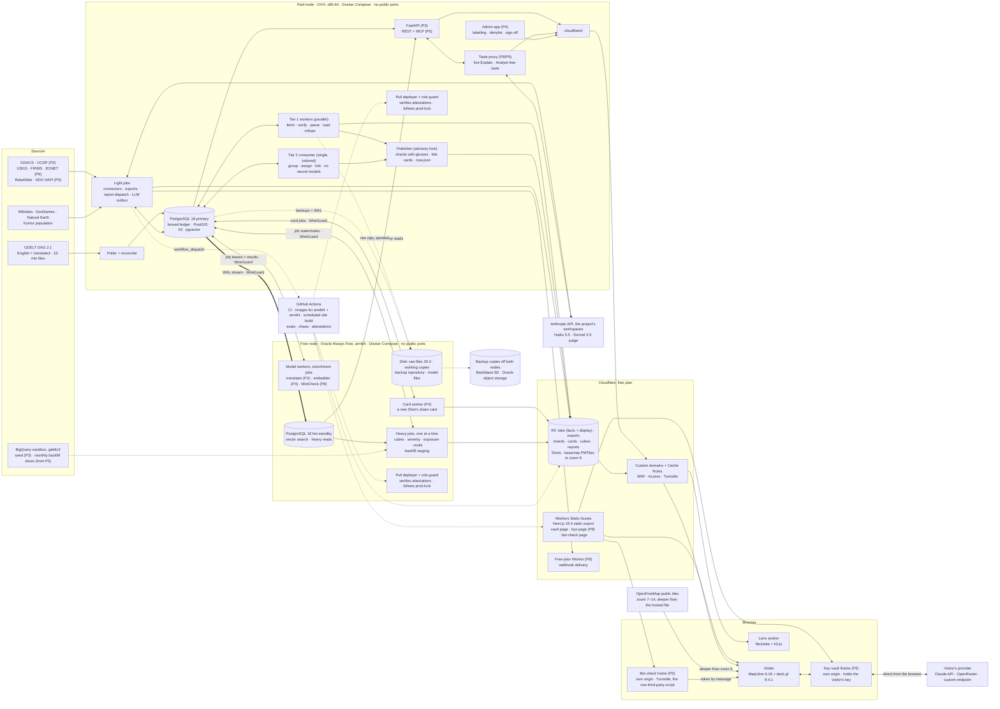
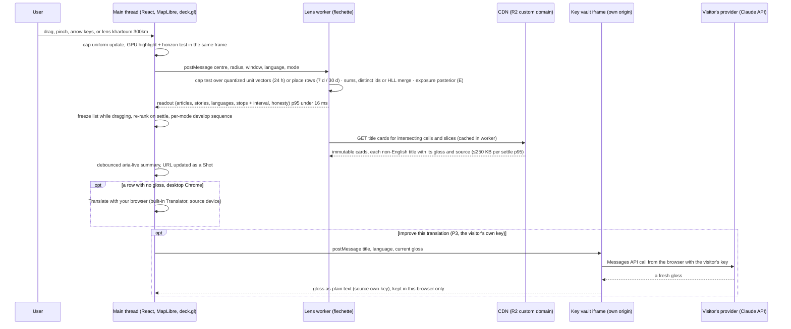
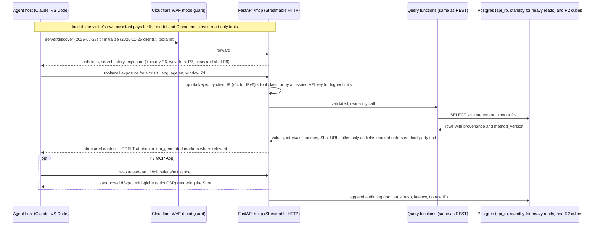
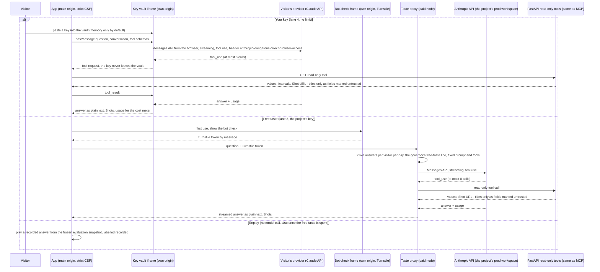

# GlobaLens 3.0 — Master Plan

*Plan of record · plan revision 7 · 2026-11-20 · ten phases from a ~1.7k-LOC hackathon prototype to a launched, measured product that runs for under $20 a month. Revision 5 has no calendar: the phases have an order and gates, not dates (§10). Revision 6 names the M3 Pro as the desktop reference device, with every threshold unchanged (§17, question 22). Revision 7 buys no domain for now: Phase 1 is deployed on Cloudflare's free addresses, and what needs a zone waits (§17, question 23).*

> **Number labels.** *(research)* means a value measured during research; a committed `bench/` or `evals/` script re-measures it before it appears in a README, résumé or `/stats`. *(illustrative)* means a placeholder. Unlabelled numbers are targets or budgets. `[Brackets]` in résumé bullets are filled only from `metrics/ledger.jsonl`, the single source of every published number.

**What you're building, in plain English.** A live 3D globe of the world's news. You turn the planet under v1's ring (the Lens) and read the real headlines from that place, in their own languages, with English translations, grouped into stories and updated every 15 minutes. Press **E** and the globe answers a question that none of the tools surveyed in §1 answers live: *which crises is each language's press under-covering, given how severe they are?* That reading comes with error bars, a public method, validation against the EU's and CARE's annual lists, and a weekly report anyone can recompute. Behind it sits an ingestion engine you can watch on `/engine`, built to survive the faults that break naive pipelines. The whole system runs on two small servers and a CDN for under $20 a month, with the real bill public on `/cost`; visitors who want unlimited live AI bring their own key. Every number on the site, and every number on your résumé, comes from one measured metrics file (`metrics/ledger.jsonl`, the metrics ledger).

---

## 0. TL;DR

**On one screen** (details follow; unfamiliar terms are in Appendix B):
- **What it becomes: one instrument, two layers.**
  1. **The daily driver.** It aims to be the best way to explore the world's news **by place, language and time**. Rotate the globe under the Lens and read the real headlines there: originals from ~65 languages *(research)*, an English gloss (a short machine translation) on every one, outlet and time, collapsed into stories, refreshed every 15 minutes, every view a link.
  2. **The signature: Exposure.** Press **E** and the light inverts. Attention is divided by **severity** measured from sensors and curated datasets; UCDP's conflict deaths are coded from news reports, so a sensor-only variant leaves them out. The Lens reads each language's **exposure in stops**, a photography unit where 0 is proportionate and each stop is a factor of two ("−4.1 stops: about 1/17 of the coverage its severity predicts" *(illustrative)*), with an error bar that simulations check holds the true value about 90% of the time. Anyone can rerun the weekly *Underexposed Report* and get a byte-identical result.
- **Why it's unique.** Others show what is happening (World Monitor), rate partisan lean (Ground News) or list neglected crises once a year (CARE, and ECHO for the EU). None of the tools surveyed in §1 measures attention against severity, per language, live, with a method anyone can rerun.
- **What you build first.** Setup (Appendix C): accounts, data keys, the two servers and a borrowed test phone. P1: a deployed Next.js + MapLibre/deck.gl globe on real GDELT data whose Lens lists real headlines, fed by a crash-proof Python ingester, with GitHub Actions CI and OpenTofu (open-source Terraform) from day one.
- **How it is built and what it costs.** Ten phases, built by Claude Code and reviewed by you for about 2–3 hours a week (Appendix D). There is no calendar: a phase starts when the one before it has passed its gate (§10). It runs on a small paid server, a free second server and Cloudflare's free plan, CDN-first, so a launch spike lands on Cloudflare's edge, not the servers. Running cost (§14): about $6–10 a month in P1–P3 and about $14 typical after that. With every spending cap reached it stays under your $20 ceiling: about $18 on the starting configuration, about $19.50 if the paid server has to move up a size. One-off spending around launch: $30–40.
- **Where the AI runs: four lanes** (§8). Shared AI that you pay for once and every visitor sees, under a hard cap ($7 a month on the starting configuration, $5 on the larger one), which also covers the free taste. Open models on our own CPUs, which translate every headline at no cost. A small free taste of live AI for visitors with no key. And bring-your-own: the visitor's own key, used from their browser, or their own Claude through MCP. No GPU is rented anywhere.
- **When you can stop.** After P3: a live globe plus Press E, already a complete portfolio piece. After P5: the full thesis with real testers. After P8: open to the public and ready to launch. After P9: launched, with the Analyst live. Any stop point can drop to a priced maintenance mode (frozen: about $1 a month).
- **What it proves.** Frontend craft (a WebGL globe and a design system), data engineering (exactly-once ingestion, a decade backfill), ML and LLM engineering (multilingual stories on CPU-only models, calibrated models, evals, an MCP server and a bring-your-own-key agent) and infrastructure (OpenTofu, signed deploys, two servers with a rehearsed failover, a public bill, a timed rebuild from code), with Rust/WASM, ClickHouse, NATS and k3s tried in measured bake-offs on machines rented by the hour. About 80k lines of code by P10: an outcome, not a target (§10).

| # | Codename | One line | Cum. LOC |
|---|---|---|---|
| 1 | First Light | Render spike first (does the globe hold its frame rate on a laptop and a mid-range phone?); both GDELT streams through a fenced ledger (a Postgres job table where only the current lease holder may commit a file, so crashes never lose or double-count data); rotate the real globe and read real headlines in the Lens; the site served as static files with a self-hosted basemap | ~9k |
| 2 | The Lens | The Lens kernel in a Web Worker (instant readouts), story groups (copies of one story collapsed), an English gloss on every headline (machine translation on the free server, Claude polish for the top stories), the second server with a rehearsed failover, keyboard and screen-reader paths (WCAG) + mobile, chaos harness (kills and pauses workers on purpose and checks nothing was lost), attested deploys (the servers run only signed, verified builds), `/engine` v1 (the backend's live UI), `/cost`, JS-vs-Rust/WASM bake-off | ~20k |
| 3 | Infrared & E | Severity from disaster alerts (GDACS) and conflict deaths (UCDP) on a population grid, a Bayesian Exposure model whose error bars are checked by simulation, **Press E**, the key panel and vault (where a visitor pastes their own Claude API key, kept on a separate page that the main app cannot read) with "Improve this translation", the **pivot gate** (can enough listed crises be scored, and does Exposure add anything beyond counting articles? A failed gate triggers Branch B), hiring packet #1 (video, case study, résumé lines) | ~28k |
| 4 | Stories | Embedding-model bake-off, StoryStream v1 (groups headlines in any language into stories; deterministic, so replays match), a titles-only benchmark against a published system, hybrid cross-lingual search (an English query finds Hindi coverage), Shots (shareable views frozen at a moment) + share cards in every script, backups | ~38k |
| 5 | Crisis Ledgers | Crisis registry, a calibrated linker (which crisis is this story about?) + quantifier (how many articles per language, with error bars), crisis Exposure on Crisis Ledger pages, Report #1, MCP server (AI agents can query GlobaLens), Director (one tour script behind the guided tour, the video and the visual tests), classroom mode, the first outside testers (five is the target, and a launch gate in P8), hiring packet #2 | ~48k |
| 6 | Long Exposure | A decade backfill at no cost (back to 2016 at the earliest), as-of replay with honest vintages (the world as it was known then, each severity source's release labelled), time-lapse export as video in the browser, decade-store bake-off (DuckDB vs ClickHouse vs Postgres), quake, fire and event layers (USGS, FIRMS, EONET), validation vs simple baselines, GlobaLens-Bench v1 (a public benchmark) | ~55k |
| 7 | Wavefront | Outlet registry, crawl-lag model (corrects for GDELT seeing articles ~2 h after publication *(research)*), StoryStream v2 + distillation (a cheap local model trained on the LLM's decisions), story arcs, chaos v2 with server-loss drills, fan-out bake-off (Postgres polling vs NATS vs Redpanda), Storybook | ~61k |
| 8 | Explain & Open | Computed-first Explain (SQL computes every number; the LLM only phrases it), checked syntheses (fact-checked AI summaries), watch-lenses (saved regions with feeds and alerts, no account), attested report (a signed weekly report anyone can verify), public API + open data, the pocket globe (installable, works offline), launch hardening on an hourly cluster, a first cut of the 90-s video; every launch gate passes and the site opens to the public | ~70k |
| 9 | Agents & Launch | The Analyst as a full panel (Replay, Free taste, Your key; ≤8 read-only tool calls, answering in Shots) with a live cost meter, OpenRouter and local models, the MCP App mini-globe (renders inside Claude), agent-eval gate on PRs within the evaluation cap; then the public launch: the final video, the launch article and **Show HN** | ~77k |
| 10 | Depth & Hardening | Rust and k3s (Kubernetes) bake-offs on the hourly cluster, timed rebuild of both servers from code, free-tier audit, metrics frozen for the résumé | ~80k (+~3k Rust if triggered) |

**No calendar.** The phases have an order and no dates (decided on 14 November 2026; §17, question 20). Each phase is built, checked and verified; it closes when its definition of done passes, and the next one starts after that. The one overlap is a soak, a check that only has to keep running for seven days or four weeks: the next phase may start while it finishes (§10). The setup in Appendix C comes before P1. The site opens to the public at the P8 close, and the public launch follows the P9 close. Nothing is cut for lack of build time (§10).

**Stop points:**
- **After P3:** a live, no-signup, real-data globe whose Lens lists real headlines by place, language and time, every one with an English gloss, grouped into stories; ingestion verified under three injected fault types (a killed worker; a worker paused past its lease, the 5-minute claim it holds on a file; duplicate deliveries; five types from P7) and visible on `/engine`; two servers with a rehearsed failover; accessible and mobile. **Press E** is live with simulation-tested error bars, plus the result of the pivot gate, whose pass/fail rules were written down before the analysis ran. A hiring packet (video, case study, résumé lines, and defense sheets: likely interview questions with answers) is ready. *Branch B* (the fallback if the gate fails, §15): the same, with Exposure labelled experimental and the gate finding published as a methods note.
- **After P5:** the complete thesis. Benchmarked stories and cross-lingual search, calibrated crisis linking and quantification, Crisis Ledgers, *The Underexposed Report* #1, an MCP server with a tool-use eval, the guided tour, classroom mode, the first outside testers (five with logged feedback is a launch gate in P8), hiring packet #2. *Branch B:* Crisis Ledgers show attention with intervals, and the weekly artifact is a "What each language saw" digest.
- **After P8:** open and ready to launch. Decade replay with honest as-of, validation against baselines, Wavefront, Explain, watch-lenses, an attested report and open data, the pocket globe, load-tested on an hourly cluster, every launch gate passed, a first cut of the 90-second video, hiring packet #3. The site is public, without an announcement.
- **After P9:** launched. The Analyst in three modes with bring-your-own-key, the MCP App, the final video, the launch article and Show HN.
- At every stop point the system can drop into a priced **maintenance mode** (§9): live-lite (about $6–11 a month, ~1 h/month) or frozen (about $1 a month).

**Headline metrics** (targets; published values come from the ledger):

| Metric | Target |
|---|---|
| Ingest correctness | Both GKG streams (~340k articles/day *(research)*); 0 intervals (15-minute GDELT files) lost or duplicated across [N] injected faults of 5 types, [c]% kill-point coverage (the share of the pipeline's crash points the fault tests actually hit) |
| Freshness | ≥99% of 15-minute intervals' attention data live ≤30 min after GDELT lists them |
| Daily driver | Reference Android: ≥30 fps at 100k points, INP p75 ≤200 ms (Interaction to Next Paint, Google's responsiveness metric); 100% of non-English titles in covered languages carry an English gloss when they are published |
| Stories | Story grouping: titles-only cross-lingual pairwise F1 (how accurately headline pairs land in the same story) against Miranda et al.'s 2018 multilingual news-clustering system re-run on the same titles (their full-text 84.0 *(research)* shown only as a reference) |
| Exposure | 90% error bars (statistical intervals) that hold the true value 85–95% of the time in simulation; beats an attention-only baseline (CARE's own method, run on GDELT) by ΔAUC ≥0.05 on the EU (ECHO) and CARE neglected-crisis lists, or the claim changes (AUC: the chance that a listed crisis scores as more under-covered than an unlisted one) |
| Weekly report | Repro hash match 100% over ≥4 consecutive weeks; out by Monday 18:00 UTC in ≥90% of weeks |
| Resilience | Losing the free server never stops publishing; losing the paid server is recovered in under 60 minutes from the merge of the promotion pull request, measured in drills |
| Usage | [u] weekly unique visitors (weekly-salted, no cookies) and [a] active niche users (seen in ≥2 distinct weeks) |
| Monthly cost | At or under $20 with every spending cap reached; about $14 typical; the real bill public on `/cost` |

---

## 1. North Star

- **Name:** GlobaLens, release **3.0** (no edition name).
- **Tagline:** *See beyond the headlines.*
- **Hero line:** *A live light meter for the world's news: what each language is looking at, how each story travels, and the crises it isn't seeing. Updated every 15 minutes, with error bars.*

**Pitch.** Every 15 minutes GDELT publishes metadata for the world's online news: about 340k articles a day, in which machine translations from ~65 languages outnumber English 1.9 to 1 *(research)*. v1 ignored most of it. GlobaLens 3.0 puts all of it on a globe you steer with v1's Lens:
- **Viewfinder** shows where the press is looking. City-level coverage is drawn as sharp discs; country-level coverage is a soft tint, never a fake pin.
- The Lens lists the real headlines in the ring, collapsed into stories, each with an English gloss, and searchable across languages.
- Press **E**: attention is divided by severity measured from GDACS, UCDP, USGS, FIRMS and population data, and the Lens reads **exposure in stops** per language with an interval. 0 is proportionate; each stop is a factor of two; the readout always says it in words too.
- **Wavefront** shows how a story crossed borders, corrected for crawl lag.
- **Long Exposure** replays attention since 2016 as it was known at the time, with each source's vintage labelled honestly.

Every number links to its method, eval and sources. Each Monday *The Underexposed Report* does weekly and per language what CARE's annual report on the least-covered humanitarian crises does once a year.

**Users.** The lead persona is the **attention allocator**: someone whose job is deciding what others look at.

| User | Job to be done | Primary surface |
|---|---|---|
| Journalism / IR instructors and students (first niche, alongside NGO communications staff; recruiting is optional; outside testers are invited from P5 and at least five with logged feedback are a launch gate, per OQ4 and OQ13) | "Every Monday, show what our language's press misses vs severity and other languages." | Report, Present mode, Eight Globes, Ledgers |
| NGO comms and advocacy staff | "Defensible, current evidence that my crisis is under-covered." | Crisis Ledger permalink, badge, watch-lens |
| Data journalists, researchers | "An open attention-vs-severity dataset with a reproducible method." | Parquet drops, GlobaLens-Bench, `/methods`, `make reproduce`, Python client |
| Curious public | "What's happening where I care, and what am I not hearing about?" | Daily-driver Lens, share cards, report |
| AI agents, developers | "Typed, cited tools for attention by place, language, time." | MCP server + MCP App |

Hiring reviewers are a secondary audience, served by `/engine`, `/trust`, `/stats`, the ADR log, the Bake-off Lab and a 5-minute "For engineers" tour. That is deliberate: a product with real users and numbers a stranger can check is what makes a reviewer stop and look, and the résumé lines fall out of it (§16).

**What makes it unique.** World Monitor (~89.7k stars *(research)*, AGPL, the same globe stack v1 used) shows *what is happening everywhere*. GlobaLens measures *where each language's press is looking, and where it isn't*. Comparisons stay factual and generous: each product is described by what it measures.

| | World Monitor (Oct 2026; figures *research*) | **GlobaLens 3.0** |
|---|---|---|
| Core | 468 feeds, 59 layer types, an instability index, an analyst that moves the map | One quantity: attention by place × language × time, set against severity |
| Neglect | Crisis trackers | Per-language stops with tested intervals, validated as-of against ECHO and CARE and against an attention-only baseline |
| Propagation | Not offered | Per-story first arrival, corrected for crawl lag |
| History | 7-day local playback | Attention since 2016, replayable as-of |
| Location | Point markers | Precision as optical focus; centroids never drawn as pins |
| Trust | Public forecast-accuracy page | Public eval history, `/engine`, a reproducible attested report, published losses |
| Agents | 99 MCP tools, paid quotas | Free H3/time/exposure/wavefront MCP tools + an MCP App |
| License | AGPL + Pro tier | Apache-2.0 code; CC BY 4.0 aggregates where upstream allows |

Others measure something else: Ground News rates partisan lean, Kagi News is a daily digest, GDELT Cloud sells AI-coded events, and CARE and ECHO publish annual lists. None measures attention against severity per language in real time.

**Where your "extra, extra crazy" went.** Into things a reviewer can see and check, not into more services: a globe whose light inverts to show neglect (Press E); eight planets, one per language, turning in sync (Eight Globes); arcs that land in the order a story reached each country (Wavefront); a decade of the world's attention you can scrub, as it was known at the time (Long Exposure); a backend with its own animated UI that replays last night's fault-injection run (`/engine`); a mini-globe that renders inside Claude (MCP App); a weekly report anyone can recompute and verify against a public signature; a public benchmark; an Analyst that answers on the visitor's own key, which never leaves their browser; a time-lapse of the decade that anyone can export as a video; the whole system running for under $20 a month, with the real bill public on `/cost`; and eight pre-registered bake-offs that put Rust/WASM, ClickHouse, NATS, Redpanda and k3s in your hands on machines rented by the hour, without bloating production. The UI is treated as a product too: the "Deep Field" design system in `packages/ui`, a storyboarded Press-E transition, Present mode and themes for classrooms, five hazard layers plus a graticule and day/night terminator, Storybook, visual regression and axe in CI, and a phone budget as strict as the desktop one (§4).

**Non-goals** (stated in the README): flights, ships, markets, bias ratings, risk scores, forecasting claims, full text, user accounts, crisis leaderboards, a non-English UI in 3.0.

**30-second demo** (readouts *illustrative*):

| t | What the viewer sees |
|---|---|
| 0–1 s | An SVG dot-matrix globe paints at the viewer's longitude (taken from the timezone; no prompt). |
| 1–4 s | WebGL fades in: warm light where the press looked today, sharp city discs, soft country tints. Badge: "data 7 min old · articles reach GDELT ~2 h after publication". |
| 4–10 s | The Sahel turns under the Lens. Real headlines in French, Arabic and Hausa fill the list with English glosses, outlet and time, grouped into stories. **The daily driver.** |
| 10–14 s | Press **E**: the legend morphs, capitals drain and azure light pools where severity outweighs coverage. The Lens reads **"−4.1 stops ▼ under-covered · English-language media gave this about 1/17 of the coverage its severity predicts (likely 1/9 to 1/32) · 7 days"**. |
| 14–18 s | Press **2** for Arabic: −1.2 stops. Split shows both languages as two concentric arcs. |
| 18–22 s | **Wavefront**: arcs land in arrival order; a strip of language chips fills in arrival order and three stay empty: "never reached Spanish-, Portuguese- or Hindi-language press". |
| 22–26 s | **Long Exposure**: scrub to 2023; the crisis's attention curve draws beside two comparable disasters. |
| 26–30 s | The **Crisis Ledger** opens with per-language severity vs attention, intervals, sources and a 90-word note labelled "AI-generated from 14 sources". Share makes a card with the same reading, pinned to that moment. |

---

## 2. From v1 to 3.0

**Honest audit** (verifiable facts only; all counts *(research)*). v1 is ~1,730 lines from a June 2025 hackathon (13 commits, messages like "FInal"):
- a Vite + react-globe.gl page;
- a 169-line Flask file over MongoDB;
- a laptop script that scraped full article text with a spoofed user agent;
- a seeder that **drops the API's collection and inserts 300,000 Faker documents with random "embeddings"** into the collection the API reads.

The README described Cloud Scheduler, Cloud Functions, Vertex AI, Docker Compose, GitHub Actions, Terraform and more; none of it is in the repo. There were no tests, CI, IaC or LICENSE, and the API was hardcoded to `127.0.0.1`. `docs/retro/v1.md` records what the seeder did and what the README claimed against what the repo contained. 3.0's honesty infrastructure (a metrics ledger, a generated status table, labelled numbers) exists so those two signals never recur.

| Area | v1 | 3.0 | Why |
|---|---|---|---|
| Data | Unrepo'd CSV step; full text scraped | Both GKG 2.1 streams from raw 15-min files through a fenced ledger; metadata only | Correctness; copyright (AP v. Meltwater, the Cohere and Perplexity suits); translations are ~2/3 of the signal *(research)* |
| Store | MongoDB `temp` | PostgreSQL 18 + PostGIS + h3 + pgvector; Parquet lake on R2 split into a facts layer and a redactable display layer | Relational, spatial, aggregate-heavy; rebuildable; takedowns possible |
| Ingest | Manual loop, no dedupe | Self-healing poller, MD5, per-file retry, fenced leases, gap registry, verified under five fault types | Files 404 for minutes; 17 days of 2025 were never published *(research)* |
| Globe | react-globe.gl, one 2,000-doc JSON | MapLibre 6.18 + deck.gl 9.4.1, incremental Arrow shards, worker Lens | Cartography, globe→street morph, million-point layers, small updates |
| Search | English SBERT over random vectors | Hybrid cross-lingual search (P4): full text on originals and glosses + multilingual embeddings, fused by RRF | Cross-lingual by construction |
| Ops / truth | Nothing; README over-claims | CI/CD on GitHub Actions, OpenTofu (the open-source fork of Terraform: same HCL language, compatible providers and the same plan/apply workflow, so your Terraform skills and the résumé keyword carry over; §6), attested deploys (each node runs only builds whose signed provenance verifies), SLOs, a stated support model; a claims file (`metrics/claims.yml`) + generated status table | Every piece earns its place; every number checkable |

**What survives:** the name, the tagline, GDELT, the dark cosmic look, and above all **the Lens gesture**: rotating the planet *under* a fixed reticle to reveal what's there. In P1 the Lens does what v1's did, listing headlines in the ring, but on real data and with a ring that keeps its screen size as you zoom. From P2 it becomes an instrument, and in E-mode a light meter. v1 is tagged `v1-hackathon` and removed from `main`. The before→after story is told when someone asks why the claims file and the metrics ledger exist; it doesn't open the pitch.

---

## 3. Product: the two layers

**Layer A, the daily driver,** is built first and never starved: Viewfinder, the Lens with real headlines (exact duplicates collapsed in P1, story groups in P2, stories in P4), an English gloss on every non-English headline (phones included), cross-lingual search, window chips, language keys, share cards, mobile, the first-run experience and, from P8, the installable pocket globe.

**Layer B, the signature:** Exposure (places in P3, crises in P5), *The Underexposed Report* (P5, attested in P8), Long Exposure (P6) and Wavefront (P7).

**Rules:**
- **Layer A first.** No Layer B work ships while a Layer A budget is red. There are three budgets: performance (fps, INP, Lens p95, bytes), accessibility (axe, manual passes), and **task success** (the Layer A tasks in the P3, P5 and P7 usability sessions, which run with whoever is available, three people or more; every miss is logged, and the budget stays red until each one is fixed or scheduled).
- **Admission.** A feature must move a product metric (defined in §13: weekly uniques, active niche users, citations via referrers and embeds) or a `/trust` validation metric, and fit the RAM budgets (§9), the $20-a-month ceiling at every cap (§14) and your weekly time (§9).
- **No key needed.** Every feature is complete for a visitor who never pastes an API key: AI work that is paid for once and shared, open models on our own CPUs, and a small free taste of live AI carry it (the first three of §8's four AI lanes). A visitor's own key, or their own Claude through MCP, lifts the limits; it is never the entrance.

| Tier | Feature | Layer | Phase |
|---|---|---|---|
| **Core** | Exactly-once ingest of both GKG streams + `/engine` showpiece (from P2 it also shows the loss of either server and the failover between them) | Both | P1→P2, grows |
| Core | Viewfinder + location honesty (discs for Geo_Type 3/4, polygons for 1/2/5, unlocated counted, not drawn) on a self-hosted basemap | A | P1 |
| Core | Lens v0 with auto aperture lists headlines with duplicates collapsed and country-level coverage grouped (P1); the Web Worker depth kernel, aperture clamp through the morph, window chips, language keys (P2) | A | P1–P2 |
| Core | Story groups (URL canon, title hash, MinHash) → StoryStream stories + Magnitude | A | P2→P4 |
| Core | English glosses on every non-English headline when it is published, on phones too, each with a source mark: machine translation at ingest, and Claude polish for multi-outlet story groups and pre-rendered pages; "rough translation" on weak languages; browser translation ("Translate with your browser") where a row has no gloss (P2); own-key translation ("Improve this translation", P3) | A | P2–P3 |
| Core | Scripts and direction: map labels in native scripts, `lang` and `dir` on every headline from its known language, system fonts for Chinese, Japanese and Korean | A | P2 |
| Core | First run: designed empty/loading/stale/no-WebGL states and the two degraded-mode banners, one for the loss of each server (P2); coach marks, example gallery, the ≤8-second intro (P4); the 90-second guided tour (P5) | A | P2/P4/P5 |
| Core | Hybrid cross-lingual search with CJK/Thai support + ⌘K grammar | A | P4 |
| Core | Shots: one schema for URLs, pinned-moment snapshots, share cards in every script, embeds, tour timelines and visual tests; a shared Shot is a small HTML file on `s.<domain>` (P4); the click-to-load embed (P8) | A | P4/P8 |
| Core | Hazard layers (GDACS, UCDP in P3; USGS, FIRMS, EONET in P6), each showing its coverage; graticule + terminator | B | P3/P6/P8 |
| Core | Crisis Ledgers; trust surfaces (`/trust`, `/stats`, `/cost`, `/methods`, attributions, two-clock badge, `/privacy`) | Both | P1→P5 (`/cost` finished in P8) |
| Core | Key panel + key vault: a visitor's own API key, held where the main app cannot read it, for "Improve this translation" (P3), live Explain (P8) and the Analyst (P9, with OpenRouter, custom endpoints and "remember on this device") | Both | P3/P8/P9 |
| Core | Explain (SQL computes every number; the wording is cached text, a template sentence, or live phrasing with the visitor's own key) + checked syntheses; watch-lenses + badges (no accounts) | Both | P8 |
| Core | Pocket globe: the site installs like an app; a zoom 0–5 basemap and the latest day work offline | A | P8 |
| **Signature** | **Press E: Exposure** with tested intervals, plain-language readouts and empty rings | B | P3 (places), P5 (crises) |
| Signature | Classroom mode: Eight Globes, Present mode, Split | Both | P5 |
| Signature | Director: one tour timeline behind Present mode, the guided tour, the launch video and the visual tests | Both | P5 (launch video: first cut P8, final cut P9) |
| Signature | Long Exposure (knowledge-time replay since 2016, decade charts computed in the browser, clip export as MP4) · Wavefront (crawl-lag-corrected arrival, story level) | B | P6 · P7 |
| Signature | The Underexposed Report (weekly, signed off, bit-reproducible, attested) | B | P5, P8 |
| Signature | Geo-news MCP server + tool-use eval, listed in the official MCP Registry (P5) and submitted to Claude's connector directory (P8) + MCP App mini-globe (P9) | Both | P5/P8/P9 |
| Signature | The Analyst: a full Ask panel in three modes (Replay, Free taste, Your key) with a live cost meter, answering in Shots with the MCP server's tools | Both | P9 |
| Signature | GlobaLens-Bench: public story-pair, crisis-link and as-of validation sets with baselines | Both | P6–P7 |
| **Later** (not in the ten phases; picked up only by a new decision) | Crisis-level Wavefront + amplifier naming · EBM decomposition · "If it were here" · Data Navigator hex traversal · WebGPU lab view (lab only; the globe stays on WebGL2) · Framing diffs (gated on κ) | — | — |

**Supporting work, each with a home phase:** a titles-only clustering probe and a TLA+ model of the lease protocol (P2); the geocoding-accuracy check (300 items), an outlet registry v0 and `packages/gdelt` on PyPI (P4); Wikipedia pageview and ReliefWeb report-count series (P6).

**Key user journeys** (each becomes a Playwright journey test on frozen fixtures in P8):
1. **"What's happening there, in their language?"** (curious reader, P1→P4).
   1. Drag the Sahel under the Lens and read the original headlines with glosses.
   2. Press `3` for French and widen to 7 days.
   3. Open a story with 14 outlets in 5 languages.
   4. Press `S`; the link opens that exact moment and unfurls as a card with the same reading.
2. **Monday class** (instructor, P3→P5).
   1. Open the weekly report in Present mode on the projector (Paper theme, large type, clicker advances figures).
   2. Show Eight Globes: eight languages, eight planets, rotating together.
   3. Open a Crisis Ledger and compare English vs Arabic stops with intervals in Split.
   4. Students cite the permalinks.
3. **Defensible evidence** (NGO comms, P5→P8). A watch-lens over the programme region, the Ledger's self-updating badge on the NGO site, an "attention cliff" alert into Slack, and the Ledger as the citation in a pitch to an editor.
4. **Reproduce the method** (researcher, P6→P8). Download a weekly Parquet drop with its datasheet (aggregates and GDELT record IDs, no titles), run `make reproduce WEEK=2027-W16`, check the hash against the Sigstore-attested one, query history with the Python client, and score a model on GlobaLens-Bench (which ships record IDs and hashes; its hydration script fetches the titles from GDELT).
5. **A cited globe in an agent** (developer, P5→P9). "Which crises is Spanish-language press under-covering this month?" in Claude, through the MCP server: cited, with Shot links and, from P9, an inline mini-globe. Claude accepts the server as a custom connector on every plan, one on the Free plan, with no login *(research)*. From P9 the site's own Analyst panel answers such questions too: live on the free taste or on the visitor's own key, with the conversation's cost shown as it runs, and as recorded examples in Replay.
6. **Hiring review** (secondary, 5 minutes). The README's "For engineers" tour: the 90-second video → `/engine` (the day's intervals in a time-lapse, last night's chaos run replayed) → `/cost` (this month's real bill) → `/trust` "where we lose" → ADR-0004 → one kernel walkthrough. A reviewer who lands on the site instead is offered the 90-second guided tour (P5).

---

## 4. Experience & design system

**Aesthetic: "Deep Field."** Near-black matte chrome; only data emits light. Ticks, graticule and mono numerals give instrument precision. Calm by default, loud only for anomalies, one colour encoding at a time. The rule: **light means attention**, so nothing else glows (no city lights at night: the night side only darkens).

**Visual target.** P1 task 0 produces 4–6 hi-fi frames (desktop V, desktop E, the Lens list, a story sheet, the mobile drawer, a Crisis Ledger) and a 10-second motion prototype of develop-on-settle, linked from `docs/design/`. Every later phase opens with a design task for its own screens and motion, reviewed against these principles before code, and every phase closes with a polish pass: a design critique and an accessibility review on screenshots, your review of a short recorded walkthrough, and no loading, empty or error state left unfinished.

**Colour tokens.** These live in Tailwind 4 `@theme` (`packages/ui/tokens.css`, created in P1) and are generated from three OKLCH inputs, Linear-style. High-contrast and Paper themes are generated from the same inputs.

| Token | Hex | Use |
|---|---|---|
| void / canvas | `#030509` / `#070A10` | space; app background |
| surface-1/2/3 | `#0D1219` / `#141A22` / `#1C232C` | panels, cards, popovers (elevation = lightness) |
| border subtle / strong / control | `#272E38` / `#38404B` / `#676F7A` | separators; control outlines (≥3:1) |
| text-1/2/3 | `#EBEFF4` / `#B4BBC5` / `#8A939F` | text (tertiary ≥5:1 everywhere) |
| **lens-500** (the only accent) | `#C3F344` | reticle, focus, selection (14.5:1 on surface-1) |
| lens-300 / 700 / 900 | `#DEFF87` / `#759B21` / `#233407` | hover, strokes, selected tint |
| danger / warning | `#FB575D` / `#FCB442` | status only, **always icon + text** (warning ≈ lime for deuteranopes, ΔE 0.077, so never colour alone) |
| ocean / land / coast | `#030910` / `#11181F` / `#2C3742` | basemap |
| atmosphere | `#478CC4` | rim glow only, in V and I; turned off in E, since it shares the exposure scale's under-covered hue (~205°) |
| attention ramp | `#1A2029 → #8A6A3E → #F9BE78 → #FFF1DC` | Viewfinder (log share) |
| severity ramp | `#24101A → #6B1D44 → #C23A6E → #FF9EB8` | Infrared; GDACS green/orange/red map onto its steps plus level glyphs and text |
| exposure scale | `#FE9879 · #CB836D · #767B81 · #5AA1CB · #59C3FE` | over → proportionate → under, with ▲/▼ glyphs; value-suppressing: wide intervals pull towards the neutral step |

The exposure scale passes a scripted colour-vision check (adjacent ΔE ≥0.079 under protan, deutan and tritan simulation). `packages/ui/scripts/palette-check.ts` gates the ramps from P3 and also asserts three colour rules: no data ramp reuses another ramp's hue; the atmosphere rim is off in E; GDACS levels only use severity steps. Two geometric rules are visual-regression Shots instead: E + Split draws concentric arcs, never the E ring's outline/fill encoding (P5); Wavefront shows language reach only in the chip strip, never as country fills (P7).

**Type** (OFL; static font instances for the pre-rendered share cards):

| Token | Face | Desktop | Mobile |
|---|---|---|---|
| micro / data | JetBrains Mono 500 caps / 450 tnum | 11/14 · 12/16 | same |
| caption / ui / body | Inter 450 / 550 / 400 | 12/16 · 13/18 · 14/21 | 13/18 · 15/20 · 16/24 |
| headline-sm / headline (chrome) | Newsreader 550 / 500 | 17/22 · 22/28 | 18/24 · 22/28 |
| headline text (original titles) | Noto Serif (Latin, Cyrillic, Greek) + per-script Noto by `unicode-range`; system fonts for Chinese, Japanese and Korean | 15/21 | 16/23 |
| display / hero | Newsreader 450 / Inter Display 600 | 32/36 · 56/56 | 28/32 · 40/42 |

**Scripts and languages** (measured on the 2026-10-27 sample *(research)*: 63 source-language codes, 21 scripts; Latin 67%, Cyrillic 11.6%, Han 6.7%, Greek 4.6%, Arabic 4.4%, Hangul 1.9%, Devanagari 1.3%; 4.6% of translated titles are right-to-left):
- Newsreader covers Latin and Vietnamese only, so original headlines use a Noto stack: Noto Serif for Latin/Cyrillic/Greek, and Noto families for Arabic, Hebrew, Devanagari, Bengali, Tamil, Telugu, Gujarati, Gurmukhi, Kannada, Malayalam, Sinhala, Thai, Georgian and Armenian, all served from our own hosts and lazy-loaded by `unicode-range`. Chinese, Japanese and Korean titles use the reader's system fonts, with no CJK web font to download (Google serves Noto Sans SC in 101 slices *(research)*); from P2 a system stack is named per `lang`, which also selects the right Han glyph variants. A fontTools CI check requires ≥99.9% glyph coverage, over a fixture week, for every script we ship a font for, and one visual Shot per script family (Arabic/Hebrew RTL, Devanagari shaping, Thai, CJK) guards rendering; the CJK Shot runs with one CJK font pinned in the test image.
- Every title renders with `lang` (BCP 47 from `srclc`) and `dir`. From P2 both come from the known language: `dir` is `rtl` or `ltr` from the language's direction in `lang.py`, because `dir="auto"` looks only at the first strong character *(research)*, so an Arabic headline that opens with a Latin brand name would be laid out left to right. P1 ships `dir="auto"`; from P2 it stays only as the fallback, with `<bdi>`, for text whose language is not known and for a title whose script contradicts its language code (the language check in §8). Outlet and time sit in `<bdi>` so an Arabic title next to Latin metadata never reorders. Glosses carry `lang="en"`. Layout uses CSS logical properties.
- `packages/gdelt/lang.py` maps GDELT's codes to BCP 47 tags, endonyms, direction and script (GDELT writes Azerbaijani as `axe`, not `aze`); CI fails on any unknown code in a week of data.
- **Map labels in native scripts** (P2). Country and city labels show each place's name in its own script, with the English name beside it where the two differ, set through MapLibre's `font-faces` in the same families as the headlines. MapLibre shapes Arabic, Hebrew, Devanagari, Khmer and Burmese natively *(research)*, so no right-to-left plugin is loaded. The visual Shots per script family cover the labels too, and an English-only label layer stays behind a style flag, because this MapLibre code path is only months old *(research)*.
- **Share cards in every script** (P4). Cards are drawn ahead of time by a renderer that handles bidirectional text (Satori ≥0.63 or Takumi *(research)*), so the text on a card (a headline with its gloss, a place, a crisis name) appears in its own script and direction. The renderer runs on our machines, where there are no system fonts, so it carries a static instance for every script, CJK included.
- The UI is English in 3.0 (a non-goal to localize), but all UI strings live in one module so a later language needs no refactor. Times show in the viewer's time zone with UTC on hover; reports are in UTC.

**Layout.** Desktop (readouts *illustrative*):
```
┌ ◉ GlobaLens Globe · Report · Crises · How it works ▾ [⌘K] [Ask]  V I E  1 EN 2 AR 3 FR…  data 7 min old ┐ 44px
├ IN THE LENS (360px, rail <1440px) ──┬──────────── globe ────────────┬ SHEET (420px, closed by default) ─┤
│ Sahel · ≈600 km [1h|6h|24h|7d|30d] │       ╭──────── ◯ ────────╮    │ Story / Crisis Ledger / Ask (P9)  │
│ 214 stories · 9 langs              │       ╰───────────────────╯    │ headlines · languages · sources   │
│ honesty: 31% country-level         │  [V|I|E] [layers] [+][−][⌖]    │ method · Δ                        │
│ ▣ headlines + glosses              │                 [locator]      │                                   │
├ TIMELINE 88px ▁▂▃▅▇█▇▅▃▂  ◀ ▶ ▶▶  brush  hatched gaps ───────────────────────────● LIVE ───┤
```
- The Lens's camera padding follows open panels on desktop and mobile, so the reticle always sits in the centre of the *visible* globe.
- The sheet opens on demand. Below 1440 px the left panel collapses to a rail. Footer: Status · Attributions · Corrections · Privacy · Terms. How it works ▾ opens Methods, Trust, Engine, Stats, Cost and API. From P3 Settings holds the key panel ("Your key"). From P5 a Classroom item in the top bar opens Present mode (F) and Eight Globes, How it works ▾ gains Take the tour, and Accessibility and Publishers join the footer. From P8 Settings offers Install (the pocket globe). From P9 an Ask button in the top bar opens the Analyst in the sheet.
- The site is a static export: every page is a file served from Cloudflare's edge, and no server renders a page on request. Pages that need their own link preview, or need to be indexed by search engines (top stories, Ledgers, reports, methods), are pre-rendered by a scheduled build after the daily rollup. A pre-rendered story or Ledger page states the time of the data it was built from, and its readouts then refresh in the browser from the current data files. If a build fails, the previous one keeps serving and the stamp shows its age. Every story's own link is the globe with `?story=<id>`: it opens the story in the sheet over the globe and works for any story while its data exists. A `/story/<id>/` page is an extra for search engines and link previews, kept only for the pre-rendered top stories, and it is its own canonical page; the site's not-found page turns any other `/story/<id>` into the `?story=` link. Sharing a view makes a Shot with its own link preview (see Shots and permanence).
- Across the pre-rendered routes (story, Ledger, report, methods) the canvas persists: it shrinks to a locator on article pages and stays full on map pages, and a `<ViewTransition>` links the two (gated for reduced motion).

Mobile:
- Full-bleed globe with the Lens kept in the unobscured area.
- Base UI Drawer at 120 px / 50% / 92%; the map stays live at the two lower detents.
- Top bar: a V·I·E segmented control. Numbered language chips, a visible scrubber (no twist gesture), and a Share · Pin · Explain row in the Lens HUD.
- Every non-English headline carries its gloss on a phone exactly as on a desktop: glosses are published with the headlines as data, so nothing depends on what the device or its browser can do.
- The report reads as an article.
- From P8 the site installs to the home screen (the pocket globe); from P9 Ask opens in the Drawer at its 50% and 92% detents.
- **Render budget** 100k points (300k desktop) plus a battery tier capping DPR at 1.5 through MapLibre's `pixelRatio` (deck's `useDevicePixels` is ignored in interleaved mode). The budget limits drawing only: readouts always use the full data, and a parity test checks one Shot on desktop and mobile.

**First run, navigation and states.**
- **Landing:** always Viewfinder at the visitor's longitude; returning visitors resume their last view (localStorage, wrapped in try/catch). From P4 a ≤8-second intro (V → E → V) plays once; any input interrupts it, and reduced motion or `?intro=0` skips it.
- **Three non-blocking coach marks** (P4): "Drag the planet under the ring", "Press E (or tap E) to compare coverage with severity", "S shares this exact view". Dismissals are remembered. In Branch B the E coach mark and any intro are omitted.
- **Example gallery** (P4): five curated Shots drawn from the canonical visual-regression set (in P4: "Sahel this week", a multilingual story and a Press-E view; "24 Feb 2022" joins in P6 and "How one story travelled" in P7). It doubles as the first-visit empty state, the instructors' starting point and test fixtures.
- **Guided tour** (P5): a 90-second path through the product for a visitor with two minutes to spare, offered beside the gallery and as Take the tour under How it works ▾, and opened directly by `?tour=1`. It plays a Director timeline (see Director) built on the gallery's Shots, one caption to a step, and it grows as the gallery does (P6, P7). The tour plays a small dated tour dataset on the CDN, not the live feed: it is the same data the visual tests run on, it says its date on screen ("Tour data from 24 Feb 2027" *(illustrative)*), and it is refreshed at each phase close. Any input pauses it and hands over the controls, a Resume pill continues it, and reduced motion replaces flights with cuts. In Branch B it leaves out the E step.
- **States** (P2 unless a row names a later phase), each with a design, copy, a visual Shot (P4) and a Storybook story (P7):

| State | Treatment |
|---|---|
| Empty Lens | "No located coverage here in 24 h" + an arrow and snap button to the nearest coverage |
| Zero attention vs not measurable | Zero shows "0 articles" with a one-sided stops bound; not measurable is hatched with its reason (no severity source covers this kind) |
| Loading (NN/g thresholds) | Nothing under 1 s; a skeleton list under 10 s; a progress bar beyond |
| Fetch failed (offline or edge error) | The last loaded data stays visible with its age; "Couldn't load the latest data · Retry" with automatic backoff (2 s → 60 s); "Offline" when the browser reports no network. From P8 an installed pocket globe opens on its saved day instead (see The pocket globe) |
| Stale >45 min | Amber badge: "GDELT hasn't published since 14:00 UTC; showing the last good data" (per stream, read from the stream stamps in a fresh `now.json`; when `now.json` itself is that old, the paid-node banner below shows instead) |
| Severity source stale | Exposure holds the last good value with "stale since …"; stops are never computed with a missing denominator |
| Past (Long Exposure) | A persistent "As known on 24 Feb 2022, 03:00 UTC" banner, tinted chrome and a Return-to-live pill |
| No WebGL2 / lost context | The SVG globe stays interactive with the list and Table view; `webglcontextrestored` restores |
| No gloss on a row | The original title with a "Translate" link where the gloss would be (see Glosses); never a spinner or a placeholder line |
| Free node down (the free second server, which runs the translation and story models) | Banner: "Translations and story grouping are catching up." Headlines keep arriving on time and still collapse into story groups; a new row shows the "Translate" link until its gloss arrives and joins its story late (from P4); Exposure readouts and crisis links hold their last computed values with their age, a new Shot's card is drawn when the node returns, search matches words only until then, and a weekly report that falls due is published late with a notice |
| Paid node down (the small paid server, which ingests, publishes and serves the API) | Banner: "Live updates paused; history and cached pages still work". The globe, history, pre-rendered pages and the last good data keep serving from the edge; search, Share and everything else that needs the API are marked unavailable until the standby, the live copy of the database kept on the free node, takes over (the target is under 60 minutes from the merge of the promotion pull request, §9). The banner shows whenever `now.json` is older than 45 minutes, whatever the cause, and `/engine` says which |
| Key refused (P3) | The key panel repeats the provider's reason in plain words and does not retry; Anthropic's refusal of browser calls from organizations with zero data retention or the Compliance API gets its own explanation and a pointer to MCP |
| Free taste spent (P8 for Explain, P9 for Ask) | Explain shows its template sentence; Ask switches to Replay and says "Today's free questions are used up", with "Use your own key" beside it |
| Today's Shots are used (P4) | The share dialog says "Today's shared views are used up" and offers the plain link to the view instead: the same view, live rather than pinned, with no card of its own. Pinned Shots are back the next day |

Both banners sit under the top bar without covering the globe, use the warning token with an icon and text, are announced once to screen readers and clear themselves on recovery. They read what the paid node publishes to R2: the free-node flag in `status.json`, and for the paid node the age of `now.json` (there is no separate heartbeat object; older than 45 minutes shows the banner). `/engine` shows the same two modes with their timelines and gives the cause.

**The Lens in detail** (depth kernel [K]; Appendix D):
- **Aperture: auto by default.** The ring keeps a constant screen size and its radius in km follows zoom, clamped to 25–3,000 km and shown live in the HUD ("≈ 640 km"). Typing `[ ]`, dragging the edge or `⌘K lens khartoum 300km` locks the radius; a lock chip unlocks it with one tap. On touch, pinch-zoom is the aperture control in auto mode, and a ≥44 px edge handle appears only while locked. The clamp is specified through the z10–12 globe→Mercator morph and covered by property tests.
- **Geometry.** The cap test is `dot(p, c) ≥ cos θ` on quantized float32 unit vectors, identical on the GPU (`LensExtension` highlight) and in the worker, with the oracle tolerance set to the quantization step. A vertex-shader horizon test (`dot(p̂, ĉam) < 1/|cam|` discards) prevents far-side see-through and picking through the globe. MapLibre-native country tints highlight through feature-state, since a deck extension can't reach them.
- **Windows.** 24 h reads every point. 7 d and 30 d read **place rows** (named-place centroids × language × window; 15.3k city-located rows mapped to 3.6k distinct places in the sample *(research)*) with the same exact cap test. Article counts are exact sums; distinct story counts merge small HyperLogLog sketches and show as "≈". H3 cells remain for severity fusion and hex rendering; decade cubes clamp the minimum aperture by resolution (res-4 ≥110 km, res-3 ≥300 km, res-2 ≥750 km), draw the effective aperture, select cells by centroid distance and area-weight boundary cells. E mode applies the same rule at the severity resolution (res 3): the effective E aperture is max(requested, 300 km), drawn as a second ring with its radius in the HUD, and attention and severity are both summed over cells chosen by centroid distance (gridDisk plus the dot test) with area-weighted boundary cells, so numerator and denominator share one support.
- **Meter, in numbers and words.** V shows articles, stories, arriving languages and honesty, plus surprise from P6. I shows people affected, killed or in need with a coverage tier and source watermarks. E shows stops with the interval and a plain-language line: "−4.1 stops ▼ under-covered: English-language media gave this about 1/17 of the coverage its share of severity predicts (likely 1/9 to 1/32)" *(illustrative)*. Zero attention reads as a one-sided bound ("below −5 stops"). A "How to read this" popover steps from attention share to severity share to the ratio, linking `/methods/exposure`. Magnitude reads "M 2.1 · ~126 independent outlets" *(illustrative)*.
- **Two time controls.** Window chips (1 h / 6 h / 24 h from P2; 7 d / 30 d from P3) in the Lens HUD set the span; the bottom timeline (brush, LIVE edge, Return-to-live pill) sets the position. In Long Exposure the position moves **knowledge time**.
- **Language keys and Split.** Keys `1`–`9` have fixed, documented defaults (1 EN, 2 AR, 3 FR, 4 ES, 5 RU, 6 ZH, 7 DE, 8 PT, 9 HI), customizable and remembered locally. Split compares two languages over one place, never two crises, and renders as two concentric arcs (inner = language A, outer = language B) or a two-row readout, never the E ring's outline/fill encoding.
- **Develop on settle**, per mode (the list freezes while dragging, shows "scanning", then re-ranks with stable keys and FLIP motion):

| Mode | 0 ms | ~150 ms | ~300 ms | ≤2 s |
|---|---|---|---|---|
| V | counters | list re-rank (group size × recency) | (P4) highlight the top story; (P7) its arcs | (P8) Explain line |
| I | counters | snap to a hazard within ≤15% of the aperture | hazard card | (P8) Explain line |
| E | counters | (P5) snap to a crisis within ≤15% of the aperture | stops, interval, empty ring | (P8) Explain line |

  A snap moves the camera at most 15% of the aperture as a calm ease (≥400 ms, ease-out, no overshoot or bounce). The first arrow key after a snap returns to the pre-snap centre; later arrow keys pan. In I and E the counters show static figures (no count-up).

  "In the Lens" lists, per mode: V, headlines (story groups from P2, stories from P4); I, hazards in the cap with people affected and their coverage badge, then headlines; E, headlines for the place under the stops readout (P3), and from P5 crises in the cap with stops and linked stories. Every headline row shows the original title in its own script, its English gloss with a source mark (from P2; see Glosses), the outlet and the time.
- **Honesty readout.** "31% of this attention comes from country-level geocodes, allocated by population · 21% of articles had no location." *(illustrative)* Country-level coverage appears in the list as one collapsed group per country or ADM1 the cap intersects ("Sudan · country-level · 214"), never as a point.
- **Empty rings.** The outline is the attention proportionate to severity; the fill is the actual attention.
- **P / S / X.** Pin (watch-lens, P8), Share (Shot, P4), Explain (P8). When the agent drives (P9) the ring shows marching dashes; any input takes control back.
- **Explain, in three forms** (P8). SQL computes every number; only the wording varies. *Cached text* exists for popular views: they are phrased ahead through Batch (Anthropic's Batch API, which takes requests in bulk at half the price and answers them later, not at once), and each free-taste phrasing is kept by Shot hash. *A template sentence* is built from the same SQL slots wherever there is no cached text. One of these two is what develops on settle, so the line never waits on a model. *Live phrasing* comes on request: pressing `X` asks for a fresh line, on the free taste (behind a bot check, while the day's budget for live Explain lasts, §8) or on the visitor's own key, whose line stays in that browser. A line that a model phrased is labelled "AI-generated"; a template sentence needs no label.
- **No dragging needed (WCAG 2.5.7).** Click to centre, arrow keys, `[ ]`, ⌘K. "In the Lens" is the screen-reader view, with debounced `aria-live` summaries.

**Glosses: an English line under every headline** (P2; the pipeline and its budget are in §8). Every non-English headline in a covered language (one whose translation model passes the licence, speed and memory floor and reaches at least 70% adequacy, §8) carries an English gloss when it is published, in the same 15-minute cycle as its title, on phones too. Glosses are translated on our own CPUs as headlines arrive and published with them as data, so no view waits on a model and a traffic spike adds no cost. A gloss sits under its title in `body` type and ends with a small **source mark** in `micro` type that says where it came from:

| Mark | Source (`source` value) | What it tells the reader | Phase |
|---|---|---|---|
| machine | Machine translation at ingest (`mt`) | Translated when the headline arrived, by an open model on our servers | P2 |
| Claude | Claude polish (`claude`) | Polished by Claude, in place of the machine gloss once the Batch result is in: the representatives of stories carried by several outlets, and titles on pre-rendered pages | P2 |
| device | Browser translation (`device`) | Translated in this browser, after the visitor chose "Translate with your browser" | P2 |
| own key | Own-key translation (`own-key`) | Translated by the visitor's own model through "Improve this translation"; kept in this browser only | P3 |

- **The mark is a button.** It is text, never colour alone, with a hit area of at least 32 px, and its accessible name begins "machine-translated", the label the AI text rules require (§7). Its popover names the source in words and the model version, and holds the actions below. Every list of headlines also carries one visible line, "English lines are machine translations", so the label never depends on reading the marks.
- **Rough translation.** A covered language whose measured adequacy is between the 70% floor and the 90% bar (§8) adds the words "rough translation" to the mark, from the first per-language measurement in P2; a language under 70% is not covered, and its rows show the original with the "Translate" link. From P3 the popover links to that language's row in the gloss quality table on `/trust`.
- **A row with no gloss** shows its original title with a "Translate" link where the gloss would be. There are four ways to get there: the language is not covered (no model passes the floor, §8); the translation failed (its job ended with no result, or its output failed a check and was withheld, §8); the row is new and the free node is catching up (see States); or its outlet has asked not to be used by AI (§7). On desktop Chrome, where the device qualifies (about 22 GB of free disk and more than 4 GB of video memory or 16 GB of RAM *(research)*), the link offers **Translate with your browser**, which uses Chrome's built-in Translator (39 languages *(research)*; a language's first use downloads its pack after the click) and marks the result "device". From P3 it also offers the visitor's own key ("Improve this translation"), except on a row whose outlet has asked not to be used by AI, where only "Translate with your browser" is offered. Where neither is available, the popover says which of the four it is and links to the table on `/trust`. Browser translation is an extra: no published gloss depends on it.
- **Improve this translation** (P3). With a key in the key panel, the popover asks the visitor's own model for a fresh gloss of that one title. The result replaces the published gloss in that browser only, carries the "own key" mark and can be reverted. Without a key, the action opens the key panel.
- Glosses appear wherever titles do: the Lens list, story sheets, search results, Ledger story lists and share cards.

**The five named modes and tools** (no other coined names; every other tool keeps a plain name, and there are plenty: ⌘K search, Share, Pin, Explain, Split, Eight Globes, Present mode, Tour, Table view, Export clip, Install, watch-lenses, Your key and, from P9, Ask. Internal names such as "title cards", "Director", "pocket globe", "key vault" and "the Analyst" never reach the UI):

| Name | Kind | Key | Shows | Phase |
|---|---|---|---|---|
| **Viewfinder** | lighting mode | `V` | Attention share as light per selected language; precision as optical focus | P1 |
| **Infrared** | lighting mode | `I` | Severity on H3 cells (default) + hazard markers on zoom or toggle | P3 |
| **Exposure** | lighting mode | `E` | log2(attention share ÷ severity share) per language, intervals, empty rings | P3 / P5 |
| **Long Exposure** | time tool | timeline, `,` `.` `J` `K`, `Space` | Hourly attention since 2016, keyed by knowledge time | P6 |
| **Wavefront** | arcs tool | `W` | First arrival of a story per country and language | P7 |

**Control parity.** Every key has a visible desktop control (its key shown in the tooltip) and a touch control. Single-key shortcuts are active only while the globe region has focus (WCAG 2.1.4); Settings can disable or remap them, and `?` opens a cheat sheet.

| Action | Desktop key | Desktop control | Touch |
|---|---|---|---|
| Mode | `V` `I` `E` | V·I·E segmented control | Same control in the top bar |
| Language | `1`–`9`, `0` = all | Numbered chips | Numbered chips |
| Aperture | `[` `]` | Edge handle, lock chip | Pinch (auto) or ≥44 px handle (locked) |
| Window / position | `,` `.` `J` `K` `Space` | Window chips; timeline | Chips; scrubber |
| Split | `Shift`+second language | Long-press menu on a chip | Long-press a second chip |
| Share / Pin / Explain | `S` `P` `X` | HUD buttons | HUD row |
| Wavefront | `W` | Tab on story sheet | Tab on story sheet |

**Press E, storyboarded** (the launch GIF depends on it; specified in `docs/design/p3.md` before code):
- 0–150 ms: chrome dims; the legend chip starts morphing from the attention ramp to the exposure scale.
- 150–900 ms: one shader uniform cross-fades luminance, so capitals visibly drain and azure pools rise.
- At 900 ms: the Lens readout morphs from counts to stops plus its plain-language line.
- First use only: a caption, "E compares coverage with severity. Blue = under-covered for its severity · press V to go back".
- E unavailable here: hatching plus the reason. Reduced motion: an instant swap plus the caption.
- Acceptance: ≥50 fps on M3 Pro and ≥30 fps on the reference Android (the tag waits for the phone). The P3 usability session asks whether people can say what changed; every miss is logged and fixed or scheduled before the tag.

**Hazard layers.** They earn their place because they *are* the severity denominator, and **no hazard is ever shown without its coverage**: each marker or footprint carries a compact badge ("M6.8 · ~1.2M exposed · 14 articles in 3 languages · ▼ −3.1 stops" *(illustrative)*; the plain-language line appears on hover and focus), and clicking one opens its coverage in the Lens.

| Layer | Phase | Rendering | Severity input |
|---|---|---|---|
| GDACS alerts (EQ, TC, FL, VO, DR, WF) | P3 | Severity-ramp steps + level glyph + text; cyclone cones | Exposed population per episode (versioned) |
| UCDP GED Candidate | P3 | Points with precision codes | Conflict fatalities, flagged *news-derived* (excluded from the sensor-only variant) |
| USGS earthquakes | P6 | Rings sized by magnitude | Kontur population inside the intensity radius |
| NASA FIRMS VIIRS detections | P6 | H3 res-4 heat | People exposed (Kontur inside detection buffers); fire radiative power only sets the tier |
| NASA EONET | P6 | Curated markers and tracks | Context and linking only (no severity) |

A graticule and a day/night terminator (darkening only) arrive in P8 as cheap MapLibre custom layers. **No breadth layers** (flights, ships, markets, weather): World Monitor already offers 59 layer types *(research)*, and each of these would dilute the one quantity GlobaLens measures. Every layer that does ship feeds the severity side of Press E, so each new layer makes the meter more accurate rather than the map busier.

**Basemap.** From P1 the map under the data is our own file: one Protomaps PMTiles file of the world to zoom 6 (45 MB *(research)*) on R2, read by HTTP range requests through MapLibre's PMTiles protocol and restyled to the Deep Field tokens (ocean, land, coast), with OpenStreetMap attribution visible on the map, in compact mode too. Closer in than zoom 6 the style switches to OpenFreeMap's public tiles (zoom 7–14), restyled the same way, so finer coastlines, roads and towns appear as the Lens narrows toward its 25 km minimum. If OpenFreeMap cannot be reached, the zoom-6 shapes are drawn larger instead: lines stay crisp, but no finer detail appears, which is acceptable for an instrument whose subject is the light on the map, not the streets under it. If our own file cannot be read, OpenFreeMap serves every zoom.

**Layer inventory** (render technique · phase): basemap (one PMTiles file through MapLibre's PMTiles protocol to zoom 6, OpenFreeMap tiles beyond · P1; native-script labels through `font-faces` · P2) · precision discs (deck Scatterplot, binary attributes · P1) · country/ADM1 tints (MapLibre fill + feature-state · P1) · H3 attention (deck H3HexagonLayer · P3) · story highlights (LensExtension · P4) · GDACS/UCDP (P3) and USGS/FIRMS/EONET (P6) hazard layers · severity on H3 (P3) · exposure scale + empty rings (P3/P5) · surprise halos (P6) · arcs + language-chip strip (P7) · gap hatching on the timeline (P6) · graticule + terminator (P8).

**Motion:**
- Transitions: 120 ms press, 180 ms popover, 280 ms sheet.
- Camera flights: 0.8–2.4 s, scaled by distance.
- `<ViewTransition>` is gated in CSS for reduced motion, since React doesn't gate it.
- MapLibre `flyTo` becomes `jumpTo` under reduced motion.
- ≤3 flashes per second; anomaly halos breathe over 4 s.
- Tours (P5) and exported clips (P6) run on a frozen clock: each frame is drawn for a stated time, not the wall clock, so a tour, its video and its test screenshots show the same frames. Under reduced motion a tour cuts between steps.
- Ask (P9) shows text as it streams; Replay plays a recorded answer back at reading pace, and whole under reduced motion.

**Tone and motion for human harm** (rules in the `packages/ui` docs; the copy is checked as well as the method: by you in each phase's polish pass, and by an external reviewer when one takes part):
- No ignite, flash or particle effects on layers that carry casualties (UCDP, Infrared, Ledgers); the I/E settle snap is only the calm ease defined under Develop on settle; crisis arcs draw calmly.
- Casualty numbers are static, in sober type, with source and date, never rolling counters.
- Copy says "people affected", not "hotspot"; "under-covered", not "ignored"; "coverage", never "worth".
- Instrument language describes attention, never deaths.

**Shots and permanence.** A Shot is the versioned view state (camera, lens, window, position, mode, language, selection, `as_of`). From P4, shared Shots **pin `as_of` and the window** by default, and the share dialog says so ("This link shows the view as of 20 Nov, 14:15 UTC"). The page opens at that moment with a "Live now: −3.2 stops →" pill *(illustrative)*. Pressing `S` writes a small immutable snapshot to R2 (readout plus ≤50 headline IDs, titles, published glosses and URLs; a few KB), and both the card and the historical list render from it, so card and page always match and links never rot. The link itself is a small HTML file on `s.<domain>`, written beside the snapshot: it carries the Shot's meta tags and names its share card, so a chat app or a crawler unfurls it without running any script, and a browser that opens it lands in the app at the pinned moment (the file is meta tags and a meta refresh, with no script). The card is drawn once, from the snapshot, by a small card worker on the free node, never when the link is requested: its key is derived from the Shot's id and written once, and the share dialog hands out the link as soon as the card exists (target: 30 seconds at p95). If the card is not there after 30 seconds, because the free node is busy or away, the link goes out with the site's default card, and its HTML file is rewritten once when the card arrives. A Shot outlives its data: once the live shards of its moment have expired (48 hours), it shows its own snapshot (the list, the readouts and the card) over a globe drawn from the daily partitions for 31 days and, from P6, from the decade frames, with a "data from <date>" note; before P6 a Shot older than 31 days shows its snapshot over today's globe with the same note. Cards for the pre-rendered pages (top stories, Ledgers, reports) are drawn in batch and carry the time of their data. Takedowns rewrite affected snapshots (§7). Every card or badge that shows stops also shows ▲/▼ and the plain-language ratio; cards add the interval.

**The click-to-load embed** (P8). The share dialog also offers an embed snippet: a frame that shows the Shot's share card with a "Load the live globe" button, and loads the globe only after a click. A page that embeds ten Shots loads ten images, not ten globes, and each frame keeps the attribution line and a link to the full view. The framed globe is read-only: it has no key panel, no Ask and no forms.

**Director: one tour timeline** (P5). A tour is a seekable timeline of Shots: each step names a Shot, a hold time, a camera move and a caption. Director is the internal name for the player that runs one; the UI says Tour and Present. One timeline format and one player sit behind four things:
- **Present mode** (`F`): a clicker steps through a timeline, such as the weekly report's figures or an instructor's own list of Shots.
- **The guided tour:** the 90-second path under First run, played on the dated tour dataset.
- **The visual tests:** Playwright seeks each timeline to its steps on a frozen clock and compares screenshots. From P5 the visual regression suite is a set of timelines: the tours a visitor can take, plus test-only timelines for the states and the script families. The tour and the tests play the same small dated tour dataset: the site reads it from the CDN, labelled with its date, and CI reads a local copy pinned by content hash; it is rebuilt at each phase close. So for the tour, the frames a visitor sees are the frames CI checked.
- **Video:** the launch video (first cut in P8, final cut at the P9 launch) and, from P5, each phase's GIF are recorded from a timeline frame by frame, so every take is repeatable. One segment is the exception: the launch video's Analyst answer is a plain screen capture of a live answer, not a frozen-clock render. The video is published as a file or a link, never as a third-party embed.

Seeking works because time is an input: MapLibre's `setNow` freezes its clock for frame-by-frame capture, and Playwright's clock controls animation frames *(research)*. deck.gl has no "idle" event *(research)*, so a step counts as ready when the app's own settled signal fires (data loaded, develop sequence finished). Captions are real text, and freeze-frame pauses a tour like any other motion.

**Export clip** (P6). In Long Exposure any visitor can save a time-lapse of the decade replay as an MP4. They brush a span on the timeline, choose a speed and press Export clip. The replay is then stepped frame by frame (`setNow` holds time still between frames) and encoded as H.264 in their own browser, with WebCodecs (the browser's own video encoder) and Mediabunny (an MP4 writer) *(research)*; nothing is uploaded and our servers do no work. A progress bar counts frames and offers Cancel; ten seconds at 8 Mbps is about 10 MB *(research)*. Every frame carries the "As known on …" date, the legend and the GDELT and map attributions, so a clip stays honest when it travels without the page; the replay shows attention, not headlines, so a clip contains no publisher's text. Where the browser has no video encoder (Firefox for Android *(research)*) the button gives way to a line that says so, and on phones the export warns that it will be slow before it starts.

**The pocket globe** (P8; the UI says Install). The site installs like an app. Install says how much it will download, then saves two things in the browser's private file storage (OPFS): a zoom 0–5 basemap (15 MB *(research)*) and the latest day of data. With no connection the globe opens on that saved day: Viewfinder, the Lens and the day's headlines with their glosses work, map detail stops at zoom 5, and a badge reads "Offline · showing data saved at 14:15" *(illustrative)*. Search, Share, Explain and Ask need a connection and are marked so. Every online visit refreshes the saved day. Safari deletes script-written storage after 7 days without a visit *(research)*, so the badge always shows the saved day's age, and the app fetches a fresh day when it next can.

**Ask: the Analyst panel** (P9). Ask opens in the sheet (the Drawer on phones) and is labelled as an AI assistant. A question is answered in at most 8 read-only tool calls. The answer arrives as text with citation chips and as Shots the globe plays, and an ops log lists each tool call as text. If the model refuses, the panel shows the refusal as it is. While the agent drives, the ring shows marching dashes; any input takes control back, and undo walks the Shot stack. A segmented control offers three modes:

| Mode | Who pays | What the visitor gets |
|---|---|---|
| **Replay** | Nobody | Recorded answers to a set of example questions, played back as they ran and labelled "recorded". They come from the frozen evaluation snapshot, so their Shots are pinned to its moment like any shared Shot. It needs no key and no budget |
| **Free taste** | You (a small daily budget, §8) | Live answers with no key, through the taste proxy (a small service of ours that holds the project's key), which sends the question to Anthropic and says so. A bot check (Turnstile, shown in its own small frame) and a quota of 2 live answers per visitor per day apply, and the panel shows how many are left today. When the quota or the day's budget is spent it says so and offers Replay and "Use your own key" |
| **Your key** | The visitor | Live answers with no limit, on the key in the key panel. The question goes from the browser straight to the provider; our servers see only the read-only tool calls |

- **The cost meter.** In both live modes a meter shows what the conversation has cost so far, from the usage numbers the API returns with each answer: "This conversation: $0.004" *(illustrative)*. An answer on Claude Haiku 5.5 costs about $0.003–0.005 (§8). On the visitor's own key the meter's numbers stay in the browser. Where an endpoint reports tokens but no price, the meter shows tokens.
- **Your own Claude instead.** The MCP server offers the same tools, so the panel also shows how to add GlobaLens to the visitor's own Claude as a connector. It needs no login and works on every Claude plan, the Free plan's one custom connector included *(research)*. "Sign in with Claude" is not offered: Anthropic does not let third-party sites use Claude.ai subscriptions *(research)*.
- **No key at the door.** Nothing on the first screen asks for a key, and every feature is complete without one (§3). A key lifts limits.

**The key panel and the vault** (v1 in P3). The panel is "Your key" under Settings, and any action that needs a key opens it.
- **Where the key lives.** The key field is not part of the app's page. It sits in a small frame served from a separate origin, `vault.<domain>`: a tiny static page with no third-party code, which shows no headlines and no model output. The key is typed there, held there and used there. The vault makes the provider calls and hands the results to the app as messages, so the app itself never holds the key. The app's own page may contact only GlobaLens hosts and, for the basemap deeper than zoom 6, OpenFreeMap's tile host (a strict Content Security Policy, §9), so only the vault can reach a provider.
- **What the panel says, beside the field:** "Your key goes from this browser straight to the provider. Our servers never see it. It is kept in a separate, locked frame, so a script on this page cannot read it. That does not make it safe from everything: if a malicious script were ever running on this page, it could still use your key while the tab is open. So use a key that can do little harm."
- **A low-risk key, in three steps** (shown with the field): create a separate workspace in the Anthropic Console; set a low monthly spend limit on it; create a key in that workspace that expires in 30 days *(research)*.
- **Memory only by default.** The key is forgotten when the tab closes or reloads, and "Forget key" clears it at once. From P9 "Remember on this device" is an opt-in: the key is kept in the vault's own storage, wrapped with a browser key that cannot be exported, and the panel says again that this prevents copying the key, not using it.
- **The key is spent only when the visitor acts:** "Improve this translation" (P3), `X` for a live Explain line (P8), a question in Ask (P9). Nothing uses it in the background.
- **Providers.** Claude is the tested path and the only one in P3. From P9, **Connect OpenRouter** runs OpenRouter's sign-in exchange (PKCE *(research)*) and leaves a key the visitor owns in the vault, and **Custom endpoint** accepts any OpenAI-compatible URL, including a model on the visitor's own machine through Ollama or LM Studio (Chrome 142+ and Firefox 153+ ask permission first, and Ollama must be started with `OLLAMA_ORIGINS` set; Safari blocks it *(research)*). The custom-endpoint page is served from its own origin, `byo.<domain>`, so the one frame that may call any address cannot reach a key remembered on `vault.<domain>`. Everything answered through OpenRouter or a custom endpoint is labelled "not covered by our evaluations".
- **When a key is refused,** the panel repeats the provider's reason in plain words. Organizations with zero data retention or the Compliance API get a 401 from Anthropic on browser calls *(research)*; the panel explains that and points to MCP.
- **Whatever comes back is text.** Output from any model or endpoint, ours or the visitor's, is untrusted and is rendered as plain text, never as markup.

**`/cost`: the bill, in public.** One page shows the month's real spend against the $20 line: a single bar with the ceiling marked, a row per vendor from the providers' own usage reports (the paid node, the domain, R2, each of the three Anthropic workspaces, the machines rented by the hour for tests and drills, and the $0 rows such as the free node), and a separate ledger for the one-off launch budget (§14). Anthropic's figures come from the governor's ledger, checked against Anthropic's own usage figures, which a protected GitHub Actions job collects where P2 task 19 confirms it can, so no admin key sits on a node. The page also says what the figure leaves out: "not included: the maintainer's Claude subscription, used to build and maintain the project". It grows with the system. In P1 it is a single panel (v0), the same one `/stats` shows. From P2 it lists, for each AI feature, the daily budget line kept by the governor (the in-code spend limiter that holds every AI feature to a daily cap and sheds features in a set order, §8), what has been spent today, and whether the feature is on its fallback. It is finished in P8, with every past month kept. Amounts are mono numerals with units, and a line at its cap is marked with an icon and words, never colour alone.

**Accessibility (WCAG 2.2 AA from P2):**
- Drag-free Lens (2.5.7); targets ≥32 px; focus never obscured by sheets (2.4.11).
- Global **freeze-frame** (2.2.2) pauses rotation, playback, tours, arcs **and live data refresh**: new items wait behind an "N new headlines" button and never reflow the list under focus.
- Single-key shortcuts scoped to the globe region, with a disable/remap toggle (2.1.4).
- Every original title carries `lang` and `dir`, and every gloss `lang="en"` (3.1.2); a Playwright assertion checks it.
- Reduced-motion and reduced-transparency paths, plus a "Solid panels" toggle (panels are ≥90% opaque anyway).
- A Table view behind every map view; no colour-only encodings; High-contrast and Paper themes (P5); share cards carry generated alt text (`og:image:alt` + `twitter:image:alt`) from the Shot readout.
- Source marks, the degraded-mode banners and the cost meter are words, with an icon where they signal status, never colour alone. Banners are announced once, not on every refresh.
- The key panel: the vault frame has a title and its field a label, focus runs through it in order, and the safety statement is ordinary text beside the field, not a tooltip.
- Ask (P9): answers, citations and the ops log are text; streamed text is announced by sentence, not by token; the cost meter is read on demand and stated once per answer. Tour captions (P5) are text in a live region, and Export clip (P6) reports its progress as text.
- Manual passes: keyboard-only and VoiceOver in P2; VoiceOver, NVDA, TalkBack and iOS VoiceOver in the P8 audit. An `/accessibility` statement page ships in P5.
- Later (not in the ten phases; §3): Data Navigator keyboard traversal of the hex grid.

**Design-system tooling:**
- **`packages/ui` is a product.** Tokens and five primitives (Panel, Chip, Badge, ListRow, Readout) in P1; Base UI components (Sheet, Drawer, CommandPalette, LensReadout, LegendChip, StopsBadge, TierBadge, Sparkline, SourceMark, Banner, CostMeter) grow with the phases.
- **axe** runs on components and the main route from P2 and must report 0 serious or critical violations to merge.
- **Visual regression** (P4, with Shots): Playwright 1.64 snapshots ≤20 canonical Shots in P4 (~40 by P8) in the official Docker image with SwiftShader, a fixed seed, a frozen clock, masked animations, **a local PMTiles extract and a local copy of the dated tour dataset, pinned by content hash** (never the production edge). The baseline screenshots picture real headlines, so they are kept beside the tour dataset on R2, not in git. From P5 the suite is driven by the Director timelines: Playwright seeks each timeline to its steps and snapshots them, so one script is both a tour and its test. The same suite gates every MapLibre upgrade, since MapLibre is pinned exactly and ships almost weekly.
- **Catalog: Storybook** (P7, once Ledger, report and story components exist), over Ladle. Its a11y addon runs axe on every story, it covers token docs and MDX, it runs interaction tests, and reviewers recognize it; Ladle starts faster but we'd rebuild those features. Fallback trigger: if Storybook can't integrate with Next 16.4 and Tailwind 4.3 within one session, switch to Ladle and record an ADR. It publishes to `design.<domain>` in P7.
- **Bundle budgets** (size-limit in CI from P1): initial route ≤200 KB gzip; the globe chunk, loaded after the SVG paint, ≤800 KB gzip. Feature chunks load only when their feature opens and sit outside both budgets, each under its own size-limit entry: the clip encoder and DuckDB-WASM for the decade charts (P6; DuckDB-WASM's core is 7.1 MB compressed *(research)*), the offline worker (P8), and the Ask panel with its agent loop (P9).

---

## 5. Target architecture

**Principles:**
1. **Bake the past, stream the present.** Each closed 15-min interval becomes small immutable, content-addressed Arrow shards on the CDN; clients keep a ring buffer and poll a ~1 KB `now.json` every 60 s (monotonic `seq`; a client never steps back). `now.json` points at the newest *manifest*: one small immutable object per publishing pass that names the pass's shard and card objects and their byte ranges (§7 step 6).
2. **The ledger is the truth, in two tiers.** *Tier 1* (fetch → verify → parse → load → article-count rollups → point and title shards that carry no group or story fields) is order-independent and runs in parallel under fenced leases; its effects happen exactly once and its replays are hash-identical. *Tier 2* (group → assign → link) is order-dependent and runs single-threaded under an advisory lock over one totally ordered log; it holds the grouping and assignment logic and the live centroids, and it loads no neural model (the small tree models of P5 and P7 are scored inside it). Model work is done beside the tiers as *enrichment jobs* (translation from P2, embedding from P4, MiniCheck from P8): order-independent and memoized, leased from the ledger under the same fenced leases as tier 1, and run on the free node, the second server (below; §7 step 9). Each result is stored once under its job kind, input hash and model version, and everything downstream reads the stored result. Tier 2 requests the embeddings it needs and applies them in ledger order when they arrive: a stamp's groups are assigned only when each of its embeddings is in, or has ended as a terminal "no result" (§7 step 9), and every earlier stamp is done, so the order in which jobs finish never changes an outcome, and tier 2 never waits for a model before an interval publishes. Tier 2 is deterministic given that order, a frozen LLM memo and the stored enrichment results (a replay reads them and never calls a model), and it is measured by assignment agreement, not claimed hash identity. Tier-2 outputs (group and story IDs, group sketches, title-card ranks) live only in tier-2-owned tables and in per-interval group shards that the publisher writes after grouping; glosses are enrichment-owned columns that the publisher adds to title shards and cards; tier-1 digests cover tier-1-owned columns and objects only.
3. **Computed first, generated second.** SQL decides what is true; an LLM only phrases it, is verified, and never blocks publishing.
4. **Degrade, don't die.** Any part can go missing and the product still answers. There are two node-loss modes, each with a banner, a runbook and a drill (`docs/degraded-modes.md`), and a static-shell fallback for the loss of both nodes; all three are shown on `/engine`. *Free node lost:* ingestion, grouping, rollups, shards and the API (search falls back to lexical only, that is, full-text matching without the vector half) continue on the paid node; translations, embeddings, story assignment, links and cubes queue in the ledger and catch up after the node is rebuilt in place from code (or re-created, if Oracle has reclaimed the instance; an hourly machine is an optional stopgap, capped at the one-off reserve, §9); the week's report waits, because links, quantification and Exposure are computed on the free node, so a report due while it is away is published late with a notice; the banner reads "Translations and story grouping are catching up." *Paid node lost:* you merge a pull request that names the free node as `primary` in `deploy/prod.lock`, and that node's deployer does the rest, with no session and no SSH: it promotes the hot standby (a live copy of the database), bumps the *ledger epoch* (a counter stamped on every lease and on `now.json`), takes over migrations and starts the must-run services from the arm64 images, and cloudflared connects from the free node (proved in the P2 failover drill). Every service on a node starts behind a *role guard*: on a node that `prod.lock` does not name as primary, or whose database carries an older epoch than `now.json`, cloudflared, the API, the taste proxy, the admin app, the light jobs and the timers stay down and the workers and publisher neither lease nor publish, so a revived old primary can neither commit nor serve (§7 step 2, §9). The target is recovery in under 60 minutes from the merge of that pull request; noticing the loss is the job of the alert tiers and the 24-hour support model (§9). *Both nodes down* (the static-shell fallback): the globe, history, pre-rendered Ledgers and reports and the last good "now" still serve from the edge.
5. **One query function, three surfaces:** REST, MCP and the Shot. The Analyst's tools are the same functions, wherever its loop runs.
6. **Untrusted text stays data.** Third-party titles and names enter prompts only through `glcore.untrusted`, and leave APIs only as structured fields marked untrusted. Whatever a model returns, a machine translation or an answer from a visitor's own key or endpoint included, is rendered as plain text.

**Freshness by product.** Attention products (point shards, rollups, story groups) publish once an interval is loaded and grouped: ≤30 min from GDELT listing, never waiting more than 15 min for the other stream (§7 step 5) and never waiting for a model. Glosses are requested when a title loads, and the publisher writes an interval's title shards with their glosses as soon as its translations commit. In normal running that is early in the same 15-minute cycle: about one core-hour of translation a day for the student-covered languages (an estimate *(research)*) is under a minute of CPU per interval. At the latest, one lease (5 min) after grouping and still inside the 30 minutes, the title shards go out with whatever glosses have arrived, so a slow free node delays an interval's titles by at most one lease, and when the model workers are away (a stale heartbeat, §7 step 6) the publisher does not wait at all. This is how every non-English title in a covered language carries its gloss when it is published. Title cards follow within ≤75 min, stories within ≤60 min p95 and crisis links within ≤6 h. Pre-rendered pages (Crisis Ledgers, weekly reports, methods pages, top stories) are rebuilt by the scheduled build (the site's static files, rebuilt in GitHub Actions) after the daily rollup, so their HTML and link previews are at most a day behind the data plane. LLM adjudications arrive later as **versioned corrections** that carry their own knowledge time; they are appended to the ordered log as entries with their own `seq` and applied only by the tier-2 consumer, so as-of replays and report hashes stay stable. Claude-polished glosses also arrive later, as new gloss rows that replace the machine translation the next time a title's cards or pages are rebuilt.

**Two nodes.** The **paid node** (OVH, x86-64) runs the must-run path: cloudflared, the poller and reconciler, the tier-1 workers, the tier-2 consumer, the publisher, the PostgreSQL primary, FastAPI (REST + MCP), the admin app, the taste proxy, light jobs and a pull deployer. The **free node** (Oracle Always Free, arm64) runs heavy and replaceable work: the model workers, a small card worker that draws each new Shot's share card, heavy jobs one at a time (DuckDB cubes, severity and exposure recomputes, evaluation runs, backfill staging), a PostgreSQL hot standby (a streaming replica of the primary) that also serves vector search and short heavy read queries (long-running jobs read the lake's working copies instead, §9), and on its disk the 30-day raw files, working copies of the lake (the decade copy among them) and the backup repository. A WireGuard tunnel, an encrypted link between the two nodes' fixed addresses, joins them (Tailscale's free plan is the documented fallback). Both nodes deny all other inbound traffic, and public traffic reaches only cloudflared on the paid node. Every service image is built for amd64 and arm64, so either node can run any service. Nothing on the must-run path waits for the free node; §9 has each node's resource budget and the sizing trigger.

**AI in four lanes** (§8 has the caps and the models). Every AI feature has a free floor, and no visitor is assumed to paste a key: lanes 1–3 make every feature complete without one.

| Lane | Who pays | What runs there | Where it runs |
|---|---|---|---|
| 1. Shared | You, under the governor's daily lines | Gloss polish, merge and link adjudication, syntheses, cached Explain; every result memoized forever | Batch calls from the paid node through the LLM outbox |
| 2. Free compute | Nobody | A machine translation of every non-English title, embeddings, MiniCheck; optional browser translation on desktop Chrome | Enrichment jobs on the free node's CPU; the visitor's device |
| 3. Free taste | You, inside the prod cap | Live Analyst answers and uncached Explain for visitors without a key: 2 live answers per visitor per day after the bot check, until the lane's daily line is spent; then Replay and "use your own key" | The taste proxy on the paid node, with a fixed prompt and tools, under the governor's free-taste lines |
| 4. Bring your own | The visitor | The Analyst with no limit, live Explain, "Improve this translation" | The visitor's browser calls their provider directly from the key vault, an isolated frame that holds their key; or their own assistant calls the MCP server |



**Ingest → enrich → publish → serve**

```mermaid
sequenceDiagram
  autonumber
  participant G as GDELT files
  participant P as Poller
  participant L as Ledger (Postgres primary)
  participant W as Tier-1 worker
  participant T as Tier-2 consumer (ordered)
  participant E as Model workers (free node)
  participant U as Publisher
  participant R as R2
  participant B as Browser via CDN
  loop every 60 s per stream
    P->>G: GET lastupdate.txt and lastupdate-translation.txt
    P->>L: INSERT interval (stream, stamp) ON CONFLICT DO NOTHING
  end
  W->>L: UPDATE ... SET lease_token, lease_until ... FOR UPDATE SKIP LOCKED RETURNING lease_token
  W->>G: GET gkg.csv.zip, retry with backoff (listed files can 404 for minutes)
  W->>W: verify size and MD5, parse, sanitize titles
  W->>R: PUT Parquet (content-addressed, idempotent keys), raw zip spooled for the free node
  W->>L: one txn: INSERT articles ON CONFLICT DO NOTHING RETURNING, rollup deltas from returned rows, translation jobs for new non-English titles, state loaded WHERE lease_token matches
  Note over L: resolved once both streams are loaded, or 15 min after the first one loaded
  T->>L: advisory lock, then read the next resolved stamp in ledger order
  T->>L: story groups (P2), embedding jobs for their representatives (P4), then state grouped
  U->>L: advisory lock, then collect newly grouped intervals
  U->>R: PUT point and group shards, place and cube-input partitions (immutable)
  U->>R: PUT the pass's manifest (immutable), then now.json last (seq+1)
  E->>L: lease enrichment jobs over WireGuard (SKIP LOCKED + lease_token, the tier-1 fence)
  E->>E: translate (P2) or embed (P4) on CPU with the model pinned in models.lock
  E->>L: one txn: INSERT results keyed by input hash + model version ON CONFLICT DO NOTHING, job done WHERE lease_token matches
  U->>R: PUT title shards with their glosses once the translations commit, at most one lease (5 min) after grouping and with no wait while the model workers are away, title cards hourly
  U->>R: PUT the pass's manifest (immutable), then now.json last (seq+1)
  T->>L: assign (P4) and link (P5) each stamp in seq order once its embeddings are in or have ended as no result, never ahead of an earlier stamp
  B->>R: GET now.json every 60 s (edge TTL 15 s from the object's s-maxage)
  B->>R: GET the manifest that now.json names, then new shards by hash (immutable, edge-cached, no Worker)
```


**A Lens interaction** (no server call for the readout)


**An MCP / agent query**


**An Analyst answer** (P9; one loop, `packages/analyst`, in three modes)


| Component | Technology | Responsibility | Phase |
|---|---|---|---|
| Poller + reconciler | Python 3.13, httpx | Both `lastupdate` files every 60 s; per-file retry + MD5; hourly master-list diff; gap registry | P1 / P3 (reconciler) |
| Fenced ledger (tier 1) | Postgres, `SKIP LOCKED` + `lease_token` | listed → fetched → verified → loaded (→ published); commits only with the current token and, from P2, the current ledger epoch; dead letter | P1 |
| Ordered log (tier 2) | Postgres advisory lock, `seq` per resolved stamp; one consumer on the paid node with no neural model in the process | grouped → assigned → linked, in ledger order; requests embeddings as enrichment jobs and applies them in `seq` order, treating a terminal "no result" as an unembeddable group; replays follow `seq` | P2 → P5 |
| Enrichment jobs | The tier-1 fence (`SKIP LOCKED` + `lease_token`) over `ingest.enrichment_job`; each result stored once under job kind, input hash and model version | Order-independent, memoized model work: translation requested at load (P2), embeddings requested at grouping (P4), MiniCheck requested by the synthesis job (P8); a worker renews its lease while a batch runs, a lost worker's lease expires and the job is taken again, and a job that fails five times moves to the dead letter with a terminal "no result" for each input (§7 step 9) | P2 / P4 / P8 |
| Model workers | The free node, CPU only: a translator (Firefox Translations student models and OPUS-MT family models, on the runtime the P2 bake-off picks), an embedder (the P4 bake-off's pick) and MiniCheck-Flan-T5-L; every model pinned by sha256 in `models.lock` | Lease enrichment jobs over WireGuard, translation jobs newest first and embedding jobs oldest `seq` first: a gloss per non-English title, a vector per group representative, a verdict per synthesis sentence. From P4 the embedder also answers the API's query-vector requests on a read-only endpoint on the tunnel (best effort, ahead of batch work; §6 Search) | P2 / P4 / P8 |
| Publisher | Single process behind an advisory lock | Shards (title shards with their glosses), title cards, cubes, one manifest per pass, `now.json` with monotonic `seq`; keeps every object class inside the R2 write budget (§7) | P1 |
| Core store | PG 18 + PostGIS 3.6 + h3-pg 4.5.0 + pgvector 0.8.7 + pg_partman + btree_gist; the primary, on the paid node | Hot window (14 d articles by stamp day, 90 d stories), registry, severity versions, `llm_memo`, glosses, labels, lenses | P1–P5 |
| Hot standby | PostgreSQL 18 streaming replica on the free node, fed over WireGuard | The failover target, promoted by the free node's deployer, with a ledger epoch bump, when `deploy/prod.lock` names that node primary; serves the vector half of search and short heavy read queries so they stay off the paid node | P2 |
| Lake + cubes | Parquet on R2 (facts layer + redactable display layer), DuckDB 2.0 (LTS) on the free node over working copies on its disk, pyarrow | Replay, history, as-of, open data; place rows and H3 cubes per language | P1/P3/P6 |
| API + MCP | FastAPI 0.162, OpenAPI 3.1; MCP Python SDK ≥2.0 (stateless 2026-07-28: per-request `_meta` protocolVersion/clientCapabilities, `server/discover`); `api.<domain>` → Cloudflare Tunnel → the paid node, GET responses edge-cached for short TTLs | Hazards, exposure, `lens_query`, search, stories, Ledgers, Explain (cached text or the template sentence), lenses, badges; read-only agent tools, the same ones the Analyst calls | P3 / P5 |
| Taste proxy | `apps/taste-proxy`: a small Node service on the paid node that calls Claude on the project's key through `packages/analyst`: its provider adapter for the fixed-prompt Explain calls (P8), its agent loop for the Analyst (P9) | Free taste for visitors without a key: live Explain (P8) and Analyst answers (P9), with a fixed prompt and tools, the bot check, 2 live answers per visitor per day and the governor's free-taste lines; once a line is spent, Replay and "use your own key" | P8 / P9 |
| Admin app | Separate FastAPI app + Jinja2 on `admin.<domain>`, Cloudflare Access (GitHub IdP), JWT verified at origin | Labelling, denylist, corrections, report sign-off, memo purges | P4 |
| Jobs runner | `jobs` table + systemd timers, on both nodes | Light jobs on the paid node: connectors, nightly exports, report dispatch, the LLM outbox. Heavy jobs on the free node, one at a time: DuckDB cubes, severity and exposure recomputes, evaluation runs, backfill staging. All gated on input watermarks. A new Shot's share card is not a heavy job: a small card worker on the free node leases card jobs outside this slot (P4) | P3 |
| Web + globe | Next.js 16.4 as a static export (the site built ahead of time into plain files) on Cloudflare Workers Static Assets; MapLibre 6.18 + deck.gl 9.4.1 | Persistent globe; pre-rendered story, Ledger, report and methods pages; `LensExtension`; no Worker and no server rendering on any page request | P1 |
| Scheduled build + Shots | GitHub Actions, dispatched by a paid-node timer (`workflow_dispatch`) after the daily rollup; Shot files written through the API | Rebuilds and deploys the static export so that pages needing their own link preview or indexing are pre-rendered (a failed build leaves the previous deployment in place); any story's own link is the globe with `?story=<id>`, and a `/story/<id>/` file exists only for a pre-rendered top story; a Shot is a small HTML file with its meta tags and a pre-rendered share card on R2, served from `s.<domain>`, its card drawn by the free node's card worker | P1 (static deploy) / P4 (Shots, story pages) / P5 (Ledgers, reports) |
| Basemap | One Protomaps PMTiles file (a whole tile set in a single file) of the world to zoom 6 (45 MB *(research)*) on R2, read by HTTP range through MapLibre's PMTiles protocol; OpenFreeMap's public tiles for zoom 7–14 | The Deep Field basemap: the whole-globe view and every first paint come from our own edge, with no tile server; deeper than zoom 6 the same style reads OpenFreeMap; if OpenFreeMap is unreachable the map overzooms the zoom-6 file (draws its shapes larger), and if our own file cannot be read OpenFreeMap serves every zoom | P1 |
| Key vault | `apps/vault`: a tiny static page on its own origin (`vault.<domain>`), loaded as a sandboxed iframe, with no third-party code; from P9 its custom-endpoint page is served from a second origin, `byo.<domain>` | Holds the visitor's API key (memory only by default) and makes the provider calls from the browser through `packages/analyst`'s provider adapter (plain `fetch`, no SDK); passes results to the app by message; neither the main app nor our servers see the key | P3 (v1) / P8 / P9 |
| Bot-check frame | `apps/check`: a small static page on its own origin (`check.<domain>`) that loads Cloudflare Turnstile, the one third-party script on the site | Shown when a visitor first uses the free taste or submits a form; passes its token to the app by message, so the main app and the vault load no third-party script (a CI check) | P5 (forms) / P8 (free taste) |
| Client packages | `lens`, `shot`, `miniglobe`, `ui`, `analyst` | Cap math; Shot schema; SVG globes (cards, Eight Globes, MCP App); design system; `analyst`: the provider adapter (P3: Claude, called from the browser inside the vault; P8: also used by the taste proxy) and, from P9, the Analyst's agent loop (browser, taste proxy, evaluation harness) | P1–P4 (`analyst`: P3, P8, P9) |
| Edge | Cloudflare free plan: DNS, Workers Static Assets, R2 custom domains + Cache Rules, WAF, Tunnel, Access, Turnstile; one free-plan Worker from P8 | Immutable caching with no Worker on any page or data request; webhook delivery in a free-plan Worker from P8 (deliveries queue if its daily quota runs out) | P1 (Access P4, Turnstile P5) / P8 |
| Node link | WireGuard between the two nodes' fixed addresses (Tailscale's free plan is the documented fallback) | Carries replication, job leases and results, spooled raw files and backups; the only inbound traffic either node accepts | P2 |
| Pull deployer + role guard | A systemd timer on each node that follows `deploy/prod.lock`: image digests, the site's commit, a `primary:` field naming the node that runs the must-run profile, and a `drill:` field for a planned stoppage | Verifies attestations and rolls out images; on a change of `primary:` it promotes the standby, bumps the ledger epoch and starts the must-run profile, and on `drill:` it stops the named services for the planned window. The role guard keeps cloudflared, the API, the taste proxy, the admin app, light jobs and timers down on any node that is not the named primary or whose ledger epoch is older than `now.json`'s (§9) | P1 (deployer) / P2 (attestations, `primary:`, `drill:`, role guard) |
| Hourly machines | `infra/burst/`: OpenTofu on Hetzner Cloud, started with `mise run burst:<scenario>`, TTL-labelled and self-destructing | Bake-offs, the load test, failover, rebuild and restore drills, building the decade cubes if the free node is too slow (P6); an optional stand-in for the free node while Oracle has no instance to give, capped at the one-off reserve; never on the serving path otherwise | P2 → P10 |
| `/engine` | Next.js page + `engine.json` on R2 | The backend's live UI (§11), with each node's health, the enrichment backlog and any degraded mode | P2→ |

---

## 6. Tech stack & decision log

One choice per decision. Every deferred option names its trigger, and the ADR log records "considered, not triggered".

| Layer | Choice | Why | Rejected alternatives (trigger) | Phase |
|---|---|---|---|---|
| App framework | Next.js 16.4 (App Router) built as a **static export** (`output: 'export'`), React 19.3; globe mounted once in `app/(globe)/layout.tsx`; pages that need their own link preview or indexing are pre-rendered at build time (the "Pre-rendered pages + Shots" row), and every story's own link is the globe with `?story=<id>`, so a story with no pre-rendered file needs no page | Pre-rendered Ledgers, reports and methods pages beside a persistent canvas, with nothing rendered per request and no React code running on a server; Renovate tracks monthly security releases (CVE-2025-55182) | Server rendering, ISR, Server Actions, middleware, rewrites and per-request route handlers (a static export has none of them; trigger: a page that must be rendered per request and can be neither drawn in the browser nor pre-rendered by the scheduled build); TanStack Start 1.0 (stable only since 13 Oct 2026); Vite SPA (no build-time pre-rendering for link previews and indexing) | P1 |
| Globe renderer | MapLibre **6.18 (exact pin)** + deck.gl **9.4.1** `MapLibreOverlay`, interleaved WebGL2; `LensExtension` with a horizon test | Cartography + adaptive globe + binary attributes (~1M points at 60 fps *(research)*) | three.js/globe.gl; Cesium; Mapbox (proprietary); WebGPU for the globe (deck.gl calls its WebGPU backend "not production ready": no basemap interleaving, and two filter extensions are WebGL-only; MapLibre closed its WebGPU proof of concept in September 2026 *(research)*; trigger: a deck.gl WebGPU device that interleaves with the basemap, lab view only until then); deck.gl v10 (alpha *(research)*; trigger: a stable release that passes the visual regression suite). **Plan B: custom GLSL**, built only on a P1 no-go | P1 |
| Basemap | **One self-hosted Protomaps PMTiles file** (a whole tile set in a single file) of the world to zoom 6 (45 MB *(research)*) on R2, read by HTTP range through MapLibre's PMTiles protocol and restyled to Deep Field, from P1: it draws the whole-globe view and every first paint. Deeper than zoom 6 the style switches to **OpenFreeMap's public tiles** (zoom 7–14) in the same Deep Field style; if OpenFreeMap is unreachable, the map overzooms the zoom-6 file (draws its shapes larger), and if our own file cannot be read, OpenFreeMap serves every zoom. The pocket globe (P8) stores the zoom 0–5 file (15 MB *(research)*) on the device | The first paint and the globe view never leave our own edge: the file is under Cloudflare's 512 MB cache limit, so on a cold cache the edge fetches the whole file (a slow first hit, and large files can be evicted) and then serves ranges from its cached copy *(research)*, with no tile server and no Worker. Street-level detail is needed only once a visitor zooms in, and OpenFreeMap serves it free, keyless and unmetered, with commercial use allowed; attribution "OpenFreeMap © OpenMapTiles Data from OpenStreetMap" (the OpenFreeMap part is optional), and the OpenStreetMap credit stays visible at every zoom | Hosting the planet file (139 GB *(research)*: about $2 a month on R2, a tenth of the ceiling, and far over the 512 MB cache limit, so every range read would reach the bucket); OpenFreeMap for every zoom (the public instance has no SLA, and its terms say it may be discontinued at any time without notice, so it stays off the first paint); a z0–12 extract behind a tile Worker (needs Workers Paid); the zoom-7 file (190 MB *(research)*; trigger: first-party analytics show visitors often zooming past zoom 6, checked in P8 on tester traffic and again in P10 on launch traffic, or OpenFreeMap's public instance is withdrawn); Mapbox; MapTiler/Stadia (non-commercial free tiers) | P1 (pocket-globe file P8) |
| Client data plane | Immutable per-interval point shards and per-interval × H3 res-0 title shards + hourly compactions; per-(H3 cell, 6-h slice) **title cards** (top-K headlines) plus daily 7 d/30 d window cards (title-card compactions that serve windows >24 h), a res-0 cell's cards stored in one object and read by HTTP range (§7); from P2 every non-English title in a title shard or card carries its English gloss with the gloss's source and model version; place rows and exposure-cube inputs as immutable per-day partitions per language (plus an all-languages partition), with hourly partitions for the open day compacted at day close; the worker sums counts, merges HLLs by register max and adds Gamma parameters across a window's partitions; one immutable manifest per publishing pass, naming the pass's shard and card objects and their byte ranges, and `now.json` with monotonic `seq` pointing at the newest manifest (§7 step 6); flechette in a Worker; Arrow MIME compressed by a Cloudflare Compression Rule or zstd IPC buffers with a flechette codec (P1 measures both) | 15-min source; ≤1.5 MB of data to first interactive on mobile, ≤150 KB per update, ≤250 KB of titles and glosses per settle; a gloss is data on the CDN, so reading it costs no model call and works on phones; object counts sized to the R2 write budget (§7) | One rolling 24-h pack + title dictionary (~20 MB/day of titles *(research)*, full re-download every 15 min); SSE/WebSockets (trigger: sub-minute push or bidirectional state); a gloss API called from the browser per view (model calls on your bill that grow with traffic and meet a rate limit in a spike) | P1–P3 |
| UI kit | Tailwind 4.3, shadcn/ui on Base UI, React Aria, Motion 14, cmdk, Zustand 5, nuqs 2.10, TanStack Query 5, uPlot | One library per job; state in the URL | Redux; Vaul (unmaintained); an i18n library (trigger: a partner needs a non-English UI) | P1–P2 (cmdk with ⌘K in P4; uPlot by P6) |
| Design system / cards | `packages/ui` tokens + primitives (P1); axe (P2); Playwright visual on a small dated dataset kept on R2 (P4; the guided tour plays the same dataset from P5); Storybook, built and published at `design.<domain>` (P7); share cards as d3-geo SVG globes with headline text in its own script, drawn with Satori ≥0.63 or Takumi, whichever passes the per-script card Shots in P4: a new Shot's card by a small card worker on the free node (target p95 30 s, outside the heavy-jobs slot), the cards of pre-rendered pages in a nightly GitHub Actions batch, and none when a link is requested | §4; a card is a file on R2, so a link preview costs nothing to serve; Satori can't render WebGL, so a card's globe is the SVG one; Satori 0.63 adds simplified bidirectional text and Takumi runs the full algorithm *(research)* | `next/og` at request time (it pins Satori 0.33.5, which has no bidirectional-text support, and a free Worker's 10 ms of CPU cannot draw an image *(research)*); Latin-only card text; Ladle (the fallback if Storybook will not integrate within one session); headless GL; HarfBuzz render path (trigger: a script that neither engine shapes correctly in the P4 card Shots) | P1–P7 |
| API | FastAPI 0.162 on the paid node behind `api.<domain>` → Cloudflare Tunnel; OpenAPI 3.1 → `@hey-api/openapi-ts`; oasdiff; RFC 9457 errors; per-endpoint quotas in middleware; GET responses edge-cached for short TTLs; heavy reads and the vector half of search go to the standby | Typed contract next to the Python ML; arrives when hazards, exposure and `lens_query` need a server; the same read-only functions serve REST, MCP and the Analyst's tools | GraphQL; tRPC; Connect (Python beta); a Worker gateway (trigger: origin QPS >50 sustained, and only inside the free plan's 100,000 Worker requests a day *(research)*); Valkey (trigger: per-worker halving proves too coarse in audit logs, or hot-key contention) | P3 |
| Database | Self-hosted PostgreSQL 18 + PostGIS 3.6 + h3-pg 4.5.0 + pgvector **0.8.7** + pg_partman + btree_gist; extensions built from tagged tarballs with checksums; dbmate with expand/contract migrations; the primary on the paid node and, from P2, a hot standby on the free node (streaming replication over WireGuard), both from one image built for amd64 and arm64. The standby is a physical replica on a different CPU architecture from its primary, so P2 proves the pairing on the fixture week before anything depends on it, and a standing check repeats the proof: weekly, and after every extension or PostgreSQL image change, a job on the standby runs index checks and compares sample btree, GiST, full-text and vector scans with the primary. The standby's replay delay is bounded (`max_standby_streaming_delay` 30 s) and `hot_standby_feedback` is off, so a long read there is cancelled and retried, never allowed to hold back replay or bloat the primary (settings confirmed on the fixture week in P2 task 15) | One engine; 0.8.7 fixes CVE-2026-103484; h3-pg 4.5.0 fixes a btree comparator sign bug that reversed ORDER BY and range scans (the upgrade reindexes); btree_gist for temporal keys; the standby is the failover target and takes vector queries and short heavy reads off the paid node | Neon/Supabase (pgvector 0.8.6; never sleeps); MongoDB; TimescaleDB (TSL); automatic failover (with only two nodes, neither can tell a dead peer from a cut link, so promotion is your decision: a merged change to `deploy/prod.lock`, carried out by the free node's deployer with a ledger epoch bump; trigger: a third always-on node); logical replication to the standby (the fallback, by ADR, if the cross-architecture physical replica does not hold in P2). **Stay on PG18 for the project's life** | P1 (PG18) → P5 (standby, pg_partman, h3-pg P2; PostGIS P3; pgvector P4; btree_gist P5) |
| Lake / decade store | Day-partitioned Parquet (zstd) on R2: a facts layer (IDs, geo, lang, outlet, times including `listed_at`, hashes) and a redactable display layer (titles, URLs, glosses); DuckDB 2.0 (LTS, released 21 Oct 2026, supported to Oct 2027; adopt from 2.0.1, due 18 Nov 2026, once `INSTALL h3 FROM community` resolves for 2.0) on the free node, over a working copy of the decade data on its disk; an hourly 16-vCPU machine builds and sorts the decade cubes only if the free node is too slow | Zero egress; takedowns possible; decade reads fast on node-attached disk, and the heavy queries and their spill stay off the paid node | DuckLake (trigger: concurrent writers); ClickHouse or partitioned PG (P6 bake-off, on burst machines); the free node's disk as the only home of the archive (the node is replaceable by design, so `lake/` and `exports/` stay on R2 and the node holds the 30-day raw files and working copies) | P1/P6 |
| Queue / streaming | **Fenced ledger-as-queue** (`SKIP LOCKED` + `lease_token`, dead letter, content-addressed writes) + a single ordered tier-2 consumer + enrichment jobs leased the same way by the free node's model workers (a lease is renewed while a batch runs, and a job that fails five times ends in the dead letter with a terminal "no result") | Exactly-once is one fenced transaction; ~15 msg/s; a second machine is one more lease holder, and a node that vanishes is a lease that expires | pgmq; Kafka/Redpanda; NATS (trigger: polling fan-out breaches freshness or the DB-load bound, measured in the P7 bake-off); a separate queue or RPC between the nodes for model work that must be delivered exactly once (a second delivery guarantee to prove beside the fence; the read-only query-vector endpoint in the Search row is best effort and guarantees nothing) | P1 (enrichment jobs P2) |
| Orchestration | Worker loop + `jobs` table + systemd timers + `glb backfill`; light jobs on the paid node, heavy jobs one at a time on the free node; time-critical schedules on node timers, which call `workflow_dispatch` where GitHub Actions does the work; Actions runs the nightly jobs that publish the project's own data (the scheduled site build, basemap, share cards, benchmark datasets, LLM-free evaluations, the chaos harness) | ~8 jobs; Actions disables schedules after 60 idle days and can delay or drop them under load *(research)*; its runners are free on a public repository (4 vCPU / 16 GB, x64 and arm64 *(research)*) | Dagster (trigger: >8 interdependent jobs or a 2nd stale-input incident); Airflow; the live 15-minute ingest on Actions (by our reading of GitHub's terms it is not allowed; the nightly builds of the project's own data are defensible on the same reading and run at GitHub's discretion *(research)*; its schedules can also slip) | P1/P3/P6 (`glb backfill`) |
| Search | PG FTS (`simple` + `unaccent`) on originals + glosses, a character-bigram `tsvector` for unspaced scripts (zho, jpn, tha, khm, lao, mya), pgvector 0.8.7 halfvec HNSW on `core.story_search` (story groups, not articles, in monthly partitions; rows added hourly for the groups of non-singleton stories), RRF in one SQL statement, run on the standby; the query vector comes from one read-only endpoint that the free node's embedder serves on the tunnel (about 10 ms for the model, an estimate; best effort, with a 150 ms timeout, no retry and priority over batch work), and results are cached at the edge by normalized query; on a timeout, or with the free node lost, search answers from full text alone | Cross-lingual, CJK-capable, no new service; vector queries and their memory stay off the paid node. The index itself is built and kept on the primary too, because a physical standby holds the same indexes: its partitions are kept for 90 days, count against the paid node's disk, and P4 task 14 measures their insert time and memory | Search on its own small writable PostgreSQL on the free node (trigger: building the index on the primary trips the sizing trigger; adopted by ADR); OpenSearch/Meilisearch/Typesense; Qdrant (trigger: recall@10 <0.95 or >10M vectors); binary quantisation with re-ranking (one bit per dimension in the index and the stored vectors for the final order; trigger: the index outgrows the standby's memory budget); pgvectorscale (a disk-based index; the documented fallback if quantisation is not enough); one vector per article (8 GB of RAM holds only 5–10M binary-quantised vectors by the research extrapolation *(research)*, which is two to four weeks of articles at about 340k a day, our arithmetic); embedding the query in the visitor's browser (a 118–130 MB model download that must be the model that built the index *(research)*; kept only for the offline pocket globe, if at all) | P4 |
| Story assignment | **Exact in-process search** (numpy) over live centroids (~100k × 256 fp32 ≈ 100 MB; a 5k-title batch ≈ 2.6e11 FLOPs, seconds on 2 vCPUs) in the tier-2 consumer on the paid node, which holds the centroids but no neural model: embeddings arrive as enrichment results and are applied in `seq` order | Deterministic on one architecture, with cross-architecture agreement measured (§8); no HNSW update churn; assignment needs no embedding model in memory, so it fits the paid node | pgvector HNSW for assignment (random level assignment per backend makes replays diverge; centroid updates bloat the index). HNSW stays for user-facing search only | P4 |
| Embeddings | Chosen by the P4 bake-off from a CPU-only shortlist: `intfloat/multilingual-e5-small` (the incumbent for the whole feed), `hotchpotch/bekko-embedding-v1-a8m` (the challenger), `microsoft/harrier-oss-v1-270m` and `Alibaba-NLP/gte-multilingual-base` (higher quality; candidates for representatives); EmbeddingGemma 2 is a reference row only. Run as enrichment jobs on the free node; the runtime is measured, not assumed (ONNX Runtime against OpenVINO, two CPU inference runtimes; fp32 against int8, full-precision against 8-bit weights; on arm64, on the free node, and on x86-64, on a free GitHub-hosted x64 runner, so no bake-off loads the paid node); revision-pinned with sha256 in `models.lock`; stored at native dimension or PCA-256 (fitted once, versioned) unless truncation costs ≤0.01 Pearson | Multilingual, permissive (MIT or Apache-2.0), free on CPU; speed is not the constraint, since the feed needs about 3.5 titles a second *(research)*; Matryoshka support measured, not assumed | Jina v4/v5 (non-commercial); hosted APIs; GPU serving, a GPU "ceiling" model and a fine-tune (no GPU is rented); EmbeddingGemma as a contender (0.74 on NTREX, a news bitext-mining score, and version 1 was the weakest encoder on titles-only clustering in Nikolaidis et al. *(research)*); static embedding models (about 100× faster, but they fail across languages *(research)*; same-language pre-grouping only); a blanket "ONNX int8" rule (one vendor measured OpenVINO 5.5× faster than ONNX Runtime and reports severe quality loss from int8 transformer weights *(research)*, so the runtime is part of the bake-off); `trust_remote_code` | P4 |
| Classical ML | LightGBM + isotonic calibration | Fast, inspectable, distillable | Deep models where trees suffice | P4 (isotonic) / P5–P7 (LightGBM) |
| LLMs | Haiku 5.5 with **thinking explicitly disabled** (effort ≤ high), structured outputs (`output_config.format`), no prefill, refusals handled as memoized outcomes; Batch for the shared lane (gloss polish, adjudication, syntheses, cached Explain); real time only through the taste proxy (live Explain and the Analyst's free taste) and from the visitor's own browser; Sonnet 5.5 sampled judge (`between_tools`, structured outputs, no forced `tool_choice`); `llm_memo`; a monthly spend limit in the Console on each of the three workspaces, with prepaid credit and auto-reload off as the hard stop behind it, and the governor's daily lines beneath the prod limit (§8) | $0.05/$0.25 per MTok on Batch *(research)*; memoization replaces the removed `temperature`; your spend is capped and does not grow with traffic | Self-hosted gpt-oss-20b (no saving); Sonnet for bulk; fine-tuning; a rented GPU for an open LLM (no GPU is rented); real-time calls on your bill for every view (cost and rate limits scale with visitors) | P2→ |
| Title translation | **Machine translation at ingest (source `mt`)** for every non-English title whose outlet has not asked to stay out of AI use (§7), as enrichment jobs on the free node's CPU: Mozilla's Firefox Translations student models (small, fast Marian models trained to imitate larger ones; MPL-2.0, 55 into-English pairs, 13–60 MB each *(research)*) for the languages they cover; OPUS-MT family models (mostly Apache-2.0 *(research)*; each model's licence is checked in the bake-off) through CTranslate2 4.9.0, a CPU inference engine, for the rest; `tencent/Hy-MT2-1.8B` (Apache-2.0) for Burmese, Khmer, Mongolian and Kazakh only if its CPU speed passes the P2 bake-off; a language is *covered* only if its model also reaches the pre-registered 70% adequacy floor on its 200-title sample (§8), and a language with no such model shows the original with a "Translate" link. The model is picked from GDELT's source-language code, with GlotLID v4 (a language identifier; Apache-2.0) as the check. **Claude polish (source `claude`)**: Haiku 5.5 through Batch for representatives of multi-outlet story groups and for pre-rendered pages, weakest languages first. Optional, in the visitor's browser: **browser translation (source `device`)** for a row with no gloss on desktop Chrome, and **own-key translation (source `own-key`)**, "Improve this translation", whose result stays in that browser. Every gloss carries its source and model version; the P2 MT runtime bake-off, on the free node, sets Marian/Bergamot native (the engines the student models were built for) against CTranslate2 conversions and OPUS-MT | Every non-English title in a covered language is glossed when it is published, on phones too, for $0: about 5.3M tokens a day and about one core-hour a day for the student-covered languages (both estimates *(research)*), whose models score a median of 0.861 on COMET22, a learned translation-quality score, by Mozilla's own figures *(research)*; glosses are data files on the CDN, so a traffic spike makes no model calls; Claude's budget goes to the stories most people read and to the languages the open models handle worst (OPUS-MT is weak on Japanese, Somali and Burmese *(research)*) | NLLB (CC-BY-NC, and its model card says it is not released for production deployment *(research)*); MADLAD-400 (Apache-2.0, but its CPU speed is unverified *(research)*; trigger: a language still uncovered after P2 that it translates acceptably inside the free node's budget); Claude as the main gloss engine (about $56 a month through Batch for the whole feed, our arithmetic: ≈212k titles a day × $8.75×10⁻⁶ × 30.4; and calls made per view grow with traffic); Workers AI's `m2m100-1.2b` (the free 10,000 neurons a day cover about 0.32M tokens of the feed's 5.3M *(research)*); Chrome's built-in Translator as a main path (desktop only, 39 languages *(research)*) | P2 (`mt`, `claude`, `device`) / P3 (`own-key`, the quality table on `/trust`) |
| Faithfulness | MiniCheck-Flan-T5-L int8 as **enrichment jobs on the free node** for syntheses (load, verify, exit); Explain uses slot checks only | 75.0 on LLM-AggreFact *(research)* at ~$0; stays off the real-time path, the paid node and the resident RAM set | HHEM-2.1 (English-only); MiniCheck on the Explain path (RAM, latency) | P8 |
| Agent | `packages/analyst`, one TypeScript package. From P3 it holds the provider adapter (Claude, called from the browser inside the vault) that "Improve this translation" uses; in P8 the taste proxy uses the same adapter for its fixed-prompt Explain calls; P9 adds the one agent loop: the Messages API with tool use and streaming, ≤8 read-only tools that emit Shots, ≤8 calls. The loop runs in the visitor's browser (own key, through the key vault), in the taste proxy on the paid node (free taste) and in the evaluation harness; the tools are the MCP server's. The panel has three modes: Replay (recorded answers), Free taste (2 live answers per visitor per day after the bot check, until the lane's daily line is spent) and Your key (no limit), with a live cost meter | One implementation to test and evaluate; inspectable, governed; an answer costs a visitor about $0.003–0.005 (estimate), and you pay only for the capped free taste | LangGraph, Pydantic AI, CopilotKit, AI SDK runtime; the Claude Agent SDK in the browser (it starts a command-line process and cannot run there *(research)*); a server-only loop on the project's key (you would pay for every answer, and a browser loop would be a second implementation) | P3 (the adapter) / P8 (the taste proxy) / P9 (the loop) |
| Compute | **Two nodes.** The paid node is an OVH VPS (x86-64): configuration S is VPS-1 (2 vCore, 4 GB, 40 GB NVMe); configuration M is VPS-2 (4 vCore, 8 GB, 75 GB NVMe), adopted by ADR when the pre-registered sizing trigger fires (expected around P4–P5; first response: move read queries to the standby). It runs the must-run path and the PostgreSQL primary. The free node is Oracle's Always Free Ampere A1 (arm64; 2 OCPU, 12 GB, 200 GB *(research)*): model workers, heavy jobs, the hot standby, working copies. A WireGuard tunnel joins them (Tailscale's free plan is the documented fallback); Compose on both; Tunnel | Small, constant load; scale-to-zero buys nothing. The fenced ledger already lets several workers take jobs safely, so the second machine is one more lease holder; heavy, replaceable work sits on the free node, and only one paid service is on the must-run path; losing either node is a rehearsed degraded mode (§5) | A single server (the 8 GB one-server design puts every model, job and query beside the ingester at about twice the price of S; it stays as the fallback, configuration M alone with backups instead of a standby, if Oracle's node cannot be had or is taken away; §9 says where its raw files, backups and restore drills go); Hetzner as the always-on server (its cheaper 8 GB types are not orderable, and its cheapest orderable 8 GB plan costs about $34 a month *(research)*; used by the hour only); the free node on the must-run path (Oracle halved the allowance in June 2026 and reclaims idle instances *(research)*); another provider's free virtual machine as the second node (GCP offers one e2-micro; AWS and Azure none *(research)*); Cloud Run + Neon; Kubernetes (P10 bake-off); AWS (App Runner closed) | P1 (paid node; ADR-0003) / P2 (free node; the node-pair ADR) |
| Edge + web | Cloudflare, free plan: DNS; the site as a Next.js static export on **Workers Static Assets** (no Worker runs on any page request); R2 **custom domains + Cache Rules** for data (explicit rules for `.arrow`, `.parquet`, `.pmtiles` and `.json`; every object under 512 MB); Shots as HTML files on R2 at `s.<domain>`, under a response-header rule (`default-src 'none'`, nosniff); the key vault on `vault.<domain>`, from P9 its custom-endpoint page on `byo.<domain>`, and the bot-check frame on `check.<domain>`; `api.<domain>` → Tunnel → FastAPI on the paid node; WAF, Access, Turnstile, Email Routing; response headers from the static-asset headers file, and a Content Security Policy (CSP) that allows only our own scripts by the mechanism P1 task 12 picks and tests (per-page hashes in a `<meta>` policy, or inline scripts moved into hashed files); one free-plan Worker for webhook delivery (P8); a preview URL per pull request | Static files are free and unlimited (at most 20,000 files and 25 MiB a file *(research)*) and never invoke a Worker, so a launch spike cannot reach a daily quota; Workers count every request, cached or not, and Free stops at 100k/day *(research)*; R2 custom-domain cache hits invoke nothing; a free-plan quota fails instead of billing | Server rendering on Workers Free through OpenNext (it typically needs 10–20 ms of CPU against the free plan's 10 ms, and every rendered request counts toward the 100,000 a day *(research)*); Vercel Hobby (personal or non-commercial use only; the site pauses at 1M requests a month and no overage can be bought *(research)*); Vercel Pro and Workers Paid (outside the $20 ceiling; trigger: an ADR that fits one under it); a pack-serving or tile Worker (on the hot path of every data request) | P1 (Access P4, Turnstile P5, the webhook Worker P8) |
| IaC | OpenTofu 1.13 (runs Terraform 1.5-compatible HCL, so "Terraform (OpenTofu)" is an honest résumé line) with the OVH, Oracle, Cloudflare and Hetzner providers; client-side state encryption (OpenTofu-only); state split into `storage` (prevent_destroy, bucket locks), `node-paid` and `node-free`, with `infra/burst/` as a separate short-lived module; plan on PR, apply on merge from a protected GitHub environment with OIDC credentials, nightly drift, Conftest | Either node is rebuilt in a drill without touching data; OVH bills by the month, so a drill reinstalls the paid node through the OVH API or rebuilds its stack on an hourly machine, and never cancels the order | Terraform (BSL); Pulumi | P1 |
| CI/CD | Actions in a free org: merge queue, `ci-ok`, SHA pins, zizmor, harden-runner, Renovate (weekly groups, patch automerge), release-please, OSV-Scanner, CodeQL, `uv sync --locked`; production changes only through CI, with a pull deployer on each node following `deploy/prod.lock` and the site deployed to Cloudflare from Actions; from P2 `prod.lock` also names the primary node and any planned drill, so a promotion or a production drill is a merged pull request like any deploy; also from P2: Hardened Images, SBOM, SLSA L3, Grype, attested pull deploys, and every image built for amd64 and arm64 on GitHub's native runners and attested for both | No inbound SSH or deploy keys; Python supply chain covered too; no session, human or agent, changes production except through a merged pull request | Trivy (compromised, CVE-2026-33634); SSH push; Argo CD (P10 bake-off); cross-building arm64 under emulation (native arm64 runners are free on a public repository *(research)*) | P1/P2 |
| Observability | OTel → Grafana Cloud Free (14-day windows; allow-listed ~400 series) + Sentry (PII off, spike protection); 28-day SLOs from daily SLI rollups in the ledger; Healthchecks.io dead-man; UptimeRobot checks from outside; Faro without a session id (P8) | $0; survives the loss of either node; no cookie banner | Langfuse/Phoenix; self-hosted LGTM | P1 (dead-man) / P2 / P8 (Faro) |
| Product analytics | First-party aggregate events on the API (no cookies or user IDs; IPs used only in memory for the weekly-salted visitor hash); weekly unique visitors as a HyperLogLog count of an in-memory hash of a weekly salt, IP and user agent (salt rotated and deleted weekly); retention from product keys (P5) | Measures the admission rule without storing personal data | Cloudflare Web Analytics alone (page views only); Plausible/PostHog (cost, cookies); a Worker + Analytics Engine for the beacons (every beacon would count against the free plan's 100,000 Worker requests a day *(research)*) | P5 |
| Auth | **No user accounts**: capability URLs, signed webhooks; admin on `admin.<domain>` behind Cloudflare Access with the GitHub IdP and passkeys, JWT verified at the origin; Turnstile on the free-taste and form paths, loaded only inside a small frame on `check.<domain>` that passes its token to the app by message; a visitor's own API key is not an account and never reaches us (the "Key vault" row) | Minimal personal data, inventoried in `docs/privacy.md`; Turnstile is the one third-party script, and its frame keeps it out of the main app and the vault | Better Auth, Clerk (trigger: a feature needing identity; none planned); email OTP as the admin root of trust; Turnstile's script in the main page (third-party code would then run beside the Lens and the key panel); "Sign in with Claude" (Anthropic prohibits third-party sites from using Claude.ai subscriptions *(research)*; MCP is the sanctioned route) | P4 (admin) / P5 (Turnstile on forms) / P8 (capability URLs, webhooks, free taste) |
| Backups / DR | Nightly locked exports of irreplaceable tables to R2 `exports/` (P2); a hot standby on the free node (P2); pgBackRest + WAL (`archive_timeout` 60 s) to an encrypted repository on the free node, with weekly copies (`backups-locked/`) in a Backblaze B2 bucket (free to 10 GB) and in Oracle's object storage (free to 20 GB), locked where the setup check finds a write-once setting on the free allowance (P4); a weekly restore check into a scratch PostgreSQL instance on the free node, and restore drills of the off-site copy on an hourly machine | Knowledge-time stamps, labels and memo outputs can't be rebuilt from GDELT; the standby makes failover fast but repeats a bad write, so point-in-time backups stay; no single account holds every copy (the primary at OVH, the standby and repository at Oracle, a weekly copy at Backblaze, the exports at Cloudflare) | Restores on public CI runners (disk, secrets); one-account blast radius; a paid backup box (outside the budget; trigger: a weekly copy that no longer fits the free allowances); the repository on R2 while the free node exists (a WAL segment a minute is about 45k Class A writes a month against the free million, and a working repository cannot sit under a bucket lock; R2 is where the repository goes only in configuration M alone, §9); the standby as the only copy | P2/P4 |
| Native code | **Rust only behind triggers:** WASM Lens kernel (P2: ≥2× p95 on the reference Android **and** JS p95 ≥4 ms, or JS misses 16 ms and WASM meets it); `storystream-core` via PyO3 (P10: replay >12 h, ≥99.9% agreement). Rust GKG parser rejected by measurement: Python does 11.7–13.6k rows/s/core *(research)* vs ~4 rows/s live | The trigger story is the senior signal | Martin tiles (trigger: >50k features per viewport) | P2 lab / P10 |
| **C++** | **No.** You offered C++ "if required", and nothing here requires it. Only two hot loops could want native code: the Lens scan in the browser and the StoryStream loop in Python. Rust reaches both from one toolchain, with memory safety: WebAssembly via wasm-bindgen and Python extensions via PyO3/maturin. C++ would need Emscripten for one and pybind11 for the other. Native code still gets built and measured: the P2 bake-off builds a real Rust → WASM Lens kernel and measures it on the reference phone, and P10 builds `storystream-core` if its trigger fires | Recorded so the omission reads as a decision. On a résumé, "benchmarked Rust/WASM against JS and chose by measurement" is a stronger line than "used C++" | — | — |
| Monorepo | pnpm + Turborepo, uv, mise, devcontainer, Compose watch + `grafana/otel-lgtm`; Cargo only if Rust ships | Affected-only CI across two languages | Nx; Bazel; Poetry | P1 |
| AI lanes | Four lanes (§5, §8). **Shared:** you pay, under the governor's daily lines, for gloss polish, merge and link adjudication, syntheses and cached Explain, all memoized forever. **Free compute:** open models on the free node's CPU, plus optional on-device extras. **Free taste:** you pay, inside the prod cap, for live Analyst answers and uncached Explain for visitors without a key (2 live answers per visitor per day after the bot check, until the lane's daily line is spent; then Replay and "use your own key"). **Bring your own:** the visitor pays, with an Anthropic key, OpenRouter, any OpenAI-compatible endpoint including a local model, or their own assistant through MCP | Every AI feature has a free floor: money changes how polished or how live a feature is, never whether it exists; your AI bill is capped and does not grow with traffic; no GPU is rented | One lane on your bill for everything (cost and rate limits scale with visitors, and the Analyst becomes the first thing shed; trigger: a ceiling above $20, set by you); bring-your-own as the entrance (no published figure was found for how many visitors paste a key *(research)*, so lanes 1–3 make every feature complete without one); a rented GPU for open models; Workers AI as a lane (its free 10,000 neurons a day buy about 0.32M translated tokens against the feed's 5.3M *(research)*); relying on Chrome's built-in AI (desktop only, and its prompt model handles five languages *(research)*) | P2 → P9 |
| Bring your own key | Claude is the tested path: the browser calls the Messages API directly, from inside the vault and through `packages/analyst`'s provider adapter (plain `fetch`, no SDK), with the header `anthropic-dangerous-direct-browser-access: true` *(research)*. "Connect OpenRouter" uses its PKCE flow, a sign-in exchange that leaves a key the visitor owns in the vault *(research)*. A custom OpenAI-compatible endpoint, including Ollama or LM Studio on the visitor's own machine, is called from its own page on a second origin, `byo.<domain>`, and is labelled "not covered by our evaluations". Everything a model or endpoint returns is untrusted text, rendered as plain text. Onboarding teaches a low-risk key: a separate workspace in the Anthropic Console, a monthly spend limit, a 30-day expiry *(research)* | The key never reaches our servers, and we can say so truthfully; the Analyst's evaluation gate runs on Claude; OpenRouter's connect flow gives a visitor with an OpenRouter account a key without copying one; one OpenAI-compatible adapter covers every other provider and local models | A stateless proxy for the visitor's key (the key would pass through our servers); "Sign in with Claude" (prohibited for third-party sites *(research)*); Anthropic's OpenAI-compatible layer for Claude (meant for testing, with no prompt caching *(research)*, so Claude gets the native adapter); native adapters for other providers (trigger: tester demand); a default free provider such as Gemini's free tier (unpublished limits, free-tier content trains Google's models, and only paid tiers may serve users in the EEA *(research)*). Known limits, stated in the panel: organisations with zero data retention or the Compliance API get a 401 on browser calls; Safari blocks a localhost endpoint, Chrome 142+ and Firefox 153+ ask permission, and Ollama must be started with `OLLAMA_ORIGINS` set *(research)* | P3 (Claude, "Improve this translation") / P8 (Explain) / P9 (the Analyst, OpenRouter, custom endpoints) |
| Key vault | The key is entered, held and used inside a sandboxed iframe on its own origin (`vault.<domain>`; `sandbox="allow-scripts allow-same-origin"`, so the frame keeps its own origin, which its origin-checked messages and, from P9, IndexedDB need, and gets no forms, popups or top navigation; P9 adds `allow-popups` for the OpenRouter sign-in window; the flags are confirmed by the P3 isolation tests): a tiny static page with no third-party code that renders no user content, makes the provider calls and passes results to the app by message. Memory only by default; "remember on this device" is opt-in and stores the key in the IndexedDB of the origin that uses it, wrapped with a non-extractable WebCrypto key. The main app keeps a strict Content Security Policy (`default-src 'none'`; `connect-src` only to our own hosts, plus OpenFreeMap's tile host for the basemap deeper than zoom 6; `frame-src` only the vault, the bot-check frame and, from P9, the custom-endpoint frame on `byo.<domain>`); each vault page's own policy allows calls only to its provider, and the custom-endpoint page, the one page with an open `connect-src`, is served from a second origin, `byo.<domain>`, so it cannot reach a key remembered on `vault.<domain>`; neither the app nor the vault loads a third-party script (a CI check) | The main app never sees the key, so a script injected into the main page cannot read it; the UI says plainly that this stops theft of the key, not misuse while such a script is running | The key in the main page's memory (any script on the page could read it; the P3 ADR records the comparison); browser storage by default (no browser storage stops a malicious script, and a non-extractable key only prevents export *(research)*); a Web Worker as the vault (it shares the page's origin, so the page's scripts can still drive it *(research)*) | P3 (v1: memory only) / P9 ("remember on this device", provider pages, `byo.<domain>`) |
| Pre-rendered pages + Shots | Pages that need their own link preview or indexing (Crisis Ledgers, weekly reports, methods pages, top stories) are pre-rendered by a **scheduled build**: a paid-node timer calls `workflow_dispatch` after the daily rollup, GitHub Actions builds the static export from the published data and deploys it, and a failed build leaves the previous deployment in place. Every story's own link is the globe with `?story=<id>`; a `/story/<id>/` file exists only for a pre-rendered top story, as a search and link-preview extra that is its own canonical page, and the site's not-found page turns any other `/story/<id>` into the `?story=` link (how the static host serves a not-found page is confirmed in P1 task 12, with the hosting ADR). A **Shot** is a small HTML file (meta tags and a meta refresh, no script) that names a share card drawn by the free node's card worker; it is written to R2 when its card exists, or after 30 seconds with the default card and then rewritten once, and it is served from `s.<domain>` | Link previews and indexing with no rendering server: what changes is rendered once and pushed to the CDN, so a spike reads files | ISR or on-demand revalidation (needs a rendering server; trigger: a page that must be fresher than the daily build and cannot refresh its numbers in the browser); rendering a Shot's page or card in a Worker on request (10 ms of CPU *(research)*); one HTML file per story (the export is limited to 20,000 files *(research)*, so only top stories are pre-rendered and the build asserts the file count); Actions' own schedule for the build (it can be delayed, dropped or disabled *(research)*, so a node timer dispatches it) | P1 (static deploy) / P4 (Shots, story pages) / P5 (Ledgers, reports) |
| Compute by the hour | `infra/burst/`: an OpenTofu module on Hetzner Cloud shared-core machines (8 vCPU CPX42 at €0.0953/h; 16 vCPU CPX62 at €0.1779/h *(research)*), started with `mise run burst:<scenario>`, TTL-labelled and self-destructing, with a sweeper; a machine that has to reach a node joins over WireGuard, admitted by the same infrastructure change that creates it. The Hetzner account is opened during setup (Appendix C), because a new account's limits rise only after a month and a first paid invoice *(research)*. Free batch work runs on GitHub Actions runners | The steady bill stays small and the heavy moments are short: three 8-vCPU machines for six hours cost $1.90, and one 16-vCPU machine for 48 hours $9.44 *(research)*; bake-offs, the load test and the node-loss, rebuild and restore rehearsals run on rented machines; production itself is drilled only in planned windows, through `deploy/prod.lock` (failover drill v1 in P2; the free-node-down and static-shell drills and one planned failover and fail-back on the real pair in P8) | A larger always-on server sized for the peaks (trigger: a recurring heavy job that the free node cannot carry); dedicated-core machines, DigitalOcean or Scaleway by the hour (dearer for both scenarios *(research)*); any rented GPU; Kaggle's free sessions for anything the system depends on (optional one-off experiments only); Tailscale for the burst machines (three nodes for six hours need 1,080 ephemeral-node minutes against the free plan's 1,000 a month *(research)*) | P2 (v1, smoke run) → P10 |
| Browser-side compute | DuckDB-WASM (DuckDB compiled to run in the browser; npm `latest` 1.33.1-dev57.0; core 7.1 MB compressed *(research)*), loaded on demand, for the decade charts (P6); WebCodecs (the browser's video encoder) + Mediabunny 1.66 (an MP4 writer) with MapLibre `setNow` for clip export as H.264 (P6); a service worker with OPFS (the browser's private file storage) for the pocket globe (P8); transformers.js 4.3.2 (small models run in the browser) only if the pocket globe embeds queries offline | $0 to run: the visitor's device does the work, and none of it loads on the first screen | DuckDB-WASM on the first screen (a 7 MB download, and public apps built this way report slow first loads *(research)*); WebGPU compute (each use needs a second, WebGL implementation as the fallback *(research)*; lab view only); the Cache API for offline tiles (it rejects partial responses, so whole files go into OPFS *(research)*); mp4-muxer (Mediabunny replaces it and applies backpressure *(research)*) | P6 / P8 |
| **Trigger-gated** | Configuration M (VPS-2) · M alone (if the free node is lost for good) · ClickHouse · NATS/Redpanda · k3s + Argo CD · Rust kernels · Dagster · Qdrant · binary quantisation and pgvectorscale · search on its own PostgreSQL on the free node · DuckLake · Valkey · SSE · Better Auth · MADLAD-400 and Hy-MT2 · the zoom-7 basemap · HarfBuzz cards · i18n library · WebGPU (lab view only) · deck.gl v10 | Each has a pre-registered metric (§11) or a stated trigger | — | — |

---

## 7. Data

| Source | Role | Terms | Cadence | Phase |
|---|---|---|---|---|
| GDELT GKG 2.1, English + translated (**raw files, never the APIs**) | Attention: place, language, outlet, title, themes, tone | Free incl. commercial; cite + link | 15 min | P1 |
| GDACS | Severity: alerts, footprints, exposed population per episode | Open; acknowledgement required; "as is" (redistribution of exposed-population figures verified before P8) | Minutes–hours | P3 |
| UCDP GED Candidate (+ annual GED releases) | Conflict fatalities (news-coded, so excluded from the sensor-only variant) | CC BY 4.0 with UCDP's citation; token; 5k req/day *(research)* | Monthly | P3 / P6 |
| Kontur Population (H3 res 8, ~400 m) | People exposed; allocation of country-level geocodes | CC BY (2023 snapshot) | Static | P3 |
| HDX HAPI (per-dataset licences) · INFORM Severity | Chronic crises (food insecurity, displacement, people in need); independent severity validation | Per dataset; **HAPI conflict-event series excluded (ACLED-sourced)**; INFORM licence verified in the P3 spike | Weekly–monthly | P3 spike / P5 |
| ReliefWeb v2 | Disaster registry (GLIDE); weekly report counts per crisis as a reference series (P6) | Approved appname; metadata only | Daily; weekly for the counts | P5 / P6 |
| Wikidata | Crisis names in 100+ languages (taken from reviewed registry revisions, never live); outlet → country and language | CC0; compliant User-Agent (200 req/min vs 10 *(research)*) | Weekly | P5–P7 |
| Wikipedia pageviews (Wikimedia) | Reference series beside press attention on Ledgers: weekly views of each registry crisis's articles, per language edition; context only, never an Exposure input | Licence verified and recorded in `prov.source` before first use; the same compliant User-Agent | Weekly | P6 |
| USGS (feeds + FDSN) · NASA FIRMS · NASA EONET | Quake intensity radius; fire detections → people exposed; context events | Open, with requested acknowledgements; FIRMS needs a free key | 1 min – 3 h | P6 |
| GeoNames cities15000 · Natural Earth · Protomaps and OpenFreeMap (OSM) | Gazetteer for ⌘K; admin polygons; basemap (a self-hosted Protomaps file of the world to zoom 6 on R2; OpenFreeMap's public tiles for zoom 7–14) | CC BY · public domain · ODbL (attribution visible on the map, also in compact mode) | Static; the basemap file is rebuilt by a scheduled GitHub Actions job | P1 (Natural Earth, Protomaps, OpenFreeMap) / P4 (GeoNames for ⌘K) |
| BigQuery `gdeltv2.gkg_partitioned`, through the BigQuery sandbox | Seed (last 90 days + latest list year) for the P3 gate; backfill from 2016 in monthly slices that start with the seed and run until the decade is done; P6 needs it complete | The sandbox needs no billing account and gives 1 TiB of queries a month free *(research)*, so the route costs $0; a slice that must run faster uses paid on-demand queries ($6.25/TiB *(research)*), capped at $10 from the one-off budget (§14) | Monthly slices | P3 → P6 |
| ECHO Forgotten Crisis Assessment · CARE's annual under-reported crises report | Validation labels (crisis names and years only) | Facts | Annual | P3/P6 |

**Not used:**
- ACLED and anything derived from it (including HAPI's conflict-event series): no API for generic emails, and its terms forbid substitutes.
- GDELT Events, Mentions and all GDELT APIs (DOC is throttled, GEO returns 404).
- Article HTML, ledes, thumbnails, or any crawler (a weekly fetch of `robots.txt` alone, for policy, is the only outbound request to publishers; see legal posture).
- Non-commercial feeds; NLLB, Jina v4/v5, the TimesFM 3.0 weights; any AGPL/GPL code (World Monitor included).

**GDELT facts the design rests on** (all *(research)* until a `bench/` script re-measures them):
- **Volume:** ~340k articles/day (≈117k English, ≈224k translated); ~1.2 GB/day zipped; GKG is ~98% of bytes and GCAM ~70% of GKG; ≈3.6k rows per 15-minute batch, peaks near 4.9k.
- **Drift:** English volume is down 61% since 2016, so luminance is always a share of the selected language.
- **Titles:** `PAGE_TITLE` is present in 99.9% of records. **Translated documents keep the original-language title, and no English title exists anywhere in the files** (verified 2026-10-29). 84% of translated titles contain numeric HTML entities, decoded at parse. Titles average ~70 B (English) and ~100 B UTF-8 (translated); URLs ~108 B. A day of titles + URLs is ~68 MB raw, ~21 MB brotli-class, so titles never travel inside the point data.
- **Glosses:** about 212k unique non-English titles a day, about 5.3M tokens to translate (both estimates *(research)*). A gloss is about as long as an English title, so glosses add roughly a fifth to a day's title bytes (our estimate; P2 measures it); they travel with the titles, inside the same per-settle byte budget.
- **Untrusted text:** in the sample, 7 of 19,333 decoded translated titles carried bidi override controls and 16 carried zero-width or BOM characters (~80 and ~185 a day at full volume).
- **Location:** 58.5% (English) and 50.9% (translated) resolve to a city, 12.4% and 26.2% to a country only, ~21% have none. Draw points **only for `Geo_Type ∈ {3,4}`**; filter on Geo_Type, never on FeatureID. Blocklist centroids such as Kansas (39.828175, −98.5795).
- **Duplicates:** 22.8% of English titles in a sample were exact duplicates; iheart.com alone was 8.5% of English documents.
- **Reliability:** a silent gap ran from 2025-06-14 18:00 to ~07-02 (1,665 intervals). Listed files can 404 for minutes. Files appear ~10 min *before* their stamp. `PAGE_PRECISEPUBTIMESTAMP` is present in 44–58% of records; median crawl lag ~120 min (English), ~82 min (translated).

**Ingestion design** (depth kernel #1; Appendix D):
1. **Poll** both `lastupdate` files every 60 s; `INSERT (stream, stamp) ON CONFLICT DO NOTHING`.
2. **Lease with a fence.** `UPDATE ingest.interval SET lease_token = gen_random_uuid(), lease_until = now() + interval '5 min' WHERE (stream, stamp) = (SELECT … FOR UPDATE SKIP LOCKED LIMIT 1) RETURNING lease_token`. Every later write commits `… WHERE (stream, stamp) = ($1,$2) AND lease_token = $3 AND state = $4`; 0 rows means a newer lease exists, so the transaction rolls back. A worker paused past its lease (GC, CPU steal, SIGSTOP) can never commit over its replacement. From P2 every lease also records the *ledger epoch*, a counter that every `now.json` carries too. A promotion is a merged change to `deploy/prod.lock` that names the free node `primary` (§9). That node's deployer promotes the standby, raises the epoch in the promoted database, and writes `now.json` with the new epoch and `seq` = max(the value in R2, the value in the promoted database) + 1, before it starts the must-run services there; the poller's gap fill (P1 task 10) and, from P3, the reconciler then re-enqueue the intervals after the promoted database's last applied stamp, so whatever the old primary published in its last minutes is published again under the new epoch, and content-addressed keys make the repeat harmless. (`now.json`'s `seq` counts publishing passes and the tier-2 log's `seq` orders resolved stamps; they are separate counters.) Every service on a node starts behind a *role guard* that compares the node's role in `prod.lock` and its database's `ingest.epoch` with `now.json`: on a node that is not the named primary, or whose epoch is older or cannot be read, the workers and the publisher neither lease nor publish, and cloudflared, the API, the taste proxy, the admin app, the light jobs and the timers stay down. `now.json` is written with a conditional PUT (R2's conditional write is confirmed in P2 task 15 before the fence relies on it), so a revived old primary cannot commit and an older epoch can never overwrite a newer one.
3. **Fetch** with per-file backoff (retrying for up to 7 days), verify size and MD5, and keep the raw zip content-addressed under `raw/gdelt/{stream}/dt=…/` for 30 days on the free node's disk. The worker writes it to a size-capped spool on the paid node, and a pull job on the free node moves it over WireGuard (a repeat is a no-op). If the free node is away, the spool drops its oldest zips at the cap: GDELT keeps the files online and the lake Parquet on R2 is the durable copy, so ingestion never waits. In P1, before the free node joins, the zips sit in R2 under a 7-day lifecycle (about 8.4 GB of the free 10 GB, so P1 may pay a few cents of R2 storage); they move to the free node's disk, and to 30 days, in P2.
4. **Load in one fenced transaction (tier 1).** Apply the 27-column contract, decode entities, sanitize (`glcore.untrusted`), drop GCAM and V1 columns (about −80% of bytes *(research)*), `INSERT … ON CONFLICT DO NOTHING RETURNING` into `core.article` (partitioned by the stamp day embedded in `GKGRECORDID`, `UNIQUE (stamp_day, gkg_record_id)`), and apply H3 × language × hour rollup deltas **only from the returned rows**. From P2 the same transaction requests a translation for each returned non-English title (an enrichment job, step 9), except a title whose outlet has asked not to be used by AI (`core.outlet.ai_use_reserved`; legal posture, below). A redelivery inserts nothing and changes nothing.
5. **Resolve and order (tier 2).** A stamp is *resolved* when both streams are loaded, or 15 min after its first stream loaded if the other has not (a provisional gap logged in `ingest.stage_log`; step 7's 7-day known-gap rule governs completeness only); it gets a ledger-assigned `seq`, and late intervals get the next `seq`. An interval that loads after its stamp resolved is processed on its own under that later `seq`. Publishing waits only for an interval's grouping, so a missing stream delays it by at most 15 min. One consumer under an advisory lock, on the paid node, runs grouping (P2), assignment (P4) and linking (P5) in `seq` order; it loads no neural model (the small tree models of P5 and P7 are scored inside it). When it groups a stamp it requests an embedding for each group representative (P4; enrichment jobs, step 9) and marks the stamp grouped at once. A group takes its representative from an outlet that has not reserved AI use where it has one; a group made only of such outlets gets no embedding and stays unassigned. It assigns a stamp's groups to stories only when every embedding it requested has arrived, or has ended as a terminal "no result" (step 9), and every earlier stamp has been assigned, so results that finish out of order are still applied in `seq` order; replays follow `seq` and read the stored results. A group whose representative has no vector is unembeddable: it stays its own story, the consumer records that in the ordered log so that a replay repeats it, an alert fires, and the consumer moves on. LLM calls in tier 2 never block it: the classifier decides now, and adjudications land later as versioned corrections appended to the ordered log with their own `seq`.
6. **Publish** (single publisher, advisory lock), in two passes per interval. First, once the interval is grouped: per-interval point shards and group shards, and the open hour's place-row and cube-input partitions (compacted into immutable daily partitions at day close, so 7 d and 30 d windows are summed in the worker rather than republished); then the pass's *manifest*, one immutable object that names the pass's shard and card objects and their byte ranges; then `now.json` **last** with `seq + 1`, pointing at that manifest. Second: title shards per H3 res-0 cell, each non-English title carrying its gloss with the gloss's source and model version, then that pass's manifest and `now.json` last again. A client reads `now.json`, then the manifest it names, then the objects it needs. The hourly compaction is a pass too: its manifest lists the live window's compactions and the current card objects, and every later manifest points at it, so a client that starts cold reads two manifests, not a chain (P1 task 11 fixes the shape and measures it inside the first-load budget). From P2 the publisher writes an interval's title shards as soon as its translation jobs have committed, and at the latest one lease (5 min) after the interval was grouped; while the model workers' heartbeat in `ops.heartbeat` is stale (no beat for 2 minutes), it does not wait at all. (In P1 there are no glosses and the two passes are one.) On the hour: compactions, and the open slice's title cards rewritten for changed cells (the last hour's headlines come from per-interval title shards). A title that went out without its gloss gets it at the next hourly compaction and card rebuild, and the catch-up after a free-node outage re-issues the affected compactions and cards. Superseded rolling objects live under dated prefixes with a 48-h lifecycle delete. There is no separate heartbeat object for the paid node: a `now.json` older than 45 minutes is what the browser reads as "live updates paused" (§4), and `/engine` gives the cause. Every object class has a line in the R2 write budget (below).
7. **Reconcile** hourly by Range-reading the master-list tails (~33 KB/stream/day *(research)*) and enqueueing missing intervals. After 7 days, mark a known gap (June 2025 is seeded).
8. **LLM outbox.** Every Batch submission is recorded (with its `custom_id`) before it is sent, so a crash can't submit and pay twice.
9. **Enrichment jobs** (model work; order-independent; on the free node). Translation (P2), embedding (P4) and MiniCheck (P8) are requested as rows in `ingest.enrichment_job`, one per batch of inputs: an interval's new titles in one language, an interval's group representatives, a synthesis's sentences. No job is requested for a title whose outlet has reserved AI use. A model worker on the free node leases a job with the fence of step 2 (`SKIP LOCKED`, a `lease_token`, a 5-minute lease that the worker renews while the batch runs; batches are capped so that one fits a lease), runs the pinned model on CPU, and in one transaction stores each result and marks the job done, `WHERE lease_token` matches. A result is stored once, under its job kind, input hash and model version: the input hash covers the sanitized text and its language (for a title, its `title_hash` and language); the model version is the model's `models.lock` entry (revision, sha256, runtime and quantisation); and the first committed result wins (`ON CONFLICT DO NOTHING`), so a retried or duplicated job changes nothing and a title seen before costs nothing. Everything downstream, and every replay, reads the stored result and never calls a model; a missing result fails a replay, as a memo miss does, unless the ordered log explains it. Two things do. A job that fails 5 attempts moves to `ingest.dead_letter` and writes a terminal "no result" row for each of its inputs: such a title shows its original with the "Translate" link, tier 2 treats a group whose representative has no vector as unembeddable (step 5), and an alert fires. And a takedown is appended to the ordered log as an entry with its own `seq`, the input hash and a tombstone; the archive keeps the tombstone in place of the result, and a replay treats a tombstoned input as absent from that point on. The embedder's version in force is recorded in the ordered log, so a replay asks for exactly the vectors the live run used. Translation jobs are leased newest first, so live titles keep their glosses while a backlog drains; embedding jobs are leased oldest `seq` first, because tier 2 applies them in order. If the free node is lost, the jobs wait in the ledger and nothing upstream of them stops (§5, principle 4).

**Two clocks and honest as-of.**
- `event_time` is the best publication estimate. **Knowledge time** is when the fact became available: for GDELT rows, the file's availability (`listed_at`, or the stamp for backfilled rows), identical for live and backfilled data. `loaded_at` is kept separately for operations.
- **Severity is bitemporal.** `sev.hazard_event_version` is append-only (event, revision, `valid_from`, `known_at`, `vintage` ∈ {live, archived, as_now}, `ingested_at`, payload); `as_of` filters on `known_at`, the source's own vintage time (GDACS episode timestamp, UCDP release date, USGS first-solution time), never on `ingested_at`; severity per cell is derived per `as_of`. Each source publishes a "data through" watermark shown on readouts, and windows newer than a source's typical lag read **"severity pending"** for that hazard kind (conflict ≈ 30 days *(research)*), never as positive stops.
- **Scope of the no-look-ahead claim:** exact for GDELT attention (where as-of is mostly a ~2-h crawl-lag shift *(research)*); vintage-labelled for severity (GDACS episode timestamps, archived UCDP Candidate releases, USGS first-solution times (origin time + 30 min; later magnitude revisions labelled as-now unless superseded versions are fetched per event with `includesuperseded=true`)); **explicitly anachronistic** for Kontur (a 2023 snapshot) and for the present-day registry, linker and names. Validation is reported both with and without revised sources.

**Core data model** (schemas `ingest`, `core`, `geo`, `sev`, `ml`, `pub`, `ops`, `prov`):

| Table | Phase | Key fields |
|---|---|---|
| `ingest.interval` (+ `known_gap`, `dead_letter`, `stage_log`, `llm_outbox`, `epoch`) | P1/P2 | PK `(stream, stamp)`; `url, size, md5, state, attempts, lease_token, lease_until, lease_epoch, seq, rows, raw_key, parquet_key, listed_at, published_at`; `ingest.epoch` holds the current ledger epoch (P2) |
| `ingest.enrichment_job` | P2 | PK `(kind, batch_key, model_version)` with `kind` ∈ {translate, embed, minicheck, card}; `input_hashes[], state, attempts, priority, lease_token, lease_until, lease_epoch`; results are written to `ml.gloss`, to `ml.article_embedding`, beside the synthesis they check or, for a Shot's share card, to `snap/`; after 5 failed attempts the job moves to `ingest.dead_letter` and each input gets a terminal "no result" row (step 9) |
| `prov.source` | P1→ | **one row per upstream dataset**: `source_id, licence, redistribute_ok, share_alike, nc, attribution_text, verified_on`; CI fails if a connector or published column lacks lineage |
| `core.outlet` | P2→P7 | `domain, country, language, wikidata_qid, outlet_group_id, lag_params, ai_use_reserved, ai_use_checked_on` (the last two set by the weekly robots.txt job from P2) |
| `core.article` (partitioned by stamp day, 14 d) | P2 | `UNIQUE (stamp_day, gkg_record_id)`; `stream, listed_at, event_time, url_canon, outlet_id, lang, title_orig, title_hash, geo_type, lat, lon, h3_r8, place_id, cc, adm1, tone, themes[]` |
| `core.story_group` + `group_lsh` | P2 | `rep_article_id, n_articles, n_outlet_groups, langs[]`; MinHash band buckets |
| `core.article_group` | P2 | `(stamp_day, gkg_record_id, group_id)`, written by tier 2 |
| `ml.llm_memo` + `llm_spend_day` | P2 | key = sha256(template, version, input_hash, model, api_version) → `output, outcome (ok/refusal), tokens, usd`; purge by `input_hash`; $ per feature per day |
| `ml.gloss` (partitioned by first-seen stamp day, 14 d) | P2 | key `(title_hash, lang, source, model_version)` → `gloss` (the text), `flags` (validator results; "rough translation"); `source` ∈ {`mt`, `claude`}, and the publisher shows `claude` over `mt`; purge by `title_hash`. Glosses with source `device` or `own-key` are made in the visitor's browser and never stored by us |
| `pub.attention_hour` (90 d hot) | P2 | `(h3_r4, lang, hour, n_articles, n_outlet_groups_hll)` (additive counts + mergeable sketches) |
| `pub.attention_hour_groups` | P2 | `(h3_r4, lang, hour, n_groups_hll)`, written by tier 2 |
| `pub.place_window` | P3 | `(place_id, lang, window, as_of, n_articles, n_capped, story_hll)` |
| `sev.hazard_event_version`, `sev.severity_cell`, `geo.population_h3` (res 8), `geo.country_alloc` | P3 | append-only versions; `(h3_r3, day, as_of, affected, killed, in_need, tier A/B/C/N, sensor_only, source_watermarks)` |
| `pub.exposure_place` / `pub.exposure_crisis` | P3 / P5 | `(key, lang, window, as_of, alpha, beta, sev_lo, sev_hi, stops_med, ci_lo, ci_hi, def_band, tier, method_version)` |
| `ml.article_embedding`, `core.story`, `core.story_member` | P4 | one vector per group representative, stored under `(title_hash, lang, model_version)` as its enrichment result: native-dim or PCA-256 `halfvec` (14 d); `story_id (uuidv5 of the founding article's gkg_record_id), first_seen, centroid, M, langs[], status, merged_into` |
| `core.story_search` | P4 | `(month, group_id, embedding halfvec)`: story groups, not articles, in monthly partitions under pgvector HNSW, for user-facing search only and queried on the standby (the index is built and kept on the primary too, because a physical standby holds the same indexes); partitions are kept for 90 days; rows are added hourly for the groups of non-singleton stories, and a hit resolves to its story through `core.story_member` |
| `ml.label_item`, `ml.label`; `ml.correction` | P4 | gold items per task; per label its origin (model draft, human spot-check or human label), the drafting model or the checker, and the value; the agreement rate between drafts and checks, and κ where a human-labelled subset exists; versioned LLM adjudications with their own knowledge time |
| `core.crisis` + `crisis_version` | P5 | `names jsonb, glide, gdacs_id, ucdp_id, footprint, cells, recorded_at`; `PRIMARY KEY (crisis_id, recorded_at, valid WITHOUT OVERLAPS)` where `valid` is valid time (btree_gist) |
| `ml.crisis_link`, `pub.quant_estimate`, `pub.report` | P5 | `(story, crisis or none, p, model_version)`; `(crisis, lang, window, est, ci)`; `week_id, content_hash, completeness, signoff`, plus `bundle_url, attestation, supersedes` from P8 |
| `pub.surprise_cell` | P6 | `(cell, lang, hour, tail_p, q)`: posterior-predictive tail probability and its Benjamini–Hochberg q-value (§8) |
| `pub.reference_series` | P6 | `(crisis, series, lang, week, value, known_at)`: Wikipedia pageviews and ReliefWeb report counts; context only |
| `pub.wavefront` | P7 | `(story, country/lang, first_arrival, ci_lo, ci_hi)` |
| `pub.watch_lens`, `pub.alert` | P8 | `token_hash, spec, webhook_url_enc, secret_enc, kid, last_seen`; fired and delivered times, `event_id` |
| `ops.jobs`, `ops.heartbeat`, `ops.audit_log`, `ops.agent_run`, `ops.denylist` | P3/P2/P4/P9/P5 | watermarks and the node each job runs on; one row per service and node, refreshed every few seconds; tool and admin calls (hashed IPs); free-taste agent traces (30-day retention; answers made with a visitor's own key are not stored); outlet/URL denylist |

**Label policy.** Gold sets are *model-drafted and human-spot-checked*: a stronger Claude model than the one under test drafts the labels, and you or a volunteer check a random sample in the languages you read. Each set is versioned in `evals/gold/` and published with that description and its agreement rate, never as human gold. A committed or published set holds record IDs, hashes and labels with a hydration script, never the titles themselves (legal posture, below). Volunteer annotators are optional; if they appear, they add a human-labelled subset that is stored and reported separately (§8).

**Partitioning, retention and lifecycle:**
- Articles, glosses and embeddings: pg_partman partitions by stamp day, dropped after 14 days and archived to the lake, never deleted row by row.
- Stories: hot for 90 days; singletons leave the live centroid set after 48 h. `core.story_search`'s monthly partitions, with their HNSW indexes, are kept for the same 90 days.
- **R2 holds what the public reads, the immutable archive, the exports, a mirror of the pinned model files and the private test fixtures.** Prefixes: `models/` (every file named in `models.lock`, about 6 GB by our estimate, so a rebuild never depends on a model host) kept while pinned; `cdn/live/dt=…/` (per-interval shards, rolling compactions, open-slice and window cards, the open day's place-row and cube-input partitions) 48 hours; `cdn/cards/` (closed-slice cards for 7 d/30 d windows) 31 days; `cdn/day/` (immutable daily place-row and cube-input partitions) 31 days; `cdn/basemap/` (the PMTiles file of the world to zoom 6, content-addressed) kept; `cdn/tour/` (the small dated tour dataset: built for the visual suite in P4, played by the guided tour from P5, rebuilt at each phase close, with the visual suite's baseline screenshots beside it) kept; `snap/` (Shot snapshots with their HTML files and share cards, served from `s.<domain>`; report figures) kept; a private `fixtures` bucket (the real fixture week and the frozen evaluation dumps, fetched by CI for integration and evaluation runs and never public) kept; `lake/facts/` kept forever under a bucket lock; `lake/display/` kept but compacted weekly to drop denylisted rows; `exports/` (irreplaceable tables) locked ≥1 year. Everything served from a custom domain has an explicit Cache Rule by path or file type (`.parquet` and `.pmtiles` are not cached by default *(research)*; `.arrow` and `.json` get explicit rules as well, and P1 task 6 records their default behaviour) and stays under Cloudflare's 512 MB cache limit, so a larger dataset is split into parts; `now.json` keeps `s-maxage=15` under a rule that respects the origin.
- **The free node's disk holds what can be re-fetched or rebuilt:** `raw/` (GDELT's zips, about 1.2 GB a day *(research)*) for 30 days; working copies of the lake for DuckDB, the sorted decade copy among them (P6); the pgBackRest repository and the weekly restore check's scratch database; model files; DuckDB spill. Nothing on it is the only copy of anything irreplaceable, so the node can be wiped and rebuilt in place from code (§9).
- **Database backups** (P4) are encrypted and live off R2. The pgBackRest repository is on the free node's disk, and the paid node pushes backups and WAL to it over WireGuard. It is a working repository (pgBackRest rewrites `backup.info`, `archive.info` and in-progress manifests and deletes expired backups and WAL), so it cannot be write-once. The weekly copy job therefore writes a copy under `backups-locked/` in two places off both nodes: a Backblaze B2 bucket (free to 10 GB) and Oracle's object storage (free to 20 GB) *(research)*, locked for 14 days against change or deletion where the setup check finds a write-once setting on the free allowance (Object Lock or a retention rule; Appendix C). Each keeps the newest weekly copy and as many older ones as its free allowance holds; the job reports both allowances on `/cost` and alerts at 80%. The WAL that the paid node keeps for the standby and for the repository is capped (a limit on the WAL a replication slot may hold, confirmed on the fixture week in P2 task 15, and from P4 a limit on pgBackRest's archive queue, confirmed in P4 task 15 with what happens when it is hit), so that a lost free node cannot fill the primary's disk; when the node returns, the standby is re-seeded and a fresh full backup is taken.
- Locked prefixes (`lake/facts/` and `exports/` on R2) are write-once: writers use a conditional PUT or HEAD-then-PUT and treat an existing key as success; corrections and backfill re-runs go to a new version prefix (`lake/facts/v{n}/…`) named in a manifest; the chaos harness's object-store fake refuses overwrites there.
- Window aggregates are assembled in the worker from immutable daily and hourly partitions, so an update changes only the open hour's partition; history comes from P6's hourly frames.
- `engine.json` updates every 60 s or on change. R2 storage by prefix and Class A/B operations appear on `/cost`, with an alert at 80% of each free tier (§9 cost guardrails).

**R2 budgets.** R2 is the one metered Cloudflare product in the plan; everything else there fails at its free limit instead of billing.
- **Storage:** ≤$1 a month for the first six months and ≤$2 by month 12 (§14): about 77 GB, then about 143 GB, at $0.015/GB-month after the free 10 GB *(research)*. The 30-day raw files and the backup repository stay off R2 for this reason.
- **Reads (Class B):** inside the free 10M a month *(research)*. Every public object has a Cache Rule. That a request served from the edge cache costs no Class B operation is our inference (a hit never reaches the bucket), not a statement in Cloudflare's docs *(research)*; the daily operations job (§9) checks it against real counts from P1.
- **Writes (Class A):** held inside the free 1M a month *(research)*, with an alert at 80% and a hard budget of 1.1M (at $4.50 per million *(research)*, an overage of at most about $0.45). The plan is the 0.7M below, for a 31-day month. The object counts are our estimates; P1 task 11 and P3 task 13 measure the real rate against each line before a layout ships, and the publisher counts its writes per line in the ledger.

| Writer | What it writes | Planned ceiling | Writes a month |
|---|---|---|---|
| Per interval (2,976 a month) | Lake Parquet for both streams (4), point and group shards (2), title shards for the res-0 cells with coverage (≤60) and the country-level shard, a manifest (2, one per pass), `now.json` (2, one per pass) | ≤72 objects | 214k |
| Per interval, from P3 | The open hour's place-row and cube-input partitions: one of each per language with new rows, plus the all-languages pair | ≤92 objects | 274k |
| Hourly (744 a month) | Compactions of the hour's point, title and group shards, and the hourly manifest | ≤65 objects | 48k |
| Title cards, from P3 | One object per res-0 cell and slice, holding that cell's own card and its res-1 and res-2 cards, read by HTTP range: the open slice's hourly rewrite for changed cells (≤60 an hour), the daily window cards (≤120 a day) and closed-slice finals (≤240 a day) | ≤60 an hour + ≤360 a day | 56k |
| Daily | Day partitions, nightly exports, SLO rollups | ≤170 objects | 5k |
| Status objects | `engine.json` (at most one write a minute), `status.json`, `stats.json`, `cost.json` | ≤1,600 a day | 50k |
| On demand | Shots (four objects each at most: the snapshot, the card, the HTML file and one rewrite of it; at the 500-a-day form quota of §9), share cards, report and open-data files, CI publishes | ≤2,300 a day | 71k |
| **Total** | | | **about 0.7M** |

Title cards are the line that sets the layout. At one object per card, the hourly rewrites, window cards and closed-slice copies at res 0, 1 and 2 would by our estimate write about a million objects a month on their own, so a cell's finer cards share its res-0 parent's object and the Lens reads the card it needs by HTTP range, at the byte range the manifest gives for it (on a cold cache the edge fetches an object under 512 MB whole, which makes the first hit slow, and large files can be evicted; after that it serves ranges from its cached copy *(research)*; such an object carries its own zstd buffers, so a range is readable as stored). If a line would still be passed, the layout is coarsened further, in a set order, and nothing is billed: (1) languages with few rows share one place-row and one cube-input object per interval; (2) title shards for quiet res-0 cells are merged; (3) `engine.json` is written on change only; (4) the open slice's card objects for quiet cells are rewritten every two hours. Point shards, manifests and `now.json` are never dropped or delayed to save writes. The publisher's per-line counter and the daily job that reads Cloudflare's operation counts (§9) both feed `/cost`.

**Data-quality checks** (per interval or job, shown on `/engine`):
- 27 columns per row (quarantine and alarm above 0.1% malformed); `PAGE_TITLE` present ≥99%; unknown `srclc` codes fail CI.
- Row counts within the trailing-28-day p1–p99; city share within ±5 points of its median.
- Blocklisted centroids never drawn (asserted); country-level rows never listed as points (asserted).
- Duplicate-ratio drift per language; **top-outlet share per language** above threshold triggers an alarm and the per-outlet cap; volume spikes from new outlets flagged.
- Connector freshness, source watermarks and licence lineage present; no news-derived input in sensor-only severity.
- Glosses: the share of non-English titles in covered languages, outlets that signal against AI use excepted, published with a gloss (target 100%); per-language validator failures (§8) and adequacy on the 200-title samples; a language under the bar is marked "rough translation".
- Enrichment queue depth and the age of the oldest waiting job; the standby's replication lag; both nodes' heartbeats.
- Source SLAs (initial; recalibrated once each source has 4 weeks of watermark history): a source is within SLA while its "data through" watermark is no older than GDACS 6 h, USGS 1 h, FIRMS 6 h, EONET 24 h, ReliefWeb 48 h, UCDP GED Candidate 60 days, HDX HAPI and INFORM 45 days. Past SLA, Exposure holds the last good value with "stale since …" and the week's report is labelled "degraded".
- Exposure: posterior parameters valid, `ci_lo ≤ stops_med ≤ ci_hi`, shares sum to 1 per language.
- Report: per-stream completeness ≥97% for the week and every source within SLA, else labelled "degraded"; hash reproducible (nightly from P6).

**Legal posture: a search engine, not a clipping service.**
- **Store:** titles, URLs, outlet, time, language, GKG metadata, embeddings and derived numbers. Never full text, ledes or thumbnails; no crawler.
- **Two lake layers.** The facts layer is immutable; titles and URLs live in the display layer, which can be redacted. Attested report bundles and open-data drops contain **aggregates, GDELT record IDs, URL hashes and outlet IDs only**, never titles or glosses, so opt-outs never touch attested artifacts and GlobaLens never relicenses publishers' headlines. The gloss archive (P2), the fp16 embedding archive (P4) and any GKG persons/organizations fields (P7) belong to the display layer, are compacted with it, and are listed in the `docs/privacy.md` data map.
- **Opt-out within 72 h, per surface:** filter the outlet at pack-build and query time (Lens, search, API, MCP, Ledgers, glosses); rebuild the current shards, and the title shards and cards inside their retention window, without the outlet; delete the superseded objects that contain it from R2 and purge their URLs from the Cloudflare cache through the API (long edge TTLs outlive an R2 delete); delete its `llm_memo` and `ml.gloss` rows; stop sending its titles to any model, the translator included; rewrite affected Shot snapshots with their HTML files and share cards; regenerate any Replay answer file that cites it (P9); drop it from pre-rendered pages with a scheduled build dispatched at once; compact the display layer weekly. Titles that are frozen outside the display layer are handled where they are kept. Committed fixtures carry synthetic or public-domain titles only. The real fixture week and the frozen evaluation dumps live in the private `fixtures` bucket, which CI fetches for integration and evaluation runs, and are rebuilt without the outlet. The tour dataset on the CDN and the baseline screenshots kept beside it are rebuilt without it. Gold sets and GlobaLens-Bench ship record IDs and hashes with a hydration script, never titles. The pocket globe's saved day is replaced at the next online visit, which `/publishers` says. If a takedown ever touches a published bundle, a superseding bundle is attested with a tombstone, keeping the chain. Runbook in `docs/runbooks/takedown.md`; contact `takedown@`. The same steps apply to a single URL or title (for example a person's delisting request) through `ops.denylist`, and also drop its rows from the embedding archive; each dropped input leaves a tombstone in the ordered log, so that replays stay possible (step 9).
- **Publishers' AI-use signals.** Weekly, a `GlobaLensBot` fetch of `robots.txt` for the top ~2,000 outlet domains reads Content-Signal `ai-input=no`, TDM-Rep and RSL. The job sets `core.outlet.ai_use_reserved` with the date it was read, and it is built in P2 task 6, before the translator goes live. Those outlets are excluded from every model step: no translation job and no embedding job is requested for their titles, Batch packs skip them, and MCP and Analyst tool text leave them out. A story group takes its representative from an outlet that has not reserved AI use where it has one, and otherwise stays unassigned. Their originals are still shown and linked, with a "Translate" link that offers only "Translate with your browser", which hands the headline to the visitor's own browser; "Improve this translation" is not offered on those rows. Their titles stand outside the gloss-coverage count (§8). Policy on `/publishers`.
- **AI text rules:** multi-source only (≥3 outlets in ≥2 countries), ≤120 words; numbers only from SQL slots; no quotes; rejected on any ≥8-word overlap; verified before display; visibly labelled "AI-generated from N sources" or "machine-translated" (EU AI Act Art. 50, applicable since 2 Aug 2026). From P8, every API/MCP field carrying generated or machine-translated text adds `ai_generated, kind, model, method_version, sources[]`, HTML carries a data attribute and JSON-LD with the IPTC digital source type, and the Analyst and MCP App identify themselves as an AI assistant.
- **Licences, column by column.** A licence matrix in the datasheet (before P8): GDELT-derived counts carry the GDELT citation; UCDP, Kontur and GeoNames are CC BY with their citations; USGS and NASA data carry the acknowledgements they request; GDACS is verified first; titles and URLs are third-party content outside CC BY; OSM/ODbL data stays out of data products. A CI lineage gate checks every column of every drop, bundle, API and MCP response, and fails if a column traces to a source with `redistribute_ok = false`, `nc = true` or `share_alike = true` in a CC BY 4.0 output, or one lacking `attribution_text`.
- **Privacy: minimal personal data, inventoried.** `docs/privacy.md` and `/privacy` list categories, purposes, retention (logs 14 days, free-taste Analyst questions 30 days, feedback 12 months, IP-keyed counters in memory only, weekly-salted visitor hashes in memory only (only the weekly count is kept), hashed IPs in `ops.audit_log`, and testers' and any volunteer reviewers' or annotators' contact details, kept until they ask), processors (OVH, Oracle, Cloudflare, Backblaze, Hetzner for hourly machines, Grafana, Sentry, Anthropic, GitHub; and OpenFreeMap, which receives tile requests from a visitor who zooms past zoom 6) and a contact. Sentry runs with `send_default_pii` off and server-side IP scrubbing; tokens and query strings are scrubbed from telemetry; capability pages send `Referrer-Policy: no-referrer`; watch-lens owners can delete their lens and webhook through the capability URL. Free-taste Analyst questions are disclosed as sent to Anthropic. A visitor's own API key stays in the key vault in their browser and never reaches our servers; questions asked with it go from the browser straight to the provider the visitor chose and are not stored by us.
- **Ethics:** compare languages by default; tiers with intervals, never ranks; switchable severity definitions; "coverage", never "worth"; an ethics statement, read by outside reviewers where they volunteer (never a gate; the weekly report carries your sign-off); "not for safety-of-life decisions" on `/terms`.

---

## 8. AI/ML

Two of the three depth spines (§16) organize the ML work: **multilingual ML with honest evaluation** (StoryStream → Wavefront, distillation, and the tool and agent evals, all held to published baselines) and **the attention-vs-severity method** (severity, linking, quantification, Exposure, validation). The third spine, correctness-first data systems, lives in §7 and §9. Everything else supports them.

**Where the models run, and who pays.** Every model in this section runs on a CPU. No GPU is rented anywhere; free Kaggle GPU sessions are for optional one-off experiments, and nothing depends on them. The translator, the embedder and MiniCheck are model workers on the free node. They take *enrichment jobs* (order-independent, memoized pieces of model work) from the ledger under the same fenced leases as tier 1. The tier-2 ordered consumer on the paid node holds the grouping and assignment logic and the centroids, but none of those models; it applies the workers' results in ledger order when they arrive, so no model ever gates publishing (§5). AI work is split into **four lanes** by who pays:

1. **Shared (you pay, capped):** gloss polish, merge and link adjudication, syntheses, cached Explain. Every result is memoized forever: paid for once, seen by every visitor.
2. **Free compute:** open models on the free node's CPU (a gloss for every non-English headline, embeddings, MiniCheck), plus optional on-device extras.
3. **Free taste (you pay, inside the production cap):** live Analyst answers and uncached Explain lines for visitors without a key.
4. **Bring your own (the visitor pays):** an Anthropic key; OpenRouter; any OpenAI-compatible endpoint, including a model on the visitor's own machine; or the visitor's own assistant through MCP.

No visitor is assumed to paste a key: lanes 1–3 make every feature complete without one. Money changes how polished or how live a feature is, never whether it exists.

| Component | Method | Eval dataset → metric | Target / bar | Phase |
|---|---|---|---|---|
| Geo precision | Geo_Type 3/4 → discs, 1/2/5 → polygons; earliest city mention is primary; population allocation for country-level geocodes | 300 items (the P4 geocoding-accuracy check) → admin-1 accuracy | ≥85% on city-tier | P1 (check in P4) |
| Syndication collapse | URL canon, NFKC title hash, MinHash LSH (128 perms, 32 bands ⇒ Jaccard threshold ≈0.42), outlet groups | 300 labelled pairs → P/R | P ≥0.95 at R ≥0.80 | P2 |
| Title glosses | A gloss has one of four sources, always called by name. **Machine translation at ingest** (source `mt`; "MT" below): every non-English title whose outlet has not asked to stay out of AI use, as an enrichment job on the free node. Mozilla's Firefox Translations student models (small, fast Marian models trained to imitate larger ones; MPL-2.0, 55 into-English pairs, 13–60 MB each, median 0.861 on COMET22, a learned translation-quality score, by Mozilla's figures) *(research)* translate the languages they cover; OPUS-MT family models (mostly Apache-2.0 *(research)*; each model's licence is checked in the bake-off) through CTranslate2, a CPU inference engine, translate the rest; `tencent/Hy-MT2-1.8B` (Apache-2.0) serves Burmese, Khmer, Mongolian and Kazakh only if its CPU speed passes the P2 bake-off. GDELT's source-language code picks the model; GlotLID v4 (a language identifier; Apache-2.0) is the check, flagging a title whose script or detected language contradicts its code (language identifiers struggle on short text: about 71 macro-F1 on tweets *(research)*, so it flags and does not overrule). NLLB is not used (non-commercial licence). A language is *covered* when a model for it passes the bake-off's licence, speed and memory floor and reaches the pre-registered adequacy floor of 70% on its 200-title sample (protocol below); a language with no such model shows the original with a "Translate" link. Titles from outlets that signal against AI use (§7) are not translated by any model: they show the original with a "Translate" link that offers only "Translate with your browser", never "Improve this translation", and they stand outside the coverage count. Glosses publish in the same 15-minute cycle as their titles, on phones too; if the free node is lost, titles still publish and their glosses catch up from the ledger's queue (the free-node-lost mode, §5 and §9). The **MT runtime bake-off [B]** (P2) picks the engine per language on the free node (arm64): Marian/Bergamot native (the engines the student models were built for) against CTranslate2 conversions and OPUS-MT; student-model conversion to CTranslate2 and Arm support are unverified *(research)*. **Claude polish** (source `claude`): Haiku 5.5 through Batch for representatives of multi-outlet story groups and for pre-rendered pages (Ledgers, reports and top stories, built ahead of time), weakest languages first, inside the gloss-polish line (below), ≤50 titles per request in a JSON envelope with canaries, memoized; a polished gloss lands after its title, on Batch turnaround, and then replaces the machine translation. **Browser translation** (source `device`, optional): "Translate with your browser" (Chrome's built-in Translator, desktop only, 39 languages *(research)*) for a row with no gloss. **Own-key translation** (source `own-key`): "Improve this translation" asks the visitor's own model for a fresh gloss; the result stays in that browser. Every gloss carries its source and model version, and the UI shows a small source mark | Per language: adequacy on a 200-title sample (labels model-drafted and human-spot-checked; protocol below), measured first in the P2 bake-off beside tokens per second, then published as the gloss quality table on `/trust` (P3); a 200-title sample of Claude-polished glosses; 10-item weekly human spot-check (25 items monthly) on languages you or a volunteer read; embedding-cosine adequacy proxy (P4); gloss coverage from the ledger, by source and by language (§13) | **100% of non-English titles in covered languages carry a gloss when they are published**; the share of the feed (by volume) in covered languages and the share polished by Claude are reported; ≥90% adequate: per language for machine translation, where a language between the 70% floor and that bar is marked "rough translation" and a language under 70% is not covered, and on its own sample for Claude polish | P2–P3 |
| Embedding bake-off | Whole feed: `intfloat/multilingual-e5-small` (incumbent) vs `hotchpotch/bekko-embedding-v1-a8m` (challenger). Higher quality, as candidates for group representatives: `microsoft/harrier-oss-v1-270m` and `Alibaba-NLP/gte-multilingual-base`. EmbeddingGemma 2 is a reference row only. All revision-pinned; no GPU model and no fine-tune. Runtime is measured, not assumed, as a matrix: ONNX Runtime vs OpenVINO (two CPU inference runtimes) × fp32 vs int8 (full-precision vs 8-bit weights) × arm64 (the free node) vs x86-64 (a GitHub-hosted x64 runner, so the paid node carries no bake-off load); a cell a runtime cannot run is recorded as such. Native vs 256-d truncation measured. The winner runs as an enrichment job on the free node and also answers the API's query-vector requests on a read-only endpoint on the tunnel (about 10 ms for the model, an estimate; best effort, with a 150 ms timeout, after which the search is lexical) | **Co-primary:** F1 on 400 in-domain title pairs and SemEval-22 T8 computed on titles only; per matrix cell: throughput, RSS and both co-primary scores, so the quality cost of int8 is a measured number; agreement between arm64 and x86-64 vectors | Peak-slot representatives in ≤60 s at 2 threads on the free node (the feed averages ≈3.5 titles/s *(research)*); throughput reported for every matrix cell on both architectures; ≤600 MB RSS; T8 titles-only never compared with the full-text 0.818 *(research)* | P4 |
| StoryStream v1 | Exact in-process cosine search over time-decayed live centroids, in ledger order, inside the tier-2 consumer on the paid node (embeddings arrive from the free node as enrichment jobs and are applied in that order; a group whose representative ends with no vector stays its own story); similarity is rounded before the threshold test and ties are broken by a fixed rule, so that a replay on the other CPU architecture can be compared; isotonic threshold; Magnitude M = log10(independent outlet groups) | Miranda 2018 splits (pairwise + B-cubed, bootstrap CIs) **against Miranda et al.'s system re-run on the same titles**, and against a batch comparator on the same titles and embeddings: a nearest-neighbour graph plus Leiden community detection, a graph-clustering method (Nikolaidis et al., Findings of EMNLP 2026) *(research)*; 400 in-domain pairs; p95; UA-RU News and Tokyo Olympics 2021 as extra sets only if their licences allow | Pre-registered P4→P5 bar: lower CI bound of cross-lingual pairwise F1 ≥0.70 on in-domain pairs; p95 <50 ms per batch item; replay agreement 100% on one architecture, with cross-architecture agreement (x86-64 against arm64) measured and published; the gap to the batch comparator is reported beside the baseline and does not move the bar | P4 |
| StoryStream v2 | Features chosen from the v1 error taxonomy: cosine at PCA prefixes (64/128/256), BM25, entity Jaccard, ADM1 overlap, Δt (σ = 72 h) → LightGBM ranker + calibrated new-story classifier; merge/split with memoized Haiku as corrections, appended to the ordered log as entries with their own `seq` and applied only by the tier-2 consumer | Same + ablations per error category | ≥0.80 cross-lingual pairwise F1 (titles-only) | P7 |
| Severity S-v1 | People affected (GDACS footprints × Kontur at res 8 with overlapping containment, rolled up to res 3), killed (UCDP), in need (HAPI where licensed, from P5); tiers A/B/C/N; sensor-only variant; bitemporal versions | Kendall τ over crises scorable under all definitions (n published); scorability by kind; validity vs INFORM Severity / HAPI people-in-need (non-media references) | τ ≥0.6; gaps published | P3 |
| Exposure | Per language: attention in the cap ~ Gamma–Poisson (negative binomial with outlet-group overdispersion, weak prior) on an outlet-capped numerator (story groups weighted by independent outlet groups, ≤3 articles per outlet group × place × language × day); severity drawn from its tier ranges; posterior draws of log2(att share ÷ sev share); zero attention → one-sided bound; Gamma posteriors aggregate analytically, so the worker computes cap-level intervals in 16 ms; severity-definition choice shown as a separate **definition band**. The uncapped article-count variant is published beside every gate and validation number and on `/methods/exposure` | Simulation-based calibration on ≥500 synthetic place-weeks resampled from the real outlet structure, incl. zero counts; as-of validation (below) | 90% intervals cover 85–95% before the UI may say "90%" | P3/P5/P6 |
| Validation | Index vs pre-registered baselines: **B0 attention-only** (CARE's method on GDELT: fewest articles among crises above the same severity floor; a naive articles-per-affected-person ratio is reported beside it as a descriptive comparison, never as B0), **B1 severity-only**, **B2 stratified random**; CARE compared only in its five monitored languages (ar, de, en, fr, es); with and without revised severity sources. Historical numerators use exact-title groups (the backfill carries title hashes only); their agreement with live groups is published | Latest list year (P3 gate) and every list year since 2016 (P6): AUC listed-vs-unlisted, precision@10, recall | Beat B0 by ΔAUC ≥0.05 with a bootstrap CI excluding 0; a tie is published as "severity adds no discrimination on this test" and the claim changes | P3/P6 |
| Crisis linker | Candidates (geo ∩ time ∩ themes ∩ reviewed Wikidata names) → LightGBM with open-set "none" + isotonic → Haiku only inside the low-margin band, as corrections | 300–500 gold, 20% double-annotated → macro-F1 per language (n ≥50), ECE, open-set precision | +10 F1 over the theme filter; ECE ≤0.05 | P5 |
| Quantifier | Adjusted + probabilistic classify-and-count per crisis × language × window; bootstrap; its error feeds the Exposure interval | Held-out days → error of totals, 90% coverage | Coverage 85–95% | P5 |
| Surprise | Negative-binomial counts with an empirical-Bayes prior per cell × hour-of-week on language shares; score = posterior-predictive tail probability; Benjamini–Hochberg FDR at q = 0.05 per hour | Weekly precision@20 vs GDACS/USGS/UCDP events, against raw volume | Beats raw volume; FDR controlled | P6 |
| Wavefront | Outlet registry + hierarchical per-outlet crawl-lag model on `PAGE_PRECISEPUBTIMESTAMP` | Masked timestamps → MAE, 80% coverage | Coverage 75–85% | P7 |
| Explain + syntheses | SQL fills slots, Haiku phrases. Explain: slot checks only; cached text for popular views (Batch and the free taste), a template sentence otherwise, live with the visitor's own key. Syntheses: Batch, ≥3 outlets in ≥2 countries, MiniCheck per sentence as an enrichment job on the free node (load, verify, exit) with evidence = original title + gloss | Slot checks; MiniCheck; 300 labels; non-English evidence reported separately | ≥95% pass; 0 slot or overlap violations | P8 |
| MCP tool use → Analyst | ≤8 read-only tools emitting Shots, offered two ways. The MCP server (P5) gives them to a visitor's own assistant. One agent loop in the TypeScript package `packages/analyst` (Messages API with tool use, streaming, ≤8 tool calls per answer; the package has held the provider adapter since P3) gives them to the Analyst panel (P9). The loop runs in three hosts: the visitor's browser (own key), the taste proxy (a small Node service on the paid node: the project's key, a fixed prompt and fixed tools, a governor line, Turnstile, 2 live answers per visitor per day) and the evaluation harness. Panel modes: Replay (recorded answers from the frozen evaluation snapshot, labelled "recorded"), Free taste, Your key (no limit); a live cost meter | P5: ~12 tool-use tasks on a frozen snapshot; P9: ~100 tasks (incl. injections adapted from AgentDojo/InjecAgent templates) → citation **support**, claim-to-view, `as_of` leakage, attack success rate with a 95% CI; run on Claude, the tested path, through the same loop that ships | No safety regression; gate threshold set from 10 identical runs with the cache bypassed (≥2σ of the null) | P5/P9 |
| Later (not in the ten phases; §3): EBM | Expected attention from severity, type, recency, covariates | Temporal holdout | — | — |

**Evaluation protocol:**
- Gold sets are versioned in `evals/gold/` with datasheets. They are **model-drafted and human-spot-checked**: a Claude model stronger than the one under test drafts every label (titles reach it only through `glcore.untrusted`); you or a volunteer check a random sample in the languages you read (the target is 20% of a set, and that checked sample is what "double-annotated" means in the table above); the set is published with that description, the checked share and the model–human agreement rate (κ between the draft and the check), and is never called human gold. A committed or published set holds record IDs, hashes and labels with a hydration script, never the titles themselves (§7). Volunteer annotators are optional: if they appear, they add a human-labelled subset that is reported separately. Per-language results only where n ≥50; search gold includes CJK and Thai queries.
- **Gloss adequacy is measured per language.** A gloss is *adequate* when it says who did what, and where, without a misleading error. Machine translation: a 200-title sample for every language with a candidate model, with labels drafted by Haiku 5.5 through Batch (its translation quality is not benchmarked in the research *(research)*, so its drafts stand only where the human spot-check agrees, and the agreement rate is published per language; about 60 languages × 200 titles ≈ 12,000 judgments at ≈63 input and ≈10 output tokens ≈ $0.07 a pass, estimate). Claude polish: one 200-title sample stratified by language, with labels drafted by Sonnet 5.5, because Haiku is then the model under test. Both are spot-checked as above. In P2, before the ci-evals workspace is in use, these drafts are paid from the dev workspace. A language is *covered* once a model for it qualifies in the MT runtime bake-off (§11): a licence the project can use, a p95 peak slot's titles in that language translated on the free node inside the 15-minute cycle and the translator's memory, and at least 70% of its 200-title sample judged adequate (the adequacy floor, pre-registered with the bake-off). A language added later passes the same test. The results are the gloss quality table on `/trust` (P3): per language, adequacy with its sample date, model versions and agreement rate, beside gloss coverage by source and the share polished by Claude. A covered language under 90% (so between the floor and the bar) is marked "rough translation" and goes first in the polish queue; a language under the 70% floor is not covered, shows the original with the "Translate" link, and is listed on `/trust`. The pass re-runs whenever a translation model or its runtime changes.
- SemEval-2023 T3 and 2025 T10 are offline-only and never used for training.
- **Nightly runs are LLM-free** (deterministic components, chaos, repro). LLM-dependent suites run when a prompt, template, model, API version or tool-schema hash changes, plus weekly, inside the ci-evals cap (below); results go to `evals/history/` and the ledger.
- LLM metrics use n ≥3 samples with CIs on the weekly sample (temperature can't be pinned); a drop beyond the CI blocks release.
- **Error analysis is a deliverable**: glosses (P2; machine translation and Claude polish separately), StoryStream v1 (P4), linker v1 (P5): ≥100 errors stratified by language, a coded failure taxonomy (Claude codes every error; from P4 you or a volunteer code a random 20% independently in the languages you read, and the agreement is published; the P2 gloss pass is single-coded), counts and examples on `/trust` under "where we lose". Every v2 feature and distillation target cites the category it addresses.
- Reports are deterministic: integer aggregates, sorted ratios rounded to 0.01 stops before hashing, seeds from the week ID; tier-2 replays run with `llm_memo` frozen and the Anthropic client stubbed, so a memo miss fails the run. Replays also use the stored enrichment results (archived embeddings, memoized glosses) and never call a model, so a replay does not depend on which node or architecture produced them. A takedown leaves a tombstone in the ordered log, and a failed job a terminal "no result", so a replay treats that input as absent from that point on instead of failing on the missing result (§7 step 9). The arithmetic over the stored vectors is another matter: live assignment runs on x86-64 and the P10 replay on arm64. So the agreement target is 100% on one architecture; across the two it is measured, with similarity rounded and ties broken by a fixed rule (P4 task 9), and published.

**The distillation story (P4→P7).** Haiku adjudicates borderline merges (P4) and low-margin links (P5), all memoized and applied as corrections. Labels that agree across two prompt variants, plus the gold sets, train the LightGBM new-story classifier and linker (P7). Reported as: *"distilled model reaches [r]% of Haiku's macro-F1 on held-out gold labels, turning a projected uncapped $[A]/month adjudication bill into $0 marginal"*, with a cost/quality Pareto plot; the human-checked sample of those labels is also reported on its own. ($A comes from the measured volume of borderline items × per-call cost; the capped spend itself is small: the two adjudication lines are $0.05 a day on configuration S, about $1.50 a month, and $0.04 a day on M, about $1.20.) Once the distilled models take over, those two lines fall to near zero and their budget moves to gloss polish.

**LLM cost model.** Haiku 5.5 is $0.10/$0.50 per MTok ($0.05/$0.25 on Batch; cache reads $0.01; prompts over 100k tokens cost $0.50/$2.50, which no owner-paid route approaches); Sonnet 5.5, used only as a sampled judge and to draft labels, is $2/$10 (research of 2026-10-29). Haiku 5.5's tokenizer uses ~30% more tokens than Haiku 4.5 *(research)*, so tokens are counted with `count_tokens(model="claude-haiku-5-5")`, never assumed. Thinking is explicitly disabled on every bulk route, and CI fails if usage shows thinking tokens.

*Gloss coverage against cost* (inputs *(research)*: ≈212k unique non-English titles/day, ≈5.3M tokens for the translation models, an estimate; for Claude, ≈35 input + 28 output tokens per title ⇒ ≈$8.75×10⁻⁶ per title on Batch, ≈2× in real time; months of 30.4 days):

| Policy | Titles/day | ≈$/month | What users see |
|---|---|---|---|
| **Chosen, the floor:** machine translation of every non-English title at ingest, on the free node's CPU | ≈212k | 0 | A gloss on every title in a covered language when it is published, on phones too, marked `mt`; quality varies by language and is published per language |
| **Chosen, the finish on configuration S:** Claude polish at the $0.08/day line | ≈9,100 (≈4.3% of non-English titles) | ≈2.43 | Representatives of multi-outlet story groups and pre-rendered pages read in Claude's wording, weakest languages first, marked `claude` |
| **The same on configuration M:** the $0.06/day line | ≈6,900 (≈3.2%) | ≈1.82 | The same, for a narrower slice |
| After distillation (P7), if both adjudication lines move to polish in full ($0.13/day on S, $0.10/day on M) | ≈14,900 on S (≈7.0%) / ≈11,400 on M (≈5.4%) | ≈3.95 / ≈3.04 | A wider polished slice under the same cap |
| Reference, not used: Claude Batch for every title | ≈212k | ~56 | Everything in Claude's wording, mostly never read, at almost three times the whole $20 ceiling |

Machine translation is the floor and Claude polish is the finish. Glosses are published data, the same on every platform: a phone gets the coverage a desktop gets (the §0 daily-driver target), and a traffic spike adds no LLM calls. Coverage is reported by source and by language (§13). Claude polish translates the original title afresh (the machine translation is not sent), which is why its per-title cost is the Batch figure above.

*Translation load* (estimates from published speeds *(research)*; the P2 bake-off measures the free node's own): ≈5.3M tokens a day. The student models need about one core-hour a day for the languages they cover, and the remaining languages add to that. If the whole feed went through OPUS-MT base models instead, it would take about two hours a day on four threads (5.3M ÷ 696 tokens/s with CTranslate2 4.9.0). Per 15-minute interval (÷ 96) that is about 38 s of one core, or about 80 s on four threads. The free node has 2 cores, so the slower bound roughly doubles there, and Arm speed is unverified; it still fits a 15-minute cycle several times over, which is why a gloss can publish with its title. Known weak spots on OPUS-MT: Japanese, Somali and Burmese (0.487, 0.445 and 0.423 on chrF, a character-overlap score, on the Flores-200 test set), and no Mongolian model. Polish is expected to reach those languages first (the order follows measured adequacy), and Hy-MT2 is tried for the ones it covers.

*Production workspace* (daily lines enforced by the governor in Postgres, beneath the Console limit: $7 a month on configuration S, $5 on M):

| Feature (phase) | Mode | Daily cap S | Daily cap M | Shed order | Fallback |
|---|---|---|---|---|---|
| Analyst free taste (P9) | real time through the taste proxy; Turnstile; per-visitor daily quota | $0.05 | $0.03 | 1st | Replayed recorded answers; "use your own key" |
| Explain, live (P8) | real time, cached by Shot hash | $0.02 | $0.015 | 2nd | Template sentence from SQL slots; own key |
| Syntheses (P8) | Batch | $0.03 | $0.02 | 3rd | Extractive "top headlines" |
| Gloss polish (P2) | Batch; representatives of multi-outlet story groups; weakest languages first | $0.08 | $0.06 | 4th | Machine translation only |
| Link adjudication (P5) | Batch, low-margin band only | $0.03 | $0.02 | 5th | LightGBM-only, flagged |
| Merge adjudication (P4) | Batch, low-margin band only | $0.02 | $0.02 | 6th | Classifier-only |
| **Total** | | **$0.23/day ≈ $7/month** | **$0.165/day ≈ $5/month** | | Hard stop; raising it needs an ADR |

- At about $8.75×10⁻⁶ per title on Batch *(research)*, the gloss-polish line buys about 9,100 titles a day on S ($0.08 ÷ $8.75×10⁻⁶) and about 6,900 on M ($0.06 ÷ $8.75×10⁻⁶). After distillation (P7) the two adjudication lines fall to near zero and their budget moves to gloss polish.
- The lines are sized to the Console limit in an average month (0.23 × 30.4 = $6.99; 0.165 × 30.4 = $5.02). The Console limit, with prepaid credit and auto-reload off as the hard stop behind it, stays the monthly backstop: the governor also tracks month-to-date spend and sheds in the same order before the limit is reached (in a 31-day month the lines alone would sum to $7.13 on S and $5.12 on M).
- Lines switch on in the phase shown, and until P5 the Console limit is lower (§14): $2 in P2, $3 in P3, $5 in P4. Only P2 is tighter than its lines: gloss polish alone would spend $2.43 in an average month, so in P2 the governor paces it to $2 ÷ 30.4 ≈ $0.066 a day, about 7,500 titles.
- Syntheses re-run only on ≥30% growth or a new country. The Explain line pays for both of its paths: lines for the most-viewed views, phrased ahead through Batch, and uncached lines phrased live through the taste proxy; each is stored by Shot hash for everyone.
- The free taste sits behind Turnstile and a quota of 2 live answers per visitor per day, until the day's line is spent. At about $0.003–0.005 an answer the line buys about 10–16 answers a day on S and 6–10 on M (estimate: $0.05 and $0.03 ÷ $0.005 and $0.003), the full quota of 5–8 visitors on S and 3–5 on M, and the panel states what is left. When the line is spent, the panel replays recorded answers and offers "use your own key".
- For launch week the live lines are raised by ADR and paid from the one-off budget (about $10, §14); the prod Console limit rises by the same amount for that month, and both revert afterwards. The same ADR raises the ci-evals Console limit for that month, to make room for the full evaluation run on the final build (below), and reverts it.

*CI/eval and dev workspaces* (separate keys, a monthly spend limit in the Console on each workspace, with prepaid credit and auto-reload off as the hard stop behind it; no key lives in the Default workspace, which cannot carry a limit *(research)*):
- **ci-evals** ≤$2.50/month on S and ≤$1.25 on M (≤$0.50 in P3): programmatic graders first; a Haiku 5.5 judge, one sample per task, only on changed agent or prompt paths, with trajectories cached by task × hash of the agent and tool source × prompt hash × model × tool-schema hash × snapshot ID; weekly, a rotating third (S) or quarter (M) of the agent tasks at pass^3, so the whole set is covered every three or four weeks, and a Sonnet 5.5 judge on a stratified sample of ≤50 (S) or ≤25 (M) judgments via Batch. The full suite runs once on the launch build, paid from the one-off budget (about $5, §14); that is more than this workspace's monthly limit, so the launch-week ADR raises the limit for that month and reverts it.
- *Estimate:* at $0.003–0.005 a task run (the P9 target is ≤$0.005), a third of ~100 tasks at pass^3 is ≈100 runs a week, about $1.30–2.20 a month against the $2.50 cap; a quarter is ≈75 runs a week, about $1.00–1.60 against $1.25. The caps are meant to bind. When measured cost would breach one, the weekly sample shrinks (fewer tasks, still pass^3) and its size is published with the result; a month that re-measures the gate threshold (10 runs × ~40 tasks, about $1.20–2.00) gives up weekly samples the same way. A cap moves only by ADR.
- **dev** ≤$0.50/month on S and ≤$0.25 on M: memoized fixtures; live calls are rare.
- All three workspaces appear in §14.

*Who pays for live AI, and how much.* The taste proxy is a small Node service on the paid node that calls Claude on the project's key through `packages/analyst`, with a fixed prompt and fixed tools: the package's provider adapter for Explain in P8, its agent loop for the Analyst from P9. It serves uncached Explain lines from P8 and Analyst answers from P9, each inside its daily line above, and it is the only real-time path in production that spends your money. A visitor's own key pays Anthropic directly at list prices: about $0.003–0.005 for an Analyst answer (estimate), and well under a hundredth of a cent for "Improve this translation" (≈$1.75×10⁻⁵ at the token sizes above, before the uncached prompt of a single-title call). The cost meter prices each call from the usage numbers the API returns, so it also shows the one case where a prompt could grow towards the 100k-token tier: a very long own-key conversation. Own-key use costs you nothing, whatever the traffic. Machine translation, embeddings and MiniCheck cost $0 marginal on the free node's CPU.

**The Analyst and bring-your-own-key** (key panel v1 in P3, Explain with the visitor's own key in P8, the full Analyst in P9; the panels' wording and states are in §4):
- **One loop, three hosts.** `packages/analyst` is one TypeScript package. Since P3 it has held the provider adapter: Claude, called from the browser inside the vault for "Improve this translation", and from P8 by the taste proxy for its fixed-prompt Explain calls. P9 adds the loop: the Messages API with tool use, streaming, at most 8 read-only tool calls per answer, each answer emitting Shots. The loop runs in the visitor's browser (own key), in the taste proxy (free taste) and in the evaluation harness, so the loop that is evaluated is the loop that ships. The MCP server offers the same tools, so a visitor's own Claude can ask instead.
- **Three modes in the panel.** *Replay* shows recorded answers from the frozen evaluation snapshot, labelled "recorded". *Free taste* gives live answers on the project's key through the taste proxy, inside its daily line. *Your key* runs on the visitor's key and has no limit. A live cost meter shows the conversation's cost from the API's usage numbers.
- **Key vault.** The key is entered, held and used inside a sandboxed iframe on its own origin (`vault.<domain>`; `sandbox="allow-scripts allow-same-origin"`, because its origin-checked messages and, from P9, IndexedDB need the frame's own origin): a tiny static page with no third-party code that renders no user content. It makes the provider calls and passes results to the app by message. The main app never sees the key and keeps a strict Content Security Policy (`default-src 'none'`; `connect-src` only to our own hosts and OpenFreeMap's tile host). The key lives in memory by default; "remember on this device" is opt-in and stores it in the IndexedDB of the origin that uses it, wrapped with a non-extractable WebCrypto key. From P9 each provider has its own vault page, whose policy allows calls only to that provider; the custom-endpoint page, the one page with an open `connect-src`, is served from a second origin, `byo.<domain>`, so it cannot reach a key remembered on `vault.<domain>`. The UI says plainly what this buys: it stops a script on the main page from stealing the key, not from misusing it while that script is running. A P3 ADR records the vault against in-page memory. Turnstile, the one third-party script the free taste and the forms need, loads only inside a small frame on `check.<domain>` and passes its token to the app by message, so neither the main app nor the vault loads third-party code (a CI check).
- **Providers.** Claude is the tested path. "Connect OpenRouter" uses its PKCE flow, a sign-in exchange that leaves a key the visitor owns in the vault *(research)*. A custom OpenAI-compatible endpoint, including Ollama or LM Studio on the visitor's own machine (Chrome 142+ and Firefox 153+ ask permission, and Ollama must be started with `OLLAMA_ORIGINS` set; Safari blocks it *(research)*), is called from its own page on `byo.<domain>` and is labelled "not covered by our evaluations".
- **Onboarding teaches a low-risk key:** a separate workspace in the Anthropic Console, a monthly spend limit on it, and a key that expires in 30 days *(research)*.
- **"Sign in with Claude" is not offered.** Anthropic prohibits third-party sites from using Claude.ai subscriptions *(research)*. MCP is the sanctioned route: Claude accepts custom remote MCP servers on every plan (one on Free), without a login *(research)*.
- **Timeline.** P3: key panel v1 (Claude only, memory only, the vault, `packages/analyst`'s provider adapter, "Improve this translation"). P8: Explain with the visitor's own key, and the taste proxy on the same adapter. P9: the full Analyst, OpenRouter, custom endpoints on `byo.<domain>` and "remember on this device", with the key-handling review repeated on vault v2 before the launch.

**Untrusted-text policy** (`glcore.untrusted`, P2; ADR):
- **Sanitize at ingest** after entity decoding: NFKC; neutralize U+202A–U+202E and U+2066–U+2069; strip ZWSP, U+2060, BOM and Unicode tag characters; keep ZWJ/ZWNJ (needed for Persian and Indic shaping); cap at ~300 characters.
- **Prompt envelope:** titles go in as a JSON array of `{id, lang, text}` declared as data, and come back as structured outputs keyed by `id`; ≤50 per Batch request, with a cached system prompt; 1–2 canary titles with known glosses on every Batch polish pack; a drifting canary discards the pack. The browser builds the same envelope for own-key translation and runs the same validators on the reply.
- **Output validators:** English, length ratio within a band, no URLs, emails, markup or imperatives, named entities preserved. They apply to machine translations exactly as to Claude's glosses, because a translation model's output is third-party text at one remove. A machine translation that fails a validator is not published: the row shows the original with "Translate", and the miss counts against gloss coverage. A Claude gloss that fails one is discarded, and the machine translation stays.
- **Bounded influence:** LLM adjudication may only flip items inside the classifier's low-margin band, every flip logged with its memo key; distillation trains on the gold sets plus LLM labels that agree across two prompt variants; `llm_memo` supports purge by input hash and prompt-version bumps.
- **Outputs to agents:** MCP and API return titles only as structured fields marked untrusted third-party text, never concatenated into prose; glosses travel the same way, marked machine-translated with their source; crisis names come from reviewed registry revisions, never live Wikidata; titles from outlets that have asked not to be used by AI are left out of MCP and Analyst tool text (§7). `packages/analyst` hands tool results to the model only as `search_result` blocks.
- **A visitor's own model:** anything a visitor's key, OpenRouter or a custom endpoint returns (an own-key gloss, an Explain line, an Analyst answer) is untrusted text. It is rendered as plain text (React text nodes; no HTML and no Markdown rendering), it stays in that browser, and nothing from it is stored server-side. An own-key Explain line passes the same slot checks, run in the browser, before it is shown. The Shots an answer emits are validated view states, not model text.
- **The taste proxy is not a general proxy:** it accepts a question for the Analyst or a Shot for Explain, with a Turnstile token, and nothing else. The prompt, the model, the tool list and the endpoint are fixed in the service, so it cannot be made to run someone else's prompt on the project's key; every call draws on its governor line and on the visitor's quota, and the admin app holds a kill switch.
- **Gates:** planted-injection fixtures must show 0 successful injections on each path in the phase it ships: glosses (P2: machine translation through the validators, and polish packs; P3: the own-key path renders planted markup as text), adjudication (P4/P5), MCP outputs (P5), Explain, syntheses and the taste proxy (P8), the Analyst in all three hosts (P9). A CLAUDE.md rule: only `glcore.untrusted` may place external text in a prompt.

**Claude API rules** (verified 2026-10-29 against Anthropic's API reference, the browser rules on 2026-11-13 *(research)*; encoded in `glcore.llm`, `packages/analyst` and CLAUDE.md):
- API version 2026-10-21 rejects `temperature`, `top_p` and `top_k`; memoization provides reproducibility.
- Haiku 5.5 runs adaptive thinking when `thinking` is omitted; bulk routes send `thinking: {type: "disabled"}`, which Haiku accepts only at effort ≤ high, and set `output_config.effort` explicitly per route (its default is `medium`).
- Assistant prefill returns a 400 on Haiku 5.5 and Sonnet 5.5; use structured outputs (`output_config.format`).
- Haiku 5.5's safety classifiers can return `stop_reason: "refusal"` with no server-side fallback. A refusal is memoized as an outcome. A Batch pack (≤50 titles) that refuses is split in halves and resubmitted, recursively, until the refusing titles are isolated (about 12 extra requests for one refusing title in a full pack). A title that still refuses keeps its machine translation, or a classifier-only result for adjudication. A refused Explain call falls back to the template sentence; a refused Analyst answer is shown as a refusal, in every host.
- Sonnet 5.5 rejects `{type: "disabled"}` (send `{type: "between_tools"}` at effort ≤ high, or adaptive at low effort) and rejects forced `tool_choice`, so the judge uses structured outputs.
- A `text` block with non-empty `citations` inside a user turn (including in a `search_result` within a `tool_result`) returns a 400: the Analyst never echoes cited assistant text back into tool results.
- **Browser calls.** A browser may call the Messages API directly only with the header `anthropic-dangerous-direct-browser-access: true` (the TypeScript SDK sets it when `dangerouslyAllowBrowser: true` *(research)*; `packages/analyst`'s adapter is plain `fetch` with no SDK and sets the header itself). Organizations with zero data retention or the Compliance API get a 401 ("CORS requests are not allowed for this Organization") even with the header *(research)*; the key panel explains that error.
- **No Agent SDK in the browser.** The Agent SDK starts a `claude` command-line process and cannot run in a browser *(research)*, so `packages/analyst` is a plain loop on the Messages API with tool use. Claude is called through its native API in every host: Anthropic's OpenAI-compatible layer is meant for testing and has no prompt caching *(research)*, so only the other providers go through the OpenAI-compatible adapter.

---

## 9. Platform

**Monorepo:**
```
globalens/
├─ apps/  web/ (Next.js, static export) · vault/ (the key-vault pages, static: served at vault.<domain> from P3; the custom-endpoint page at byo.<domain> from P9) · check/ (the bot-check frame served at check.<domain>, static) · api/ (FastAPI, /mcp; P3) · admin/ (FastAPI + Jinja2; P4) · taste-proxy/ (Node, on the project's key through packages/analyst: its provider adapter for fixed-prompt Explain calls in P8, its agent loop from P9) · worker/ (poller, reconciler, tier-1, tier-2 consumer, enrichment workers, publisher, deployer + role guard) · jobs/ (connectors, severity, exposure, report, evals, exports, share cards: the card worker for new Shots and the batch renderer, glb backfill)
├─ packages/  ui/ · lens/ · shot/ · miniglobe/ · analyst/ (TypeScript; the provider adapter from P3, the agent loop from P9) · api-client/ (generated) · gdelt/ (parser, lang.py, contracts) · glcore/ (models, provenance, ledger, llm, untrusted) · py-client/ (P8)
├─ db/  migrations/ (dbmate, expand/contract) · functions/ (lens_query, rollups, exposure) · Dockerfile (PG18 + extensions from checksummed tarballs)
├─ infra/  live/{bootstrap,storage,edge,web,node-paid,node-free,observability,github} · burst/ (machines by the hour) · modules/ · policy/          deploy/  compose/{node-paid,node-free} · prod.lock
├─ evals/  gold/ · suites/ · history/ · bench-release/ (GlobaLens-Bench)          bench/  (measure_gkg.py, backfill_size.py, lens, k6)     lab/  (Bake-off Lab)
├─ docs/  3.0/ (master plan, north star, research) · adr/ · bakeoffs/ · design/ · devlog/ · methods/ · retro/ · postmortems/ · runbooks/ (free-tiers.md among them) · perf/devices.md · ai-workflow.md · ethics.md · slo.md · privacy.md · secrets.md · degraded-modes.md · report-policy.md · metrics.md
├─ metrics/  ledger.jsonl · claims.yml
└─ CLAUDE.md · .claude/settings.json (hooks, deny rules) · SECURITY.md · CITATION.cff (P8) · NOTICE · mise.toml · turbo.json · pnpm-workspace.yaml · pyproject.toml · models.lock   (crates/ only if Rust is adopted)
```

**Environments:**

| Env | What | Data |
|---|---|---|
| local | `mise run dev`: Compose watch (Postgres, worker, api, `grafana/otel-lgtm`) + `next dev` (from P3 the vault page on a second local origin) | A committed 6-h fixture slice with synthetic or public-domain titles; local PMTiles extract |
| ci | Testcontainers PG18 with extensions; golden files; fixture replay; Playwright in the official image | Committed fixtures (synthetic or public-domain titles); for integration and evaluation runs, the real fixture week and the frozen evaluation dumps fetched from the private `fixtures` bucket; **never the production edge** |
| preview | A Cloudflare preview URL per pull request (a Worker version of the static export), with response headers from the static-asset headers file (both are confirmed in P1 before the hosting ADR is accepted) | A frozen fixture data plane on a `preview/` R2 prefix; prod read-only API only for a short smoke set |
| prod | The paid node and the free node (Compose on each, joined by WireGuard) + Cloudflare (static assets, R2, Tunnel; one free-plan Worker from P8) | Live |
| burst | `infra/burst/`: machines rented by the hour for the P2 smoke run, the P4 off-site restore drill, bake-offs, the load test, failover drills, decade cube building and the timed rebuild, started with `mise run burst:<scenario>`; TTL-labelled; each machine self-destructs (`shutdown -P +TTL`) and a sweeper deletes expired machines | Copies |

**CI/CD pipeline.** Production is reached only through this pipeline. A Claude Code session can open a pull request and nothing more (step 7).
1. **PR** (`pull_request` and `merge_group`):
   - `turbo --affected`: lint (eslint, ruff), types (tsc, pyright strict), unit tests (vitest, pytest), size-limit;
   - SQL tests in Testcontainers; GDELT contract tests; ISO-week property tests (2020 and 2026 have a W53);
   - OpenAPI drift (regenerate the client, then oasdiff); **previous-release API tests against the new schema** (expand/contract check);
   - licence and lineage check, zizmor, dependency review, OSV-Scanner on `uv.lock` and `pnpm-lock.yaml`, CodeQL;
   - eval slices on model paths (LLM-free) and the agent PR gate on changed agent paths (P9);
   - the static export builds and deploys as a Cloudflare preview version; on the built output, the file count and the largest file are checked against the static-assets limits (20,000 files, 25 MiB each *(research)*), the Content Security Policy is applied by the mechanism P1 task 12 chose (per-page script hashes in a `<meta>` policy, or inline scripts moved into hashed files), the build ID is pinned to the commit (`generateBuildId`) and a check asserts that two builds of one commit differ only in pre-rendered HTML and data, and a check fails the build if the main app or the vault loads a third-party script (Turnstile, the one third-party script, loads only inside the bot-check frame on `check.<domain>`);
   - Playwright visual (P4; the Director tour timeline from P5) + axe + security-header check + OWASP ZAP baseline against the preview;
   - the Claude GitHub Action reviews every pull request by running a review prompt on the diff, on your subscription token; the cloud `/code-review ultra` at the P3, P5 and P8 gates (three free runs per account *(research)*).
   - A `skip-llm-gate` label lets a merge proceed if the Anthropic API is down; it's logged and the gate re-runs within 24 h.
2. **`ci-ok`** (`if: always()`) is the only required check, run by the merge queue.
3. **Main:** every service image for amd64 **and** arm64, each built natively on GitHub's free x64 and arm64 runners *(research)*, FROM Docker Hardened Images, `uv sync --locked` with hashes → Syft SBOM → `actions/attest@v4` (provenance and SBOM for both architectures; `attest-build-provenance` v4 is now only a wrapper, and new implementations should use `actions/attest`) from a reusable workflow (SLSA L3, public Sigstore log) → Grype. A bot PR bumps `deploy/prod.lock`, and **merging that pull request is your approval of the deploy**. The same pull request pins the site's commit: the static export deploys from it when the pull request merges, and the scheduled build (step 6) rebuilds that commit, so neither path can ship code you have not approved. From P2 `prod.lock` carries two more fields: `primary:`, naming the node that runs the must-run profile, and `drill:`, for a planned stoppage. A promotion or a production drill is a pull request that changes one of them, and merging it is the approval. release-please tags phases.
4. **Deploy:** the pull deployer on each node (a systemd timer) polls `prod.lock`. For each new digest it runs `gh attestation verify oci://ghcr.io/<org>/<image>@sha256:<digest> --repo <org>/<repo> --signer-workflow <org>/<repo>/.github/workflows/<build>.yml` (artifacts built by a reusable workflow must be verified with `--signer-workflow` or `--signer-repo`) and pulls the image for its own architecture by digest. The node that `prod.lock` names primary (normally the paid node) then takes `pg_create_restore_point`, runs `dbmate up` (with `lock_timeout`) in a one-shot container, rolls out behind health gates, rolls back the image on failure, and reports to `/engine`. The other node's deployer does not migrate (the standby receives schema changes through replication while it is a physical replica; under the logical-replication fallback the ADR says how the free node gets schema changes); it rolls its workers behind the same gates once the primary reports healthy. Migrations are expand/contract (additive in release N, destructive in N+1 behind a manual-approval label), so a rolled-back image, or a free-node worker one release behind, always runs against the new schema. In P1 the paid node's deployer already follows `prod.lock` by digest, so nothing is ever pushed from a session; the attestation check joins in P2 (P2 task 10), with the free node and its deployer. **Promotion and drills (from P2).** When `primary:` changes to the free node, that node's deployer promotes the standby, bumps the ledger epoch, writes `now.json` with the new epoch and `seq` = max(the value in R2, the value in the promoted database) + 1, unseals the must-run secrets, takes the migrating role and starts the must-run profile, and cloudflared connects from there. Every service on a node starts behind the role guard (§7 step 2), so a paid node that comes back finds that it is not the named primary and keeps cloudflared, the API, the taste proxy, the admin app, its light jobs and its timers down. The runbook then rotates the tunnel credential (an `infra/live/edge` change from CI that re-seals it for the nodes), so that the copy on the old node no longer connects (that a rotation cuts off a connector still holding the old credential is confirmed in P2 task 17 before the runbook relies on it). Fail-back is the same change in the other direction, once the paid node has been re-seeded as a standby. A `drill:` entry stops the named services on the named node for a planned window and starts them again when it is removed. No session and no SSH is involved in any of it.
5. **Infra:** `tofu plan` (read-only credentials) comments on the PR; apply runs on merge in a protected GitHub environment with short-lived OIDC credentials (a provider without OIDC federation keeps a scoped apply token as a secret of that environment only); a nightly drift check opens an issue.
6. **Schedules:** time-critical jobs (repro gate, report attestation dispatch, staleness watchdog, the scheduled site build) are driven by systemd timers on the paid node that call `workflow_dispatch`, because GitHub disables scheduled workflows in public repos after 60 days without activity and can delay or drop them under load *(research)*. Actions never runs the live 15-minute ingest. **The scheduled site build:** after the daily rollup the paid node dispatches a build of the static export from the published data. It pre-renders the pages that need their own link preview or indexing (Crisis Ledger pages, weekly report pages, methods pages, top stories) and deploys them; if the build fails, the previous deployment stays. Nightly: chaos harness (P2+), LLM-free evals (P4+), repro gate (P6+), `pgbackrest verify` (P4+), 60-s k6 smoke on cache-hit paths (P8+), and the batch renders of the project's own data (share cards, benchmark datasets). Weekly: LLM suites inside the ci-evals cap (§8), the restore check on the free node (P4+: the latest backup restored into a scratch PostgreSQL instance there and verified, at $0), the standby check (P2+: a job on the standby runs index checks and compares sample btree, GiST, full-text and vector scans with the primary; it also runs after every extension or PostgreSQL image change, because the standby is on a different CPU architecture), live-source canaries that validate each upstream's schema and open an issue on drift, a 4-hour client soak (heap and GPU-memory slope). Quarterly: the free-tier audit (below).
7. **Sessions:** hooks, not prose (`.claude/settings.json`, Appendix D). A Stop hook runs `mise run check` and blocks "done" while it fails; it gives up after 8 blocks in a row *(research)*, so the required CI check (`ci-ok`), not the hook, is the gate that cannot be passed. PreToolUse deny rules block `tofu apply`, `tofu destroy`, deploy commands and SSH to either node from a session, in every permission mode *(research)*. Claude Code scheduled tasks (a research preview on Pro and above, with run caps not verified *(research)*) work through Renovate's dependency pull requests and triage failed runs; like any session, they can open a pull request and deploy nothing.

**IaC layout:**
- `infra/live/bootstrap`: R2 state bucket with client-side state encryption, applied once locally; the age key and state passphrase are escrowed offline (Appendix C).
- `infra/live/storage`: R2 buckets (`cdn`, `lake`, `exports`, plus `snap` for Shots, `models` for the mirror of the pinned model files, and a private `fixtures` bucket for the real fixture week and the frozen evaluation dumps), lifecycle rules, bucket locks, the `cdn` custom domain, the `s.<domain>` custom domain on the `snap` bucket for Shot pages, and Cache Rules (immutable hashed paths: Edge TTL override, long; `now.json`: Eligible for cache, with Edge TTL and Browser TTL both "Respect origin"; the publisher writes `Cache-Control: public, max-age=15, s-maxage=15` on every `now.json` PUT and the client fetches it with `cache: 'no-store'`, because on the Free plan an "Override origin" Edge TTL can't go below 2 hours and the zone's default 4-hour Browser Cache TTL replaces a lower origin max-age unless the rule respects origin *(research)*; `.parquet`, `.pmtiles`, `.arrow` and `.json` are named in the rules explicitly: `.parquet` and `.pmtiles` are not cached without one *(research)*, and P1 task 6 records the default behaviour of `.arrow` and `.json`; every object stays under Cloudflare's 512 MB cache limit *(research)*). R2 holds what the public reads, the immutable archive and the locked exports; the 30-day raw files and working copies live on the free node's disk (§7; in P1, before the free node joins, the raw files sit in R2 under a 7-day lifecycle, about 8.4 GB of its free 10 GB). The same stack holds the two off-Cloudflare buckets for encrypted database backups: Oracle's free 20 GB of object storage and Backblaze B2's free 10 GB *(research)*, both under `backups-locked/`. Everything has `prevent_destroy`; per-bucket scoped tokens (paid node: write cdn/lake/exports and `snap`, read `models`; free node: write `cdn` and `lake` (the tokens are per bucket, so a CI test holds its jobs to the prefixes they publish), `snap` (its card worker) and the backup buckets, read `models`; CI: write cdn, report bundles and `models`, read and write `fixtures`; an hourly machine in a restore drill: `backups-locked/` read-only; the free node also keeps the paid node's tokens, sealed, for a promotion: see the threat model below); bucket locks on `lake/facts/` and `exports/` only, and `backups-locked/` is written once and never overwritten.
- `infra/live/edge`: zone, DNS, WAF flood rule, Tunnel (its credential is rotated from here after a promotion), Access (GitHub IdP), Turnstile, Email Routing (`security@`, `takedown@`, with SPF/DMARC); from P4 a response-header rule on `s.<domain>` (`default-src 'none'` and nosniff for Shot pages; that the free plan applies such a rule to an R2 custom domain is confirmed in P4 task 13 before Shot pages rely on it); from P8 one free-plan Worker for webhook delivery. No paid Workers.
- `infra/live/web`: the static-assets deployment that serves the site (no Worker script runs on a page request), its preview version per pull request, the static-asset headers file, the Content Security Policy by the mechanism P1 task 12 chose, and four more small static deployments, each on its own origin: the `vault.<domain>` pages (P3), the bot-check frame on `check.<domain>` (P5), Storybook at `design.<domain>` (P7) and the custom-endpoint page on `byo.<domain>` (P9).
- `infra/live/node-paid`: the OVH VPS (provider `ovh/ovh` *(research)*): VPS-1 on configuration S, VPS-2 on M (§14); deny-all-inbound rules except the WireGuard port from the free node's fixed address (setup settles whether this is a firewall the `ovh/ovh` provider manages or a host firewall written by the bootstrap and checked by a boot-time test); a first-boot bootstrap with a one-time token and no long-lived secret in it (containers are kept from any metadata address the provider exposes). OVH bills by the month, not the hour, so the order carries `prevent_destroy` and **rebuild drills never cancel the OVH order**: a drill reinstalls the node's operating system through the OVH API and re-runs the bootstrap, or rebuilds the paid node's stack on an hourly machine and fails over to it. (How OVH passes a first-boot script on reinstall is a setup check. Whether a move from VPS-1 to VPS-2 is an in-place upgrade or a failover to the standby and back is settled in the sizing ADR.)
- `infra/live/node-free`: the Oracle Always Free Ampere A1 instance (2 OCPU, 12 GB RAM, 200 GB of block storage *(research)*), with the same deny-all-inbound rule, the same first-boot bootstrap and its end of the WireGuard tunnel (Tailscale's free plan is the documented fallback). It holds nothing that exists nowhere else, so it can be rebuilt from code at any time. Drills rebuild it in place: its services are stopped, its data volumes wiped and the bootstrap re-run on the same instance, by a CI workflow and with no session (how Oracle re-runs a first-boot script on an existing instance is confirmed in P2 task 15 before the drill relies on it). The instance itself carries `prevent_destroy` and is re-created only after Oracle has reclaimed it, because a new Always Free instance is not guaranteed (setup treats creating one as a capacity test, Appendix C). The P1 definition of done and every later drill rebuild **only the node stacks**, never storage.
- `infra/burst/` (its own state; the only place Hetzner appears): an OpenTofu module that creates shared-core Hetzner Cloud machines by the hour (8 vCPU CPX42 at €0.0953/h; 16 vCPU CPX62 at €0.1779/h *(research)*), runs one scenario and destroys them. `mise run burst:<scenario>` dispatches the workflow that applies it, so a session holds no cloud credentials. Every machine is TTL-labelled and shuts itself down at its TTL (`shutdown -P +TTL`); a sweeper dispatched from a paid-node timer deletes anything past its TTL, because Hetzner bills a machine until it is deleted *(research)*. Three 8-vCPU machines for six hours cost $1.90; one 16-vCPU machine for 48 hours costs $9.44 *(research)*. Uses: the smoke run (P2), the off-site restore drill (P4), bake-offs (the decade store in P6, fan-out in P7, Rust and k3s in P10), the load test at ten times expected launch traffic (P8), failover drills (chaos v2 in P7, on camera in P8), building and sorting the decade cubes if the free node is too slow (P6), the timed rebuild, with its restore from the off-site copies (P10), and, as an option capped at the one-off reserve, a stand-in for the free node while Oracle has no instance to give. A machine that must reach a node is admitted to the WireGuard tunnel by the same infrastructure change that creates it. Nothing recurring runs here: every run is a one-off, entered in the one-off ledger (the one exception is configuration M alone, whose monthly restore drill is paid inside the monthly ceiling; see M alone, below). The account is opened during setup, because a new account's limits rise only after a month and a first paid invoice *(research)*.
- `infra/live/observability`, `github`: Grafana stack, synthetics, alerts, Sentry, UptimeRobot monitors; org, rulesets, merge queue, environments (`production` is protected and holds the OIDC trust and any apply token).
- `infra/policy/*.rego` (Conftest): no inbound rules except the WireGuard port between the two fixed addresses, and for a burst stand-in's address only while that machine exists (wherever the rule is a provider resource), private buckets except the custom domains, Access on `admin.*`, no admin paths on the public API hostname, `prevent_destroy` on storage, on the OVH order and on the free node's instance, required labels (a TTL on every burst machine).
- **The free-tier audit.** One table, on `/cost` and in `docs/runbooks/free-tiers.md`, with a row for every free allowance and every price this plan relies on: Oracle's Always Free shape, object storage and idle rule; OVH's VPS-1 and VPS-2 prices; Cloudflare's free plan (static assets: 20,000 files and 25 MiB a file; Workers: 100,000 requests a day and 10 ms of CPU each; R2: 10 GB, 1M Class A and 10M Class B operations a month; the 512 MB cache limit; 10 Cache Rules; Turnstile; Tunnel); GitHub Actions and GHCR for a public repository; the BigQuery sandbox's 1 TiB of queries a month; Backblaze B2's 10 GB; the free plans of Grafana Cloud, Sentry, Healthchecks.io and UptimeRobot; OpenFreeMap's public tile service and its terms; and Hetzner's hourly prices (all *(research)*). Each row holds the limit or price as last re-read on the provider's own page, the use measured over the last 28 days, the headroom, what happens at the limit (it fails or it bills), the written fallback with its monthly price, and the date checked; for the free node the fallback is configuration M alone (§14). A quarterly job, dispatched from a paid-node timer, re-opens the audit; a row past 80% of its limit, or a limit or price that has changed, opens an issue. The audit also runs for the P8 launch gates (free-tier headroom checked) and in full in P10.

**Observability, SLOs and the support model.**
- Both nodes export OTLP to Grafana Cloud, with one trace per interval and a span per stage; ~400 allow-listed series across the two nodes (per-partition Postgres metrics are dropped or rolled up). Grafana panels use **14-day windows** (Free retention); 28-day SLOs are computed from daily SLI rollups written to `metrics/ledger.jsonl` and `cdn/slo/daily/`.
- The **sizing trigger** is pre-registered and watches the paid node: PSI "some" (Linux pressure-stall information: the share of time in which some task was stalled waiting for memory) above 10% for 1 h (node_exporter pressure collector), or MemAvailable under 15% at p95 over 24 h, or disk above 70%. It opens an issue → ADR → the paid node moves to VPS-2 and all three Anthropic workspaces switch to the M caps in the same change (§14). The first response, before any resize, is to move the remaining read queries to the standby (heavy reads go there from P3 and the vector half of search from P4, so what is left is the API's light reads). Disk alerts at 80% and 85% on both nodes; WAL archive failures, replication lag and `pg_wal` size alert (the WAL the standby's replication slot may hold is capped, with the setting confirmed in P2 task 15, so that a lost free node cannot fill the paid node's disk; a standby that falls past the cap is re-seeded).
- **Oracle's idle rule.** An Always Free instance can be reclaimed if its CPU, network and memory all stay under 20% for 7 days *(research)*. The standby and the model workers keep the free node busy; a dashboard panel tracks the three numbers against that line, and the daily digest flags any day on which all three sat under it.
- **Losing a node is a designed mode, not an outage** (`docs/degraded-modes.md`; each mode has a banner, a runbook and a drill, and shows on `/engine`). *Free node lost:* ingestion, grouping, rollups, shards and the API (search falls back to lexical only) continue; translations, embeddings, story assignment, links and cubes queue in the ledger and catch up after the node is rebuilt in place from code, or re-created if Oracle has reclaimed the instance. An hourly machine may stand in meanwhile, as an option capped at the one-off reserve ($2, about 19 hours of one 8-vCPU machine by our arithmetic); past that the system stays in free-node-lost mode, which is safe by design, until the node returns or the M-alone ADR is taken. The week's report waits: links, quantification and Exposure are computed on the free node, so a report due while it is away is published late with a notice. The banner reads "Translations and story grouping are catching up." *Paid node lost:* you merge a pull request that names the free node `primary` in `deploy/prod.lock`; its deployer promotes the standby with a ledger epoch bump, unseals the must-run secrets and starts the must-run services from the arm64 images, and cloudflared connects from the free node (proved in the P2 failover drill). The role guard keeps a revived old primary from committing or serving, and the runbook rotates the tunnel credential. The 60-minute target runs from the merge of that pull request; noticing the loss is the job of the alert tiers below, under the support model's 24 hours. While it is the primary, the free node pauses heavy jobs and runs the model workers at low priority. (The standby is a physical streaming replica on a different CPU architecture from its primary. P2 proves that pairing on the fixture week before anything depends on it, and the weekly standby check repeats the proof; if it does not hold, the standby is fed by logical replication and the runbook changes by ADR.) With both nodes down, the static site, the data plane and the last good "now" still serve from the edge.
- **The standby's two roles.** It is the failover target and it answers queries, and the two pull apart: a long read on a hot standby either holds back replay or is cancelled by it. So `max_standby_streaming_delay` is bounded (30 s) and `hot_standby_feedback` is off; API reads carry their 2 s timeout; heavy jobs read the lake's working copies, and any standby query longer than the delay is written to be cancelled and retried (settings confirmed on the fixture week in P2 task 15).
- Sentry (PII off, sampling, spike protection, per-issue rate limits) collects errors; Faro (P8) runs without a session id and reports Lens timings and fps; browser errors and Faro beacons reach their collectors through `api.<domain>`, so telemetry adds no third-party host to the app's `connect-src`; UptimeRobot's free monitors probe the site, the data plane, the API and one OpenFreeMap tile from outside (the basemap deeper than zoom 6 comes from OpenFreeMap's public tiles, and the map overzooms our own zoom-6 file when they do not answer); a Healthchecks.io dead-man's switch is pinged by every publish.
- **Support model** (on `/status`, the README and `/methods`): *solo-maintained, best effort, no on-call; alerts handled within 24 h.* SLOs below are internal targets under the error-budget policy in `docs/slo.md`: a burning freshness budget freezes feature work.
- **Alert tiers.** Phone push (ntfy or Grafana IRM; any hour, no response promise) only for: ingestion stalled >60 min; a node-loss mode declared; disk >85% or WAL archiving failing; two failed backups in a row; LLM spend anomaly or hard stop; Tunnel down >15 min; the report job failing between Sat 12:00 and Mon 18:00 UTC. Everything else goes to a daily digest issue, a dead-lettered enrichment job among them (§7 step 9).

| SLO (internal target) | Target | Window |
|---|---|---|
| Attention freshness: interval's shards, rollups and story groups live ≤30 min after GDELT lists it | ≥99% per stream | 28 d (ledger) |
| Stories assigned ≤60 min after listing / crisis links ≤6 h | ≥95% / ≥95% | 28 d |
| Gloss coverage: non-English titles in covered languages, from outlets that have not signalled against AI use, that carry a gloss when they are published | 100% (a title published while the free node is lost counts as a miss); the share of the feed, by volume, in covered languages and the share polished by Claude are reported beside it | 28 d (ledger) |
| Completeness ≤24 h (excluding registered gaps) | ≥99.9% | 28 d |
| Edge availability (globe, shards, pre-rendered Ledgers) / API availability | 99.9% / 99.5% | 28 d (synthetics) |
| API cache-miss p95 | <300 ms | 14 d (Grafana) |
| Lens readout p95 | <16 ms on M3 Pro and the reference Android (`docs/perf/devices.md`); CI runs the benchmark under 6× CPU throttling as a regression proxy | per release |
| Web vitals p75 | LCP ≤2.5 s, INP ≤200 ms, CLS ≤0.1; SVG paint <1 s | 14 d RUM |
| Frame rate | ≥50 fps M3 Pro at 300k points; ≥30 fps reference Android at 100k | per release |
| Bytes | First interactive ≤1.5 MB of data on mobile (point shards + `now.json`; JS is held by size-limit, fonts and tiles are reported; full 24 h ≤3 MB); ≤150 KB per 15-min update; titles ≤250 KB per settle p95, a cold session's first settle included | per release |
| Report | Published by Monday 18:00 UTC in ≥90% of weeks (a missed week is announced, never back-dated; a report that waits for a lost free node is published late with a notice and counts as missed); repro hash match 100% | weekly |
| LLM spend | ≤ caps; the breaker sheds features, the engine keeps running | daily |
| Recovery | **Paid node lost** (from P2): the standby is promoted through `deploy/prod.lock`; RTO <60 min from the merge of the promotion pull request (detection is the alert tiers' job, under the 24-hour support model); RPO ≤5 min for non-replayable tables, ≤15 min overall (streaming replication; from P4 WAL also ships to the pgBackRest repository on the free node, `archive_timeout` 60 s). **Free node lost:** publishing never stops and nothing is lost; the enrichment backlog and the time to clear it are reported. **Both nodes rebuilt from code** (the P10 timed rebuild; also the recovery path for configuration M alone): RTO <60 min from the encrypted backup copies and the lake; RPO as above while a WAL archive survives, ≤24 h for non-replayable tables otherwise (the nightly exports on R2) | per drill |

**Resource budget** (enforced: Compose `mem_limit`, `oom_score_adj` protecting Postgres on both nodes, PgBouncer-style pooling, DuckDB `memory_limit`/`threads`/`max_temp_directory_size`, the model runtimes held to ≤2 intra-op threads at low cgroup weight (ONNX Runtime, where the P4 bake-off picks it, with the arena off), two uvicorn workers, one heavy job at a time; bake-offs run on burst machines, except the two model-runtime bake-offs, which run capped in the free node's jobs slot, with the x86-64 cells on a GitHub-hosted x64 runner (§11)):

| Process | Paid node on S (4 GB, OVH VPS-1) | Paid node on M (8 GB, OVH VPS-2) | Free node (12 GB, Oracle A1) | Notes |
|---|---|---|---|---|
| Postgres (shared_buffers, work_mem, maintenance) | 1.2 GB (primary) | 2.5 GB (primary) | 3 GB (hot standby) | HNSW for search only (P4): built and kept on the primary over story groups, in monthly partitions held for 90 days (a physical standby holds the same indexes), and queried on the standby, which also takes the short heavy read queries |
| Tier-1 workers + publisher | 0.5 GB | 0.5 GB | — | parse + Arrow writes |
| Tier-2 ordered consumer | 0.4 GB | 0.4 GB | — | grouping and assignment logic with centroids in memory (~0.1 GB); no neural models (the small tree models of P5 and P7 are scored here) |
| API (+ MCP) | 0.35 GB | 0.35 GB | — | two workers |
| Light jobs | 0.3 GB | 0.3 GB | — | connectors, nightly exports, report dispatch, the LLM outbox |
| Translator | — | — | 1.5 GB | models loaded per language on demand |
| Embedder | — | — | 0.6 GB | the cap is the P4 bake-off's RSS floor |
| Jobs slot | — | — | 3 GB | one heavy job at a time: DuckDB cubes, severity and exposure recomputes, evaluation runs, backfill staging, the weekly restore check (a scratch PostgreSQL instance); MiniCheck (P8; int8 ~0.8 GB) loads here as a batch and exits. A new Shot's card is drawn outside this slot, by the card worker |
| OS, Docker, Alloy/exporters, deployer (plus cloudflared and pgBackRest on the paid node) | 0.9 GB | 0.9 GB | 1 GB | |
| Headroom | ~0.35 GB + 2 GB swap | ~3.05 GB + 2 GB swap | ~2.9 GB | The sizing trigger watches the paid node. Four small services have no line of their own and run under a `mem_limit` out of this headroom, measured when they ship: the admin app (P4) and the taste proxy (P8) on the paid node, the card worker (P4) and the decade reader (P6) on the free node |
| **Disk** | 40 GB NVMe: one previous image version, 14-day partitions + indexes, ~4 GB attention_hour, the 90-day `core.story_search` partitions with their HNSW indexes (from P4; P4 task 14 measures them), WAL, logs (rotated), a spool of raw files for the hours the free node is away; no DuckDB spill | 75 GB NVMe: the same contents | 200 GB block storage: the standby, the pgBackRest repository, the 30-day raw files (~36 GB at ~1.2 GB a day *(research)*), the working copy of the archive (the decade lake from P6), model files, DuckDB spill, the weekly scratch restore | The sizing trigger's disk line is 70%: 28 GB on S, 52.5 GB on M |
| **CPU** | 2 vCore: ingest + publish ≪1 core; the API keeps priority | 4 vCore: the same load, with room for read queries | 2 OCPU: the standby's replay first; translation about one core-hour a day for the student-covered languages (an estimate *(research)*); the embedder keeps up with the feed's ~3.5 titles/s *(research)* and embeds the group representatives of a p95 peak slot (~4.9k rows *(research)*) in ≤60 s; heavy jobs at low cgroup weight | |

**While promoted.** When a promotion has made the free node the primary, it pauses heavy jobs and runs the model workers at low priority, so that the promoted database and the must-run services come first; the jobs slot's 3 GB is what the must-run services use there.

**M alone.** If the free node cannot be had or is taken away, configuration M runs everything alone, by ADR, with backups in place of the standby (§14):
- *Memory.* The translator, the embedder and one heavy job at a time run inside M's ~3.05 GB of headroom, taking turns where they do not fit together, and the ADR records the measured budget.
- *Disk (75 GB).* The raw files return to R2 under the 7-day lifecycle, as in P1. There is no decade working copy: the history endpoint is off, and the decade charts read the CDN tables.
- *Backups.* The pgBackRest repository and the WAL archive live in R2 under `backups/` (about 45k Class A writes a month for the WAL, inside the write budget), with the weekly copies (`backups-locked/`) in Backblaze B2, and in Oracle's object storage if the account still exists.
- *Restore.* The weekly restore check becomes a monthly restore drill on an hourly machine: the one recurring use of a rented machine, paid inside the monthly ceiling and not from the one-off ledger.
- *Money.* The prod cap is trimmed by $1, to $4.00, with the governor's lines scaled to it in the same ADR, to pay for that storage and the drill (about $1 a month by our estimate; the ADR records the measured figure), so the total stays under $20.
- *Tasks.* The standby and failover tasks become restore drills (P2 task 17, the P7 and P8 failover drills, the weekly standby check), and vector search runs on the primary.

**Security and threat model** (STRIDE-lite, reviewed at P2, P5 and P8; the untrusted-text row is live from P2 and the visitor-key row from P3):

| Threat | Mitigation |
|---|---|
| Supply chain (npm worms; compromised actions such as Trivy in Mar 2026; the same campaign hit LiteLLM on PyPI) | SHA pins, zizmor, harden-runner allow-list, `permissions: {}`, no `pull_request_target` + checkout; pnpm `minimumReleaseAge`, Renovate cooldowns for npm **and PyPI**, `uv` `exclude-newer` in CI; `uv sync --locked` with hashes; OSV-Scanner + CodeQL; Hardened Images; SBOM + SLSA L3 verified on each node, for its own architecture, before deploy; Grype; models fetched by commit SHA with sha256 in `models.lock`, mirrored to R2, never `trust_remote_code`; DuckDB's h3 extension vendored; Postgres extensions built from checksummed tarballs; PyPI Trusted Publishing (from P4) |
| Prompt injection via third-party titles and names (P2+) | `glcore.untrusted` sanitizer, JSON envelope, canaries, output validators, bounded LLM influence, memo purge, untrusted-field marking in API/MCP, per-path injection fixtures (§8) |
| XSS through decoded titles, Wikidata names, glosses, model output, badges, feeds | React text nodes only; machine translations and anything a model or a visitor's endpoint returns are untrusted text and render as plain text; highlights by splitting into `<mark>` elements, never `innerHTML`; Atom and SVG built with an XML library; SVG badges served with `Content-Security-Policy: default-src 'none'; style-src 'unsafe-inline'`; the site is a static export, so its CSP starts from `default-src 'none'`, allows only our own scripts (by the mechanism P1 task 12 picks and tests: either `script-src 'self' 'wasm-unsafe-eval'` with a per-page `<meta http-equiv>` policy that carries that page's inline-script hashes and the remaining headers in the static-asset headers file, or a post-export step that moves inline scripts into hashed files; no nonces, since nothing renders per request) and lists only the vault, the bot-check frame and, from P9, the custom-endpoint frame on `byo.<domain>` in `frame-src`; Shot pages on `s.<domain>` are a separate origin, generated from the validated Shot schema with escaped text as meta tags and a meta refresh with no script, and served under a response-header rule (`default-src 'none'`, nosniff); `require-trusted-types-for 'script'` with one named policy allowing only same-origin and `blob:` worker URLs (MapLibre, deck.gl, the Lens worker), report-only in P1 and enforced from P2; `frame-ancestors 'none'` (except `/embed`, whose framed globe is read-only, badges, and the vault, custom-endpoint and bot-check pages, which only the app may frame), HSTS, nosniff and `Referrer-Policy: strict-origin-when-cross-origin`, set for the site through the static-asset headers file; Playwright test with planted markup titles; header and script-policy check in CI |
| Theft or misuse of a visitor's API key (P3+) | The key is entered, held and used only inside the **key vault**: a sandboxed iframe on its own origin (`vault.<domain>`; `sandbox="allow-scripts allow-same-origin"`, so the frame keeps its own origin, which its origin-checked messages and, from P9, IndexedDB need, with no forms, popups or top navigation until P9 adds `allow-popups` for the OpenRouter sign-in window), a tiny static page with no third-party code that renders no user content. The vault makes the provider calls and passes results to the app by message, answering only our own origin and a fixed set of message types. Each vault page's own policy allows calls only to its provider's hosts; from P9 the custom-endpoint page, the one page whose `connect-src` is open, is served from a second origin, `byo.<domain>`, so it cannot reach a key remembered on `vault.<domain>`. The app never sees the key, and the key never reaches our servers. The app keeps a strict CSP (`default-src 'none'`; `connect-src` only to our own hosts, plus OpenFreeMap's tile host for the basemap deeper than zoom 6; `frame-src` only the vault, the bot-check frame and, from P9, the custom-endpoint frame; only our own scripts). Neither the app nor the vault loads a third-party script, which CI checks on the built export: Turnstile, the one third-party script, loads only inside a small frame on `check.<domain>` and passes its token to the app by message. Memory only by default; "remember on this device" (P9) is opt-in and stores the key in the IndexedDB of the origin that uses it, wrapped with a non-extractable WebCrypto key. Onboarding teaches a low-risk key: its own workspace in the Anthropic Console, a monthly spend limit, a 30-day expiry *(research)*. **What this stops:** a script on the main page reading or exporting the key. **What it does not stop:** that script asking the vault to make calls while it is running; the UI says so plainly, and the low-limit key bounds the loss. A P3 ADR records the vault against in-page memory; the P8 key-handling review (CSP enforced, the CI check that the app and the vault load no third-party script, the vault reviewed) is a launch gate, and it is repeated on vault v2 before the launch (P9 task 17: every provider page line by line, each page's policy, the storage path, the OpenRouter callback) |
| Spoofed admin / labelling | `admin.<domain>` only, a separate app behind Cloudflare Access with the GitHub IdP and passkeys; `Cf-Access-Jwt-Assertion` verified at the origin (team certs + aud); every admin action in `ops.audit_log`; no admin routes in the public OpenAPI spec (Conftest-checked) |
| SSRF through watch-lens webhooks (P8) | Deliveries leave from a free-plan Cloudflare Worker (no VPC, no metadata service; within 100,000 requests a day and 10 ms of CPU each *(research)*), never from a node: HTTPS 443 only, no redirects, 5 s timeout, 64 KB cap, IP-literal and private-range hosts rejected; subscription handshake: generic URLs must echo a challenge; Slack and Discord formats (hosts `hooks.slack.com` and `discord.com/api/webhooks/` only) are verified by posting a one-time 6-digit code that the lens's owner enters on the capability page, since Slack webhooks can't echo; per-destination rate limits; auto-disable after 10 failures; expiry after 90 idle days; if the day's Worker quota is exhausted, deliveries queue and go out when it resets; SSRF unit tests (IPv4/IPv6 literals, decimal/octal forms, rebinding, redirects) |
| Webhook spoofing / replay | `GlobaLens-Signature: t=<unix>,v1=<HMAC-SHA256(secret, t + "." + body)>,kid=<n>` with 5-min tolerance, `event_id` for dedupe, rotation with overlap, verification snippets in Python and JS; webhook URL and secret envelope-encrypted (key in SOPS), never logged; Slack and Discord formatters |
| Abuse / bill shock | CDN-first (pages are static files and readouts never hit the origin; API GETs are edge-cached for short TTLs); per-endpoint quotas in middleware keyed by endpoint class × best identity (an issued API key for MCP, else IP; a short-lived token from the bot check, which runs in its own frame, for the free taste and forms; IP last); unguessable cohort links (P5) with a higher quota; global concurrency caps; 429 + `Retry-After` as RFC 9457 problem+json; cache keys normalized on immutable paths; the single free WAF rule as a flood guard; the taste proxy runs a fixed prompt and tool set on the project's key, inside its governor line and a quota of 2 live answers per visitor per day, and falls back to Replay; the governor's hard stop beneath a monthly spend limit in the Console on each workspace, with prepaid credit and auto-reload off as the hard stop behind it; a free-plan quota that runs out fails without billing; abuse runbook before Report #1 |
| Tampered published numbers | Content-addressed objects; report hash + Sigstore attestation; "verify this hash" in the UI |
| Information disclosure | Inventoried personal data (§7); Postgres reachable only on its own node and, for replication and the free node's workers, across the WireGuard tunnel; a visitor's API key never reaches our servers, logs or telemetry; secrets per `docs/secrets.md` (purpose, scope, store, readers, rotation, blast radius, revoke steps), SOPS/age at rest, plan vs apply credentials, per-bucket R2 tokens, 90-day rotation; telemetry scrubbing |
| Exposure of the free node or of the link between the nodes | The nodes talk only through a WireGuard tunnel between their two fixed addresses (Tailscale's free plan is the documented fallback). Both deny all inbound traffic except that tunnel (Conftest-checked where the rule is a provider resource, by a boot-time test where it is a host firewall), and public traffic reaches only cloudflared on the paid node. Replication, job leases and results, standby reads, spooled raw files and backups cross the tunnel; nothing else does. The free node's processes connect with their own least-privilege roles (the standby replication-only; workers and jobs limited to the tables they write). The paid node holds the must-run secrets; the free node holds its own and, sealed at rest, a copy of the must-run secrets, which its deployer unseals only when `deploy/prod.lock` names it primary (`docs/secrets.md`). That is what lets a promotion run with no session and no SSH, and it has a price: whoever took over the free node could unseal them too, so the free node is hardened and watched like the paid node, and those secrets are rotated after any suspected compromise of it. A promotion bumps the ledger epoch, the role guard keeps a revived old primary from committing or serving, and the runbook rotates the tunnel credential. WireGuard keys rotate with the other secrets |
| Account loss / lockout | Passkeys or 2FA with recovery codes on every vendor (setup); escrowed keys; storage stack independent of the nodes; the standby on a second provider; encrypted backup copies off Cloudflare (Oracle object storage and Backblaze B2) |
| Known CVEs | pgvector ≥0.8.7; Next.js security releases auto-merged after CI; MapLibre and deck.gl pinned and upgraded behind visual regression |

**Quotas** (initial values in `docs/slo.md`, tuned from P5 audit logs; 429 + `Retry-After` as RFC 9457): read endpoints (lens, search, stories, hazards, exposure, crises): 120/min per IP, 1,200/min per cohort link, 40 concurrent. `/mcp`: 60 tool calls/min and 1,000/day per issued API key, else per client IP (/64 for IPv6) × tool class; 20 concurrent. The free taste, through the taste proxy (uncached Explain from P8, the Analyst from P9): the bot check when a visitor first uses it, then a short-lived token on every request; 2 live answers per visitor per day (a live Explain line counts as one), with what is left shown in the panel, until the lane's daily line is spent; a global concurrency cap; and, as the global budget, the governor's daily lines (§8): $0.05 a day for the Analyst on configuration S and $0.03 on M, which is about 10–16 answers a day on S and 6–10 on M at $0.003–0.005 each, and $0.02 and $0.015 a day for live Explain. When a visitor's quota or a line is spent, the panel replays recorded answers (Replay) or shows the template sentence, and offers "use your own key". Own-key requests go from the visitor's browser straight to their provider and meet no quota of ours beyond the read-endpoint quotas on the tools they call. Shots, feedback, opt-out and watch-lens creation: the bot check (Turnstile, in its frame), 10/hour per session and 500/day per form globally. Shots ship in P4, one phase before the bot-check frame, under a per-IP rate limit and the same daily total; when the day's Shots are used, the share dialog offers the plain view link (§4). Each of the two uvicorn workers enforces half of every limit in memory, so no shared state is needed; the taste proxy is a single process and keeps its own counters.

`SECURITY.md` and `/.well-known/security.txt` ship in P2; runbooks (`docs/runbooks/`) cover ingest stalled, source stale, LLM cap hit, paid node lost (the promotion pull request, then the tunnel credential), free node lost (rebuild in place and catch up), key leaked, bad report/correction, takedown and abuse, growing by phase.

**Cost guardrails** (from the first deploy; the ceiling is $20 a month at every cap, in every phase, §14):
- **Fixed prices.** The paid node and the domain cannot overrun.
- **Cloudflare's free plan fails instead of billing.** A free-plan quota that runs out returns an error. R2 is the one metered product: lifecycle rules by prefix; storage budgeted at ≤$1 a month for the first six months and ≤$2 by month 12, with an alert at 80% of that line; and a write budget that holds Class A operations inside the free million a month (hard budget 1.1M; the publisher logs objects written per interval, and the shard layout is coarsened before a month can pass it, §14). A daily job sums `r2OperationsAdaptiveGroups` (Cloudflare GraphQL Analytics API, ≤31-day ranges *(research)*) by Class A/B action type and alerts at 80% of the free 1M Class A / 10M Class B monthly operations *(research)*. Cloudflare's dollar spending limits cover only Workers and Durable Objects *(research)*, so they are not what protects R2.
- **Anthropic.** A monthly spend limit in the Console on each of the three workspaces, with prepaid credit and auto-reload off as the hard stop behind it: prod $7.00, ci-evals $2.50 and dev $0.50 on configuration S; $5.00, $1.25 and $0.25 on M. No key lives in the Default workspace, which cannot carry a limit *(research)*. The limits start lower and rise by ADR as the phases add features (§14). Beneath the prod limit the governor enforces its daily lines and shed order (§8); raising a line or a limit takes an ADR. Two rises are planned. The first is launch week, after the P9 close: the live-AI lines and the prod limit go up by ADR, paid from the one-off ledger, and revert afterwards (the raise and its automatic revert are rehearsed the day before Show HN, P9 task 16; P10 task 15 verifies the revert and lowers the limits). The second, in the same ADR, raises the ci-evals limit for the month of the full evaluation run on the final build, which costs more than that workspace's monthly limit, and reverts it.
- **BigQuery.** The backfill runs in the BigQuery sandbox, which has no billing account; queries are free to 1 TiB a month *(research)*. The sandbox keeps at most 10 GiB of storage and, by third-party reports, expires tables after 60 days *(research)*, so each slice is written straight to Parquet and nothing stays in BigQuery. Setup confirms that a project with no billing account cannot be charged, and the slice job's credential is proved there in P3 before the first slice relies on it. The decade backfill is cut into monthly slices that fit inside the free TiB, starting with the P3 seed. Every job still carries `maximum_bytes_billed`, a dry run and `_PARTITIONTIME` filters. If a slice must run faster, billing is switched on by ADR for paid on-demand queries capped at $10 from the one-off ledger; a `QueryUsagePerDay` custom quota and the byte caps are then the hard limits, with a GCP budget's alert thresholds beside them (Cloud Billing spend caps cover only the Gemini API, Agent Platform, Cloud Run and Cloud Run functions, not BigQuery or Compute Engine).
- **The hourly cluster.** TTL labels, self-shutdown and a sweeper for burst machines. Nothing recurring runs there, so it adds nothing to the monthly bill: every run is a one-off in the ledger below. The weekly restore check runs on the free node, at $0. (Configuration M alone is the one exception: its monthly restore drill is a rented machine paid inside the monthly ceiling; see M alone, above.)
- **The one-off ledger** ($30–40 in total, kept in the repository and shown on `/cost`): the live-AI lines raised for launch week, after the P9 close (about $10); one full evaluation run on the final build, before launch (about $5); hourly-cluster runs for the smoke run, the off-site restore drill, the bake-offs, the load test, the node-loss and failover drills and the timed rebuild (about $11.50 in total); the decade backfill only if the free route is too slow (paid BigQuery queries capped at $10, or a 16-vCPU machine for 48 hours of cube building at $9.44); a reserve of $2.
- **`/cost`.** A public page that shows the month's real spend against the $20 line, vendor by vendor (the paid node, the domain, R2 storage and operations, each Anthropic workspace, the hourly cluster), from the providers' own usage reports, with the one-off ledger beside it; a daily job writes it to `cdn/cost.json`. Anthropic's usage is collected by a protected GitHub Actions job and handed to that daily job, so no admin key sits on a node (whether Anthropic's usage can be fetched by a job, and with which key, is confirmed in P2 task 19 before `/cost` relies on it; if it cannot, the governor's ledger stays the source and the Console's usage page is read at each month end). The page says what it leaves out: "not included: the maintainer's Claude subscription, used to build and maintain the project". It starts as the cost panel on `/stats` in P1, gains the governor's lines in P2 and is finished in P8.

**Running it: your weekly time, upgrades and maintenance mode.**
- **Your weekly time** (about 2–3 hours a week, in every phase): accounts, payment, 2FA and secrets; approving deploys (merging the lock-file pull request); signing off the weekly report (≤30 minutes, from P5); the 10-item weekly gloss spot-check in the languages you read (§8, from P2); reviewing each phase's recorded walkthrough; the kernel reviews and explain-backs; any conversations with testers. Operating chores are not on that list. Claude Code scheduled tasks (a research preview on Pro and above, with run caps not verified *(research)*) work through Renovate's weekly groups and triage failed runs, and the alert digest, gap handling, feedback triage, the monthly patch window and the quarterly Postgres rebuild reach you as issues or pull requests to approve. Optional outreach, any reviewer or volunteer coordination, and postmortems sit in their phases' tasks, not in this weekly time. If your time runs over 3 hours a week for four weeks (logged with R11), the next close says what is waiting on you (§10). The launch month (the four weeks after the P9 close, when Show HN goes up) sits at the top of the range, because answering the thread is yours.
- **Report policy** (`docs/report-policy.md`): a Saturday auto-draft with a ≤30-minute author checklist; you sign off every report before it publishes, because it goes out under your name. A report that falls due while the free node is away waits for it, because links, quantification and Exposure are computed there, and is published late with a notice. Outside reviewers (humanitarian or ethics) are optional: when one is available they check method changes or quarterly, not every week, and the report names them; without a reviewer the report carries "automated, signed off by the maintainer". A week you cannot sign off is skipped with a notice. A correction is a new attested bundle that supersedes the old hash, linked both ways and listed on `/corrections`.
- **Upgrade policy:** stay on PG18; rebuild the Postgres image quarterly for minor and extension releases, gated by the chaos harness, the standby first and then the primary; a monthly reboot window that avoids Sunday and Monday, the free node before the paid node (host security updates via unattended-upgrades, with kernel updates applied by the reboot; a node is rebuilt only in drills, after a clean Postgres shutdown and a final WAL push so planned rebuilds lose nothing); Renovate grouped weekly with patch automerge when CI and visual regression pass.
- **Postmortems:** a blameless postmortem (`docs/postmortems/`, template in Appendix D) within 72 h of any SLO breach, rollback, data-correctness defect or cost-cap trip; count and links on `/stats`.
- **Maintenance mode at any stop point** (`docs/runbooks/maintenance-mode.md`):

| Option | What runs | ≈$/month | Upkeep |
|---|---|---|---|
| Full | Everything as planned | per §14: about $14 typical and about $18 at every cap on S; about $16–17 and about $19.50 on M month to month | your weekly time |
| Live-lite | The paid node alone carries ingestion, the globe, the Lens and `/engine`; LLM features and the report are paused. The free node costs nothing, so it keeps translating and grouping for as long as Oracle keeps it; if it goes, "free node lost" becomes the steady state | about $6–7 on S · about $11 on M | ~1 h/month (quarterly dependency patch day) |
| Frozen | A final static snapshot (shards, cubes, Ledgers, report archive) served as static files from Cloudflare, with a "frozen on <date>" banner; the paid node's order cancelled and the free node deleted | about $1 for the domain, plus any R2 storage over the free 10 GB | none |

  Must-run schedules (watchdog, backups, report dispatch, the scheduled site build) already live on paid-node timers plus the external heartbeat, so a quiet repo doesn't silently stop them. Token and credit expiry dates live in `docs/secrets.md`, checked by a monthly paid-node timer job.

---

## 10. The 10 phases

**Conventions:**
- **Sizes, not hours.** Claude Code does the building, so a task carries a size instead of an hour estimate: **S** is one session, including review and tests; **M** is a few sessions; **L** is a short spec and several pull requests. A depth kernel **[K]** is L; a bake-off **[B]** keeps its timebox, and one that needs machines runs on the hourly cluster (§11). Labelling follows the model-drafted, human-spot-checked policy (§8). Every phase has a **design task 0** (Claude drafts `docs/design/pN.md` from this plan and your notes, with Ubl's sections: context, goals and non-goals, design, alternatives, cross-cutting concerns, plus that phase's screens and motion; you approve it before any code) and a **close** (changelog post, a GIF recorded from the tour script (from P5, the Director timeline), tag, ledger entries, the polish pass, the usage record and your 10-minute explain-back).
- Every task is started with the kickoff prompt in Appendix D. **[K]** marks a depth kernel: Claude writes it, and you review it line by line and record an explanation (Appendix D). **[B]** marks a Bake-off Lab task (§11). Each phase lists what to **read before starting**.
- **How to read a phase.** *Wow · depth · hardening* lists, in that order, what a visitor sees, the engineering depth you can defend in an interview, and what makes it robust. *Résumé bullet unlocked* is a long-form draft whose `[brackets]` fill only from the metrics ledger; its *spine* is one of the three depth areas you claim (§16). Trim it to two lines for the final résumé and keep the long form in its defense sheet. Unfamiliar terms are in Appendix B.
- Every phase ends with a tagged release (`v3.0.0-pN`), the live demo, a 30–60 s GIF, a `/stats` delta, at least one ADR and a short changelog-style devlog.
- **Gates, not cut lines.** A phase closes when its definition of done passes. Nothing is dropped for lack of build time. Each phase names one **protected user-facing item** and its never-skipped items: they are what gets fixed first when something breaks. Bake-offs and polish items finish inside their own phase; the only thing that may still be running when the next phase starts is a soak.
- **Soak rule:** a soak is a check that only has to keep running: 7-day freshness, 7 nights of chaos, 7 days under the LLM cap, 4 weekly repro matches. If one is still running when everything else in the phase is done and verified, the next phase starts while it finishes, and the tag waits for it. Soaks start at P1 task 16 (deploy), P2 task 9 (chaos v1), P4 task 11 (full governor), P6 task 15 (repro gate) and P7 task 4 (shadow run).
- **Your part** in every phase is about 2–3 hours a week: approving the design note and each deploy, watching the phase's recorded walkthrough, the kernel review where there is one, the explain-back, and from P5 the weekly report sign-off (≤30 minutes).

**LOC honesty.** LOC is an outcome, not a goal: **100k is not a target**, and padding would hurt the project. Expected end state is **~80k** (range 67–98k). `cloc` runs in CI and writes the real numbers to the ledger each phase; public pages show test-to-code ratio and eval-set sizes rather than LOC.

| Area | LOC |
|---|---|
| web/TS | ~26.2k |
| Python | ~19.6k |
| SQL | ~3.4k |
| IaC/CI | ~6.4k |
| tests | ~15.6k |
| evals/bench/lab | ~9.0k |
| Rust (the ~0.4k WASM lab in P2 is already counted under evals/bench/lab; `storystream-core` only if P10's trigger fires) | +~3k |

**No calendar.** The phases run in order, P1 to P10, and have no dates (decided on 14 November 2026; §17, question 20). The setup checklist in Appendix C comes first. A phase starts when the one before it has closed: its definition of done has passed, its checks have been verified, and you have approved the close. The soak rule above is the one exception: a soak that is still running does not hold up the next phase, and the tag waits for it.

**What takes the time.** Not hours of typing. Three things do: your Claude plan's five-hour and weekly usage limits (Max 20x; §17, question 18); your review time (about 2–3 hours a week, more in a kernel phase); and the waits below. Each close records how long the phase took and how much of each week's limit it used, and lists anything that is waiting on you. The record goes in the phase's devlog, for the case study; it is not compared with a target.

**Waits that cannot be shortened** take wall-clock time whatever else happens: the P1 7-day freshness soak; 7 chaos nights (P2); 7 days under the LLM cap (P4); the 7-day v2 shadow run (P7); ReliefWeb's manual approval; UCDP's token; Hetzner's one-month wait before the hourly cluster's limits rise (the account opens during setup; the cluster is first needed in earnest in P6); the BigQuery sandbox's free 1 TiB a month, which is why the decade backfill runs in monthly slices from P3; finding five outside testers (a target from P5, a launch gate in P8); 4 consecutive weekly repro matches before the P8 close (the gate starts in P6; under Branch B it still starts when P5 closes); Monday report cycles. **The academic calendar matters for the first niche:** instructors plan by term, so a pilot of the Monday lesson with 2–3 instructors is possible once Press E is live (P3), if you choose to recruit, and any classroom push is held for the start of the term that follows the launch. The site opens to the public at the P8 close and the public launch follows at the P9 close, through the developer, NGO and newsletter channels (OQ4).

### Phase 1 — First Light: a walking skeleton on real data

- **Goal:** replace v1 with a deployed, CI-gated skeleton that ingests both GDELT GKG streams through a fenced ledger and lets anyone rotate the globe under the Lens and read the real headlines there.
- **Your part:** about 2–3 hours a week: approve `docs/design/p1.md` and the visual target; hold the accounts and secrets and approve each infrastructure apply and deploy; correct the v1 retro; run the phone half of the render spike; review the ledger kernel line by line and record its ten-minute explanation; watch the phase walkthrough. **LOC:** +8.9k (web 3.1k · py 2.1k · sql 0.3k · iac 1.5k · tests 1.4k · bench/lab 0.5k), cumulative ~9k.
- **Read before starting:** §4 (Lens, layout, scripts), §5 principles, §7 ingestion design, §9 (IaC layout, CI/CD, cost guardrails), Appendix D.
- **Wow · depth · hardening:** rotate the real planet under v1's Lens and read today's headlines in their own scripts · the fenced-ledger kernel (Claude writes it; you explain it) plus the render bake-off · CI and a CI-only path to production from day one, a paid node rebuilt from code, a 7-day freshness soak.
- **Why now:** everything depends on correct ingestion and a working renderer. This retires the earliest risks (renderer go/no-go on desktop *and* the reference Android at the start of the phase; GDELT file reliability; the title payload; a site and a basemap served as static files) and replaces the synthetic demo with real data on day one.
- **User-facing scope:**
  - A no-signup URL; a dark globe that paints as SVG first; the basemap restyled to Deep Field with visible attribution: our own Protomaps PMTiles file of the world to zoom 6 (45 MB *(research)*, on R2) draws the whole-globe view and every first paint, and OpenFreeMap's public tiles take over closer in (zoom 7–14).
  - Precision discs (`Geo_Type` 3/4) and tinted country/ADM1 polygons; unlocated articles counted, not drawn; honesty legend.
  - **Lens v0** with auto aperture: ≤50 recent headlines in the ring (original title in its script, language, outlet, time, link out), exact duplicates collapsed ("+11 copies · 4 outlets"), country-level coverage as one group per country, list frozen while dragging and re-ranked on settle.
  - Language chips with fixed key defaults, the two-clock badge, `/attributions`, `/stats` with the cost panel v0 (the first `/cost`: the month's real spend against the $20 line), `/privacy` v0.
  - English glosses arrive in P2; GDELT supplies none (§7).
- **Engineering scope:**
  - **Frontend:** Next.js shell as a static export, persistent client-only globe, deck.gl binary attributes, MapLibre fills over the basemap (our own file to zoom 6, OpenFreeMap's tiles beyond), flechette, a main-thread cap query (the Lens depth kernel comes in P2), tokens + five primitives.
  - **Backend/data:** Python worker (poller, fenced ledger, parser, publisher with point and title shards). Postgres holds only the ledger and provenance.
  - **Infra:** OpenTofu (storage, edge and the paid node as separate states; configuration S), Actions CI with the CI-only deploy path, the site on Cloudflare Workers Static Assets, an R2 custom domain with Cache Rules (deferred with the domain; until then the bucket's `r2.dev` address: §17, question 23), the committed Claude Code hooks. The free node, created during setup, joins in P2.
  - **New tech, and why:** Next.js 16.4 as a static export (persistent layout; plain files, so no Worker runs on a page request); MapLibre 6.18 + deck.gl 9.4.1 (cartography plus GPU layers); PMTiles (the whole-globe basemap as one file of our own, read by HTTP range; OpenFreeMap's public tiles serve only the closer zooms); PostgreSQL 18 (the ledger needs transactions); R2 + custom domain (immutable, zero-egress, edge-cached objects without Workers); Cloudflare Workers Static Assets (static files with unlimited free requests *(research)*); OpenTofu with the `ovh/ovh` provider (a paid node rebuilt from code); Compose + cloudflared (one node, no open ports); Claude Code hooks (rules that are enforced, not advised); pnpm/Turborepo/uv/mise (one monorepo, two languages).
- **Tasks:**
  0. Design (M): Claude drafts `docs/design/p1.md` from this plan and your notes, with the visual target (4–6 hi-fi frames + a 10-s develop-on-settle motion sketch); you approve it before any code.
  1. **[B]** Pre-register the render spike (S): `lab/p1-render/prereg.md` with a prior; a standalone page fed by a static 300k-point GDELT sample (no monorepo or CI needed). Make the sample with a throwaway lab script (part of task 2): download one day of both streams' `gkg.csv.zip` files from `masterfilelist.txt` (two days if one gives fewer than 300k points), keep `Geo_Type` 3/4 rows, and write lat, lon, language and time to one Arrow or JSON file. The script is thrown away; the real parser is task 9.
  2. **[B]** Run the spike (L) on an M3 Pro and the reference Android, a borrowed or owned mid-range phone recorded in `docs/perf/devices.md` (§11 GO criteria: fps, picking across z10–12, no far-side see-through, labels, arcs). A short `projectTile()` smoke test replaces a speculative GLSL fallback; Plan B is built only on a no-go. ADR-0002 + note; file upstream repros for any renderer bug found. Until a phone is in hand, run the M3 Pro half first with Chrome's 6× CPU throttling as a stand-in and finish the phone half the day you have one; the GO decision waits for the phone.
  3. Tag `v1-hackathon`, remove v1 from `main`, publish `docs/retro/v1.md` (S): Claude drafts the retro from the §2 audit of the v1 repository and you correct it; verifiable facts only.
  4. Monorepo skeleton (pnpm, Turborepo, uv, `mise.toml`, devcontainer), Apache-2.0 LICENSE, NOTICE, `CLAUDE.md`, the committed hooks in `.claude/settings.json` (a Stop hook that runs `mise run check` and blocks "done" while it fails, giving up after 8 blocks in a row *(research)*, so the required `ci-ok` check stays the gate that cannot be passed; deny rules for `tofu apply`, `tofu destroy`, deploy commands and SSH to a node; Appendix D), ADR-0001 on the monorepo and toolchain (S).
  5. CI (S): affected lint/types/tests, zizmor, SHA pins, harden-runner, `ci-ok`, Renovate (npm + PyPI cooldowns), release-please, OSV-Scanner, CodeQL, `uv sync --locked`, size-limit, a check that the site loads no third-party script; the Claude GitHub Action reviews every pull request by running a review prompt on the diff, on your subscription token; scheduled tasks (a research preview on Pro and above, with run caps not verified *(research)*) for dependency pull requests and failed-run triage.
  6. OpenTofu `bootstrap` + `storage` + `edge` (S): encrypted state; R2 buckets with lifecycle rules and `prevent_destroy`; `cdn` custom domain + Cache Rules (explicit rules for `.arrow`, `.json`, `.parquet` and `.pmtiles`, with the default caching of `.arrow` and `.json` recorded first; `now.json` keeps `s-maxage=15` under an origin-respecting rule); zone, DNS, Tunnel. Since revision 7 the custom domain, its Cache Rules, the zone and DNS wait for a domain (§17, question 23); the state, the buckets and the `cdn` bucket's `r2.dev` address are built now. ADR-0003 on topology (the paid node in P1, the free node from P2; configuration S and the sizing trigger's move to M).
  7. OpenTofu `node-paid` + Compose (S): the paid node ordered during setup (OVH VPS-1: 2 vCore, 4 GB, 40 GB NVMe; configuration S) managed through the `ovh/ovh` provider, with `prevent_destroy` on the order; a deny-all-inbound firewall (provider-managed, or a host firewall written by the bootstrap, as setup settles); a first-boot bootstrap with a one-time token (setup confirms how OVH passes it on a reinstall); pinned PG18 image; Compose `mem_limit`s from the §9 budget for S; the rebuild workflow, which reinstalls the operating system through the OVH API, re-runs the bootstrap and never cancels the order; `docs/secrets.md` inventory.
  8. dbmate `0001_ingest.sql` (S): `ingest.interval` (with `lease_token`, `seq`), `ingest.known_gap` (June 2025 seeded), `prov.source` (per dataset).
  9. `packages/gdelt` (M): 27-column parser, entity decoding, sanitizer v0, URL canon, NFKC titles + title hash, Geo_Type locations, primary location, lean projection, `lang.py` (srclc → BCP 47, endonym, direction, script; `axe`); golden files shaped on real rows (malformed lines, entities, broken UTF-8) but carrying synthetic or public-domain titles, so that no publisher's headline is committed to the repository (§7); move `measure_gkg.py` and `backfill_size.py` from `docs/3.0/research/scripts/` into `bench/`.
  10. **[K]** Poller + fenced ledger (L): Claude writes the kernel with its property tests, and you review it line by line with Claude as tutor before the close. 60 s polling of both streams, idempotent insert, `SKIP LOCKED` leases with `lease_token`, token-checked commits, per-file backoff, MD5, content-addressed raw upload; when the newest listed stamp is more than 15 min after the last one seen, enqueue every intermediate stamp (file names are deterministic) and take their size and MD5 from one Range read of the master list. Hypothesis property tests including paused-worker interleavings.
  11. Data plane v1 (M): per-interval point shards (quantized unit vectors, precision class, language, outlet, time, row key) and hourly compactions; per-interval title shards partitioned by H3 res-0 cell for city-level rows (titles + URLs, fetched lazily, compacted hourly), plus one per-interval country-level title shard fetched only when a country group is expanded; a single publisher that writes each pass's manifest (one immutable object naming the pass's shard objects and their byte ranges; the hourly compaction's manifest lists the live window) and then `now.json` last with `seq`, pointing at the newest manifest; a cold start (`now.json`, two manifests, then shards) measured inside the first-load budget; Compression Rule vs zstd-IPC measured; byte budgets recorded; R2 objects written per interval logged to the ledger, against the Class A write budget (§7).
  12. Next.js shell (M): a static export (`output: 'export'`) with `app/(globe)/layout.tsx`; d3-geo SVG placeholder at the visitor's longitude crossfading to WebGL; the Deep Field style over both basemap sources (task 18); `tokens.css` + Panel, Chip, Badge, ListRow, Readout; UI strings module; security headers through the static-asset headers file (Trusted Types report-only) and the Content Security Policy of §9, for which this task picks and tests one mechanism before the hosting ADR: either `script-src 'self' 'wasm-unsafe-eval'` with a per-page `<meta http-equiv>` policy that carries that page's inline-script hashes and the remaining headers in the headers file, or a post-export step that moves inline scripts into hashed files (the headers file's limits are a setup check, Appendix C); `generateBuildId` pinned to the commit that `prod.lock` approves, with a CI check that two builds of one commit differ only in pre-rendered HTML and data; ADR-0006 on hosting (the static export on Cloudflare Workers Static Assets: no server rendering, incremental regeneration, Server Actions, middleware, rewrites or per-request route handlers; how pages that need their own link preview are built ahead of time; the CSP mechanism; and the story link rule, by which every story's own link is the globe with `?story=<id>`, a `/story/<id>/` file exists only for a pre-rendered top story, and the site's not-found page turns any other `/story/<id>` into that link; the headers file, the not-found page and the preview URL per pull request of task 16 are all confirmed in P1 before the hosting ADR is accepted); the §4 headline font stack (Noto Serif for Latin/Cyrillic/Greek plus per-script Noto families loaded by `unicode-range`; system fonts for Chinese, Japanese and Korean) and its fontTools CI check (≥99.9% glyph coverage, over the fixture week, for every script we ship a font for); timestamps in the viewer's time zone with UTC on hover.
  13. Layers (S): precision discs, country/ADM1 tints (feature-state), unlocated counter, honesty legend.
  14. Lens v0 (M): unproject the reticle to a cap (auto aperture), cap test over quantized unit vectors, a newest-first list that fetches the title shards of the res-0 cells the cap intersects, newest interval first, until the list has 50 rows or the settle has fetched 250 KB ("load older" continues back to 24 h at ≤250 KB per step), duplicate collapse, country-level groups, freeze-and-re-rank, `lang` + `dir="auto"` + `<bdi>`, arrow keys and click-to-centre; oracle tests at the quantization tolerance.
  15. Two-clock badge, language chips (fixed defaults), Lens state in the URL (S).
  16. Deploy (M): the CI-only path from day one. GHCR images on main; a bot pull request bumps `deploy/prod.lock`, and merging it is your approval; the paid node's pull deployer (a timer) follows `prod.lock` by digest, with attestation checks joining in P2 task 10; OpenTofu applies run from CI in a protected GitHub environment, with OIDC credentials or, for a provider without OIDC federation, a scoped apply token kept as a secret of that environment only (§9); CI builds the static export from the commit that pull request pins and deploys it to Cloudflare Workers Static Assets (`infra/live/web`), with a Cloudflare preview URL per pull request on the frozen fixture data plane under the `preview/` R2 prefix; Healthchecks.io dead-man pinged by the publisher with a 60-minute grace period, so a stale `now.json` pages without any Actions schedule.
  17. Pages (S): `/attributions` from `prov.source` (the basemap's Protomaps, OpenFreeMap and OpenStreetMap credits included); `/stats` from `stats.json`, with the cost panel (task 19); `/privacy` v0 data map; README with a status table generated from `metrics/claims.yml`.
  18. Basemap (S): a GitHub Actions job extracts the world to zoom 6 from the Protomaps build into one PMTiles file (45 MB; zoom 7 would be 190 MB *(research)*) and publishes it to R2 under its Cache Rule; MapLibre reads it by HTTP range through the PMTiles protocol for the whole-globe view and every first paint; deeper than zoom 6 the style switches to OpenFreeMap's public tiles (zoom 7–14) in the same Deep Field style, and the CSP's `connect-src` names that one tile host beside our own; if OpenFreeMap is unreachable the map overzooms the zoom-6 file, and if our own file cannot be read OpenFreeMap serves every zoom; attribution stays visible on the map, also in compact mode.
  19. Cost panel v0 (S): a daily job writes `cdn/cost.json`: the paid node and the domain as fixed lines, R2 storage by prefix and Class A/B operations from Cloudflare's GraphQL Analytics API (alert at 80% of each free tier), and the one-off ledger; `/cost` renders the month's real spend against the $20 line, and the same panel sits on `/stats`.
  20. Close (M): the 7-day soak, running since task 16, may still be running when P2 starts (the tag waits); ADR-0004 (fenced ledger-as-queue) and ADR-0005 (content policy; no C++); changelog "Retiring a hackathon"; GIF; tag; ledger entries; your line-by-line review of the ledger kernel, then the recorded ten-minute explanation with no notes and no AI (published; it is this phase's explain-back; anything you cannot explain is rewritten or simplified before P2); the polish pass (a design critique and an accessibility review on screenshots, your review of the recorded walkthrough, no unfinished loading, empty or error state); the usage record (time taken, share of the weekly limit used).
- **Data model & API:** `ingest.interval`, `ingest.known_gap`, `prov.source`. R2: `raw/` (7-day lifecycle: about 8.4 GB of the free 10 GB, so P1 may pay a few cents of R2 storage; from P2 the raw files live on the free node's disk for 30 days), `lake/facts/`, `lake/display/`, `cdn/live/dt={date}/shards/{hash}.arrow`, `cdn/live/dt={date}/titles/{hash}.arrow`, `cdn/live/dt=…/hour/{hash}.arrow`, `cdn/live/dt={date}/manifest/{hash}.json`, `cdn/now.json`, `cdn/stats.json`, `cdn/cost.json`, `cdn/basemap/{hash}.pmtiles`. No REST API yet.
- **Tests & evals:** ≥10 golden fixtures shaped on real rows (synthetic or public-domain titles) with 0 contract failures; 1,000 generated ledger histories (kills, pauses past lease, duplicate inserts) with nothing lost or duplicated and every stale-token commit rejected; 10k random caps against the haversine oracle at the quantization step; a week of `srclc` values with 0 unknown codes; Playwright smoke; parse throughput ≥10k rows/s/core (11.7–13.6k *research*); the static export builds with no server-only feature, the header check and the script-policy check pass on every route of the exported site, no page loads a third-party script, two builds of one commit differ only in pre-rendered HTML and data, and an unknown `/story/<id>` lands on the globe with `?story=<id>`; each hook rule holds (a failing `mise run check` blocks "done"; the denied commands are refused); the basemap loads by range request, and with OpenFreeMap blocked the map overzooms the zoom-6 file down to the Lens's smallest aperture.
- **Definition of done:**
  - Both streams live at the public URL (the site's free `workers.dev` address until a domain exists; §17, question 23); ≥99% of intervals land within 30 min across the 7-day soak.
  - `ci-ok` required; every production change after the one-time state bootstrap went through CI (no apply or deploy from a session); the rebuild workflow reinstalls the paid node's operating system through the OVH API and brings the stack back from a clean checkout without touching storage or cancelling the order (the ledger and `prov.source` are dumped to `exports/` before the reinstall and restored after it, since no backups exist yet).
  - The site is a static export on Cloudflare Workers Static Assets with no Worker on any page request; the basemap comes from our own PMTiles file on R2 to zoom 6 and from OpenFreeMap beyond it, with the overzoom fallback tested; `/cost` shows the month at or under about $6–7 (no LLM yet; §14).
  - SVG paints in <1 s; first interactive ≤1.5 MB of data on mobile (point shards + `now.json`; JS is held by size-limit, fonts and tiles reported); ≤150 KB per update; title bytes per settle ≤250 KB p95, a cold session's first settle included (p95 over 100 random places).
  - The Lens lists recent headlines anywhere there is data; no title appears twice; country-level coverage is never drawn or listed as a point.
  - Render GO criteria met on M3 Pro and the reference Android (the tag waits for the phone); retro and ADR-0002 published.
- **Demo moment:** cold load: SVG globe, then WebGL with real discs. Rotate to Kyiv; Ukrainian, Russian and English headlines fill the Lens with copies collapsed. Click one and the original opens. The badge reads "data 9 min old" *(illustrative)*. `/cost` shows the month's bill so far against the $20 line.
- **Résumé bullet unlocked** (spine: correctness-first data systems): "Built self-healing ingestion for GDELT's unreliable 15-minute feeds (files that 404 for minutes, a 17-day silent gap *(research)*) on fenced Postgres leases: [N] intervals auto-recovered, 0 lost or duplicated across [M] injected faults of [5] types ([c]% kill-point coverage; refreshed after chaos v2 in P7), [99.x]% fresh within 30 min."
- **Metrics to publish:** freshness p50/p95 and % ≤30 min per stream; completeness ≤24 h; auto-recovered intervals; parse rows/s; first-load and per-update bytes; title bytes per settle; decode ms; SVG and first-frame ms; spike fps (M3 Pro, Android); R2 objects written per interval against the Class A budget; the month's spend by line against the $20 ceiling; test-to-code ratio (LOC by area goes to the ledger only).
- **Risks & priorities:**
  - Renderer no-go: Plan B in GLSL joins this phase as an L task and the phase takes longer; nothing else is dropped.
  - VPS-1 repriced or not orderable on OVH's US site: setup confirms the order page (Appendix C); the next size up is VPS-2 with the M caps (§14).
  - The OVH reinstall: setup confirms that the API can reinstall the operating system and how a first-boot script is passed (Appendix C); the rebuild workflow is written against that answer.
  - OpenFreeMap unreachable or withdrawn (a public service with no SLA): the map overzooms our own zoom-6 file, so the whole-globe view and every first paint never depend on it.
  - Missed listings: rare (1 of 28,921 English intervals in 2026 *(research)*); the reconciler arrives with the jobs runner in P3, and until then the poller enqueues every skipped stamp (task 10).
  - Outage during the soak: the poller enqueues the skipped stamps when it recovers (task 10), the misses count against freshness, and the soak extends.
  - **Protected:** a readable, deduplicated Lens list on real data. **Never:** real data, CI, the ledger kernel.

### Phase 2 — The Lens: an instrument, story groups, and an engine you can watch

- **Goal:** make the Lens a sub-16 ms worker instrument (the second depth kernel) with window chips, an English gloss on every non-English headline and accessible mobile paths; collapse syndication into story groups in a deterministic ordered tier; bring in the free node for translation and a hot standby; verify ingestion under injected faults and show it live on `/engine`.
- **Your part:** about 2–3 hours a week: approve `docs/design/p2.md`; approve each deploy and the two drill runs; spot-check the drafted syndication labels and a sample of glosses in the languages you read; review the Lens kernel line by line and record its ten-minute explanation; run the phone measurements and the hallway check; watch the phase walkthrough. **LOC:** +10.6k (web 2.7k · py 2.4k · sql 0.5k · iac 1.6k · tests 2.2k · lab 1.2k, of which ~0.4k Rust), cumulative ~20k.
- **Read before starting:** §4 (Lens detail, accessibility, states, scripts), §5 (two tiers, the two nodes, degraded modes), §7 ingestion steps 2, 4–6 and 9, §8 (glosses, the untrusted-text policy and Claude API rules), §9 (resource budgets, the sizing trigger), §11 P2 rows.
- **Wow · depth · hardening:** the Lens settles in <16 ms over story groups, and every non-English headline carries an English gloss with its source mark · the Lens kernel, the WASM and MT-runtime bake-offs, the chaos harness and a TLA+ model of the lease protocol · attested pull deploys on two nodes, a hot standby with a rehearsed failover, OTel, WCAG 2.2 AA paths.
- **Why now:** the daily driver must feel instant and readable (thirty syndicated copies make the list useless); the WASM bake-off needs the JS kernel as its baseline; the ledger must be proven before order-dependent stages land on it; glosses are the first model work and the first LLM path, so the free node and enrichment jobs arrive with machine translation, and the untrusted-text policy with Claude's polish.
- **User-facing scope:**
  - Lens settles in <16 ms with GPU highlight; window chips (1/6/24 h) and the timeline; language keys `1`–`9`.
  - Story groups in the list ("14 outlets · 5 languages").
  - English glosses on every non-English headline in a covered language, published in the same 15-minute cycle as the title, on phones too: machine translation at ingest for all of them and Claude polish for the representatives of multi-outlet story groups, each ending with a small source mark (machine, Claude); a covered language under the 90% adequacy bar adds "rough translation" to the mark, and a language under the 70% floor is not covered; a row with no gloss shows the original with a "Translate" link (on desktop Chrome, "Translate with your browser"); titles from outlets that have asked not to be used by AI are shown and linked but never sent to a model.
  - Map labels in native scripts; every headline with the right text direction, language tag and font.
  - WCAG paths: drag-free Lens, screen-reader summaries, Table view, freeze-frame (including live refresh), reduced motion, scoped shortcuts with a settings toggle and `?` cheat sheet.
  - Designed states (empty, loading, stale per stream, no WebGL2, free node lost, paid node lost), each degraded mode with its banner; the mobile drawer with touch parity.
  - `/engine` v1, `/status` and `/cost` v1.
- **Engineering scope:**
  - **Frontend:** Lens worker, `LensExtension`, control parity, gloss source marks, native-script labels, the degraded-mode banners.
  - **Backend:** `core.article` by stamp day, the tier-2 ordered consumer, MinHash grouping, enrichment jobs in the ledger, the translator worker on the free node, `glcore.llm` + `glcore.untrusted`, the Batch polish job.
  - **Infra:** the free node joined over WireGuard with a PostgreSQL hot standby, images for amd64 and arm64, OTel/Grafana/Sentry, attested pull deploys on both nodes, nightly locked exports, `infra/burst/` v1, the sizing trigger.
  - **New tech, and why:** pg_partman (drop stamp-day partitions); h3-py/h3-pg (rollups keyed by cell); Mozilla's Firefox Translations student models and OPUS-MT models on the free node's CPU, on the runtime the bake-off picks (2/3 of headlines aren't English, and translating all of them on our own CPU costs $0); Haiku Batch + `llm_memo` v0 (polish for the stories most people read); WireGuard and PostgreSQL streaming replication (a second node, and a standby that can take over); Syft, attestations, Grype (verifiable deploys); Grafana Cloud + Sentry (SLOs and the sizing trigger); OpenTofu on Hetzner Cloud for `infra/burst/` (machines by the hour for drills and bake-offs); TLA+ (a checked model of the lease protocol); Rust + wasm-bindgen in `lab/` only.
- **Tasks:**
  0. Design (S): Claude drafts `docs/design/p2.md` from this plan and your notes (Lens HUD, states, banners and drawer screens; the two-node layout and the gloss path); you approve it before any code.
  1. **[K]** Lens worker kernel (L): Claude writes the kernel with its property tests, and you review it line by line with Claude as tutor before the close. Flechette in a Worker, transferable arrays, cap test on quantized unit vectors, top-K groups, exact distinct counts, honesty %, a Shift+P perf overlay; p95 <16 ms; property tests including poles and the antimeridian.
  2. `LensExtension` + auto aperture + time (M): one cap uniform, vertex-shader highlight and horizon test in both projections; aperture clamp through the morph; window chips via `DataFilterExtension`; timeline brush and LIVE edge; language keys.
  3. Two-tier pipeline (M): `core.article` partitioned by stamp day with `UNIQUE (stamp_day, gkg_record_id)`; `INSERT … ON CONFLICT DO NOTHING RETURNING` with rollup deltas from returned rows; resolved markers and `seq`; the tier-2 consumer and publisher under advisory locks; a 15-min provisional-gap timeout; enrichment jobs (`ingest.enrichment_job`): order-independent, memoized model work requested in the ledger (translation jobs in the load transaction) and leased under the tier-1 fence, each result stored once under its job kind, input hash and model version; a worker renews its lease while a batch runs, batches are capped so that one fits a lease, and a job that fails 5 attempts moves to `ingest.dead_letter` with a terminal "no result" row for each input and an alert; translation jobs are leased newest first (embedding jobs, from P4, oldest `seq` first); attention products never wait for a model, and title shards wait at most one lease, and not at all while the model workers are away (task 6).
  4. Story groups (M): URL canon + NFKC hash + MinHash LSH (128 perms, 32 bands) + outlet groups in tier 2; 300 labelled pairs (model-drafted and spot-checked by you, under the §8 label policy) and P/R measured.
  5. Untrusted-text policy (S): `glcore.untrusted` (sanitizer, JSON envelope, canaries, validators applied to machine-translated and Claude output alike, memo purge-by-hash), planted-injection fixtures for glosses, the threat-model row, an ADR.
  6. Glosses v1 (L): *the AI-use opt-out, before the translator goes live:* a weekly `GlobaLensBot` job reads `robots.txt` for the top ~2,000 outlet domains (Content-Signal `ai-input=no`, TDM-Rep, RSL) and sets `core.outlet.ai_use_reserved` with the date it was read; the load transaction requests no translation, and from P4 tier 2 no embedding, for a reserved outlet's titles; a group takes its representative from an outlet that has not reserved AI use where it has one, and otherwise stays unassigned; Batch packs and, from P5, MCP and Analyst text skip those titles; such a row shows the original with a "Translate" link that offers only "Translate with your browser"; a fixture test checks that a reserved outlet yields zero enrichment jobs and appears in zero prompts. *Machine translation at ingest (source `mt`):* the translator worker on the free node leases the translation jobs requested as intervals load and glosses every other new non-English title once, by title hash: Mozilla's Firefox Translations student models (Marian, MPL-2.0, 55 into-English pairs *(research)*) for the languages they cover, OPUS-MT family models (mostly Apache-2.0 *(research)*; each model's licence is checked in the bake-off) for the rest, and `tencent/Hy-MT2-1.8B` for Burmese, Khmer, Mongolian and Kazakh only if its CPU speed passes the bake-off (task 16); models are pinned by revision with sha256 in `models.lock` and loaded per language on demand inside the translator's 1.5 GB; NLLB is not used (non-commercial licence). *Claude polish (source `claude`):* `glcore.llm` (thinking disabled, explicit effort, structured outputs, refusal split-and-retry, outbox for Batch submissions, token counting); `ml.llm_memo` + the governor's gloss-polish line, paced in this phase to the prod workspace's $2 limit (about $0.066 a day, about 7,500 titles; §8); Haiku 5.5 Batch for the representatives of multi-outlet story groups, weakest languages first. *Browser translation (source `device`), optional:* "Translate with your browser" on a row with no gloss (Chrome's built-in Translator, desktop only; main thread only; a user gesture before a language pack downloads). *Publishing:* every gloss is stored once with its source and model version (`ml.gloss`), and glosses are enrichment-owned columns that the publisher adds to title shards: it writes an interval's title shards with their glosses as soon as its translations commit, normally early in the same 15-minute cycle, and at the latest one lease (5 min) after grouping with whatever glosses have arrived, so a slow free node delays an interval's titles by at most one lease, and when the model workers are away (a stale heartbeat, §7 step 6) the publisher does not wait at all (§5); a polished gloss lands later, on Batch turnaround, and replaces the machine translation wherever the title is next written (its hourly compaction if that is still open; from P3 its cards, which is where most polished glosses first show, so in this phase the polish path is proved on fixtures and on the titles whose Batch result lands inside the hour); a machine translation that fails an output validator is withheld (the row shows the original with "Translate") and counts as a miss; gloss bytes count inside the settle's 250 KB, and the list shows each gloss's source mark. *Quality:* adequacy on a 200-title sample per language with a candidate model and on one 200-title sample of polished glosses (labels under the §8 policy), with a language under the 70% floor left uncovered, and a covered language under the 90% bar marked "rough translation" and sent first to polish; gloss coverage at publish, by source, from the ledger; a ≥100-error gloss taxonomy stratified by language, machine translation and polish separately (single-coded).
  7. Accessibility + states (M): drag-free Lens, debounced `aria-live`, Table view, freeze-frame with "N new headlines", reduced motion and transparency, focus management, `lang`/`dir` assertions, shortcut scoping + toggle + cheat sheet, axe gate; the state designs from §4, including the two degraded-mode banners (free node lost: "Translations and story grouping are catching up."; paid node lost: "Live updates paused; history and cached pages still work").
  8. Mobile (S): Drawer detents, Lens kept in the free area, render budget, DPR through MapLibre `pixelRatio`, V·I·E and HUD touch controls; the borrowed iPhone (Safari) completes a 10-minute orbit without losing the WebGL context, recovers via `webglcontextrestored` when the loss is forced, and stays under 400 MB of tab memory.
  9. Chaos harness v1 (M): replay a fixture week (the real week, fetched by CI from the private `fixtures` bucket, §7) under SIGKILL, SIGSTOP held past the lease then SIGCONT, and duplicate poller inserts; compare an ordered digest of every tier-1-owned table and shard with a clean run (title shards on their tier-1 columns), and compare tier-2 group partitions by pairwise agreement; the same faults hit an enrichment-job worker (with a stub translator), and every gloss must be stored exactly once; 3 seeded mutants (fencing check removed, rollup outside the transaction, `now.json` before its shard) must be caught; kill-point coverage and the full event trace to R2; nightly CI.
  10. Attested pull deploys (M): reusable build (SBOM + provenance) for amd64 and arm64 on GitHub's native runners, attested for both; the pull deployer on each node verifies attestations before it follows `prod.lock`; restore point + expand/contract migrations, health-gated rollout and image rollback. ADR: Grype, not Trivy.
  11. Observability v1 (S): OTel traces per interval, host metrics for both nodes, the sizing trigger armed on the paid node (PSI "some" above 10% for 1 h, or MemAvailable under 15% at p95 over 24 h, or disk above 70%; it opens an issue), replication lag and the enrichment backlog, disk alerts, a panel for Oracle's idle rule (CPU, network and memory against 20% over 7 days *(research)*), Sentry (PII off), alert tiers (push vs digest), daily SLI rollups to the ledger; nightly locked exports to `exports/` of every irreplaceable table, extended as each appears, with append-only tables exported incrementally by watermark: `ingest.interval`, `ingest.known_gap`, `ml.llm_memo` (P2); `sev.hazard_event_version` (P3); `ml.label_item`, `ml.label`, `ml.correction` (P4); `core.crisis`, `core.crisis_version`, `pub.report`, `ops.denylist` (P5); `pub.watch_lens` with encrypted columns as stored, and `pub.alert` (P8); `docs/degraded-modes.md` v1; `SECURITY.md` + `security.txt`; a key-leaked runbook; a monthly expiry-check timer that reads token and credit expiry dates from `docs/secrets.md` and opens an issue 30 days ahead.
  12. `/engine` v1 + `/status` (S): animated ledger state machine (intervals flowing listed → published), freshness gauge per stream, both nodes side by side (role, health, deploy digest with a verified tick for each), the standby's replication lag, the enrichment backlog (jobs waiting, by kind), the degraded-mode state with its banner (read from the free-node flag in `status.json` and from the age of `now.json`; there is no separate heartbeat object, §7), the drill history (starting with failover drill v1), last chaos run (fault counts, digest match, mutants caught) replayed from its published event trace, queue depths, the LLM cost meter, the bake-off scoreboard (P1 spike); a check with the paid node stopped confirms the globe and `/status` keep serving (run inside task 17's drill).
  13. **[B]** Pre-register the Lens-kernel bake-off with a prior (S): JS vs Rust → WASM (wasm-bindgen + SIMD128), end-to-end readout measured, scan loop isolated with h3-js held constant.
  14. **[B]** Build and measure (M) on M3 Pro and the reference Android; ADR-length note. Adopt only on the §11 rule; an inconclusive expiry counts as "not adopted".
  15. The free node joins (L): `infra/live/node-free` brings the Oracle Always Free instance created during setup (Ampere A1, arm64: 2 OCPU, 12 GB, 200 GB) under OpenTofu with `prevent_destroy` on the instance: it is rebuilt in place from code (services stopped, data volumes wiped, the bootstrap re-run by a CI workflow; how Oracle re-runs a first-boot script on an existing instance is confirmed here), and re-created only after Oracle has reclaimed it; a WireGuard tunnel between the two nodes' fixed addresses (Tailscale's free plan is the documented fallback), with both nodes denying all inbound traffic except that tunnel; a PostgreSQL hot standby (streaming replica) on the free node, proven first on the fixture week across the two CPU architectures (promote the replica, then compare table digests and index scans with the primary), with the same comparison kept as the weekly standby check (index checks, and sample btree, GiST, full-text and vector scans compared with the primary; it also runs after every extension or PostgreSQL image change); the standby's settings confirmed on the fixture week (`max_standby_streaming_delay` 30 s and `hot_standby_feedback` off, so a long read is cancelled and retried, never allowed to hold back replay); the WAL its replication slot may hold capped so that a lost free node cannot fill the paid node's disk (the setting, and what happens when the cap is hit, are confirmed here on the fixture week); the model-worker runtime that leases enrichment jobs over the tunnel; the heavy-jobs slot and DuckDB spill; the 30-day raw files and working copies move from R2 to the free node's disk, spooled on the paid node while the free node is away; Compose `mem_limit`s from the §9 budget (translator 1.5 GB, standby Postgres 3 GB, jobs slot 3 GB); the free node's own pull deployer; the `primary:` and `drill:` fields of `deploy/prod.lock` and the deployer logic that acts on them (a promotion with its ledger epoch bump and its `now.json` write, fail-back, a planned stoppage); the role guard, behind which every service on either node starts; the must-run secrets sealed on the free node, unsealed by its deployer only when `prod.lock` names it primary; R2's conditional write (a `now.json` PUT that fails if the object has changed since it was read) confirmed here before the fence relies on it. ADR: the node pair, with promotion as your decision (a merged `prod.lock` change), fenced by the ledger epoch and the role guard, and never automatic.
  16. **[B]** MT runtime bake-off (L): pre-register with a prior in `lab/p2-mt/prereg.md`, then measure in the free node's jobs slot (arm64, ≤2 threads, under a `mem_limit`): Mozilla's student models under Marian/Bergamot native against the same models converted to CTranslate2, OPUS-MT family models through CTranslate2 4.9.0, and `tencent/Hy-MT2-1.8B` for Burmese, Khmer, Mongolian and Kazakh; tokens per second and adequacy on 200 titles per language (labels under the §8 policy). A model qualifies for a language, which makes that language covered, on the pre-registered rule (§11). Student-model conversion to CTranslate2 and Arm support are unverified *(research)*, so a path that will not build or run is recorded as such. ADR on the MT runtime + note; the per-language table feeds `/trust` in P3.
  17. Failover drill v1 (M): the runbooks `docs/runbooks/free-node-lost.md` and `docs/runbooks/paid-node-lost.md`, each drilled once in a planned window after the P1 soak has closed, through `deploy/prod.lock` and with no session on either node. *Free node lost:* a `drill:` entry stops the free node's services; attention products stay ≤30 min fresh, title shards go out without glosses (at most one lease late until the workers' heartbeat is stale, with no wait after that), translation jobs queue in the ledger, the banner shows, and after the node is rebuilt in place from code the queue drains (queue depth, oldest job age and catch-up time recorded). *Paid node lost:* a `drill:` entry stops the paid node's services, and a second pull request names the free node `primary`; its deployer promotes the standby, bumps the ledger epoch (a counter stamped on every lease and on `now.json`), writes `now.json` with the new epoch and `seq` = max(the value in R2, the value in the promoted database) + 1, unseals the must-run secrets and starts the must-run services from the arm64 images, and cloudflared connects from there; the paid node's services are then started again, to show that the role guard keeps them down; the drill passes with RTO under 60 minutes from the merge of the promotion pull request until publishing resumes, no interval lost or duplicated and no commit accepted from the old primary; then service returns to the paid node by the same change in the other direction, the standby is re-seeded and the tunnel credential is rotated, with a check that a connector still holding the old credential can no longer connect. Both runs go into `/engine`'s drill history and `docs/degraded-modes.md`; intervals the drill delays count against freshness like any outage.
  18. Scripts and direction (S): map labels in native scripts through MapLibre's `font-faces`, each place's name in its own script with the English name beside it where the two differ (MapLibre shapes Arabic, Hebrew, Devanagari, Khmer and Burmese itself *(research)*, so no right-to-left plugin is loaded), with an English-only label layer kept behind a style flag; `dir` and `lang` on every headline set from the known language (`packages/gdelt/lang.py`), with `<bdi>` where it is unknown; a system font stack for Chinese, Japanese and Korean named per `lang`; one screenshot per script family (Arabic/Hebrew RTL, Devanagari, Thai, CJK) reviewed in the polish pass and promoted to a visual-regression Shot in P4.
  19. `/cost` v1 (S): the governor's daily line for each AI feature, what has been spent against it today (from `ml.llm_spend_day`) and whether the feature is on its fallback, and each Anthropic workspace's month-to-date spend from the governor's ledger against its Console limit, reconciled with Anthropic's own usage figures (this task confirms whether a job can fetch them and with which key; if it can, a protected GitHub Actions job collects them and hands them to the daily cost job, so that no admin key sits on a node; until then, and if it cannot, the Console's usage page is read at each month end; the task also confirms that a workspace's limit counts the calendar month), join the paid node, domain and R2 rows (the free node as a $0 row); the month's total against the $20 line, with the note "not included: the maintainer's Claude subscription, used to build and maintain the project"; the one-off ledger, opened by the burst smoke run (task 20).
  20. `infra/burst/` v1 (S): the OpenTofu module for shared-core Hetzner Cloud machines rented by the hour (8 vCPU at €0.0953 an hour, 16 vCPU at €0.1779 *(research)*); `mise run burst:<scenario>` dispatches the workflow that applies it, so a session holds no cloud credentials; every machine is TTL-labelled and shuts itself down, and a sweeper deletes anything past its TTL; a smoke scenario in which one machine boots, replays the fixture week, uploads its result and destroys itself, with the sweeper shown deleting an expired machine; the run's cost (about 11 cents for one started hour of an 8-vCPU machine, by our arithmetic) opens the one-off ledger.
  21. TLA+ model of the lease protocol (M): `apps/worker/ledger/spec/lease.tla` models workers that crash, pause past a lease and resume, duplicate inserts, token-checked commits and the ledger epoch; TLC checks in CI that no interval is lost or committed twice and that no stale-token or stale-epoch commit succeeds, and that the model with the fencing check removed fails; the kernel's walkthrough note maps each action in the model to its function.
  22. Titles-only clustering probe (S): in `lab/p2-cluster-probe/`, embed one fixture week's group representatives with `intfloat/multilingual-e5-small` on CPU, cluster them with a nearest-neighbour graph and Leiden community detection, and write a short note (cluster sizes, the singleton share, examples of cross-language clusters and misses); its numbers set the prior for P4's bake-off, and nothing ships from it.
  23. Close (S): publish the ADRs drafted inside tasks 4, 5, 6, 10, 14, 15 and 16 (story groups, untrusted text, glosses, deploys, WASM, the node pair, the MT runtime); changelog "Exactly-once on at-least-once" (the ledger kernel post: Claude turns your P1 explanation and the harness results into a draft with code links, and you edit and approve it); a hallway check of the Lens with 3 people (about an hour of your time); GIF, tag; your line-by-line review of the Lens kernel, then the recorded ten-minute explanation with no notes and no AI (published; it is this phase's explain-back; anything you cannot explain is rewritten or simplified before P3) and its post "A light meter in a Web Worker" as an edited transcript with code links; the polish pass (a design critique and an accessibility review on screenshots, your review of the recorded walkthrough, no unfinished loading, empty or error state); the usage record (time taken, share of the weekly limit used).
- **Data model & API:** tables `core.article`, `core.outlet` (domain, outlet group, `ai_use_reserved` with the date it was read), `core.story_group`, `core.group_lsh`, `core.article_group`, `pub.attention_hour`, `pub.attention_hour_groups`, `ml.llm_memo`, `ml.llm_spend_day`, `ml.gloss` (title hash, language, source, model version, text), `ingest.stage_log`, `ingest.dead_letter`, `ingest.llm_outbox`, `ingest.enrichment_job`, `ingest.epoch` (the ledger epoch, stamped on every lease and on `now.json`), `ops.heartbeat` (one row per service and node); `deploy/prod.lock` gains `primary:` and `drill:`; R2 `cdn/live/dt={date}/groups/{hash}.arrow` (per-interval group shards, written after grouping), title shards with gloss, source and model-version columns, `engine.json`, `status.json`, `cost.json`, `exports/`; the 30-day raw files on the free node's disk. No public REST yet (glosses are published data).
- **Tests & evals:** chaos digest equality 100% across all three fault types and every seeded mutant caught; a redelivered enrichment job stores its gloss once, a batch that outlasts one lease is renewed and not taken twice, and a job that fails five times ends in the dead letter with a "no result" row for each input; a reserved fixture outlet yields zero enrichment jobs and appears in zero prompts; the TLA+ model checks, and its unfenced variant fails; Lens property tests on 10k caps; MinHash P ≥0.95 at R ≥0.80; gloss adequacy measured on a 200-title sample per language with a candidate model (floor: 70%, under which a language is not covered; bar: ≥90%, under which a covered language is marked "rough translation") and ≥90% on a 200-title sample of Claude-polished glosses; 0 successful injections on gloss fixtures (machine translation through the validators, and polish packs); axe 0 serious; size-limit budgets green; withholding one stream for 2 h keeps the other stream's attention ≤30 min fresh; with the free node stopped, attention products stay ≤30 min fresh, title shards go out within one lease of grouping and, once the workers' heartbeat is stale, with no wait, and the queued translations drain when it returns; after a promotion, no commit carrying the old epoch is accepted, the role guard keeps every service on the old primary down, and R2 refuses a `now.json` write made against a stale read; the standby check passes on the fixture week; the amd64 and arm64 images pass the same suite; `lang` and `dir` asserted on every headline row.
- **Definition of done:**
  - Lens p95 <16 ms on M3 Pro and the reference Android; INP p75 ≤200 ms; ≥50 fps at 300k (desktop), ≥30 fps at 100k (Android). The tag waits for the phone.
  - Chaos green for 7 nights (soak rule applies); every deploy attestation-verified on both nodes; `/engine` live.
  - The free node has joined: the standby is streaming, failover drill v1 has passed through `deploy/prod.lock` (RTO under 60 minutes from the merge of the promotion pull request, no interval lost or duplicated, no commit from the old primary, the role guard holding its services down), both degraded-mode banners were seen in the drills, and the sizing trigger is armed.
  - Keyboard-only and VoiceOver passes; manual WCAG 2.1.4 check.
  - The borrowed iPhone (Safari) completes a 10-minute orbit without losing the WebGL context, recovers via `webglcontextrestored` when the loss is forced, and stays under 400 MB of tab memory (the tag waits for the phone).
  - The WASM and MT-runtime ADRs merged whatever the outcome (a bake-off ends with its phase at the latest, §11).
  - 100% of non-English titles in covered languages carry a gloss when they are published, on every day the free node was up (from the ledger); titles published while it was away, the drill's window among them, count as misses and are reported separately; the share of the feed in covered languages and the share polished by Claude are published.
  - `/cost` v1 shows the month at or under about $9 at every cap (prod $2, dev $0.50); the burst smoke run completed and destroyed itself; the TLA+ model is green in CI.
- **Demo moment:** split screen. Left: drag the Lens across the Gulf of Guinea; readouts settle instantly, copies collapse into story groups, and a gloss with its source mark sits under every French headline. Right: `/engine` replays last night's chaos run: a worker frozen past its lease wakes up, its stale commit is rejected, the replacement commits, and the digests match. Then the free node is stopped: the banner says translations are catching up, the globe keeps updating, and the queue drains when the node returns.
- **Résumé bullet unlocked** (spine: the frontend hook): "Rendered [300]k points on an interleaved WebGL2 globe at [f] fps on desktop and [100]k at [f2] fps on a mid-range Android ([device]; INP p75 [i] ms) by moving aggregation into a Web Worker kernel over Arrow; benchmarked Rust/WASM against it and [rejected/adopted] it by a pre-registered rule."
- **Metrics to publish:** Lens p95 (desktop, Android) and the JS/WASM ratio; fault-injection runs, mutants caught, kill-point coverage; syndication P/R and duplicate inflation per language; gloss coverage at publish by source, the share of the feed in covered languages, gloss adequacy per language, translator tokens/s per runtime and polish $/day; web vitals, bundle sizes and fps; the paid node's memory pressure and disk against the sizing trigger; standby replication lag, the failover drill's RTO, and the free-node drill's queue depth, oldest job age and catch-up time; the month's spend against the $20 ceiling.
- **Risks & priorities:**
  - WASM toolchain friction: inconclusive = not adopted.
  - Polish refusals or cost: split-and-retry; the governor sheds polish to machine translation only; coverage is published by source.
  - Weak machine translation in some languages (Japanese, Somali and Burmese on OPUS-MT *(research)*): adequacy is measured and published per language, polish goes to the weakest first, a covered language under the bar is marked "rough translation", and a language under the 70% floor is left uncovered.
  - Student models that won't convert to CTranslate2 or won't run on Arm *(research)*: the bake-off measures every path, and whichever runs carries the language.
  - The free node cannot be created, or Oracle reclaims it: configuration M runs everything alone, by ADR, with backups in place of the standby and the prod cap trimmed by $1 to pay for them (§9, §14); the idle-rule panel watches CPU, network and memory.
  - A standby on a different CPU architecture from its primary: task 15 proves it on the fixture week before anything depends on it, and the weekly standby check repeats the proof; if it does not hold, the standby is fed by logical replication and the runbook changes by ADR.
  - Flaky chaos runs: deterministic seeds on fixtures.
  - **Protected:** story groups + glosses in a list that reads as stories. **Never:** chaos, a11y basics, the untrusted-text policy.

### Phase 3 — Infrared & E: measure severity, invert the light, run the gate

- **Goal:** measure severity from disaster and conflict datasets on population grids, ship **Press E** (place-level Exposure in stops with tested intervals and plain language), run a pre-registered pivot gate that has to beat an attention-only baseline, and open the first bring-your-own-key path (the key vault, with "Improve this translation").
- **Your part:** about 2–3 hours a week: approve `docs/design/p3.md` and the gate pre-registration before the analysis runs; edit and approve the methods and ethics text; approve each deploy; run usability session #1 and the mock interview; record the ten-minute explain-back; watch the phase walkthrough. **LOC:** +8.2k (web 3.0k · py 2.0k · sql 0.5k · iac 0.3k · tests 1.8k · evals 0.6k), cumulative ~28k.
- **Read before starting:** §4 (Press E storyboard, hazard layers, states), §7 (two clocks, severity versions), §8 (Exposure, Validation rows; glosses and the key vault), §15 (pivot gate).
- **In plain words** (read this first; no stats degree needed): the statistics are tasks 1, 9, 10, 11 and 17; the rest is connectors, an API, the key vault and UI. *Severity* is people affected or killed, from disaster and conflict datasets laid over a population grid. The *Exposure model* (Gamma–Poisson, a standard model for counts) turns article counts into a rate with an error bar that widens when counts are small. *SBC* (simulation-based calibration) makes ≥500 fake place-weeks where you know the answer and checks that the 90% error bars contain it 85–95% of the time. The *gate* compares your index with three simple baselines (B0 counts articles only, B1 uses severity only, B2 is random) using *AUC*: the chance that a crisis on the EU/CARE neglect lists scores as more under-covered than one that isn't. *Kendall τ* checks that tiers stay put when the severity definition changes. Your explain-back has to cover these ideas. If you have an ML reviewer (optional, Appendix D), send them `docs/design/p3.md` before task 10.
- **Wow · depth · hardening:** **Press E** inverts the light and says what it means · a Bayesian Exposure model with simulation-tested intervals and a gate against baselines, explained interactively on `/methods/exposure` · licence lineage in CI, palette checks, bitemporal severity, a key vault on its own origin behind a strict Content Security Policy.
- **Why now:** Exposure is the signature, and its riskiest bet (can severity be measured honestly, and does it add anything beyond attention?) must be tested early enough to pivot. The hero must be live by the end of P3. Order is a vertical slice: gate pre-registration and inputs first, a provisional run right after the exposure model, polish last. The key vault lands here with its smallest use, so Explain (P8) and the Analyst (P9) build on a path that has already been reviewed.
- **User-facing scope:**
  - **Infrared** (`I`): severity on H3 by default; GDACS and UCDP markers on zoom/toggle, each with its coverage badge.
  - **Exposure** (`E`): the storyboarded transition; stops with the interval, a plain-language ratio, "How to read this", tier badges, empty rings, value-suppressing colour; "not measurable" hatched; "severity pending" for lagged sources.
  - Glosses on every row, on title cards too; "Improve this translation" with your own Claude key (key panel v1: the key is held in memory, inside the vault; not offered on rows whose outlet has asked not to be used by AI); 7- and 30-day windows; headline lists from title cards in sparse places too.
  - `/methods/exposure` as an interactive explainer, with the ethics statement; the gloss quality table on `/trust`; `/privacy` v1.
- **Engineering scope:**
  - **Backend/data:** jobs runner + reconciler, GDACS and UCDP connectors with versions, Kontur at res 8, severity S-v1 (bitemporal), place rows and title cards, the exposure job, FastAPI, the first monthly slices of the decade backfill.
  - **Frontend:** I and E modes, readouts, hazard layers; the key panel, the vault page and `packages/analyst` (its provider adapter); the interactive explainer.
  - **New tech, and why:** `jobs` runner + systemd timers (first multi-cadence work); PostGIS (footprints ∩ cells); FastAPI + OpenAPI client (hazards, exposure and `lens_query` need a server; it sits behind Cloudflare Tunnel on the paid node, with GET responses cached at the edge for short TTLs); the BigQuery sandbox, capped and run from the free node's jobs slot (the gate needs 90 days plus a list year the poller can't supply, and the same free 1 TiB of queries a month *(research)* carries the decade backfill, a slice a month); a sandboxed iframe on its own origin, `vault.<domain>` (a visitor's key never reaches the main app); the Messages API called from the browser with `anthropic-dangerous-direct-browser-access: true` *(research)*.
- **Tasks:**
  0. Design (S): Claude drafts `docs/design/p3.md` from this plan and your notes, with the Press-E storyboard, readout copy and the key-panel screens; you approve it before any code.
  1. Gate pre-registration (M): `docs/gates/p3-pivot.md` (§15): G1 gated on all listed crises, broken down per kind (sudden-onset/conflict vs chronic, with the expected chronic result) and under the sensor-only definition; G2 over crises scorable under all definitions; G3 against B0/B1/B2 with its comparison set and window; `evals/validation/forgotten_crises.yml` (latest ECHO and CARE lists → places, kinds, sources; CARE limited to its five languages).
  2. BigQuery seed (S): minimal columns for the last 90 days plus the latest list year (~20–110 GB scanned *(research)*, inside the sandbox's free 1 TiB of queries a month *(research)*), dry-run gate and `maximum_bytes_billed`, run as a job in the free node's jobs slot with the slice job's credential, not from a session (how a job's credential works in a sandbox project is confirmed here, before the seed relies on it); it is also the first slice of the decade backfill (task 23).
  3. HDX HAPI + INFORM spike (S): endpoints and per-dataset licences (conflict series excluded); document chronic-crisis coverage.
  4. Jobs runner + reconciler (S): `ops.jobs` with input watermarks, systemd timers, resumable runs (light jobs on the paid node; heavy jobs one at a time in the free node's jobs slot, waiting in the queue while that node is away); the hourly master-list reconciler and known gaps. ADR: jobs table, not Dagster.
  5. Provenance (S): `prov.source` one row per dataset; the CI licence + lineage gate v1; `/attributions` regenerates.
  6. Kontur (S): population at native res 8 (DuckDB over Kontur Parquet) + `geo.country_alloc`.
  7. GDACS connector (S): alerts, levels, footprints, exposed population, episode versions → `sev.hazard_event_version`; plus a one-off pull of the latest list year from the GDACS event archive, keeping episode timestamps as vintages.
  8. UCDP GED Candidate connector (S): token, fatalities with precision codes, release versions, news-derived flag; plus, for the latest list year, the last Candidate release published on or before each list's date (vintage) and the annual GED release covering that year (labelled as-now).
  9. Severity S-v1 (M): footprint × population at res 8 with overlapping containment, rolled up to res 3; affected/killed/in-need per cell per day per `as_of`; tiers A/B/C/N; sensor-only variant; source watermarks and "severity pending"; a fixture where a ~50 km² footprint must yield non-zero exposure. ADR.
  10. Exposure model (M): outlet-capped numerator; Gamma–Poisson posterior per language and place; severity ranges drawn in the posterior; definition band; one-sided bounds at zero; simulation-based calibration on ≥500 synthetic place-weeks; until coverage is 85–95%, the UI says "credible interval", not "90%"; the uncapped article-count numerator computed alongside as a sensitivity variant. ADR.
  11. Provisional gate run (S): G1–G3 on the seed with S-v1 and the exposure model; the result is published with the drafts, and goes to informal reviewers if you have them.
  12. Drafts (S): Claude drafts from this plan and your notes, and you edit and approve: `/methods/exposure` as a reviewer-ready document (including what list validation can and cannot show), `docs/ethics.md` ("not for safety-of-life decisions"), `/privacy` v1 (Anthropic disclosed for gloss polish; a visitor's own key is used from their browser and never reaches our servers). Your sign-off on the drafts against the ethics statement and the tone rules is the gate's G4 check (§15), with every objection logged; sending the drafts to informal reviewers with the provisional result is optional.
  13. Title cards + place rows (M): per-(H3 cell, 6-h slice) top-K cards (the open slice's rewritten hourly) plus per-(cell, 7 d) and (cell, 30 d) window cards rebuilt daily, at res 0/1/2 chosen by aperture (a 7-d or 30-d settle reads one window card plus today's ≤4 slice cards per intersecting cell); to stay inside the R2 write budget (§7), a res-0 cell's card and its res-1 and res-2 cards share one object per slice, and the worker reads the card it needs by HTTP range, at the byte range the pass's manifest gives for it (§7 step 6); every card row carries its gloss and the gloss's source; each res-2 card also carries the top 3 headlines per named place (`place_id`) in the cell, so the worker's exact cap filter always has candidates for small caps; caps smaller than a res-2 cell filter card rows by location, and when fewer than min(50, in-cap rows) remain, 24-h lists fall back to the per-interval title shards, newest first, while 7-d/30-d lists show "N more articles here aren't among this area's top headlines" (with a search link from P4); `pub.place_window` with HLL sketches; place rows and cube inputs as immutable daily/hourly partitions merged in the worker; exposure cubes the worker sums analytically, with centroid-distance cell selection, area-weighted boundary cells and the res-3 minimum aperture; R2 objects written per interval logged to the ledger.
  14. Exposure UI (M): the transition per storyboard, the 5-step scale with ▲/▼ glyphs, readout copy, "How to read this", tier badges, empty rings, value-suppressing palette, E-unavailable state; the CVD and collision checks in CI; the effective-aperture ring in E.
  15. FastAPI (M): `/healthz`, `/readyz`, `GET /v1/hazards`, `GET /v1/exposure/place`, `GET /v1/lens` over the `lens_query` SQL function (property-tested against the worker); served at `api.<domain>` through Cloudflare Tunnel from the paid node, with GET responses edge-cached for short TTLs and heavy read queries sent to the standby (back to the primary when it is unreachable); OpenAPI 3.1 → `packages/api-client`, oasdiff, `api_ro`, quotas middleware, RFC 9457 errors.
  16. Infrared UI (S): severity on H3, the H3 attention layer (deck `H3HexagonLayer`, §4 layer inventory), GDACS/UCDP layers with coverage badges and legend, GDACS levels on severity steps.
  17. Final gate run (S) → `docs/gates/p3-result.md` + decision ADR (Pass, Narrow, or Branch B); the gate uses live story groups where the poller covers the 90-day window and labels any seed-derived part "exact-title groups".
  18. Usability session #1 (S): run with whoever is available, three people or more, first-time users where you can find them; tasks: find what's happening in a named city within 30 s, unaided; paraphrase a −2-stop reading and its interval; say what changed on Press E. Every miss is logged and fixed or scheduled before the tag; no pass ratio gates the phase.
  19. Hiring packet #1 (M): a 60–90 s captioned video (screen-recorded), the case study (your outline or voice memo, Claude's draft, your edit), three résumé variants from the ledger, the scripted 2-minute story, per-bullet defense sheets, README "For engineers" tour v1; the 30-minute mock interview with no AI (with a technical friend if one is available, otherwise a recorded self-drill from a question bank Claude writes).
  20. Key panel v1 and the key vault (L): `apps/vault`, a tiny static page at `vault.<domain>` with no third-party code that renders no user content, loaded as a sandboxed iframe (`sandbox="allow-scripts allow-same-origin"`: the frame keeps its own origin, which its origin-checked messages need now and IndexedDB will need in P9, and it gets no forms, popups or top navigation; the isolation tests below confirm the flags); the key is entered, held (memory only) and used there; `packages/analyst` starts here as the provider adapter (Claude over plain `fetch`, with no SDK; P8's taste proxy uses the same adapter, and P9 adds the agent loop), and the vault makes the provider call through it and passes the result to the app by message, answering only our own origin and a fixed set of message types; the main app never sees the key and keeps a strict Content Security Policy (`default-src 'none'`; `connect-src` only to our own hosts, plus OpenFreeMap's tile host for the basemap; `frame-src` only the vault), while the vault's own policy allows calls only to the provider; the panel is "Your key" under Settings; Claude is the only provider in v1, called with `anthropic-dangerous-direct-browser-access: true` *(research)*; a refused key shows the provider's reason in plain words, and the 401 that organisations with zero data retention or the Compliance API receive *(research)* gets its own explanation and a pointer to MCP; onboarding teaches a low-risk key (a separate workspace in the Anthropic Console, a monthly spend limit, a 30-day expiry *(research)*); the panel says plainly what the vault does: it stops a script on the main page from stealing the key, not from misusing it while that script runs; "Improve this translation" (own-key translation, source `own-key`; not offered on a row whose outlet has asked not to be used by AI) sends one title in the untrusted-text envelope, runs the same validators on the reply, shows it as plain text with its source mark and keeps it in that browser; the no-third-party-script check from P1 covers the vault origin too. ADR: the vault against in-page memory.
  21. Gloss quality table on `/trust` (S): per language, adequacy on its 200-title sample with the sample date, model versions and agreement rate, gloss coverage at publish by source, the share polished by Claude and the "rough translation" flag, with the share of the feed (by volume) in covered languages at the top; rendered from the metrics ledger; P4's `/trust` v1 builds on this page.
  22. Interactive `/methods/exposure` (M): task 12's document becomes an explainer with 3–4 interactive figures: move the attention share and the severity share and watch stops and the interval respond; the simulated-coverage plot from the SBC suite; the gate result against its baselines; every chart linked to its code, eval and data, and the page pre-rendered in the static export. The validation section against baselines joins in P6.
  23. Backfill slices (S): a monthly `backfill-slice` job in the free node's jobs slot spends what is left of the BigQuery sandbox's free 1 TiB of queries on the next month-partitions of the decade backfill, newest first (minimal columns: date, primary location, geo type, language, domain, title hash), behind a dry-run gate and `maximum_bytes_billed`, with resumable checkpoints; each slice is staged on the free node's disk and lands in the archive (`lake/`) as month-partitioned Parquet, and its bytes scanned and rows go to the ledger and `/engine`. It starts with the seed's month and runs again in each calendar month after it, in whatever phase is then under way, until the decade is in the archive. The monthly allowance is a wait (§10): the backfill costs $0 if enough months have passed by the time P6 needs it, and P6 task 4 covers whatever is missing; the sandbox project has no billing account (that it therefore cannot be charged is confirmed during setup; the job's credential is confirmed in task 2; whether keyless access from Actions works in a sandbox project is confirmed in this task, before P6 relies on it); re-downloading the raw files (about 5.7 TB *(research)*) stays rejected.
  24. Close (S): changelog "Measuring what the world isn't looking at", Press-E GIF, tag, the recorded ten-minute explain-back (no notes, no AI); outreach to instructors and NGOs, and a pilot of the Monday lesson, may start here and are optional; maintenance-mode runbook v1 (`docs/runbooks/maintenance-mode.md`: live-lite and frozen steps, including the static-snapshot export); the P5 and P8 closes update it; the polish pass (a design critique and an accessibility review on screenshots, your review of the recorded walkthrough, no unfinished loading, empty or error state); the usage record (time taken, share of the weekly limit used); `/code-review ultra` on the phase's critical paths (the vault and key panel, the exposure model, the ledger and Lens kernels), inside its limit of 500 files or 8,000 changed lines, using the first of the account's three free runs *(research)* (how a run is scoped to those paths is checked before the gate), with every finding fixed or logged before the tag.
- **Data model & API:** tables `sev.hazard_event_version`, `sev.severity_cell`, `geo.population_h3`, `geo.country_alloc`, `pub.place_window`, `pub.exposure_place`, `ops.jobs`; API `GET /v1/hazards?bbox&since`, `GET /v1/exposure/place?h3&lang&window&as_of`, `GET /v1/lens?lat&lon&r&window&lang` (glosses are data files, so there is no gloss endpoint); `vault.<domain>`, a static page (our API never receives a key); `packages/analyst` (the provider adapter, run inside the vault); CDN `cdn/live/dt={date}/cards/{res0-cell}/{slice}/{hash}.arrow` (one range-readable object per res-0 cell and open slice, holding that cell's card and its res-1 and res-2 cards; rewritten hourly for changed cells) and `cdn/live/dt={date}/cards/{res0-cell}/{7d|30d}/{hash}.arrow` (window cards, rebuilt daily); each closed slice's final object is copied to `cdn/cards/{res0-cell}/{slice}/{hash}.arrow`; place-row and cube-input partitions per language (plus all languages) at `cdn/live/dt={date}/places/{lang}/{hash}.arrow` for the open day's hours and `cdn/day/{date}/{lang}/{hash}.arrow` once compacted (current `as_of` only). Card rows carry their gloss and its source; backfill slices land in `lake/` as month-partitioned Parquet until P6 aggregates them.
- **Tests & evals:** connector contracts on recorded fixtures; exposure property tests (shares sum to 1; intervals ordered; zero counts finite); SBC coverage 85–95% including zero-count cases; Kendall τ ≥0.6 with n published; scorability by kind; G3 vs baselines; injection fixtures on the own-key gloss path (planted markup renders as text; the reply passes the same validators; 0 successful); key-vault isolation tests (the app never receives the key: a script planted on the main page cannot read it, the vault answers only our origin, the frame's sandbox flags hold, and the key is gone after a reload); "Improve this translation" is absent on a reserved outlet's row; the zero-data-retention 401 shows its explanation; the header check (the main app's `default-src 'none'` and its `connect-src` list) and the no-third-party-script check; cube/card decode ≤50 ms; CVD and collision checks pass; moving the reticle 10 km on fixture data changes stops by less than half the interval width; 7 d and 30 d modes stay within the §9 byte budgets (≤150 KB per update; titles ≤250 KB per settle p95); a 25-km cap on a secondary city that shares a res-2 cell with a capital lists its own headlines in 7 d; a property test over 1,000 random caps (25–3,000 km) checks list length against in-cap counts.
- **Definition of done:**
  - Press E live with intervals, tiers and plain-language readouts; ≥50 fps on M3 Pro and ≥30 fps on the reference Android during the transition (the tag waits for the phone); usability session #1 has run, with every miss logged and fixed or scheduled.
  - Two hazard layers with coverage badges; no hazard shown without its attention count.
  - Every non-English row in a covered language carries a gloss, in 24-h lists and on title cards alike, and the gloss quality table is on `/trust`; "Improve this translation" works with a visitor's own key through the vault, and no key reaches the main app or our servers (CSP enforced; the no-third-party-script check green).
  - Gate result and ADR published; `/methods/exposure` live as an interactive explainer; the key-vault ADR merged; hiring packet #1 complete.
  - The first backfill slices have landed and are logged; `/code-review ultra` has run, with its findings fixed or logged; `/cost` shows the month at or under about $10 at every cap (prod $3, ci-evals $0.50, dev $0.50; the prod limit raised by ADR).
- **Demo moment** (readouts *illustrative*): warm light over the capitals. Press E and it drains as the legend morphs. Drift to an under-covered flood: "−4.1 stops ▼ under-covered · about 1/17 of the coverage its severity predicts (likely 1/9 to 1/32) · English · 7 d". Press `2`: Arabic, −1.2. The list still shows the few headlines that did cover it, glossed. Pick one marked "rough translation", choose "Improve this translation" and paste a key: a better gloss appears with its own-key mark, and the panel says the key never left the vault.
- **Résumé bullet unlocked** (spine: the measurement method): "Designed a per-language attention-vs-severity index: severity from disaster and conflict datasets on population grids, a Bayesian count model whose 90% intervals hit [c]% simulated coverage, and a pre-registered pivot gate that had to beat an attention-only baseline (ΔAUC [d] on the latest EU and CARE lists)."
- **Metrics to publish:** scorability by kind (and sensor-only), τ with n, G3 vs B0/B1/B2, SBC coverage, median interval width, gloss coverage at publish by source and adequacy per language (the `/trust` table), connector freshness, card and cube bytes, E-transition fps, usability results, backfill bytes scanned per slice.
- **Risks & priorities:**
  - Chronic crises unscorable: G1 reported per kind, the HAPI spike, published shares; a chronic-driven Narrow ships Exposure only for measurable kinds.
  - Severity adds nothing beyond attention: published as a finding; the claim changes (§15).
  - Misread as "worth": plain language, tiers, languages compared first, the ethics statement; reviewers, if you have them, check the copy.
  - A pasted key stolen by a script on our page: the vault on its own origin, a strict CSP, no third-party scripts, memory only, low-limit keys taught in onboarding, and the limit of the protection stated in the UI.
  - Few visitors paste a key: nothing in this phase needs one; every row already has a gloss.
  - **Protected:** Press E with intervals, and the gate run. **Never:** intervals, tiers, the gate pre-registration, hiring packet #1.

### Phase 4 — Stories: from headlines to evaluated multilingual stories

- **Goal:** turn articles into multilingual stories with a deterministic online clusterer benchmarked against a same-input baseline, add hybrid cross-lingual search and shareable pinned Shots, and start real backups once labelled data exists.
- **Your part:** about 2–3 hours a week: approve `docs/design/p4.md`; spot-check the drafted story-pair and search labels in the languages you read; approve each deploy and the sizing decision; review the StoryStream kernel line by line and record its ten-minute explanation; watch the phase walkthrough. **LOC:** +10.6k (web 2.9k · py 2.7k · sql 0.5k · iac 0.5k · tests 2.0k · evals/lab 2.0k), cumulative ~38k.
- **Read before starting:** §6 (story assignment, embeddings, search rows), §8 (embedding bake-off, StoryStream v1, evaluation protocol, the label policy), §11 P4 row, Appendix D kernel table.
- **Wow · depth · hardening:** thirty headlines in twelve languages *(illustrative)* snap into one story, and an English query finds Hindi and Chinese coverage · the StoryStream kernel, the embedding bake-off with its runtime matrix, and two honest titles-only comparators · backups with restores, the admin surface behind Access, the sizing decision.
- **Why now:** story identity is the unit for linking (P5), propagation (P7) and a readable daily driver; clustering quality and embedding cost are front-loaded risks, and P5 builds on stories only if they clear a pre-registered bar.
- **User-facing scope:**
  - The Lens lists **stories** with a Magnitude badge ("M 2.1 · ~126 independent outlets" *(illustrative)*), languages and first-seen time; the top story highlights on settle.
  - Story sheets with originals, glosses and a timeline; every story has its own link, the globe with `?story=<id>`, and top stories also get a pre-rendered `/story/<id>/` page, so that each has its own link preview and share card.
  - Hybrid search across languages (CJK and Thai included) and the ⌘K grammar (`lens khartoum 300km 7d ar`).
  - **Shots**: `S` pins the moment, the card matches the page and shows the headline in its own script, the share dialog explains it; the example gallery, the three coach marks and the ≤8-second intro (§4).
  - `/trust` v1 with eval history, label agreement (κ) and "where we lose"; `/methods/storystream` as an interactive explainer.
- **Engineering scope:**
  - **ML:** the embedder as a model worker on the free node, StoryStream v1 (tier 2, exact search), merge/split adjudication as corrections, the titles-only baseline and the kNN + Leiden comparator, gold sets under the label policy.
  - **Backend:** hybrid search (the vector half on the standby), the admin app, pgBackRest, Shot files, the card worker and the batch card job, the scheduled build, the outlet registry v0; the monthly backfill slices keep running (P3 task 23).
  - **Frontend:** story UI, Shots and cards, visual regression, the interactive StoryStream explainer.
  - **New tech, and why:** ONNX Runtime and OpenVINO, fp32 and int8 (multilingual embeddings on CPU; the runtime is measured on arm64 and x86-64, not assumed); pgvector 0.8.7 `halfvec` HNSW on `core.story_search`, served from the standby (user-facing search only); isotonic calibration (a calibrated threshold; LightGBM follows in P5); Leiden community detection over a nearest-neighbour graph (the batch comparator); Satori ≥0.63 or Takumi (share cards with bidirectional text, drawn ahead of any request *(research)*); a scratch PostgreSQL instance on the free node (the weekly restore check, at $0); Cloudflare Access with the GitHub IdP on `admin.<domain>` (labels are irreplaceable); pgBackRest (the first irreplaceable data); Playwright visual regression (Shots exist); PyPI Trusted Publishing (`packages/gdelt`).
- **Tasks:**
  0. Design (S): Claude drafts `docs/design/p4.md` from this plan and your notes (story sheet, search and share-dialog screens; the share card in each script family); you approve it before any code.
  1. Admin app + labelling tool (S): `apps/admin` (FastAPI + Jinja2) on `admin.<domain>` behind Access; JWT verified at the origin; pair, link and query tasks, each shown with its drafted label for the spot-check; κ between draft and check; export to `evals/gold/` with each item's provenance (drafted, checked, human-labelled), as record IDs, hashes and labels with a hydration script and never the titles themselves (§7); every admin action written to `ops.audit_log` (created here; P5 adds MCP tool calls).
  2. Gold labelling (S): 400 in-domain story pairs across ≥6 languages and 120 search queries including CJK and Thai, drafted by a stronger Claude model than the one under test (under $1 by our estimate, once, in the ci-evals workspace); you or a volunteer check a random 20% in the languages you read; the set is published as model-drafted and human-spot-checked with its agreement rate, never as human gold, and as record IDs, hashes and labels with a hydration script, never titles; volunteer annotators, if any appear, add a human-labelled subset.
  3. Eval harness (S): Miranda loaders (pairwise + B-cubed, bootstrap CIs), SemEval-22 T8 computed on titles only, the in-domain set; UA-RU News and Tokyo Olympics 2021 only if their licences allow *(research)*; LLM-free nightly; the eval-budget ADR (inside the ci-evals cap: programmatic graders first, cached runs).
  4. Titles-only baseline (M): re-run Priberam's released news-clustering code on the Miranda splits with body features disabled (if it won't run inside its timebox, implement its feature set titles-only); this becomes the primary comparison.
  5. **[B]** Pre-register the embedding bake-off with a prior (S): the shortlist (`intfloat/multilingual-e5-small`, the incumbent for the whole feed; `hotchpotch/bekko-embedding-v1-a8m`, the challenger; `microsoft/harrier-oss-v1-270m` and `Alibaba-NLP/gte-multilingual-base`, higher quality and candidates for representatives; EmbeddingGemma 2 as a reference row only), co-primary metrics, the MRL column, the runtime matrix (ONNX Runtime against OpenVINO, fp32 against int8, on arm64 and x86-64: the free node, and a free GitHub-hosted x64 runner, never the paid node), throughput and RSS floors (§11).
  6. **[B]** Exports for the runtime matrix (S): ONNX and OpenVINO, fp32 and int8, for the four shortlisted models and the EmbeddingGemma 2 reference row (revision-pinned, sha256 in `models.lock`), built in GitHub Actions.
  7. **[B]** Run the matrix in the free node's jobs slot (arm64) and on a free GitHub-hosted x64 runner (x86-64), one configuration at a time under a 600 MB memory cap (the RSS floor itself); a cell a runtime cannot run, or a run the cap kills, is recorded as such; score, report the agreement between arm64 and x86-64 vectors, ADR + model card (M).
  8. Embedder stage (S): the embedder runs as a model worker on the free node: for each grouped interval it takes an enrichment job, oldest `seq` first, and embeds the group representatives (memoized) → native-dim or PCA-256 `halfvec` (14 d), with an fp16 Parquet archive under `lake/display/embeddings/` (redactable, a redacted row leaving a tombstone, §7 step 9) so replays never re-embed; no job is requested for a group whose only outlets have reserved AI use, and a job that fails five times ends with a "no result" row per input, which tier 2 treats as an unembeddable group; the tier-2 consumer applies the results in ledger order when they arrive and never waits for them to publish; the embedder also serves the read-only query-vector endpoint that search uses (task 14); the gloss adequacy proxy (cosine between original and gloss embeddings, threshold calibrated on the 200-title samples) flags glosses for the spot-check and for polish.
  9. **[K]** StoryStream v1 assignment (L): Claude writes the kernel with its property tests, and you review it line by line with Claude as tutor before the close. Exact cosine search (numpy) over time-decayed live centroids in `seq` order; isotonic threshold; new-story creation; centroid updates; stable IDs by max overlap; deterministic under replay with the memo frozen, on one architecture; similarity is rounded before the threshold test and ties are broken by a fixed rule, and the fixture month is replayed on both architectures (arm64 in the free node's jobs slot, x86-64 on a GitHub-hosted x64 runner) with the stored vectors, the agreement between them measured and published; a group whose representative has no vector stays its own story and is recorded in the ordered log, and a tombstoned input is treated as absent from that point on; story_id is uuidv5 of the founding article (no DEFAULT uuidv7()); centroid decay and the 48-h singleton expiry use the processed stamp's time, never the wall clock; the similarity kernel runs with a fixed BLAS thread count. It runs in the tier-2 consumer on the paid node, with centroids in memory and no neural model in the process.
  10. Magnitude and aggregates (S): independent outlet groups, languages, countries; singletons leave the live set after 48 h.
  11. Merge/split adjudication (S): borderline pairs inside the low-margin band → Haiku Batch via the outbox, appended to the ordered log as entries with their own `seq` and applied only by the tier-2 consumer, as versioned corrections with their own knowledge time; full governor (the §8 daily lines for gloss polish and merge adjudication, ordered shedding, fallbacks, a hard stop beneath the prod workspace's $5 limit); injection fixtures on this path.
  12. Story UI (M): the Lens lists stories; story sheet; every story's own link is the globe with `?story=<id>`, which opens the sheet client-side and works for any story while its data exists; top stories are also pre-rendered as `/story/<id>/` pages by the scheduled build (after the daily rollup the paid node calls `workflow_dispatch`; GitHub Actions builds the static export from the published data and deploys it; a failed build leaves the previous deployment in place; a file budget keeps the export inside the 20,000-file limit *(research)*), each with its meta tags, a batch-rendered share card (alt text) and a self-referencing canonical; the site's not-found page turns any other `/story/<id>` into the `?story=` link, so a story that was never pre-rendered, or has left the top set, still opens (the rule is recorded in ADR-0006, P1 task 12).
  13. Shots (M): Zod schema ↔ nuqs codec with pinned `as_of`; `POST /v1/shots` writes a snapshot to `snap/` and enqueues a card job; the card is drawn once, from the snapshot, by the card worker (task 19), never when the link is requested; the Shot's own small HTML file (meta tags and a meta refresh with no script: it names the card, and a browser that opens it lands in the app at the pinned moment) is written to R2 when the card exists, or after 30 seconds with the site's default card and then rewritten once, and is served from `s.<domain>` under a response-header rule (`default-src 'none'`, nosniff; that Cloudflare's free plan applies such a rule to an R2 custom domain is confirmed in this task before Shot pages rely on it); a Shot whose live shards have expired shows its own snapshot (list, readouts, card) over a globe drawn from the daily partitions for 31 days and, after that, over today's globe, with a "data from <date>" note (P6 adds the decade frames); until P5 adds the bot-check frame, Shot creation runs under a per-IP rate limit and the 500-a-day total, with the designed "today's Shots are used" state (§4); share dialog; Playwright visual regression bootstrapped on the ≤20 canonical Shots that exist by P4 (V, I, E, a story, the §4 states, and one per script family: Arabic/Hebrew RTL, Devanagari, Thai, CJK) on a small dated dataset kept on R2 and pinned by content hash, with its baseline screenshots beside it and not in git (from P5 the guided tour plays the same dataset), and a local PMTiles extract; each later phase's close adds its own Shots (~40 by P8).
      - 13b. First run (S): the example gallery from Shots that exist by P4, the three coach marks (§4) and the ≤8-s intro.
  14. Hybrid search (M): FTS on originals + glosses, a character-bigram `tsvector` for unspaced scripts, pgvector 0.8.7 `halfvec` HNSW on `core.story_search` (story groups, not articles, in monthly partitions; rows added hourly for the groups of non-singleton stories, and a hit resolves to its story through `core.story_member`; binary quantisation with re-ranking if memory is tight, pgvectorscale as the documented fallback), RRF in one statement, run on the standby; the query vector comes from one read-only endpoint that the free node's embedder serves on the tunnel (about 10 ms for the model, an estimate; best effort, with a 150 ms timeout, no retry and priority over batch work), and results are cached at the edge by normalized query; on a timeout, or with the free node away, search answers from full text alone; the index is built and kept on the primary too, because a physical standby holds the same indexes, so this task measures its insert time and memory on the paid node (inside Postgres's 1.2 GB on S) and its 90-day partitions against the disk line, and if it trips the sizing trigger, search moves to its own small writable PostgreSQL on the free node, by ADR; nDCG@10 on the 120-query gold set; ⌘K grammar.
  15. Backups + resize (S): pgBackRest full weekly + WAL (`archive_timeout` 60 s) to the encrypted repository on the free node; a cap on pgBackRest's archive queue, so that a lost free node cannot fill the paid node's disk (the setting, and what happens when the cap is hit, are confirmed here); nightly `pgbackrest verify`; the weekly copy job (encrypted copies in Oracle's free 20 GB object storage and Backblaze B2's free 10 GB, under `backups-locked/`, locked for 14 days where the setup check found a write-once setting, §7); the weekly restore check on the free node, at $0 (the latest backup restored into a scratch PostgreSQL instance in the jobs slot and verified: row counts, checksums and measured RPO, reported to `/engine`); one restore drill from the newest off-site copy on a burst machine (`mise run burst:restore`; under $0.50 by our arithmetic, for up to four started hours of one 8-vCPU machine, a one-off in the ledger); if the sizing trigger has fired: the ADR, the paid node moved to VPS-2 and all three workspaces switched to the M caps, with `/cost` updated.
  16. `/trust` v1 + `/engine` panels (S): eval sparklines, dataset cards (each saying how its labels were made and its agreement rate), κ, method versions, beside P3's gloss quality table; on `/engine`, a 24-h time-lapse ribbon of interval transitions, the stories-born-per-hour panel and the sizing-trigger gauges.
  17. Error analysis + bar (S): ≥100 StoryStream errors coded into a taxonomy (Claude codes them all; you or a volunteer code a random 20% independently, and the agreement is published); evaluate the pre-registered P4→P5 bar; record the decision.
  18. kNN + Leiden comparator (S): the batch method of Nikolaidis et al. (Findings of EMNLP 2026) *(research)*, a nearest-neighbour graph with Leiden community detection, run on the same titles and the production embeddings; pairwise and B-cubed F1 with CIs on Miranda and the in-domain pairs, shown on `/trust` beside StoryStream and the Miranda baseline as what a batch method reaches against the online one; the gap is reported and does not move the P4→P5 bar.
  19. Share cards (M): a small card worker on the free node, outside the heavy-jobs slot and under its own `mem_limit`, leases a card job for each new Shot the way a model worker leases an enrichment job and draws the card (target: 30 seconds at p95); a nightly GitHub Actions batch draws the cards of top stories and the gallery. Both render with Satori ≥0.63 or Takumi *(research)*, whichever passes the bidirectional-text fixtures (Arabic/Hebrew RTL, Devanagari, Thai, CJK), with a static font instance for every script, CJK included: the headline in its own script, the readout, the plain-language line and generated alt text, as images on R2. A Shot's card is written once, under a key derived from the Shot's id; the batch cards are content-addressed. A Shot whose card is not ready after 30 seconds goes out with the site's default card, and its HTML file is rewritten once when the card arrives (with the free node away, when it returns).
  20. Interactive `/methods/storystream` (M): a static page with 3–4 interactive figures: fixture headlines join stories one at a time while the reader moves the threshold and the decay; the comparison with the Miranda baseline and the kNN + Leiden comparator; "where we lose" by error category; every chart linked to its code, eval and data. P7 updates it for v2.
  21. Outlet registry v0 (S): domain → country and language for the outlets that carry most of the volume, from Wikidata (P17/P856) with a ccTLD fallback and an overrides file; it feeds Magnitude's country counts (task 10), and the share of article volume it resolves is published; P7 completes it, with its accuracy check and the lag parameters.
  22. `packages/gdelt` on PyPI (S): the parser, `lang.py` and the 27-column contract published through PyPI Trusted Publishing and versioned by release-please, with a README, a typed API and its golden-file tests run against the built wheel.
  23. Geocoding-accuracy check (S): 300 city-tier items (`Geo_Type` 3/4) stratified by language; admin-1 accuracy of the primary location against labels made under the label policy (drafted from the title and GDELT's location fields; you check a random sample by opening the linked articles); target ≥85% on the city tier; the result and its misses go to `/trust`.
  24. Close (S): your line-by-line review of the StoryStream kernel, then the recorded ten-minute explanation with no notes and no AI (published; it is this phase's explain-back; anything you cannot explain is rewritten or simplified before P5) + changelog; GIF; tag; optional outreach to a reviewer for Report #1; the polish pass (a design critique and an accessibility review on screenshots, your review of the recorded walkthrough, no unfinished loading, empty or error state); the usage record (time taken, share of the weekly limit used).
- **Data model & API:** tables `ml.article_embedding`, `core.story`, `core.story_member`, `core.story_search` (story groups, in monthly partitions kept for 90 days), `ml.label_item`, `ml.label` (with each label's provenance: drafted, checked, human-labelled), `ml.correction`, `ops.audit_log`; `core.outlet` gains country, language and `wikidata_qid` for the outlets in registry v0; API `GET /v1/stories?bbox&window&lang`, `GET /v1/stories/{id}`, `GET /v1/search`, `POST /v1/shots`; admin `POST /admin/labels` (never in the public spec); R2 `snap/`: each Shot's snapshot, HTML file and share card, served from `s.<domain>`; `cdn/tour/`: the small dated dataset the visual suite runs on, with its baseline screenshots; card jobs in `ingest.enrichment_job` (kind `card`); a read-only query-vector endpoint on the tunnel (not public); title cards gain per-cell top stories.
- **Tests & evals:** T8 titles-only Pearson per model (never compared with 0.818); titles/s and RSS for every cell of the runtime matrix, and the agreement between arm64 and x86-64 vectors; Miranda pairwise and B-cubed with CIs against the same-input baseline and the kNN + Leiden comparator; in-domain pair F1; replay determinism (identical assignments on two runs with the memo frozen on one architecture; agreement between the x86-64 and arm64 replays of the fixture month measured and published; a replay with a tombstoned input and with a "no result" input completes); assignment p95 <50 ms per item; HNSW insert time and memory on the paid node measured against its budget; nDCG@10 ≥0.6 including CJK queries; κ ≥0.6 between drafted labels and the spot-check; injection fixtures on adjudication; visual snapshots stable for 3 runs; share cards render every script-family fixture and carry alt text; a new Shot's card is drawn within 30 s at p95 while a heavy job runs, and with the card worker stopped the link goes out with the default card and is rewritten once; a Shot's HTML carries the same reading as its page, has no script and is served with its response headers; a Shot older than 48 hours opens with its snapshot and the "data from" note; an unknown `/story/<id>` opens the story through `?story=<id>`; search still answers from full text with the free node stopped or the query-vector endpoint timing out; geocoding admin-1 accuracy ≥85% on the city tier; `packages/gdelt` installs from PyPI in a clean environment and passes its golden files.
- **Definition of done:**
  - Bake-off ADR merged with its runtime matrix; the production embedder live on the free node; StoryStream keeps up with the measured p95 rows per slot (peak slots ≤90 s).
  - Miranda (vs the same-input baseline) and T8 titles-only scores on `/trust` with CIs, the kNN + Leiden comparator beside them; the P4→P5 bar evaluated (lower CI bound of cross-lingual pairwise F1 ≥0.70 on in-domain pairs) and its branch chosen.
  - Search crosses languages, CJK included; Shots pin moments, each Shot is an HTML file on R2, and cards match pages in the headline's own script.
  - LLM spend under the caps for 7 days (soak rule); the weekly restore check has passed on the free node, and the off-site copy has been restored once on a burst machine; the sizing decision recorded (stay on S, or move to M by ADR).
  - `/methods/storystream` live as an interactive explainer; outlet registry v0 in use; `packages/gdelt` on PyPI; the geocoding result on `/trust`; `/cost` shows the month at or under about $15 at every cap on S (prod $5, ci-evals $2.50, dev $0.50; the limits raised by ADR).
- **Demo moment** (readouts *illustrative*): type "water shortage" and Hindi, Spanish, Arabic and Chinese coverage lights up. Open a story: thirty headlines in twelve languages snap together while M ticks from 1.2 to 2.1. Share it: the link unfurls as a card showing the same moment, with the headline in its own script. `/trust` shows F1 against the re-run baseline.
- **Résumé bullet unlocked** (spine: multilingual ML with honest evaluation): "Designed an online multilingual story clusterer (StoryStream; deterministic exact search over CPU embeddings whose model and runtime were chosen by a pre-registered bake-off): [x] titles-only cross-lingual pairwise F1 vs [b] for Miranda et al.'s system re-run on the same input (their full-text result: 84.0 *(research)*), at [y] ms p95."
- **Metrics to publish:** T8 (titles-only), MRL delta and titles/s per model and runtime; Miranda F1 with CIs vs the baseline and the kNN + Leiden comparator; stories/day and singleton share; story freshness (% assigned ≤60 min); assignment p95 and replay agreement; nDCG@10 (all, CJK); label agreement (κ) per gold set; geocoding admin-1 accuracy; the share of article volume the outlet registry resolves; $/day per LLM feature against its line; the sizing trigger's readings, and memory pressure after a move to M; RPO/restore time.
- **Risks & priorities:**
  - v1 misses the bar: P5 links story groups directly (stories for display only), or P7's v2 features are pulled forward.
  - Priberam code won't run titles-only: implement its feature set; publish both.
  - Drafted labels disagree with the spot-check (κ <0.6): the drafting prompt is revised and the sample checked again; the set is not published until it passes, and its CI is reported honestly.
  - The paid node runs short once the tier-2 consumer holds the centroids: the sizing trigger opens the issue; the remaining read queries move to the standby first, then the paid node moves to VPS-2 with the M caps.
  - The free node away: embeddings, story assignment and share cards queue and catch up from the ledger, search answers from full text, and the banner shows.
  - Bidirectional text in cards: the script-family fixtures decide between Satori ≥0.63 and Takumi *(research)*.
  - **Protected:** stories in the Lens with share cards. **Never:** evals, the same-input baseline, backups.

### Phase 5 — Crisis Ledgers: the complete thesis, in front of real users

- **Goal:** link stories to a reviewed crisis registry with a calibrated open-set linker and quantifier; publish per-language crisis Exposure on Crisis Ledgers and *The Underexposed Report* #1; expose it through a read-only MCP server with a tool-use eval, listed in the official MCP Registry; give instructors a classroom mode and every visitor a guided tour, both played from one tour timeline (Director); put it in front of outside testers (five is the target here, and the launch gate in P8).
- **Your part:** about 2–3 hours a week: approve `docs/design/p5.md`; review the Wikidata name revisions and spot-check the drafted link labels; sign off Report #1 and each weekly report after it (≤30 minutes); review the quantifier kernel line by line and record its ten-minute explanation; talk to the outside testers, run usability session #2 and the mock interview; approve each deploy; watch the phase walkthrough. **LOC:** +9.4k (web 3.2k · py 2.4k · sql 0.5k · iac 0.3k · tests 2.1k · evals 0.9k), cumulative ~48k.
- **Read before starting:** §3 journeys 2–3 and 5, §7 (registry, legal posture), §8 (linker, quantifier, the label policy), §9 (report policy, quotas), §15 Branch B.
- **In plain words:** the ML is tasks 4–6 and 14, plus the label spot-check in task 2. The *linker* decides which crisis each story is about, or *none* (that's what "open-set" means), using LightGBM, a fast tree model. *Calibrated* means its 70% answers are right about 70% of the time; isotonic calibration is the fitting step that gets it there, and *ECE* measures how far off it still is. *Macro-F1* averages the F1 score over crises, so small crises count as much as big ones. The *quantifier* estimates how many articles per language are about each crisis, correcting for the linker's known error rates instead of trusting each label, with error bars.
- **Wow · depth · hardening:** a Ledger link unfurls into "−3.8 stops ▼ under-covered · about 1/14 of the coverage its severity predicts" *(illustrative)*, Report #1 ships, and a class projects it from one tour timeline · the open-set linker plus the quantifier kernel, and Director (one script behind the tour, Present mode and the visual tests) · the MCP server's quotas, audit log and tool-use eval; your sign-off on every report; corrections and opt-outs.
- **Why now:** crisis Exposure needs stories (P4) and severity (P3); outside testers (and reviewers, if you have them) must see the thesis before launch work begins; MCP is cheap once the query functions exist.
- **User-facing scope:**
  - `/crisis/[slug]` Ledgers: per-language severity vs attention with intervals and plain language, sources, method version, linked stories, a share card with the direction word, plain-language ratio and interval ("−3.8 stops ▼ under-covered · about 1/14 of the coverage its severity predicts (likely 1/8 to 1/25) · English-language media" *(illustrative)*).
  - The Lens snaps to crises in E. `/report/[week]` (Report #1, signed off by you) as a mobile-first article, with an Atom feed and an `.ics` Monday reminder.
  - **Classroom mode:** Present mode (`F` or `?present=1`: chrome hidden, Paper or High-contrast theme, type +25%, nothing hover-dependent, a clicker advances the tour timeline), Eight Globes (V = attention share, E = stops; rotation synchronized; one legend; keys 1–8 open that language; 2×4 grid on projectors, a swipeable row on phones), Split, the High-contrast and Paper themes.
  - A guided tour: the 90-second path through the product for a visitor with two minutes to spare, played from a Director timeline on the dated tour dataset (Take the tour, or `?tour=1`).
  - `https://api.<domain>/mcp`, listed in the official MCP Registry; `/corrections`, the opt-out form, `/publishers`, `/accessibility`, `/terms`; an in-app "Report a problem with this view".
- **Engineering scope:**
  - **Data:** the registry from GDACS, UCDP and ReliefWeb (GLIDE) with reviewed Wikidata names; the monthly backfill slices keep running (P3 task 23).
  - **ML:** candidates → linker → quantifier.
  - **Backend:** Ledger API, the report job, MCP, product metrics.
  - **Frontend:** Ledger, report and classroom pages (Ledgers and reports pre-rendered by the scheduled build); Director v1.
  - **New tech, and why:** LightGBM (a fast, inspectable open-set linker that LLM labels can later be distilled into); PG18 `WITHOUT OVERLAPS` + btree_gist (versions recorded together never overlap in valid time; revisions append); MCP Python SDK ≥2.0 over stateless Streamable HTTP (MCP 2026-07-28; agents are users, and the functions exist); first-party aggregate analytics (the admission rule needs measurement, without storing personal data); Turnstile inside a small frame on `check.<domain>` (the one third-party script: the forms need a bot check, and neither the main app nor the vault may load it); a seekable tour timeline on MapLibre's `setNow` and Playwright's clock (one script for the tour, Present mode and the visual suite, so every frame is repeatable *(research)*).
- **Tasks:**
  0. Design (S): Claude drafts `docs/design/p5.md` from this plan and your notes (Ledger, report and classroom screens; the tour's storyboard); you approve it before any code.
  1. Crisis registry (M): GDACS, UCDP and ReliefWeb merged on GLIDE, geography and time; HAPI chronic-crisis entries (people in need) where the P3 spike cleared the licence; Wikidata names imported as reviewed revisions; `core.crisis_version` with valid time and `recorded_at`; footprints → cells. ADR.
  2. Link gold (M): 300–500 story–crisis items drafted by a stronger Claude model than the one under test; you or a volunteer check a random 20% in the languages you read; the set is published as model-drafted and human-spot-checked with its agreement rate, never as human gold; volunteer annotators, if any appear, add a human-labelled subset.
  3. Candidates (S): story cells ∩ crisis cells ∩ time ∩ themes ∩ names, plus the theme-filter baseline.
  4. Linker v1 (M): LightGBM with an open-set "none" class, isotonic calibration, Haiku only inside the low-margin band as corrections (Batch, inside the governor's link-adjudication line); injection fixtures. ADR.
  5. **[K]** Quantifier (L): Claude writes the kernel with its property tests, and you review it line by line with Claude as tutor before the close. Adjusted + probabilistic classify-and-count per crisis × language × window; bootstrap intervals; held-out days; its error feeds the Exposure posterior.
  6. Crisis Exposure job (S): stops per language with combined intervals and the definition band; tiers with intervals, never ranks.
  7. Ledgers (M): `/v1/crises`, `/v1/crises/{id}`, `/v1/crises/{id}/exposure?lang&window&as_of`; `/crisis/[slug]` pre-rendered by the scheduled build (P4 task 12), each page with its meta tags and a batch-rendered share card, and refreshed client-side from the API; in E the Lens snaps to a crisis within ≤15% of the aperture and lists the crises in the cap with their stops and linked stories (§4).
  8. Product metrics + users (M): ~12 aggregate events via `sendBeacon` (no cookies; no stored IPs or user IDs); weekly unique visitors = a HyperLogLog count of SHA-256(weekly salt ‖ IP ‖ User-Agent) computed in memory at `POST /v1/e` (random salt, rotated Monday 00:00 UTC, never stored); `docs/metrics.md` (outside tester = a person outside the project who used it through their own link and left at least one logged piece of feedback; active niche user = a cohort-link token seen in ≥2 distinct ISO weeks, or use confirmed by the instructor in a class session or by an NGO participant in a monthly 2-question check-in; watch tokens also count from P8); cohort links (an unguessable 256-bit `?k=` capability issued to every tester, and to every class and NGO participant if you recruit a cohort, hashed at rest, created in the admin app) also carry the cohort quota class; the "Report a problem" control (no account; it attaches the Shot), guarded like the other forms by Turnstile, which loads only inside its small frame on `check.<domain>` (the one addition to the app's `frame-src` beside the vault) and passes its token to the app by message; Shot creation, which shipped in P4 under a per-IP rate limit, moves behind the same bot check; the Monday lesson kit; testers invited through cohort links, five as the target, with the feedback of those who have tried it logged; a weekly feedback triage of ≤20 minutes inside your weekly time.
  9. Report job (M): Saturday auto-draft, snapshot Parquet, per-language tables, tiers, completeness thresholds (≥97% per stream, sources within SLA, else "degraded"), your ≤30-minute sign-off checklist, snapshot hash → `/report/[week]`, pre-rendered by the scheduled build once you sign off. The draft is a heavy job on the free node, where links, quantification and crisis Exposure are computed, so a report that falls due while that node is away waits for it and is published late with a notice. `docs/report-policy.md`: your sign-off every week, the label "automated, signed off by the maintainer" on any report no outside reviewer has read, and the late-with-a-notice rule.
  10. MCP server (M): `lens`, `search`, `story`, `exposure` over the same query functions (~300 LOC) on the stateless MCP 2026-07-28 protocol (MCP Python SDK ≥2.0); titles as untrusted structured fields, with titles from outlets that have asked not to be used by AI left out; GDELT attribution; quotas keyed by client IP (/64 for IPv6) × tool class, or by an issued API key for higher limits; `ops.audit_log`; Inspector tests; a ~12-task tool-use eval on a frozen snapshot (a `pg_dump` of the query tables at one fixed `as_of`, kept in the private `fixtures` bucket, fetched by CI and restored in Testcontainers; P9 task 1 generalizes it) covering citation support and `as_of` leakage, which seeds P9's suite; the server listed in the official MCP Registry (in preview; free, namespaced by GitHub or DNS *(research)*) and open without login, so it can be added to Claude as a custom connector on every plan, one on Free *(research)*; the threat model updated for the MCP surface (tool-output prompt injection via titles, quota abuse, data exfiltration). ADR.
  11. Classroom mode (M): Present mode (it plays the Director timeline, task 17), Eight Globes with its projector grid and its swipeable phone row, Split (concentric arcs), High-contrast and Paper themes.
  12. Trust and legal pages (S): `/corrections` (YAML-rendered), opt-out form + `ops.denylist` + takedown runbook, `/publishers` (the AI-use signals the weekly job reads, what a reserved outlet is left out of, and how to opt out), `/accessibility`, `/terms` ("not for safety-of-life decisions", GDACS "as is"; API and MCP terms: attribution passes through, titles © their publishers, no warranty, rate limits).
  13. Sign-off and reviewers (S): you sign off the method, ethics, UI copy and the Report #1 draft against the checklist; if you have external reviewers (optional), send them the same pack; log every objection, theirs or a tester's; check the pivot gate's ethics clause (G4, §15) before publishing.
  14. Linker error analysis (S): ≥100 errors stratified by language, coded against the P4 taxonomy extended for linking (Claude codes them all; you or a volunteer code a random 20% independently); "where we lose" updated.
  15. Usability session #2 (S), run with the outside testers who are available, three people or more: find a named crisis's Ledger and paraphrase its stops and interval in <5 min. If a class or NGO cohort takes part (optional, OQ4), run its variant as well: an instructor builds a Monday slide from a Ledger in <5 min and students read a Ledger, or NGO staff find their crisis's Ledger and paraphrase its stops and interval in <5 min. Every variant adds a Layer A task: find and share a story about a named city with ⌘K within 60 s. Every miss is logged and fixed or scheduled before the tag; no pass ratio gates the phase.
  16. Hiring packet #2 (M): video and case study refreshed, résumé variants regenerated, the 2-minute story revised, `docs/design/scale-out.md` as a one-page capacity table (component · current load · headroom · first bottleneck at 10×, 100×, 1000× · the §6 trigger that answers it) for ingest, ledger contention, centroid RAM, single-threaded tier 2 and API QPS, built from §6 and the §9 resource budgets of both nodes; the 30-minute mock interview with no AI (with a technical friend if one is available, otherwise a recorded self-drill from a question bank Claude writes).
  17. Director v1 (L): one tour timeline format and one player. A tour is a seekable timeline of Shots, each step naming a Shot, a hold time, a camera move and a caption, kept as a versioned file beside the Shot schema in `packages/shot`. The player drives three things: Present mode, where a clicker steps through a timeline; the guided tour, the 90-second path for a busy visitor (offered beside the gallery, under How it works ▾ and by `?tour=1`; any input pauses it and a Resume pill continues it; reduced motion replaces flights with cuts); and the Playwright visual suite, which seeks each timeline to its steps on a frozen clock and compares screenshots (MapLibre's `setNow` freezes map time and Playwright's clock drives animation frames *(research)*; a step counts as ready when the app's own settled signal fires, because deck.gl has no idle event *(research)*). The guided tour and the visual suite play the same small dated tour dataset: the site reads the dataset that P4 built for the visual suite from `cdn/tour/` and labels it with its date, CI reads a copy pinned by content hash, and it is rebuilt at each phase close, with the baseline screenshots kept beside it. So for the tour, the frames a visitor sees are the frames CI checked. P4's canonical Shots become timelines (the tours a visitor can take, plus test-only timelines for the states and the script families), P5 adds its own steps (a Ledger, the report, Eight Globes, E + Split as concentric arcs), and from this phase the close's GIF is recorded from a timeline.
  18. Close (S): your line-by-line review of the quantifier kernel, then the recorded ten-minute explanation with no notes and no AI (published; it is this phase's explain-back; anything you cannot explain is rewritten or simplified before P6) + changelog "Report #1"; GIF recorded from the Director timeline; tag; maintenance-mode runbook updated; the polish pass (a design critique and an accessibility review on screenshots, your review of the recorded walkthrough, no unfinished loading, empty or error state); the usage record (time taken, share of the weekly limit used); `/code-review ultra` on the phase's critical paths (the linker, the quantifier, the MCP server and the report job), inside its limit of 500 files or 8,000 changed lines, using the second of the account's three free runs *(research)*, with every finding fixed or logged before the tag.
- **Data model & API:** tables `core.crisis`, `core.crisis_version`, `ml.crisis_link`, `pub.quant_estimate`, `pub.exposure_crisis`, `pub.report`, `ops.denylist` (MCP tool calls join the P4 `ops.audit_log`); API: Ledger endpoints, `GET /v1/reports/{week}`, `GET /report.atom`, `POST /v1/feedback`, `POST /v1/e` (aggregate events), `/mcp`; `/crisis/[slug]` and `/report/[week]` as pre-rendered pages in the static export; `check.<domain>`, the static page that frames the bot check; the tour timelines as versioned files beside the Shot schema; `cdn/tour/`, the dated tour dataset.
- **Tests & evals:** linker macro-F1 per language (n ≥50), ECE ≤0.05, open-set precision, +10 F1 over the theme filter; quantifier 90% coverage 85–95%; κ ≥0.6 between drafted link labels and the spot-check; MCP contract tests (schemas, attribution, read-only, quotas) and the 12-task eval; report hash stable across recomputations; Ledger LCP ≤2.5 s; injection fixtures on links and MCP outputs; every Director step renders the same frame on 3 runs, the tour, Present mode and the visual suite read the same timeline file, and the tour on the site and the suite in CI read the same dataset (one content hash); the bot-check frame is the only place a third-party script loads (the P1 check still passes on the app and the vault), and a form submits only with the token the frame hands over.
- **Definition of done:**
  - ≥10 crises with Ledgers and intervals; Report #1 published (Monday 18:00 UTC target) with your sign-off, labelled "automated, signed off by the maintainer" unless an outside reviewer has read it.
  - *Branch B:* Ledgers with per-language attention intervals and "What each language saw" digest #1 instead.
  - MCP works in Claude Desktop and is listed in the official MCP Registry; the tool-use eval runs inside the ci-evals cap.
  - Outside testers are invited (five is the target, and the P8 launch gate) and the feedback of those who have tried it is logged; usability session #2 has run, with every miss logged and fixed or scheduled; Director v1 drives Present mode, the guided tour and the Playwright visual suite from one timeline.
  - Linker and quantifier on `/trust`; `/corrections` live.
  - `/code-review ultra` has run, with its findings fixed or logged; `/cost` shows the month at or under about $18 at every cap on S (prod $7, ci-evals $2.50, dev $0.50; the prod limit raised by ADR), or about $19.50 on M month to month (prod $5, ci-evals $1.25, dev $0.25).
- **Demo moment** (readouts *illustrative*): paste a Ledger link into a chat and it unfurls as "−3.8 stops ▼ under-covered · English-language media gave it about 1/14 of the coverage its severity predicts". Open it in Present mode on a projector: per-language bars with intervals, sources; the clicker advances the tour to Eight Globes. Then in Claude, with GlobaLens added as a connector, "Which crises is Spanish-language press under-covering?" returns a cited answer with Shot links.
- **Résumé bullet unlocked** (spine: the measurement method): "Built calibrated multilingual crisis linking (LightGBM with bounded LLM adjudication; macro-F1 [f] vs [b] baseline, ECE [e]) and quantification with [c]% coverage of its 90% intervals; published a weekly reproducible report and put it in front of [t] outside testers with logged feedback (plus [n] external reviewers and [a] active niche users, where either took part)."
- **Metrics to publish:** linker F1, ECE, open-set precision; quantifier coverage; label agreement (κ) on the link sample; crises with Ledgers; report on-time %; MCP tool calls/week, p95 and eval results; weekly uniques, outside testers with logged feedback, and active niche users if a cohort exists; LLM $/day per line; usability results.
- **Risks & priorities:**
  - Drafted link labels disagree with the spot-check: revise the drafting prompt and check again; report per-language results only where n ≥50 in a language someone can check.
  - An ethics objection that cannot be resolved before Report #1 (at your own sign-off, or from a reviewer if you have one): Branch B (§15).
  - HAPI unusable: chronic crises stay "not measurable".
  - Fewer than 5 outside testers have tried it by the close: the phase still closes, and you keep asking through P6 to P8, because five with logged feedback are a P8 launch gate (§16); never fake traction.
  - Director frames that do not repeat: steps wait on the app's settled signal with time frozen; a flaky step is fixed, never retried into passing.
  - **Protected:** the Ledger page. **Never:** your sign-off before publishing, `/corrections`, the opt-out path, hiring packet #2.

### Phase 6 — Long Exposure: a decade of attention, replayable as-of

- **Goal:** replay attention since 2016 at hourly resolution keyed by knowledge time, with each severity source's vintage labelled honestly; let any visitor export the replay as a video clip and chart the decade in their own browser; add the remaining hazard layers and surprise halos; validate Exposure as-of against baselines on every list year; release GlobaLens-Bench v1.
- **Your part:** about 2–3 hours a week: approve `docs/design/p6.md` before code; approve any paid backfill query or cube-building machine before it runs (both come from the one-off budget); read the as-of validation write-up and the Bench datasheet before they are published; sign off each weekly report (≤30 minutes); merge the deploy lock-file pull requests; watch the phase walkthrough and record the explain-back. **LOC:** +7.6k (web 2.3k · py 2.3k · sql 0.4k · iac 0.4k · tests 1.4k · bench/lab 0.8k), cumulative ~55k.
- **Read before starting:** §7 (two clocks and honest as-of; partitioning; where the archive lives), §8 (Validation, Surprise rows; the label policy), §11 P6 row, §14 (the one-off budget).
- **Wow · depth · hardening:** scrub to 24 Feb 2022 and watch Europe's attention erupt, with severity as it was known then, then export that replay as an MP4 from your own browser · the backfill in free monthly slices, vintage-aware as-of and the decade-store bake-off · leakage tests for attention *and* severity, BigQuery byte caps, a nightly repro gate.
- **Why now:** validation against annual lists needs years of data; the surprise baseline needs seasonality; the decade-store bake-off needs a real ~1B-row cube *(research)*; four live weekly repro matches must exist before launch; the backfill's monthly slices have been running since the P3 seed, and this phase verifies them and completes whatever is missing; clip export and the decade charts need a decade to show.
- **User-facing scope:**
  - **Long Exposure:** the timeline moves knowledge time; a decade scrubber with hatched known gaps (June 2025), playback and `J`/`K` stepping; the persistent "As known on …" banner; Lens readouts in the past down to a ≥110 km aperture (res-4 decade cells).
  - **Export clip:** any visitor can export a time-lapse of the decade replay as an MP4, rendered and encoded in their own browser, with nothing uploaded; every frame carries the "As known on …" date and the attribution line. Not offered on Firefox for Android, which has no video encoder *(research)*.
  - Attention curves on Ledgers beside comparable disasters (per-crisis series computed server-side), with two thin context lines: Wikipedia pageviews and ReliefWeb report counts.
  - **Decade charts:** attention by place and language since 2016, computed in the visitor's browser by DuckDB-WASM (the DuckDB database engine compiled to run inside a web page), downloaded only when the charts are opened; every chart shows its query and has a Table view.
  - Surprise halos in Viewfinder.
  - **More layers:** USGS earthquakes, FIRMS fire detections (people exposed) and EONET events, each with its coverage badge.
  - A 10-year completeness calendar on `/trust`; GlobaLens-Bench on GitHub and Hugging Face.
- **Engineering scope:**
  - **Data:** the `glb backfill` CLI, historical severity, decade chunks, per-crisis curves and chart tables, three connectors (USGS, FIRMS, EONET), two reference series (Wikipedia pageviews, ReliefWeb report counts).
  - **ML:** the surprise job; as-of validation against baselines.
  - **Backend:** bitemporal `as_of` across the API and cubes; the decade reader on the free node; the nightly repro gate.
  - **Frontend:** the Long Exposure timeline and decade scrubber, attention curves, surprise halos, three hazard layers, clip export, the decade charts.
  - **Infra:** BigQuery in OpenTofu with WIF and byte caps; the decade facts in `lake/` on R2 and the sorted decade copy on the free node's 200 GB disk; the decade `.arrow` and `.parquet` objects covered by the explicit Cache Rules (§9); the decade-store bake-off on a burst machine (rented by the hour through `infra/burst/`, TTL-labelled, destroyed after the run).
  - **New tech, and why:** WIF from GitHub Actions to GCP (keyless queries for any month still missing; the stored credential that the P3–P5 slice job used on the free node is then revoked); ClickHouse in the lab only; the WebCodecs `VideoEncoder` with Mediabunny 1.66 (H.264 MP4 encoded in the visitor's browser, so a clip costs the servers nothing); MapLibre `setNow` (freezes map time for frame-by-frame capture); DuckDB-WASM (decade charts with no origin query; its core is 7.1 MB compressed *(research)*, so it loads only on demand).
- **Tasks:**
  0. Design (S): Claude drafts `docs/design/p6.md` from the plan and your notes; scrubber, past-mode, curve, decade-chart and clip-export screens; you approve before code.
  1. Per-year field sampling (S) (`bench/backfill_fields.py`) over the monthly slices already in the archive: `PAGE_TITLE`, the translated stream, Geo_Type mix and volume; decide the earliest year we can honestly serve (never before 2016).
  2. BigQuery hardening (S): project in OpenTofu; WIF, so completion queries run keylessly from Actions (keyless access in a sandbox project is confirmed in P3 task 23) and the slice job's stored credential is revoked; `maximum_bytes_billed`, a dry run and `_PARTITIONTIME` filters on every job; and a monthly scanned-bytes counter in the ledger that the dry-run gate checks against the sandbox's free 1 TiB of queries a month *(research)*. The project stays in the sandbox, which has no billing account (that it therefore cannot be charged is confirmed during setup). Only if a slice must run faster is billing switched on, by its own ADR: a `QueryUsagePerDay` custom quota and the byte caps are then the hard limits, sized so paid queries cannot pass $10, with a budget's alert thresholds beside them (Cloud Billing spend caps don't cover BigQuery). ADR on the backfill route (rejected: re-downloading ~5.7 TB of raw zips *(research)* on an hourly machine).
  3. `glb backfill` CLI (M): month partitions, a dry-run cost gate, minimal columns (date, primary location, geo type, language, domain, title hash), resumable checkpoints, DuckDB h3 aggregation (vendored extension) into `lake/facts/attention_hourly/`; knowledge time = file availability. It takes over from the monthly slice job that has run in the BigQuery sandbox since the P3 seed (P3 task 23), whose month-partitioned Parquet is already in `lake/`: `verify` reconciles each landed month against the master lists, `complete` fetches any month still missing, and `aggregate` builds the hourly facts.
  4. Run the backfill (S; days of wall-clock): verify the slices that have landed since the P3 seed, complete any missing month inside the sandbox allowance at $0 (waiting for the next month's allowance if this month's is spent), and aggregate in capped monthly batches; log each batch's bytes and cost to the ledger. If you choose not to wait, paid on-demand queries run behind the dry-run gate, capped at $10 from the one-off budget and entered in the one-off ledger on `/cost`.
  5. Historical severity backfill (M): USGS FDSN catalog, the GDACS event archive, ReliefWeb GLIDE, versioned UCDP GED annual releases, and the archived monthly UCDP Candidate releases (for each list, the last Candidate release published on or before its date, because the annual release available on that date ends the year before the list year); everything without vintages is labelled "as-now severity"; `known_at` set from each source's vintage, `vintage = as_now` where none exists.
  6. Live connectors (M): USGS (feeds + FDSN; intensity radius × Kontur), FIRMS (VIIRS NRT → people exposed inside detection buffers; FRP sets the tier), EONET (context); layers with coverage badges.
  7. Decade data products (M): static weekly/monthly chunks of hourly res-2/3 frames for map playback (prefetched around the scrub position); per-crisis attention series precomputed for every registry crisis; compact chart tables for the in-browser decade charts (task 18). All three are public, so they go to R2 under explicit `.arrow` and `.parquet` Cache Rules, every object under Cloudflare's 512 MB cache limit *(research)*; their bytes by prefix and their Class A writes are logged to the ledger and checked against the R2 line (§14). A copy of the decade lake sorted by (lang, res-4 cell, hour) sits on the free node's 200 GB disk for arbitrary aggregates down to the res-4 (≥110 km) aperture, read by a small DuckDB service, the decade reader, that the API calls over the tunnel and that runs under a `mem_limit` out of the free node's headroom (§9); the store suite (task 9) is re-run on that disk. The cubes are built and sorted in the free node's jobs slot; if that proves too slow, one hourly 16-vCPU machine builds them for up to 48 h (`mise run burst:decade-cubes`; $9.44 *(research)*, from the one-off budget). With the free node lost, playback, curves and the in-browser charts keep serving from the CDN, and `GET /v1/history/attention` answers 503 with `Retry-After` until the copy is re-staged from `lake/` (a row in `docs/degraded-modes.md`). From this phase a Shot whose live shards and daily partitions have expired draws its globe from these decade frames, with its "data from <date>" note (§4).
  8. **[B]** Pre-register the decade-store bake-off with a prior (S).
  9. **[B]** Run DuckDB vs single-node ClickHouse vs partitioned Postgres on a burst machine (`mise run burst:decade-store`; one 8-vCPU machine with a 6-hour TTL, about $0.63 from the one-off budget), cold and warm, with CPU and memory capped to what the free node gives the decade reader (L); then re-run the store suite for the adopted store on the free node's own disk, the storage class production uses.
  10. **[B]** Write the ADR (S). Adopt a challenger only if DuckDB misses the SLO and the challenger meets it.
  11. As-of semantics (M): honour knowledge time and severity versions everywhere; `as_of` on the Ledger, exposure and history endpoints and in cubes; leakage tests asserting no attention row and no severity version with `known_at` after `as_of`, as-now rows counted separately.
  12. Long Exposure UI (M): knowledge-time timeline, decade scrubber, playback speeds, past-mode banner and tinted chrome, attention curves (uPlot), reduced-motion stepping.
  13. Surprise (M): negative-binomial counts with an empirical-Bayes prior per cell × hour-of-week on language shares; posterior-predictive tail scores; Benjamini–Hochberg at q = 0.05 per hour; halos; weekly precision@20 vs GDACS/USGS/UCDP against raw volume.
  14. As-of validation (M): for each ECHO and CARE list since 2016, the index as of the list's publication date vs B0/B1/B2 (AUC, precision@10, recall), with and without revised severity, CARE in its five languages; severity validity vs INFORM/HAPI where licensed; published in `/methods/exposure` with losses and a scope note: list validation shows agreement with expert lists that themselves draw on media monitoring, not ground truth about which crises deserve coverage; over the months where live data and the backfill overlap, compute stops both ways (live MinHash groups vs exact-title groups) and publish their agreement (Spearman ρ over place × language × week); historical numbers are labelled "exact-title groups".
  15. Nightly repro gate (S): pinned container, lake snapshot, deterministic aggregation, `make reproduce`; dispatch-driven from a paid-node timer; blocks publication on any mismatch. Under Branch B, where P6 and P7 swap, this task still starts when P5 closes, because the P8 close needs four weekly matches in a row.
  16. GlobaLens-Bench v1 (M): story-pair, crisis-link and as-of validation sets keyed by GDELT record ID and URL hash, shipped without titles and with a hydration script that fetches them from GDELT's own files, a datasheet that states how the labels were made (model-drafted and human-spot-checked under the §8 label policy, with the agreement rate; never called human gold; any volunteer-labelled subset marked as such, with the volunteers' consent and credit), baselines scored on the Bench's own sets (the titles-only Priberam system run on the in-domain story pairs; B0 on the as-of set), a scoring script, a leaderboard repo; Hugging Face + GitHub.
  17. Clip export (M): the visitor brushes a span on the Long Exposure timeline, chooses a speed and presses Export clip; the replay is then rendered frame by frame in their own browser. MapLibre `setNow` freezes map time for each frame and the deck.gl clock uniform steps on the same frame clock (the Director timeline's clock from P5), so a frame is captured only once the app's settled signal has fired; frames are encoded as H.264 by the WebCodecs `VideoEncoder` and written to an MP4 by Mediabunny 1.66, which applies backpressure *(research)*. Ten seconds at 8 Mbps is about 10 MB *(research)*. Every frame carries the "As known on …" date, the legend and the GDELT and map attributions; a progress bar counts frames and offers Cancel; the file never leaves the device. The button appears only where a WebCodecs feature check passes: Firefox for Android has no encoder, Firefox has open H.264 bugs and Chrome's encoder slows while the page re-renders *(research)*, so a browser without an encoder gets a line that says so, and a phone gets a warning that the export will be slow. P8 and P9 render the launch video with the same exporter, except the Analyst segment of the final cut, which is a plain screen capture of a live answer (§4).
  18. Decade charts in the browser (M): a "Decade charts" panel (attention share by language for a place since 2016; two places or two languages compared; seasonality by month) computed by DuckDB-WASM in a Web Worker over the chart tables from task 7, read from R2 by HTTP range. The engine (npm `latest` 1.33.1-dev57.0; core 7.1 MB compressed *(research)*) is a separate chunk fetched only when the panel opens, outside the §9 first-interactive and bundle budgets and with its own size-limit entry; uPlot draws; every chart has a Table view, a CSV download and "Show query" (the SQL it ran). Range reads use the single-threaded JavaScript httpfs path *(research)*, so each chart table is sorted for row-group pruning. If the engine fails to load or runs out of memory (an open Firefox range-request bug, and a private-window WebKit failure reported on the `next` build; phones are unmeasured *(research)*), the panel draws its default charts from `GET /v1/history/attention` instead. Time to first chart is measured on desktop and the reference phones and published.
  19. Reference series (M): two light connectors. Weekly Wikipedia pageviews for each registry crisis's articles, per language edition, found through the reviewed Wikidata entries and fetched with the compliant User-Agent; weekly ReliefWeb report counts per crisis (ReliefWeb v2, metadata only, by GLIDE). Both land in `pub.reference_series` with `known_at`, so as-of views stay honest; each source gets a `prov.source` row with its licence verified first, and the CI lineage gate covers both. Ledgers draw them as two thin context lines beside the press-attention curve ("public interest: Wikipedia pageviews", "humanitarian reporting: ReliefWeb reports"); neither enters the Exposure numerator or the severity denominator; `/methods/exposure` reports their rank correlation with press attention as a description, not a validation.
  20. Close (M): changelog "A decade of attention for $[b]"; GIF; tag; ledger entries; the polish pass (a design critique and an accessibility review on screenshots of the scrubber, past mode, curves, charts and clip export; your review of a short recorded walkthrough; no unfinished loading, empty or error state); the usage record (time taken, share of the weekly limit used); explain-back.
- **Data model & API:** `lake/facts/attention_hourly/year=*/`, `cdn/decade/{res}/{yyyy-ww}/{hash}.arrow`, `cdn/curves/{crisis}/{hash}.arrow`, `cdn/decade/charts/{table}/{hash}.parquet` with `cdn/decade/charts/manifest.json`; tables `pub.surprise_cell`, `pub.reference_series` (crisis, series, lang, week, value, `known_at`); `as_of` on every read endpoint plus `GET /v1/history/attention?h3&lang&from&to&as_of`; MCP gains `history`. Exported clips are made and kept in the visitor's browser; nothing is stored.
- **Tests & evals:** a dry-run gate that aborts above the cap; monthly row reconciliation against the master lists; leakage tests (attention and severity); the decade-store latency suite on the burst machine and, for the adopted store, on the production storage class; surprise FDR and precision@20 vs volume; validation published; repro hash match nightly; a clip exported from fixtures parses as an H.264 MP4 with the expected duration and frame count, and its first, middle and last frames match their visual snapshots; the DuckDB-WASM chunk is absent from the network log until the charts open, and a chart query matches `GET /v1/history/attention` on fixtures; reference-series connector contracts on recorded fixtures.
- **Definition of done:**
  - Hourly attention replayable from the earliest honest year; the backfill verified and complete at $0 through the sandbox, or else for at most about $10 from the one-off budget (paid queries capped at $10, or the $9.44 cube-building machine), and recorded on `/cost`; decade-store ADR merged.
  - Leakage tests pass; validation published with wins, losses and the with/without-revision split.
  - Scrub ≥50 fps on desktop; the repro gate green (4 consecutive weekly matches by the P8 launch gate).
  - Three more hazard layers live with coverage badges; GlobaLens-Bench v1 released.
  - Clip export produces a valid MP4 in desktop Chrome and Safari and on the reference phones (the tag waits for the phones), and in desktop Firefox where its encoder passes the feature check; where no encoder exists the control says so.
  - Decade charts draw from static files with no origin query, and their engine downloads only on demand; both reference series appear on Ledgers, labelled as context.
- **Demo moment:** type `2022-02-24 03:00Z` and press play; Europe's attention erupts. Press Export clip, and an MP4 of that replay, encoded in the browser, lands in your downloads. Open a 2023 earthquake's Ledger: its attention curve beside two comparable disasters. Flip `as_of` back a month: severity reverts to the UCDP and GDACS vintages known then, and the banner says so.
- **Résumé bullet unlocked** (spine: correctness-first data / the measurement method): "Backfilled a decade of GDELT attention for $[b] under hard BigQuery caps and served it as static chunks plus server-side curves (replay p95 [t] ms on the production disk); validated the Exposure index as-of on every EU and CARE list since 2016 against an attention-only baseline (ΔAUC [d], with and without revised severity)."
- **Metrics to publish:** backfill $ and rows; chunk MB; replay p95; the bake-off table; surprise precision@20 vs volume and the FDR; validation AUC/precision@10/recall vs baselines; completeness %; repro matches; Bench downloads; clip export time and file size for a 10-second clip (desktop and the reference phones); decade charts' time to first chart and bytes downloaded on demand; reference-series coverage (crises with each series).
- **Risks & priorities:**
  - A slice is missing or must run faster than the sandbox allowance: the dry-run gate and the byte caps; paid on-demand queries capped at $10 from the one-off budget, switched on only by ADR.
  - The free node is too slow to build and sort the decade cubes: one hourly 16-vCPU machine for up to 48 h ($9.44 *(research)*, one-off budget).
  - Missing early-year fields: start later and say so.
  - Severity vintages missing: label "as-now" and report both validation numbers.
  - Clip export is slow or unsupported on some browsers: feature detection, a warning on phones, a plain reason where it cannot work.
  - DuckDB-WASM fails on a browser or runs out of memory on a phone: the server-drawn default charts.
  - **Protected:** the decade scrubber. **Never:** leakage tests, the with/without-revision split.

### Phase 7 — Wavefront: how stories travel

- **Goal:** show how stories cross countries and languages with a crawl-lag-corrected arrival model, built on StoryStream v2 with ablations tied to the error taxonomy and a measured distillation; harden the chaos harness and rehearse the loss of either node.
- **Your part:** about 2–3 hours a week: approve `docs/design/p7.md` before code; approve the switch to v2 after the 7-day shadow run; check a random sample of the outlet-registry labels; run the usability sessions from Claude's script; approve the node-loss drill run (one-off budget) and read its timeline; sign off each weekly report (≤30 minutes); merge the deploy lock-file pull requests; watch the phase walkthrough and record the explain-back. **LOC:** +5.8k (web 1.4k · py 1.9k · sql 0.2k · iac 0.3k · tests 1.1k · bench/lab 0.9k), cumulative ~61k.
- **Read before starting:** §4 (Wavefront, colour rules), §8 (StoryStream v2, Wavefront, distillation), §11 P7 row, `docs/degraded-modes.md` and the failover runbook (both node-loss modes).
- **Wow · depth · hardening:** arcs land in arrival order and a strip of language chips shows who never covered it · the crawl-lag model, StoryStream v2 with distillation, the fan-out bake-off · chaos v2 (five fault types, five mutants, both node-loss drills), a 7-day shadow run, ablations with CIs.
- **Why now:** propagation needs stable story identity (P4) and an outlet registry. P6's history widens the lag model's training data but isn't required, which is why Branch B can swap P6 and P7. Wavefront is the third signature tool and the lead story in the fallback branch. The node-loss drills land here so that P8 can repeat one on camera with a runbook that has already been corrected once.
- **User-facing scope:**
  - **Wavefront** (`W`): great-circle arcs (depth-tested against the globe, no far-side halves) land in arrival order with calm ring pulses; a strip of language chips fills in arrival order, empty for languages never reached; an arrival table as the accessible alternative; a Wavefront tab on story sheets.
  - Arcs develop in the Lens at ~300 ms for the top story in V.
  - `/methods/wavefront` and an updated `/methods/storystream`; the component catalog at `design.<domain>`.
  - On `/engine`, the two node-loss drills replay from their event traces.
- **Engineering scope:**
  - **Data:** the outlet registry (Wikidata, ccTLD fallback, overrides).
  - **ML:** the crawl-lag model; StoryStream v2 with ablations and the distillation report.
  - **Backend:** the wavefront job and MCP tool; chaos harness v2 and the node-loss drills.
  - **Frontend:** the arc layer, language-chip strip and arrival table; the Storybook catalog.
  - **Infra:** the fan-out bake-off on a burst machine and the node-loss drills on an hourly cluster, both through `infra/burst/` (rented by the hour, TTL-labelled, destroyed after the run).
  - **New tech, and why:** a LightGBM ranker and new-story classifier (v1's threshold plateaus); NATS JetStream and Redpanda in the lab only; toxiproxy for fault injection; Storybook (the component set now exists).
- **Tasks:**
  0. Design (S): Claude drafts `docs/design/p7.md` from the plan and your notes; arcs, language strip and arrival table; you approve before code.
  1. Outlet registry (M): domain → country and language via Wikidata (P17/P856), ccTLD fallback, an overrides file, extending the P4 registry v0; accuracy on a 300-domain check set labelled under the §8 label policy (model-drafted, a random sample checked by you, the agreement rate published).
  2. Crawl-lag model (M): hierarchical per-outlet lag fitted on `PAGE_PRECISEPUBTIMESTAMP` (present in 44–58% *(research)*), 80% arrival intervals for undated articles; MAE and coverage on masked timestamps. ADR.
  3. StoryStream v2 features (M), each citing a P4 error category: cosines at PCA prefixes (64/128/256), BM25 on titles, entity Jaccard (GKG persons and orgs, kept only in the 14-day hot window and the display layer), ADM1 overlap, Δt Gaussian (σ = 72 h).
  4. Ranker + new-story classifier (M): LightGBM trained on gold plus memoized Haiku adjudications that agree across two prompt variants; a 7-day shadow run against v1. Both are small tree models scored inside the tier-2 consumer on the paid node, while embeddings still arrive as enrichment jobs from the free node; the P5 linker is retrained the same way on its memoized link adjudications.
  5. Ablations (S) with CIs per error category and per feature group (time, entity, geo, LLM pass, titles-only), on Miranda and in-domain data.
  6. Distillation report (S): classifier F1 relative to Haiku on held-out gold labels (model-drafted and human-spot-checked, §8; the human-checked sample is also reported on its own); LLM calls/day before and after; the projected uncapped bill vs $0 marginal; Pareto plot. Once the distilled models are live, the governor's merge- and link-adjudication lines fall to near zero and their budget moves to gloss polish (§8); the report records the change.
  7. Wavefront job (M): lag-corrected first arrival per country and language for each story; "never reached" sets for the top 12 languages → `pub.wavefront` + a cube.
  8. Wavefront UI (M): `ArcLayer` (`greatCircle`) depth-tested against the globe, animated on a clock uniform with zero CPU per frame; ring pulses (≤3 flashes/s, calm on casualty layers); the language-chip strip; the arrival table.
  9. Explainers (S): `/methods/wavefront` and the updated `/methods/storystream` (interactive since P4) as static pages with 3–4 interactive figures each (the lag model; the v1 → v2 story with ablations per error category); Claude drafts both from the design note and the eval outputs, and you edit and approve.
  10. MCP gains a `wavefront` tool (S).
  11. Chaos harness v2 (M): Postgres restarts mid-COMMIT, R2 PUT errors and timeouts via toxiproxy; mutants 4–5 (a non-idempotent R2 key, a reconciler double-enqueue); tier-2 replays under the frozen memo with assignment agreement; `docs/bugs-caught.md` lists real defects found.
  12. **[B]** Pre-register the fan-out bake-off with a prior (S). Tagged due diligence (expected: not adopted); task 13 runs regardless.
  13. **[B]** Harness (M): on a burst machine (`mise run burst:fanout`; one 8-vCPU machine with a 6-hour TTL, about $0.63 from the one-off budget), replay a month of intervals at maximum speed with 1–8 consumers (exposure, wavefront, `/engine` feed, a stub of the P8 watch-lens evaluator) polling the ledger vs NATS JetStream push vs Redpanda, with Postgres held to the paid node's budget on S (2 cores, 1.2 GB); publish-to-consume latency and Postgres CPU; tier-1 hashes identical.
  14. **[B]** ADR-length note (S). Adopt a broker only on the §11 rule.
  15. Storybook catalog (S): stories for every component and state, with the a11y addon; built in CI and published at `design.<domain>` as static files.
  16. Technical report (optional; M if written): not a deliverable and not a gate. If you choose to write one, it is a ≤4-page report published on `/methods`, assembled from the P3 `/methods/exposure` document and the P6 validation section (the Exposure method and as-of validation against baselines; GlobaLens-Bench summarized from its datasheet), in your words, with figures and tables regenerated from the ledger by Claude on request. No task, gate or later phase waits for it.
  17. Usability session #3 (S), run with whoever is available, three people or more: read a Wavefront ("which language got it last; which never"); Layer A: P3's city task. Claude writes the script and logs the results; you run the sessions with the outside testers or other first-time users. Every miss is logged and fixed or scheduled before the tag; no pass ratio gates the phase.
  18. Node-loss drills (M): chaos v2 at the level of whole machines, run on an hourly cluster, so that no fault is ever injected into production (production's own drills are planned stoppages through `prod.lock`, in P2 and P8). `mise run burst:node-loss` starts three 8-vCPU machines for up to six hours ($1.90 *(research)*, from the one-off budget): stand-ins for the paid node and the free node, joined by WireGuard and built by the production bootstrap from the amd64 images, and a driver that replays a fixture week at speed. Both stand-ins are x86-64, so this drill rehearses the runbook, the fence and the catch-up, not the cross-architecture pair; the real pair is exercised by P2's drill, by the weekly standby check and by P8's planned failover and fail-back. *Free-node loss:* the stand-in is destroyed mid-replay; ingestion, grouping, rollups, shards and the API (lexical-only search) must continue with the banner up; enrichment jobs queue in the ledger; the node is rebuilt from code and the queue drains, with tier-1 digests equal to a clean run and tier-2 assignment agreement reported. *Paid-node failover:* the paid stand-in is cut off; the drill's copy of `prod.lock` names the survivor `primary`, and its deployer promotes the standby with a ledger epoch bump, writes `now.json` with the new epoch, starts the must-run services and connects cloudflared under a drill hostname; when the old primary is revived, its commits must be rejected and the role guard must keep its services down; RTO is timed against the 60-minute target from the merge of the promotion change, and RPO recorded. A negative control repeats the failover with the epoch check and the role guard switched off, and the digest comparison must catch the stale commit. Both event traces go to R2 and replay on `/engine`; the runbooks and `docs/degraded-modes.md` are corrected from what the drills find.
  19. Close (M): changelog "How stories travel"; GIF; tag; ledger entries; the polish pass (a design critique and an accessibility review on screenshots of the arcs, the language-chip strip, the arrival table and the Storybook states; your review of a short recorded walkthrough; no unfinished loading, empty or error state); the usage record (time taken, share of the weekly limit used); explain-back.
- **Data model & API:** `core.outlet` gains country, language and lag params; new `pub.wavefront`; `GET /v1/stories/{id}/wavefront`. R2: the drills' event traces, beside the chaos traces.
- **Tests & evals:** arrival MAE and 80% coverage within 75–85%; registry resolves ≥95% of article volume; v2 ≥0.80 cross-lingual pairwise F1 with CIs; distillation ≥90% of LLM F1; chaos v2: 0 lost or duplicated across five fault types, all five mutants caught, kill-point coverage reported; node-loss drills: 0 intervals lost or duplicated in either drill, the stale primary's commits rejected and its services held down by the role guard, the negative control caught, RTO under 60 minutes from the promotion change; transport hash equality; arcs ≤2 ms/frame at 5k arcs.
- **Definition of done:**
  - v2 live after a clean 7-day shadow run (soak rule); story Wavefront live with intervals.
  - Ablations, distillation and the bugs-caught list on `/trust`; fan-out ADR merged.
  - Both node-loss drills pass on the hourly cluster and replay on `/engine`.
  - Storybook catalog complete and published at `design.<domain>`; `/methods/wavefront` live with its interactive figures.
- **Demo moment:** open a breaking story; arcs draw out from Nairobi country by country while the language strip fills: "French-language press +9 h via one wire; never reached Hindi" *(illustrative)*. Toggle the arrival table, then the ablation chart, where time features matter most. Then `/engine` replays the drill: the free node vanishes, the banner goes up, and the queue drains when the node returns.
- **Résumé bullet unlocked** (spine: multilingual ML with honest evaluation): "Built a crawl-lag-corrected propagation model (median GDELT lag ~[2] h) with [c]% coverage on its 80% intervals; upgraded the story clusterer (StoryStream) to a LightGBM ranker distilled from LLM adjudications at [r]% of the LLM's F1, turning a projected uncapped $[A]/month adjudication bill into $0 marginal."
- **Metrics to publish:** lag MAE and coverage; v2 F1 and ablations per category; distillation ratio and the projected bill; chaos v2 fault counts, mutants and coverage; node-loss drill RTO, RPO and catch-up time; arc ms per frame; fan-out latency and DB CPU; usability results; the technical report's link, if one is written.
- **Risks & priorities:**
  - Sparse timestamps for some outlets: hierarchical pooling and wider intervals.
  - v2 regresses on some languages: keep v1 per language behind a flag.
  - A drill exposes a gap in the failover runbook: fix it, re-run, publish both runs.
  - **Protected:** Wavefront arcs with the arrival table. **Never:** the intervals, chaos v2.

### Phase 8 — Explain & Open: trustworthy words, a reproducible report, and a site ready for launch

- **Goal:** add computed-first Explain and checked syntheses, watch-lenses and badges, an attested reproducible report, a public API, Python client and open data; make the site installable and usable offline; harden the edge for launch; pass every launch gate; open the site to the public without an announcement, ready for the launch at the P9 close.
- **Your part:** about 2–3 hours a week: approve `docs/design/p8.md` before code; give the outline or voice memo for the launch article and edit Claude's draft; do the manual screen-reader passes on the reference devices from Claude's checklist; go through the vault page line by line with Claude as tutor; approve each hourly-cluster run (one-off budget); file the connector-directory submission; read the `/code-review ultra` findings; sit the 30-minute mock interview; sign off each weekly report (≤30 minutes); merge the deploy lock-file pull requests, the ones that run the three production drills included; watch the phase walkthrough and record the explain-back; decide when to announce (§17, question 19: at this close, or one phase later at the P9 close, which is the default and what this plan assumes). **LOC:** +9.2k (web 3.6k · py 2.1k · sql 0.3k · iac 0.6k · tests 2.0k · bench/lab 0.6k), cumulative ~70k.
- **Read before starting:** §7 (legal posture, licences, AI text rules), §8 (Explain + syntheses; the four AI lanes and the daily lines), §9 (security table, cost guardrails), §14 (the one-off budget), §16 (launch plan).
- **Wow · depth · hardening:** hover any number to see its query, `make reproduce` matches the attested hash, and the site opens to the public · computed-first Explain plus a bit-reproducible, attested report · k6 at 10× from an hourly cluster, the paid-node-down, free-node-down and static-shell drills, a WCAG audit, the launch gates.
- **Why now:** launch needs every trust surface in place: explanations that never invent numbers, a report anyone can recompute, retention loops, an edge that survives a spike, and load-tested degrade-don't-die behaviour. Passing the gates here and opening quietly gives the site real traffic for the whole of P9, before the announcement at the P9 close.
- **User-facing scope:**
  - Hover any number to see its query and method. The Explain line that develops on settle is cached text for popular views and a template sentence otherwise, both slot-checked against SQL; `X` (or its button) asks for a freshly phrased line through the free taste or the visitor's own key. Lines a model wrote are labelled "AI-generated".
  - Syntheses of ≤120 words from ≥3 outlets in ≥2 countries, MiniCheck-verified, labelled "AI-generated from N sources".
  - `P` pins a watch-lens: a capability URL with an Atom feed and signed webhooks (attention-cliff and surprise alerts), Slack and Discord formats; self-updating badges.
  - `make reproduce WEEK=…` and "verify this hash"; `/api` docs and `pip install globalens`; weekly open-data drops with a datasheet; a public status page.
  - **Pocket globe:** the site installs like an app (Install), and the zoom 0–5 basemap (15 MB *(research)*) and the latest day then work with no connection.
  - An embed that shows a Shot's share card and loads the globe only when it is clicked.
  - `/cost`, finished: the month's real spend against the $20 line, by vendor and by AI feature, with the one-off ledger.
  - Graticule and terminator; the flagship `/methods/exposure` scrollytelling explainer.
  - From this phase's close the site is open to the public, with no announcement yet.
- **Engineering scope:**
  - **ML:** Explain and synthesis pipelines with MiniCheck verification on the free node.
  - **Backend/data:** the taste proxy, the watch-lens evaluator, the repro pipeline and attestation, the public API and Python client, the open-data job, the `/cost` collectors.
  - **Frontend:** Explain in every lane, watch-lens and badge flows; the pocket globe; the click-to-load embed; graticule and terminator; the `/methods/exposure` scrollytelling; the a11y audit.
  - **Infra:** the launch edge (the Cache Rules audit, the free-plan webhook Worker, the optional zoom-7 basemap file), k6 from an hourly cluster, the on-camera failover drill on stand-ins, and in production the free-node-down and static-shell drills and one planned failover and fail-back on the real pair (the paid-node-down drill).
  - **New tech, and why:** MiniCheck-Flan-T5-L int8 as a batch job on the free node (verifies every synthesis sentence); Sigstore attestation of report bundles; one Cloudflare Worker on the free plan (webhook deliveries leave from Cloudflare, never from our servers; no paid Workers anywhere); a small Node service, the taste proxy (holds the project's key for capped free-taste calls); a service worker with OPFS, the browser's private file system (whole files kept for offline use).
- **Tasks:**
  0. Design (S): Claude drafts `docs/design/p8.md` from the plan and your notes; Explain, watch-lens, Install (the pocket globe), embed, `/cost` and launch screens; you approve before code.
  1. Explain (M): per-metric slot templates; SQL fills numbers and entities; four ways to get the sentence and one slot check for all of them. *Cached:* the most-viewed Shots are phrased by Haiku through Batch and kept by Shot hash, memoized forever. *Template:* with no cached line, the sentence is built from the SQL slots with no model, and carries no AI label. Only these two develop on settle; a settle never triggers a live call. *Free taste:* pressing `X` (or its button) on a view with no cached line asks Haiku for one through the taste proxy (task 17), and the result is cached for everyone. *Own key:* with a key in the vault (P3), the same action asks the visitor's own model from their browser, and the line stays in that browser; a visitor's key is spent only on an explicit action. The cached and free-taste paths both draw on the governor's Explain line ($0.02 a day on S, $0.015 on M; second to be shed, to the template sentence). The slot checker runs on the server for cached and free-taste lines and in the browser for own-key lines (one rule set, parity-tested); a line that fails shows the template sentence instead. Injection fixtures. ADR.
  2. Syntheses (M): Batch JSON with `source_ids` verified afterwards, 8-gram overlap rejection, no quotes, re-run on material change, inside the governor's syntheses line ($0.03 a day on S, $0.02 on M); MiniCheck as a scheduled batch on the free node (evidence = original title + gloss); a 300-label faithfulness set, labelled under the §8 label policy, with non-English evidence reported separately.
  3. AI Act marking (S): `ai_generated, kind, model, method_version, sources[]` on API/MCP fields; HTML data attributes + JSON-LD (IPTC digital source type); labels kept in feeds and cards.
  4. Watch-lenses (M): 256-bit capability tokens hashed at rest; Turnstile on creation (inside the `check.<domain>` frame); Atom feed; webhooks delivered by a Worker on Cloudflare's free plan, within its 100,000 requests a day and 10 ms of CPU each *(research)* (challenge-echo handshake for generic URLs and a posted one-time code for Slack/Discord, signing with `kid`, retries with `event_id`, SSRF rules, auto-disable, 90-day expiry); if the day's quota is spent, deliveries queue in `pub.alert` and go out when it resets, and Atom feeds are unaffected; encrypted URL and secret; delete via the capability URL; set-based per-batch evaluation by joining H3 cells.
  5. Badges (S): `GET /v1/badges/crisis/{id}.svg` built with an XML library, strict CSP, CDN TTL 15 min, embed snippets.
  6. Reproducibility (M): bundles contain aggregates, record IDs and hashes only; `make reproduce`; attest each bundle from Actions (dispatched by a paid-node timer) to the public Sigstore log; "verify this hash" shows the `gh attestation verify` command; corrections as superseding bundles. ADR.
  7. Public API (M): `/api` from OpenAPI 3.1, a versioning and deprecation policy, API/MCP terms reviewed with the versioning policy; `packages/py-client` (typed, pandas/pyarrow helpers) published as `globalens` via PyPI Trusted Publishing (`packages/gdelt` has been on PyPI since P4); `CITATION.cff`.
  8. Open data (M): weekly Parquet at `open/weekly/{week}/` with a datasheet and the column-level licence matrix; the CI lineage gate on every column; GDACS redistribution terms verified first; every file under the 512 MB cache limit and behind the `.parquet` Cache Rule.
  9. Launch edge (M): a Cache Rules audit (every `.parquet`, `.pmtiles`, `.arrow` and `.json` path has an explicit rule, every object is under 512 MB, `now.json` keeps `s-maxage=15`); the basemap stays one self-hosted file to zoom 6 with OpenFreeMap's public tiles for zoom 7–14, and the self-hosted zoom-7 file (190 MB *(research)*) is added if first-party analytics show visitors often zooming past zoom 6 (checked here on tester traffic and again in P10 on launch traffic); no planet file is hosted; the overzoom fallback (OpenFreeMap unreachable) is tested; the webhook Worker deployed on the free plan; analytics stay first-party and cookie-free on the API; graticule + terminator.
  10. Load and resilience (M): k6 at 10× expected launch traffic once, driven from an hourly cluster (`mise run burst:load`; three 8-vCPU machines for six hours cost $1.90 *(research)*, from the one-off budget), on CDN-first and cache-miss paths (the scripts never request OpenFreeMap's public tiles); a 60-s nightly smoke on cache-hit paths; the on-camera failover drill on the same kind of cluster (`mise run burst:failover`; $1.90, from the one-off budget): x86-64 stand-ins for both nodes, free-node loss and then paid-node failover as in P7 task 18, screen-recorded with `/engine` showing the event trace; in production, in a quiet hour and through `deploy/prod.lock`, three drills. The free-node-down drill: a `drill:` entry stops the model workers and the standby; ingestion, shards and the API continue with lexical-only search and the "catching up" banner, then the queue drains. The static-shell drill: a `drill:` entry stops the publisher and the tunnel, so nothing new is written and neither node can be reached; the globe, history, pre-rendered Ledgers and the last `now.json` still serve from Cloudflare alone, and the "live updates paused" banner appears once `now.json` is older than 45 minutes. The paid-node-down drill: one planned failover and fail-back on the real pair, run as failover drill v1 was (P2 task 17): a `drill:` entry stops the paid node's services, a pull request names the free node `primary:`, the arm64 standby is promoted and serves through the tunnel, the role guard keeps the paid node's services down when they are started again, and a further pull request returns service to the paid node once it has been re-seeded; the time from each merge until publishing resumes is recorded against the 60-minute target, with no interval lost or duplicated. Then Playwright journey tests for the six §3 journeys on frozen fixtures.
  11. Observability for launch (S): Faro bundled with the app (no remote script) and without a session id (Lens timings, fps), reporting through a first-party endpoint on the API, so telemetry adds no third-party host to the app's `connect-src`; synthetics, burn-rate alerts.
  12. Security and key-handling review (M): the threat model revisited; OWASP ZAP baseline green; secrets rotation dates checked; the key-handling review: the Content Security Policy enforced on every route, by the mechanism chosen in P1 task 12; a CI check that crawls every route and fails if the main app or the vault loads a script from any host that is not ours, or connects outside the policy's allow-list; Turnstile, the one third-party script, confirmed to load only inside its frame on `check.<domain>` and to hand over nothing but its token, by message; and the vault page (`vault.<domain>`) reviewed line by line (no third-party code, no user content rendered, message origins checked, memory only). P9 task 17 repeats the review on the vault as P9 leaves it, before the launch.
  13. Accessibility audit (M): WCAG 2.2 AA checklist, axe, manual VoiceOver, NVDA, TalkBack and iOS VoiceOver, keyboard-only; fix everything serious.
  14. `/methods/exposure` (M): the flagship scrollytelling explainer (attention share → severity share → stops → interval → validation vs baselines), built on the P3 interactive explainer, every chart linked to code, eval and data.
  15. Launch kit (M): README (the pitch in your voice, hero GIF, Try it, the "For engineers" 5-minute tour, key numbers linked to `/stats`, generated status table, "How is this different from World Monitor / GDELT / Ground News?" written factually); a first cut of the 90-second captioned video, rendered frame by frame from the Director timeline with the P6 exporter so every take is repeatable (the final cut is P9's and adds one plain screen capture of a live Analyst answer); the video is published as a file or a link, never as a third-party embed; the launch article drafted in your voice, on how a live, 65-language news globe runs on under $20 a month (you supply an outline or a voice memo, Claude drafts, you edit; it is published at the launch); the submission to Claude's connector directory (tool annotations, the privacy policy and a support contact in place; the submitter needs a paid Claude plan *(research)*); the launch-channel plan (data-journalism newsletters, r/dataisbeautiful, newsroom Bluesky and Mastodon; IR and journalism teaching lists and a meetup talk are optional); Show HN waits for the P9 close; `sitemap.xml` for Ledgers, reports, `/methods` and `/trust`, written by the scheduled build; each pre-rendered story page (only stories at M ≥1.0 are pre-rendered) carries a self-referencing `rel=canonical`, as ADR-0006 sets; Shot pages carry `noindex` and `rel=canonical` to the live view; `robots.txt` with Content Signals (`search=yes, ai-input=yes, ai-train=no`).
  16. Hiring packet #3 (M): video, case study (in your voice) and résumé variants refreshed from the ledger; the 2-minute story revised; defense sheets updated; a 30-minute mock interview with no AI, with a technical friend if one is available, otherwise a recorded self-drill from a question bank Claude writes, with the misses logged.
  17. Taste proxy (M): a small Node service on the paid node, behind the tunnel at `api.<domain>/v1/taste/*`. It holds the prod-workspace key; accepts only fixed prompts with inputs it builds itself (for Explain a Shot, never free text) and sends them through `packages/analyst`'s provider adapter (in the repository since P3 task 20), so the service has no model call of its own; checks the bot-check token from the `check.<domain>` frame, the per-visitor quota (2 live answers a day; a live Explain line counts as one) and the governor line in Postgres before each call; streams the result; records tokens and cost per call; and has a kill switch in the admin app. It runs under a `mem_limit` out of the paid node's headroom, measured when it ships (§9). P9 adds the Analyst's agent loop, from the same package. ADR.
  18. Pocket globe (M): a web app manifest and a service worker make the site installable. The service worker precaches only the static shell (hashed files); it never caches `now.json` or API responses. Install, always an explicit action, says how much it will download and then writes whole files into OPFS, because the Cache API rejects partial responses *(research)*: the zoom 0–5 basemap file (15 MB *(research)*), read through the PMTiles `FileSource`, and the latest 24 hours of point, group and title-card files. With no connection the globe opens on that saved day: Viewfinder, the Lens and the day's headlines with their glosses work, map detail stops at zoom 5, and a badge names the saved day and its age; Search, Share, Explain and Ask need a connection and are marked so. Every online visit replaces the saved day, which is also how a takedown reaches a saved copy (`/publishers` gains a line saying so); the storage used is shown, with "Remove offline data". Safari deletes script-written storage after 7 days without a visit *(research)*, so the app fetches a fresh day when it next can. Playwright runs the saved day with the network off.
  19. Click-to-load embed (S): `/embed?shot=…` is a small static page that shows the Shot's pre-rendered share card with its plain-language reading as text, and loads the globe only after a click. Before the click it ships no globe code (budget: ≤50 KB plus the card image); `frame-ancestors` is open only on `/embed` and badges; the globe that loads inside the frame is read-only, with no key panel, no Ask and no forms; the share dialog offers the snippet; each frame keeps the attribution line and a link to the full view, with `rel=canonical` pointing there; embed views and clicks count as aggregate events.
  20. `/cost` finished and caps tested (M): `/cost` shows the month's real spend against the $20 line from each provider's own usage report or invoice (the paid node, the domain spread over the year, R2 storage and Class A/B operations, the hourly cluster) and, for each Anthropic workspace, from the governor's ledger reconciled at each month end with the usage figures that the protected GitHub Actions job of P2 task 19 collects (no admin key sits on a node), written daily to `cdn/cost.json`; the page says what is not included: the maintainer's Claude subscription, used to build and maintain the project; the governor's lines per feature per day, every month since P1, a headroom table for each free allowance (used, limit, what happens at the limit), and the one-off ledger against its $30–40 budget, each entry linked to its run. Caps tested: each governor line that exists by this phase is driven to its cap in turn and must shed to its fallback in the §8 order (the Analyst's free-taste line and the launch-week raise are tested in P9, tasks 16 and 17); the three workspace limits are read back from the Console and compared with §14; the one-off ledger's entries so far are reconciled with the providers' invoices; the free-tier audit (§9) is run once for the headroom gate.
  21. Close (M): changelog; GIF; tag; ledger entries; the soft opening (from the tag the site is open to the public, with the sitemap and `robots.txt` live and no announcement); the `/code-review ultra` run at the gate, scoped to the launch-critical paths (the taste proxy, the vault and own-key Explain, webhook delivery, the reproducibility pipeline) to fit its size limit, with every finding fixed or logged before the tag; the polish pass (a design critique and an accessibility review on screenshots of Explain, watch-lenses, the pocket globe, the embed and `/cost`; your review of a short recorded walkthrough; no unfinished loading, empty or error state); the usage record (time taken, share of the weekly limit used); explain-back; maintenance-mode runbook updated.
- **Data model & API:** new `pub.watch_lens`, `pub.alert`; `pub.report` gains `bundle_url`, `attestation`, `supersedes`. Endpoints: `POST /v1/watch-lenses`, `DELETE /w/{token}`, `GET /w/{token}.atom`, `GET /v1/explain?shot=…` (slots, the template sentence and the cached line if one exists), `POST /v1/taste/explain` (the taste proxy), `GET /v1/badges/…`. R2: `open/weekly/`. Static: `/embed`, the web app manifest and the service worker.
- **Tests & evals:** slot checks 0 violations on cached, free-taste and own-key lines, with the server and browser checkers agreeing on the fixture set; MiniCheck pass ≥95% on syntheses; 0 overlap violations; injection fixtures on Explain, syntheses and the taste proxy; repro hashes match for 4 consecutive weeks (gate running since P6); webhook signature, handshake and SSRF tests, plus a spent-quota test in which deliveries queue and later drain; k6 cache-miss p95 <300 ms at 10× with errors <0.1%; journey tests green; drill checklists completed, with the planned failover and the fail-back each inside 60 minutes from its merge and no commit accepted from the node that is not the named primary; the taste proxy refuses a call without a bot-check token, past the visitor's 2 live answers a day or past the governor line; the pocket globe passes its journey with the network off; the embed stays inside its pre-click budget; the no-third-party-script check green on every route.
- **Definition of done:**
  - **Launch gates pass:** no signup; k6 at 10× on an hourly cluster; paid-node-down (one planned failover and fail-back on the real pair), free-node-down and static-shell fallbacks drilled; caps tested (governor, workspace limits, the one-off ledger); first-party analytics and errors live; feedback channel open; **at least 5 outside testers with logged feedback**; 4 consecutive repro matches; the 90-second video (first cut, recorded from Director); a key-handling review (CSP enforced on every route, a CI check that the site loads no third-party script, the vault reviewed; P9 repeats it on the vault's new pages before the launch); free-tier headroom checked.
  - The site is open to the public without an announcement, and launch-ready; the attested report verifiable; the client on PyPI; open data and datasheet live.
  - Explain works in every lane; the pocket globe installs and runs offline; the embed and the finished `/cost` are live; the launch article is drafted, the connector-directory submission filed and hiring packet #3 complete.
- **Demo moment** (readouts *illustrative*): hover "−3.8 stops" to see its query. Press `X` and a checked sentence writes itself. Pin a lens and a Slack webhook fires on an attention cliff. Put the phone in airplane mode: the saved globe still turns and the day's headlines still read. In a terminal, `make reproduce WEEK=2027-W16` matches the published hash and `gh attestation verify` passes.
- **Résumé bullet unlocked** (reproducibility; the usage bullet is unlocked by the launch in P9): "Published a weekly dataset and report anyone can recompute bit for bit ([k] of [k] weekly hashes matched, Sigstore-attested), with AI text computed first and [m]% of synthesis sentences passing a faithfulness check."
- **Metrics to publish:** MiniCheck rate and $/text; slot and overlap violations; the Explain lane mix (cached, template, free taste, own key); repro matches; lenses, feeds and webhooks (delivered and queued); edge hit rate and peak req/s (labelled production or synthetic); k6; weekly uniques and active niche users; pocket-globe saves and offline size; embeds and referrers; the month's spend against the $20 line and the one-off ledger; free-tier headroom.
- **Risks & priorities:**
  - Spike: the site is static files and the data is R2 behind Cache Rules, so no Worker runs on a page or data request; glosses are data files, not calls; the governor sheds live Explain first, then syntheses (the Analyst free taste joins the front of the shed order in P9).
  - R2 is the one metered edge product: a cold cache or a missing Cache Rule turns reads into billed operations; the task 9 audit, the load test and the 80% alert guard it.
  - OpenFreeMap's public tiles (zoom 7–14) are slow or unreachable under launch traffic: the map overzooms the self-hosted zoom-6 file; the zoom-7 file narrows the gap.
  - The planned failover on the real pair goes wrong: it runs in a quiet hour through the path rehearsed in P2 and P7; the epoch fence and the role guard keep a second writer out; the intervals it delays count against freshness like any outage; a failure is a finding to fix before the gate passes, not a reason to skip the drill.
  - Misattribution: strict gates; syntheses switch off if MiniCheck falls below 95%.
  - Fewer than 5 outside testers with logged feedback: the gate does not pass and the launch waits; never fake traction.
  - The webhook Worker's daily quota is spent: deliveries queue; feeds keep working.
  - **Protected:** watch-lenses with Atom feeds. **Never:** the repro gate, the launch gates, the video, hiring packet #3.

### Phase 9 — Agents & Launch: a cited globe inside your assistant, and the public launch

- **Goal:** ship the MCP App mini-globe and the Analyst as a full panel in three modes (Replay, Free taste, Your key) that answers in Shots, with frozen-snapshot agent evals gating relevant PRs inside the ci-evals cap; then launch in public, with the final video, the launch article and Show HN.
- **Your part:** about 2–3 hours a week, plus launch day itself at the close: approve `docs/design/p9.md` before code; make a low-limit key the way the onboarding teaches and try all three modes with it; check a random sample of the citation-support and judge labels; repeat the key-handling review on the vault as this phase leaves it, line by line with Claude as tutor (every provider page, each page's policy, the "remember on this device" storage path and the OpenRouter callback); read the red-team findings and the eval card before they are published; approve the full evaluation run and the launch-week raise (one-off budget); give the launch article its last edit and publish it; post Show HN and answer the thread; sign off each weekly report (≤30 minutes); merge the deploy lock-file pull requests; watch the phase walkthrough and record the explain-back. **LOC:** +6.5k (web 3.5k · py 0.7k · sql 0.1k · iac 0.1k · tests 1.1k · bench/lab 1.0k), cumulative ~77k.
- **Read before starting:** §4 (Ask: the Analyst panel; the key panel and the vault), §5 (MCP diagram; the Analyst answer), §8 (MCP tool use → Analyst row, the four AI lanes and the key vault, untrusted-text policy, Claude API rules, workspaces), §14 (the one-off budget), §16 (Show HN and the launch channels).
- **Wow · depth · hardening:** Claude renders a cited mini-globe inline, the site's own Analyst answers in views with no key, on a free taste or on your own key, and the project launches in public · one agent loop shared by the browser, the taste proxy and the eval harness, with frozen-snapshot agent evals (claim-to-view, citation-support and leakage graders) · a PR gate set from null runs, a red team, the key vault, the bot check and the governor, and the launch gates re-checked on the final build, with the key-handling review repeated on the vault's new pages.
- **Why now:** the tools, query functions, Shots and miniglobe already exist, and so do the key vault (P3) and the taste proxy (P8), so agents are a thin, evaluated layer rather than a foundation. Placing them late avoids "agent soup". The launch waits for this phase's close so that Ask, bring-your-own-key and the MCP App are live when Show HN goes up, on a site that has already run in public since the P8 close.
- **User-facing scope:**
  - In Claude, VS Code and other MCP Apps hosts, answers render an interactive mini-globe of the cited Shot.
  - On the site, the "Ask" panel (labelled as an AI assistant) runs ≤8 read-only tool calls and emits Shots the globe plays, with an ops log (also as text) and citation chips, in three modes. **Replay:** recorded answers, labelled "recorded", with no key and no limit. **Free taste:** 2 live answers per visitor per day after the bot check, until the day's line is spent; daily capacity stated. **Your key:** no limit; the visitor's browser calls their provider and our servers never see the key. A live cost meter shows what the conversation has cost.
  - Your key takes an Anthropic key (the tested path), an OpenRouter connection (its PKCE sign-in flow), or a custom OpenAI-compatible endpoint, including a model on the visitor's own machine; answers through OpenRouter or a custom endpoint are labelled "not covered by our evaluations". "Remember on this device" is opt-in. A card shows how to ask from the visitor's own Claude through MCP instead.
  - The Lens shows marching dashes while the agent drives; any input takes control back, and undo walks the Shot stack.
  - The public launch: the final 90-second video with the Analyst in it, the launch article and Show HN.
- **Engineering scope:**
  - **ML/agents:** the one agent loop, added to `packages/analyst` (TypeScript; the package has held the provider adapter since P3), frozen snapshots and the eval harness.
  - **Backend:** the taste proxy's streamed Analyst route and the MCP App resource.
  - **Frontend:** the Ask panel (three modes, cost meter, provider connections), key panel v2 in the vault, with the custom-endpoint page on its own origin (`byo.<domain>`), and the agent-driven Lens state.
  - **Infra:** the agent PR gate inside the ci-evals workspace; the `byo.<domain>` deployment; the launch-week lines, with a dry run of the raise and its automatic revert.
  - **New tech, and why:** MCP Apps (the `io.modelcontextprotocol/ui` extension, stable spec 2026-01-26, served from an MCP 2026-07-28 server) for inline UI, with a strict CSP and no remote scripts; OpenRouter's PKCE flow (a connection for visitors without an Anthropic key, with no secret of ours involved); a non-extractable WebCrypto key with IndexedDB on the origin that uses the key ("remember on this device"); a second static origin, `byo.<domain>`, for the custom-endpoint page (the one page with an open `connect-src` cannot reach a key remembered on `vault.<domain>`).
- **Tasks:**
  0. Design (S): Claude drafts `docs/design/p9.md` from the plan and your notes; the Ask panel in its three modes, the key and provider screens, and agent-driven Lens states; you approve before code.
  1. Snapshot builder (S): three historic 72-hour windows plus a weekly rolling one as restorable Postgres dumps, kept in the private `fixtures` bucket and fetched by CI for evaluation runs (Testcontainers in CI); no dump is committed to the repository (§7).
  2. `as_of` guard on every tool, with leakage unit tests (S).
  3. Eval tasks (M): grow the P5 set to ~100: grounded lookup, cross-lingual comparison, exposure with intervals, wavefront, instrument operation (split-lens centres within 50 km, window overlap ≥0.7), abstention, plus adversarial cases adapted from AgentDojo/InjecAgent templates planted in fixture titles (labelled synthetic, never shown to users).
  4. Programmatic graders (M): trajectory, citation **support** (claims backed by tool-returned IDs, human-checked on a sample), claim-to-view consistency, `as_of` leakage, attack success rate with a 95% CI; $/task.
  5. Judges (S): a Haiku judge per task; a weekly Sonnet 5.5 judge (structured outputs, `between_tools`) on a stratified sample of ≤50 judgments on S, or ≤25 on M, via Batch, both orders, calibrated on 100 labels made under the §8 label policy (drafted by a stronger model than the judge, a random sample checked by you; agreement and κ reported).
  6. CI wiring (S): programmatic graders run first and call no model; the PR gate runs pass^1 on ~40 tasks only for changed agent, tool or prompt paths, with the Haiku judge and with trajectories cached by task × hash of the agent and tool source × prompt hash × model × tool-schema hash × snapshot ID; its threshold comes from 10 identical runs with the trajectory cache bypassed (fresh samples; ≥2σ of the null), first measured in the full evaluation run on the final build (task 16) and re-measured whenever the model or tool schema changes, in a month that gives up its weekly samples to stay inside the limit; until the first threshold lands the gate reports without blocking. Weekly, a rotating third of the tasks on S, or a quarter on M, runs at pass^3 and posts to `/trust`, so the whole suite is covered every three or four weeks. All of it sits inside the ci-evals workspace's monthly limit ($2.50 on S, $1.25 on M); when a week's runs would pass it, the sample shrinks and its size is published with the result.
  7. Analyst tools (M): ≤8 read-only pure functions (`lens`, `search`, `story`, `exposure`, `wavefront`, `history`, `crisis`, `shot`), called through the public read-only API; the MCP server gains `crisis` and `shot`, so both surfaces offer the same eight and there is one implementation to test. They return `search_result` blocks on the Claude path and the same IDs as plain JSON on OpenAI-compatible endpoints; cited assistant text is never echoed into tool results.
  8. Analyst loop (M, ~1.5k LOC in total): `packages/analyst` gains its agent loop, one TypeScript loop on the Messages API with tool use and streaming: ≤8 calls; Shots validated (Zod, in parity with the API's Pydantic schema); refusal handling. The provider adapter, in the package since P3 for Claude, gains an OpenAI-compatible path for OpenRouter and custom endpoints. It runs in three places. In the visitor's browser (Your key), the provider calls are made inside the vault frame and the app runs the tools, so the app never holds the key. In the taste proxy (Free taste), it runs with the project's key, the fixed prompt and tools, governor shed order 1, the bot check and the quota of 2 live answers per visitor per day, behind a streamed `POST /v1/taste/analyst`; the line ($0.05 a day on S, $0.03 on M) buys about 10–16 answers a day on S and 6–10 on M at $0.003–0.005 an answer, and the panel states what is left. In the evaluation harness, it runs against the frozen snapshots. A parity test replays recorded model outputs through all three and requires identical tool calls and Shots. ADR: no framework.
  9. Ask panel (L): the three modes behind one segmented control, each state saying why it is what it is: Replay (task 14); Free taste, showing the answers left today for this visitor and for the site, and offering Replay and "use your own key" when either runs out; Your key. Ops-log rows (also as text), citation chips, reduced-motion jump cuts, the AI-assistant disclosure; the live cost meter (tokens from the API's usage numbers × the model's price, or tokens alone where an endpoint gives no price; also as text, read on demand); designed empty, loading, refused, quota-spent and provider-error states, including the 401 that organisations with zero data retention or the Compliance API receive *(research)*; everything a model or endpoint returns rendered as plain text; a card for asking from the visitor's own Claude through MCP (custom connectors work on every Claude plan, one on Free, without login *(research)*).
  10. Agent-driven Lens state (S): marching dashes, interrupt on any input, an undo stack of Shots.
  11. MCP App (M): a `ui://globalens/miniglobe` resource rendering a Shot in a sandboxed iframe with a declared CSP, host-tested in Claude Desktop and VS Code.
  12. Red team (S): injections, exfiltration and cost abuse, plus the key paths: a script planted on the main page cannot obtain the key from the vault, the custom-endpoint page on `byo.<domain>` cannot read a key remembered on `vault.<domain>`, markup from a hostile custom endpoint renders as text, and the free taste cannot be pushed past its quota or made to run anything but its fixed prompt; publish the agent eval card.
  13. Bench and privacy (M): a GlobaLens-Bench leaderboard on Hugging Face and GitHub (with the agent-task split, shipped like the rest of the Bench as record IDs and hashes with the hydration script, never titles); `/privacy` updated for Analyst questions: free-taste questions are kept 30 days and sent to Anthropic; with the visitor's own key the conversation goes from their browser to the provider they chose and never to our servers, which see only the read-only tool calls any API client makes; what "remember on this device" stores and how to remove it.
  14. Replay mode (M): a curated set of recorded answers, at least one per eval category, taken from runs on the frozen evaluation snapshot and published as static files with their Shots, tool calls and citations (a takedown that touches a recorded answer regenerates that file, §7); played back as a simulated stream with the globe following, labelled "recorded" with the snapshot's date; no model call and no key. It is the panel's first-visit state and its fallback when the free taste is spent or shed.
  15. Providers and key panel v2 (M), inside the vault and, for custom endpoints, on a second origin: "Connect OpenRouter" through its PKCE flow *(research)*, whose sign-in opens in a window of its own and returns to a vault page, so the vault frame's sandbox gains `allow-popups` (it keeps `allow-scripts allow-same-origin`; IndexedDB needs `allow-same-origin`); which flags the sign-in window needs, and that the callback lands only on the vault's own page, are confirmed in this task, and the P3 isolation tests are re-run on the result; a custom OpenAI-compatible endpoint, including Ollama or LM Studio on localhost (Chrome 142+ and Firefox 153+ ask permission; Safari blocks it; the visitor must also set `OLLAMA_ORIGINS` to allow the page *(research)*; that the permission prompt works from the `byo.<domain>` frame is verified in this task before the option ships); both labelled "not covered by our evaluations"; "remember on this device", opt-in, keeping the key in the IndexedDB of the origin that uses it (`vault.<domain>` for Anthropic and OpenRouter, `byo.<domain>` for a custom endpoint), wrapped with a non-extractable WebCrypto key, with "Forget key" beside it; onboarding that teaches a low-risk Anthropic key (a separate workspace in the Console, a monthly spend limit, a 30-day expiry *(research)*); and the plain statement of what the vault stops (theft of the key by a script on the main page) and what it does not (misuse while such a script is running). Each provider has its own page with its own policy: the Anthropic and OpenRouter pages, on `vault.<domain>`, can connect only to that provider; the custom-endpoint page, the one page whose `connect-src` is open, is served from `byo.<domain>` in a frame with the same sandbox, so it cannot reach a key remembered on `vault.<domain>`. Every page calls its provider through `packages/analyst`'s adapter, plain `fetch` with no SDK, so the pages stay small enough to review line by line (task 17). "Sign in with Claude" is not offered: Anthropic prohibits it for third-party sites *(research)*.
  16. Full evaluation run and launch-week lines (S): before launch, one full evaluation run on the final build, paid from the one-off budget (about $5): every LLM suite at full size, the agent suite at pass^3 with the Sonnet judge, and the ten null runs that set the PR gate's first threshold; the results go to `/trust` and the eval card. ADR, covering two temporary rises, both paid from the one-off budget and entered in the one-off ledger on `/cost`. For the month of the full run, the ci-evals workspace's Console limit rises by the run's cost, because the run costs more than that workspace's monthly limit. For launch week, the governor's live lines (the Analyst free taste and live Explain) and the prod workspace limit rise by about $10 in total; the raise carries an end date and the governor reverts by itself. The day before Show HN, a dry run applies the raise with an end date a few minutes ahead and checks that every line falls back on its own. After launch week, P10 task 15 verifies the revert and lowers both Console limits.
  17. Launch (M): only after every other task passes and the polish pass (task 18) is done. The P8 launch gates re-checked on the final build (journey tests, the no-third-party-script check, caps, now with the Analyst's free-taste line driven to its cap and shed to Replay, free-tier headroom, and a k6 smoke confirming that the free taste refuses past its quota under load without calling a model); the key-handling review repeated on the vault as this phase leaves it: every provider page read line by line, each page's policy, the storage path of "remember on this device" and the OpenRouter callback, done by you with Claude as tutor on top of the ordinary pull-request review (the account's three free `/code-review ultra` runs were used at the P3, P5 and P8 gates), with every finding fixed before the tag; the final cut of the 90-second video, rendered again from the Director timeline, plus one segment that is a plain screen capture of a live Analyst answer (a live answer cannot be re-rendered from a frozen clock), published as a file or a link, never as a third-party embed; the README's Try it and tour updated for Ask and the MCP App; the launch article published; the tag cut on this launch build; Show HN posted on a weekday morning (US time), only with every gate green, with a plain title and no request for votes; the launch channels from the P8 plan; you answer the thread. The phase ends there. The launch dashboard is then watched through launch week (edge hit rate, API p95, the governor's lines, free-tier headroom), and P10 task 15 closes the week out.
  18. Close (M): the polish pass, before the launch (a design critique and an accessibility review on screenshots of the panel's three modes, every key and provider state and the MCP App in its hosts; your review of a short recorded walkthrough; no unfinished loading, empty or error state); changelog "An agent that answers in views"; GIF; the tag, cut on the launch build before Show HN is posted (task 17); ledger entries; the usage record (time taken, share of the weekly limit used); explain-back. The launch-week revert and the launch postmortem belong to P10 task 15.
- **Data model & API:** new `ops.agent_run` (free-taste and evaluation runs: trace, tools, cost, `as_of`, Shots; 30-day retention); `POST /v1/taste/analyst` (streamed, on the taste proxy); MCP gains the tools `crisis` and `shot` and the resource `ui://globalens/miniglobe`; recorded answers as static files (`replay/{id}.json`); `byo.<domain>`, a static page (the custom-endpoint page; our servers never receive a key from it either); the evaluation snapshots in the private `fixtures` bucket. A Your-key conversation leaves no conversation record on our servers: its tool calls are ordinary read-only API requests, logged for 14 days like any others (§7).
- **Tests & evals:** citation support ≥95% on the human-checked sample; claim-to-view ≥95%; pass^3 ≥0.8 on core categories; attack success rate reported with its CI, 0 successful injections on the fixture set in all three places the loop runs; time to first action p95 <2.5 s; ≤$0.005 per answer (Haiku 5.5, thinking disabled, cached tool and system prefix); the three-place parity test; vault tests (a planted main-page script cannot obtain the key; each provider page connects only where its policy allows; the custom-endpoint page on `byo.<domain>` cannot read storage on `vault.<domain>`; a remembered key cannot be exported; the P3 isolation tests pass with the sandbox flags as P9 leaves them); the OpenRouter flow against a stub; the free taste refuses a third answer in a day and falls back to Replay when its line is spent; the launch-week dry run, in which the raised lines fall back by themselves at their end date.
- **Definition of done:**
  - The App renders in Claude Desktop; the Ask panel is live in all three modes, with the free taste behind the governor and its capacity stated; Your key works on Claude (the tested path), OpenRouter connects and a custom endpoint works, both under the "not covered by our evaluations" label; the PR gate is required on agent paths, inside the ci-evals limit; the eval card is published.
  - **Launched:** the P8 launch gates still green on the final build; the key-handling review repeated on the vault as this phase leaves it (every provider page line by line, each page's policy, the storage path, the OpenRouter callback), with its findings fixed; the full evaluation run recorded in the one-off ledger; the launch-week raise rehearsed, with its automatic revert seen to work; the final video and the launch article published; the tag cut on the launch build; Show HN posted.
- **Demo moment:** in Claude, "How did English- and Arabic-language coverage of the Sudan floods differ this month?" renders an inline mini-globe with split readouts and citations, and its deep link opens the exact view on the site. Grab the globe mid-answer and the agent yields. On launch morning the Show HN link opens the site with no signup and no key: the tour plays the 90-second path, the same question plays back in Ask as a recorded answer, a new one runs live on the free taste, and with a pasted key the meter beside the answer reads about half a cent *(illustrative)*. `/cost` shows the month's bill under its $20 line.
- **Résumé bullets unlocked** (usage and the agent work kept separate):
  - "Launched GlobaLens to [u] weekly unique visitors and [a] active niche users; served [r] req/s ([production | load-tested]) at a [h]% edge hit rate for $[c] a month in total, on one small paid server and one free one, with the bill published live."
  - (spine: multilingual ML with honest evaluation, AI-engineering variant) "Shipped an MCP server and in-chat mini-globe app with a bounded analyst that runs on the visitor's own API key (one loop shared by the browser, a capped free-taste proxy and the eval harness): [p] pass^3 on a [100]-task frozen-snapshot benchmark, [s]% of cited claims supported on a human-checked sample, [a]% attack success (95% CI) on injections adapted from published templates, gated by a threshold set from 10 null runs."
- **Metrics to publish:** pass^3 by category, claim-to-view, citation support, attack success with CI, $/answer, time to first action, MCP tool calls/week, eval spend against the ci-evals limit; the mode mix (Replay, Free taste, Your key) as aggregate counts, never keys or prompts; free-taste answers a day against capacity; launch week's weekly uniques and active niche users, peak req/s and edge hit rate (labelled production), and its spend in the one-off ledger, all published when P10 task 15 closes the week out; the Show HN outcome (only if it reached the front page).
- **Risks & priorities:**
  - Agent slop: motion budget, the claim-to-view grader, caps.
  - Cost: the free taste is the first line shed, to Replay and "use your own key", and its capacity is stated; on Your key the cost is the visitor's and is shown live.
  - A launch spike: the site is static files and the data is cached R2 objects, so no Worker runs on a page or data request; the P8 load test covered ten times the expected traffic; the free taste sits behind the bot check, the quota and its line; API quotas and short edge TTLs protect the paid node.
  - The launch draws little attention: the other channels follow; never fake traction, and the Show HN outcome is published only if it reached the front page.
  - A defect surfaces in launch week: a postmortem within 72 h and a fix through the normal pipeline.
  - A pasted key is stolen by a script on our page: the vault, a strict Content Security Policy, no third-party script in the app or the vault, the custom-endpoint page on its own origin, memory only by default, the key-handling review repeated on the new pages, the low-risk key onboarding, and the limit stated plainly.
  - Few visitors paste a key: Replay and the free taste make the panel complete without one.
  - A custom endpoint returns hostile text or behaves unlike Claude: plain-text rendering and the "not covered by our evaluations" label.
  - A week's evaluation runs would pass the ci-evals limit: the rotating sample shrinks; the limit moves only by ADR.
  - **Protected:** the MCP App. **Never:** the evals and the red team.

### Phase 10 — Depth & Hardening: settle the triggers, rebuild from code, freeze the numbers

- **Goal:** close out launch week, settle the last trigger-gated decisions with measurements, rebuild both production nodes from code in a timed DR drill, audit every free tier the system stands on, and freeze the metrics the résumé and launch materials quote.
- **Your part:** about 2–3 hours a week: close out launch week when it ends, seven days after Show HN (confirm the revert, lower the two Console limits, write the launch postmortem from Claude's draft); approve `docs/design/p10.md` (the drill plan) before any machine starts; approve each hourly-cluster run (one-off budget); read the drill timeline and both ADRs; do the rotation steps only an account owner can do in each vendor's console; check the free-tier audit against your own account pages; give the outline or voice memo for the final case study and edit the draft; write the technical report if you choose to; answer launch feedback during the launch month (the four weeks after the P9 close), which puts these weeks at the top of that range; sign off each weekly report (≤30 minutes); merge the deploy lock-file pull requests; watch the phase walkthrough and record the explain-back. **LOC:** +3.4k (web 0.5k · py 1.0k · sql 0.1k · iac 0.8k · tests 0.5k · bench/lab 0.5k), cumulative ~80k. Rust adds ~3k only if triggered.
- **Read before starting:** §9 (IaC layout, recovery SLOs, maintenance mode, cost guardrails), §11 P10 rows, §14 (the free allowances and their fallbacks).
- **Wow · depth · hardening:** production rebuilt from code against a stopwatch · the Rust and k3s decisions settled by pre-registered measurement · the DR and rotation drills, the free-tier audit, the metrics freeze.
- **Why now:** the embeddings archived since P4 make a full replay measurable. The strongest evidence comes from measured decisions and a rebuild against a stopwatch, not from more components.
- **User-facing scope:** the published RTO/RPO on `/stats`; the free-tier audit on `/cost`; a dataset DOI; datasheet v1; the refreshed video and final case study; the technical report on `/methods`, if you write one.
- **Engineering scope:**
  - **Backend/ML:** the full tier-2 replay harness and profile; the Rust bake-off.
  - **Infra:** the timed DR drill of both nodes and the orchestration bake-off on the hourly cluster (`infra/burst/`); the secret-rotation drill; the free-tier audit; maintenance mode.
  - **New tech, only if adopted:** Rust + PyO3 + maturin (if a replay takes >12 h); k3s + Argo CD (if they beat Compose on RTO and upgrade toil).
- **Tasks:**
  0. Design (S): Claude drafts `docs/design/p10.md` from the plan and your notes; the drill plan; you approve before any machine starts.
  1. Replay harness (M): a deterministic full tier-2 replay over the archived embeddings since P4 with the memo frozen, the Python oracle, digests and checkpoints.
  2. Run and profile it (S) with py-spy in the free node's jobs slot, checkpointed so other heavy jobs can take their turn; record wall time and the hot loop.
  3. **[B]** Pre-register the Rust bake-off with a prior (S).
  4. **[B]** If triggered, build `crates/storystream-core` (Rust + PyO3; the sequential assignment loop only) (M). If not, write the ADR "considered, not triggered" with the measurement and skip to task 6.
  5. **[B]** Differential tests against the Python oracle on a full replay, on one 8-vCPU burst machine (`mise run burst:replay`; about $2 by our arithmetic, for up to 19 hours of one 8-vCPU machine; only if triggered, and paid from the one-off reserve); adopt-or-reject note (S). Adoption changes a depth kernel, so it ships only with updated property tests, an updated walkthrough note, your line-by-line review and a recorded ten-minute explanation.
  6. **[B]** Pre-register the orchestration bake-off; start three TTL-labelled 8-vCPU burst machines with OpenTofu (`mise run burst:k3s`; six hours cost $1.90 *(research)*, from the one-off budget) (S).
  7. **[B]** Measure k3s + Argo CD against Compose on RTO and upgrade toil; ADR; destroy the machines (L).
  8. DR drill against a stopwatch (M): `mise run burst:rebuild` starts two empty hourly machines (about $2 by our estimate, from the one-off budget), and both nodes are rebuilt on them from a clean checkout while production keeps serving. *Paid-node stack:* bootstrap, restore the database with pgBackRest from the encrypted off-site copies in `backups-locked/` (or rebuild from the lake and exports), replay missed intervals from the ledger, verify tier-1 digest parity and tier-2 assignment agreement, and pass the journey smoke checks through a drill hostname; the stopwatch stops there. *Free-node stack:* bootstrap from the amd64 builds of the same images, re-seed the standby, start the model workers and drain a queue of enrichment jobs, and re-stage the sorted decade copy from `lake/`; its time to full service is recorded separately. Publish RTO (target <60 min) and RPO (as in the failover drills while a WAL archive survives; ≤24 h for non-replayable tables otherwise, from the nightly exports on R2) beside the failover figures from P2, P7 and P8, each labelled with the architecture it ran on (this drill rebuilds both stacks on x86-64 machines); publish both runs if the first reveals gaps. The OVH order is never cancelled and public traffic never moves; the in-place path (an operating-system reinstall through the OVH API, then the same bootstrap) stays in the runbook.
  9. Secret and key rotation drill (S): Cloudflare tokens, R2 keys, webhook secrets, each node's GitHub read token, the OVH, Oracle and Hetzner API credentials, the WireGuard keys, Anthropic keys (the taste proxy's included).
  10. Dataset DOI and datasheet (S): Zenodo DOI for GlobaLens-Bench and the open data; datasheet v1. *Optional, not a deliverable and not a gate:* the technical report on `/methods`, written or brought up to the frozen numbers by you if you choose; nothing waits for it.
  11. Final refresh (M): video re-cut with frozen numbers (rendered again from the Director timeline), the final case study (in your voice: an outline or voice memo, Claude's draft, your edit), three résumé variants filled from the ledger, the interview narrative.
  12. Maintenance mode (S): final refresh and re-pricing of the runbook; verify the expiry-check timer.
  13. Metrics freeze (S): snapshot `metrics/ledger.jsonl`; tag `v3.0.0`.
  14. Free-tier audit (M): the quarterly audit (§9) run in full, as one table on `/cost` and in `docs/runbooks/free-tiers.md`, with a row for every free allowance and fixed price the system stands on: Oracle's Always Free node and object storage, OVH's VPS prices, Cloudflare's free plan (static assets, R2's free 10 GB and its operations, the webhook Worker's 100,000 requests a day, Cache Rules, Turnstile, Tunnel), GitHub Actions and GHCR, Grafana Cloud Free, Sentry Developer, Healthchecks.io, UptimeRobot, Backblaze B2, the BigQuery sandbox, OpenFreeMap's public tiles and Hetzner's hourly prices. Each row gives the limit as re-read on the provider's own page that week, the use measured over the last 28 days, the headroom, what happens at the limit (it fails or it bills), the written fallback with its monthly price, and the date checked. Oracle's idle rule (CPU, network and memory all under 20% for 7 days *(research)*) is checked against its dashboard panel. A row past 80% of its limit opens an issue. The zoom-7 basemap trigger (§6) is re-checked here on launch traffic: if first-party analytics show visitors often zooming past zoom 6, or OpenFreeMap's row shows its public tiles slow or withdrawn, the 190 MB file *(research)* is added. The audit's numbers reach the ledger before the freeze (task 13).
  15. Launch-week close-out (S), done when launch week ends, seven days after Show HN: the launch-week lines reverted and verified (every raised governor line is back at its §8 value, and `/cost` shows the raise closed in the one-off ledger), the Console limits lowered (prod and ci-evals: this plan takes a Console limit to count the calendar month's spend, which P2 task 19 confirms on the Console's usage page; so each is set to its §14 value plus what its raise has spent this month, which leaves the rest of the month its ordinary allowance, and to the §14 value itself when the month turns), the launch postmortem written (blameless template), and launch week's numbers published (the P9 metrics list).
  16. Close (M): changelog; GIF; ledger entries; the polish pass (a design critique and an accessibility review on screenshots of `/cost`, `/stats` and the `/engine` drill timeline; your review of a short recorded walkthrough; no unfinished loading, empty or error state); the usage record (time taken, share of the weekly limit used, for this phase and for all ten); explain-back.
- **Data model & API:** none required.
- **Tests & evals:** Rust↔Python differential tests (if built); the DR drill checklist; the k3s harness; the free-tier audit table complete (every row has its limit, measured use, behaviour at the limit, fallback and date); the launch-week close-out checklist (every raised line back at its §8 value, both Console limits lowered as task 15 sets out).
- **Definition of done:** launch week closed out (lines reverted, Console limits lowered, postmortem written); both P10 ADRs merged, whichever way they decide; RTO measured and published (target <60 min) with RPO; the DOI live; the free-tier audit published; the video published; the ledger frozen, and every résumé number links to an entry.
- **Demo moment:** a screen recording of `mise run burst:rebuild`: two empty machines, then bootstrap, restore and replay. The stopwatch stops at [m] minutes, and `/engine` shows digest parity.
- **Résumé bullet unlocked** (spine: correctness-first data systems): "Rebuilt production (both servers) from code and the R2 lake in [m] min in a timed DR drill on machines rented by the hour (RPO [p] min); ran [8] pre-registered bake-offs and adopted [k], with back-of-envelope priors matching the measurements within [x]%."
- **Metrics to publish:** replay wall time, Rust speedup (if built), RTO and RPO, the free node's time to full service, upgrade toil, the prior-vs-measured calibration table, the final SLO report, free-tier headroom by service, the running cost at the freeze against the $20 line, test-to-code ratio (LOC by area goes to the ledger only).
- **Risks & priorities:**
  - The drill reveals gaps: fix them, re-run, publish both runs.
  - A free tier has changed since launch: the audit names the fallback and its price; if Oracle's free node is withdrawn, configuration M runs everything alone, by ADR, with backups in place of the standby and the prod cap trimmed by $1 (§9 "M alone", §14).
  - **Protected:** the published RTO. **Never:** the DR drill, the freeze.

---

## 11. The Bake-off Lab, `/engine` and `/methods`

**Why it exists.** You asked for maximal ambition and named C++, Terraform, AI/ML and CI/CD. The heavyweight systems a project like this tempts you toward next are Rust/WASM (the native path, in place of C++), ClickHouse, NATS/Redpanda and k3s/Argo CD. The research says technology adopted before a measured need reads as résumé padding. The Lab gives you hands-on time with each challenger and turns it into evidence senior reviewers trust: "considered, measured, chose X".

**Rules:**
- Each bake-off lives in `lab/<id>/`, with `prereg.md` committed **before** any measurement. The prereg includes a **Prior**: a back-of-envelope estimate of each contender's result and the expected decision. A bake-off that rents machines also names its burst scenario and its expected cost there.
- It answers a decision the plan actually faces, and is tagged **decision** (genuinely uncertain) or **due diligence** (expected no-go, run to confirm with numbers).
- It runs from one script (`lab/<id>/run.sh`) and stays inside its timebox: its size in the table below (the whole bake-off; its tasks are sized one by one in §10) and, at the latest, the close of its own phase; a run on rented machines also ends when their TTL does. **A bake-off that expires inconclusive counts as "not adopted"**, and its note records the partial data.
- It publishes `docs/bakeoffs/<id>.md`, an ADR and a short post (the ADR-length note, rendered on the blog). The challenger is adopted **only** if it wins on the pre-registered metric; "not adopted" counts as a success.
- The Lab index publishes a **calibration table**: prior vs measured for every bake-off, and expected vs actual cost for those that rented machines.
- Bake-offs that need machines run on the hourly cluster (`infra/burst/`, §9): machines created for the run, TTL-labelled and destroyed after it, with the run's cost logged in the one-off ledger on `/cost`. The others run on reference devices. No bake-off touches the live data path. The two model-runtime bake-offs (P2-MT and P4) are the one exception to "never on a production node", because their answer depends on the hardware that will run the models: they measure in the free node's jobs slot, one configuration at a time, under a `mem_limit` (600 MB for P4, which is the P4 floor itself) and at low cgroup weight; the P4 matrix's x86-64 cells run on a free GitHub-hosted x64 runner, and nothing is measured on the paid node. A run killed by its cap is a recorded result, not an incident.

| Phase | Question | Contenders | Pre-registered metric & adoption threshold | Timebox · where it runs · expected cost | Tag | Output |
|---|---|---|---|---|---|---|
| P1 | Can the open stack carry the globe on desktop *and* a mid-range phone? | MapLibre 6.18 + deck.gl 9.4.1 interleaved vs MapLibre + custom GLSL | **GO** if: ≥50 fps p50 at 300k points in a 30-s scripted orbit on M3 Pro; ≥30 fps p50 at 100k on the reference Android; ≥99% of 1,000 scripted picks correct across the z10–12 morph; no far-side see-through and no picking through the globe for discs, arcs and labels; symbol labels work. Otherwise Plan B. *Prior:* GO, with work on arc depth testing | L · M3 Pro and the reference Android (Chrome's 6× CPU throttling stands in until a phone is available; the GO decision waits for the phone) · $0 | decision | ADR-0002 + note |
| P2 | Does the Lens kernel need WASM? | JS typed arrays vs Rust → WASM (wasm-bindgen, SIMD128) | End-to-end readout p95 (postMessage, decode, scan, top-K) over 1,000 scripted settles (300k desktop / 100k Android), scan loop isolated with h3-js held constant. **Adopt WASM only if ≥2× faster at p95 on the reference Android and JS p95 ≥4 ms there (≥25% of the frame budget), or if JS misses 16 ms and WASM meets it**; otherwise "faster, not needed". Bundle delta reported. *Prior:* JS at 2–4 ms → not adopted | L · M3 Pro and the reference Android · $0 | due diligence | ADR note |
| P2-MT | Which CPU runtime translates each language's headlines? | Mozilla's Firefox Translations student models under Marian/Bergamot native vs the same models converted to CTranslate2 vs OPUS-MT family models through CTranslate2 4.9.0; `tencent/Hy-MT2-1.8B` for Burmese, Khmer, Mongolian and Kazakh | On the free node (arm64) at ≤2 threads: tokens per second, and adequacy on 200 titles per language. A model qualifies for a language, which makes that language *covered* (§8), only if its licence allows the use, it runs on arm64, its adequacy on the 200-title sample reaches the pre-registered floor of 70% (from 70% up to the 90% bar the language is covered and marked "rough translation"), and it translates a p95 peak slot's titles in that language inside the 15-minute cycle within the translator's 1.5 GB; the chosen set as a whole must clear a p95 peak slot inside the cycle too. Where two runtimes qualify, the higher adequacy wins; a difference inside the 200-title sample's 95% interval is a tie and goes to speed. Hy-MT2 is adopted for its four languages only if it passes the same test; a language with no qualifying model, or whose best model is under the floor, shows the original with a "Translate" link. *Prior:* the student models clear the floor under Marian with a wide margin (about one core-hour a day for the languages they cover, in a feed of about 5.3M tokens a day, both estimates *(research)*); whether their CTranslate2 conversion works, and on arm64, is unverified *(research)* and is the open question; Hy-MT2 misses the speed floor on 2 cores | L · the free node's jobs slot · $0 | decision | ADR + note; the per-language table feeds `/trust` (P3) |
| P4 | Which embedder ships? | `multilingual-e5-small` (the incumbent for the whole feed) vs `bekko-embedding-v1-a8m` (the challenger) vs `harrier-oss-v1-270m` and `gte-multilingual-base` (higher quality; candidates for group representatives); EmbeddingGemma 2 as a reference row only; each under ONNX Runtime and OpenVINO, fp32 and int8, on the free node (arm64) and a GitHub-hosted x64 runner (x86-64) | Co-primary: in-domain title-pair F1 (lower CI bound) and SemEval-22 T8 Pearson on titles only, among model and runtime pairs that embed a p95 peak slot's group representatives in ≤60 s at 2 threads on the free node within **≤600 MB RSS**. Throughput is measured, not assumed, for every cell of the runtime matrix on both architectures (the feed needs about 3.5 titles a second *(research)*); a cell a runtime cannot run is recorded as such, and the agreement between arm64 and x86-64 vectors is reported. Native vs 256-d truncation measured; truncate only if Pearson drops ≤0.01, else native or PCA-256. Ties (Δ<0.01) go to speed, so a slower, higher-quality model earns its place only by a clear win. *Prior:* quality ranks harrier, gte, bekko, e5-small, as their published scores on STS22's cross-lingual news pairs do (mean Spearman 0.720 / 0.699 / 0.681 / 0.655 *(research)*); e5-small and bekko clear the floor easily, and harrier's speed at 2 threads decides whether it ships | L · the free node's jobs slot, and a GitHub-hosted x64 runner for the x86-64 cells · $0 | decision | ADR + model card |
| P6 | Where does a decade of attention live? | DuckDB over the archive's working copy on the free node's disk vs single-node ClickHouse vs partitioned Postgres (~1B-row hourly cube *(research)*) | On a burst machine with CPU and memory capped to what the free node gives the decade reader, cold and warm: p95 <300 ms for a 90-day × res-3 × one-language aggregate and <1 s for a 10-year per-crisis series. The store suite is then re-run for the adopted store on the free node's own disk, the storage class production uses. **Adopt a challenger only if DuckDB misses and the challenger meets it.** *Prior:* DuckDB meets both | L · one 8-vCPU burst machine, TTL 6 h · about $0.63 | due diligence | ADR + note |
| P7 | Does fan-out need a broker? | Ledger polling vs NATS JetStream vs Redpanda (Kafka API) | Replay one month at maximum speed with 1–8 consumers (exposure, wavefront, `/engine` feed, watch-lens evaluator), with Postgres held to the paid node's budget on S (2 cores, 1.2 GB): publish-to-consume p95 and Postgres CPU, tier-1 hashes identical under chaos. **Adopt a broker only if polling breaches the freshness SLO or exceeds 20% sustained DB CPU at 8 consumers, and the broker meets both.** *Prior:* polling well under 1% DB CPU → not adopted; the run still goes ahead to confirm this with numbers and to give hands-on JetStream and Redpanda time | L · one 8-vCPU burst machine, TTL 6 h · about $0.63 | due diligence | ADR + note |
| P10a | Does tier 2 need native code? | `storystream-core` (Rust/PyO3) vs the Python oracle | Trigger: a full replay takes >12 h. **Adopt only with ≥99.9% assignment agreement and ≤¼ of Python's wall time.** If not triggered, the ADR records the measurement | L · the trigger's replay in the free node's jobs slot ($0); the differential replay on one 8-vCPU burst machine, only if triggered · about $2 by our arithmetic (up to 19 hours), paid from the one-off reserve | decision (conditional) | ADR + note |
| P10b | Should Compose give way to Kubernetes? | Compose vs k3s + Argo CD (3 temporary nodes) | Rebuild RTO and upgrade toil (median steps and minutes over 3 trials of a Postgres minor, an app image and cloudflared). **Adopt only if RTO improves ≥30%, toil doesn't rise, and the monthly bill stays at or under $20 at every cap (§14).** | L · three 8-vCPU burst machines, TTL 6 h · $1.90 *(research)* | due diligence | ADR + note |

Rented machines for the Lab cost about $3.16 for the three runs that are certain ($0.63 + $0.63 + $1.90, at €0.0953 an hour for an 8-vCPU machine *(research)*), plus the P10 differential replay: about $2 by our arithmetic (up to 19 hours of one 8-vCPU machine), only if the Rust trigger fires, paid from the one-off reserve. Each run is a one-off, booked to the one-off ledger's line for hourly-cluster runs (§14), the replay to the reserve; none recurs. Every other bake-off costs $0.

**`/engine`: the backend has a UI too.** It's a showpiece, not an admin view. It renders from `engine.json` on R2 (updated every 60 s or on change), so it still works when the API or either node is down. It ships in P2 and gains a panel each phase:

| Phase | Panels |
|---|---|
| P2 | Animated ledger state machine (each interval a packet moving listed → … → published, coloured by latency vs budget); freshness gauge per stream; both nodes side by side (role, health, deploy digest with a verified-attestation tick for each); the standby's replication lag and the result of its weekly check; the enrichment backlog (jobs waiting, by kind, and jobs that ended as "no result"); the degraded-mode state (free node lost, paid node lost, both nodes down) with its banner; the drill history, starting with failover drill v1; last chaos run (fault counts, digest match, mutants caught) replayed from its published event trace; queue depths; LLM cost meter; the bake-off scoreboard (from the P1 spike) |
| P3 | Connector freshness and source watermarks; job watermarks; gate status |
| P4 | A 24-h time-lapse ribbon replaying the day's interval transitions at ~1000×; eval sparklines; embedder titles/s; stories born and merged per hour; the sizing-trigger gauges (PSI, MemAvailable and disk on the paid node); last restore and measured RPO |
| P5 | Linker, quantifier and report health (completeness, on-time); MCP tool calls |
| P6 | Backfill progress and $; nightly repro gate |
| P7 | Chaos v2 runs across five fault types; the free-node-loss and paid-node-failover drills in the drill history; fan-out latency; v1/v2 shadow comparison |
| P8 | k6 runs; edge hit rate; the webhook Worker's daily requests against its free quota; the free-taste lines (spent and left today); the on-camera failover drill and the three production drills (free node down, static shell, the planned failover and fail-back) in the drill history |
| P9 | Agent pass^3 trend; eval spend |
| P10 | The timed rebuild of both nodes on the drill timeline |

**`/methods/*`: explainers.** Every chart links to its code, eval and data. Each explainer ships in the phase of the feature it explains.
- `/methods/exposure` (the flagship): an interactive explainer in P3, with Press E (attention share → severity share → stops → interval, and what list validation can and cannot show); the validation section against baselines in P6; a d3 scrollytelling version that walks through to the validation in P8.
- `/methods/storystream`: an interactive explainer in P4, with stories; updated in P7 with the v1 → v2 story and ablations per error category.
- `/methods/wavefront`: in P7, with Wavefront (the lag model).
- Each is a static page with 3–4 interactive figures.

---

## 12. Cross-cutting tracks

| Phase | Testing | Security | Performance budgets | Accessibility | Observability | Cost | Docs / ADRs | Devlog |
|---|---|---|---|---|---|---|---|---|
| P1 | Golden GKG files; ledger properties incl. paused workers; Lens oracle at the quantization step; `srclc` contract; smoke | SHA pins, zizmor, OSV, CodeQL, Renovate cooldowns (npm + PyPI), `uv --locked`, deny-all firewall, Tunnel, secrets inventory, security headers (the CSP by the mechanism chosen and tested in task 12), the third-party-script check; session hooks and deny rules; deploys through CI only | SVG <1 s; spike fps (M3 Pro + Android); first interactive ≤1.5 MB of data; ≤150 KB/update; titles ≤250 KB/settle (cold first settle included) | Keyboard rotate and radius; real-DOM list with `lang`/`dir` | Ledger freshness; dead-man switch; `/stats` v0 | `/cost` v0 (the cost panel on `/stats`); configuration S, paid node only: about $6–7 a month, no LLM; R2 lifecycle rules and write budget | ADR 1–6; v1 retro; visual target | "Retiring a hackathon"; ledger walkthrough |
| P2 | Chaos v1 (3 fault types, 3 mutants); failover drill v1 (free node lost; paid node lost), run through `prod.lock`; a TLA+ model of the lease protocol; Lens properties; MinHash P/R; gloss adequacy per language + injection fixtures; the AI-use opt-out fixture | Untrusted-text policy; SBOM, SLSA L3, Grype, attested pulls on both nodes (amd64 + arm64); WireGuard-only link, deny-all inbound; the epoch fence and the role guard; the must-run secrets sealed at rest on the free node; `SECURITY.md` | Lens p95 <16 ms; INP ≤200 ms; Android ≥30 fps; size-limit; glosses published in the same 15-min cycle as their titles | WCAG 2.2 AA paths incl. 2.1.4, 2.2.2, 3.1.2; axe gate; VoiceOver; `lang` and `dir` from the known language; map labels in native scripts; gloss source marks readable as text | OTel from both nodes, the sizing trigger, replication lag, the weekly standby check and the enrichment backlog (dead letters included), the idle-rule panel, Sentry (PII off), alert tiers, daily SLI rollups, locked exports, expiry-check timer | `/cost` v1 with the governor's lines; prod ≤$2, dev ≤$0.50 (about $9 at every cap); the burst smoke run opens the one-off ledger | Story groups, glosses and the MT runtime, untrusted text, deploys, WASM, the node pair; degraded-modes v1 | "Exactly-once on at-least-once"; Lens walkthrough + post |
| P3 | Connector contracts; exposure properties; SBC coverage; gate script; CVD + collision checks; key-vault isolation tests (the app never receives the key) | Licence + lineage gate; API quotas + RFC 9457; the key vault on its own origin (ADR) behind the strict CSP; `/code-review ultra` at the gate | Card/cube decode ≤50 ms; E ≥50 fps M3 Pro, ≥30 Android | Plain-language readouts; no colour-only encodings; "not measurable" and "rough translation" in text | Source watermarks; per-source freshness | prod ≤$3, ci-evals ≤$0.50, dev ≤$0.50 (about $10 at every cap); the BigQuery seed and first backfill slice at $0; R2 writes measured against the 1.1M budget | Severity, exposure, gate, jobs, key-vault ADRs; ethics draft; interactive `/methods/exposure`; gloss quality table on `/trust`; `/privacy` v1 | "Measuring what the world isn't looking at" |
| P4 | Miranda vs the same-input baseline, with the kNN + Leiden comparator; T8 titles-only; in-domain pairs; nDCG incl. CJK; label spot-check agreement (agreement rate and κ between the model's draft and the human check, and between people where two label); replay determinism (100% on one architecture; arm64 against x86-64 measured); visual regression; geocoding-accuracy check | Admin app behind Access (GitHub IdP), JWT at origin; `models.lock`; adjudication injection fixtures; Shot creation under a per-IP rate limit; the response-header rule on `s.<domain>`; PyPI Trusted Publishing (`packages/gdelt`) | Assignment p95 <50 ms; peak slot ≤90 s; search <300 ms | Sheet focus; ⌘K; share cards in every script, with alt text | Eval sparklines; governor alerts; restore + RPO | prod ≤$5, ci-evals ≤$2.50 (the full governor, 7 days under the cap); the sizing trigger is expected around here, and moves S to M by ADR | Embedder, StoryStream, governor, backup ADRs; the label policy; interactive `/methods/storystream`; `/trust` v1 | StoryStream kernel walkthrough |
| P5 | Linker F1/ECE; quantifier coverage; MCP contracts + 12-task eval; the Director tour timeline as the visual suite | MCP read-only, quotas, audit log, threat-model update; opt-out + denylist; takedown and abuse runbooks; the bot check (Turnstile) isolated in its own frame on `check.<domain>`, with Shot creation behind it from here; `/code-review ultra` at the gate | Ledger LCP ≤2.5 s | Present mode; semantic tables; report as article; `/accessibility` | Report completeness and on-time; MCP p95; aggregate events | Full caps from here: about $18 a month at every cap on S (about $19.50 on M month to month) | Registry, linker, MCP ADRs; ethics v1; report policy; scale-out doc; MCP Registry listing | "Report #1"; quantifier walkthrough |
| P6 | As-of leakage (attention + severity); dry-run gates; store suite; repro gate; clip export on fixtures | WIF; BigQuery sandbox with byte caps (quotas if billing is ever switched on) | Replay p95 <300 ms / <1 s on the production storage class; scrub ≥50 fps; DuckDB-WASM loaded on demand, off the first screen | J/K stepping; past-mode banner; reduced-motion playback | Backfill panel; completeness calendar | The backfill completes at $0 in sandbox slices (paid queries capped at $10 only by ADR); decade-store bake-off about $0.63; a 16-vCPU machine for cube building ($9.44) only if the free node is too slow | Backfill, store, as-of ADRs; Bench datasheet | "A decade of attention for $[b]" |
| P7 | Lag coverage; ablations; chaos v2 (5 fault types, 5 mutants), with free-node loss and paid-node failover drilled on x86-64 stand-ins on an hourly cluster; transport hashes | Registry override review; fault injection in CI and on the hourly cluster only | Arcs ≤2 ms/frame at 5k arcs | Arrival table; ≤3 flashes/s; calm motion on casualty layers | Lag drift; fan-out latency; drill history | Distillation moves the two adjudication lines' budget to gloss polish; fan-out bake-off about $0.63; the drill run in the one-off ledger | Lag and fan-out ADRs; distillation; bugs-caught list; `/methods/wavefront`; Storybook published at `design.<domain>`; technical report (optional) | "How stories travel" |
| P8 | Slot checks; MiniCheck; 4 weekly repro matches; k6 10× on an hourly cluster; journey tests; the on-camera drill on stand-ins; production drills through `prod.lock` (free node down, static shell, and one planned failover and fail-back on the real pair as the paid-node-down drill); SSRF tests; caps tested (governor, workspace limits, one-off ledger) | Worker-delivered signed webhooks (free plan); hashed tokens; threat-model review; the key-handling review (CSP enforced on every route, the check that the app and the vault load no third-party script, the vault reviewed); the taste proxy (Turnstile, per-visitor quota); ZAP; secret-rotation dates; Trusted Publishing (`globalens`); `/code-review ultra` at the gate | Edge hit rate ≥95%; API p95 <300 ms at 10×; pocket-globe basemap 15 MB | Full WCAG 2.2 AA audit incl. TalkBack and iOS VoiceOver | Faro (no session id), synthetics, burn-rate, launch dashboard; free-tier headroom | `/cost` finished; the load test and drill on an hourly cluster (about $2 a run) | Explain and repro ADRs; datasheet + licence matrix; API docs + terms | Changelog: the site opens, unannounced |
| P9 | Agent PR gate (null-run threshold); weekly pass^3 on a rotating sample; red team; `packages/analyst` tested in the browser, the taste proxy and the harness | Injection defences; Turnstile on the free taste; AI-assistant disclosure; own-key, OpenRouter and custom-endpoint output as plain text; "remember on this device" inside the vault; the custom-endpoint page on its own origin (`byo.<domain>`); the key-handling review repeated on the vault's new pages before the launch | First action <2.5 s; ≤$0.005/answer | Ops log as text; interrupts; reduced-motion cuts; the cost meter as text | Agent traces; eval spend | The free taste inside the prod cap ($0.05 a day on S, $0.03 on M); the agent-evaluation gate inside the ci-evals cap; the live cost meter; before launch, the full evaluation run on the final build (about $5, with the ci-evals limit raised for that month by ADR) and a dry run of the launch-week raise and its automatic revert; in launch week, the live-AI lines raised by ADR from the one-off ledger (about $10) | Agent ADR; eval card | "An agent that answers in views"; the launch article |
| P10 | Differential tests; the timed rebuild of both nodes; k3s harness | Rotation drill | Replay wall time; RTO <60 min | The polish pass on `/cost`, `/stats` and the `/engine` drill timeline | Final SLO report | The launch-week lines reverted and the Console limits lowered; the free-tier audit; maintenance mode re-priced; the k3s run and the timed rebuild on the hourly cluster (about $2 a run) | Rust and orchestration ADRs; technical report (optional); maintenance runbook (final) | Launch postmortem; final case study + video |

**At every phase close** (§10): the polish pass (a design critique and an accessibility review on screenshots, your review of a short recorded walkthrough, and no unfinished loading, empty or error state); the usage record (time taken, share of the weekly limit used); and your 10-minute explain-back with no notes and no AI (in P1, P2, P4 and P5 the published kernel walkthrough is the explain-back). In every phase the Claude GitHub Action reviews every pull request by running a review prompt on the diff.

---

## 13. Benchmarks & metrics registry

Every row writes to `metrics/ledger.jsonl` (`metric, value, ci, unit, commit, dataset_version, script, ts, label, source`), where `label` ∈ {measured, research, illustrative} and `source` ∈ {production, synthetic}. The ledger renders on `/stats`, `/trust` and `/cost`; definitions live in `docs/metrics.md`.

| Metric | How measured | Target | Phase |
|---|---|---|---|
| Attention freshness (% ≤30 min); stories ≤60 min; completeness ≤24 h | Ledger timestamps vs the 15-min stamp grid (P1–P2) and the master list (P3+), minus known gaps, rolled up daily | ≥99% / ≥95% / ≥99.9% (28 d) | P1/P4 |
| Auto-recovered intervals; faults injected vs intervals lost or duplicated; kill-point coverage; mutants caught | Ledger + chaos harness JSON | reported; 0; every transition boundary hit ≥k times; 100% (3 in P2, 5 in P7) | P1/P2/P7 |
| Parse throughput | `bench/parse_bench.py` | ≥10k rows/s/core (11.7–13.6k *research*) | P1 |
| Bytes: first interactive, per update, titles per settle (glosses included); cards and cubes; bundles | Perf script + Lighthouse CI + size-limit | ≤1.5 MB mobile data / ≤150 KB / ≤250 KB p95 incl. cold first settle; reported; ≤200 KB initial + ≤800 KB globe chunk (gzip) | P1/P2/P3 |
| SVG paint and first frame; LCP / INP / CLS p75 | Lighthouse CI; Faro RUM from P8 | <1 s (SVG), first frame reported; ≤2.5 s / ≤200 ms / ≤0.1 | P1/P2 |
| Decode time: shards; title cards and cubes | Perf script in the Lens worker | reported; ≤50 ms (cards, cubes) | P1/P3 |
| FPS desktop / mobile (P1 render spike, Lens, P3 Press E transition); Lens p95 | Perf-lab script on the devices in `docs/perf/devices.md`; CI proxy under CPU throttling | ≥50 @300k / ≥30 @100k; <16 ms | P1/P2/P3 |
| Paid-node pressure (PSI "some", MemAvailable p95, disk used) vs the sizing trigger | node_exporter pressure collector, daily rollup | below the §9 trigger (PSI "some" >10% for 1 h, MemAvailable <15% at p95 over 24 h, or disk >70%), else move to configuration M by ADR | P2/P4–P5 |
| Syndication P/R; duplicate inflation per language | 300 labelled pairs; % collapsed | P ≥0.95 @ R ≥0.80; published | P2 |
| Gloss coverage at publish (the §0 headline): share of non-English titles in covered languages that carry a gloss when they are published | Ledger, per interval: titles in covered languages whose gloss is published in the same 15-minute cycle as the title ÷ all such titles, leaving out titles from outlets that signal against AI use (§7), which are never translated; rolled up daily (source = production). Titles published while the free node was away count as misses and are also reported separately; a gloss withheld by a validator counts as missing | 100% | P2 |
| Share of the feed in covered languages | Daily, by volume: non-English titles whose language is covered (an accepted machine-translation model that also reaches the pre-registered 70% adequacy floor, §8) ÷ all non-English titles; the uncovered languages are listed on `/trust` | reported | P2 |
| Gloss coverage by source and by language; share polished by Claude | Ledger: per language and overall, published non-English titles by the source of their stored gloss (`mt`, `claude`, none), with "none" split into uncovered language, outlet excluded for its AI-use signal (outside the coverage count), withheld by a validator, ended as "no result" after five failed attempts (§7) and still catching up. `device` and `own-key` glosses are made in the visitor's browser and never stored, so they are outside this count | reported; the polish line buys about 9,100 titles a day on S and about 6,900 on M, ≈4.3% and ≈3.2% of ≈212k non-English titles (estimate, §8) | P2 |
| Machine-translation adequacy per language; Claude-polish adequacy | A 200-title sample per covered language and one 200-title sample of polished glosses, labels model-drafted and human-spot-checked (§8), plus the 10-item weekly spot-check; published as the gloss quality table on `/trust` with model versions and the agreement rate | ≥90% adequate; a language between the 70% floor and 90% is marked "rough translation" and listed; a language under the floor is not covered and shows the original with the "Translate" link | P2/P3 |
| Enrichment lag after a free-node loss: queue depth and oldest job age while the node is away; time from its return to a drained queue | Ledger timestamps of the queued work (translations, embeddings, story assignment, links, cubes) in the free-node-loss drills (failover drill v1 in P2; chaos v2 on an hourly cluster in P7; the P8 launch gate) and in any real outage; the backlog shows on `/engine` | catch-up time reported; attention freshness keeps its SLO throughout (≥99% ≤30 min); every queued job completes or ends as a recorded "no result" (§7) | P2/P7/P8 |
| Paid-node failover time; standby replication lag and data lost at promotion; commits accepted from the revived old primary | Timed failover drill through `deploy/prod.lock`, from the merge of the promotion pull request until the site and API serve from the promoted node (standby promoted with a ledger epoch bump, must-run services started, cloudflared reconnected). On the real pair, where the free node's arm64 standby takes over: drill v1 in P2 and the planned failover and fail-back in P8. On x86-64 stand-ins on an hourly cluster, which rehearse the runbook, the fence and the catch-up but not the cross-architecture pair: chaos v2 in P7 and the on-camera drill in P8. Every figure is published with the architecture it ran on; the weekly standby check's result and the standby's lag as a daily rollup are shown on `/engine` | RTO <60 min from the merge; lag and loss reported against the §9 recovery SLO; 0, with no interval lost or duplicated in a drill | P2/P7/P8 |
| Scorability by kind (+ sensor-only); τ with n; G3 ΔAUC vs B0 | Gate script | §15 bands | P3 |
| Simulated coverage of 90% intervals; median interval width | SBC suite (≥500 synthetic place-weeks, incl. zero counts); exposure job | 85–95%; reported | P3 |
| Connector freshness and source watermarks | Connector watermarks vs each source's cadence | reported | P3 |
| Usability task success | Scripted sessions with whoever is available, three people or more (the outside testers from P5) | Reported per task, with every miss logged and fixed or scheduled before the tag; no pass ratio gates a phase. P3: the city task in 30 s, paraphrasing −2 stops, saying what changed on Press E; P5: find a named crisis's Ledger and paraphrase its stops and interval in <5 min; with a class or NGO cohort, where one takes part: a slide in <5 min and students read a Ledger, or NGO staff find their crisis's Ledger and paraphrase its stops and interval in <5 min; every variant adds find and share a story via ⌘K in 60 s; P7: read a Wavefront, and the city task again | P3/P5/P7 |
| T8 titles-only Pearson; titles/s and RSS per runtime-matrix cell (ONNX Runtime/OpenVINO × fp32/int8 × arm64/x86-64); truncation delta | Bake-off harness | reported (never vs 0.818); ≤60 s per peak slot at 2 threads on the free node, ≤600 MB RSS; ≤0.01 | P4 |
| StoryStream F1 (pairwise, B-cubed) vs the same-input baseline and the kNN + Leiden batch comparator (§8); replay agreement; v2 ablations per error category | Miranda splits + in-domain pairs, bootstrap CIs; frozen-memo replays | v1 bar: lower CI ≥0.70 in-domain; v2 ≥0.80; replay agreement 100% on one architecture, with arm64-against-x86-64 agreement measured and published (P4 task 9); the gap to the batch comparator and the ablations reported with CIs | P4/P7 |
| Assignment p95; nDCG@10 (all, CJK); stories/day and singleton share | Tier-2 timings; 120 queries; tier-2 counts | <50 ms; ≥0.6; reported | P4 |
| Label agreement (κ between the model's draft and the human check) per gold set; geocoding admin-1 accuracy; share of article volume the outlet registry resolves | Admin-app exports under the §8 label policy; 300 city-tier items; registry counts | κ ≥0.6 before a set is published; ≥85% on the city tier; reported (≥95% from P7) | P4/P5/P7 |
| RPO; restore time | Weekly restore check into a scratch PostgreSQL instance on the free node; restore drills of the off-site copy on a burst machine (`infra/burst/`) | ≤5 min (non-replayable tables); reported | P4 |
| Linker macro-F1, ECE, open-set precision; quantifier coverage; crises with Ledgers | Link gold (n ≥50/language); held-out days; registry | +10 F1 over the theme filter, ECE ≤0.05, open-set precision reported; 85–95%; ≥10 crises | P5 |
| Report on time; repro match | Job logs; nightly gate | ≥90% by Mon 18:00 UTC; 100% | P5/P6 |
| Weekly unique visitors; outside testers with logged feedback; active niche users; citations (referrer domains, embeds, badge renders) | First-party aggregate events; HyperLogLog of a weekly-salted in-memory hash of IP + User-Agent (no cookies; IPs never stored); the feedback log; cohort links (P5), watch tokens (P8) and check-ins; Referer | reported; outside testers: five is the target from P5, and at least 5 with logged feedback is a P8 launch gate; active niche users and citations reported | P5/P8 |
| MCP tool calls/week and p95; tool-use eval | Audit log; eval suite | reported | P5 |
| Backfill $, rows and bytes scanned per monthly slice; decade chunk MB; replay p95 | Dry-run logs + billing, against the BigQuery sandbox's free 1 TiB a month *(research)*; chunk sizes; store suite on the production storage class | $0 on the free BigQuery-sandbox route, else at most about $10 from the one-off budget (paid queries capped at $10, or the $9.44 cube-building machine); reported; <300 ms / <1 s | P3–P6 |
| As-of validation (AUC, precision@10, recall vs B0/B1/B2, with and without revised severity); surprise precision@20 and FDR | Validation script; weekly | beat B0 by ΔAUC ≥0.05 or the claim changes; beats volume at q = 0.05 | P6 |
| Clip export time and file size; decade charts: time to first chart and bytes downloaded on demand; reference-series coverage (crises with each series) | Perf script on desktop and the reference phones; network log; registry counts | reported | P6 |
| GlobaLens-Bench downloads; the technical report, if written | Hugging Face / GitHub stats | reported | P6/P7 |
| Arrival MAE, 80% coverage; distillation ratio, projected bill | Masked timestamps; held-out gold labels (the human-checked sample also on its own) | 75–85%; ≥90% of LLM F1 | P7 |
| Arc render cost | Perf-lab script | ≤2 ms/frame at 5k arcs | P7 |
| MiniCheck pass; slot/overlap violations | Per sentence; automated | ≥95%; 0 | P8 |
| Explain lane mix (cached, template, free taste, own key); pocket-globe saves and offline size | First-party aggregate events; the saved files' size | reported | P8 |
| Edge hit rate (the CDN hit ratio: the share of data and API GET requests answered from Cloudflare's cache); peak req/s; API p95 @10× | Cloudflare analytics (labelled production/synthetic); k6 from an hourly cluster | ≥95%; reported; <300 ms | P8 |
| Watch-lenses, feeds and webhook deliveries (delivered and queued) | Postgres counts and Worker delivery logs | reported | P8 |
| Show HN outcome | HN | reported (only if it reached the front page) | P9 |
| Agent pass^3; citation support; claim-to-view; attack success (95% CI); $/answer; time to first action p95 | Frozen-snapshot suite | ≥0.8; ≥95%; ≥95%; reported; ≤$0.005; <2.5 s | P9 |
| Analyst cost per answer on a visitor's own key; free-taste answers a day; mode mix (Replay, Free taste, Your key) | The same loop at Haiku 5.5 list prices: usage tokens × price on the frozen-snapshot suite and on free-taste runs (`ops.agent_run`), median and p95; free-taste answers from the governor ledger; mode counts from first-party aggregate events. Own-key conversations are metered only in the visitor's browser (the cost meter): no key, question, answer or cost is reported to us | ≤$0.005 (about $0.003–0.005 expected, estimate); reported (its line buys about 10–16 a day on S and 6–10 on M, estimate); reported | P9 |
| Bake-off measurements (each §11 row: render fps, JS/WASM ratio, MT tokens/s and adequacy per language, embedder scores and the runtime matrix, decade-store p95, fan-out latency and DB CPU, Rust speedup, k3s RTO and upgrade toil) | `lab/<id>/run.sh` | the §11 adoption thresholds | P1/P2/P4/P6/P7/P10 |
| Replay wall time; RTO / RPO; prior-vs-measured calibration | `bench/replay`; timed rebuild of both nodes on the hourly cluster; Lab index | reported; RTO <60 min; reported | P10 |
| SLO attainment (every §9 SLO, incl. edge and API availability) | Daily SLI rollups → 28-day windows | §9 targets; final SLO report in P10 | P2→P10 |
| Running cost per month, at every cap and actual; one-off spending | `/cost`: each provider's own usage and billing reports and the governor ledger, against the caps in §14; the one-off ledger | ≤$20 at every cap, in every phase (about $18 on configuration S; about $19.50 on M month to month, about $18 on its 12-month term); typical about $14 on S and about $16–17 on M; one-offs $30–40 in total | all (`/cost` v0 in P1, v1 in P2, finished in P8) |
| Free-tier headroom: R2 storage and Class A writes; the webhook Worker's daily requests; the free node's activity against Oracle's idle rule | Daily Cloudflare GraphQL job (§9); Worker analytics; a Grafana panel of the free node's CPU, network and memory | R2 inside its budget (≤$1 a month for the first six months, ≤$2 by month 12) with Class A writes inside the free million a month (alert at 80%; hard budget 1.1M); Worker requests under 100,000 a day; the free node never under 20% on all three numbers for 7 days running; checked at the P8 launch gate and in the free-tier audit (§9) | P1→P10 |
| LLM $/day per feature; $/month by vendor and workspace; R2 storage + operations; test-to-code ratio; LOC by area (ledger only, not rendered on `/stats`); postmortems | Governor ledger; billing exports; `cloc` in CI; `docs/postmortems/` | within the §8 caps and §14; LOC is an outcome only; reported | all |

---

## 14. Cost model by phase

**The ceiling is $20 a month at every spending cap, in every phase, with $30–40 of one-off spending around launch. You set both on 13 November 2026.**

**Assumptions:**
- Vendor prices, free tiers, quotas and the exchange rate in this section are *(research)*, checked on 12 and 13 November 2026; the phase totals are our estimates.
- USD per month, before sales tax or VAT; EUR→USD ≈1.105.
- **Paid node** (OVH; billed by the month, with no hourly rate). Configuration S is VPS-1 (2027 range): 2 vCore, 4 GB, 40 GB NVMe, $4.54–5.35 depending on the term. Configuration M is VPS-2: 4 vCore, 8 GB, 75 GB NVMe, $10.00 month to month, $9.50 on 6 months or $8.50 on 12 months ($102 upfront), with a daily backup included. The figures are from OVH's US site, which re-priced this range between 12 and 13 November 2026; setup re-checks the order page on that site (US billing; §17, question 17).
- **Free node:** Oracle Always Free Ampere A1: 2 OCPU, 12 GB, 200 GB of block storage, 20 GB of object storage and 10 TB of egress a month. Oracle halved this allowance without notice on 15 June 2026 (the date is reported by a secondary source *(research)*) and reclaims instances that sit idle for 7 days (§9).
- **R2:** $0.015/GB-month after 10 GB free, zero egress; Class A operations $4.50 per million after 1M free; Class B $0.36 per million after 10M free. R2 holds `cdn/`, `lake/`, `exports/`, `snap/`, `models/` and the private `fixtures/`, budgeted at ≤$1 for the first six months and ≤$2 by month 12. The publisher's write budget keeps Class A operations inside the free 1M a month: the planned layout writes about 0.7M (§7), the alert fires at 80% and the hard budget is 1.1M; P1 task 11 and P3 task 13 log objects written per interval, and the shard layout is coarsened if the budget would be exceeded. The daily GraphQL job (§9) alerts at 80% of each free tier.
- **Everything else at Cloudflare is the free plan:** static assets (the website), Cache Rules, Tunnel, Turnstile, Access, and one free-plan Worker for webhook delivery. Free-plan quotas return errors instead of bills. No Workers Paid. Domain ≈ $1 (≤$15, paid yearly).
- **Anthropic, three workspaces: a monthly spend limit in the Console on each workspace, with prepaid credit and auto-reload off as the hard stop behind it** (§8). On S: prod ≤$2 in P2, ≤$3 in P3, ≤$5 in P4 and ≤$7 from P5; ci-evals ≤$0.50 in P3 and ≤$2.50 from P4; dev ≤$0.50. On M: prod ≤$5, ci-evals ≤$1.25, dev ≤$0.25. Typical spend sits under the caps.
- **Backups off Cloudflare:** Oracle's free 20 GB of object storage and Backblaze B2's free 10 GB.
- **$0:** GitHub Actions and GHCR (public repository), the BigQuery sandbox, Grafana Cloud Free, Sentry Developer, Healthchecks.io, UptimeRobot.
- **Nothing is bought:** test phones are borrowed or your own (§17), and labelling uses the model-drafted, human-spot-checked policy (§8).

| Phase | **S: paid node 4 GB + free node** (typical – at every cap) | M: paid node 8 GB + free node (typical – at every cap) | What changes |
|---|---|---|---|
| P1 | **~6–7** | — | No LLM. The paid node and the domain |
| P2 | **~7–9** | — | The free node joins ($0). Gloss polish (prod ≤$2); dev. R2 passes its free 10 GB within the first months of ingestion (cents) |
| P3 | **~8–10** | — | prod ≤$3; ci-evals ≤$0.50; the backfill starts in free BigQuery-sandbox slices |
| P4 | **~11–15** | ~14–18.50 | The full governor (prod ≤$5); ci-evals ≤$2.50. The sizing trigger is expected to fire around here |
| P5–P7 | **~13–18** | ~16–19.50 | prod ≤$7 on S, ≤$5 on M; R2 ≤$1 in the first six months of operation |
| P8 | **~14–18** | ~16–19.50 | Explain's lanes; the site opens to the public |
| P9–P10 | **~14–18** | ~16–19.50 | The Analyst's free taste runs inside the prod cap. **Launch week (after the P9 close):** the one-offs below, not the monthly bill. R2 ≤$2 by the twelfth month of operation |

- **S** is where the plan starts. It holds while the paid node stays inside its 4 GB and 40 GB budgets (§9). The free node does the heavy work.
- **M** begins when the pre-registered sizing trigger fires (§9): the paid node moves to VPS-2 and all three workspaces drop to the M caps in the same change, so the total stays under the ceiling. On the 12-month term the M column is about $1.50 lower.
- **M alone** is the fallback if Oracle's free node cannot be created or is taken away: the paid node on M runs everything, as a single 8 GB server, with backups in place of the standby. The backup repository then lives in R2 and a monthly restore drill runs on an hourly machine; the prod cap is trimmed by $1, to $4.00, to pay for both (about $1 a month by our estimate), so the total is about the same as M and stays under $20 (§9).
- **Maintenance mode at any stop point** (§9): live-lite on the paid node alone with the LLM features paused, about $6–7 on S or about $11 on M; frozen, about $1 for the domain plus any R2 storage over the free 10 GB.

**One-offs: planned at about $28.50–38.50 in total, inside your $30–40 allowance, and tracked on `/cost`:**

| Item | Phase | About |
|---|---|---|
| Launch week: the live-AI lines raised, so that launch visitors get live answers after the ordinary free taste would have run out (rehearsed the day before Show HN; closed out in P10 task 15) | P9 | $10 |
| One full evaluation run on the final build (the ci-evals Console limit is raised for that month by the launch-week ADR, and reverted) | P9 | $5 |
| Hourly cluster runs: the smoke run, the off-site restore drill, the bake-offs, the load test, the node-loss and failover drills and the timed rebuild of both nodes (§11 and the phases list each run's cost) | P2–P10 | about $11.50 |
| Decade backfill, only if the free route is too slow: paid BigQuery queries capped at $10, or a 16-vCPU machine for 48 hours of cube building at $9.44 | P6 | $0–10 |
| Reserve: pays the Rust differential replay (about $2) if its trigger fires, or a short stand-in machine if the free node is lost; a second call on it needs your approval | — | $2 |
| **Total** | | **$28.50–38.50** |

- **Running total to the end of P10.** There is no calendar, so no total is forecast. Each month of building costs what the table above gives for the phase in progress (about $6–10 a month in P1–P3 and about $14 typical after that, never more than $20), and the one-offs come on top. `/cost` shows each month's real spend. Not included: the maintainer's Claude subscription, used to build and maintain the project; `/cost` says the same.

---

## 15. Risk register

| # | Risk | L / I | Mitigation | Watch |
|---|---|---|---|---|
| R1 | Severity unmeasurable for chronic crises, where users look | H / H | Per-kind G1 reporting inside an all-crises gate; HAPI/INFORM spike in P3; coverage tiers with "not measurable"; sensor-only variant; **pivot gate** | P3 gate; G4 until Report #1 |
| R2 | Backlash over "ranking lives"; politicized conflicts | M / H | Languages compared first; tiers with intervals, never ranks; plain-language readouts; tone rules for harm; switchable definitions; ethics statement; your sign-off on copy against the tone rules (optional reviewers check copy too); corrections log | Objections from testers, readers or optional reviewers |
| R3 | Experimental GlobeView; see-through and morph interleaving | M / H | A bake-off at the start of P1 on M3 Pro and the reference Android; horizon test; native layers; Plan B in GLSL; exact pins; visual regression | P1 ADR |
| R4 | GDELT outage, decline, GDELT 5 format change | M / H | Files, not APIs; fenced ledger + reconciler + gap registry; contract tests; live-source canaries; `SourceConnector` seam; the CDN keeps the last good state | Freshness burn |
| R5 | Memory, CPU or disk exhaustion | H / M | Per-process resource budgets with hard caps on both nodes; the pre-registered sizing trigger (first move the remaining read queries to the standby, then configuration M by ADR); models and heavy jobs on the free node; MiniCheck as a batch; bake-offs on burst machines; disk alerts | The sizing trigger: PSI "some" >10% for 1 h, MemAvailable <15% at p95 over 24 h, or disk >70% on the paid node |
| R6 | LLM cost or API churn (no temperature; +30% tokenizer; refusals) | M / M | `llm_memo`, Batch, ordered shedding, fallbacks, counted tokens, thinking-off assertions, refusal handling, a monthly spend limit in the Console on each workspace, with prepaid credit and auto-reload off as the hard stop behind it; live AI beyond the capped free taste runs on the visitor's own key | Governor alerts |
| R7 | No English titles in GDELT for translated docs (measured) | — / M | Machine translation at ingest for every non-English title in a covered language (source `mt`, on the free node), except titles from outlets that signal against AI use, which are never machine-translated; Claude polish for multi-outlet story groups and pre-rendered pages (source `claude`); the original with a "Translate" link where no model qualifies or the best one is under the 70% adequacy floor; gloss coverage published by source | Gloss coverage at publication <100% in covered languages |
| R8 | World Monitor ships attention-vs-severity | M / M | Ship E in P3; compete on method (tested intervals, validation against baselines, decade, reproducibility, GlobaLens-Bench) | Monthly check |
| R9 | Label quality and capacity | M / M | Gold sets are model-drafted and human-spot-checked, published with that description and the agreement rate, never as human gold; scoped gold sets; MT assist; volunteers add a human-labelled subset if they appear; per-language only where n ≥50 | Spot-check agreement rate |
| R10 | Owning AI-written code | M / H | Four depth kernels that Claude writes and you review line by line, each with a published walkthrough; an explain-back per phase, and what you cannot explain is rewritten or simplified before the next phase; `docs/ai-workflow.md` says plainly that Claude wrote the code and how it was verified, with the AI-assist share; no-AI mock interviews at P3/P5/P8 (a technical friend, or a recorded self-drill); external technical reviewers on kernel PRs if any are found | Failed explain-back |
| R11 | Solo scope; a phase that will not close (your Claude plan's limits, wall-clock waits, review time) | H / M | Gates, not hours, and no calendar: a phase starts when the one before it has closed; a usage record at every close; stop points; maintenance mode | A gate check that fails twice for the same reason, or a phase whose open task list grows instead of shrinking (re-plan that phase with you before going on) |
| R12 | Launch spike exhausts a free quota or burns the LLM budget | M / M | The site is static files and the data is cached R2 objects, so no Worker runs on a page or data request; glosses are published data, not live calls; the free taste sits behind Turnstile, a per-visitor quota and its governor line, and falls back to Replay; API quotas and short edge TTLs; webhook deliveries queue when the free Worker quota runs out; launch-week lines are raised only from the one-off ledger, with the raise and its automatic revert rehearsed the day before Show HN | Launch dashboard |
| R13 | Copyright, misattribution, takedowns | L / H | Metadata only; redactable display layer; drops, bundles, gold sets and the Bench without titles; no real titles committed to the repository (committed fixtures are synthetic or public-domain; the real fixture week and the evaluation dumps sit in a private bucket); a 72-h opt-out that names every surface and its action (§7); publishers' AI-use signals honoured; checked multi-source AI text | Takedowns |
| R14 | A price or a free tier changes (Oracle halved its free Arm allowance in June 2026; OVH re-priced its range between 12 and 13 November 2026; Hugging Face withdrew free CPU hosting *(research)*) | M / M | Only one paid service on the must-run path; everything in OpenTofu; about $2 of headroom under the $20 ceiling at every cap on S (about $0.50 on M month to month, $2 on the 12-month term); a written fallback for each free service and the quarterly free-tier audit; the public `/cost` page | Price notices; free-tier audit issues |
| R15 | Too few outside testers; academic calendar | M / M | Testers are invited from P5, with five as the target there; at least 5 with logged feedback is a P8 launch gate, and the launch waits for it; a tester list from setup; classroom mode ships as a feature; outreach to instructors and NGOs is optional, with any classroom push held for the start of the term that follows the launch (§16); never fake traction | <5 testers with logged feedback by the end of P5 |
| R16 | Prompt injection via third-party titles | M / H | Untrusted-text policy from P2; per-path injection fixtures; bounded LLM influence; untrusted fields in API/MCP | Any fixture success |
| R17 | Validation is circular (lists partly measure media coverage) | M / H | Attention-only baseline B0; severity validated against non-media references; claims change on a tie | G3 ΔAUC CI |
| R18 | Free-plan limits and schedule decay | M / M | Static assets and the R2 custom domain (no Worker quota on pages or data); the static-assets file limit checked in CI; webhook deliveries queue at the free Worker quota; the R2 write budget; Grafana 14-day windows + ledger SLOs; dispatch-driven schedules from paid-node timers; dead-man switch; Sentry spike protection | Ops-tier alerts; free-tier headroom (a launch gate) |
| R19 | Data loss or a one-account blast radius | L / H | Split state; `prevent_destroy`; bucket locks; locked exports; a hot standby on a second provider, promoted only by a merged pull request to `deploy/prod.lock`, with a ledger epoch bump and a role guard on every service; the weekly standby check; encrypted backup copies off both nodes and off Cloudflare; weekly restore checks; escrowed keys | Restore failures; standby-check mismatches; replication lag |
| R20 | Privacy or AI-transparency non-compliance | L / M | Data map and `/privacy`; telemetry scrubbing; no cookies; AI Act marking and disclosures | Complaints |
| R21 | The free node cannot be created, or is reclaimed | M / M | Created during setup as a capacity test; the standby and the model workers keep it above Oracle's idle rule, with a panel on the three numbers; losing it is a designed mode, drilled from P2 (publishing continues; translations and story grouping catch up from the ledger); it is rebuilt in place from code, or re-created if Oracle has reclaimed the instance; an hourly machine may stand in meanwhile, as an option capped at the one-off reserve; fallback: configuration M alone, by ADR, with backups in place of the standby and the prod cap trimmed by $1 (§9, §14) | The idle-rule panel; "free node lost" declared |
| R22 | Few visitors paste a key | H / L | Lanes 1–3 make every feature complete without one; Replay and the free taste carry the Analyst; MCP serves visitors who bring their own assistant; no metric or gate depends on key uptake | Analyst mode mix (aggregate events) |
| R23 | A visitor's key is stolen or misused through our page | L / H | The key vault on its own origin; strict CSP; no third-party script in the app or the vault, checked in CI, with the bot check isolated in its own frame; memory only by default; onboarding that teaches a low-limit, expiring key; the limit of the defence stated plainly in the UI; the custom-endpoint page, the one page with an open `connect-src`, on its own origin (`byo.<domain>`, P9); the P3 ADR, the P8 key-handling review and its repeat on the vault's new pages before the launch (P9 task 17) | The third-party-script check; the key-handling reviews |
| R24 | Machine translation is weak for some languages (Japanese, Somali and Burmese on the OPUS-MT models *(research)*) | H / M | Per-language adequacy measured on 200-title samples and published on `/trust`; a language between the pre-registered 70% floor and the 90% bar is marked "rough translation", and one under the floor is not covered and shows the original with the "Translate" link; Claude polish goes to the weakest languages first; a heavier open model for Burmese, Khmer, Mongolian and Kazakh if it passes the P2 bake-off; "Improve this translation" on the visitor's own key | Languages under the adequacy bar |
| R25 | AI-written code that looks finished but is not | M / H | Gates, not hours: tests and evaluations first; a Stop hook that blocks "done" while `mise run check` fails (it gives up after 8 blocks in a row *(research)*, so CI's required check is the gate that cannot be passed); CI as the only path to production; the Claude GitHub Action reviews every pull request by running a review prompt on the diff, with the ultra review at the P3, P5 and P8 gates; visual, chaos and journey tests; Claude looks at the running app; the polish pass at every close | Defects found after a "done" claim (postmortems) |
| R26 | Cloudflare's terms on serving large files | L / M | Data files live in R2 on a custom domain, the path its terms name, each under the 512 MB cache limit *(research)*; whether an R2 subscription that stays inside its free tier counts as the paid service those terms refer to is not spelled out in them, and the research marks it unverified *(research)*, so the question is put to Cloudflare during setup and the answer is filed with the free-tier audit; the site itself is small static files | A terms change (free-tier audit) |
| R27 | OpenFreeMap's public tiles are unreachable or withdrawn | M / L | Our own zoom-6 basemap file draws the whole-globe view and every first paint; OpenFreeMap serves only zoom 7–14, and when it does not answer the map overzooms the zoom-6 file; the style is ours either way; its terms are in the free-tier audit | Tile errors deeper than zoom 6; the tile probe |
| R28 | The standby runs on a different CPU architecture from its primary (arm64 from x86-64) | M / H | P2 proves the pairing on the fixture week before anything depends on it (promote the replica, then compare table digests and index scans with the primary); both images come from one Postgres build; a standing check repeats the comparison weekly and after every extension or PostgreSQL image change (index checks on the standby, and sample btree, GiST, full-text and vector scans compared with the primary); P8 runs one planned failover and fail-back on the real pair; if the pairing does not hold, the standby is fed by logical replication and the runbook changes by ADR | Digest or index-scan mismatches in a drill or in the weekly standby check; replication errors |

**The pivot gate.** Evaluated at the end of P3 (a provisional run right after the exposure model); its ethics clause (G4) stays live until Report #1 in P5. Pre-registered in `docs/gates/p3-pivot.md` before the analysis runs, using the capped BigQuery seed (last 90 days + the latest list year) and the HAPI/INFORM spike.

| Criterion | Measure | Pass | Narrow | Fail |
|---|---|---|---|---|
| G1 Scorability | Share of crises on the latest ECHO Forgotten Crisis and CARE lists (deduplicated) with tier A/B place-level severity over the last 90 days, **reported separately for sudden-onset/conflict and chronic kinds**, and under the sensor-only definition. Gating uses the share of all listed crises (deduplicated), because the gate exists to catch too small a scorable share of the listed CARE/ECHO crises. The sudden-onset/conflict, chronic and sensor-only shares are published beside it, and the expected (low) chronic share is pre-registered, so a chronic-driven Narrow reads as the known R1 gap | ≥50% | 30–50% | <30% |
| G2 Stability | Kendall τ of exposure tiers across definitions (affected / killed / sensor-only), computed **only over crises scorable under all three**, with n published (per-definition sign agreement if n <15) | ≥0.6 | 0.4–0.6 | <0.4 |
| G3 Direction and added value | As-of on the latest list year: listed crises vs a comparison set (every GDACS orange/red event and every UCDP country-month with ≥25 deaths in the same window that is on neither list); English stops (CARE in its five languages); AUC compared with **B0 attention-only**. List-year severity comes from P3 tasks 7–8, as of each list's publication date; a source without a vintage is labelled as-now severity in the gate result | Listed below unlisted **and** ΔAUC vs B0 ≥0.05 with a bootstrap CI excluding 0 | Listed below unlisted but the ΔAUC CI includes 0 | Listed ≥ unlisted |
| G4 Ethics | Your sign-off against the ethics statement and the tone rules (in P3 on the drafts, again before Report #1), with every objection from a tester or an optional outside reviewer logged | No substantive objection | Objection fixable within P5 | Unresolved before Report #1 |

**Decision rule:**
- **Pass** if every criterion passes.
- **Narrow** if any criterion lands in "Narrow" and none fails: Exposure ships only for measurable crisis kinds; every page states the scorable share; and if G3 is narrow, the claim becomes descriptive ("attention relative to severity"), publishing "severity adds no discrimination on this test". A G3 tie alone never triggers Branch B.
- **Fail** if any criterion fails: this triggers **Branch B**.

**Branch B, the fallback, still strong:**
- Exposure becomes **"Experimental"**: behind a toggle, sensor-only, no tiers. A methods note publishes the finding, an honest research result in its own right.
- The signature trio becomes **Stories, Wavefront and Long Exposure**:
  - P4 is unchanged.
  - P5 still ships the registry, linker and quantifier. Ledgers show per-language **attention with intervals**, with severity as context; the MCP `exposure` tool is marked experimental. The weekly attested artifact becomes a **"What each language saw" digest**: attention with intervals and top stories per language (Wavefront from P7), no severity. P5's Branch-B DoD: Ledgers with attention intervals + digest #1.
  - **P6 and P7 swap**, so Wavefront lands one phase earlier. The nightly repro gate (P6 task 15) still starts when P5 closes, because the P8 close needs four weekly matches in a row.
    - The optional technical report on `/methods` (P7), if you choose to write one, takes the gate finding, StoryStream v1→v2 and Wavefront as its subject; the as-of validation and GlobaLens-Bench join it in P10.
  - P8's repro gate and attestation apply to the digest and the open-data drop; the launch story becomes "how the world's news travels, and what each language sees".
  - The instructor kit pivots to Eight Globes, Split and Wavefront comparisons.
- Stop points in Branch B: after P3, the daily driver plus experimental E and the published gate finding; after P5, stories, attention Ledgers, digest #1, MCP and the first outside testers (five with logged feedback is the P8 launch gate); after P8, open and launch-ready; after P9, launched as above.
- What still makes it unique: per-story propagation, decade as-of replay, location honesty, public evals and a live engine, H3/time MCP tools, and the best daily driver for news by place, language and time.

---

## 16. Launch & presentation plan

**Depth map.** You claim depth in three areas, each with its own proof; everything else is hygiene. The globe and Lens are the hook, and count as a spine only for frontend roles.

| Spine | Depth kernel (Claude writes it; you review it line by line and explain it) | Benchmark / eval | Flagship writing | Résumé bullet | Interview branch |
|---|---|---|---|---|---|
| 1. Correctness-first data systems | Fenced ledger (P1) | Chaos harness: five fault types, seeded mutants, kill-point coverage (P2/P7); free-node loss and paid-node failover drills (P2 and P8 on the real pair, P7 and the on-camera run on stand-ins); as-of leakage tests (P6); timed rebuild of both nodes (P10) | "Exactly-once on at-least-once" + ledger walkthrough | P1, P10 | "What happens when a worker pauses past its lease?" "Why two tiers?" "What happens when the free server disappears?" |
| 2. Multilingual ML with honest evaluation | StoryStream assignment (P4) | Same-input Miranda baseline, in-domain gold (model-drafted, human-spot-checked), per-language translation adequacy (P2/P3), distillation Pareto (P7), agent and tool evals (P5/P9) | StoryStream walkthrough + `/methods/storystream` | P4, P7, P9 | "Why titles only, and how do you know you beat the baseline?" |
| 3. The attention-vs-severity method | Quantifier (P5); Lens kernel (P2) for frontend roles | Simulated interval coverage (P3), gate vs the attention-only baseline (P3), as-of validation (P6), GlobaLens-Bench (P6) | `/methods/exposure` + quantifier walkthrough | P3, P5, P6 | "Does severity add anything beyond attention?" |

**Hygiene, not headline:** SLSA attestations, Hardened Images, Grype, zizmor, harden-runner, Renovate, release-please, Storybook, the OTel stack and the k3s/NATS/ClickHouse labs live in the repo and get at most one phrase on a résumé ("benchmarked X vs Y", never a Skills list). "Terraform (OpenTofu)" covers keyword searches honestly. The other tools you asked for get the same treatment: "GitHub Actions CI/CD with signed, attested deploys" and "Rust/WASM, benchmarked against JS" each fit as one phrase inside a spine bullet, and the ML and statistics work already fills two of the three spines, so keyword searches find all of it without a Skills list. **Rule:** the final résumé carries at most four GlobaLens lines (one header line with checkable proof, such as the live URL, the public monthly bill on `/cost` or the benchmark, plus three spine bullets), plain language first and coined names in parentheses.

**How it was built, said plainly.** Claude Code wrote the code. You set the direction, approved every design note and deploy, reviewed the four depth kernels line by line and can explain each decision without notes. `docs/ai-workflow.md` is the written version: the tools, the gates every change passed, the AI-assist share computed from commit trailers, and the kernel explanations you recorded. Directing an agent to build a verified system of this size is a skill worth showing, and the explain-backs (Appendix D) are what make it defensible in an interview.

**README, in order:**
1. One-sentence pitch with a hero GIF of Press E.
2. **Try it** (no signup, no key). 2b. **For engineers, a 5-minute tour:** the 90-second video → `/engine` (last night's chaos run replayed) → `/cost` (this month's real bill) → `/trust` "where we lose" → ADR-0004 → a kernel walkthrough.
3. Key numbers linked to `/stats`.
4. A **What's real** table generated from `metrics/claims.yml`.
5. C4 diagrams (Mermaid).
6. Evals with `make` commands to reproduce them; GlobaLens-Bench.
7. **How is this different from World Monitor / GDELT / Ground News?** (factual: what each measures).
8. ADR index and the Bake-off Lab with its prior-vs-measured calibration table.
9. `mise run dev` quickstart.
10. **How this was built** (`docs/ai-workflow.md`: who wrote what, how each part was verified, the AI-assist share).
11. Limitations, non-goals and the support model ("solo-maintained, best effort, no on-call").
12. Attributions, licences, `CITATION.cff`.

**Docs site:** the app hosts `/methods`, `/trust`, `/engine`, `/cost`, `/stats`, `/status`, `/api`, `/attributions`, `/privacy`, `/terms`, `/publishers`, `/accessibility` and `/corrections`; Storybook lives at `design.<domain>` (P7); ADRs and devlogs render from `docs/`.

**Video:** a 60–90 s captioned video in each hiring packet (P3, P5); a first cut of the **90-second captioned launch video is a P8 launch gate** (problem → daily-driver Lens → Press E → Wavefront → Long Exposure → Ledger → `/engine`, `/cost` and `/trust`). From P5 it is rendered from the Director timeline on the dated tour dataset: the tour script that drives the on-site guided tour and the visual tests also renders the footage frame by frame, so every take is repeatable. The final cut is made at the P9 close, before Show HN: it adds one segment that is a plain screen capture of a live Analyst answer, since a live answer cannot be re-rendered from a frozen clock. It is re-cut in P10 with frozen numbers. The video is published as a file or a link, never as a third-party embed. Optional meetup lightning talk.

**Writing (~10 substantial pieces):**
- *In your voice* (you supply an outline or a voice memo, Claude drafts, you edit): **the launch article**, on how a live, 65-language news globe runs on under $20 a month (the four AI lanes, the static edge, the two nodes, the governor and `/cost`); one case study, written at P3 and extended at P5 and P8 (refreshed in P10); the README pitch.
- *From your recordings:* 4 kernel walkthroughs (your ten-minute recorded explanation of each kernel, plus a post written as an edited transcript with code links).
- *Drafted by Claude from the plan and your notes, edited and approved by you:* 3 methods explainers (`/methods/exposure` as the flagship; StoryStream; Wavefront), each shipping with its feature; 10 short changelog devlogs; 8 ADR-length bake-off notes.
- *Optional:* a technical report on `/methods` (P7, refreshed in P10), written by you if you choose. It is not a gate.

**External proof** (checkable by a stranger in 30 seconds): the live site with its public bill on `/cost`; GlobaLens-Bench on Hugging Face and GitHub (P6); the MCP server in the official MCP Registry (P5) and, if the submission is accepted, Claude's connector directory (P8); merged or filed upstream renderer fixes; `packages/gdelt` (P4) and `globalens` (P8) on PyPI.

**Hiring packets** (their own tasks inside P3, P5 and P8: P3 task 19, P5 task 16, P8 task 16): a 60–90 s video of the current product; the case study; three résumé variants regenerated from the ledger; the scripted 2-minute story; a defense sheet per bullet; the README "For engineers" tour; a 30-minute mock interview with no AI, with the misses logged (with a technical friend if one is available, otherwise a recorded self-drill from a question bank Claude writes). P10 only refreshes them.

**Show HN** goes up at the P9 close, when the Analyst and bring-your-own-key are live, and only after the launch gates pass. The gates are P8's definition of done, and the site is already open to the public, without an announcement, from the P8 close: no signup; k6 at 10× on an hourly cluster; paid-node-down (one planned failover and fail-back on the real pair), free-node-down and static-shell fallbacks drilled; caps tested (the governor, the workspace limits, the one-off ledger); first-party analytics and errors live; feedback channel; at least 5 outside testers with logged feedback; 4 consecutive repro matches; the 90-second video; the key-handling review (Content Security Policy enforced on every route, a CI check that the app and the vault load no third-party script, the vault reviewed); free-tier headroom checked. P9 re-checks the gates on the final build and adds two steps of its own before the post: the key-handling review repeated on the vault's new pages, and a dry run of the launch-week raise and its automatic revert. The tag is cut on that build, and P10 task 15 closes launch week out. Post on a weekday morning (US time) with a plain title ("Show HN: GlobaLens – where the world's press is and isn't looking, per language"). Answer everything in the thread; never ask for votes. The launch follows the P9 close, whenever that is (§10). Instructors plan by term, so launch through the developer, NGO and newsletter channels and hold any classroom push for the start of the term that follows.

**Launch channels** (so the launch doesn't hinge on one site): the launch article, data-journalism newsletters, r/dataisbeautiful, newsroom Bluesky and Mastodon, IR and journalism teaching lists, a data-journalism meetup talk, and the testers already using it.

**Résumé variants** (three bullets each, numbers from the ledger only, plain language first):
- **SWE / systems:** self-healing ingestion with fenced leases (P1); the WebGL2 globe with a worker kernel on a reference phone (P2), or launch traffic served from a static edge and two small servers for under $20 a month, with the bill public (P9); the timed rebuild plus pre-registered bake-offs (P10).
- **AI / ML:** StoryStream vs a same-input baseline after a pre-registered bake-off (P4); calibrated linking and quantification with tested coverage, or distillation at [r]% of the LLM's F1 (P5/P7); the evaluated agent, the bring-your-own-key Analyst and the MCP App (P9).
- **Data:** two-stream ingestion with a gap registry and [99.9]% completeness (P1); a decade backfill with as-of validation against an attention-only baseline (P6); a reproducible, attested weekly dataset plus GlobaLens-Bench (P8/P6).

**Interview narrative: one through-line,** scripted at P3 and revised at P5 and P8:
1. **The problem and its stakes.** Two-thirds of the news GDELT indexes reaches it through machine translation *(research)*, and nobody measures what each language's press misses relative to severity; CARE does it once a year.
2. **Three hard decisions, each with a number:** exactly-once processing on an unreliable feed (fencing plus fault injection, and the bugs it caught); severity from sensors and curated datasets (with a sensor-only variant) behind a pre-registered kill criterion that had to beat attention-only; LLM adjudication distilled into LightGBM at [r]% of its F1. A fourth to offer when cost comes up: running it for under $20 a month (what is precomputed once, what moved to open models and to the visitor's own key, what is rented by the hour).
3. **The result:** validation against baselines, testers, cost.
4. **What you'd change.**

v1 comes up only when someone asks why the claims file and the metrics ledger exist. `docs/design/scale-out.md` (P5) answers "how would this scale 100×?" from the §6 triggers. Each defense sheet holds the top 10 probing questions with answers and code pointers (for example: "What Jaccard threshold do 32 bands × 4 rows imply?" ≈0.42; "What happens when a worker pauses past its lease?" its commit matches 0 rows and rolls back).

---

## 17. Decisions and open questions (with recommended defaults)

Questions 1, 2, 6, 7, 8, 10, 12, 13, 14 and 15 were decided on 13 November 2026, questions 3, 4, 5, 9, 11, 16, 17, 18, 20 and 21 on 14 November 2026, question 22 on 15 November 2026, and question 23 on 20 November 2026. They are recorded here so the reasons stay with the plan. Question 19 is still yours to answer, at the P8 gate; it has a default.

1. **Cloud and budget.** *Decided:* at most $20 a month at every spending cap, in every phase, plus $30–40 of one-off spending around launch. A small paid node at OVH, Oracle's free node and Cloudflare's free plan (§14). The plan starts on configuration S and moves to M when the sizing trigger fires (§9).
2. **Weekly hours.** *Decided:* build time is not the constraint. Claude Code does the implementation, testing, verification and deployment; your part is about 2–3 hours a week of reviews, approvals and explain-backs (Appendix D). There is no calendar (question 20).
3. **The Exposure signature.** *Decided (14 November 2026):* *The Underexposed Report* is published under your name, with the ethics statement, the corrections log, the report policy, your weekly sign-off and Branch B as the safety valve. Outside reviewers are optional (question 13).
4. **First niche.** *Decided (14 November 2026):* design for journalism and international-relations classrooms and for NGO communications staff. Recruiting a cohort is optional: outside testers from either group, or developers, are invited from P5, with five as the target there, and at least five with logged feedback are needed before launch (a P8 gate). Any classroom push waits for the start of the academic term that follows the launch, because instructors plan by term (§16).
5. **Logistics.** *Decided (14 November 2026):* a free GitHub org (needed for the merge queue); a short domain (≤$15/yr; not bought for now, question 23); Apache-2.0 for code and CC BY 4.0 for aggregates where upstream allows (titles never included); v1 tagged `v1-hackathon` and removed from `main`.
6. **Annotators.** *Decided:* optional. Gold sets are model-drafted and human-spot-checked, and published as such (§8). Volunteers from a journalism or linguistics programme add a human-labelled subset if they appear; they are credited on `/trust`. There is no paid fallback.
7. **English glosses.** *Decided:* every non-English headline is machine-translated when it arrives, on the free node, at no cost; Claude polishes the representatives of multi-outlet story groups within the gloss-polish line (about $2.40 a month on S); every gloss shows its source (§8).
8. **Analyst scope.** *Decided:* the Analyst ships in P9 as a full panel with three modes: Replay, Free taste and Your key. The MCP server, the MCP App and the tool evals stay as planned.
9. **When will you start applying, and for which cycle?** *Decided (14 November 2026):* there is no fixed date. Hiring packets are made at the P3, P5 and P8 closes. If that changes and you apply before P3 has closed, a reduced packet moves into the P2 close.
10. **Reference devices.** *Decided:* nothing is bought. Borrow a mid-range Android (a Galaxy A5x-class phone) and a 3–4-year-old iPhone, or use your own, and record them in `docs/perf/devices.md`. Chrome's 6× CPU throttling stands in until a phone is available; decisions that depend on a real phone wait for it.
11. **Credit and consent.** *Decided (14 November 2026, the default taken):* testers, reviewers, annotators and instructors are credited by name only with explicit consent; otherwise anonymously.
12. **Explainer timing.** *Decided:* each interactive `/methods` explainer ships with its feature: Exposure in P3, StoryStream in P4, Wavefront in P7.
13. **Work that depends on other people.** *Decided:* the technical report, the two outside technical reviewers, the humanitarian or ethics reviewers of the weekly report and the annotators are all optional and never gate a phase. Exposure's tested error bars, the pre-registered P3 gate, the as-of validation and GlobaLens-Bench stay as gates, because Claude can build and check them. Launch needs at least five outside testers with logged feedback.
14. **Who writes the code.** *Decided:* Claude writes all of it, including the four depth kernels. You review each kernel line by line with Claude as tutor and record a ten-minute explanation with no notes; what you cannot explain is rewritten or simplified before the next phase (Appendix D).
15. **Bring-your-own-key providers.** *Decided:* Claude is the tested path. An OpenRouter connect button and a custom OpenAI-compatible endpoint (including a model on the visitor's own machine) are offered and labelled "not covered by our evaluations" (§8).
16. **The paid node's term.** *Decided (14 November 2026, the default taken):* month to month until the sizing trigger has either fired or stayed quiet through P5; then choose between staying month to month and paying 12 months upfront ($102 for VPS-2, about $1.50 a month less).
17. **Billing country and region.** *Decided (14 November 2026):* US billing, ordered from OVH's US site (the source of the §14 prices), with both nodes in US West so the link between them is fast. Setup confirms the exact data centre and the Oracle region when the nodes are ordered (Appendix C).
18. **Your Claude plan.** *Decided (14 November 2026):* Max 20x. Its five-hour and weekly limits are one of the three things that take time (§10); each close records how much of the weekly limit the phase used.
19. **When to launch.** The site opens to the public at the P8 close, with every launch gate passed. Announce it then, or one phase later at the P9 close, when the Analyst, bring-your-own-key and the MCP App are live? *Default:* at the P9 close: you launch once, and those are the features the launch audience will most want to try. Launching at the P8 close instead moves only the video's final cut, the article, Show HN, the launch-week budget with its dry run, and the launch-week close-out (P10 task 15, which would then fall in P9); nothing else in P8 or P9 changes. *Still open; it is decided at the P8 gate.*
20. **Schedule.** *Decided (14 November 2026):* there is none. The plan has no calendar, no target dates and no phase lengths. Work goes phase by phase: build the phase, check it, verify it, and only then start the next (§10). The one overlap is a soak that is still running when everything else in the phase is done; the next phase starts while it finishes. A wait that comes from outside, such as an approval that takes weeks or a soak that runs seven days, is stated as a wait and never as a date.
21. **Where the working copy lives.** *Decided (14 November 2026):* `~/Projects/GlobaLens`, outside any iCloud-synced folder. It was moved there the same day (Appendix C).
22. **The desktop reference device.** *Decided (15 November 2026):* the M3 Pro, with every threshold unchanged. Revision 5 named an M1 wherever a desktop criterion appears: the render spike, the frame-rate and Lens-readout budgets, the Lens-kernel bake-off and Press E. There is no M1 to measure on (your MacBook Pro has an M3 Pro and is your only Mac), and nothing is bought (question 10). The reference Android, its criteria and the 6× CPU throttling stand-in are as they were. The cost: an M3 Pro is the faster machine, so a desktop pass is weaker evidence for older laptops than a pass on an M1 would have been, and what the plan can say about low-end hardware now rests on the reference Android criteria. Desktop numbers are reported as "M3 Pro", and the machine is recorded in `docs/perf/devices.md`.
23. **The domain.** *Decided (20 November 2026):* none is bought for now. Question 5 allowed a short domain; until one is bought, the site is served at its free `workers.dev` address and the data plane is read from the `cdn` bucket's free `r2.dev` address. Phase 1 is built, soaked and closed on those addresses. What waits for a domain: the zone and DNS, the `cdn` custom domain and its Cache Rules (P1 task 6), the Compression Rule measurement and the edge-cache behaviour (P1 task 11), Email Routing for `security@` and `takedown@` (Appendix C), and every later origin of our own (`vault.`, `s.`, `api.`, `check.`, `admin.`, `byo.` and `design.<domain>`), whose phases say in their design notes whether a free address will do. The cost, as Cloudflare's documentation described the free addresses that day: the `r2.dev` address is rate-limited and meant for non-production traffic, and caching, Cache Rules and WAF rules are not available on it, so nothing is cached at the edge and every read goes to R2; Cloudflare recommends a custom domain over `workers.dev` for production. That is acceptable while the site has no audience, and not for a launch. *Still open, with a default:* when the domain is bought. *Default:* before the site is announced to anyone outside the project. Each address is one setting, so the move is a configuration change plus the `edge` stack of P1 task 6. `/cost` has no domain line until then. `docs/design/p1.md` §12.1 has the detail.

---

## Appendix A — Sources by area

Sources are grouped by area. The last two groups carry their own status: one holds sources to verify before quoting, and one holds the sources for servers, prices, free tiers and browser-side AI, checked on 12 and 13 November 2026.

**GDELT and news data**
- Terms: https://www.gdeltproject.org/about.html · data page: https://www.gdeltproject.org/data.html
- Manifests: https://data.gdeltproject.org/gdeltv2/lastupdate.txt · https://data.gdeltproject.org/gdeltv2/lastupdate-translation.txt · https://data.gdeltproject.org/gdeltv2/masterfilelist.txt
- Codebooks: http://data.gdeltproject.org/documentation/GDELT-Global_Knowledge_Graph_Codebook-V2.1.pdf · http://data.gdeltproject.org/documentation/GDELT-Event_Codebook-V2.0.pdf
- Partitioned BigQuery tables: https://blog.gdeltproject.org/announcing-partitioned-gdelt-bigquery-tables/ · pricing: https://cloud.google.com/bigquery/pricing · custom quotas: https://docs.cloud.google.com/bigquery/docs/custom-quotas · Cloud Billing budgets and spend caps (which services caps cover): https://docs.cloud.google.com/billing/docs/how-to/budgets-spend-caps
- GDELT 5 / Spanner: https://blog.gdeltproject.org/scaling-gdelt-for-a-new-era-migrating-to-spanner-with-agentic-interactive-gemini/
- Literature: MIRAI https://arxiv.org/abs/2407.01231 · Hammond & Weidmann https://doi.org/10.1177/2053168014539924 · Kwak & An https://doi.org/10.1007/978-3-319-13734-6_22

**Severity, attention and geography**
- Hazards:
  - USGS https://earthquake.usgs.gov/earthquakes/feed/v1.0/geojson.php
  - GDACS https://data.gdacs.org/Documents/2025/GDACS_API_quickstart_v1.pdf (terms: https://www.gdacs.org/documents/2025/GDACS_Terms_of_use_Mar_25.pdf)
  - EONET https://eonet.gsfc.nasa.gov/docs/v3
  - FIRMS https://firms.modaps.eosdis.nasa.gov/api/area/
- Conflict and humanitarian:
  - UCDP https://ucdp.uu.se/apidocs/ · https://ucdp.uu.se/downloads/
  - ReliefWeb https://apidoc.reliefweb.int/
  - HDX HAPI https://hdx-hapi.readthedocs.io/en/latest/
  - Kontur https://data.humdata.org/dataset/kontur-population-dataset
- Attention and knowledge: Wikimedia rate limits https://www.mediawiki.org/wiki/Wikimedia_APIs/Rate_limits · pageviews https://dumps.wikimedia.org/other/pageviews/readme.html
- Geography: GeoNames https://www.geonames.org/export/ · Natural Earth https://www.naturalearthdata.com/about/terms-of-use/ · Protomaps https://docs.protomaps.com/basemaps/downloads · OpenFreeMap https://openfreemap.org/ (terms of service: https://openfreemap.org/tos/)
- ACLED access tiers (why it's excluded): https://acleddata.com/myacled-faqs

**Legal**
- EU AI Act Art. 50: https://artificialintelligenceact.eu/article/50/
- Content Signals: https://blog.cloudflare.com/content-signals-policy/
- RSL: https://rslstandard.org/
- AP v. Meltwater: https://en.wikipedia.org/wiki/Associated_Press_v._Meltwater_U.S._Holdings,_Inc.

**Frontend and geo**
- MapLibre releases https://github.com/maplibre/maplibre-gl-js/releases · globe projection spec https://maplibre.org/maplibre-style-spec/projection/ · custom layers on the globe https://maplibre.org/maplibre-gl-js/docs/examples/add-a-custom-layer-with-tiles-to-a-globe/
- deck.gl with MapLibre https://deck.gl/docs/api-reference/maplibre/overview · GlobeView https://deck.gl/docs/api-reference/core/globe-view · WebGPU https://deck.gl/docs/developer-guide/webgpu · performance https://deck.gl/docs/developer-guide/performance
- Next.js 16.4 https://nextjs.org/blog/next-16-4 · CVE advisory https://nextjs.org/blog/CVE-2025-66478 · React 19.3 https://react.dev/blog/2026/09/09/react-19-3
- flechette https://github.com/uwdata/flechette · h3-js https://github.com/uber/h3-js/releases · wasm-bindgen https://github.com/wasm-bindgen/wasm-bindgen · R2 pricing https://developers.cloudflare.com/r2/pricing/

**UX**
- GitHub globe https://github.blog/engineering/user-experience/how-we-built-the-github-globe/ · Stripe globe https://stripe.com/blog/globe · earth.nullschool https://earth.nullschool.net/about
- Surprise maps https://idl.uw.edu/papers/surprise-maps · WCAG 2.2 https://www.w3.org/WAI/standards-guidelines/wcag/new-in-22/ · Data Navigator https://dig.cmu.edu/data-navigator/
- Base UI Drawer https://base-ui.com/react/components/drawer · NN/g on Liquid Glass https://www.nngroup.com/articles/liquid-glass/ · Linear UI redesign https://linear.app/now/how-we-redesigned-the-linear-ui
- MCP Apps https://github.com/modelcontextprotocol/ext-apps

**Backend and data**
- PostgreSQL 18 https://www.postgresql.org/docs/18/release-18.html · pgvector changelog https://github.com/pgvector/pgvector/blob/master/CHANGELOG.md · pgvector 0.8.7 https://www.postgresql.org/about/news/pgvector-087-released-3392/
- h3-pg https://github.com/postgis/h3-pg (changelog, 4.5.0: https://github.com/postgis/h3-pg/blob/main/CHANGELOG.md) · DuckDB release calendar (2.0 LTS) https://duckdb.org/release_calendar · DuckLake https://ducklake.select/2026/04/13/ducklake-10/
- FastAPI https://fastapi.tiangolo.com/release-notes/ · LISTEN/NOTIFY limits https://www.recall.ai/blog/postgres-listen-notify-does-not-scale
- Prefect/Dagster https://dagster.io/blog/prefect-is-acquiring-dagster · NATS https://www.cncf.io/blog/2025/05/01/protecting-nats-and-the-integrity-of-open-source-cncfs-commitment-to-the-community · ClickHouse billing https://clickhouse.com/docs/cloud/manage/billing/overview

**AI/ML**
- Claude pricing https://platform.claude.com/docs/en/about-claude/pricing · Batch https://platform.claude.com/docs/en/build-with-claude/batch-processing · search results https://platform.claude.com/docs/en/build-with-claude/search-results · API 2026-10-21 migration https://platform.claude.com/docs/en/api/migration-2026-10-21
- Embedding models: harrier-oss-v1-270m https://huggingface.co/microsoft/harrier-oss-v1-270m (MIT; 640-d, 32,768 tokens; pin the revision, currently 31de22b673913c7d658c0f03f792d77c2dcf8ebd) · EmbeddingGemma 2 https://blog.google/innovation-and-ai/technology/developers-tools/embeddinggemma-2/
- Clustering benchmarks and data: Miranda et al. 2018 https://aclanthology.org/D18-1483.pdf (code: https://github.com/Priberam/news-clustering) · SemEval-2022 T8 https://aclanthology.org/2022.semeval-1.155/ · Hanley & Durumeric 2025 https://aclanthology.org/2025.acl-long.124/
- Faithfulness and frames: MiniCheck https://aclanthology.org/2024.emnlp-main.499.pdf · LLM-AggreFact https://llm-aggrefact.github.io/ · Media Frames Corpus https://www.aclweb.org/anthology/P15-2072.pdf
- Linking and geo: Mewsli-9 https://www.aclweb.org/anthology/2020.emnlp-main.630.pdf · Wikidata Embedding Project https://www.wikidata.org/wiki/Wikidata:Embedding_Project
- Spec and tools: MCP spec https://modelcontextprotocol.io/specification/latest · MCP 2026-07-28 changelog (sessions and `Mcp-Session-Id` removed) https://modelcontextprotocol.io/specification/2026-07-28/changelog

**Platform**
- OpenTofu https://opentofu.org/blog/ · `actions/attest-build-provenance` (v4 wraps `actions/attest`) https://github.com/actions/attest-build-provenance
- GitHub runners https://docs.github.com/en/actions/reference/runners/github-hosted-runners · merge queue https://github.blog/changelog/2023-07-12-pull-request-merge-queue-is-now-generally-available/ · attestations https://docs.github.com/en/actions/concepts/security/artifact-attestations
- Trivy compromise https://www.microsoft.com/en-us/security/blog/2026/03/24/detecting-investigating-defending-against-trivy-supply-chain-compromise/ · zizmor https://github.com/zizmorcore/zizmor · Docker Hardened Images https://www.docker.com/products/hardened-images/
- Grafana Cloud https://grafana.com/pricing/ · Sentry https://sentry.io/pricing/ · Playwright https://playwright.dev/docs/release-notes · k6 https://github.com/grafana/k6/releases

**Market and career**
- World Monitor https://github.com/koala73/worldmonitor (Pro pricing: https://www.worldmonitor.app/pro) · Ground News Blindspot https://about.ground.news/blindspot · Kagi News https://help.kagi.com/kagi/news · GDELT Cloud https://docs.gdeltcloud.com/
- Unfiltered.News (defunct) https://www.niemanlab.org/2016/03/a-new-data-viz-tool-shows-what-stories-are-being-undercovered-in-countries-around-the-world/
- Recruiter study https://interviewing.io/blog/are-recruiters-better-than-a-coin-flip-at-judging-resumes · Anthropic candidate AI guidance https://www.anthropic.com/candidate-ai-guidance · Résumé-driven development https://arxiv.org/abs/2101.12703
- Show HN guidelines https://news.ycombinator.com/showhn.html · Design docs at Google https://www.industrialempathy.com/posts/design-docs-at-google/ · Nygard ADRs https://cognitect.com/blog/2011/11/15/documenting-architecture-decisions

**Further sources, to verify before quoting** (each claim the plan relies on is restated where it is used)
- Cloudflare: Workers pricing (requests billed whether or not served from cache; Free 100k/day) https://developers.cloudflare.com/workers/platform/pricing/ · Edge and Browser Cache TTL https://developers.cloudflare.com/cache/how-to/edge-browser-cache-ttl/ · R2 bucket locks https://developers.cloudflare.com/r2/buckets/bucket-locks/ · R2 metrics and analytics (GraphQL) https://developers.cloudflare.com/r2/platform/metrics-analytics/ · R2 public buckets and custom domains https://developers.cloudflare.com/r2/buckets/public-buckets/ · Cache Rules https://developers.cloudflare.com/cache/how-to/cache-rules/ · Compression Rules https://developers.cloudflare.com/rules/compression-rules/
- GitHub: disabling scheduled workflows after 60 days of inactivity https://docs.github.com/en/actions/managing-workflow-runs-and-deployments/managing-workflow-runs/disabling-and-enabling-a-workflow · PyPI Trusted Publishing https://docs.pypi.org/trusted-publishers/
- PostgreSQL 18 temporal constraints (`WITHOUT OVERLAPS`) https://www.postgresql.org/docs/18/sql-createtable.html · pgvector (HNSW construction) https://github.com/pgvector/pgvector
- Validation references: ECHO Forgotten Crisis Assessment https://civil-protection-humanitarian-aid.ec.europa.eu/what/humanitarian-aid/needs-assessments/forgotten-crisis-assessment_en · INFORM Severity https://drmkc.jrc.ec.europa.eu/inform-index/InDepth/Severity · CARE International (annual under-reported crises report and its method) https://www.care-international.org/
- Uncertainty and readability: Correll, Moritz & Heer, "Value-Suppressing Uncertainty Palettes" (CHI 2018) https://idl.uw.edu/papers/uncertainty-palettes · WCAG 2.1.4 Character Key Shortcuts https://www.w3.org/WAI/WCAG22/Understanding/character-key-shortcuts.html
- Agent security benchmarks: AgentDojo https://github.com/ethz-spylab/agentdojo · InjecAgent https://github.com/uiuc-kang-lab/InjecAgent
- Translation: Chrome built-in Translator API https://developer.chrome.com/docs/ai/translator-api · Opus-MT https://github.com/Helsinki-NLP/Opus-MT
- Ops and security tooling: OSV-Scanner https://github.com/google/osv-scanner · toxiproxy https://github.com/Shopify/toxiproxy · Healthchecks.io https://healthchecks.io/ · RFC 9457 (problem details) https://www.rfc-editor.org/rfc/rfc9457 · TLA+ https://lamport.azurewebsites.net/tla/tla.html
- AI transparency: IPTC digital source type vocabulary https://cv.iptc.org/newscodes/digitalsourcetype/
- Claude API reference (thinking, effort, structured outputs, refusals, API version 2026-10-21): https://platform.claude.com/docs/en/api/migration-2026-10-21 · https://platform.claude.com/docs/en/about-claude/pricing

**Servers, prices, free tiers and browser-side AI** (checked 2026-11-12 and 2026-11-13; every fact, its confidence mark and the full source list are in `research/budget-rethink.md`)
- Servers and prices: OVH VPS https://us.ovhcloud.com/vps/ · Oracle Always Free https://docs.oracle.com/en-us/iaas/Content/FreeTier/resourceref.htm (the June 2026 cut: https://infoq.com/news/2026/07/oracle-cloud-free-tier-limits/) · Hetzner Cloud hourly prices https://www.hetzner.com/cloud/regular-performance · Hetzner billing and account limits https://docs.hetzner.com/cloud/billing/faq/
- Cloudflare free plan: Workers limits https://developers.cloudflare.com/workers/platform/limits/ · static assets https://developers.cloudflare.com/workers/static-assets/billing-and-limitations/ · cacheable file size https://developers.cloudflare.com/cache/concepts/default-cache-behavior/ · range requests https://developers.cloudflare.com/cache/reference/range-requests/ · R2 pricing https://developers.cloudflare.com/r2/pricing/ · spend management https://developers.cloudflare.com/billing/manage/spend-management/ · Developer Platform terms https://www.cloudflare.com/service-specific-terms-developer-platform/ · Turnstile https://developers.cloudflare.com/turnstile/plans/
- Static hosting choice: Next.js static exports https://nextjs.org/docs/app/guides/static-exports · Next.js on Workers https://developers.cloudflare.com/workers/framework-guides/web-apps/nextjs/ · Vercel Hobby limits (why it is not used) https://vercel.com/docs/plans/hobby
- Free compute: GitHub Actions terms https://docs.github.com/en/site-policy/github-terms/github-terms-for-additional-products-and-features · Actions billing https://docs.github.com/en/billing/concepts/product-billing/github-actions · BigQuery sandbox https://cloud.google.com/bigquery/docs/sandbox · Kaggle notebooks https://www.kaggle.com/docs/notebooks
- Bring-your-own-key: Anthropic browser access https://platform.claude.com/docs/en/manage-claude/authentication · workspaces and spend limits https://platform.claude.com/docs/en/manage-claude/workspaces · subscription credentials in third-party apps https://code.claude.com/docs/en/legal-and-compliance · OpenRouter PKCE https://openrouter.ai/docs/use-cases/oauth-pkce · IETF guidance for browser-based apps https://datatracker.ietf.org/doc/draft-ietf-oauth-browser-based-apps/ · Content Security Policy https://w3c.github.io/webappsec-csp/ · Chrome local network access https://developer.chrome.com/blog/local-network-access · Claude custom connectors https://support.claude.com/en/articles/11175166-getting-started-with-custom-connectors-using-remote-mcp · MCP Registry https://modelcontextprotocol.io/registry/about · Claude connector directory https://claude.com/docs/connectors/building/submission
- Translation and embeddings on CPU: Mozilla translation models https://github.com/mozilla/translations · student-model speed https://github.com/browsermt/students/blob/master/esen/README.md · CTranslate2 https://github.com/OpenNMT/CTranslate2 · OPUS-MT scores https://opus.nlpl.eu/dashboard/ · Hy-MT2 https://huggingface.co/tencent/Hy-MT2-1.8B · NLLB licence https://huggingface.co/facebook/nllb-200-distilled-600M · multilingual-e5-small https://huggingface.co/intfloat/multilingual-e5-small · bekko-embedding https://huggingface.co/hotchpotch/bekko-embedding-v1-a8m · gte-multilingual-base https://huggingface.co/Alibaba-NLP/gte-multilingual-base · MTEB results https://github.com/embeddings-benchmark/results · Nikolaidis et al. 2026 (kNN + Leiden) https://aclanthology.org/2026.findings-emnlp.104.pdf · GlotLID https://huggingface.co/cis-lmu/glotlid · pgvector quantisation https://jkatz05.com/post/postgres/pgvector-scalar-binary-quantization/ · pgvectorscale https://github.com/timescale/pgvectorscale
- In the browser: Mediabunny https://mediabunny.dev/guide/media-sources · MapLibre `setNow` https://maplibre.org/maplibre-gl-js/docs/API/functions/setNow/ · WebCodecs codec selection https://developer.mozilla.org/en-US/docs/Web/API/WebCodecs_API/Codec_selection · DuckDB-WASM https://duckdb.org/docs/2.0/clients/wasm/overview.html · storage quotas https://developer.mozilla.org/en-US/docs/Web/API/Storage_API/Storage_quotas_and_eviction_criteria · PMTiles https://github.com/protomaps/PMTiles · Satori https://github.com/vercel/satori · Takumi https://takumi.kane.tw/docs/typography · bidirectional text markup https://www.w3.org/International/articles/inline-bidi-markup/ · Playwright clock https://playwright.dev/docs/clock
- Building with Claude Code: GitHub Actions https://code.claude.com/docs/en/github-actions.md · hooks https://code.claude.com/docs/en/hooks-guide.md · permissions https://code.claude.com/docs/en/permissions.md · cloud sessions and auto-fix https://code.claude.com/docs/en/claude-code-on-the-web.md · the "ultra" review https://code.claude.com/docs/en/ultrareview.md · plan limits https://support.claude.com/en/articles/11145838-using-claude-code-with-your-pro-or-max-plan

## Appendix B — Glossary

| Term | Meaning |
|---|---|
| GKG 2.1 | GDELT's Global Knowledge Graph: one 27-column row per article, every 15 min, in English and translated streams |
| Geo_Type | GDELT location precision. 3/4 = city or landmark (drawn as discs); 1/2/5 = country, US state or ADM1 (drawn as polygons) |
| Location honesty | Coarse geocodes are never drawn as precise pins; precision is shown as optical focus |
| H3 | Hexagonal grid. Maps, severity and decade cubes aggregate at res 2–4 (title cards at res 0–2); population at res 8 |
| Place rows | Per-place (named-centroid) × language × window counts used by the Lens for 7- and 30-day windows |
| Spherical cap | The Lens aperture: all points within angle θ of a centre (`dot(p, c) ≥ cos θ`) |
| Auto aperture | The ring keeps its screen size and its radius in km follows zoom until you lock it |
| Shards / title cards | Immutable per-interval point files and per-interval × H3 res-0 title files / top-K headline files per (H3 cell, 6-h slice; the open, still-filling slice's cards are rewritten hourly), plus daily 7 d/30 d window cards, so a settle fetches only what it lists |
| Fenced lease | A lease whose token must match at commit time, so a paused worker can't overwrite its replacement |
| Tier 1 / tier 2 | Order-independent stages (parallel, exactly-once, hash-identical replays) / order-dependent stages (single, ordered, deterministic with a frozen memo) |
| Resolved marker / `seq` | A stamp is resolved when both streams are loaded or 15 min after the first one loaded (the missing stream is logged as a provisional gap); it then gets the next ledger sequence number, and a late interval gets its own later one |
| Story group / StoryStream | Syndicated or duplicate copies collapsed by URL, title hash and MinHash (P2) / the online multilingual story clusterer (P4, v2 in P7) |
| Magnitude (M) | log10 of the number of independent outlet groups covering a story |
| Viewfinder / Infrared / Exposure | Lighting modes: attention / severity / attention ÷ severity |
| Long Exposure / Wavefront | Time tool (attention since 2016, keyed by knowledge time) / arcs tool (first arrival per country and language) |
| Stops | log2(attention share ÷ severity share). 0 = proportionate; each stop is a factor of 2; always shown with a plain-language ratio |
| Definition band | The spread of stops across severity definitions (affected, killed, sensor-only), shown separately from the sampling interval |
| Coverage tier | Quality of the severity data: A (sensor footprint × population, or curated counts), B (approximate), C (proxy), N (not measurable) |
| B0 / B1 / B2 | Pre-registered validation baselines: attention-only (CARE's method on GDELT), severity-only, stratified random |
| SBC | Simulation-based calibration: checking that 90% intervals cover ~90% of synthetic truths |
| Empty ring | Outline = proportionate attention; fill = actual attention |
| Crisis Ledger / The Underexposed Report | A pre-rendered page per crisis / the weekly reproducible publication, signed off by the maintainer |
| Shot | Versioned view-state schema (camera, lens, window, position, mode, language, selection, `as_of`) behind URLs, pinned snapshots, cards, embeds, visual tests and agent outputs |
| Knowledge time / as-of | When a fact became available, not when it happened; as-of views show only what was known then, with each source's vintage labelled |
| Gloss coverage | Share of non-English titles in covered languages, outlets that signal against AI use excepted, that carry an English gloss when they are published (target 100%); reported with the share of the feed in covered languages and the share polished by Claude |
| Quantification; open-set linking | Estimating totals with corrected classify-and-count and intervals; linking with an explicit "no crisis" class |
| ECE; pairwise vs B-cubed F1 | Expected calibration error; two clustering metrics (Miranda et al. report pairwise) |
| Matryoshka; halfvec; RRF | Embeddings whose prefixes stand alone (measured, not assumed, here); pgvector's fp16 type; Reciprocal Rank Fusion of full-text and vector rankings |
| MCP / MCP App | Model Context Protocol tools for agents / interactive UI inside agent hosts |
| SLSA L3 / Sigstore; WIF | Build-provenance level and public attestation log; keyless Workload Identity Federation from Actions to GCP |
| PSI | Linux pressure-stall information; the sizing trigger reads it |
| Your weekly time | The 2–3 hours a week you spend on the project: reviews, deploy approvals, explain-backs and, from P5, the weekly report sign-off (§9) |
| Bake-off; prior; pivot gate | Pre-registered, timeboxed comparison that decides an adoption; the back-of-envelope prediction recorded before it; the P3 decision on whether Exposure stays the signature |
| Two-clock badge; develop on settle | Data age plus GDELT crawl lag; the staged, per-mode Lens reveal (counters → re-rank or snap → arcs or readout → Explain) |
| Gloss | A short English machine translation shown under a non-English headline. Every gloss has a source, shown as a small mark: machine translation at ingest (`mt`), Claude polish (`claude`), browser translation (`device`) or own-key translation (`own-key`) |
| Ledger (six meanings) | (1) **Ingest ledger** or **fenced ledger**: the Postgres table `ingest.interval` that walks each 15-minute GDELT file through listed → fetched → verified → loaded → published and doubles as the job queue. (2) **Metrics ledger**: `metrics/ledger.jsonl`, the single source of every published number. (3) **Claims file**: `metrics/claims.yml`, behind the README status table. (4) **Crisis Ledger**: the public page per crisis. (5) **One-off ledger**: the record of one-time spending around launch, shown on `/cost` (§14). (6) **Governor's ledger**: the governor's record of LLM spending by feature and day (`ml.llm_spend_day`, §7), behind the AI lines on `/cost` |
| Interval (two meanings) | A 15-minute GDELT file and its time slot (ingestion, freshness) / a statistical interval, i.e. an error bar (Exposure, quantifier) |
| Coverage (two meanings) | News coverage: how much the press wrote about something / interval coverage: how often an error bar contains the true value in simulation. A *coverage tier* (above) is a third idea, the quality of the severity data; *gloss coverage* and *kill-point coverage* are simple shares |
| Tier (other uses) | Besides tier 1/2 and coverage tiers: exposure tiers on Ledgers and reports (bands of stops shown with intervals, never ranks), alert tiers (phone push vs daily digest) and the mobile battery tier (caps pixel density) |
| Lease | A worker's 5-minute claim on one interval; see Fenced lease |
| Depth kernel [K]; [B] | One of four small core modules (ledger, Lens, StoryStream assignment, quantifier). Claude writes it; you review it line by line, record an explanation of it without notes, and publish the walkthrough with a post (Appendix D) / a Bake-off Lab task (§11) |
| Spine | One of the three areas where you claim depth on your résumé (§16 depth map): correctness-first data systems; multilingual ML with honest evaluation; the attention-vs-severity method |
| Hiring packet; defense sheet | What you hand a recruiter at P3, P5 and P8: a 60–90 s video, a case study, three résumé variants, a 2-minute story, defense sheets and the README "For engineers" tour / one page per résumé bullet with its ledger entries, the 10 likeliest interview questions with answers, and code pointers |
| Branch B | The fallback if the P3 pivot gate fails: Exposure becomes an experimental toggle, and Stories, Wavefront and Long Exposure lead (§15) |
| Watch-lens | A saved Lens over a region, followed through an Atom feed or signed webhook alerts; the private link is the key, so no account is needed (P8) |
| Chaos harness; mutant; kill-point coverage | A test rig that replays recorded data while killing, pausing and duplicating workers, then checks every table matches a clean run / a bug planted on purpose that the harness must catch / the share of the ledger's state transitions where a crash has been injected at least k times |
| Attestation (attested) | A signed, public (Sigstore) record of which commit and workflow built an artifact; each node deploys only attested images, and anyone can check a report against its attestation |
| Vintage | The version of a source's data as published on a given date; sources revise figures later, so as-of views label which vintage they used |
| Crawl lag | The delay between an article's publication and GDELT listing it (median ~2 h *(research)*) |
| Distillation | Training a cheap local model (LightGBM) on an expensive model's (Haiku's) decisions so later calls cost $0 |
| Fan-out | Delivering each new interval to several consumers (Exposure, Wavefront, `/engine`, watch-lens alerts); the P7 bake-off tests whether that needs a message broker |
| Governor; memo | The in-code LLM spend limiter with per-feature daily caps, a shed order and fallbacks (§8) / `llm_memo`, the stored result of every LLM call keyed by its inputs, so nothing is paid for twice and replays give the same answer |
| Soak; burst machine | Running the live system for a set period (for example 7 days) to prove a target holds (§10 soak rule) / a temporary server rented by the hour through `infra/burst/` that deletes itself after a set time; bake-offs, load tests, rehearsal drills and off-site restores run there instead of on production |
| Explain-back | A 10-minute recording, with no notes and no AI, explaining what you just built |
| Explain; synthesis | A one-line AI phrasing of numbers SQL computed (P8) / a ≤120-word AI summary from ≥3 outlets in ≥2 countries, checked sentence by sentence by MiniCheck |
| Analyst; Replay / Free taste / Your key | The AI assistant panel (P9): ≤8 read-only tool calls per answer, replies as Shots. *Replay* shows recorded answers; *Free taste* gives a visitor 2 live answers a day on your capped budget; *Your key* runs on the visitor's own API key with no limit |
| GlobaLens-Bench | The public benchmark released in P6: labelled story pairs, crisis links and as-of validation sets, with baselines and a scoring script; it ships record IDs and hashes with a hydration script, never titles |
| ECHO / CARE lists | The EU's annual Forgotten Crisis Assessment (from ECHO, its humanitarian-aid department) and CARE International's annual list of under-reported crises: the validation labels |
| AUC / ΔAUC | The chance that a randomly chosen listed crisis scores as more under-covered than an unlisted one (0.5 = coin flip, 1 = perfect) / Exposure's AUC minus the attention-only baseline's |
| κ; Kendall τ; nDCG@10; pass^k | Agreement between two annotators beyond chance (0 = chance, 1 = perfect) / rank agreement between two orderings / quality of the top 10 search results against a perfect ranking (0–1) / the share of agent tasks passed in all k of k repeated runs |
| OQ; R1–R28; G1–G4 | The numbered questions in §17, decided or open (OQ4 is question 4); risk-register rows (§15); pivot-gate criteria (§15) |
| Paid node; free node; configurations S and M | The small paid server (OVH) that runs everything that must never stop / Oracle's free Arm server that runs the models, the heavy jobs and the standby database / S: the paid node with 4 GB; M: the paid node with 8 GB and lower Claude caps (§14) |
| Data sources | GDACS: UN/EU disaster alerts. UCDP: Uppsala conflict-death data. USGS: earthquakes. FIRMS: NASA fire detections. EONET: NASA's natural-event tracker. Kontur: population on an H3 grid. HDX HAPI: humanitarian indicators. ReliefWeb: the UN's humanitarian information service; GLIDE: the global disaster ID it uses |
| Wow · depth · hardening | Each phase's summary line: what a visitor sees · what you can defend in an interview · what makes it robust |
| Cohort link | An unguessable `?k=` link issued to every tester, and to class or NGO participants if a cohort is recruited (P5); it counts active niche users without accounts and carries a higher quota |
| Effective aperture | The ring actually measured when the requested one is smaller than the data's grid allows (E mode: at least 300 km at H3 res 3), drawn as a second ring with its radius |
| Source SLA | How old a severity source's "data through" watermark may get before Exposure holds its last good value and the week's report is labelled degraded (§7) |
| Sizing trigger | The pre-registered memory-pressure and disk thresholds on the paid node that move the plan from configuration S to M (§9) |
| Exact-title groups | Story groups formed from exact title-hash matches alone, because the BigQuery seed (P3) and backfill (P6) carry title hashes only; numbers built on them carry this label, and their agreement with live MinHash groups is published (§8, P6) |
| The $20 ceiling; one-off ledger | The most the system may cost in a month with every spending cap reached / the record of the $30–40 of one-time spending around launch; both are shown on `/cost` (§14) |
| Four lanes | Where AI work runs: shared (you pay once, everyone sees it), free compute (open models on our CPUs), free taste (a small capped allowance of live AI) and bring-your-own (the visitor's key or assistant) (§8) |
| BYOK; key vault | Bring your own key: a visitor uses their own API key for live AI / the small page on its own origin (`vault.<domain>`) that holds that key and makes the provider calls, so the main app never sees it; from P9 the custom-endpoint page sits on a second origin, `byo.<domain>` (§8) |
| Taste proxy | The small service on the paid node that runs the Analyst, and phrases live Explain lines, for visitors without a key, on the project's key and through `packages/analyst`, with a fixed prompt and tools, a bot check and a daily budget |
| Enrichment job | Order-independent, memoized model work (translation, embedding, MiniCheck) that a worker on the free node takes from the ledger under a fenced lease; tier 2 applies the results in ledger order, and a job that fails five times ends as a recorded "no result", so nothing waits on it for ever (§5, §7) |
| Student model; CTranslate2 | A small, fast translation model trained to imitate a larger one (Mozilla's Firefox Translations models) / an inference engine that runs translation models efficiently on CPUs |
| Static export; scheduled build | The website built ahead of time into plain files, with no server rendering / the daily rebuild that pre-renders pages needing their own link preview (§5) |
| Hot standby; weekly standby check | A live copy of the database on the free node, promoted through a pull request to `deploy/prod.lock` if the paid node fails; it also serves the vector half of search and heavy read queries / the job that, weekly and after every extension or PostgreSQL image change, runs index checks on the standby and compares sample scans with the primary (§9) |
| Degraded mode | A defined way of running with a part missing: the free node lost (translations and story grouping catch up later), or the paid node lost (live updates pause while the static site, history and cached pages keep serving). Each has a banner, a runbook and a drill; with both nodes down, the static-shell fallback still serves the site, history and the last good data from the edge |
| Hourly cluster | Machines created by `infra/burst/` for a few hours (a load test, a failover drill, a bake-off) and then destroyed |
| Director; clip export | One tour timeline that drives the guided tour, the launch video and the visual tests, played on a small dated tour dataset / saving a time-lapse of the decade replay as an MP4, encoded in the visitor's browser |
| Pocket globe | The installable, offline form of the site: a low-zoom basemap and the latest day stored on the device |
| `/cost` | The public page showing the month's real spend against the $20 ceiling, line by line |
| S, M, L (task sizes) | One session; a few sessions; a short spec and several pull requests (§10). Not the same as configurations S and M |
| Polish pass; usage record | The design, accessibility and unfinished-state review that closes every phase / the note made at each close, in the phase's devlog, of how long the phase took, how much of each week's Claude limit it used and what is waiting on you: a record, not a comparison with a target |
| Model-drafted, human-spot-checked | The label policy: a stronger Claude model drafts labels, a person checks a random sample, and the set is published with that description and its agreement rate (§8) |
| CSP; PKCE; OPFS | Content Security Policy: a browser rule listing what a page may load and contact / the sign-in exchange OpenRouter uses to hand a visitor's key to a web page without a server secret / the Origin Private File System, the browser's private file storage |
| Covered language; adequacy bar | A language with a translation model that passes the licence, speed and memory floor of the P2 bake-off and reaches the pre-registered adequacy floor of 70% on the 200-title sample / the 90% share of sampled glosses a reader judges adequate; a language between the floor and the bar is marked "rough translation", and one under the floor shows the original with the "Translate" link (§8) |
| Source mark | The small label on every gloss saying where it came from: machine, Claude, device or own key |
| Bot-check frame | The small frame on `check.<domain>` that holds Cloudflare's Turnstile widget, the only third-party script anywhere on the site |
| Free-tier audit | The quarterly check that every free allowance this plan relies on still matches what the vendor publishes (§9) |
| Idle rule | Oracle may reclaim a free instance whose CPU, network and memory all stay under 20% for 7 days; a dashboard panel tracks the three numbers |
| Ledger epoch; role guard | A counter raised when the standby is promoted and stamped on every lease and on `now.json`, so a revived old primary can no longer commit / the check every service on a node passes before it starts: unless `deploy/prod.lock` names the node `primary` and its database's epoch is current, cloudflared, the API, the taste proxy, the admin app, light jobs and timers stay down (§7, §9) |
| Key-handling review | The P8 launch gate that checks the Content Security Policy, the no-third-party-script rule and the vault; P9 repeats it on the vault's new pages before the launch |
| Edge hit rate | The share of requests answered from Cloudflare's cache without reaching R2 or the servers |
| Console limit | The monthly spend limit set in the Console on an Anthropic workspace, with prepaid credit and auto-reload off as the hard stop behind it; the governor's daily lines sit beneath it |
| Lock-file pull request; pull deployer | A pull request to `deploy/prod.lock`, the file that pins the image digests and the site's commit to deploy and names the `primary:` node and any `drill:`; merging it is your approval, for a deploy, a promotion or a drill alike / the small process on each node that verifies those digests' attestations, rolls them out and acts on a change of `primary:` or `drill:` (§9) |
| Weekly restore check; restore drill | Restoring last night's backup into a scratch database on the free node every week, at no cost / restoring the off-site copy onto an hourly machine, as a timed drill |
| Node-loss drill; negative control | A rehearsal that removes a node on purpose to check the degraded mode and the recovery / a run with the protection switched off, to show the test can fail |
| Soft opening; launch week | The site becoming public at the P8 close without an announcement / the week after the P9 close, when Show HN goes up and the live-AI lines are raised from the one-off budget; P10 task 15 closes it out |
| Runtime matrix; kNN + Leiden comparator | The grid of inference runtimes, weight precisions and CPU architectures each embedding model is measured on / a batch clustering method (nearest-neighbour graph plus community detection) reported beside the Miranda baseline |
| Reference series; decade reader | Wikipedia pageviews and ReliefWeb report counts shown as context lines, never part of Exposure / the small service on the free node that answers arbitrary queries over the sorted decade copy |
| Overzoom | Drawing map tiles larger than the zoom they were made for when no finer tiles are available |
| Manifest; card worker | The immutable object each publishing pass writes, naming that pass's shard and card objects and their byte ranges, with `now.json` pointing at the newest one (§7) / the small service on the free node, outside the heavy-jobs slot, that draws a new Shot's share card (P4) |
| TLA+ model | A formal specification of the lease protocol that a model checker explores for bad interleavings (P2) |

## Appendix C — Setup checklist (before P1)

**Order of work.** Every open question in §17 except question 19 is answered (14 November 2026): US billing, both nodes in US West, Claude Max 20x. First send the slow requests: the ReliefWeb appname (approved manually; weeks), the UCDP token and HAPI identifier (days), and open the Hetzner account, whose limits rise only after a month. Do the account setup while you wait. Claude prepares each step and stops wherever an account, a payment or a two-factor code is needed; those are yours. Setup has no dates: P1 starts when the items it needs are done.

| Item | Why / when needed | Lead time |
|---|---|---|
| Open Questions 3, 4, 5, 9, 11, 16, 17 and 18 (§17): **answered on 14 November 2026**; question 19 waits for the P8 gate | Unblocks P1 | done |
| **Merge the `docs/3.0-plan` branch into `main`.** The working copy was moved out of the iCloud-synced Desktop folder to `~/Projects/GlobaLens` on 14 November 2026 (§17, question 21), with its git data inside it as an ordinary `.git` folder | The repository's git index went missing four times between 29 October and 14 November 2026 while it sat in an iCloud-synced Desktop folder on a nearly full disk; the Appendix D kickoff prompt reads the plan from `main` | the move: done |
| Create a free **GitHub org**, transfer the repo, enable secret-scanning push protection | Merge queue needs an org-owned public repo (P1) | — |
| **Passkeys or 2FA with recovery codes** on GitHub, Cloudflare, OVH, Oracle Cloud, Hetzner, Anthropic, GCP, Grafana, Sentry, PyPI and npm; recovery codes in a password manager | Losing any one account is total | — |
| Register a **domain** and add it to **Cloudflare** (deferred on 20 November 2026: §17, question 23), enable R2 (a $0 subscription through checkout), and ask Cloudflare whether an R2 subscription inside its free tier counts as the paid service its terms on large files refer to (R26); Email Routing for `security@` and `takedown@` with SPF/DMARC; budget alerts and the Workers spending limit; read the limits of the static-asset headers file on Cloudflare's own page (how many rules, how long a line) against the Content Security Policy of §9, so that P1 task 12 can choose its mechanism | P1 DNS, static assets, R2 custom domain, Tunnel; policy contacts; the cost guardrails (§9); the CSP mechanism (P1 task 12) | — |
| **OVH:** order the paid node, VPS-1 (2027 range), from OVH's US site, in a US West data centre (§17, question 17), month to month (§17, question 16); confirm the price against §14; create API credentials; check that the API can reinstall the operating system, how a first-boot script is passed, whether the `ovh/ovh` provider can manage a firewall for the VPS, and whether moving from VPS-1 to VPS-2 is an in-place upgrade | P1 compute; every rebuild drill (§9) | up to 1–2 days |
| **Oracle Cloud:** create the account and the Always Free Ampere A1 instance (2 OCPU, 12 GB, 200 GB) in the US West region nearest the paid node (§17, question 17). This is a capacity test: if the instance cannot be created after a few days of tries, P2 starts without it and the "M alone" fallback applies (§9, §14). Once the instance exists it is kept: drills rebuild it in place and never destroy it (§9) | The free node joins in P2 | days, if capacity is short |
| **Hetzner Cloud:** open the account, create and delete the smallest machine once so that a first invoice exists, and create an API token | The hourly cluster (first needed in P2 for a smoke run, in earnest from P6); new-account limits rise only after a month and a paid invoice *(research)* | **a month** |
| **Anthropic:** three workspaces (prod, ci-evals, dev; not the Default workspace, which cannot carry a spend limit *(research)*) with Console limits of $2 / $0.50 / $0.50 to start (ci-evals is unused until P3), auto-reload off, keys in the password manager. The limits rise by ADR as §14 lists | P2 gloss polish; CI evals from P3 | — |
| **GCP/BigQuery:** a sandbox project with no billing account (1 TiB of queries a month free *(research)*); confirm on Google's own page that such a project cannot be charged. If billing is ever enabled: a budget with alert thresholds, a `QueryUsagePerDay` custom quota and a default `maximum_bytes_billed`, because Cloud Billing spend caps don't cover BigQuery | The P3 seed and the monthly backfill slices | — |
| **Grafana Cloud Free**, **Sentry Developer**, **Healthchecks.io**, **UptimeRobot**; install the alert app (ntfy or Grafana IRM) and send a test page | P1/P2 | — |
| **Backblaze B2** and Oracle Object Storage buckets for the off-site backup copies; check that a write-once setting (Object Lock or a retention rule) is available on the free allowances | P4 backups (§7) | — |
| Generate and **escrow** the age key, the OpenTofu state passphrase and the backup cipher passphrase offline | P1; needed for every restore and rebuild drill | — |
| Reserve **`globalens`** on PyPI (pending Trusted Publisher) and the npm scope (both unclaimed when checked on 2026-10-29) | P4 (`packages/gdelt`) and P8 | — |
| **UCDP API token** (email request) | P3 connector | days |
| **ReliefWeb appname** pre-approval request | P5 registry | **weeks (manual)** |
| HDX HAPI app identifier, if required (verify) | P3 spike | days |
| **NASA FIRMS MAP_KEY** | P6 connector | minutes |
| Wikimedia-compliant **User-Agent** string with a contact URL and email | P5–P7 | — |
| **Reference devices:** borrow a mid-range Android and a 3–4-year-old iPhone, or use your own; record model, SoC, RAM, OS and browser versions in `docs/perf/devices.md` | P1 render spike; every mobile number | days |
| **Claude Code setup:** the hooks and deny rules from Appendix D in the repository's settings; the official Claude GitHub Action with a subscription token from `claude setup-token`; the Claude GitHub App for auto-fix on pull requests; the plan is Max 20x (§17, question 18) | Every phase | — |
| **Testers (optional outreach):** a list of at least five people outside the project who will try it at P5 and before launch: classmates, instructors, NGO contacts or developers. Reviewers and annotators are optional (§17, question 13) | P5 and the launch gate | weeks |
| Local toolchain: Docker, mise (node, pnpm, python, uv, opentofu), `gh`, Claude Code; devcontainer smoke test | P1 | — |

## Appendix D — Execution playbook for building with Claude Code

Claude Code writes the code, tests and infrastructure. You set direction, approve, and must be able to explain the result. This appendix is how that stays safe and how the quality bar holds without a person typing.

**`CLAUDE.md` (repo root; keep it under ~150 lines)**
```markdown
# GlobaLens 3.0: working agreement for Claude Code
## Map
apps/{web,api,admin,worker,jobs,taste-proxy,vault,check} · packages/{ui,lens,shot,miniglobe,analyst,api-client(generated),gdelt,glcore,py-client}
db/{migrations,functions} · infra/live/{bootstrap,storage,edge,node-paid,node-free,observability,github,web} · infra/burst/ · deploy/ · evals/ · bench/ · lab/ · docs/ (plan: docs/3.0/master-plan.md)
## Commands
mise run dev | check (lint+types+unit) | test | e2e | eval:quick | bench:<name> | tofu:plan | burst:<scenario>
## Rules
- Plan first: restate the task, list files to touch and the tests you will write first, then code. One task = one PR, Conventional Commits.
- Done means checked: `mise run check` passes (the Stop hook blocks "done" up to 8 times in a row; CI enforces it), the task's tests and evals pass, and the PR says what was verified and how.
  Never report a result you did not run.
- New dependency or service => ADR in docs/adr (template docs/adr/0000-template.md). No ADR, no merge.
- Money: no new paid service, plan or recurring cost without an ADR and the owner's approval. Every LLM route has a governor line;
  never raise a cap in code. The total stays at or under $20 a month at every cap (§14).
- Production is reached only through CI. Never run `tofu apply`, `tofu destroy`, a deploy command or SSH to a node from a session
  (deny rules enforce it). Open the PR; the owner merges it. A promotion or a planned drill is also a PR, to deploy/prod.lock
  (primary:, drill:).
- Roles: every service starts behind the role guard. Nothing may start cloudflared, the API, the taste proxy, the admin app,
  light jobs or timers on a node that prod.lock does not name primary, or whose ledger epoch is not current.
- DEPTH KERNELS (apps/worker/ledger/*.py, packages/lens/src/kernel/*, apps/worker/storystream/assign.py, apps/jobs/quant/quantifier.py):
  a change updates the kernel's property tests and its walkthrough note in the same PR and requests the owner's line-by-line review.
- Data: never store full article text, ledes or thumbnails. Every upstream dataset needs a prov/sources.yml entry.
  Attribute GDELT in UI, API and MCP. Open-data drops, attested bundles, gold sets and the Bench never contain titles or glosses.
- Untrusted text: only glcore.untrusted may place external text (titles, names) in a prompt; API/MCP return titles
  only as structured fields marked untrusted. Machine translations and any model's output, including output produced with a
  visitor's own key or endpoint, are untrusted text. Render all of it as React text nodes with lang + dir from the known language
  (<bdi> otherwise); never innerHTML; build Atom/SVG with an XML library.
- Keys: a visitor's API key exists only inside apps/vault. No code outside it may read, log, store or transmit one.
  The site loads no third-party script (CI checks); the one exception, Cloudflare's Turnstile bot check, loads only inside the
  isolated frame on check.<domain>.
- LLM calls only through glcore.llm (server) or packages/analyst (browser, taste proxy, evals): memoized where shared, governed;
  thinking explicitly disabled on bulk routes (Haiku: effort <= high); explicit effort; structured outputs (output_config.format);
  no prefill; refusals handled; no temperature/top_p/top_k (API 2026-10-21); never echo cited text into user turns;
  count tokens with the target model.
- Ledger writes commit only with the current lease_token. Order-dependent (tier-2) code runs only in the ordered consumer.
  Model work (translation, embedding, MiniCheck) is requested as enrichment jobs; tier 2 never calls a model inline.
- Both nodes: every image builds for amd64 and arm64; nothing may assume one architecture or that the free node is present.
- Migrations are expand/contract: no destructive DDL in the release whose code needs it.
- Numbers: never write a metric into docs/README unless it exists in metrics/ledger.jsonl. Label (research)/(illustrative).
- SQL lives in db/ (dbmate). The API reads through the api_ro role. Regenerate the TS client after an OpenAPI change.
- Budgets that fail CI: size-limit, axe 0 serious, zizmor 0 high, OpenAPI drift 0, palette + collision check, font coverage,
  the third-party-script check, the CSP header check, Lens benchmark under CPU throttling (the 16 ms target is checked on real
  devices per release).
- No code copied from AGPL/GPL projects (World Monitor included); adapted MIT/BSD snippets are recorded in NOTICE.
- Secrets never in code, logs or telemetry. No network calls in unit tests (fixtures in tests/fixtures/). Committed fixtures
  carry synthetic or public-domain titles only; the real fixture week and the evaluation dumps stay in the private fixtures bucket.
- Rebuild drills never cancel the paid node's order and never destroy the free node's instance (prevent_destroy): they
  reinstall or rebuild in place through CI, or rebuild on an hourly machine. Destroys target infra/burst only; never storage.
```

**Hooks and permissions** (`.claude/settings.json`, committed). Rules in `CLAUDE.md` are advice; these are enforced.
- A **Stop hook** runs `mise run check` and blocks a "done" claim while it fails. The hook gives up after 8 blocks in a row *(research)*, so the required CI check (`ci-ok`), not the hook, is the gate that cannot be passed.
- **Deny rules** block `tofu apply`, `tofu destroy`, deploy commands and SSH to either node from any session. A PreToolUse deny holds in every permission mode *(research)*.
- **Production changes go through CI only.** The pull deployer on each node verifies attestations and follows `deploy/prod.lock`; merging the bot's lock-file pull request is your approval. A promotion or a planned drill is the same kind of change: a pull request that edits `primary:` or `drill:` in that file. Infrastructure applies run in a protected GitHub environment with short-lived OIDC credentials.
- **Reviews.** The Claude GitHub Action reviews every pull request by running a review prompt on the diff. The cloud `/code-review ultra` runs at the P3, P5 and P8 gates (an account gets three free runs *(research)*). The official Claude GitHub Action runs in CI on your subscription token, and scheduled tasks (a research preview on Pro and above, with run caps not verified *(research)*) open dependency pull requests and triage failed runs; if the preview or its caps rule that out, the same prompts run from the GitHub Action, dispatched by a paid-node timer.
- **Looking at the app.** For every UI change Claude starts the dev server, opens the page in the built-in browser and says what it saw; Playwright repeats the check in CI; from P5 the Director tour script is the visual regression suite.
- **Usage.** Unattended runs carry `--max-turns` and `--max-budget-usd`. The usage record at each close notes how much of your plan's weekly limit the phase used.

**ADR template** (`docs/adr/0000-template.md`). Claude drafts it from the requirement or measurement; you approve it. The **Prior** is written before anything is measured.
```markdown
# ADR-NNNN: <decision>
Status: proposed | accepted | superseded by ADR-XXXX · Date · Phase · Spine (if any)
## Context: the requirement or measurement that forces a decision (link the metric/ledger entry)
## Prior: what you expect each option to measure, before measuring (bake-offs and triggers)
## Options considered: each with cost, risk, ops burden, and the trigger that would change the answer
## Decision: exactly one choice
## Evidence: bench/eval/bake-off links; pre-registration; prior vs measured
## Consequences: what gets easier/harder; rollback plan; what we will measure next
```

**Per-phase kickoff prompt** (paste at the start of each session)
```text
You are working on GlobaLens 3.0, Phase <N> — <Codename>. Read CLAUDE.md, the master plan (docs/3.0/master-plan.md) §10 Phase <N>
(including its "Read before starting" list), docs/design/p<N>.md (approved), and these ADRs: <list>.
Today's task: #<k> "<title>" (size <S|M|L>). Done means: <tests/evals that must pass>, <docs to update>,
<ledger entries to write>. Constraints: no new dependency or cost without an ADR; production only through CI;
no unmeasured numbers; untrusted text only through glcore.untrusted; visitor keys only inside apps/vault.
First reply with: (1) a ≤10-bullet plan, (2) the files you will create or modify, (3) the tests or evals you will write first,
(4) risks or open questions. For an L task or a depth kernel, wait for my OK; for S and M, proceed unless a question blocks you.
After implementing: run `mise run check`, open the PR, summarize what you verified and how (including what you looked at in the
running app), update docs/devlog/p<N>.md, and propose a Conventional Commit message.
```

**Definition-of-done checklist (every phase)**
- [ ] Design note (task 0) drafted by Claude and approved by you before code; all phase DoD items met (soaks may finish during the next phase; the tag waits).
- [ ] CI, evals and the chaos run green; `ci-ok` required; budgets green (performance, accessibility, task success).
- [ ] Tagged release (`v3.0.0-pN`) with changelog; live demo updated; 30–60 s GIF (screen capture; from P5 recorded from the Director timeline).
- [ ] `/stats` delta and ledger entries (every number labelled, `source` set); README status table regenerated.
- [ ] At least 1 ADR merged (with its prior); bake-off notes if any.
- [ ] Short changelog devlog published; kernel walkthrough or methods page if the phase has one; hiring packet at P3, P5 and P8.
- [ ] axe 0 serious; zizmor 0 high; ZAP baseline clean; no third-party script outside the bot-check frame; cost within plan (`/cost`: every line under its cap, the month under $20).
- [ ] Polish pass: a design critique and an accessibility review on screenshots; no unfinished loading, empty or error state; you have watched the recorded walkthrough.
- [ ] `/code-review ultra` at the P3, P5 and P8 gates.
- [ ] Postmortems written for any SLO breach, rollback, data defect or cap trip; runbooks updated.
- [ ] Usage record: how long the phase took and the share of the weekly limit it used; `cloc` by area recorded.
- [ ] 10-minute explain-back recorded (no notes, no AI); "what I'd change" log updated.

**Postmortem template** (`docs/postmortems/YYYY-MM-DD-<slug>.md`, blameless, within 72 h): impact (who, what, how long, which SLO) · timeline from `/engine` traces · root cause · detection (what alerted, what should have) · what went well · action items linked to PRs · follow-up date.

**Defense sheet template** (one per résumé bullet, `docs/interview/<bullet>.md`): the claim and its ledger entries · the 10 most likely probing questions with answers · code pointers · what you'd do differently · the number you'd quote if pressed for a single one.

**AI-ownership protocol**
1. **Who does what.** Claude writes the code, tests, infrastructure and the first drafts of design notes, ADRs, methods pages and devlogs. You approve each design note before code and each deploy, and you write three things in your own voice, from an outline or a voice memo that Claude turns into a draft for you to edit: the launch article, the case study and the README pitch. `docs/ai-workflow.md` discloses all of it: tools, gates, and an **AI-assist share** computed from `Co-Authored-By` trailers (lines last touched by AI-co-authored commits, overall and for kernel paths).
2. **One bar for all code.** Every change passes the same tests, evals, benchmarks and review. PR descriptions state what was verified and how; a claim nobody ran is a defect.
3. **Four depth kernels you can defend.** Claude writes each kernel body, with its tests, fixtures, harnesses and benchmarks. In the phase it lands, you go through it line by line with Claude as tutor, then record a ten-minute walkthrough with no notes and no AI; it is published in the phase's close in place of the private explain-back, with a post written as an edited transcript with code links. A kernel you cannot explain is rewritten or simplified before the next phase starts.

| Kernel | Files | Phase | Proof | Post |
|---|---|---|---|---|
| Ledger (fenced lease, transition, exactly-once commit) | `apps/worker/ledger/` | P1 (chaos in P2/P7) | State-machine property tests incl. paused workers; chaos harness with seeded mutants | "Exactly-once on at-least-once" |
| Lens (cap test, top-K, distinct, exposure posterior sums) | `packages/lens/src/kernel/` | P2 (P3 additions) | Haversine and `lens_query` oracles at the quantization step; p95 on reference devices | "A light meter in a Web Worker" |
| StoryStream assignment | `apps/worker/storystream/assign.py` | P4 | Same-input Miranda baseline and in-domain F1 with CIs; replay determinism | "Clustering the world's news in one pass" |
| Quantifier | `apps/jobs/quant/quantifier.py` | P5 | Interval coverage on held-out days; feeds the SBC suite | "Counting what a classifier can't" |

4. **Outside review (optional).** If you find external technical reviewers (one systems, one ML), they review the kernel PRs and the P3 and P5 design notes, and their comments stay in the public PRs. No phase waits for them.
5. **Explain-back.** After every phase (private) and every kernel (published), record a 10-minute walkthrough with no notes and no AI. If you can't explain a part, it gets rewritten or simplified before the next phase starts.
6. **Interview drills.** At P3, P5 and P8, 30 minutes on a randomly chosen component, with no AI: with a technical friend if one is available, otherwise as a recorded self-drill from a question bank Claude writes. Keep the question bank and the misses, with fixes, in `docs/ai-workflow.md`.

**What only you do.** Accounts, payment, two-factor codes and secrets. Approving each deploy, and each promotion or production drill, by merging its lock-file pull request. Signing off each weekly report from P5 (≤30 minutes), because it is published under your name. Watching each phase's recorded walkthrough and deciding what "polished" means. The kernel reviews and explain-backs. Any conversations with testers. Together, about 2–3 hours a week.
