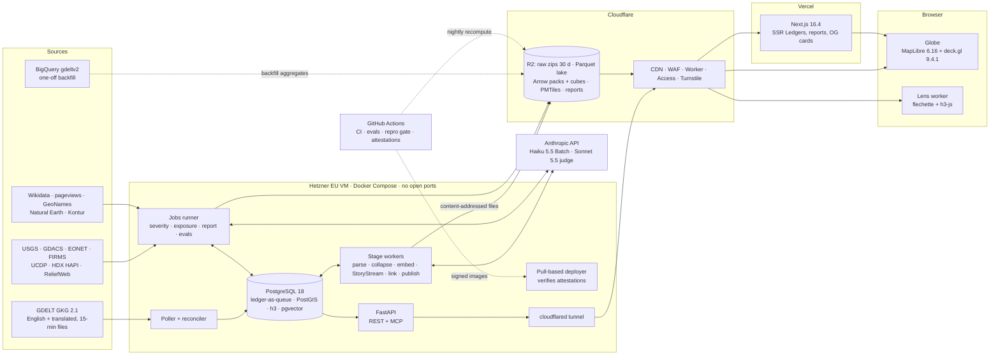

# GlobaLens 3.0 — Exposure

### North Star · 2026-10-29 · the single direction the 10-phase plan executes

> *(illustrative)* marks a placeholder. *(research)* marks a value measured during research; a `bench/` script re-measures it before it appears in a README, résumé or `/stats`. Other numbers are targets or budgets.

## 1. Name, tagline, pitch and 30-second demo

- **Name:** GlobaLens 3.0, *Exposure* edition. The weekly publication is *The Underexposed Report*.
- **Tagline (kept from v1):** *See beyond the headlines.*
- **Hero line:** *A live light meter for the world's news: what each language is looking at, how each story travels, and the crises it isn't seeing. Updated every 15 minutes, with error bars.*

**Pitch.** GlobaLens turns every GDELT 15-minute update into a measured picture of the world's attention, on a 3D globe you steer with v1's Lens. That is about 340k articles a day, and translations from 65 languages outnumber English 1.9 to 1 *(research)*. Viewfinder shows where the press is looking. Press **E** and the light inverts: attention is divided by severity, which is measured from sensors and curated datasets, never from the news. The Lens then reads **exposure in stops** per language, with an interval (one stop is a factor of two; 0 is proportionate). Wavefront shows how a story crossed borders, corrected for crawl lag, and the time ring rewinds to 2016. Every number links to its method, eval score and sources. Every Monday, a reproducible, Sigstore-attested *Underexposed Report* does what CARE's annual "Breaking the Silence" does, but weekly and per language. All of it runs on one EU server for about $46 a month.

**30-second demo** (readouts *illustrative*):

| t | What the viewer sees |
|---|---|
| 0–1 s | An SVG dot-matrix globe paints at the viewer's longitude, taken from the timezone with no prompt. |
| 1–4 s | WebGL fades in: warm light wherever the press looked this week, with precision-sized city discs and tinted countries. Badge: "data 7 min old · articles reach GDELT ~2 h after publication". |
| 4–7 s | "This is where the world is looking." The intro presses **E**: capitals dim, and azure light pools where severity outweighs coverage. |
| 7–11 s | The camera drifts to a crisis in this week's "severely underexposed" tier. The Lens snaps on and reads **−4.1 stops (−5.0 to −3.2), English-language media, 7 days**. |
| 11–15 s | Press **2** for Arabic: −1.2 stops. The ring splits to compare the two languages. |
| 15–19 s | **Wavefront:** arcs land in arrival order. "Never reached Spanish-, Portuguese- or Hindi-language press." |
| 19–24 s | Scrub back to 2023. The crisis's forgetting curve draws beside two comparable disasters. |
| 24–30 s | The **Crisis Ledger** opens: severity vs attention per language, with intervals, sources and a 90-word explanation labelled "AI-generated from 14 sources". Sharing produces a card showing the same reading. |

**How it differs** (verified white space, digest §0). World Monitor (~90k stars, same globe stack as v1) shows *what is happening everywhere*. GlobaLens measures *where the world is looking, and where it isn't*.

| | World Monitor (Oct 2026) | GlobaLens 3.0 |
|---|---|---|
| Core | 468 feeds, 59 layers, an instability index | One measured quantity: attention, set against severity |
| Neglect (#3) | HAPI conflict counts per crisis; no attention measure | Per-language exposure in stops, with intervals, validated as-of against ECHO and CARE |
| Propagation (#2) | None found | Wavefront, corrected for crawl lag |
| History (#7) | 7-day local playback | Attention since 2016, replayable as-of |
| Location (#5) | No precision display | Precision drawn as optical focus; centroids never drawn as pins |
| Trust (#6) | Forecast scores withdrawn | Public eval history; a reproducible, attested report |
| Agents (#4, #9) | 99 MCP tools, an analyst that moves the map | MCP tools for H3 cells, time and exposure, plus an MCP App; the agent comes late |
| License | AGPL + Pro tier | Apache-2.0, open data |

Ground News (partisan lean), Liveuamap (curated incidents), CARE/ECHO (annual reports) and GDELT Cloud (event coding) don't measure attention against severity per language in real time.

**Lineage.** The base is *Underexposed*: it had the best average judge score (hiring 56/70, feasibility 55/70, product 46/60) and supplies the thesis, unit, scope rule and minimal data plane. Grafts:
- **Seismograph** supplies the engine: an exactly-once ledger, a chaos harness, `llm_memo`, StoryStream, Wavefront, Magnitude, and Rust gated behind a trigger.
- **Living Planet** supplies the face: the first five seconds, develop-on-settle, optics for location honesty, a CDN-static past, and the Shot contract.
- **Desk** supplies bitemporal as-of replay and "computed first, generated second".
- **Atlas** supplies frozen-snapshot evals.

The base's fatal flaws are fixed:
- Severity has a coverage tier per crisis and a sensor-only variant.
- StoryStream restores story-level news.
- A 15-minute live layer makes the report a weekly ritual, not the heartbeat.
- The engine and agent work restore breadth.

## 2. Target users and jobs-to-be-done

The lead persona is the **attention allocator**: someone whose job is deciding what other people look at.

| User | Job to be done | Primary surface |
|---|---|---|
| Journalism and international-relations instructors and students (first niche: 20–50, recruited by hand) | "Each Monday, show what our language's press is missing compared with severity and other languages." | Weekly report, Lens + language filter, Eight Globes |
| NGO communications and advocacy staff | "I need current, defensible evidence that my crisis is under-covered for its severity." | Ledger permalink, self-updating badge, watch-lens alerts, export |
| Data journalists and researchers | "I need an open attention-vs-severity dataset with a reproducible method." | Parquet downloads, methods pages, `make reproduce`, API/MCP |
| Curious public | "Show me what I'm not hearing about." | The landing inversion, share cards, the report |
| AI agents and developers | "Give my agent typed, cited tools for attention by place and time." | MCP server and App |

Hiring reviewers are a secondary audience, served by `/engine`, `/trust`, `/stats` and the ADR log.

## 3. Feature map

**Admission rule:** a feature ships only if it moves a product metric (users, citations, retention) or a validation metric on `/trust`, and fits the RAM and cost budgets.

**Core (must ship)**

| Feature | What | Wow | Phase |
|---|---|---|---|
| Exactly-once ingest + `/engine` | Both GDELT streams through a ledger state machine (MD5 checks, per-file retry, a gap registry) | Kill a worker live; nothing is double-counted | P1–2 |
| Viewfinder + location honesty | Attention shown as light: precision-sized discs, country/ADM1 polygons, and unlocated items counted, not drawn | Imprecise coverage stays out of focus | P1 |
| Lens 3.0 | A geodesic cap of 25–3,000 km with a time ring and a language filter, computed in the browser | The readout settles in under 16 ms, with no server call | P1–2 |
| StoryStream + Magnitude | Online multilingual clustering; M = log10(number of independent outlets) | Thirty languages snap into one story | P4 |
| Infrared | Sensor and curated severity on H3 cells, with coverage tiers | A flood's exposed population lights up from sensor data alone | P3 |
| Crisis Ledgers | A server-rendered page per crisis: per-language severity vs attention, sources, method | A pasted link unfurls into "−3.8 stops" | P5 |
| Explain | The AI phrases facts computed in SQL; it never generates numbers | Hover a number to see its query | P8 |
| Trust surfaces | `/trust`, `/stats`, methods, attributions, a two-clock badge | GDELT's June 2025 gap drawn as a hatched stripe | P1→ |
| Shots | One schema for URLs, OG cards, embeds, Atom feeds and visual tests | Every view is a link that previews as the same globe | P2 |
| Watch-lenses + badges | A capability URL with an Atom feed and a signed webhook; no accounts | An "attention cliff" alert fires when the world looks away | P8 |

**Signature (the wow, and what makes it unique)**

| Feature | What | Wow | Phase |
|---|---|---|---|
| **Press E: Exposure** | log2(attention share ÷ severity share) per language, with intervals and empty rings | Light drains from media capitals and pools over crises few outlets cover | P3 places, P5 crises |
| **Eight Globes** | d3-geo small multiples, one per language | Eight languages, eight different planets | P3 |
| **Wavefront** | First arrival of a story in each country and language, corrected for crawl lag | "Never reached Arabic-language press" | P7 |
| **Long Exposure** | Hourly attention since 2016, keyed by knowledge time | Readouts show only what was known at that moment | P6 |
| **Underexposed Report** | Weekly and reviewed, bit-reproducible, attested to Sigstore | `make reproduce WEEK=2026-W44` matches the published hash | P5, P8 |
| **Geo-news MCP + App** | Lens, exposure, wavefront and H3/time tools, plus an inline mini-globe | Claude answers with a cited globe | P9 |

**Stretch** (in order; cut from the bottom):
1. EBM decomposition.
2. A bounded Analyst that answers in Shots.
3. An embedder fine-tune, only if the bake-off misses.
4. "If it were here" and a Daily Calibration quiz.
5. Clips and tours.
6. Crowd-out and "AI Echo" studies.
7. Prism (framing), gated on κ.

## 4. Signature interactions: the Lens becomes a light meter

v1's gesture stays: you rotate the planet under a fixed reticle. In 3.0 the reticle *measures*.

- **Aperture.** A true spherical cap of 25–3,000 km. Set it with `[ ]`, by dragging the edge, or by typing `lens khartoum 300km`. It is filled with H3 cells, each at most 5% of the cap, and lit by one GPU uniform (`dot(p, c) ≥ cos θ`), so it stays correct at the poles at any screen size.
- **Meter.** The ring splits into heat (severity share, left) and light (attention share, right). The centre readout depends on the mode:
  - Viewfinder: attention, surprise (σ against an hour-of-week baseline) and arriving languages.
  - Infrared: people affected, killed or in need, with a coverage tier.
  - Exposure: stops, with a 90% interval.
- **Time ring.** 24 h, 7 d, 30 d or custom. In Long Exposure it moves knowledge time, so readouts revert to what was known then.
- **Language filter and Split.** Keys 1–9 re-light the planet one language at a time. Split compares two languages over one place, never two crises.
- **Develop on settle.**
  - 0 ms: counters update.
  - 150 ms: the Lens snaps to the nearest crisis.
  - 300 ms: Wavefront arcs land (an empty ring marks silence).
  - Within 2 s: the Explain line appears.
- **Honesty readout.** "31% of this attention comes from country-level geocodes, allocated by population · 21% of articles had no location."
- **Pin, Share, Explain (P/S/X).** Pin makes a watch-lens URL, and Share makes a Shot permalink. When the agent drives (P9), the ring shows marching dashes; any drag takes back control.
- **No dragging needed (WCAG 2.5.7).** Click to centre, arrow keys, `[ ]`, and a ⌘K grammar (`lens sahel 800km 7d ar`). "In the Lens" is the screen-reader view, with debounced aria-live summaries.
- **Kernel (hand-written).** A Web Worker decodes Arrow cubes with flechette, fills the cap with h3-js and sums typed arrays.
  - Target: p95 under 16 ms.
  - Property-tested against a haversine oracle and against h3-pg.
  - The last 24 h ship as point packs; longer windows as cubes plus per-cell top-story lists.
  - The server never sees a Lens query.
- **Empty rings.** The outline is the attention a crisis would get if coverage were proportionate to severity; the fill is the attention it actually got. Area-true and colour-blind-safe.

Viewfinder draws raw attention share as light on purpose, because the bias is the point. Surprising cells get a halo. Luminance is a share of the selected language's total, so GDELT's source drift (English down 61% since 2016) doesn't darken the replay.

## 5. Design direction

**Aesthetic: "Deep Field".**
- Near-black, matte chrome; only data emits light.
- Instrument precision: ticks, graticule, mono numerals.
- Calm by default, loud only for anomalies.
- One colour encoding at a time.
- The rule: **light means attention.**

| Token | Hex | Use |
|---|---|---|
| void / canvas | #030509 / #070A10 | space, app background |
| surface 1/2/3 | #0D1219 / #141A22 / #1C232C | panels, cards, popovers |
| border subtle / control | #272E38 / #676F7A | separators, input outlines (≥3:1) |
| text 1/2/3 | #EBEFF4 / #B4BBC5 / #8A939F | text (tertiary ≥5:1) |
| lens-500, the only accent | #C3F344 | reticle, focus, selection (14.5:1) |
| danger / warning | #FB575D / #FCB442 | status only, always with icon + text |
| ocean / land / coast | #030910 / #11181F / #2C3742 | basemap |
| attention ramp | #1A2029 → #8A6A3E → #F9BE78 → #FFF1DC | Viewfinder (log share) |
| severity ramp | #24101A → #6B1D44 → #C23A6E → #FF9EB8 | Infrared |
| exposure scale | #FE9879 · #CB836D · #767B81 · #5AA1CB · #59C3FE | over → proportionate → under, with −/+ glyphs |

The exposure scale was script-verified (adjacent steps ΔE ≥ 0.079 under simulated colour blindness). The ramps must pass the same check.

**Type.** Newsreader (headlines), Inter 4 with tabular figures (UI), JetBrains Mono (readouts). Noto fallbacks for Arabic, Devanagari, CJK and Hebrew; static font instances for OG cards.

**Desktop.**
- Top bar: ⌘K, V/I/E, language, time, and the two-clock badge.
- Left: "In the Lens".
- Centre: the globe.
- Right: a non-modal sheet.
- Bottom: an 88 px timeline.

**Mobile.**
- A full-bleed globe with the Lens kept in the free area.
- A Base UI Drawer at 120 px / 50% / 92%.
- Language chips.
- A visible scrubber (no twist gesture).
- The report as an article.
- 100k points (300k on desktop).

**Motion.**
- 120/180/280 ms transitions.
- 0.8–2.4 s camera flights.
- `<ViewTransition>` gated for reduced motion.
- No more than 3 flashes per second.

**Accessibility (WCAG 2.2 AA from P2).**
- A drag-free Lens.
- Targets of at least 32 px.
- Focus never obscured.
- Freeze-frame.
- Reduced-motion and reduced-transparency paths.
- A Table view.
- No colour-only encodings.
- High-contrast and Paper themes.

**Performance (gated per release).**
- SVG paint under 1 s.
- At p75: LCP ≤ 2.5 s, INP ≤ 200 ms, CLS ≤ 0.1.
- ≥50 fps on an M1 laptop, ≥30 fps on a mid-range Android.
- Real-user fps published on `/stats`.

## 6. Architecture

**Principles:**
- **Bake the past, stream the present.** Closed 15-minute buckets become immutable Arrow files on the CDN, and clients poll a ~300-byte `now.json`.
- **The ledger is the truth.** Every effect happens exactly once.
- **Computed first, generated second.**
- **Degrade, don't die.** If the VM is down, history and the last good "now" keep serving.

| Component | Technology | Responsibility | Why it earns its place | Phase |
|---|---|---|---|---|
| Poller + reconciler | Python 3.13, httpx | Polls `lastupdate` every 60 s; per-file retry and MD5; hourly master-list diff; gap registry | Listed files can 404 for minutes, and 17 days of 2025 are missing | P1 |
| Ledger-as-queue | Postgres table, `SKIP LOCKED` leases | listed → fetched → verified → loaded → clustered → linked → published | Output and state transition commit in one transaction | P1 |
| Core store | PostgreSQL 18, PostGIS 3.6, h3-pg 4.2.3, pgvector ≥0.8.7, pg_partman | Hot window (14 days of articles, 90 of stories), registry, severity, labels, lenses, `llm_memo` | Spatial joins, story vectors, cheap retention | P1 |
| Lake + cubes | Parquet on R2, DuckDB 1.5, pyarrow | Replay, history, as-of, snapshots; Arrow packs and H3 cubes per language | No egress fees, reads scale on the CDN, and Postgres can be rebuilt from it | P1 |
| Severity connectors | Python | Hazard, conflict and humanitarian feeds → H3 severity with coverage tiers | The exposure denominator, never taken from news | P3 |
| StoryStream | ONNX int8 harrier-270m, numpy, LightGBM | Online clustering, Magnitude, story identity | The unit for linking, display and propagation | P4, v2 in P7 |
| Linker + quantifier | LightGBM, isotonic calibration, Haiku Batch | Story → crisis (open set); adjusted totals with intervals | The exposure numerator, with honest error | P5 |
| Jobs runner | `jobs` table, systemd timers | Connectors, daily exposure, report, evals; each gated on input watermarks | Six jobs don't need Dagster | P3 |
| `llm_memo` + governor | Postgres table, daily $ ledger | Memoizes by (prompt, input, model, API version); sheds features in a fixed order | Reproducible without temperature; caps the bill | P4 |
| API | FastAPI 0.162, MCP SDK (P9) | Search, Ledger data, sources, lenses, Explain, MCP | One query function behind three surfaces | P2 |
| Web | Next.js 16.4 on Vercel | Persistent globe layout, SSR Ledgers and reports, OG cards | Permalinks and cards spread the project | P1 |
| Globe | MapLibre 6.16 (pinned) + deck.gl 9.4.1, WebGL2 | Cartography, globe→Mercator morph, H3 and arc layers, `LensExtension` | The only open stack with both cartography and GPU layers | P1 |
| Client packages | flechette + h3-js; d3-geo; Zod + nuqs | Lens cap math; SVG globes for cards, Eight Globes and the MCP App; the Shot contract | Interactions cost the server nothing; Satori can't do WebGL; one shared contract | P2 |
| Edge | Cloudflare DNS, WAF, R2, CDN, Worker, Tunnel, Access, Turnstile | Immutable caching, PMTiles, rate limits, admin auth | One vendor covers the whole edge | P1 |
| `storystream-core` | Rust + PyO3 | Sequential assignment loop | Built only if a replay takes more than 12 h | P10, if triggered |

**Monthly budget** (steady state, excl. VAT):

| Item | $/month |
|---|---|
| Hetzner CPX22 (2 vCPU, 4 GB RAM, 80 GB disk, EU), €19.99 incl. IPv4 (price checked 2026-10-29) | ~23 |
| Cloudflare R2, ~140 GB in year 1 | ~2 |
| Workers Paid (from launch) + domain | ~6 |
| Anthropic, hard-capped in code, evals included | ≤15 |
| Vercel Hobby, Actions, Grafana Cloud Free, Sentry Developer | 0 |
| **Total** | **≈46** |

**Bursts:** the BigQuery backfill ($0–20, spread over months), a temporary OpenTofu backfill box (~€5), and a launch month with Vercel Pro ($20) and a $30 LLM cap.

**RAM (4 GB):**
- Postgres: 1.3 GB
- Worker and embedder: 1.0 GB
- API: 0.3 GB
- OS: 0.5 GB
- One batch slot: 0.9 GB
- Swap: 2 GB

It fits because vectors index stories, old articles live in Parquet, Lens queries never reach the server, and training runs on free CI runners.

## 7. Decision log (ADR summaries)

Each decision has exactly one choice. Every deferred option names its trigger, and the ADR log records "considered, not triggered".

| Decision | Choice | Why | Rejected (trigger) |
|---|---|---|---|
| App framework | Next.js 16.4 (App Router, Cache Components) on React 19.3. The globe is mounted once in a client layout | Server-rendered Ledgers and OG cards beside a persistent canvas. Renovate tracks the monthly security releases (CVE-2025-55182) | TanStack Start 1.0 (stable only since 13 Oct 2026); Vite SPA (no SSR or OG) |
| Globe renderer | MapLibre GL JS 6.16 (exact pin) + deck.gl 9.4.1 interleaved on WebGL2; native heatmap and symbol layers; a custom `LensExtension` | Cartography, an adaptive globe and binary attributes. A week-1 spike decides go or no-go, because GlobeView is experimental | three.js/globe.gl; Cesium; Mapbox; WebGPU in the core (no basemap interleaving). Plan B: custom GLSL |
| Basemap | Protomaps PMTiles z0–12 extract on R2, served by a Worker and recoloured dark | ≈$0.25/month, cacheable, ODbL | Mapbox; MapTiler/Stadia (free tiers are non-commercial) |
| Data plane | Immutable Arrow packs/cubes on R2; `now.json` polled every 60 s | The source changes every 15 min; 50k viewers ≈ 830 cached req/s | SSE, WebSockets |
| API style | FastAPI REST with OpenAPI 3.1 and a generated TypeScript client; MCP (Streamable HTTP) calls the same functions | Most reads never touch the API | GraphQL; tRPC; Connect (beta in Python) |
| Database | Self-hosted PostgreSQL 18 + PostGIS 3.6 + h3-pg 4.2.3 + pgvector ≥0.8.7 + pg_partman; PG18 `WITHOUT OVERLAPS` for registry versions | One engine for all of it; 0.8.7 fixes CVE-2026-103484 | Neon/Supabase (pgvector 0.8.6; compute stays awake under 15-min writes); ClickHouse (trigger: ~1B hot rows or p95 >2 s); TimescaleDB |
| Lake | Day-partitioned Parquet on R2 with `event_time` and `ingested_at`, queried by DuckDB | Replay, as-of, snapshots and open data at $0.015/GB | DuckLake (trigger: concurrent writers); Iceberg |
| Search | Postgres hybrid: `tsvector` on original and translated titles plus pgvector HNSW on story centroids, merged by RRF; GeoNames/Wikidata labels | Cross-lingual, with no new service | OpenSearch; Qdrant (trigger: recall@10 <0.95 or >10M vectors) |
| Queue / streaming | The ledger is the queue: `SKIP LOCKED` leases, attempts → dead letter, content-addressed external writes | One state store; exactly-once is one transaction | pgmq (second store); Kafka (~15 msg/s); NATS (trigger: ≥3 independent consumers) |
| Orchestration | Worker loop, `jobs` table with input watermarks, systemd timers, resumable `glb backfill` CLI | ~6 scheduled jobs | Dagster (trigger: >8 interdependent jobs or a second stale-input incident); Airflow |
| Embeddings | harrier-oss-v1-270m (MIT, 94 languages), ONNX int8 on CPU, stored as 256-d Matryoshka `halfvec`. Provisional until the P4 bake-off | Multilingual and permissive; titles fit on 2 vCPUs | Jina v4/v5 (non-commercial); hosted APIs (recurring cost). Bake-off rivals: EmbeddingGemma 2, e5-small (fallback), Qwen3-0.6B (ceiling) |
| LLMs | Claude Haiku 5.5 on the Batch API, thinking off, for adjudication, translation and syntheses; real-time only for Explain. Sonnet 5.5 as a sampled judge. Every output stored in `llm_memo`; spend capped at $15/month | $0.05/$0.25 per MTok on Batch, with native citations. API 2026-10-21 rejects temperature, so memoization gives reproducibility | Self-hosted gpt-oss-20b; Sonnet for bulk; fine-tuning |
| Agent framework | None: ~1.5k LOC on the Anthropic SDK, ≤8 read-only tools that are pure functions of state, and fixed workflows except for the late Analyst (≤8 calls) | Inspectable, governed, evaluable | LangGraph; Pydantic AI; CopilotKit; AI SDK runtime (backend is Python) |
| Cloud + compute | One Hetzner EU VM (CPX22, €19.99) running Docker Compose behind Cloudflare Tunnel; Vercel for the web. Server type is an OpenTofu variable: CAX21 (€10.99) when it becomes orderable, CPX32 (€35.99) only on a trigger | Small, constant load, so scaling to zero saves nothing; 20 TB of traffic is included | Cloud Run + Neon (two clouds); Kubernetes (no load to justify it); AWS (App Runner closed) |
| IaC | OpenTofu 1.13 for Hetzner, Cloudflare, the GitHub org, Grafana, Vercel and Sentry. Encrypted state in R2; plan on PR, apply on merge, nightly drift check, Conftest policies | Real infrastructure, rebuilt in the DR drill | Terraform (BSL); Pulumi |
| CI/CD | GitHub Actions in a free org: merge queue, a `ci-ok` gate, SHA-pinned actions, zizmor, Renovate, Docker Hardened Images, Syft SBOMs, SLSA L3 attestations, Grype, release-please, and Playwright snapshots of Shots. Deploys are pull-based: verify the attestation, then roll out or roll back | No inbound SSH and no deploy keys in CI | Trivy (compromised, CVE-2026-33634); SSH push deploys; Argo CD |
| Observability | OpenTelemetry → Grafana Cloud Free (metrics, logs, traces, Faro RUM, synthetics, k6), plus Sentry. `/status` and `/stats` render from JSON on R2 | $0, one stack, and the status page survives a VM outage | Langfuse/Phoenix; self-hosted LGTM |
| Auth | No user accounts: capability URLs, HMAC-signed webhooks, Cloudflare Access (email OTP) for admin and labelling, and Turnstile plus WAF rate limits | No GDPR surface and no on-call promises | Better Auth; Clerk |
| Frontend libraries | Zustand, nuqs, TanStack Query, Tailwind 4.3 with shadcn/ui on Base UI, React Aria, Motion, uPlot, cmdk | Each covers one job | Redux; Vaul |
| Monorepo | pnpm + Turborepo, a uv workspace, mise, Compose watch with `grafana/otel-lgtm`, a devcontainer. Cargo only if Rust ships | CI runs only what changed, across TypeScript and Python | Nx; Bazel; Poetry |
| Rust / C++ | **Rust in at most one place:** `storystream-core` (PyO3), built only if a full replay takes over 12 h, and only if it agrees with the Python oracle on ≥99.9% of assignments. **Rejected by measurement:** a Rust GKG parser, since Python already parses 11.7–13.6k rows/s per core *(research)* and the live load is ~4 rows/s. **No C++.** WASM only if the Lens misses 16 ms on a mid-range phone | The trigger story is the senior signal | Rust parser; Martin; C++ |

## 8. Data sources and legal posture

| Source | Role | Terms | Cadence |
|---|---|---|---|
| GDELT GKG 2.1 raw files (English and translated) | Attention: place, language, outlet, title, themes | Free, including commercial use; cite and link | 15 min |
| BigQuery `gdeltv2.gkg_partitioned` | A 90-day seed (P2), then aggregates from 2016 (P6) | $6.25/TiB after 1 TiB/month free | Once |
| USGS, GDACS, NASA EONET, NASA FIRMS | Sudden-onset severity: magnitude, alerts, exposed population, fire power | Open; GDACS requires acknowledgement and is "as is"; FIRMS needs a free key | 1 min – 3 h |
| UCDP GED + Candidate | Conflict fatalities (coded from news, so excluded from the sensor-only variant) | CC BY 4.0; token, 5k requests/day | Monthly |
| HDX HAPI | Chronic crises: food insecurity, displacement, needs, funding | HAPI terms and per-source licenses; endpoints to verify in P3; conflict series not used | Weekly–monthly |
| ReliefWeb v2 | Disaster registry (GLIDE); report counts as an independent attention series | Approved appname; metadata only | Daily |
| Wikidata, Wikipedia pageviews | Crisis names in 100+ languages; outlet metadata; public attention | CC0; compliant User-Agent | Weekly / daily |
| Kontur Population (H3, 400 m) | People exposed; allocating country-level geocodes to cells | CC BY (Nov 2023) | Static |
| GeoNames, Natural Earth, Protomaps | Gazetteer, admin polygons, basemap | CC BY; public domain; ODbL | Static |
| CARE and ECHO forgotten-crisis lists | Validation labels | Facts | Annual |

**To evaluate in P3:** the INFORM Severity Index, which covers protracted crises; its license is unverified.

**Not used:**
- ACLED: no API for generic emails, and its terms forbid substitutes.
- GDELT Events, Mentions and APIs.
- Article HTML, ledes and thumbnails.
- Non-commercial feeds.
- NLLB, Jina, and the TimesFM 3.0 weights.

**Legal posture: a search engine, not a clipping service.**
- **We store:** titles, URLs, outlet, time, language, GKG metadata, embeddings and derived numbers. Never full text, ledes or thumbnails, and there is no crawler.
- **AI text:**
  - Multi-source only: at least 3 outlets, at most 120 words.
  - Numbers only from SQL slots; no quotes.
  - Rejected on any 8-word overlap with a source.
  - Verified before display.
  - Labelled "AI-generated from N sources" (EU AI Act Art. 50(4), in force since 2 Aug 2026). Translated titles are labelled too.
- **Provenance:** every row carries `source, license, attribution, commercial_ok`. CI fails on an unlicensed source, and the attributions page is generated from these fields.
- **Publishers:** opt-outs are honoured within 72 h, takedown and abuse contacts are published, and GDELT is attributed everywhere.
- **Privacy:** no accounts, cookies or personal data.
- **Ethics:**
  - Compare languages by default.
  - Publish tiers with intervals, never ranks.
  - Make severity definitions switchable.
  - Write "coverage", never "worth".
  - Publish an ethics statement and get 2–3 external reviewers.
  - State that GlobaLens is not for safety-of-life decisions.

## 9. AI/ML components and evaluation

There are two depth pillars: **StoryStream → Wavefront**, and **Exposure** (linking, severity, quantification). Everything else supports them or is a stretch.

| Component | Method | Evaluation | Bar |
|---|---|---|---|
| Geo precision | `Geo_Type ∈ {3,4}` becomes discs; `{1,2,5}` becomes polygons. Filter on Geo_Type, never on whether a FeatureID exists. The primary location is the earliest city mention; country-level attention is allocated by population | Admin-1 accuracy on 300 labelled items | City-level 58.5% EN / 50.9% translated *(research)* |
| Syndication collapse | URL canonicalization, NFKC title hash, MinHash LSH, outlet groups | P/R on 500 labelled pairs; inflation per language | 22.8% exact-duplicate EN titles *(research)* |
| Embedding bake-off | harrier-270m, EmbeddingGemma 2 and e5-small (int8 CPU); Qwen3-0.6B as the ceiling | SemEval-22 T8 Pearson; Miranda F1; titles/s on the VM | T8 best 0.818 |
| StoryStream | v1: ANN over decayed centroids with a calibrated threshold. v2: Miranda features (Matryoshka cosines, BM25, entity Jaccard, ADM1 overlap, Δt σ = 72 h) → LightGBM ranker + calibrated new-story classifier, with an hourly merge/split pass using memoized Haiku | Pairwise and B-cubed F1 with CIs on Miranda (titles-only penalty reported) and on 400 in-domain pairs; ablations; p95 latency | Miranda 94.1/97.1/94.2 mono, **84.0 cross-lingual** |
| Wavefront | Outlet registry + hierarchical per-outlet crawl-lag model fitted on `PAGE_PRECISEPUBTIMESTAMP` (present in 44–58% of records) | Arrival MAE on masked timestamps; 80%-interval coverage | Coverage ±5 pts. Median lag ~120 / 82 min *(research)* |
| Surprise baseline | Robust median/MAD per cell and hour of week on language shares, with empirical-Bayes shrinkage | Weekly precision@20 vs GDACS, USGS and UCDP events | Beats raw volume |
| Severity S-v1 | People affected (footprints × Kontur), killed or in need; coverage tiers; a sensor-only variant | Kendall τ stability; validity vs ReliefWeb volume and HAPI funding; share of listed crises it can measure | Gaps published, not hidden |
| Crisis linker | Candidates (geo, time, GKG themes, Wikidata names) → embeddings → LightGBM with an open-set "none" class and isotonic calibration → Haiku on low-margin cases | Macro-F1 per language (where n ≥ 50), ECE and open-set precision; ablation against a theme-filter baseline; cost and quality of the LLM vs the distilled model | Beats the theme filter |
| Quantifier | Adjusted and probabilistic classify-and-count per crisis × language × window; bootstrap intervals | Error of totals on held-out days; 90%-interval coverage | 85–95% coverage |
| Exposure index | log2(attention share ÷ severity share); intervals combined | As-of precision@10 and recall vs ECHO and CARE, with no look-ahead | Published, losses included |
| Explain + syntheses | SQL fills the slots and Haiku phrases them. Syntheses only for stories from ≥3 outlets in ≥2 countries | Slot check on numbers and entities; MiniCheck-Flan-T5-L (75.0 on LLM-AggreFact) per sentence; overlap; $/text | ≥95% pass; 0 violations |
| Agent (P9) | Analyst that emits Shots; ≤8 read-only tools | Frozen snapshots: claim-to-view consistency, citation validity, no `as_of` leakage, title injections, pass^k. A 40-task PR gate (~$0.08) | No safety regression |
| Stretch: EBM | Expected attention from severity, type, recency and covariates | Temporal holdout against baselines | — |

- **Gold sets:** 300–500 items, machine-translation-assisted, with 20% double-annotated (κ reported). Only languages that have annotators are labelled, and the method is shown on `/trust`.
- **Evals:** pytest suites log to `evals/history/`. LLM metrics use n ≥ 3 samples with confidence intervals, and a drop beyond the CI blocks a release.
- **Determinism:** integer aggregates, single-threaded sorted ratios rounded to 0.01 stops before hashing, and seeds derived from the week ID.

## 10. Headline metrics and résumé bullets

Every metric comes from a committed `bench/` or `evals/` script through a metrics ledger, the only source for README and résumé numbers. The research scripts `measure_gkg.py` and `backfill_size.py` move into `bench/` in P1.

**Published on `/stats` and `/trust`:**

| Area | Metrics |
|---|---|
| Freshness | ≥99% of intervals within 30 min; ≥99.9% complete within 24 h |
| Correctness | Chaos-run hash matches (1,000 nightly SIGKILLs) |
| Clustering | StoryStream cross-lingual F1 vs 84.0; T8 Pearson vs 0.818 |
| Propagation | Wavefront MAE and interval coverage |
| Linking | Per-language F1, ECE and totals coverage |
| Validity | As-of precision@10 vs ECHO and CARE; weekly report hash matches |
| Frontend | Lens p95, INP, real-user fps |
| Edge and cost | CDN hit ratio, peak req/s, $/month |
| Usage | Weekly and returning users, embeds, citations |

**Résumé bullets** (values in brackets come only from the ledger):
- Built GlobaLens, an open, live instrument that measures the world's news attention against crisis severity in [N] languages. Ingests every GDELT 15-minute update (~340k articles/day) with exactly-once effects on at-least-once delivery, proven by a nightly [1,000]-SIGKILL chaos harness with replay-identical state hashes. [99.x]% of intervals are live within 30 minutes; the whole system runs on $[46]/month.
- Designed StoryStream, an online multilingual story clusterer (int8 CPU embeddings, a LightGBM ranker and a calibrated new-story classifier). Reaches [x] cross-lingual pairwise F1 against the published 84.0 (Miranda et al., EMNLP 2018), at [y] ms p95.
- Built calibrated crisis linking and quantification with [c]% coverage of 90% intervals. Evaluated as-of, the Exposure index recovered [p]% of the EU Forgotten Crisis and CARE lists.
- Served a decade of GDELT attention as CDN-static Arrow cubes after a capped $[b] BigQuery backfill; absorbed [r] req/s at launch with a [h]% edge hit rate.
- Shipped a WebGL2 globe whose Lens computes spherical-cap aggregates in a Web Worker in [t] ms p95; the server never sees a Lens query.
- Publish a weekly report anyone can recompute bit for bit, gated nightly and attested to Sigstore. All AI text is computed first and passes [100]% numeric checks.
- *(Only if triggered)* Ported StoryStream's loop to Rust/PyO3: [N] h → [M] h at ≥99.9% agreement.

**Honesty infrastructure:**
- A README status table generated in CI.
- A claims ledger.
- A `v1-hackathon` tag, with a retrospective.
- `docs/ai-workflow.md`.
- Four hand-written depth kernels (ledger, Lens, StoryStream assignment, quantifier), each with a blog post and an explain-back recording.

## 11. Non-goals and deliberate cuts

- **Prediction:** no forecasts and no "early warning" framed as prediction. GDELT measures attention, not truth.
- **Breadth:** no flights, ships, markets, outages, weather, risk scores or bias ratings.
- **Accounts:** no sign-up, auth service, inbox, push, self-run email, Boards or teams.
- **Article content:** no full text, ledes, per-article summaries, quotes, thumbnails or crawling.
- **Chat-first identity:** no LLM call on the landing path.
- **Entity graph and Figures:** both cut. Framing diffs survive only as the last stretch item.
- **Untriggered infrastructure:** no Kubernetes, Kafka/NATS, ClickHouse, Qdrant, Dagster, DuckLake, pgmq, SSE/WebSockets, tile server, core WebGPU or C++.
- **Graphics vanity:** no 4K stills, nightly MP4s, satellite days, particles or point-count goals.
- **Crisis leaderboards:** no crisis-vs-crisis rankings and no "worth" language.
- **Unearned claims:** no LOC goals, and no history before what a sampled backfill proves (nothing earlier than 2016).

## 12. Top risks and mitigations

| Risk | Mitigation |
|---|---|
| Severity is weakest for chronic crises, exactly where users look | Coverage tiers that show "not measurable" instead of a number; a HAPI and INFORM spike in P3; a sensor-only variant; publishing the share of crises we can score |
| Backlash over "ranking lives"; politicized conflicts | Compare languages first; publish tiers with intervals; switchable definitions; an ethics statement; external reviewers; a corrections log |
| GlobeView is experimental, and interleaving across the z10–12 morph is unproven | A week-1 spike with a go/no-go ADR; MapLibre-native layers; custom GLSL as Plan B; exact version pins; visual regression tests |
| GDELT outages, decline or a format change in GDELT 5 | Use files, not APIs; the ledger, reconciler and gap registry; contract tests; a `SourceConnector` interface; the CDN keeps serving the last good data |
| Linker quality across 65 languages; labelling labour | Link at story level; scoped gold sets with a second annotator; per-language results only where n is large enough; quantification corrects totals |
| The 4 GB box runs short of RAM or CPU | A written RAM budget; heavy jobs moved to CI runners; e5-small as the fallback; CPX32 only on a measured trigger plus an explicit budget decision |
| LLM cost or API churn (temperature removed; the new tokenizer counts ~30% more tokens) | `llm_memo`; the Batch API; ordered feature shedding; templated fallbacks; token counts measured, not assumed |
| World Monitor adds attention-vs-severity (it already runs HAPI crisis trackers) | Ship E-mode in P3; compete on method: intervals, as-of validation, a decade of history, reproducibility, open data |
| Owning AI-written code | Depth kernels written by hand; ADRs drafted by a human first; explain-back recordings; one set of CI gates for all code |

## 13. Preliminary phase ordering

Each phase takes about 3 weeks and ships a tagged release, a live demo, a GIF, a `/stats` delta and at least one ADR.

1. **First Light (wk 1–3):** v1 tag and retrospective, GitHub org, data registrations, VM, render-spike ADR; ledger ingest of both GDELT streams to R2; a live Viewfinder with location honesty, a language filter, Lens v0, the two-clock badge and `/engine`; OpenTofu and CI. *Gate: a no-signup URL on real data, ≥99% fresh for 7 days.*
2. **The Lens (wk 4–6):** Lens worker kernel and GPU highlight, time ring, surprise baseline from a 90-day BigQuery seed, Shots and OG cards, accessibility paths, mobile drawer, syndication collapse, chaos harness, attested pull deploys. *Gate: Lens p95 under 16 ms; identical chaos hashes.*
3. **Infrared & E (wk 7–9):** severity connectors with a license check in CI, coverage tiers, place-level Exposure with intervals and a sensor-only variant, Press E, empty rings, Eight Globes, a draft ethics statement. *Gate: the hero interaction is live.*
4. **Stories (wk 10–13):** embedding bake-off ADR, StoryStream v1, Magnitude, story sheets with translated titles, hybrid search, `llm_memo` and the spend governor, labelling tool, `/trust` v1. *Gate: Miranda and T8 scores published with CIs.*
5. **Crisis Ledgers (wk 14–17):** crisis registry, linker, quantifier, per-language crisis Exposure, server-rendered Ledgers, Report #1, the first 20 users, external reviewers. *Gate: the complete thesis is live, with evals on `/trust`.*
6. **Long Exposure (wk 18–20):** per-year field sampling, capped BigQuery backfill, decade cubes, knowledge-time as-of, pageview and ReliefWeb series, validation against ECHO and CARE. *Gate: decade replay and validation published.*
7. **Wavefront (wk 21–23):** StoryStream v2 with ablations, the crawl-lag model, Wavefront arcs for stories and crises. *Gate: v2 F1 and lag-interval coverage published.*
8. **Explain & Launch (wk 24–27):** Explain and syntheses checked by MiniCheck, watch-lenses and badges, `make reproduce` plus a nightly reproducibility gate and Sigstore attestation, k6 at 10×, a VM-down drill, an a11y audit, then Show HN once there are 20+ niche users. *Gate: launch.*
9. **Agents (wk 28–30):** MCP server and App, a bounded Analyst behind the governor, frozen-snapshot agent evals as a PR gate. *Gate: evals published; MCP live in Claude.*
10. **Depth & Hardening (wk 31–34):** a replay benchmark (Rust `storystream-core` only if a replay takes over 12 h), EBM (stretch), a DR drill rebuilt from code and the lake with the RTO published, open data with a methods paper, and a 90-second video. *Gate: metrics frozen into the ledger.*

**Natural stopping points:** after P3, a unique live instrument; after P5, the complete thesis with real users; after P8, a launched product.

## 14. Open questions for you

1. **First niche:** journalism/IR classrooms, NGO communications staff, or both? Which can you reach for 20–50 users?
2. **Budget:** is ~$46/month acceptable? If 4 GB is too small: pay ~$64 for CPX32, or cut LLM features?
3. **Ethics and voice:** are you comfortable publishing a weekly report under your name that sorts crises into "underexposed" tiers, with outside reviewers?
4. **Naming:** do "GlobaLens 3.0, Exposure edition" and *The Underexposed Report* work for you, alongside "See beyond the headlines"?
5. **Time:** how many hours a week can you give? The plan assumes ~10–12 for ~34 weeks.
6. **Annotators:** can you recruit one or two multilingual annotators?
7. **Analyst:** ship the bounded agent in P9, or stop at the MCP server and app?
8. **Licenses:** Apache-2.0 for code and CC BY 4.0 for open data, where upstream licenses allow?
