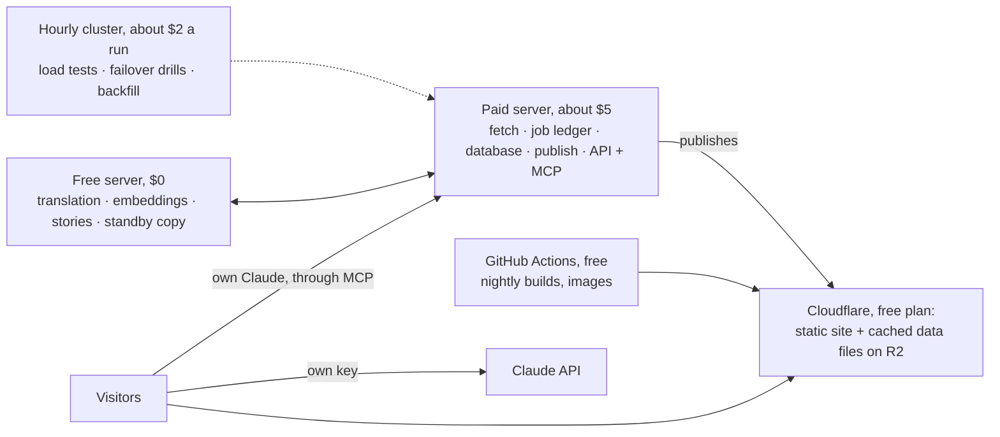

# GlobaLens 3.0 on $20 a month: the rethink

*Proposal, 13 November 2026. Prices and limits come from `research/budget-rethink.md`, except where they quote the earlier plan.*

> **Status: approved on 13 November 2026 and applied.** `master-plan.md` (revision 4) is now the source of truth; where this proposal and the plan differ, the plan wins. "The plan of record" below means revision 3, the plan as it stood before this proposal. Refinements made while rewriting:
> - **Server size.** The plan's disk budget suggests the paid server will need the next size up from about Phase 4. Both sizes stay under $20 with every cap reached: about $18 on the small one, about $19.50 month to month on the larger one, because the Claude caps shrink when the server grows (master plan §14).
> - **One-off spending** is itemised at about $28.50–38.50, inside the $30–40 allowance.
> - **Launch.** The site opens quietly at the end of Phase 8; the public launch is at the end of Phase 9, when the Analyst is live (§17, question 19).
> - **Map tiles** deeper than zoom 6 come from OpenFreeMap's public tiles; the world to zoom 6 is self-hosted.
> - **Publisher opt-outs.** Outlets that signal against AI use are not machine-translated.
> - **Enforcement.** The Stop hook is a first check; the required CI check is the gate that cannot be passed.

## 1. What you asked for

On 13 November you changed the brief:

- **Quality first.** You want a good, ambitious project, not a cut-down one.
- **About $20 a month** to keep it running in public. (I read your "max 20 dollars" as per month.) Plus **$30–40 once**, around filming the video and launching.
- **No rented GPUs.**
- **Bring your own key (BYOK).** Visitors who want live AI use their own API key. There is a hosted demo, an article and a video.
- **Time is not the limit.** Claude does the implementation, testing, verification and deployment.
- **Where the effort should go:** UI, features, small details, backend, strong compute infrastructure.

## 2. The short version

The plan of record was written for a person with 10 hours a week and a bill that grew from $26 to over $100 a month. It spent money to save your hours: a bigger server, paid web hosting, paid AI calls for things a free model could do. Your new brief is the reverse. Hours are plentiful and money is tight, so the new plan spends build effort to save money. Nothing in the product has to be cut to do it.

1. **The product stays whole.** The globe, the Lens, story groups, cross-language search, Press E (Exposure), the decade replay, Wavefront, the weekly report, the MCP server, and the Analyst chatbot that the $5 version dropped.
2. **The bill is about $14 a month, and about $18 if every spending cap is reached** (§4). One small paid server, one free server, Cloudflare's free plan, and a capped Claude budget.
3. **AI comes in four lanes** (§5), so no feature depends on how much you can spend: AI that you pay for once and every visitor sees; free models on our servers and in the visitor's browser; a small free taste of live AI; and bring-your-own, either a key or the visitor's own Claude.
4. **Big compute is rented by the hour** (§6). A three-machine cluster for a six-hour load test costs about $2. The steady bill stays small; the heavy moments are short and cheap.
5. **Time buys polish** (§8). Everything the old plan cut for lack of hours comes back, and there is room for new features that cost nothing to run.
6. **The $20 limit becomes part of the story.** A public page shows the real bill every month, and the launch article explains how a live, 60-language news system runs on it.

## 3. What does not change

- **The idea.** One instrument, two layers: the daily driver (explore the world's news by place, language and time) and the signature (Exposure: attention measured against severity, per language).
- **The ten phases and their order**, P1 "First Light" to P10 "Depth & Hardening". Their contents grow; their sequence holds.
- **The core stack.** Next.js, MapLibre and deck.gl in the browser; Python, FastAPI and Postgres (PostGIS, h3, pgvector) on the server; OpenTofu for infrastructure; GitHub Actions with signed, attested builds; Claude Haiku 5.5 for bulk AI work.
- **The engineering spine.** The fenced-lease job ledger, the chaos tests, CDN-first serving, the metrics ledger, pre-registered bake-offs, the timed rebuild from code.
- **The safety rules.** No full article text, the untrusted-text policy, hard spending caps, every published number traceable to a measurement.

## 4. The money

### Monthly, once everything is running

| Item | Plan of record | Now | How |
|---|---|---|---|
| Paid server | $23–41 | **about $5** | OVH VPS-1: 2 cores, 4 GB, 40 GB, at $4.54–5.35 depending on the term |
| Second server | none | **$0** | Oracle's free Arm machine: 2 cores, 12 GB, 200 GB |
| Website hosting | $0, then $20 in the launch month | **$0** | The site becomes static files on Cloudflare: free and unlimited |
| Data delivery | $2–8, plus $5 from P8 | **$0–2** | Cloudflare's free plan; R2 storage is free to 10 GB, then $0.015 per GB |
| Claude API, all uses | caps of $30–45 from P5 | **caps of $10** | Production $7, evaluation $2.50, development $0.50 |
| Off-site backup | about $4 | **$0** | Backblaze's free 10 GB and Oracle's free 20 GB |
| Domain | about $1 | **about $1** | Paid once a year, about $12–15 |
| Monitoring, error tracking, email | $0 | **$0** | Grafana Cloud, Sentry, Healthchecks, Resend free plans |
| **Total** | **$26, rising to $115** | **about $14 typical; about $18 at every cap** | |

Notes:
- Prices are before sales tax.
- In P1–P3, before most AI features exist, the bill is about $7–9.
- Typical Claude spend sits under its caps. In P4–P8 the plan of record expected evaluation and development to use $4–10 of their $15 caps.
- If measurements in P1–P2 show the small server is too small, the next size (4 cores, 8 GB, 75 GB) costs $8.50–10. The Claude caps come down by the same $4–5, and the total still fits under $20.
- The Claude subscription you build with is separate from this budget.

### What keeps the bill from running away

| Layer | What it does |
|---|---|
| Fixed prices | The server and domain cannot overrun |
| Cloudflare free plan | At a free limit, a request fails; nothing is billed. R2 is the one metered product, so it gets a write budget, lifecycle rules and an alert at 80% |
| Anthropic workspace limits | Each of the three workspaces has a hard monthly spend limit set in the Console |
| Our own governor | A daily budget per feature, with a fixed order in which features switch to their free fallback (already designed in §8 of the plan) |
| `/cost` | A public page that shows this month's real spend against the $20 line, from the providers' own usage reports |

### One-off spending: inside your $30–40

| Item | About |
|---|---|
| Launch week: raise the live-AI caps so the demo and the video show everything | $10 |
| A full evaluation run on the final build | $5 |
| Hourly cluster: a load test, a failover drill and a Kubernetes trial (a few runs at about $2 each) | $4–6 |
| Decade history backfill on a 16-core machine for 48 hours (or $0 through BigQuery's free sandbox) | $0–10 |
| Reserve | $5–10 |
| **Total** | **$24–41** |

The plan of record also listed test phones ($150–250) and paid annotators ($300–500). Those become: borrow a phone or use your own, and volunteers or model-assisted labelling (§7).

## 5. AI in four lanes

Every AI feature gets a free floor. Money changes how polished or how live a feature is, never whether it exists.

| Lane | Who pays | What runs there |
|---|---|---|
| **1. Shared** | You, under a hard cap of about $7 a month | Work done once that every visitor sees: Claude-polished translations of the top stories, the borderline story-grouping decisions, the weekly report's summaries, explanations of the most-viewed views. Every result is stored and reused. |
| **2. Free compute** | Nobody | Open models on our own CPUs: an English translation for every headline, embeddings for search and story grouping, language detection. Desktop Chrome's built-in translator is an extra where it exists. |
| **3. Free taste** | You, about $1.50 of lane 1 | Live Analyst questions and fresh explanations for visitors with no key: a few per visitor per day, a global daily budget, a bot check and a kill switch. When the budget is spent, visitors see recorded answers replayed and an invitation to use lane 4. |
| **4. Bring your own** | The visitor | Their own Anthropic key, used straight from their browser. A one-click OpenRouter connection for people without one. Any OpenAI-compatible endpoint, including a model on their own machine. Or GlobaLens added to their own Claude through MCP, which works on Claude's Free plan. |

### Feature by feature

| Feature | Plan of record | Now |
|---|---|---|
| English glosses | Claude translates only the rows on screen, capped at about $5 a month; "gloss pending" when the cap is hit | **Every headline is translated when it arrives**, on our CPUs, for $0, on phones too. Claude polishes about the top 5% (the stories most people read). Each gloss shows where it came from. "Improve this translation" works with your own key |
| Story-grouping and crisis-link decisions | Claude decides borderline cases | The same, on a smaller slice. It ends when the cheap local model trained on those decisions takes over (P7) |
| Weekly report summaries | Claude, in batch | The same |
| Explain | Live, cached, capped | Cached for popular views; a template sentence otherwise; live through lane 3 or 4 |
| Analyst | P9, minimal, 16–27 answers a day for everyone, first in line to be cut | A full panel in three modes: replayed examples, the free taste, and your own key with no limit. Also available inside the visitor's own Claude through MCP |
| Evaluation runs | Caps of $10–25 a month | A $2.50 cap: code-based graders first, cached runs, a rotating weekly sample. The full suite runs once before launch from the one-off budget |

Why this is better than the plan of record, not just cheaper:

- **Translations get wider.** The research found that small open models covering the 55 largest languages can translate their share of the feed in about one core-hour a day on an ordinary CPU; the remaining languages use slower models and add to that (our estimate from published speeds). The old design translated only what someone was looking at and stopped at its cap.
- **Launch day gets safer.** Glosses become plain data files on the CDN. A traffic spike no longer turns into thousands of live Claude calls and a rate limit.
- **The Analyst stops being a liability.** Its cost no longer grows with your traffic.

What an answer costs a visitor: Claude Haiku 5.5 is $0.10 per million input tokens and $0.50 per million output tokens. The plan of record budgeted $0.08 a day for 16–27 Analyst answers, so one answer is about a third to half a cent. The panel shows the running cost of the conversation.

One thing to be realistic about: no published figure exists for how many visitors paste a key, and it is safest to assume few do. A recruiter gives the site a minute or two. So lanes 1–3 must make the product complete and impressive with no key at all. Bring-your-own is the "no limits" button, not the entrance.

### How a visitor's key is handled

- **The browser calls Anthropic directly.** Our servers never see the key. The tools the model calls are our public, read-only API: the same tools the MCP server offers (at most eight), so there is one implementation to test.
- **Memory only, by default.** "Remember on this device" is opt-in. The UI says plainly what is true: no browser storage is safe from a malicious script running on the page.
- **So the real defence is keeping scripts out.** A strict Content Security Policy lets the page talk only to our own hosts and the chosen provider. The site loads no third-party scripts at all. Model output and headlines are always rendered as plain text.
- **Onboarding teaches a low-risk key.** A separate workspace in the Anthropic Console, a monthly spend limit (for example $5), and a key that expires in 30 days.
- **A known limit.** Organisations with zero data retention get an error from Anthropic on browser calls; the panel explains it.
- **Claude is the tested path.** The Analyst's evaluation gate runs on Claude. OpenRouter and custom endpoints are labelled "not covered by our evaluations", and anything they return is treated as untrusted text.
- **Not possible:** "Sign in with Claude". Anthropic does not allow third-party sites to use a visitor's Claude.ai subscription. MCP is the sanctioned route for that.

## 6. Infrastructure: small every day, big by the hour

**The edge (Cloudflare, free plan)**
- The site is a static export of the Next.js app. Static files on Cloudflare are free and unlimited, and no Worker runs, so a launch spike cannot hit a daily quota. The research ruled out the alternatives: server rendering typically needs 10–20 ms of CPU against the free plan's 10 ms limit, and Vercel's free plan pauses a site at 1M requests a month.
- Data files (map shards, Parquet, share cards) live in R2 on our own domain behind Cache Rules, each under Cloudflare's 512 MB cache limit.
- The basemap is one file. A world map to zoom 6 is 45 MB, and to zoom 7 it is 190 MB. Either fits in the cache, so map tiles come from the edge for $0 from day one. The plan of record used a public tile service until P8 and then paid $5 a month.
- Pages that need their own link preview (a shared view, a crisis page, the weekly report) are written to R2 as small HTML files when they are created, instead of being rendered on every request.

**Two servers**
- **The paid server** (small, reliable) runs what must never stop: fetching GDELT every 15 minutes, the job ledger, the main database, publishing to the CDN, and the API and MCP endpoint behind Cloudflare Tunnel.
- **The free server** (bigger, replaceable) runs the heavy work: translation, embeddings, story grouping, large queries, the decade archive, evaluation runs. It also keeps a live copy of the database.
- The job ledger already lets several workers take jobs safely (fenced leases), so a second machine fits the existing design.
- **If Oracle takes the free server away:** the site stays up and fresh. Translation and story grouping pause, then catch up from the ledger once the server is rebuilt from code. **If the paid server dies:** the free server takes over from its copy. Both events are visible on `/engine`, and both are rehearsed.
- Sizing is settled by measurement in P1–P2. The fallback is the next paid size up with lower Claude caps (§4).

**Compute by the hour**
- An OpenTofu module creates a cluster, runs a job and destroys it. Three 8-core Hetzner machines for six hours cost $1.90; a 16-core machine for 48 hours costs $9.44.
- Uses: a load test at ten times expected launch traffic; a failover drill on camera; the Kubernetes (k3s), ClickHouse and NATS bake-offs for cents each; the history backfill if the free route is too slow.
- The Hetzner account is opened in Week 0, because new accounts get higher limits only after a month and a first paid invoice.

**Free batch compute**
- GitHub Actions on a public repository gives 4-core, 16 GB machines for x86 and Arm with no monthly cap. It builds the images for both servers and runs the nightly jobs that publish the project's own data: the basemap, the share cards, the benchmark datasets, the model-free evaluations.
- It does not run the live 15-minute ingest. GitHub's terms rule that out, and schedules there can be delayed.

**Watching it:** Grafana Cloud, Sentry, Healthchecks and UptimeRobot, all on free plans.

## 7. How it gets built when Claude builds it

The plan of record assumed you would write four core modules by hand and draft every document first. You have said Claude does the building. That works, with a different way of keeping quality high.

**Gates replace hours.** A phase is finished when its checks pass, not when its hours run out. The order inside each phase: write the spec, write the tests and evaluations first, build, run the machine checks, get your review, ship.

**The machine checks do the policing.**
- Rules in `CLAUDE.md` are advice. Hooks are enforced. A hook refuses a "done" claim until the checks pass, and deny rules stop Claude from running a deploy or `tofu apply` directly.
- Production changes go through CI only: short-lived cloud credentials, a protected environment, and your click to approve.
- Every pull request gets `/code-review`. The deeper cloud review ("ultra") runs at the three most important gates: an account gets three free runs, and later runs cost $5–25 each, which is not in the budget.
- Claude looks at the running app: it starts the dev server, opens pages in the built-in browser and reads the result. Playwright repeats those checks in CI, and the tour script (§8) doubles as the visual regression suite.
- Independent tasks run in parallel in separate worktrees or sessions.
- The official Claude GitHub Action runs in CI on your subscription token, and scheduled tasks handle dependency updates and failed-run triage.

**What sets the pace now.** Not your hours. Three things: your Claude plan's five-hour and weekly usage limits; things that take real time whatever we do (four weekly reports in a row before launch, soak tests, data keys that take days or weeks to arrive, Hetzner's one-month wait); and how fast you review. The calendar gets recomputed in the rewrite. My rough expectation, not yet computed, is that launch moves from October 2027 to spring 2027.

**What stays with you.** It is a short list, and none of it can be delegated:

1. Accounts, payment, two-factor codes and secrets.
2. Approving each production deploy, and signing off each weekly report, because it is published under your name.
3. Looking at the product. One short recorded walkthrough per phase. Your taste decides what "polished" means.
4. People: the first testers, and any reviewers you want.
5. Being able to explain it. The one thing Claude cannot do for you is the interview.

**Kernels you can defend.** The four core modules (the job ledger, the Lens kernel, story assignment, the quantifier) stay special, in a new way. Claude writes them. You then go through each one line by line with Claude as tutor, and record a ten-minute explanation with no notes. Anything you cannot explain gets rewritten or simplified before the next phase. The mock interviews and the per-claim defence sheets stay. `docs/ai-workflow.md` says plainly that Claude wrote the code and how it was verified. Directing an agent to build a verified system of this size is a skill worth showing, as long as you can defend the design.

**Labelled data.** The plan of record wanted 300–500 hand-labelled examples with volunteer annotators. The new default: a stronger Claude model than the one being tested drafts the labels, you or a volunteer check a random sample in the languages you read, and the set is published as "model-labelled, human-spot-checked" with the agreement rate. It is weaker than human gold, and it is never called human gold. Cost: under $1, once.

## 8. What the extra time buys

**Coming back** (cut or deferred in the plan of record for lack of hours):

- The Analyst as a full panel, not a minimal one that is first in line to be cut.
- Every phase's cut line: the Rust/WASM bake-off on time; designed loading and server-down states; mobile touch polish; the Infrared polish and the 30-day window; the short intro; command-palette extras; Split view; the high-contrast theme; the Lens snapping to crises; the crisis-page share card; the finer decade grid (110 km instead of 300 km); the EONET event layer; Storybook; the Wavefront method figures; badges; the day/night line; open data; the Ask panel polish; the Lens driven by the agent; the k3s bake-off.
- The backlog: the geocoding-accuracy check, Wikipedia pageview and ReliefWeb series, an early outlet registry, a formal (TLA+) model of the lease protocol, the GDELT package on PyPI early.
- Interactive explainers on `/methods` when each feature ships, not two phases later.

**New, and $0 to run** (from the research):

1. **Director.** One tour timeline drives three things: the guided tour on the site (the 90-second path for a busy visitor), the launch video (rendered frame by frame in the browser), and the visual tests in CI. The research found no public map app that does this.
2. **Export a clip.** Any visitor can export a time-lapse of the decade replay as an MP4, encoded in their own browser.
3. **A gloss for every headline**, on phones too, each labelled by source (machine, or polished by Claude).
4. **`/cost`.** The real bill, live, against the $20 line.
5. **Failover you can watch** on `/engine`, rehearsed on an hourly cluster.
6. **Pocket globe.** The site installs like an app. The zoom 0–5 basemap (15 MB) and the latest day work offline.
7. **Share cards in every script**, pre-rendered in batch, plus an embed that shows the card until it is clicked.
8. **Map labels in native scripts**, and the right text direction, language tag and font on every headline.
9. **Decade charts computed in the browser** with DuckDB, loaded only when someone opens them.
10. **The bring-your-own-key Analyst with a live cost meter.**

**Deliberately not doing** (the research said no):

- WebGPU for the main globe. deck.gl calls its WebGPU backend "not production ready", and MapLibre closed its prototype. The globe stays on WebGL2.
- Embedding search queries in the browser by default. It needs a 118–130 MB download; the server does it in about 10 ms.
- Drawing share cards on demand. A free Worker gets 10 ms of CPU.
- Relying on Chrome's built-in AI. It is desktop-only, and its prompt model handles five languages.
- NLLB translation models. The licence is non-commercial and the model card says "not released for production deployment".

**A polish pass closes every phase.** Claude runs a design critique and an accessibility review on screenshots. You watch a short walkthrough. Nothing ships with an unfinished loading, empty or error state.

## 9. Launch: demo, video, article

- **The site is the demo.** No signup and no key.
- **The video** is recorded from the Director timeline during launch week, with the live-AI caps raised from the one-off budget.
- **The article:** how a live, 60-language news globe runs on $20 a month. The engineering walkthroughs already in the plan follow it.
- **MCP listings:** the official MCP Registry (free), and Claude's connector directory (the submitter needs a paid Claude plan, a privacy policy and a support contact).
- **Show HN** goes up only after the launch gates pass, as in the plan of record.

## 10. Risks

| Risk | What we do about it |
|---|---|
| Free tiers change. Oracle halved its free machine in June 2026, OVH changed prices between 12 and 13 November, Hugging Face withdrew free CPU hosting | Only one paid service is on the must-run path. Everything is in OpenTofu. The budget keeps $2 or more of headroom. Each free service has a written fallback and a quarterly check |
| The free Oracle machine cannot be created, or is reclaimed | Tested in Week 0. Fallback: the larger paid server with lower Claude caps, still under $20 |
| Few visitors paste a key | Lanes 1–3 make the product complete without one |
| A pasted key is stolen by a script on our page | Strict Content Security Policy, no third-party scripts, memory-only by default, low-limit keys in onboarding, and the risk stated plainly in the UI |
| Machine translation is weak for some languages (Japanese, Somali and Burmese on the bulk models) | Quality is measured and published per language. Claude polish goes to the weak languages first. Heavier open models handle rare languages on the free server |
| Code that looks finished but is not | Gates, hooks, CI as the only path to production, visual and chaos tests, reviews |
| You cannot explain a part in an interview | An explain-back per phase; what you cannot explain gets rewritten or simplified |
| Cloudflare's terms on large files | Data files live in R2, the path its terms name, each under 512 MB |
| Your Claude plan's limits slow the build | No dates are promised until the first phase is measured |

## 11. Decisions, with my defaults

If you approve the direction without changing these, I use the defaults.

1. **The budget.** $20 a month is the ceiling, and $30–40 is a one-off around launch. *Default: yes, as read from your message.*
2. **The research extras.** The plan of record makes four things depend on other people: an arXiv paper, two outside technical reviewers, one or two annotators, and twenty recruited users before launch. *Default: keep Exposure, its tested error bars, its pass/fail gate and the public benchmark, which Claude can build and check. Make the paper, reviewers and annotators optional. Launch with at least five outside testers instead of twenty active users.*
3. **Hand-written modules.** *Default: none. Claude writes the four kernels; you review them and record the explanations (§7).*
4. **Servers.** *Default: the small paid server plus the free one. Move up one paid size only if P1–P2 measurements say so.*
5. **Bring-your-own providers.** *Default: Claude as the tested path, an OpenRouter connect button, and a custom endpoint for local models, labelled as untested.*
6. **Labels.** *Default: model-drafted and human-spot-checked, published as such (§7).*

## 12. What the rewrite changes in `master-plan.md`

| Section | Change |
|---|---|
| §0 TL;DR | New cost, calendar and stop points; the "Monthly cost" metric becomes "at or under $20 at every cap" |
| §3 Product, §4 Experience | The Analyst's three modes, the key panel and cost meter, Director, clip export, the pocket globe, script and direction details |
| §5 Architecture, §6 Decisions | Two servers; static export and push-rendered pages; the single-file basemap; the four AI lanes; new decision records for hosting, BYOK, the server pair and the translation models |
| §7 Data | Where the archive lives; the free backfill route |
| §8 AI/ML | The gloss pipeline (CPU first, Claude polish), the new caps table, the evaluation budget, the embedding shortlist, the label policy |
| §9 Platform | Deploys through CI only; hooks; the OpenTofu layout for OVH, Oracle, Cloudflare and the hourly cluster; the cost guardrails and `/cost` |
| §10 Phases | Hours and cut lines removed; gates added; the returning and new items placed in phases |
| §11 Bake-off Lab | Bake-offs move to the hourly cluster |
| §13 Metrics | Cost, edge hit rate and gloss coverage by source added |
| §14 Cost model | Rewritten from §4 of this document |
| §15 Risks | The table in §10 of this document merged in |
| §16 Launch | The one-off budget, Director, the article |
| §17 Open questions | Questions 1, 2, 7, 8 and 10 closed; the decisions in §11 recorded |
| Appendix C (Week 0) | Accounts: OVH, Oracle, Cloudflare, Hetzner (early), Anthropic workspaces with the new limits; borrow a phone |
| Appendix D (playbook) | Rewritten from §7 of this document |
| `README.md`, the explorer page | Brought in line |
