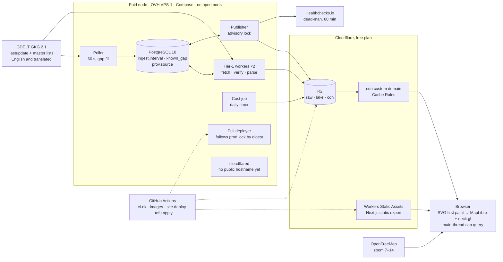
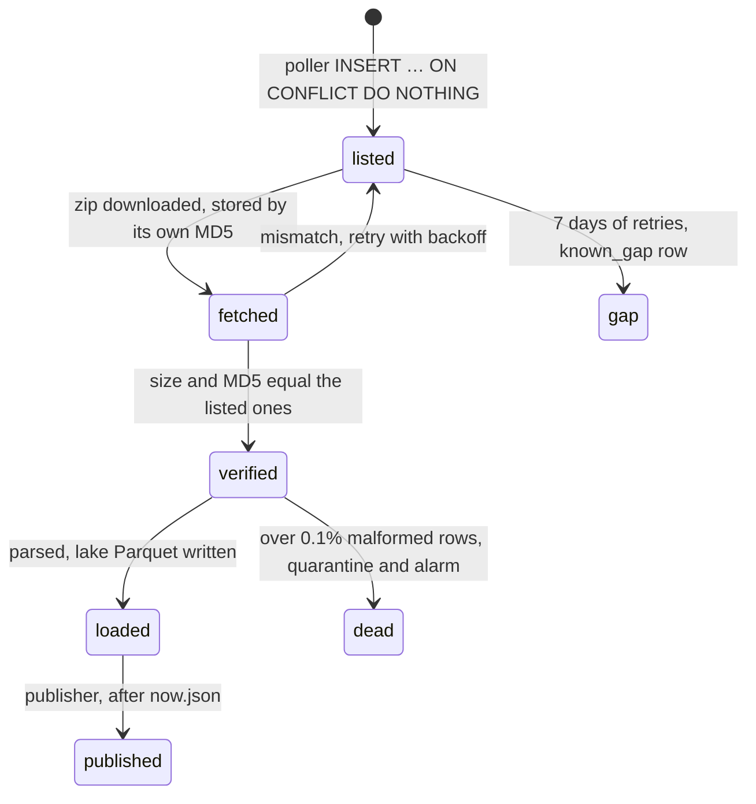

# Phase 1 — First Light: design note

**Status: draft, waiting for the owner's approval. Nothing in this note is built, and no application code exists yet.**

Drafted on 14 November 2026 from `docs/3.0/master-plan.md` (revision 5): §10 Phase 1, with §4, §5, §7, §9, §11, §14, §17 and Appendices C and D. Branch: `docs/p1-design`.

**How to read it.**
- A number here comes from the plan and keeps the plan's label: *(research)* is a value measured or quoted during research and not yet re-measured by a committed script; *(illustrative)* is a placeholder readout.
- **Proposed** marks a design choice made in this note, where the plan fixes the goal and leaves the shape open. The ones that change what a visitor sees, what is stored for good, or what the plan says are also questions in §13. The rest are detail (object shapes, column types, lease order) that you approve with the note and that the task's own tests then hold to.
- Where this note does its own arithmetic on the plan's numbers, it says so. None of it is a measurement.
- `Qn` points at a question in §13.

**What to review first:** the visual target ([`p1/index.html`](p1/index.html), opened in a browser), then §13 (27 questions: three only you can answer, eight you will see on screen, sixteen engineering choices you can approve as a block), then §7 (the ledger kernel, which you will have to explain without notes at the close).

---

## 1. Context

v1 is a ~1,730-line hackathon prototype *(research)*: a Vite page with a react-globe.gl globe, a 169-line Flask file over MongoDB, a laptop script, and a seeder that fills the collection the API reads with 300,000 Faker documents (`docs/3.0/v1-audit.md`). What survives is the name, GDELT as the backbone, the dark look and the Lens gesture: you rotate the planet under a fixed ring and read what is there.

Phase 1 replaces v1 with a walking skeleton on real data. Everything later depends on two things being right, so P1 retires them first: ingestion that does not lose or duplicate a 15-minute file, and a renderer that carries the globe on a desktop and on a mid-range phone. It also puts the production path in place from the first deploy: CI is the only way to production, the paid node is rebuilt from code, and the month's bill is public.

The plan's goal for the phase: *replace v1 with a deployed, CI-gated skeleton that ingests both GDELT GKG streams through a fenced ledger and lets anyone rotate the globe under the Lens and read the real headlines there.*

## 2. Goals and non-goals

**Goals** (the plan's definition of done is in §11):
1. Both GKG streams (English and translated) are ingested from GDELT's raw 15-minute files through the fenced ledger and published as immutable shards. At least 99% of intervals are live within 30 minutes across a 7-day soak.
2. A visitor with no account opens the URL, sees an SVG globe in under a second, then the WebGL globe with real points, turns it under the Lens and reads up to 50 recent headlines from that place in their own scripts, with exact copies collapsed and country-level coverage grouped.
3. The render go/no-go is decided by a pre-registered spike on an M1 and the reference Android.
4. Production is reached only through CI: `ci-ok` is required, deploys follow `deploy/prod.lock`, infrastructure applies run in a protected environment, and the paid node comes back from a clean checkout.
5. The site is a static export with no Worker on any page request. `/cost` shows the month's real spend against the $20 line, at about $6–7 for this phase (no LLM yet; plan §14).
6. You can explain the ledger kernel line by line.

**Non-goals in P1** (each has a home phase in the plan):
- English glosses, story groups, window chips, the Lens worker kernel, `/engine`, the free node, the standby, the ledger epoch and role guard, attestation checks at deploy, `core.article` in Postgres (all P2).
- Infrared, Exposure, hazards, the REST API, the key panel (P3). Stories, search, ⌘K, Shots (P4). Crisis Ledgers, the report, MCP, tours (P5).
- Any LLM call. Any crawler, article text, lede or thumbnail (never, §7).
- Designed empty, loading and error states with their own visual Shots (P2). P1 ships plain versions so that nothing is left unfinished at the close (Q7).

## 3. What a visitor gets, and the visual target

### 3.1 User-facing scope

| Surface | P1 behaviour | Plan |
|---|---|---|
| First paint | A d3-geo SVG globe at the visitor's longitude, crossfading to WebGL. The longitude comes from the browser's time-zone offset: no prompt, no lookup (Q9) | task 12 |
| Basemap | Deep Field style. Our own Protomaps PMTiles file to zoom 6 (45 MB *(research)*) on R2 draws the whole globe and every first paint; OpenFreeMap's public tiles serve zoom 7–14; attribution stays visible, in compact mode too | task 18 |
| Light | Precision discs for `Geo_Type` 3/4. Country, US-state and ADM1 coverage (types 1/2/5) as a soft wash over the polygon. Unlocated articles counted, not drawn. An honesty legend says which is which | task 13 |
| Lens v0 | A ring of constant screen size; its radius in km follows zoom (auto aperture, 25–3,000 km) and shows live. Up to 50 headlines, newest first: original title in its script, language, outlet, time, link out. Exact copies collapse ("+11 copies · 4 outlets"). One group per country for country-level coverage. The list freezes while dragging and re-ranks on settle | task 14 |
| Controls | Language chips with the fixed keys (1 EN, 2 AR, 3 FR, 4 ES, 5 RU, 6 ZH, 7 DE, 8 PT, 9 HI, 0 all). Arrow keys move the ring, click centres, `[` `]` change the radius (Q8). Lens state in the URL | tasks 14, 15 |
| Two-clock badge | Data age, and GDELT's crawl lag beside it ("data 9 min old" *(illustrative)*; the lag is about 2 hours for English and less for translated *(research)*) | task 15 |
| Pages | `/attributions`, `/stats` with the cost panel, `/cost`, `/privacy` v0 | tasks 17, 19 |

Not on the P1 screen, by recommendation (Q5): the V·I·E control, window chips, the timeline, ⌘K. Only Viewfinder exists, and a control that does nothing is an unfinished state.

### 3.2 Visual target

Six frames, one motion sketch and a contact sheet in [`docs/design/p1/`](p1/), each a self-contained HTML page. Open [`p1/index.html`](p1/index.html) in a browser; GitHub shows HTML as source.

| File | Shows | Scope |
|---|---|---|
| [`frame-1-desktop-viewfinder.html`](p1/frame-1-desktop-viewfinder.html) | The plan's demo moment: Kyiv under the ring at ≈ 640 km *(illustrative)*, headlines in Ukrainian, Russian, English and Polish, copies collapsed, country-level groups, chips, the two-clock badge, the honesty legend, attribution | **P1** |
| [`frame-2-lens-list.html`](p1/frame-2-lens-list.html) | The list in detail: Arabic, Hebrew, Devanagari, Han and Cyrillic rows; the copies and country-group expansions; the frozen list while dragging; the plain P1 states; row anatomy; the colour and type tokens | **P1** |
| [`frame-3-mobile-drawer.html`](p1/frame-3-mobile-drawer.html) | Khartoum on a phone at the three drawer detents (120 px / 50% / 92%), Arabic rows right to left | **P1** |
| [`frame-4-desktop-exposure.html`](p1/frame-4-desktop-exposure.html) | Press E over the Sahel: cells coloured by coverage against severity, the stops readout with its interval and plain-language line, empty rings, the timeline | target, P3 and P5 |
| [`frame-5-story-sheet.html`](p1/frame-5-story-sheet.html) | The Lens listing stories, one open in the 420 px sheet with glosses and source marks | target, P4 |
| [`frame-6-crisis-ledger.html`](p1/frame-6-crisis-ledger.html) | A Crisis Ledger page: stops by language with intervals, severity and attention with sources, the labelled AI note | target, P5 |
| [`motion-develop-on-settle.html`](p1/motion-develop-on-settle.html) | Ten seconds: rest, a drag from Budapest to Kyiv under the fixed ring, release, and the settle sequence | **P1**, with the P4 and P8 beats drawn dashed |

The plan asks for these six frames by name (§4, "Visual target"). Three are P1's own screens. The other three are where the product is going: P1 creates `tokens.css`, the type stack and the panel layout, and those have to hold for Exposure, a story sheet and a Ledger. Their own design notes (`p3.md`, `p4.md`, `p5.md`) specify them before they are built.

**What the frames fix for P1:**
- **Tokens.** Every colour is a §4 token: void `#030509`, canvas `#070A10`, surfaces `#0D1219` / `#141A22` / `#1C232C`, text `#EBEFF4` / `#B4BBC5` / `#8A939F`, the one accent lens-500 `#C3F344`, the attention ramp `#1A2029 → #8A6A3E → #F9BE78 → #FFF1DC`, basemap ocean `#030910` / land `#11181F` / coast `#2C3742`.
- **Type.** Micro and data in JetBrains Mono (11/14 caps, 12/16 tabular), UI and body in Inter (12/16, 13/18, 14/21), chrome headlines in Newsreader (17/22, 22/28), original titles in Noto Serif 15/21 (16/23 on phones) with per-script Noto families and system fonts for Chinese, Japanese and Korean.
- **Layout.** Top bar 44 px, left panel 360 px, the ring centred in the visible globe (camera padding follows the open panel and, on phones, the drawer).
- **Light means attention.** Only data glows. A city-level article is a sharp disc. Country-level coverage is a soft, out-of-focus wash over the polygon, never a point. Discs inside the ring are at full brightness and the rest are dimmed.
- **Five primitives:** Panel, Chip, Badge, ListRow, Readout.

**Motion.** The plan's develop-on-settle table for Viewfinder is counters at 0 ms, the list re-rank at about 150 ms, the top story highlight at about 300 ms (P4) and the Explain line within 2 s (P8). The sketch plays it on a 10-second loop:

| Time | What happens | In P1 |
|---|---|---|
| 0–0.7 s | At rest over Budapest | yes |
| 0.7–3.6 s | Drag. The ring stays put and the planet moves. Discs entering the ring brighten in the same frame; coordinates update live. The list is held and dimmed, with "scanning" | yes |
| 3.6–4.0 s | Release and glide | yes |
| settle, 0 ms | Counters and place name change | yes |
| settle + ~150 ms | The list re-ranks. Rows that stay keep their keys and slide; rows that leave fade first; new rows fade in. **Proposed:** 280 ms, ease-out | yes; in P1 the order is newest first |
| settle + ~300 ms | Top story highlight | no, P4 (dashed) |
| settle + ≤ 2 s | Explain line | no, P8 (dashed) |

The 150 ms and 300 ms beats are faster than the eye follows, so the sketch has 0.25× and 0.1× speeds and a scrubber, and opens at any instant with `?t=<ms>`. Time is an input to its render function, which is the same idea the plan uses later for tours and visual tests. Under reduced motion the product cuts straight to the settled list; the sketch then opens paused on the settled state. The sketch shows the case where title shards are already cached. When they still have to load, rows appear as they arrive and a skeleton shows only after 1 s (the plan's loading thresholds).

**Limits of the frames.** They are drawings, not the running app. Headlines and outlets are synthetic (`.example` domains). Every readout is illustrative; where the plan has its own example it is used ("data 9 min old", "≈ 640 km", "+11 copies · 4 outlets", "Sudan · country-level · 214", "−4.1 stops", "M 2.1 · ~126 independent outlets"), and the rest are invented. The named typefaces are not embedded, so the pages fall back to system fonts. Land and borders are Natural Earth (public domain), projected ahead of time. ADM1 washes are not drawn, because the outline data used here has countries only. The Exposure frame's cells are a schematic hexagonal grid at about the spacing of H3 resolution 3, not real H3 indexes.

---

## 4. Architecture in P1



What is different from the full architecture in plan §5: one node, no tier 2, no enrichment jobs, no API. Postgres holds only the ledger and provenance (the plan's engineering scope for P1); parsed rows go to the lake on R2 and to the shards, not to `core.article`, which arrives in P2. The publisher plays the part of the ordered consumer: it is the single process that decides what has been published and in what order.

**Processes and memory** (Compose `mem_limit`s from the plan's budget for configuration S): Postgres 1.2 GB; tier-1 workers and publisher 0.5 GB together; operating system, Docker, exporters, deployer and cloudflared 0.9 GB. The tier-2, API and light-jobs lines are unused in P1. **Proposed:** two tier-1 worker processes from day one, so the fence is exercised by real contention and not only in tests.

**Browser.** Next.js static export, the globe mounted once in `app/(globe)/layout.tsx`. MapLibre draws the basemap and the country and ADM1 washes; deck.gl draws the discs from binary attributes (interleaved, per the spike). flechette decodes Arrow. The cap query runs on the main thread in P1; the worker kernel is P2.

## 5. Data model (Postgres)

Migration `db/migrations/0001_ingest.sql` (dbmate, task 8). The plan names three tables: `ingest.interval` (with `lease_token`, `seq`), `ingest.known_gap` (June 2025 seeded) and `prov.source`. The sketch below is the proposed shape; column names follow plan §7's core data model.

```sql
create schema ingest;
create schema prov;

create type ingest.stream as enum ('english', 'translated');
create type ingest.state  as enum
  ('listed', 'fetched', 'verified', 'loaded', 'published',  -- the plan's chain
   'gap',                                                   -- never arrived within 7 days
   'dead');                                                 -- Q12: unusable file, needs a person

create table ingest.interval (
  stream          ingest.stream not null,
  stamp           timestamptz   not null,          -- the 15-minute stamp, UTC
  url             text          not null,
  size            bigint,                          -- from lastupdate or the master list
  md5             text,
  state           ingest.state  not null default 'listed',
  attempts        int           not null default 0,
  next_attempt_at timestamptz   not null default now(),   -- per-file backoff
  lease_token     uuid,
  lease_until     timestamptz,
  seq             bigint,                          -- Q13: set by the publisher, in publish order
  rows            int,
  raw_key         text,
  parquet_key     text,
  listed_at       timestamptz   not null,          -- knowledge time of the file
  loaded_at       timestamptz,
  published_at    timestamptz,
  last_error      text,
  primary key (stream, stamp),
  check (stamp = date_bin('15 minutes', stamp, timestamptz 'epoch'))
);
create index on ingest.interval (next_attempt_at)
  where state in ('listed', 'fetched', 'verified');

create table ingest.known_gap (
  stream      ingest.stream not null,
  first_stamp timestamptz   not null,
  last_stamp  timestamptz   not null,
  intervals   int           not null,
  reason      text          not null,
  recorded_at timestamptz   not null default now(),
  primary key (stream, first_stamp)
);

create table prov.source (            -- one row per upstream dataset
  source_id        text primary key,
  licence          text    not null,
  redistribute_ok  boolean not null,
  share_alike      boolean not null,
  nc               boolean not null,
  attribution_text text    not null,
  verified_on      date    not null
);
```

**Proposed additions to the plan's list** (Q14), in the same migration because the publisher needs them on day one:

```sql
create table ingest.publish_pass (     -- one row per publishing pass
  seq          bigint primary key,     -- the value written to now.json
  manifest_key text,
  started_at   timestamptz not null default now(),
  finished_at  timestamptz,
  objects      jsonb                   -- writes per object class, against the Class A budget
);
```

Notes:
- **`lease_epoch`** is in the plan's field list but belongs to P2 (the ledger epoch arrives with the standby). Migrations are expand/contract, so it is added then.
- **`seq` on an interval** (Q13). From P2 the plan has two counters: `now.json`'s `seq` counts publishing passes, and the tier-2 log's `seq` orders resolved stamps. P1 has no tier 2. Proposed: the publisher, which is a single process under an advisory lock, assigns `ingest.interval.seq` to each interval in the order it publishes them. That is the same rule P2's tier-2 consumer follows (one writer, ledger order), so the column keeps its meaning. `ingest.publish_pass.seq` is the pass counter.
- **The June 2025 seed.** The plan gives the gap as 2025-06-14 18:00 to about 07-02, 1,665 intervals *(research)*; the research file gives the English stream as ending 07-02 02:00 and the translated stream as 1,666 intervals from 17:45 *(research)*. The seed rows are written from a run of the master-list script (`docs/3.0/research/scripts/analyze_masterlist.py`, moved to `bench/` with the others in task 9), not typed by hand.
- **`prov.source` rows in P1:** GDELT GKG 2.1, Natural Earth, the Protomaps basemap (OpenStreetMap, ODbL) and OpenFreeMap (OpenMapTiles, OpenStreetMap). The source of truth is `prov/sources.yml` (Appendix D); the migration's seed is generated from it and CI fails if they differ. Fonts are software, so they go in `NOTICE`.
- **Roles.** `worker` (reads and writes `ingest.*`), `migrator` (DDL), `readonly` (for `/stats` generation). No superuser in any service.

## 6. R2 object layout

Paths are written as the plan writes them: the first segment is the bucket. The plan fixes the `cdn/` paths; the file names under `raw/` and `lake/` are proposed.

| Path | What | Written by | Kept | Cache |
|---|---|---|---|---|
| `raw/gdelt/{stream}/dt={date}/{md5}.zip` | The verified zip, content-addressed | tier 1 | 7 days in P1 (about 8.4 GB of the free 10 GB, so a few cents of storage); moves to the free node's disk in P2 | private |
| `lake/facts/…/dt={date}/{stream}-{stamp}-{hash}.parquet` | IDs, geo, language, outlet, times, hashes | tier 1 | forever, under a bucket lock (Q17) | private |
| `lake/display/…/dt={date}/{stream}-{stamp}-{hash}.parquet` | Titles and URLs: the layer that can be redacted | tier 1 | kept | private |
| `cdn/live/dt={date}/shards/{hash}.arrow` | One point shard per interval | publisher | 48 h | immutable |
| `cdn/live/dt={date}/titles/{hash}.arrow` | Title shards: one per interval and H3 res-0 cell with coverage, plus one country-level shard per interval | publisher | 48 h | immutable |
| `cdn/live/dt={date}/hour/{hash}.arrow` | Hourly compactions of the above | publisher | 48 h | immutable |
| `cdn/live/dt={date}/manifest/{hash}.json` | One immutable manifest per pass | publisher | 48 h | immutable |
| `cdn/now.json` | The only mutable pointer; ~1 KB | publisher, last in every pass | — | `public, max-age=15, s-maxage=15`, rule respects origin |
| `cdn/stats.json` | Freshness, completeness, bytes, writes per interval | publisher | — | short, respects origin |
| `cdn/cost.json` | The month's spend by line | daily cost job | — | short, respects origin |
| `cdn/basemap/{hash}.pmtiles` | World to zoom 6 | Actions job | kept | immutable |
| `cdn/geo/{hash}.pmtiles` | **Proposed (Q16):** Natural Earth countries and ADM1 as vector tiles, for the washes | Actions job | kept | immutable |
| `cdn/preview/…` | A frozen fixture data plane for pull-request previews (synthetic titles) | CI | replaced | as above |

**Proposed:** `raw` is its own bucket in P1 (Q18). It has one lifecycle rule, its size reads straight off Cloudflare's per-bucket figures for `/cost`, and it goes away in P2 without touching `lake`.

**Cache Rules** (task 6; the free plan has 10 *(research)*): immutable hashed paths get a long Edge TTL override; `now.json` is eligible for cache with Edge and Browser TTL both "respect origin", and the client fetches it with `cache: 'no-store'`, because on the free plan an override cannot go below 2 hours *(research)*; `.arrow`, `.json`, `.parquet` and `.pmtiles` are named explicitly, after recording what Cloudflare does with `.arrow` and `.json` by default. Every object stays under the 512 MB cache limit *(research)*.

### 6.1 `now.json` (proposed shape)

```json
{
  "v": 1,
  "seq": 4812,
  "written_at": "2026-11-14T14:11:07Z",
  "manifest": "live/dt=2026-11-14/manifest/9f2c….json",
  "streams": {
    "english":    { "stamp": "2026-11-14T14:00:00Z", "listed_at": "2026-11-14T13:51:10Z" },
    "translated": { "stamp": "2026-11-14T14:00:00Z", "listed_at": "2026-11-14T13:52:44Z" }
  }
}
```

The browser polls it every 60 s and never steps back: a `seq` at or below the last one seen is ignored. The per-stream stamps feed the two-clock badge and the "stale over 45 minutes" state. The values above are *(illustrative)*.

### 6.2 The manifest (proposed shape)

The plan: one immutable object per pass that names the pass's shard objects and their byte ranges; the hourly compaction's manifest lists the live window; a client that starts cold reads `now.json`, two manifests, then shards.

```json
{
  "v": 1,
  "seq": 4812,
  "hour": "live/dt=2026-11-14/manifest/41aa….json",
  "open": [
    {
      "stamp": "2026-11-14T14:00:00Z",
      "streams": ["english", "translated"],
      "points": { "key": "live/dt=2026-11-14/shards/7b….arrow",
                  "segments": { "points": [0, 39820], "areas": [39820, 2104] }, "rows": 1893 },
      "titles": { "cells": { "12": { "key": "…/titles/c1….arrow", "bytes": 18230, "rows": 96 } },
                  "country": { "key": "…/titles/e9….arrow", "bytes": 40112, "rows": 511 } }
    }
  ]
}
```

Two clarifications of the plan's wording:
- **A pass manifest lists the whole open hour**, not only the intervals of its own pass. Otherwise a cold client would miss the intervals published between the last hourly compaction and the current pass. With this, `now.json` → pass manifest → hourly manifest is complete, and it is still two manifests.
- **Byte ranges name segments inside one object.** In P1 the point shard holds two Arrow tables back to back (§6.3), and the manifest gives each one's offset and length. The browser fetches the object whole and slices it; no HTTP range request is involved. The same field serves P3's title cards, which are read by range.

The hourly manifest lists, for each closed hour in the 24-hour window, the hour's point compaction and its title compactions by cell, and names the stamps each compaction holds. A compaction is the hour's interval tables concatenated: rows keep their `iv` (§6.3), so a point still finds its title by (`iv`, `key`), and the Lens can still read newest interval first. That is the largest thing on the cold path, so task 11 measures it inside the first-load budget; if it is too large, the per-cell title lists move into one small index object per hour that the Lens fetches on first use.

### 6.3 Point shard (proposed schema)

One object per interval. Segment `points` has one row per city-level article (`Geo_Type` 3 or 4):

| Column | Type | Meaning |
|---|---|---|
| `x`, `y`, `z` | int16 | The unit vector × 32767, rounded. This is the wire format only. Dividing by 32767 does not give back a unit vector, so the page normalizes each row once at decode and keeps the result as float32 (§6.3.1). The page's test and the GPU both read that one float32 array, so they see the same values; the oracle's tolerance is the quantization step |
| `prec` | uint8 | Precision class: GDELT's `Geo_Type` (3 or 4 here) |
| `cell` | uint8 | Index of the H3 res-0 cell, set by the publisher. It tells the Lens which title shard holds the row, so P1 needs no H3 library in the browser and the two sides can never disagree at a cell edge |
| `lang` | uint8 | Index into the versioned language table from `lang.py` |
| `outlet` | uint32 | A hash of the outlet's domain, for counting distinct outlets. The name is in the title shard |
| `t` | int32 | Event time in minutes since 1970: `PAGE_PRECISEPUBTIMESTAMP` where present (44–58% of records *(research)*), else the stamp |
| `iv` | uint32 | The row's interval: its stamp as a count of 15-minute intervals since 1970. Every row carries it, so a row keeps its identity when intervals are compacted together |
| `key` | uint32 | The stream in the top bit, the record number from `GKGRECORDID` below it. Record numbers restart every interval, so `key` is unique only within one interval: **the row's identity is (`iv`, `key`)**, which rebuilds the record ID exactly |

That is 25 bytes a row before compression (arithmetic on these types, not a measurement). `iv` holds one value in a per-interval shard and a handful in an hourly compaction, so it should compress to almost nothing; task 11 measures it.

#### 6.3.1 Decoding the vectors, and the cap test

The plan's test is `dot(p, c) ≥ cos θ` on unit vectors. Two details make it hold at the 25 km end of the aperture, where `cos θ` is within about eight millionths of 1 (this note's arithmetic):

1. **Normalize at decode.** Rounding to int16 changes a vector's length by up to a few parts in 100,000, which is more than the whole height of a 25 km cap. Tested as stored, a point directly under the reticle would fall outside its own cap about one time in five (a short script over random points, not a measurement of the product). So the page divides by 32767, divides by the vector's length in double precision, and stores float32. After that the only error left is positional, and it stays under one quantization step.
2. **Evaluate it as a chord.** For unit vectors `dot(p, c) ≥ cos θ` and `|p − c|² ≤ 2 − 2 cos θ` are the same predicate. The second subtracts nearby numbers first, so float32 rounding in the shader stays far below the quantization step; the first loses that precision near 1. The page and the shader both use the chord form, and the threshold is computed once in double precision and passed to the shader as a uniform.

The GPU needs no normalization of its own: deck.gl is handed the already-normalized float32 array as its attribute.

Segment `areas` holds the counts the washes and the honesty readout need, never rows:

| Column | Type | Meaning |
|---|---|---|
| `kind` | uint8 | `Geo_Type` 1 (country), 2 (US state) or 5 (ADM1); 0 for no location |
| `code` | dictionary(utf8) | GDELT's country or ADM1 code; empty for kind 0 |
| `lang` | uint8 | As above |
| `n` | uint32 | Articles |

Country-level rows are not in the `points` table at all, so "country-level coverage is never drawn or listed as a point" holds by construction as well as by assertion (Q15).

### 6.4 Title shard (proposed schema)

One object per interval and res-0 cell with coverage (at most 60 by the plan's budget), fetched lazily; one more per interval for country-level rows, fetched only when a country group is opened.

| Column | Type | Meaning |
|---|---|---|
| `iv`, `key` | uint32, uint32 | Together they join to the point shard, in per-interval shards and in compactions alike |
| `lang` | uint8 | |
| `t` | int32 | |
| `title` | utf8 | Original title: entities decoded, sanitized, NFKC |
| `url` | utf8 | Canonical URL |
| `outlet` | dictionary(utf8) | The outlet's domain as GDELT gives it |
| `title_hash` | fixed_size_binary(8) | For collapsing exact copies |
| `kind`, `code` | as §6.3 | Country-level shard only |

Titles never travel in the point data: a day of titles and URLs is about 68 MB raw *(research)*.

### 6.5 Compression

Task 11 measures two ways: a Cloudflare Compression Rule on the Arrow MIME type, or zstd-compressed Arrow IPC buffers decoded by a flechette codec. **Prior, written before measuring:** zstd inside the file wins, because P3's range-read cards need it anyway (a range has to be readable as stored), and one mechanism for every object is simpler. The Compression Rule is kept if the decoder costs more than its place in the 800 KB globe chunk. The decision is recorded with the measurement.

### 6.6 The write budget in P1

By the plan's line items, an interval writes: lake Parquet for both streams (4), one point shard (group shards arrive in P2), title shards (≤ 60) and the country-level shard (1), one manifest and one `now.json` (in P1 the plan's two passes are one). That is at most 68. Raw zips add 2 while they live in R2, so at most 70, under the plan's ceiling of 72 objects per interval (this note's arithmetic). The hourly line (≤ 65) and the status objects are as planned. The publisher records its writes per object class in `ingest.publish_pass.objects`, and `stats.json` shows them against the Class A budget: 1M free a month *(research)*, alert at 80%, hard budget 1.1M.

---

## 7. The fenced-ledger kernel

Files: `apps/worker/ledger/*.py`. This is depth kernel #1: Claude writes it with its property tests; you review it line by line and record a ten-minute explanation with no notes.

### 7.1 The claim

Every 15-minute file of both streams is processed **at least once** by some worker and its effects land **exactly once**, whatever the workers do: crash, run twice, or pause for longer than their lease and wake up.

Two mechanisms carry it, and the kernel is only these two:
1. **The fence.** A worker's right to change an interval is a random token written into the row when the lease is taken. Every later write names that token in its `WHERE` clause. If another worker has taken the interval since, the token no longer matches, the update touches 0 rows, and the transaction rolls back. The check and the write are one statement in one database, so there is no moment between them.
2. **Idempotent effects.** Everything a worker does outside Postgres is a PUT to a key derived from the content. Doing it twice writes the same bytes to the same key. So a worker that was fenced out has changed nothing that matters.

A lease time-out alone is not enough: a paused worker cannot know that it was paused. It wakes up believing it still holds the lease, and only the token check at commit stops it.

### 7.2 States



`loaded → published` belongs to the publisher (§7.5). Everything before it is tier 1, order-independent, and runs under leases. This note reads the plan's "quarantine and alarm above 0.1% malformed" as parking the whole file (`dead`), because that share of bad rows more likely means a format change than bad luck; under it, malformed rows are dropped and counted.

### 7.3 Lease and commit

The lease, as plan §7 step 2 writes it, with the backoff column added:

```sql
update ingest.interval
   set lease_token = gen_random_uuid(),
       lease_until = now() + interval '5 minutes',
       attempts    = attempts + 1
 where (stream, stamp) = (
         select stream, stamp
           from ingest.interval
          where state in ('listed', 'fetched', 'verified')
            and next_attempt_at <= now()
            and (lease_until is null or lease_until < now())
          order by stamp desc                 -- proposed: newest first
          for update skip locked
          limit 1)
returning stream, stamp, state, lease_token, url, size, md5;
```

Every transition:

```sql
update ingest.interval
   set state = $to, …fields…, lease_until = now() + interval '5 minutes'
 where (stream, stamp) = ($1, $2)
   and lease_token = $3          -- the fence
   and state = $from;            -- the expected state
-- 0 rows: a newer lease exists, or the step was already done. Roll back and drop the work.
```

The final tier-1 transition (`→ loaded`) also clears the token. A worker that gets 0 rows never tries to find out why: it stops. If its commit had in fact landed, the row has moved on; if not, the lease expires and another worker repeats the step. Both are safe.

**Proposed details:**
- **Newest first.** Tier 1 has no order to respect, and the freshness target is about new files. A backlog after an outage drains behind the live edge.
- **One lease walks one interval through all three tier-1 steps**, committing each, so a crash resumes from the last committed state and not from the start.
- **Backoff is a release, not a held lease.** On a 404 or a mismatch the worker clears its token and sets `next_attempt_at` (exponential, capped), so nothing sleeps while holding a lease. Listed files can 404 for minutes *(research)*; retries continue for up to 7 days, then the interval becomes `gap` and a `known_gap` row is written.
- **Time comes from Postgres.** Leases are compared with the database's `now()`, so worker clocks do not matter. The kernel functions take an optional `now` for tests only.
- **No lease renewal in P1.** One interval is a few thousand rows (≈ 3.6k per batch, peaks near 4.9k *(research)*), which at the researched parse rate (11.7–13.6k rows/s/core *(research)*) is well under a second of parsing by this note's arithmetic. Renewal arrives with P2's enrichment batches.

### 7.4 Effects outside the database

| Step | Effect | Key | Why a repeat is harmless |
|---|---|---|---|
| fetch | PUT the zip | `raw/gdelt/{stream}/dt=…/{md5 of the bytes}.zip` | Same bytes, same key |
| load | PUT facts and display Parquet | includes the content hash | Same input and code give the same bytes; a different code version gives a different key that nothing points to |
| publish | PUT shards and manifest | content hash | As above |
| publish | PUT `now.json` | fixed | Only the publisher writes it, under the advisory lock, with a `seq` that only grows |

An orphan (an object a fenced-out worker wrote under an old code version) is garbage, not corruption: the ledger row names the key that counts. Orphans in `raw/` and `cdn/live/` expire; orphans in `lake/facts/` do not, which is one reason for Q17.

### 7.5 The poller and the publisher

**Poller.** Every 60 s it reads both `lastupdate` files (three lines each: size, MD5, URL *(research)*) and inserts `(stream, stamp)` with `ON CONFLICT DO NOTHING`. When the newest listed stamp is more than 15 minutes after the last one it saw, it inserts every stamp in between (file names are deterministic) and takes their sizes and MD5s from one Range read of the master list's tail. That is the plan's stand-in for the hourly reconciler, which arrives in P3.

**Publisher.** One process holding a Postgres advisory lock; a second one exits. A stamp is ready when both streams are loaded, or 15 minutes after the first one loaded (the plan's resolve rule, §7 step 5, applied here because P1 has no tier 2). A late stream is published on its own in a later pass. Each pass:

1. In its own short transaction, take the next pass number from `ingest.publish_pass` and commit. A crash later burns the number; `seq` has gaps and never repeats.
2. Read the ready intervals' Parquet, build the point shard and the title shards, PUT them.
3. PUT the manifest.
4. PUT `now.json` **last**.
5. In one transaction, mark the intervals `published` with their `seq` and `published_at`, and record the writes. Ping Healthchecks.io.

A crash between 4 and 5 leaves the intervals `loaded`; the next pass publishes them again under the next `seq`, with identical shard keys. On the hour the publisher also compacts the closed hour and writes the hourly manifest.

`now.json` is a plain PUT in P1: one publisher, one node. The conditional PUT and the ledger epoch that stop a revived old primary arrive in P2 with the standby.

### 7.6 What can go wrong, and what happens

| Event | Outcome |
|---|---|
| The same stamp is listed twice | `ON CONFLICT DO NOTHING`; one row |
| A worker dies after fetching, before committing | The lease expires; another worker repeats the fetch; the PUT lands on the same key |
| A worker pauses for 6 minutes mid-parse and wakes | Its commit names a stale token, updates 0 rows, rolls back |
| Two workers hold the same interval at once (one of them a zombie) | Both may PUT identical objects; only the current token commits |
| The file 404s for minutes | Released with backoff; counted against freshness; retried for up to 7 days |
| The MD5 does not match | Back to `listed` with backoff; the mismatched object expires with `raw/` |
| More than 0.1% of rows are malformed | `dead`, with the error, and an alarm; nothing is published from it |
| The file never appears | `gap` after 7 days, with a `known_gap` row |
| Postgres restarts mid-commit | The transaction is gone; the lease expires |
| The publisher dies between the manifest and `now.json` | `now.json` still names the old manifest; the next pass repeats |
| The poller is down for an hour | On return it enqueues every skipped stamp; the misses count against freshness |

### 7.7 Property tests

Hypothesis state-machine tests against a real PostgreSQL 18 in Testcontainers (the behaviour of `SKIP LOCKED` is the thing under test, so no fake database), with a fake object store that records every PUT and a clock the test controls.

- **Workers are stepped by the test.** Each worker is a generator that yields at every point where the world can change: after the lease, after the fetch, after each PUT, before each commit. The test chooses who moves next, and can kill a worker, pause it while the clock moves past its lease, or deliver a listing twice.
- **Invariants, checked after every step and at the end:**
  1. Every listed interval ends in exactly one terminal state.
  2. For each interval and transition there is exactly one successful commit.
  3. A commit with a token that is not the row's current token never succeeds.
  4. The set of object keys and digests is the same as a run with one worker and no faults.
  5. `now.json`'s `seq` never decreases, and a published interval is never unpublished.
- **Volume:** 1,000 generated histories, with kills, pauses past the lease and duplicate inserts, with nothing lost or duplicated and every stale-token commit rejected (the plan's test).
- **A test that can fail.** One extra run removes `and lease_token = $3` from the commit and must find a violation. A property test that cannot fail proves nothing.

The chaos harness with seeded mutants is P2, and a TLA+ model of the lease protocol is P2 supporting work.

### 7.8 What you should be able to explain at the close

Why a time-out is not a fence. Why the token check has to be in the same statement as the write. What `SKIP LOCKED` does and what it does not promise. Why effects are keyed by content. Why `now.json` goes last. What a burned `seq` is. What the tests would miss (anything outside the model: a bug in GDELT's files, a wrong parse that is deterministic). The walkthrough note lives beside the code (`apps/worker/ledger/WALKTHROUGH.md`) and changes in the same pull request as the kernel.

---

## 8. Render spike: pre-registration outline

`lab/p1-render/prereg.md` is committed before anything is measured (task 1). This is its outline; the thresholds are the plan's (§11) and are not open.

1. **Question.** Can the open stack carry the globe on a desktop and on a mid-range phone? Tag: **decision**.
2. **Contenders.** MapLibre 6.18 + deck.gl 9.4.1, interleaved, against MapLibre with custom GLSL. Plan B is not built for the spike; a short `projectTile()` smoke test stands in for it, and Plan B is built only on a no-go.
3. **GO, all of:**
   - ≥ 50 fps p50 at 300k points in a 30-second scripted orbit on the M1;
   - ≥ 30 fps p50 at 100k points on the reference Android;
   - ≥ 99% of 1,000 scripted picks correct across the zoom 10–12 globe-to-Mercator morph;
   - no far-side see-through and no picking through the globe, for discs, arcs and labels;
   - symbol labels work.
   Otherwise Plan B.
4. **Prior** (the plan's): GO, with work on arc depth testing. The prereg adds a number for each criterion before measuring, so the calibration table has something to compare.
5. **Sample.** A throwaway script downloads one day of both streams' `gkg.csv.zip` files named in `masterfilelist.txt` (two days if one gives fewer than 300k points), keeps `Geo_Type` 3/4 rows, and writes latitude, longitude, language and time to one file. **Proposed (Q26):** Arrow, read with flechette, so the spike exercises the real decode path. The sample has no titles. It is not committed: the prereg records the list of source files and the sample's SHA-256, so anyone can rebuild it.
6. **Page.** Standalone, in `lab/p1-render/`, with its own pinned `package.json`. No monorepo and no CI are needed, so it can start today.
7. **Method.** A scripted orbit with frame times from `requestAnimationFrame`; a scripted pick list with known answers; see-through checks by placing points on the far side and reading pixels and pick results; each run repeated, with the device's state noted (battery, temperature, browser version).
8. **Devices.** The M1 and the reference Android, recorded in `docs/perf/devices.md` (model, SoC, RAM, OS and browser versions). Until a phone is in hand the M1 half runs first, with Chrome's 6× CPU throttling as a stand-in. **The GO decision waits for the phone** (Q2).
9. **Timebox and cost.** Size L; closes with the phase at the latest; $0.
10. **Outputs.** `docs/bakeoffs/p1-render.md`, ADR-0002, a row in the Lab's calibration table (prior against measured), and upstream reproductions for any renderer bug found.
11. **Not measured here:** the Lens readout time (P2), battery drain, any browser other than Chrome on the two devices.

---

## 9. Task by task

Sizes are the plan's (S one session, M a few, L a short spec and several pull requests). "Needs" lists what must exist first, including accounts (§12).

**0 · Design (M).** This note and the visual target. Done when you approve both.

**1 · [B] Pre-register the render spike (S).** §8. Done when `prereg.md` is committed with its prior, before any measurement. Needs: nothing.

**2 · [B] Run the spike (L).** The standalone page, the sample, the M1 half now and the phone half when there is a phone. Done when ADR-0002 and the bake-off note are published and the GO or no-go is recorded. Needs: task 1; a reference Android for the decision.

**3 · Tag v1, remove it from `main`, publish the retro (S).** Tag `v1-hackathon`; delete `Frontend/`, `backend/`, `process-articles/`, `populateDB/` and the v1 README from `main`; Claude drafts `docs/retro/v1.md` from the audit and you correct it, verifiable facts only. **Proposed (Q24):** the tag goes on `26e15f4`, the last commit before the plan documents. Before tagging, the history is scanned for committed credentials: a pattern scan of the current tree in this session found none (the two matches were a placeholder and a format string), and the history was not scanned. Needs: your OK for the push.

**4 · Monorepo skeleton (S).** pnpm, Turborepo, uv, `mise.toml`, devcontainer; Apache-2.0 `LICENSE`, `NOTICE`, `CLAUDE.md` (Appendix D's text); `.claude/settings.json` with the Stop hook (runs `mise run check`, blocks "done" while it fails, gives up after 8 blocks in a row *(research)*) and the deny rules (`tofu apply`, `tofu destroy`, deploy commands, SSH to a node); ADR-0001. P1 creates `apps/{web,worker}`, `packages/{ui,lens,gdelt,glcore}`, `db/`, `infra/live/{bootstrap,storage,edge,web,node-paid}`, `deploy/`, `bench/`, `lab/`, `metrics/` and the `docs/` folders it writes to. `mise run` tasks: `dev`, `check`, `test`, `e2e`, `bench:<name>`, `tofu:plan`. Needs: nothing. One thing to know: `~/Projects/CLAUDE.md` (the career workspace's instructions) is loaded into every session in this folder as well; see the follow-ups at the end.

**5 · CI (S).** `ci.yml` on `pull_request` and `merge_group`: affected lint, types and tests; SQL tests in Testcontainers; GDELT contract tests; size-limit; the third-party-script check and the header and script-policy check on the built export; zizmor; OSV-Scanner; `uv sync --locked`. Separate workflows for CodeQL, release-please and the Claude review of each pull request. Every action pinned by SHA, `permissions: {}` by default, harden-runner with an allow-list, Renovate with cooldowns for npm and PyPI. `ci-ok` (`if: always()`) is the one required check. Needs: the workflows can be written and run on the current public repository; the merge queue needs the org; the Claude review needs your subscription token.

**6 · OpenTofu `bootstrap` + `storage` + `edge` (S).** State in R2 with client-side encryption, applied once from your machine: the only production change that does not go through CI. Buckets with lifecycle rules and `prevent_destroy`; the `cdn` custom domain and the Cache Rules of §6; zone, DNS, Tunnel. Conftest policies. ADR-0003 on topology. Needs: OpenTofu and `age` installed locally, the domain on Cloudflare, R2 enabled, the escrowed keys.

**7 · OpenTofu `node-paid` + Compose (S).** The VPS-1 order under `prevent_destroy`; deny-all inbound; a first-boot bootstrap with a one-time token; the pinned PG18 image; Compose with the `mem_limit`s of §4; the rebuild workflow (reinstall the operating system through the OVH API, re-run the bootstrap, never cancel the order; dump the ledger and `prov.source` to `exports/` before and restore after); `docs/secrets.md`. The Compose stack, the image and the bootstrap script can be built and tested locally now. Needs for the rest: the OVH order and the three setup answers in §12.

**8 · `0001_ingest.sql` (S).** §5. Done when the migration applies to a clean PG18 and the SQL tests pass. Needs: task 4.

**9 · `packages/gdelt` (M).**
- **Contract:** exactly 27 tab-separated columns; a row that fails is counted and quarantined, never guessed at.
- **Lean projection:** record ID, date, outlet, URL, locations, tone, themes, translation info, and from the extras the page title and precise publication time. GCAM and the V1 columns are dropped (about −80% of bytes *(research)*).
- **Titles:** decode HTML entities (84% of translated titles carry numeric ones *(research)*), sanitize, normalize to NFKC, hash.
- **Sanitizer v0** (`glcore.untrusted`): strips bidi override controls, zero-width and BOM characters and other controls, and caps length. In the sample, 7 of 19,333 translated titles carried bidi overrides and 16 carried zero-width or BOM characters *(research)*.
- **Location:** the earliest city-level mention (`Geo_Type` 3/4) is the primary location; otherwise the most specific area (ADM1 or US state, then country); otherwise none. Selection is on `Geo_Type`, never on FeatureID. Blocklisted centroids such as Kansas (39.828175, −98.5795) are never drawn; proposed: such a row counts as country-level.
- **`lang.py`:** `srclc` → BCP 47 tag, endonym, direction, script; GDELT's `axe` is Azerbaijani; the English stream is `en`. CI fails on an unknown code in a week of data.
- **URL canon;** the title hash.
- **Golden files:** at least 10, shaped on real rows (malformed lines, entities, broken UTF-8) and carrying synthetic or public-domain titles. **Proposed (Q27):** URLs and outlet names in committed fixtures are synthetic too, because a URL's slug usually spells out the headline.
- Move `measure_gkg.py` and `backfill_size.py` from `docs/3.0/research/scripts/` to `bench/`; add `bench/parse_bench.py` (target ≥ 10k rows/s/core).

Needs: task 4. A real fixture week kept off the repository (Q19).

**10 · [K] Poller + fenced ledger (L).** §7. Because it is an L kernel task, its kickoff waits for your OK on the plan, per Appendix D. Done when the 1,000-history test passes, the walkthrough note exists, and both streams run locally against live GDELT with a local object store. Needs: tasks 8 and 9.

**11 · Data plane v1 (M).** §6: shard writers, the manifest, the publisher, hourly compactions, the cold-start measurement, the compression measurement, the byte budgets and the write log. Needs: tasks 9 and 10. The Compression Rule half of the measurement needs Cloudflare.

**12 · Next.js shell (M).**
- Static export (`output: 'export'`) with the persistent globe layout.
- **First paint:** the SVG globe is drawn from a small land outline shipped with the page, at the longitude the time-zone offset suggests (Q9), and crossfades to WebGL.
- `tokens.css` and the five primitives; one UI strings module; timestamps in the viewer's zone with UTC on hover.
- **Fonts:** the §4 stack, self-hosted, lazy-loaded by `unicode-range`; system fonts for Chinese, Japanese and Korean; the fontTools check (≥ 99.9% glyph coverage over the fixture week for every script we ship a font for). Whether the files are vendored or come from pinned npm font packages is a dependency choice for this task's ADR (Q20).
- **Security headers** through the static-asset headers file, Trusted Types report-only, and the CSP of plan §9. This task picks and tests one CSP mechanism before the hosting ADR (Q21).
- **One build for preview and production. Proposed (Q22):** the data-plane base comes from the hostname at run time, not from a build-time variable, so the files a preview tested are the files production serves.
- `generateBuildId` pinned to the commit, with the CI check that two builds of one commit differ only in pre-rendered HTML and data.
- ADR-0006 on hosting, accepted only after the headers file, the not-found page and the per-pull-request preview URL are confirmed on Cloudflare.
- The story link rule is set up now even though stories arrive in P4: an unknown `/story/<id>` lands on the globe with `?story=<id>`.

Needs: task 4; Cloudflare for the confirmations and the ADR.

**13 · Layers (S).** Discs: deck.gl Scatterplot from binary attributes, additive, in-ring discs at full brightness. Washes: MapLibre fills with feature-state, fed by the `areas` segment and joined to the admin polygons by GDELT's codes (Q16). The unlocated counter and the honesty legend. Blocklisted centroids are asserted never drawn. Needs: tasks 11 and 12, and the spike's answer (Q3).

**14 · Lens v0 (M).**
- The reticle is the centre of the visible globe; its centre is unprojected to a unit vector each frame, and the radius in km is found by unprojecting a point on the ring, which stays correct through the globe-to-Mercator morph without a formula.
- **Auto aperture.** The ring's screen size is fixed. **Proposed:** the 25–3,000 km clamp is realized as the camera's zoom limits, so the ring never has to change size.
- **Cap test:** the plan's `dot(p, c) ≥ cos θ`, over the float32 unit vectors normalized at decode and evaluated in its chord form, `|p − c|² ≤ 2 − 2 cos θ` (§6.3.1), on the main thread; the same expression on the same array drives the in-ring highlight.
- **List:** from the in-cap points, newest interval first, fetch the title shards of the cells those points name until the list has 50 rows or the settle has fetched 250 KB; "load older" continues back to 24 h at ≤ 250 KB a step.
- **Copies:** rows with the same title hash collapse into one, with "+N copies · M outlets" counted over the rows loaded for this place (Q10).
- **Country groups:** one row per country or region the ring touches, from the `areas` counts; opening one fetches the country-level title shard.
- **Freeze and re-rank:** §3.2.
- **Markup:** real DOM rows with `lang`, `dir` (Q6), `<bdi>` around outlet and time; the whole title is the link out.
- **Keys:** arrows move the ring, click centres, `[` `]` change the radius by zooming (Q8).
- **Oracle tests** at the quantization step, and a centre test: for random centres, a point at the reticle's centre is inside the cap at the 25 km minimum.

Needs: tasks 11–13.

**15 · Two-clock badge, chips, URL state (S).** The badge reads `now.json`. Chips filter discs, washes and the list by language. **Proposed:** the URL carries the centre, the zoom and the language (`?ll=50.45,30.52&z=5.2&lang=uk`), written on settle with `replaceState`; P4's Shot schema will read these and may supersede them. Needs: task 14.

**16 · Deploy (M).** As the plan: GHCR images on `main`; a bot pull request bumps `deploy/prod.lock` and merging it is your approval; the paid node's deployer (a systemd timer) follows the lock by digest; OpenTofu applies run from CI in the protected `production` environment, with OIDC where the provider federates and a scoped apply token as a secret of that environment where it does not; CI builds the static export from the pinned commit and deploys it to Workers Static Assets; a preview URL per pull request on the `preview/` data plane; the publisher pings Healthchecks.io with a 60-minute grace period. The 7-day soak starts here. Needs: everything above, the org, Cloudflare, OVH, Healthchecks.io.

**17 · Pages (S).** `/attributions` built at build time from `prov/sources.yml`, which also seeds `prov.source` (the site is static, so it cannot query Postgres); the Protomaps, OpenFreeMap and OpenStreetMap credits included. `/stats` from `stats.json`. `/privacy` v0 with the data map (in P1: no accounts, no cookies, no analytics; OpenFreeMap sees tile requests past zoom 6). The README status table generated from `metrics/claims.yml`. Needs: tasks 11, 12, 19.

**18 · Basemap (S).** An Actions job extracts the world to zoom 6 from the Protomaps build into one PMTiles file (45 MB; zoom 7 would be 190 MB *(research)*) and publishes it under `cdn/basemap/{hash}.pmtiles`. **Proposed (Q23):** the hash the site uses is pinned in the repository and changed by a bot pull request, like an image digest; there is no mutable pointer. The Deep Field style has two sets of layers, because the two sources have different schemas: Protomaps layers to zoom 6 and OpenMapTiles layers for zoom 7–14. Fallbacks: if OpenFreeMap is unreachable, the style lets the zoom-6 layers overzoom; if our file cannot be read, OpenFreeMap serves every zoom. The CSP's `connect-src` names OpenFreeMap's one tile host beside our own. A Playwright test blocks OpenFreeMap and checks the overzoom down to the Lens's smallest aperture. The same job builds the admin-polygon tiles (Q16). The extraction tool is a new dependency and gets its ADR. Needs: Cloudflare to publish; a local extract is enough for development.

**19 · Cost panel v0 (S).** A daily job writes `cdn/cost.json`: the paid node and the domain as fixed lines, R2 storage and Class A and B operations from Cloudflare's GraphQL Analytics API (alert at 80% of each free tier), and the one-off ledger. `/cost` renders the month against the $20 line; the same panel sits on `/stats`; amounts are mono numerals with units; a line at its cap is marked with an icon and words. The page says what it leaves out: the maintainer's Claude subscription. **Proposed (Q25):** the job runs on the paid node as a timer with a read-only analytics token. Needs: Cloudflare; the page can be built now against a fixture.

**20 · Close (M).** The soak may still be running when P2 starts, and the tag waits for it. ADR-0004 (fenced ledger-as-queue) and ADR-0005 (content policy; no C++). The changelog post "Retiring a hackathon". The GIF, the tag `v3.0.0-p1`, the ledger entries. Your line-by-line review of the kernel, then the recorded ten-minute explanation with no notes and no AI. The polish pass: a design critique and an accessibility review on screenshots, your review of the recorded walkthrough, no unfinished loading, empty or error state. The usage record.

**ADRs in P1:** 0001 monorepo and toolchain (task 4) · 0002 renderer (task 2) · 0003 topology (task 6) · 0004 fenced ledger-as-queue (task 20) · 0005 content policy, no C++ (task 20) · 0006 hosting (task 12).

---

## 10. Tests and evals

The plan's list, with where each one lives:

| Test | Pass | Task |
|---|---|---|
| Golden GKG fixtures | ≥ 10 fixtures, 0 contract failures | 9 |
| Ledger property test | 1,000 generated histories (kills, pauses past lease, duplicate inserts): nothing lost or duplicated, every stale-token commit rejected | 10 |
| Fence-removed run | The property test finds a violation | 10 |
| Lens oracle | 10k random caps against the haversine oracle at the quantization step | 14 |
| Cap centre | For random centres, a point at the reticle's centre is inside the cap at the 25 km minimum, on the page and in the shader | 14 |
| `srclc` contract | A week of values, 0 unknown codes | 9 |
| Parse throughput | ≥ 10k rows/s/core (11.7–13.6k *(research)*) | 9 |
| Static export | Builds with no server-only feature; the header check and the script-policy check pass on every route; no page loads a third-party script; two builds of one commit differ only in pre-rendered HTML and data; an unknown `/story/<id>` lands on the globe with `?story=<id>` | 12 |
| Font coverage | ≥ 99.9% glyph coverage over the fixture week for every script we ship a font for | 12 |
| Hook rules | A failing `mise run check` blocks "done"; each denied command is refused | 4 |
| Basemap | Loads by range request; with OpenFreeMap blocked the map overzooms the zoom-6 file down to the smallest aperture | 18 |
| Data-quality asserts | Blocklisted centroids never drawn; country-level rows never listed as points | 13, 14 |
| Bytes | Cold start (`now.json`, two manifests, shards) inside the first-load budget; update and settle budgets (§11) | 11, 14 |
| Playwright smoke | The page loads, the globe paints, a settle lists headlines, a link opens; a planted markup title renders as text | 16 |
| Render spike | The GO criteria of §8 | 2 |

Unit tests make no network calls. Committed fixtures carry synthetic or public-domain titles only. CI never reads the production edge.

## 11. Definition of done

From the plan, unchanged:

- [ ] Both streams live at the public URL; ≥ 99% of intervals land within 30 minutes across the 7-day soak.
- [ ] `ci-ok` required; every production change after the one-time state bootstrap went through CI (no apply or deploy from a session); the rebuild workflow reinstalls the paid node's operating system through the OVH API and brings the stack back from a clean checkout without touching storage or cancelling the order (the ledger and `prov.source` are dumped to `exports/` before the reinstall and restored after it).
- [ ] The site is a static export on Cloudflare Workers Static Assets with no Worker on any page request; the basemap comes from our own PMTiles file to zoom 6 and from OpenFreeMap beyond it, with the overzoom fallback tested; `/cost` shows the month at or under about $6–7.
- [ ] SVG paints in under 1 s; first interactive ≤ 1.5 MB of data on mobile (point shards + `now.json`; JS is held by size-limit, fonts and tiles reported); ≤ 150 KB per update; title bytes per settle ≤ 250 KB p95, a cold session's first settle included (p95 over 100 random places).
- [ ] The Lens lists recent headlines anywhere there is data; no title appears twice; country-level coverage is never drawn or listed as a point.
- [ ] Render GO criteria met on the M1 and the reference Android (the tag waits for the phone); the retro and ADR-0002 published.

And the every-phase checklist (Appendix D): this note approved before code; tag `v3.0.0-p1` with changelog; a 30–60 s GIF; the `/stats` delta and ledger entries, every number labelled; at least one ADR merged with its prior; the devlog and the kernel walkthrough; zizmor 0 high; no third-party script; cost within plan; the polish pass; the usage record; `cloc` by area; the published explain-back.

**Demo moment** (the plan's): cold load, SVG globe, then WebGL with real discs. Rotate to Kyiv; Ukrainian, Russian and English headlines fill the Lens with copies collapsed. Click one and the original opens. The badge reads "data 9 min old" *(illustrative)*. `/cost` shows the month's bill so far against the $20 line.

**Protected:** a readable, deduplicated Lens list on real data. **Never skipped:** real data, CI, the ledger kernel.

**Metrics to publish at the close:** freshness p50/p95 and % ≤ 30 min per stream; completeness ≤ 24 h; auto-recovered intervals; parse rows/s; first-load and per-update bytes; title bytes per settle; decode ms; SVG and first-frame ms; spike fps (M1, Android); R2 objects written per interval against the Class A budget; the month's spend by line; test-to-code ratio.

---

## 12. What can start now, and what must wait

Not set up yet: the GitHub org, the domain and Cloudflare, the OVH server. Installed locally (checked in this session): mise, Node, pnpm, Python, uv, Docker, `gh`. Missing locally: OpenTofu and `age`.

| Task | Can start now | Waits for |
|---|---|---|
| 0 Design | yes | your approval |
| 1 Prereg | **yes, fully** | — |
| 2 Spike | **yes: the page, the sample, the M1 half** | a reference Android, for the decision |
| 3 v1 tag, removal, retro | yes: the retro draft and the tag | your OK to push the tag and the removal |
| 4 Monorepo skeleton | **yes, fully**, on a branch | — |
| 5 CI | yes: every workflow, running on the current public repo | the org, for the merge queue; your subscription token, for the Claude review; Cloudflare, for the preview step |
| 6 OpenTofu storage and edge | the HCL and the Conftest policies | OpenTofu and `age` installed; the domain on Cloudflare; R2 enabled; escrowed keys; then your apply of `bootstrap` |
| 7 Node and Compose | the Compose stack, the PG18 image, the bootstrap script, tested with local Docker | the OVH order; setup's answers on reinstall, the first-boot script and the firewall |
| 8 Migration | **yes, fully** | — |
| 9 `packages/gdelt` | **yes, fully** (it reads GDELT's public files) | — |
| 10 Ledger kernel | **yes: the kernel, its tests, a local run against live GDELT** | your OK on its plan (L task); the node and R2, to run in production |
| 11 Data plane | yes: writers, manifest, publisher, byte and write measurements against a local object store | Cloudflare, for the Compression Rule measurement and the real cache behaviour |
| 12 Next.js shell | yes: the export, tokens, primitives, fonts, the CSP mechanism on a local build | Cloudflare, to confirm the headers file, the not-found page and previews before ADR-0006 |
| 13 Layers | yes, against a local data plane and a local PMTiles extract | the spike's answer (Q3) |
| 14 Lens v0 | yes | task 13 |
| 15 Badge, chips, URL | yes | task 14 |
| 16 Deploy | the workflows and the deployer, as code | the org, Cloudflare, OVH, Healthchecks.io |
| 17 Pages | yes, against fixture JSON | task 19's data, for real numbers |
| 18 Basemap | yes: the job and a local extract | Cloudflare, to publish |
| 19 Cost panel | the page and the `cost.json` shape | Cloudflare, for the API |
| 20 Close | no | the soak, the phone, your review |

**Order that the accounts suggest.** The org first (Q1): it is free, and the repository's path then appears in image names, in the OIDC trust and in attestation checks, so moving it later means touching all three. Tasks 1, 2, 4, 8, 9 and 10 need no account and are most of the phase's risk. The domain and Cloudflare unblock 6, 11, 12, 18 and 19. OVH unblocks 7 and 16.

**What setup has to answer before the task that depends on it** (Appendix C; none of these is a design choice):

| Unknown | Needed by |
|---|---|
| The limits of Cloudflare's static-asset headers file (rules, line length) | task 12, the CSP mechanism |
| Whether the OVH API can reinstall the operating system, and how a first-boot script is passed | task 7, the rebuild workflow |
| Whether the `ovh/ovh` provider can manage a firewall for the VPS | task 7 |
| VPS-1's price and availability on OVH's US site | task 7 |
| Which providers offer OIDC federation to GitHub Actions | tasks 6 and 16 |
| Whether an R2 subscription inside its free tier counts as the paid service in Cloudflare's large-file terms (R26) | before launch; asked at setup |

---

## 13. Questions for the owner

Each has a recommendation. Group C can be approved as a block.

### A. Only you can answer

| # | Question | Recommendation | Needed by |
|---|---|---|---|
| Q1 | Create the GitHub org and move the repository before the monorepo and CI land, or build on the personal repository and move later? | **Org first.** It is free and quick, and it avoids renaming images and re-making trust policies. Tasks 1, 2, 8, 9 and 10 can begin on branches meanwhile | tasks 4, 5 |
| Q2 | Which phone is the reference Android, and when can you have it? | A mid-range phone you own or can borrow (the plan suggests a Galaxy A5x-class device), recorded in `docs/perf/devices.md`. The GO decision and the tag wait for it | task 2 |
| Q3 | May tasks 13 and 14 proceed on the M1 result, before the phone half of the spike? | **Yes, if the M1 passes with Chrome's 6× throttle as well.** Only the layer code depends on the renderer; a later no-go adds Plan B as the plan says and drops nothing | task 13 |

### B. Choices you will see on screen

| # | Question | Recommendation | Why |
|---|---|---|---|
| Q4 | Do you approve the visual target: tokens, type, layout, the disc and wash treatment, the motion? | Review `p1/index.html`; say what to change | It is the bar for every later screen |
| Q5 | Should P1 show later controls (V·I·E, window chips, the timeline, ⌘K) as disabled? | **No.** Show only what works | A dead control is an unfinished state, and the close forbids those |
| Q6 | Text direction: the plan ships `dir="auto"` in P1 and takes direction from the language in P2. Pull that forward? | **Yes: `dir` from the language in P1**, `auto` only where the language is unknown | `lang.py` already carries direction in P1 and every row has a language. `auto` reads the first strong character, so an Arabic headline that opens with a Latin name is laid out left to right (frame 2 shows it). P2 still adds the check for a title whose script contradicts its code |
| Q7 | Empty, loading, failed, stale and no-WebGL states: the plan designs them in P2. What does P1 show? | **Plain versions now** (frame 2, column C), with the plan's own copy; P2 designs them fully and adds the snap-to-nearest button | The P1 close requires that no state is left unfinished |
| Q8 | The plan lists "keyboard rotate and radius" for P1, and the radius lock arrives in P2. What do `[` and `]` do in P1? | **They zoom.** In auto mode the radius follows zoom, so this changes the radius with no lock state | Meets the P1 accessibility line without building the lock early |
| Q9 | How does a static page know the visitor's longitude for the first paint? | **From the browser's time-zone offset** | No permission prompt, no IP lookup, no server; right to within a time zone, which is enough to face the right hemisphere |
| Q10 | "+11 copies · 4 outlets": counted over the rows the Lens has loaded, or exactly over the whole ring? | **Over loaded rows in P1** | Exact counts need a 64-bit title hash on every point, which costs first-load bytes. P2's story groups replace this count |
| Q11 | Place names on the P1 map? The plan's native-script labels arrive in P2 | **No map labels in P1.** The Lens header names the place (country and region, from the admin polygons) | P2 does labels properly through `font-faces`; a Latin-only label set with its own glyph files would be built and then thrown away. Revisit if the walkthrough finds the map disorienting |

### C. Engineering choices (approve as a block, or pick out any you disagree with)

| # | Question | Recommendation | Why |
|---|---|---|---|
| Q12 | The component table gives the ledger a dead letter in P1; task 8 lists three tables | A terminal `dead` state and `last_error` on `ingest.interval` in P1; the `ingest.dead_letter` table arrives with enrichment jobs in P2 | One row per file is enough to park a bad file and raise an alarm |
| Q13 | What `seq` on `ingest.interval` means before tier 2 exists | The publisher assigns it, in publish order (§5) | Same rule as P2: one writer, ledger order |
| Q14 | Add `ingest.publish_pass` to `0001` | Yes | The publisher needs a durable pass counter and a place to log writes per interval |
| Q15 | Where the country, ADM1 and unlocated counts travel | As a second Arrow segment inside the point shard, addressed by the manifest's byte ranges (§6.3) | No extra object against the write budget, and area rows cannot be drawn as points |
| Q16 | Where the admin polygons for the washes come from | A second small PMTiles file of Natural Earth countries and ADM1, keyed by GDELT's codes, built by the basemap job | The browser loads only the tiles in view; a whole-world ADM1 file would weigh on the mobile first load |
| Q17 | When the bucket lock on `lake/facts/` starts | **At the P1 close**, not at the first deploy | The first weeks are when a parser bug is most likely, and locked objects cannot be removed. Nothing is lost meanwhile: GDELT keeps the raw files online. After the close, corrections go to a new version prefix, as planned |
| Q18 | `raw/` as a prefix of `lake` or its own bucket | Its own bucket in P1 | One lifecycle rule, a per-bucket size for `/cost`, and it disappears in P2 |
| Q19 | The real fixture week (needed for the font-coverage check and the `srclc` test) before the private `fixtures` bucket exists | Kept on your machine, outside the repository; those two checks run locally until task 6 creates the bucket | No real headline is ever committed |
| Q20 | Font files: vendored, or pinned npm font packages | Pinned packages, recorded in the task 12 ADR | Renovate tracks them, and they ship `unicode-range` subsets |
| Q21 | Which CSP mechanism to try first | **Per-page `<meta>` policy with script hashes**, written by a post-export step; fall back to moving inline scripts into hashed files | It changes one tag and leaves Next's output otherwise untouched, and it does not depend on the headers file's line limit. A `<meta>` policy cannot carry `frame-ancestors` or a report-only policy, so those stay in the headers file |
| Q22 | One build for preview and production | Yes: the data-plane base is chosen from the hostname at run time | What a preview tested is byte for byte what production serves |
| Q23 | How the site learns the basemap's hash | Pinned in the repository, changed by a bot pull request | Cache forever, no mutable pointer, and a basemap change is an approved change |
| Q24 | Which commit `v1-hackathon` tags | `26e15f4`, the last commit before the plan documents | The tag then holds v1 and nothing else |
| Q25 | Where the daily cost job runs | On the paid node, as a timer, with a read-only analytics token | GitHub disables schedules in quiet public repositories *(research)*, and the plan keeps must-run schedules on node timers |
| Q26 | The spike's sample file: Arrow or JSON | Arrow, not committed; its hash and source list go in the prereg | Exercises the real decode path |
| Q27 | Golden fixtures: synthetic URLs and outlet names as well as titles | Yes | A URL's slug usually spells out the headline |

Two more follow from the plan and are noted, not asked: cloudflared runs in P1 with no public hostname, so the tunnel credential, the Compose service and the deny-all-inbound posture are proved while nothing is exposed (the API arrives in P3); and the host firewall written by the bootstrap is the baseline, with a provider-managed firewall added if setup finds the `ovh/ovh` provider supports one.

---

## 14. Alternatives considered

| Decision | Chosen | Not chosen, and why |
|---|---|---|
| Queue | The ledger table is the queue (plan §6) | A broker: one more service to run and to make exactly-once; the P7 bake-off measures whether it is ever needed |
| Fence | A token checked in the commit | A lease time-out alone: a paused worker cannot know it was paused. Advisory locks per interval: they vanish with the connection and leave no record |
| Lease order | Newest first | Oldest first: a backlog would hold back the live edge |
| Point coordinates | int16 on the wire, normalized to float32 unit vectors at decode | Latitude and longitude: the cap test needs trigonometry per point. Float32 vectors on the wire: twice the bytes. int16 tested as stored: the length error is larger than a 25 km cap (§6.3.1) |
| Cap test form | The chord, `\|p − c\|² ≤ 2 − 2 cos θ` | The dot product as written: the same predicate, but it loses float32 precision near 1, where the small apertures live |
| Row-to-title join | A `cell` column in the point shard | H3 in the browser: a library in the globe chunk, and a risk that page and publisher assign a border point to different cells |
| Area counts | A second segment in the point shard | A third object per interval: one more write an interval. Rows in the points table: larger first load, and the "never a point" rule would rest on a filter |
| Copy counts | Over loaded rows | A 64-bit hash per point: exact, at about 8 more bytes a row on first load |
| First-paint longitude | Time-zone offset | Geolocation (a prompt); an edge lookup (needs a Worker on the page request, which the plan rules out) |
| Preview configuration | From the hostname at run time | A build-time variable: preview and production would be different builds |
| Frames | Self-contained HTML with inline SVG | Images: not inspectable, and text in six scripts would be pixels. A design tool: a new dependency |

## 15. Cross-cutting concerns

**Security.** SHA-pinned actions, zizmor, harden-runner, `permissions: {}`, no `pull_request_target` with checkout; cooldowns for npm and PyPI; `uv sync --locked`; OSV-Scanner and CodeQL. The node denies all inbound traffic. The site's CSP starts from `default-src 'none'`, allows only our own scripts, and names our own hosts and OpenFreeMap's tile host in `connect-src`; Trusted Types is report-only in P1 and enforced from P2; `frame-ancestors 'none'`, HSTS, nosniff and `Referrer-Policy: strict-origin-when-cross-origin`. Titles are untrusted text: sanitized at parse, rendered as React text nodes, never as markup; a Playwright test plants a title with markup in it. Secrets are inventoried in `docs/secrets.md`, never in code or logs. Session hooks deny `tofu apply`, `tofu destroy`, deploys and SSH.

**Legal and privacy.** Stored: titles, URLs, outlet, time, language, GKG metadata and derived numbers. Never article text, ledes or thumbnails; no crawler. Titles and URLs sit in the display layer of the lake so they can be redacted. No publisher's headline is committed to the repository. GDELT is attributed in the UI; OpenStreetMap, Protomaps and OpenFreeMap are credited on the map and on `/attributions`. P1 collects no personal data: no accounts, no cookies, no analytics. `/privacy` v0 says so and names OpenFreeMap as the one third party a visitor's browser may contact (past zoom 6).

**Accessibility.** WCAG 2.2 AA is a gate from P2; P1 lays the ground. The Lens works without dragging: click to centre, arrow keys, `[` `]`. The list is real DOM with `lang` and direction on every title. Targets are at least 32 px. Nothing is encoded by colour alone: the legend names disc, wash and "not drawn" in words, and the stale badge carries an icon and text. Reduced motion turns camera flights into jumps and the list re-rank into a cut. Focus is never hidden behind the panel.

**Performance budgets** (the plan's): SVG paint < 1 s; first interactive ≤ 1.5 MB of data on mobile; ≤ 150 KB per 15-minute update; titles ≤ 250 KB per settle at p95; the initial route ≤ 200 KB gzip and the globe chunk ≤ 800 KB gzip (size-limit in CI). Render budget: 100k points on phones, 300k on desktop, with a battery tier that caps the device pixel ratio at 1.5 through MapLibre's `pixelRatio`.

**Observability.** The ledger's own timestamps give freshness and completeness, published in `stats.json`. The publisher pings a Healthchecks.io dead-man's switch (60-minute grace), so a stale `now.json` pages without any Actions schedule. OTLP to Grafana, Sentry and `/engine` are P2.

**Cost.** Configuration S, paid node only: about $6–7 a month, no LLM. The paid node (VPS-1: 2 vCore, 4 GB, 40 GB NVMe, $4.54–5.35 depending on the term *(research)*) and the domain are fixed prices. R2 is the one metered product: raw zips take about 8.4 GB of the free 10 GB in P1, so a few cents of storage are possible; writes are held inside the free million a month. Everything else at Cloudflare is the free plan, which fails instead of billing. No new paid service is introduced by this note.

## 16. Risks

The plan's, with this note's additions marked.

| Risk | Response |
|---|---|
| Renderer no-go | Plan B in GLSL joins the phase as an L task and the phase takes longer; nothing else is dropped |
| VPS-1 repriced or not orderable on OVH's US site | Setup confirms the order page; the next size up is VPS-2 with the M caps |
| The OVH reinstall | Setup confirms the API and how a first-boot script is passed; the rebuild workflow is written against that answer |
| OpenFreeMap unreachable or withdrawn | The map overzooms our own zoom-6 file; the whole-globe view and every first paint never depend on it |
| Missed listings (1 of 28,921 English intervals in 2026 *(research)*) | The poller enqueues every skipped stamp; the reconciler arrives in P3 |
| Outage during the soak | The poller enqueues the skipped stamps on recovery, the misses count against freshness, and the soak extends |
| *This note:* the two basemap sources have different schemas, and their generalization differs at the zoom 6 to 7 seam | The Deep Field style is spare (ocean, land, coast), so the layer map is small; task 18 checks the seam on screenshots and blends it if it shows |
| *This note:* the hourly manifest is the largest object on the cold path | Measured in task 11 inside the first-load budget; the fallback is one small title index per hour (§6.2) |
| *This note:* the first-load budget is tight for a full 24 hours of points on a phone | The page loads newest first up to the render budget; task 11 records the bytes and narrows column types if needed, in a stated order: `t` to a 16-bit offset from the row's own stamp (`iv`), then `outlet` to 16 bits |
| *This note:* the first weeks of lake output may carry a parser bug | Q17: lock the facts layer at the close, not at the first deploy |

---

## Follow-ups noticed while drafting (not part of this task)

- `~/Projects/CLAUDE.md` belongs to the career workspace, but it sits in the parent folder, so its instructions (read `HANDOFF.md`, update it every session) are loaded into GlobaLens sessions too. Worth scoping to that workspace before task 4 adds this repository's own `CLAUDE.md`.
- `docs/3.0/README.md` does not link `docs/design/` yet.
- The research file records details the master plan rounds off (for example the June 2025 gap's exact bounds per stream). Where P1 seeds data from such a figure, it is re-measured, not copied.
